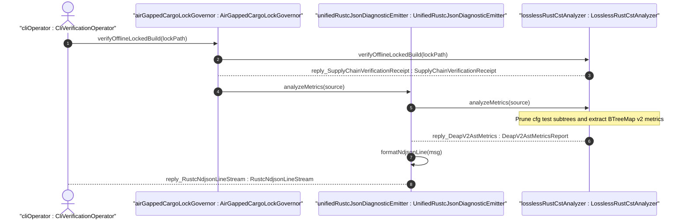
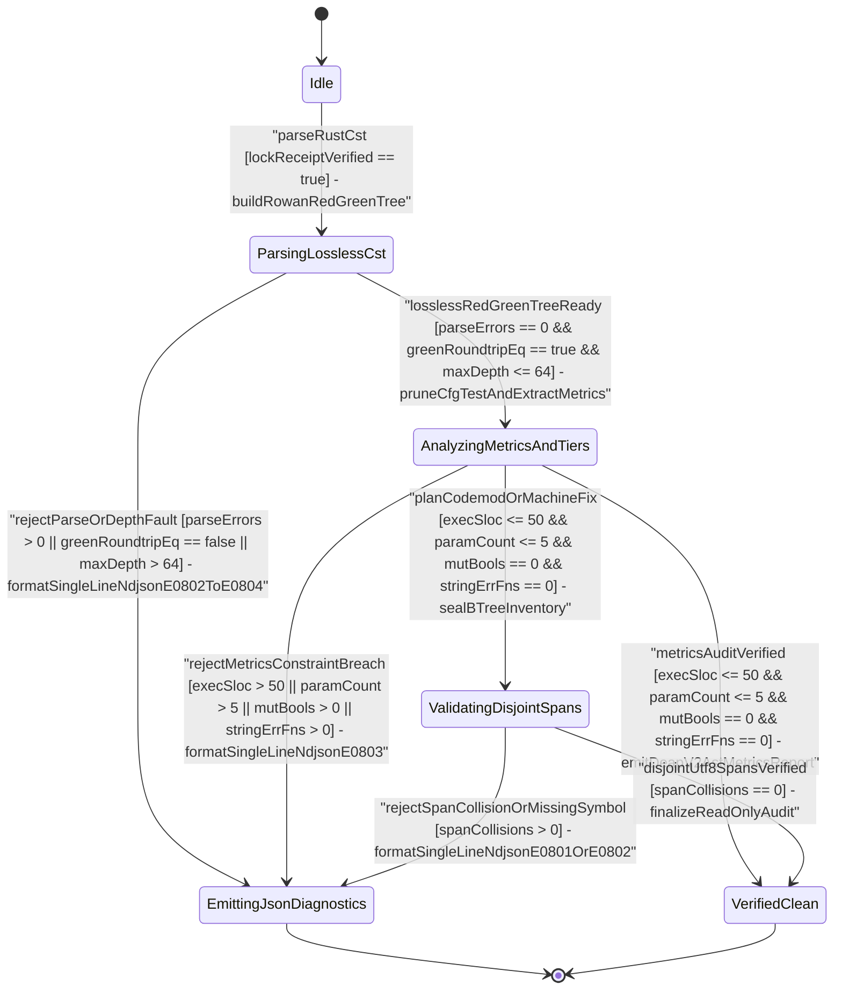

| Attribute | Specification Detail |
| :--- | :--- |
| **Issue ID** | TBD |
| **Title** | User Story 56: analyze Metrics |
| **Type** | user-story |
| **Parent Epic** | [EPIC-08-BP_08_Lossless_Rust_CST_Codemod_Engine_and_Unified_rustc_Compatible_JSON_Diagnostics](../epics/EPIC-08-BP_08_Lossless_Rust_CST_Codemod_Engine_and_Unified_rustc_Compatible_JSON_Diagnostics.md) |
| **SysML Interaction** | `BP_08_Lossless_Rust_CST_Codemod_Engine_and_Unified_rustc_Compatible_JSON_Diagnostics_SequenceInteraction` |
| **SysML Test Case** | `Test_analyzeMetrics` |
| **Generation Mode** | subagent |
| **Specification Source** | [schema/model.sysml](../../schema/model.sysml) |

# User Story 56: analyze Metrics

## Parent Epic
- [ ] [EPIC-08-BP_08_Lossless_Rust_CST_Codemod_Engine_and_Unified_rustc_Compatible_JSON_Diagnostics](../epics/EPIC-08-BP_08_Lossless_Rust_CST_Codemod_Engine_and_Unified_rustc_Compatible_JSON_Diagnostics.md) (governs lossless `ra_ap_syntax` and `rowan` Red/Green CST parsing, `v2_metrics` structural complexity enforcement, and unified single-line `rustc`-compatible NDJSON diagnostics under **REQ-0608**)

## Domain Object Mapping
- **Primary Domain Objects:** `LosslessRustCstAnalyzer`, `UnifiedRustcJsonDiagnosticEmitter`, `AirGappedCargoLockGovernor`, `CstMetricsThresholds`, `VerifiedLosslessCst`, `DocTier`, `FnAstMetrics`, `DeapV2AstMetricsReport`, `CstMetricsError`
- **Actor/Role:** `UnifiedRustcJsonDiagnosticEmitter` (invoking `analyzeMetrics(source)` on `LosslessRustCstAnalyzer` after `AirGappedCargoLockGovernor` seals offline Cargo lock verification for a CLI verification caller)
- **Target Rust Module Path:** `crates/deap-core/src/source_ast.rs` (designated host for `v2_metrics` CST extraction logic, bound to typed error definitions in `crates/deap-core/src/error.rs`, single-line NDJSON emission in `crates/deap-core/src/diagnostics.rs`, and SysML AST cross-checking via `crates/deap-core/src/sysml_ast/mod.rs`)

## User Story & BDD Realization

**As a** `UnifiedRustcJsonDiagnosticEmitter` gated by `AirGappedCargoLockGovernor`
**I want to** invoke `analyzeMetrics(source)` on `LosslessRustCstAnalyzer` over raw UTF-8 `.rs` buffers using lossless `ra_ap_syntax` and `rowan` Red/Green Concrete Syntax Trees (`MAX_AST_DEPTH = 64`)
**So that** subtree-scoped `cfg(test)` outer-attribute modules and `test` outer-attribute items are deterministically excluded prior to `DocTier` (`RustTierA` versus `RustTierBC`) classification and `production_exec_sloc` accounting, per-callable `v2_metrics` (`exec_sloc`, receiver-excluded parameter arity, mutable `bool` flags, compound boolean predicate clause arity, `rt_loop` outer-attribute annotations, and forbidden `Result<T, String>` error returns) are extracted in deterministic `BTreeMap` order, and any syntax, depth, round-trip, or constraint breach (**C_CST_01**..**C_CST_03**) fails closed with single-line `--message-format=json` NDJSON diagnostics (**DEAP-E0801**..**DEAP-E0804**).

**Given** `AirGappedCargoLockGovernor` has verified `--offline --locked` workspace checksums (`reply_SupplyChainVerificationReceipt`) and `LosslessRustCstAnalyzer` is in `Idle` with immutable **C_CST_01**..**C_CST_03** thresholds (`max_fn_exec_sloc = 50`, `max_fn_param_count = 5`, `max_mut_bool_flags = 0`, `max_predicate_arity = 3`, `MAX_AST_DEPTH = 64`)
**When** `UnifiedRustcJsonDiagnosticEmitter` dispatches `analyzeMetrics(source)` across `rust_source_in` (`Utf8RustSourceBuffer`)
**Then** `LosslessRustCstAnalyzer` transitions `Idle -> ParsingLosslessCst -> AnalyzingMetricsAndTiers`, verifies bit-for-bit root `rowan::GreenNode` round-trip equality and UTF-8 `is_char_boundary` spans, prunes `cfg(test)` and `test` attribute subtrees, emits an immutable `BTreeMap`-ordered `DeapV2AstMetricsReport` (`reply_DeapV2AstMetrics`) on `metrics_report_out`, or transitions fail-closed to `EmittingJsonDiagnostics` on any **UCA-BP08-05**..**UCA-BP08-08** fault.

## Architectural Realization (3-Layer Definition of Done)

### Layer 1: Domain State & Data Model
- **Crate Safety & Purity Attributes:** Enforces `#![forbid(unsafe_code)]` across `crates/deap-core/src/source_ast.rs`, `crates/deap-core/src/diagnostics.rs`, and `crates/deap-core/src/error.rs` with zero `Result<T, String>` signatures in production domain APIs.
- **Immutable Analyzer Configuration (`CstMetricsThresholds`):** Captures `LosslessRustCstAnalyzer` AST attributes (`max_fn_exec_sloc: usize` bounded to `1..=50` per **C_CST_01**, `max_fn_param_count: usize` bounded to `0..=5` per **C_CST_02**, `max_mut_bool_flags: usize` fixed to `0` per **C_CST_03**, `max_predicate_arity: usize` fixed to `3`, `max_ast_depth: usize` fixed to `MAX_AST_DEPTH = 64`, `lossless_roundtrip_required: bool` fixed to `true`, and `deterministic_uuid: &'static str` fixed to `"6ba7b810-9dad-11d1-80b4-00c04fd430c8"`).
- **Deterministic Ordered Inventories (`BTreeMap` / `BTreeSet`):** Stores per-item `DocTier` (`DocTier::RustTierA` for `pub` items, `DocTier::RustTierBC` for private or `pub(crate)` items, `DocTier::TestExcluded` recorded exclusively as pruned audit counters) and per-callable `FnAstMetrics` in `BTreeMap<(u32, String), FnAstMetrics>` keyed by `(TextRange::start().into(), symbol_name)` with `BTreeSet<usize>` non-trivia executable line sets (zero `HashMap` or `HashSet` non-determinism, mitigating **FM-BP08-006**).
- **Typed Domain Error Taxonomy (`CstMetricsError`):** Declares non-exhaustive (`non_exhaustive` outer `ast::Attr`) `CstMetricsError` variants carrying exact UTF-8 byte offsets and `DEAP-E0801`..`DEAP-E0804` diagnostic codes:
  - `UnverifiedParsePrecondition { state: &'static str }` (**DEAP-E0801** / **SC-BP08-06**)
  - `LosslessRoundtripOrSpanMismatch { byte_start: usize, byte_end: usize }` (**DEAP-E0802** / **SC-BP08-08**)
  - `MalformedUtf8OrRustSyntax { byte_start: usize, byte_end: usize, detail: String }` (**DEAP-E0803** / **SC-BP08-05**)
  - `ThresholdEnvelopeOrMetricsViolation { code: &'static str, symbol: String, byte_start: usize, byte_end: usize }` (**DEAP-E0803** / **SC-BP08-05**)
  - `AstDepthOrArithmeticExhaustion { observed_depth: usize, max_depth: usize, byte_offset: usize }` (**DEAP-E0804** / **SC-BP08-07**)

### Layer 2: Logic & State Management
- **Total Function & Complexity Discipline:** Every implementation function in `crates/deap-core/src/source_ast.rs` is a total function (`<= 50` exec SLOC nominal target per **C_CST_01** and `<= 80` exec SLOC hard micro-task ceiling, `<= 5` formal parameters excluding `&self` per **C_CST_02**, `0` mutable `bool` flags per **C_CST_03**, compound boolean predicate arity `<= 3`, zero `.unwrap()`, `.expect()`, `panic!`, or unchecked `[]` indexing).
- **Bounded Iterative Red/Green CST Traversal (`MAX_AST_DEPTH = 64`):** Constructs lossless syntax trees via `ra_ap_syntax::SourceFile::parse` over `rowan` Green/Red nodes and traverses `SyntaxNode` children using an explicit heap-allocated worklist stack `(SyntaxNode, usize, bool)` tracking `(node, depth, inside_test_scope)`. Halts fail-closed with `CstMetricsError::AstDepthOrArithmeticExhaustion` (**DEAP-E0804**) the instant `depth > MAX_AST_DEPTH` (`64`), eliminating recursive call-stack overflow (**FM-BP08-007**).
- **Subtree-Scoped `cfg(test)` Exclusion & `DocTier` Classification:** Detects outer `ast::Attr` nodes matching `cfg(test)` on `ast::Module` or any `ast::Item` and `test` on `ast::Fn` at subtree entry, pruning the entire descendant `TextRange` from both `production_exec_sloc` token-line sets and `DocTier::RustTierA` / `DocTier::RustTierBC` docstring completeness checks (**FM-BP08-006**). Verifies `str::is_char_boundary` on all leading `///` and outer `doc` attribute trivia `TextRange` boundaries (**FM-BP08-008**).
- **Exact `v2_metrics` CST Extraction & Checked Arithmetic:** Uses `.get(...)` slice indexing over precomputed monotone line-start byte tables (`O(log N)` `binary_search`) and checked/saturating arithmetic (`checked_add`, `checked_sub`, `saturating_add` only for bounded diagnostic counters paired with `checked_add` AST accumulators) to compute:
  1. `production_exec_sloc` and per-callable `exec_sloc` from non-trivia `SyntaxToken` spans (excluding `COMMENT`, `WHITESPACE`, outer `doc` attributes, and pruned `cfg(test)` subtrees).
  2. Receiver-excluded formal `param_count` via `ast::ParamList::params()` while explicitly excluding `ast::ParamList::self_param()` (`self`, `&self`, `&mut self`).
  3. `mut_bool_flag_count` by inspecting `ast::LetStmt` nodes carrying a `mut` `IdentPat` whose explicit `ast::Type` is `bool` or whose initializer expression is a boolean `Literal` (`true` / `false`).
  4. `max_predicate_clauses` across `ast::BinExpr` logical `&&` and `||` trees, outer `rt_loop` `ast::Attr` presence (`is_rt_loop`), and `returns_result_string_err` by inspecting `ast::RetType` -> `ast::PathType` generic `GenericArgList` segments for `Result<_, String>`.
- **Lifecycle State Transitions (`BP_08_..._LifecycleState`):** Enforces deterministic progression `Idle -> ParsingLosslessCst` (`parseRustCst`) `-> AnalyzingMetricsAndTiers` (`losslessRedGreenTreeReady`) `-> ValidatingDisjointSpans` / `VerifiedClean`, routing any invariant failure directly to `EmittingJsonDiagnostics` without partial state mutation.

### Layer 3: Presentation & Actuator Interface Binding
- **SysML Port & Protocol Realization:**
  - Ingress `rust_source_in: String` (`[protocol: Utf8RustSourceBuffer]`) receives immutable UTF-8 `.rs` source bytes only after `AirGappedCargoLockGovernor` emits `reply_SupplyChainVerificationReceipt` on `lock_receipt_out`.
  - Egress `metrics_report_out: String` (`[protocol: DeapV2AstMetricsReport]`) delivers `reply_DeapV2AstMetrics` to `UnifiedRustcJsonDiagnosticEmitter`, and `item_inventory_out: String` (`[protocol: BTreeOrderedItemInventory]`) exposes `DocTier`-tagged `TextRange` descriptors.
- **Unified `--message-format=json` NDJSON CLI Binding:** Binds `CstMetricsError` and **C_CST_01**..**C_CST_03** findings into `crates/deap-core/src/diagnostics.rs` (`UnifiedRustcJsonDiagnosticEmitter::formatNdjsonLine`), serializing single-line `rustc`-compatible JSON objects (`"reason": "compiler-message"`, `"code": { "code": "DEAP-E0801".."DEAP-E0804" }`, 1-based `line_start`/`line_end`/`column_start`/`column_end`, and UTF-8 `byte_start`/`byte_end`) across `verify-baseline` and `compile-sysml` (shared across all 5 workspace CLIs). Guarantees zero embedded `0x0A` newline bytes, zero `0x1B` ANSI escape codes, and atomic line-locked `stdout` flushing (**Invariant_REQ_0608_SC_04_REQ_0608**).

## Atomic Implementation Micro-Tasks (`crates/deap-core/src/source_ast.rs`)

1. **`MT-US56-01` -- Domain Schema, `DocTier` Inventory Types & `CstMetricsError` Envelope Validator** (`<= 45` exec SLOC, `1` formal param):
   - **Target:** `crates/deap-core/src/source_ast.rs` (error bridge in `crates/deap-core/src/error.rs`).
   - **Signature:** `pub fn validate_metrics_thresholds(thresholds: &CstMetricsThresholds) -> Result<(), CstMetricsError>`
   - **Contract:** Defines `CstMetricsThresholds`, `DocTier`, `FnAstMetrics`, `DeapV2AstMetricsReport` (backed by `BTreeMap<(u32, String), FnAstMetrics>`), and typed non-exhaustive `CstMetricsError` (zero `Result<T, String>`). Enforces **C_CST_01** (`1 <= max_fn_exec_sloc <= 50`), **C_CST_02** (`max_fn_param_count <= 5`), **C_CST_03** (`max_mut_bool_flags == 0`), `max_predicate_arity == 3`, `max_ast_depth == 64`, `lossless_roundtrip_required == true`, and canonical `deterministic_uuid`, returning `DEAP-E0803` on violation.
   - **Traceability:** `[REQ-0608]`, `[FLS: fls_66m4rnbssgig]`, `[FLS: fls_9ucqbbd0s2yo]`.

2. **`MT-US56-02` -- Lossless `ra_ap_syntax`/`rowan` Red-Green Parser & Iterative `MAX_AST_DEPTH = 64` Guard** (`<= 48` exec SLOC, `3` formal params):
   - **Target:** `crates/deap-core/src/source_ast.rs`.
   - **Signature:** `pub fn parse_verified_lossless_cst(source_path: &str, source_bytes: &[u8], thresholds: &CstMetricsThresholds) -> Result<VerifiedLosslessCst, CstMetricsError>`
   - **Contract:** Validates `thresholds`, decodes `source_bytes` as strict UTF-8 (`DEAP-E0803`), invokes `ra_ap_syntax::SourceFile::parse`, fails closed if `!parse.errors().is_empty()` (`DEAP-E0803`, **FM-BP08-005**), verifies bit-for-bit root `rowan::GreenNode` byte equality against `source_bytes` plus UTF-8 `is_char_boundary` node boundaries (`DEAP-E0802`, **FM-BP08-008**), and runs an explicit-stack iterative Red-tree walk enforcing `MAX_AST_DEPTH = 64` via `checked_add(1)` (`DEAP-E0804`, **FM-BP08-007**). Seals `VerifiedLosslessCst` (`losslessRedGreenTreeReady`).
   - **Traceability:** `[REQ-0608]`, `[FLS: fls_exe4zodlwfez]`, `[FLS: fls_142vncdktbin]`.

3. **`MT-US56-03` -- `cfg(test)`-Excluded `DocTier` Classifier & Per-Callable `v2_metrics` Extractor** (`<= 50` exec SLOC per function, `<= 3` formal params):
   - **Target:** `crates/deap-core/src/source_ast.rs`.
   - **Signatures:**
     - `pub fn analyze_cst_v2_metrics(cst: &VerifiedLosslessCst, thresholds: &CstMetricsThresholds) -> Result<DeapV2AstMetricsReport, CstMetricsError>` (`2` params, `<= 48` exec SLOC)
     - `fn extract_callable_v2_metrics(fn_node: &ra_ap_syntax::ast::Fn, line_starts: &[usize]) -> Result<FnAstMetrics, CstMetricsError>` (`2` params, `<= 48` exec SLOC)
   - **Contract:** Consumes only a sealed `&VerifiedLosslessCst` token (preventing out-of-order analysis, **FM-BP08-006**), prunes `cfg(test)` outer-attribute modules/items and `test` outer-attribute functions (`ra_ap_syntax::ast::HasAttrs`) before accumulating `production_exec_sloc` and assigning `DocTier::RustTierA` / `DocTier::RustTierBC`, resolves line indices via `line_starts.binary_search(...)` and `.get(...)` indexing, strips `self`/`&self`/`&mut self` receivers, and counts `exec_sloc`, `param_count`, `mut_bool_flag_count`, `max_predicate_clauses`, `rt_loop` outer-attribute markers, and `returns_result_string_err` using `checked_add`/`checked_sub`.
   - **Traceability:** `[REQ-0608]`, `[FLS: fls_ikfvbeewame7]`, `[FLS: fls_nsvzzbldhq53]`.

4. **`MT-US56-04` -- `C_CST_01`..`C_CST_03` Invariant Gate & Single-Line `rustc` NDJSON Diagnostic Binding** (`<= 46` exec SLOC, `4` formal params):
   - **Target:** `crates/deap-core/src/source_ast.rs` and `crates/deap-core/src/diagnostics.rs`.
   - **Signature:** `pub fn evaluate_metrics_and_format_ndjson(report: &DeapV2AstMetricsReport, thresholds: &CstMetricsThresholds, source_text: &str, json_mode: bool) -> Result<Vec<String>, CstMetricsError>`
   - **Contract:** Audits every `FnAstMetrics` entry in deterministic `BTreeMap` order against **C_CST_01** (`exec_sloc <= max_fn_exec_sloc`), **C_CST_02** (`param_count <= max_fn_param_count`), **C_CST_03** (`mut_bool_flag_count == 0`), `max_predicate_clauses <= 3`, and `!returns_result_string_err`. Converts violations into `DeapDiagnosticFinding` records (`DEAP-E0801`..`DEAP-E0804`) and, when `json_mode` (`--message-format=json`) is `true`, formats single-line `"reason": "compiler-message"` JSON lines verified free of `0x0A` and `0x1B` bytes (**Invariant_REQ_0608_SC_04_REQ_0608**).
   - **Traceability:** `[REQ-0608]`, `[FLS: fls_izdv9i4spokw]`, `[FLS: fls_3axjf9qz856h]`.

## UML Sequence Diagram



## UML State Machine Diagram



## Mathematical Formulations & Derivations

$$
\begin{aligned}
\mathcal{L}_{\text{cst}}(S) &\iff \bigoplus_{i=1}^{k} \beta(t_i) = S \land \sum_{i=1}^{k} \lvert \rho(t_i) \rvert = \lvert S \rvert \land D_{\max}(T_{\text{red}}(S)) \le D_{\text{cap}} \\
\text{SLOC}_{\text{prod}}(S) &= \lvert \{ \ell \in \Lambda(S) \mid \exists t \in \tau(T_{\text{red}}(S) \setminus T_{\text{test}}), \quad \kappa(t) \notin \mathcal{K}_{\text{trivia}} \land \ell \cap \lambda(t) \neq \emptyset \} \rvert \\
\forall f \in \mathcal{F}(T_{\text{red}}(S) \setminus T_{\text{test}}), \quad \text{SLOC}_{\text{fn}}(f) &\le L_{\max} \land \lvert \Pi(f) \setminus \Pi_{\text{self}} \rvert \le P_{\max} \land B_{\text{mut}}(f) = 0 \land C_{\text{pred}}(f) \le C_{\max} \land E_{\text{str}}(f) = 0 \\
\forall d_j \in \mathcal{D}_{\text{ndjson}}, \quad N_{\text{LF}}(d_j) &= 0 \land N_{\text{ESC}}(d_j) = 0
\end{aligned}
$$

- Parameter Definitions & Engineering Units:
- $S$: Input UTF-8 Rust compilation unit byte buffer received on `rust_source_in` (`bytes`).
- $t_i, \beta(t_i), \rho(t_i)$: Leaf CST token $i$, its UTF-8 byte slice projection (`bytes`), and its half-open `TextRange` span (`bytes`) across $k$ leaf tokens.
- $T_{\text{red}}(S), T_{\text{test}}$: Full `rowan` Red syntax tree of $S$ and the union of pruned `cfg(test)` module and `test` callable subtrees (`AST nodes`).
- $D_{\max}(T_{\text{red}}(S)), D_{\text{cap}}$: Observed maximum root-to-leaf CST nesting depth and hard traversal ceiling $D_{\text{cap}} = 64$ (`AST depth levels`, `MAX_AST_DEPTH = 64`).
- $\Lambda(S), \lambda(t), \mathcal{K}_{\text{trivia}}$: Source line set of $S$ (`lines`), line coverage of token $t$ (`lines`), and non-executable trivia `SyntaxKind` set (`WHITESPACE`, `COMMENT`, outer/inner docblock attributes).
- $\text{SLOC}_{\text{prod}}(S), \text{SLOC}_{\text{fn}}(f), L_{\max}$: Production executable line count (`SLOC`), per-function executable line count (`SLOC`), and **C_CST_01** upper bound $L_{\max} = 50$ (`SLOC`, within the `80` `SLOC` implementation micro-task ceiling).
- $\Pi(f), \Pi_{\text{self}}, P_{\max}$: Formal parameter list of callable $f$, receiver token set (`self`, `&self`, `&mut self`), and **C_CST_02** upper bound $P_{\max} = 5$ (`params`).
- $B_{\text{mut}}(f)$: Count of local mutable boolean state bindings (`let mut flag: bool`) inside $f$, constrained to $0$ (`flags`) by **C_CST_03**.
- $C_{\text{pred}}(f), C_{\max}$: Maximum boolean operator clause count in a single unhoisted compound predicate expression inside $f$ and threshold $C_{\max} = 3$ (`clauses`).
- $E_{\text{str}}(f)$: Indicator equal to $1$ when callable $f$ returns `Result<T, String>` and $0$ when typed `<Domain>Error` return contracts hold (`count`, required $0$).
- $\mathcal{D}_{\text{ndjson}}, N_{\text{LF}}(d_j), N_{\text{ESC}}(d_j)$: Emitted `--message-format=json` diagnostic records and embedded newline (`0x0A`) / ANSI escape (`0x1B`) byte counts (`bytes`, both required $0$ per **Invariant_REQ_0608_SC_04_REQ_0608**).

## Acceptance Criteria (BDD Nominal, Boundary & Fail-Closed `UCA-*` Scenarios)

- [ ] **AC-US-56-01 (Nominal -- Lossless CST Round-Trip & Deterministic `v2_metrics` Extraction [`TEST_US56_01` / `Test_analyzeMetrics`]):**
  - **Given** `AirGappedCargoLockGovernor` has emitted `reply_SupplyChainVerificationReceipt` and `LosslessRustCstAnalyzer` is in `Idle` receiving a valid UTF-8 `.rs` fixture containing outer/inner docblocks, raw strings with braces, `pub` and `pub(crate)` functions with `<= 50` exec SLOC, `<= 5` non-receiver parameters, `0` mutable `bool` flags, `<= 3` predicate clauses, `rt_loop` outer-attribute annotations, and typed `<Domain>Error` `Result` returns
  - **When** `UnifiedRustcJsonDiagnosticEmitter` invokes `analyzeMetrics(source)` on `LosslessRustCstAnalyzer`
  - **Then** `LosslessRustCstAnalyzer` transitions `Idle -> ParsingLosslessCst -> AnalyzingMetricsAndTiers -> VerifiedClean`, verifies bit-for-bit root `rowan::GreenNode` round-trip equality (`Lossless(S) == true`), classifies `pub` items as `DocTier::RustTierA` and `pub(crate)`/private items as `DocTier::RustTierBC`, and emits a deterministic `BTreeMap`-ordered `DeapV2AstMetricsReport` (`reply_DeapV2AstMetrics`) on `metrics_report_out` with exit code `0`.

- [ ] **AC-US-56-02 (Nominal -- Detection of `v2_metrics` Violations & Single-Line `--message-format=json` NDJSON [`TEST_US56_02`]):**
  - **Given** a syntactically valid UTF-8 `.rs` fixture containing a function with `let mut flag: bool = false`, a 4-clause compound boolean predicate (`a && b && c && d`), and a `pub fn` returning `Result<usize, String>` under `--message-format=json`
  - **When** `LosslessRustCstAnalyzer` executes `analyze_cst_v2_metrics` and `UnifiedRustcJsonDiagnosticEmitter` executes `evaluate_metrics_and_format_ndjson`
  - **Then** `DeapV2AstMetricsReport` records `mut_bool_flag_count == 1` (**C_CST_03** breach), `max_predicate_clauses == 4`, and `returns_result_string_err == true`, transitioning to `EmittingJsonDiagnostics` and emitting strictly single-line `"reason": "compiler-message"` NDJSON lines (`DEAP-E0803`) containing `0` embedded `0x0A` newlines and `0` `0x1B` ANSI escape bytes.

- [ ] **AC-US-56-03 (Boundary -- Exact `C_CST_01`..`C_CST_03` Envelope & `self`/`&self`/`&mut self` Receiver Exclusion [`TEST_US56_03`]):**
  - **Given** a UTF-8 `.rs` fixture containing an inherent method `pub fn boundary(&mut self, p1: u32, p2: u32, p3: u32, p4: u32, p5: u32) -> Result<u32, CstMetricsError>` with exactly `50` non-trivia executable SLOC, `3` boolean predicate clauses, `0` mutable `bool` flags, and CST maximum nesting depth exactly equal to `MAX_AST_DEPTH = 64`
  - **When** `LosslessRustCstAnalyzer` executes `parse_verified_lossless_cst` and `analyze_cst_v2_metrics`
  - **Then** receiver `&mut self` is excluded to yield `param_count == 5` (**C_CST_02** satisfied), `exec_sloc == 50` (**C_CST_01** satisfied), `mut_bool_flag_count == 0` (**C_CST_03** satisfied), and depth `64` passes without false-positive rejection, whereas adding a `51`st executable line or a `6`th non-receiver parameter fails closed with `DEAP-E0803`.

- [ ] **AC-US-56-04 (Boundary -- Subtree-Scoped `cfg(test)` & `test` Attribute Exclusion Without Production Scope Leakage [`TEST_US56_04`]):**
  - **Given** a UTF-8 `.rs` fixture where a `cfg(test)` outer-attribute inline `mod tests` block containing `70`-SLOC `test` outer-attribute helpers sits lexically between two production `pub fn` items
  - **When** `LosslessRustCstAnalyzer` executes `analyze_cst_v2_metrics`
  - **Then** all items inside `cfg(test)` and `test` attribute subtrees are excluded from `production_exec_sloc` and `DocTier::RustTierA`/`DocTier::RustTierBC` checks, while both preceding and trailing production `pub fn` items remain strictly subject to `DocTier::RustTierA` and **C_CST_01**..**C_CST_03** enforcement (**SC-BP08-06**).

- [ ] **AC-US-56-05 (Fail-Closed Fault Injection -- `UCA-BP08-05` / `FM-BP08-005` Malformed Syntax, Invalid UTF-8 & Threshold Mutation [`TEST_US56_05`]):**
  - **Given** `rust_source_in` receives either an invalid UTF-8 byte sequence (`0xFF`), a Rust source buffer with an incomplete trailing expression (`ra_ap_syntax::SourceFile::parse` yielding `errors().len() > 0`), or mutated thresholds (`max_fn_exec_sloc = 51`, `max_fn_param_count = 6`, `max_mut_bool_flags = 1`, or `lossless_roundtrip_required = false`)
  - **When** `LosslessRustCstAnalyzer` executes `validate_metrics_thresholds` and `parse_verified_lossless_cst`
  - **Then** execution aborts fail-closed in `ParsingLosslessCst -> EmittingJsonDiagnostics` with `CstMetricsError::MalformedUtf8OrRustSyntax` or `CstMetricsError::ThresholdEnvelopeOrMetricsViolation` (`DEAP-E0803` / **SC-BP08-05**), exit code `1`, and zero partial `DeapV2AstMetricsReport` output.

- [ ] **AC-US-56-06 (Fail-Closed Fault Injection -- `UCA-BP08-06` / `FM-BP08-006` Out-of-Order Precondition & Unbalanced Attribute Scope [`TEST_US56_06`]):**
  - **Given** an attempted out-of-order `analyzeMetrics` dispatch lacking a verified `SupplyChainVerificationReceipt` / sealed `VerifiedLosslessCst` token, or an unclosed attribute token tree attempting to bleed `cfg(test)` exemption across subsequent production items
  - **When** `LosslessRustCstAnalyzer` evaluates lifecycle entry guards in `AnalyzingMetricsAndTiers`
  - **Then** `LosslessRustCstAnalyzer` rejects the unsealed or malformed transition fail-closed (`DEAP-E0801` / `DEAP-E0803`, **SC-BP08-06**), preserves deterministic `BTreeMap` state isolation, and emits a single-line JSON diagnostic without exempting any production item.

- [ ] **AC-US-56-07 (Fail-Closed Fault Injection -- `UCA-BP08-07` / `FM-BP08-007` `MAX_AST_DEPTH = 64` Breach & Checked Arithmetic Overflow [`TEST_US56_07`]):**
  - **Given** a syntactically parseable `.rs` fixture containing nested block or boolean expressions reaching CST depth `65` (`> MAX_AST_DEPTH = 64`), or synthetic span/counter inputs triggering `checked_add` / `checked_sub` overflow
  - **When** `LosslessRustCstAnalyzer` traverses the Red tree via its iterative worklist in `parse_verified_lossless_cst` and `analyze_cst_v2_metrics`
  - **Then** traversal halts deterministically without call-stack recursion overflow or integer wraparound, returning `CstMetricsError::AstDepthOrArithmeticExhaustion` (`DEAP-E0804` / **SC-BP08-07**) and emitting a single-line `--message-format=json` diagnostic with exit code `1`.

- [ ] **AC-US-56-08 (Fail-Closed Fault Injection -- `UCA-BP08-08` / `FM-BP08-008` Lossy Projection & Non-UTF-8 Char-Boundary `TextRange` [`TEST_US56_08`]):**
  - **Given** a synthetic fault-injected `GreenNode` buffer divergence (`syntax.text() != source_str`) or a multi-byte UTF-8 comment/identifier fixture tested with a mid-codepoint `TextRange` offset (`!source_str.is_char_boundary(offset)`)
  - **When** `LosslessRustCstAnalyzer` validates lossless round-trip and `DocTier` outer-attribute/docblock `TextRange` spans prior to `metrics_report_out` emission
  - **Then** `LosslessRustCstAnalyzer` aborts fail-closed with `CstMetricsError::LosslessRoundtripOrSpanMismatch` (`DEAP-E0802` / **SC-BP08-08**), suppresses partial `reply_DeapV2AstMetrics` publication, and emits a single-line zero-ANSI `compiler-message` NDJSON diagnostic.

## Formal SysML Test Case & Verification Binding

- **Primary Compiler-Owned SysML Test Case Def:** `Test_analyzeMetrics`
- **Scenario-Bound SysML Verification Suite:** `TEST_US56_01`..`TEST_US56_08`
- **Subject Part:** `LosslessRustCstAnalyzer`
- **Verified Requirement:** `REQ_0608_BP_08_Lossless_Rust_CST_Codemod_Engine_and_Unified_rustc_Compatible_JSON_Diagnostics` (**REQ-0608**)

```sysml
test case def Test_analyzeMetrics {
    subject LosslessRustCstAnalyzer;
    verify requirement REQ_0608_BP_08_Lossless_Rust_CST_Codemod_Engine_and_Unified_rustc_Compatible_JSON_Diagnostics;
    objective "Verify lossless ra_ap_syntax and rowan CST round-trip, cfg-test excluded DocTier and v2_metrics extraction, MAX_AST_DEPTH 64 ceiling, and fail-closed DEAP-E0801..DEAP-E0804 NDJSON diagnostics";
    step verify_offline_cargo_lock_precondition;
    step parse_lossless_red_green_cst_bounded_depth_64;
    step prune_cfg_test_and_extract_btreemap_v2_metrics;
    step assert_cst_constraints_and_single_line_ndjson;
}

test case def TEST_US56_01_NominalLosslessCstMetrics {
    subject LosslessRustCstAnalyzer;
    verify requirement REQ_0608_BP_08_Lossless_Rust_CST_Codemod_Engine_and_Unified_rustc_Compatible_JSON_Diagnostics;
    objective "AC-US-56-01 nominal lossless Red-Green CST round-trip and BTreeMap-ordered DeapV2AstMetricsReport emission";
    step ingest_valid_utf8_rust_fixture;
    step assert_green_node_byte_equality_and_doctier_classification;
    step assert_btreemap_metrics_report_zero_findings;
}

test case def TEST_US56_02_NominalNdjsonMetricsViolationStream {
    subject LosslessRustCstAnalyzer;
    verify requirement REQ_0608_BP_08_Lossless_Rust_CST_Codemod_Engine_and_Unified_rustc_Compatible_JSON_Diagnostics;
    objective "AC-US-56-02 detection of mutable bool flag, 4-clause predicate, and Result String error return as single-line zero-ANSI NDJSON";
    step ingest_fixture_with_mut_bool_and_string_result_error;
    step evaluate_cst_v2_metrics_and_format_ndjson;
    step assert_single_line_compiler_message_zero_lf_zero_ansi;
}

test case def TEST_US56_03_BoundaryThresholdsAndSelfReceivers {
    subject LosslessRustCstAnalyzer;
    verify requirement REQ_0608_BP_08_Lossless_Rust_CST_Codemod_Engine_and_Unified_rustc_Compatible_JSON_Diagnostics;
    objective "AC-US-56-03 exact C_CST_01 50-SLOC, C_CST_02 5-param excluding self receivers, and MAX_AST_DEPTH 64 boundary verification";
    step ingest_exact_boundary_50_sloc_5_param_depth_64_fixture;
    step assert_boundary_acceptance_and_self_receiver_exclusion;
    step inject_51_sloc_and_6_param_mutations_and_assert_deap_e0803;
}

test case def TEST_US56_04_BoundaryCfgTestSubtreeExclusion {
    subject LosslessRustCstAnalyzer;
    verify requirement REQ_0608_BP_08_Lossless_Rust_CST_Codemod_Engine_and_Unified_rustc_Compatible_JSON_Diagnostics;
    objective "AC-US-56-04 subtree-scoped cfg-test and test-fn exclusion from production_exec_sloc and DocTier without adjacent scope leakage";
    step ingest_interleaved_cfg_test_and_production_pub_fn_fixture;
    step assert_test_subtree_excluded_from_production_exec_sloc;
    step assert_trailing_production_item_enforces_rust_tier_a;
}

test case def TEST_US56_05_Uca05MalformedSyntaxAndThresholds {
    subject LosslessRustCstAnalyzer;
    verify requirement REQ_0608_BP_08_Lossless_Rust_CST_Codemod_Engine_and_Unified_rustc_Compatible_JSON_Diagnostics;
    objective "AC-US-56-05 fail-closed UCA-BP08-05 / FM-BP08-005 rejection on invalid UTF-8, trailing syntax error, or out-of-envelope thresholds";
    step inject_non_utf8_incomplete_expr_and_invalid_thresholds;
    step assert_fail_closed_deap_e0803_and_zero_partial_report;
}

test case def TEST_US56_06_Uca06UnverifiedStateAndScopeIsolation {
    subject LosslessRustCstAnalyzer;
    verify requirement REQ_0608_BP_08_Lossless_Rust_CST_Codemod_Engine_and_Unified_rustc_Compatible_JSON_Diagnostics;
    objective "AC-US-56-06 fail-closed UCA-BP08-06 / FM-BP08-006 rejection on unverified parse state precondition or malformed attribute scope";
    step inject_unsealed_state_invocation_and_unclosed_cfg_attr;
    step assert_fail_closed_deap_e0801_or_e0803_diagnostic;
}

test case def TEST_US56_07_Uca07MaxAstDepth64AndCheckedOverflow {
    subject LosslessRustCstAnalyzer;
    verify requirement REQ_0608_BP_08_Lossless_Rust_CST_Codemod_Engine_and_Unified_rustc_Compatible_JSON_Diagnostics;
    objective "AC-US-56-07 fail-closed UCA-BP08-07 / FM-BP08-007 iterative trap on CST depth 65 exceeding MAX_AST_DEPTH 64 and arithmetic overflow";
    step inject_depth_65_nested_block_fixture_and_counter_overflow;
    step assert_iterative_halt_deap_e0804_without_stack_overflow;
}

test case def TEST_US56_08_Uca08RoundtripAndUtf8CharBoundary {
    subject LosslessRustCstAnalyzer;
    verify requirement REQ_0608_BP_08_Lossless_Rust_CST_Codemod_Engine_and_Unified_rustc_Compatible_JSON_Diagnostics;
    objective "AC-US-56-08 fail-closed UCA-BP08-08 / FM-BP08-008 trap on GreenNode byte mismatch or mid-codepoint UTF-8 TextRange offset";
    step inject_green_buffer_divergence_and_mid_codepoint_span;
    step assert_fail_closed_deap_e0802_and_atomic_suppression;
}
```

## Logical UI & Interface Bindings

| Interface Channel | Category | Target Component / Handler | Target Container / Endpoint | Data Source Binding |
| --- | --- | --- | --- | --- |
| cli | Command-Line Verification Gate | `LosslessRustCstAnalyzer::analyze_cst_v2_metrics` | `verify-baseline` / `compile-sysml` CST Metrics Gate | `BP_08::LosslessRustCstAnalyzer::metrics_report_out` (`DeapV2AstMetricsReport`) |
| ndjson | M2M Compiler Diagnostic Stream | `UnifiedRustcJsonDiagnosticEmitter::formatNdjsonLine` | `--message-format=json` (`stdout` line-locked NDJSON stream) | `BP_08::UnifiedRustcJsonDiagnosticEmitter::ndjson_out` (`RustcNdjsonLineStream`) |

## Required Features
- [ ] [Feature 41: [BP 08 Lossless Rust CST Codemod Engine and Unified rustc Compatible JSON Diagnostics] AirGappedCargoLockGovernor](../features/FEAT-41-AirGappedCargoLockGovernor.md) (seals `--offline --locked` supply-chain precondition `reply_SupplyChainVerificationReceipt` before CST analysis executes)
- [ ] [Feature 42: [BP 08 Lossless Rust CST Codemod Engine and Unified rustc Compatible JSON Diagnostics] LosslessRustCstAnalyzer](../features/FEAT-42-LosslessRustCstAnalyzer.md) (hosts `LosslessRustCstAnalyzer` `ra_ap_syntax`/`rowan` Red-Green CST parsing, `cfg(test)`-excluded `DocTier` classification, and `v2_metrics` extraction)
- [ ] [Feature 44: [BP 08 Lossless Rust CST Codemod Engine and Unified rustc Compatible JSON Diagnostics] UnifiedRustcJsonDiagnosticEmitter](../features/FEAT-44-UnifiedRustcJsonDiagnosticEmitter.md) (invokes `analyzeMetrics` on `LosslessRustCstAnalyzer` and serializes **DEAP-E0801**..**DEAP-E0804** breaches as single-line `--message-format=json` NDJSON frames)

## Source References
Operational concept definitions and system sequence interaction models:
- System Architecture Model: `schema/model.sysml`
- Blueprint SysML v2 Specification: `docs/designs/blueprint-08-rust-analyzer-cst-refactoring-and-json-diagnostics.sysml`
- Component Failure Mode Registry: [FAILURE_MODE_REGISTRY.md](../research/FAILURE_MODE_REGISTRY.md) (`FM-BP08-005`..`FM-BP08-008`)
- Host Crate Implementation Targets: `crates/deap-core/src/source_ast.rs`, `crates/deap-core/src/diagnostics.rs`, `crates/deap-core/src/error.rs`
- Normative Systems Engineering Standard: ISO/IEC/IEEE 29148:2018 Section 6.4.2 Concept of Operations and Ferrocene Language Specification (FLS)

Authoritative user story flows and interaction lifelines derive from `schema/model.sysml` pursuant to ISO/IEC/IEEE 29148.

