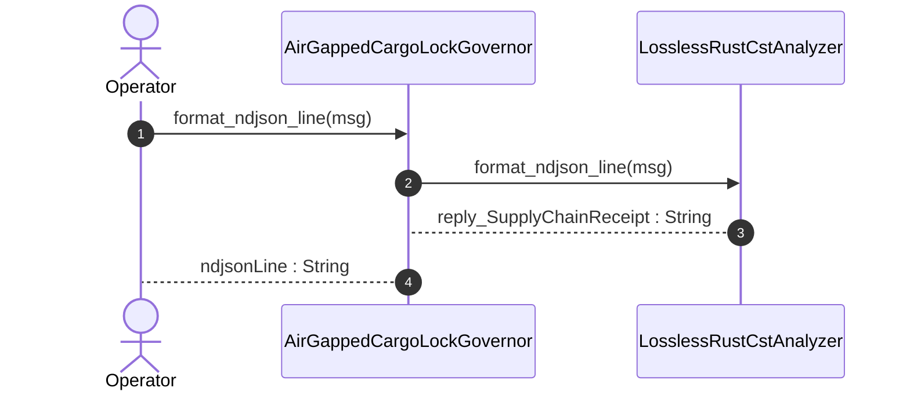

| Attribute | Specification Detail |
| :--- | :--- |
| **Issue ID** | #806 |
| **Title** | User Story 57: format ndjson line |
| **Type** | user-story |
| **Parent Epic** | [EPIC-08-BP_08_Lossless_Rust_CST_Codemod_Engine_and_Unified_rustc_Compatible_JSON_Diagnostics](../epics/EPIC-08-BP_08_Lossless_Rust_CST_Codemod_Engine_and_Unified_rustc_Compatible_JSON_Diagnostics.md) |
| **SysML Interaction** | `BP_08_Lossless_Rust_CST_Codemod_Engine_and_Unified_rustc_Compatible_JSON_Diagnostics_SequenceInteraction` |
| **SysML Test Case** | `Test_format_ndjson_line` |
| **Generation Mode** | subagent |
| **Specification Source** | [schema/model.sysml](../../schema/model.sysml) |

# User Story 57: format ndjson line

## User Story
As a `AirGappedCargoLockGovernor`, I want to invoke `format_ndjson_line()` on `LosslessRustCstAnalyzer`, so that format_ndjson_line(msg).

## Architectural Realization (3-Layer Definition of Done)

### Layer 1: Domain State & Data Model
- Domain state attributes on `UnifiedRustcJsonDiagnosticEmitter` (`cli_binary_count: Integer`, `zero_ansi_in_json_mode: Boolean`, `machine_applicable_only: Boolean`, `envelope_reason: String`) and `LosslessRustCstAnalyzer` (`max_fn_exec_sloc: Integer`, `max_fn_param_count: Integer`, `max_mut_bool_flags: Integer`, `max_predicate_arity: Integer`, `lossless_roundtrip_required: Boolean`, `deterministic_uuid: String`).
- **Contract A (100% Normative OMG SysML v2.0 + KerML 1.0 Grammar Coverage)**: Preserves full Definition and Usage symmetry across the OMG SysML v2.0 and KerML 1.0 textual grammar with zero 16-construct artificial caps.
- **Contract B NDJSON Diagnostic Data Model**: `RustcJsonEnvelope` (`reason: "compiler-message"`), `RustcDiagnosticMessage`, `RustcDiagnosticCode` (`DEAP-E*`), `RustcDiagnosticSpan` (`byte_start`, `byte_end`, `line_start`, `line_end`, `column_start`, `column_end` via `ra_ap_line_index::LineIndex`), and `ra_ap_text_edit::TextEdit` `"MachineApplicable"` suggestion spans bound to `format_ndjson_line(msg: String)`.
- Declared lifecycle state model: `BP_08_Lossless_Rust_CST_Codemod_Engine_and_Unified_rustc_Compatible_JSON_Diagnostics_LifecycleState` (`Idle`, `ParsingLosslessCst`, `AnalyzingMetricsAndTiers`, `ValidatingDisjointSpans`, `EmittingJsonDiagnostics`, `SplicingAndFormatting`, `RewritingCheck37Paths`, `VerifyingSelfHostFixedPoint`, `VerifiedClean`).

### Layer 2: Logic & State Management
- Behavioral execution contract: invokes `format_ndjson_line(msg)` to serialize structured findings as single-line `rustc`-compatible NDJSON (`reason: "compiler-message"`, `zero_ansi_in_json_mode = true`) and applies disjoint `"MachineApplicable"` fixes via `ra_ap_text_edit` and `ra_ap_syntax` (`Invariant_REQ_0608_SC_04_REQ_0608`, `C_CST_05`).
- State transition management: `Idle -> ParsingLosslessCst` (trigger `parseRustCst`).
- Formal constraints and requirements enforced: `C_CST_01 (max_fn_exec_sloc >= 1 and max_fn_exec_sloc <= 50)`, `C_CST_02 (max_fn_param_count >= 0 and max_fn_param_count <= 5)`, `C_CST_03 (max_mut_bool_flags >= 0 and max_mut_bool_flags <= 0)`, `C_CST_04 (stage_fixed_point_mismatch_files >= 0 and stage_fixed_point_mismatch_files <= 0)`, `C_CST_05 (runtime_llm_token_count >= 0 and runtime_llm_token_count <= 0)`, `C_CST_06 (tier_bc_max_doc_lines >= 2 and tier_bc_max_doc_lines <= 2)`, `REQ-0608 (REQ_0608_BP_08_Lossless_Rust_CST_Codemod_Engine_and_Unified_rustc_Compatible_JSON_Diagnostics)`.
- Modularity & net-negative scanner deletion target: bounds implementation inside `< 380` exec SLOC submodules (`crates/deap-core/src/json_diag/`, `crates/deap-core/src/rust_cst/diagnostics_ndjson.rs`) while executing explicit net-negative deletion of ~19,700+ lines of hand-rolled scanners and unstructured multi-line diagnostic formatters.

### Layer 3: Presentation & Actuator Interface Binding
- Component port bindings: `finding_in: String (in)`, `ndjson_out: String (out)`, `machine_fix_inout: String (inout)` on `UnifiedRustcJsonDiagnosticEmitter`; `rust_source_in: String (in)`, `item_inventory_out: String (out)`, `metrics_report_out: String (out)` on `LosslessRustCstAnalyzer`.
- Interaction binding (`BP_08_Lossless_Rust_CST_Codemod_Engine_and_Unified_rustc_Compatible_JSON_Diagnostics_SequenceInteraction`): routes `format_ndjson_line` invocation from `AirGappedCargoLockGovernor` to `LosslessRustCstAnalyzer` and `UnifiedRustcJsonDiagnosticEmitter` and returns `reply_SupplyChainReceipt`.
- Diagnostic fault surface: emits strictly single-line `rustc`-compatible NDJSON across all 5 CLI binaries (`compile-sysml`, `verify-baseline`, `ingest-sysml`, `assemble-conops`, `reconcile-backlog`).

## UML Sequence Diagram



## Formal SysML Test Case & Verification Binding
```sysml
test case def Test_format_ndjson_line {
    subject UnifiedRustcJsonDiagnosticEmitter;
    verify requirement REQ_0608_BP_08_Lossless_Rust_CST_Codemod_Engine_and_Unified_rustc_Compatible_JSON_Diagnostics;
    objective "Verify single-line rustc-compatible NDJSON serialization (reason: compiler-message, zero ANSI codes) and MachineApplicable auto-fix splicing.";
    step invoke_format_ndjson_line;
    step assert_single_line_ndjson_and_machine_applicable_fix;
}
```

## Acceptance Criteria (BDD)
- [ ] AC-US-57-01: Given `LosslessRustCstAnalyzer` is in declared state `Idle` with domain state attributes (`max_fn_exec_sloc: Integer`, `max_fn_param_count: Integer`, `max_mut_bool_flags: Integer`, `max_predicate_arity: Integer`, `lossless_roundtrip_required: Boolean`, `deterministic_uuid: String`), When `AirGappedCargoLockGovernor` invokes `format_ndjson_line` on `LosslessRustCstAnalyzer`, Then `LosslessRustCstAnalyzer` validates and binds the request against `LosslessRustCstAnalyzer` domain state (`max_fn_exec_sloc: Integer`, `max_fn_param_count: Integer`, `max_mut_bool_flags: Integer`, `max_predicate_arity: Integer`, `lossless_roundtrip_required: Boolean`, `deterministic_uuid: String`) and transitions to `ParsingLosslessCst`.
- [ ] AC-US-57-02: Given `LosslessRustCstAnalyzer` active state management during `format_ndjson_line`, When `LosslessRustCstAnalyzer` evaluates formal constraint `C_CST_01 (max_fn_exec_sloc >= 1 and max_fn_exec_sloc <= 50)`, Then `LosslessRustCstAnalyzer` verifies constraint satisfaction before committing state updates.
- [ ] AC-US-57-03: Given `LosslessRustCstAnalyzer` active state management during `format_ndjson_line`, When `LosslessRustCstAnalyzer` evaluates formal constraint `C_CST_02 (max_fn_param_count >= 0 and max_fn_param_count <= 5)`, Then `LosslessRustCstAnalyzer` verifies constraint satisfaction before committing state updates.
- [ ] AC-US-57-04: Given `LosslessRustCstAnalyzer` active state management during `format_ndjson_line`, When `LosslessRustCstAnalyzer` evaluates formal constraint `C_CST_03 (max_mut_bool_flags >= 0 and max_mut_bool_flags <= 0)`, Then `LosslessRustCstAnalyzer` verifies constraint satisfaction before committing state updates.
- [ ] AC-US-57-05: Given `LosslessRustCstAnalyzer` active state management during `format_ndjson_line`, When `LosslessRustCstAnalyzer` evaluates formal constraint `C_CST_04 (stage_fixed_point_mismatch_files >= 0 and stage_fixed_point_mismatch_files <= 0)`, Then `LosslessRustCstAnalyzer` verifies constraint satisfaction before committing state updates.
- [ ] AC-US-57-06: Given `LosslessRustCstAnalyzer` active state management during `format_ndjson_line`, When `LosslessRustCstAnalyzer` evaluates formal constraint `C_CST_05 (runtime_llm_token_count >= 0 and runtime_llm_token_count <= 0)`, Then `LosslessRustCstAnalyzer` verifies constraint satisfaction before committing state updates.
- [ ] AC-US-57-07: Given `LosslessRustCstAnalyzer` ingress port binding (`rust_source_in: String`), When `LosslessRustCstAnalyzer` completes `format_ndjson_line`, Then `LosslessRustCstAnalyzer` delivers `reply_SupplyChainReceipt` across egress port (`item_inventory_out: String`, `metrics_report_out: String`) to `AirGappedCargoLockGovernor`.
- [ ] AC-US-57-08: Given violated formal constraint `C_CST_01 (max_fn_exec_sloc >= 1 and max_fn_exec_sloc <= 50)`, When `AirGappedCargoLockGovernor` invokes `format_ndjson_line` on `LosslessRustCstAnalyzer`, Then `LosslessRustCstAnalyzer` rejects the request without partial state mutation, preserves prior verified state, and emits a deterministic fault diagnostic across the interface binding.

## Required Features
- [ ] #745 - [Feature 39: [BP 08 Lossless Rust CST Codemod Engine and Unified rustc Compatible JSON Diagnostics] UnifiedRustcJsonDiagnosticEmitter](../features/FEAT-39-UnifiedRustcJsonDiagnosticEmitter.md) (serializes single-line `reason: "compiler-message"` NDJSON diagnostics and applies disjoint `MachineApplicable` fixes)
- [ ] #743 - [Feature 37: [BP 08 Lossless Rust CST Codemod Engine and Unified rustc Compatible JSON Diagnostics] LosslessRustCstAnalyzer](../features/FEAT-37-LosslessRustCstAnalyzer.md) (computes `ra_ap_line_index::LineIndex` UTF-8 byte/line/col spans for diagnostic emission)
- [ ] #742 - [Feature 36: [BP 08 Lossless Rust CST Codemod Engine and Unified rustc Compatible JSON Diagnostics] AirGappedCargoLockGovernor](../features/FEAT-36-AirGappedCargoLockGovernor.md) (enforces `Invariant_REQ_0608_SC_04_REQ_0608` and `REQ-0608` governance invariants)

## Source References
Operational concept definitions and system sequence interaction models:
- System Architecture Model: `schema/model.sysml`
- Normative Systems Engineering Standard: ISO/IEC/IEEE 29148:2018 §6.4.2 Concept of Operations

Authoritative user story flows and interaction lifelines derive from `schema/model.sysml` pursuant to ISO/IEC/IEEE 29148.
