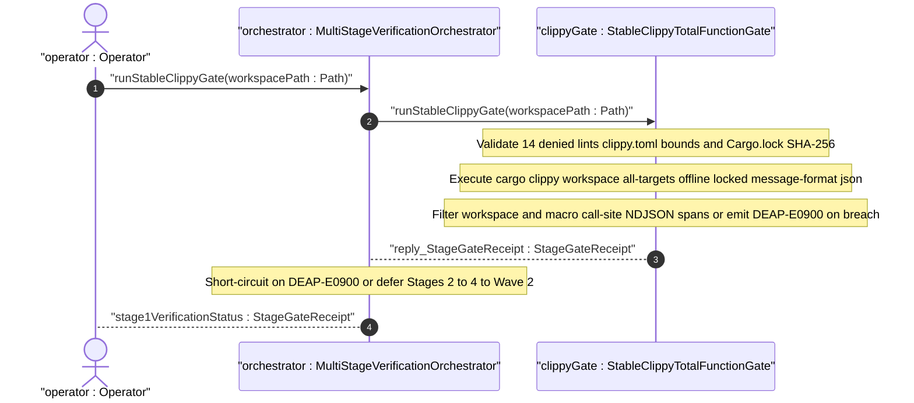
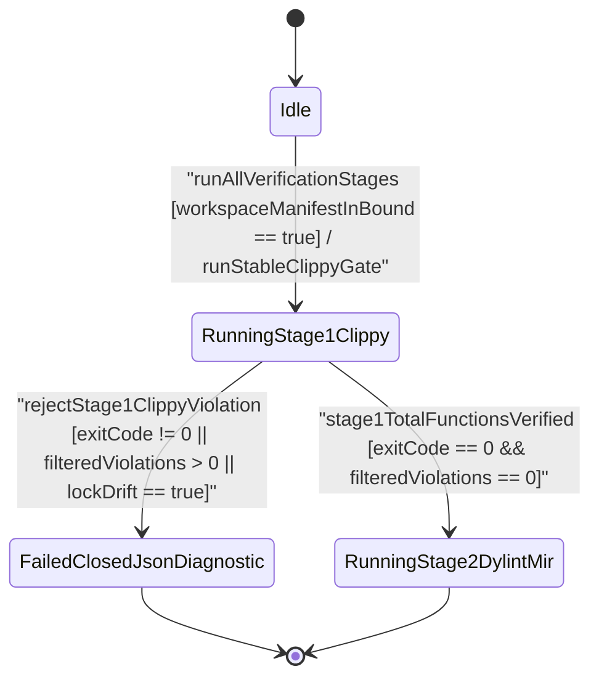

| Attribute | Specification Detail |
| :--- | :--- |
| **Issue ID** | TBD |
| **Title** | User Story 57: run Stable Clippy Gate |
| **Type** | user-story |
| **Parent Epic** | [EPIC-09-BP_09_Multi_Stage_Compiler_and_Formal_Verification_Gatekeeper](../epics/EPIC-09-BP_09_Multi_Stage_Compiler_and_Formal_Verification_Gatekeeper.md) |
| **SysML Interaction** | `BP_09_Multi_Stage_Compiler_and_Formal_Verification_Gatekeeper_SequenceInteraction` |
| **SysML Test Case** | `Test_runStableClippyGate` |
| **Generation Mode** | subagent |
| **Specification Source** | [schema/model.sysml](../../schema/model.sysml) |

# User Story 57: run Stable Clippy Gate

## User Story

**As a** `MultiStageVerificationOrchestrator`,
**I want to** invoke `runStableClippyGate(workspacePath)` on `StableClippyTotalFunctionGate` over a pinned workspace `Cargo.toml`, `Cargo.lock`, and `clippy.toml` bundle,
**So that** Stage-1 Track-1 total-function, checked-arithmetic, cast-safety, unsafe-documentation, deterministic-collection, `80`-SLOC, and `5`-parameter invariants (**REQ-0609** / **Invariant_REQ_0609_SC_01**) are enforced fail-closed with single-line `--message-format=json` NDJSON `DEAP-E0900` diagnostics while explicitly deferring Stages 2-4 to Wave-2.

## Domain Object Mapping & Wave-2 Stage Deferral Boundary

- **Primary Domain Objects:**
  - `StableClippyTotalFunctionGate` (SysML `part def` under `BP_09_Multi_Stage_Compiler_and_Formal_Verification_Gatekeeper`, realized under `FEAT-50` in `crates/verify-baseline/src/clippy_gate.rs`).
  - `MultiStageVerificationOrchestrator` (SysML `part def` realized under `FEAT-49` in `crates/verify-baseline/src/runner.rs`, dispatching `runStableClippyGate` and consuming `reply_StageGateReceipt`).
  - `RustcCompilerMessageNdjson` diagnostic envelope (`crates/deap-core/src/diagnostics.rs`, emitting ANSI-free single-line `"reason": "compiler-message"` records tagged `DEAP-E0900`).
- **Actor/Role:** `Operator` (CI verification runner or developer CLI caller invoking `verify-baseline`) delegating through `MultiStageVerificationOrchestrator`.
- **Explicit Stages 2-4 Wave-2 Deferral Contract:**
  - **Active Track-1 Scope (`US-57` / `FEAT-50`):** Executes Stage-1 `runStableClippyGate` exclusively on the stable Rust toolchain (`cargo clippy --workspace --all-targets --offline --locked --message-format=json`), auditing root `Cargo.toml` `[workspace.lints.clippy]` (`denied_clippy_lint_count == 14`), member crate `[lints] workspace = true` inheritance, root `clippy.toml` thresholds (`too-many-lines-threshold = 80`, `too-many-arguments-threshold = 5`, `disallowed_types_count >= 3`), `Cargo.lock` SHA-256 immutability, and workspace-relative NDJSON span filtering.
  - **Deferred Wave-2 Scope (Stages 2-4):** Stage 2 (`IsolatedDylintMirAllocationGate::verifyMirAllocationsAndReqs` nightly `rustc_private` MIR zero-allocation `DEAP-E0901` and `.digest.json` requirement-binding `DEAP-E0902`), Stage 3 (`FrbIcdBridgeAndMiriUbGate::synthesizeFrbIcdFacade` and `runMiriAndDartGate` FFI boundary synthesis and `-Zmiri-tree-borrows` `DEAP-E0903`), and Stage 4 (`KaniCbmcProofSynthesizer::synthesizeKaniProofModule` and `runKaniCbmcProofs` conditional `cfg(kani)` CBMC model checking `DEAP-E0904`) are explicitly deferred to Wave-2 stories. Root stable `Cargo.toml` MUST remain 100% free of nightly `rustc_private`, Dylint, Miri, or Kani dependencies during Track-1 execution.

## Architectural Realization (3-Layer Definition of Done)

### Layer 1: Domain State & Data Model
- **SysML & Rust Domain State (`StableClippyTotalFunctionGate`):** Preserves canonical AST attributes `denied_clippy_lint_count: Integer = 14`, `too_many_lines_threshold: Integer = 80`, `too_many_arguments_threshold: Integer = 5`, `disallowed_types_count: Integer = 3`, `json_diagnostic_stream: Boolean = true`, and `deterministic_uuid: String = "6ba7b810-9dad-11d1-80b4-00c04fd430c9"`, alongside package-level formal envelope attributes (`Blueprint_ID = "BP-09"`, `Requirement_ID = "REQ-0609"`, `max_rt_heap_allocations`, `max_miri_ub_violations`, `max_kani_counterexamples`, `default_kani_unwind_bound`).
- **Strongly-Typed Rust Data Structures & Error Model (`crates/verify-baseline/src/clippy_gate.rs`):**
  - Enforces `#![forbid(unsafe_code)]` and zero `Result<T, String>` signatures across all Stage-1 types and functions.
  - Defines typed `ClippyGateError` enum (`NonCanonicalWorkspacePath`, `ManifestIoFailure`, `WeakenedWorkspaceLintTable`, `UnauthorizedAllowAttribute`, `ClippyTomlThresholdBreach`, `CargoLockDriftDetected`, `JsonDepthLimitExceeded`, `ViolationCounterOverflow`, `ClippySubprocessAbnormalExit`, `Stage1ViolationsRejected`) mapping deterministically to diagnostic code `DEAP-E0900`.
  - Uses deterministic `BTreeMap<String, String>` and `BTreeSet<String>` containers exclusively (`0` `HashMap` or `HashSet` instances) for lint-table audits, member-crate prefix tables, and span-ordered `ClippyNdjsonFinding` inventories.
- **Lifecycle State Model (`BP_09_Multi_Stage_Compiler_and_Formal_Verification_Gatekeeper_LifecycleState`):** Models `Idle`, `RunningStage1Clippy`, `FailedClosedJsonDiagnostic`, and downstream Wave-2 handoff states (`RunningStage2DylintMir`, `RunningStage3FrbAndMiri`, `RunningStage4KaniCbmc`, `VerifiedAllFourStages`).

### Layer 2: Logic & State Management
- **Total-Function & Bounded Complexity Discipline:** Every Rust function in `crates/verify-baseline/src/clippy_gate.rs` is a pure or bounded-I/O total function satisfying `<= 80` executable SLOC (**C_VER_01**), `<= 5` callable parameters (**C_VER_02**), `<= 3` boolean parameters (`BoolParams_HIR <= 3` with zero mutable boolean flags), `MAX_AST_DEPTH = 64` JSON/TOML nesting ceiling, safe `.get()` slice indexing (zero direct `[]` indexing, `.unwrap()`, `.expect()`, or `panic!()`), and checked/saturating arithmetic (`checked_add`, `saturating_add`).
- **14-Lint `[workspace.lints.clippy]` & `clippy.toml` Pre-Flight Enforcement (`SC-BP09-17`):** Verifies root `Cargo.toml` sets all `14` mandatory Clippy lints to `"deny"` or `"forbid"` (`unwrap_used`, `expect_used`, `panic`, `todo`, `indexing_slicing`, `arithmetic_side_effects`, `cast_possible_truncation`, `cast_possible_wrap`, `cast_sign_loss`, `undocumented_unsafe_blocks`, `too_many_lines`, `too_many_arguments`, `fn_params_excessive_bools`, `disallowed_types`), verifies `[lints] workspace = true` across every workspace member crate with zero unauthorized `#![allow(...)]` or item-level `allow(...)` lint-suppression overrides, and verifies root `clippy.toml` bounds (`1 <= too-many-lines-threshold <= 80`, `0 <= too-many-arguments-threshold <= 5`, and `disallowed_types_count >= 3` banning non-deterministic hash containers and Check-34 backtracking NFA pattern-engine types).
- **Air-Gapped Lockfile, Fingerprint Cache & Span-Filter Invariants (`SC-BP09-18`..`SC-BP09-20`):** Seals a pre-execution SHA-256 digest across `Cargo.toml`, `Cargo.lock`, and `clippy.toml` to invalidate stale incremental fingerprints, executes `cargo clippy --workspace --all-targets --offline --locked --message-format=json`, resolves macro-expansion call-site backtraces to workspace member crates so macro-originated defects cannot escape filtering, re-verifies post-run `Cargo.lock` SHA-256 identity, and requires BOTH subprocess exit code `0` AND `0` filtered `compiler-message` errors before sealing `stage1TotalFunctionsVerified`.
- **Formal Constraints Enforced:** `C_VER_01 (too_many_lines_threshold >= 1 and too_many_lines_threshold <= 80)`, `C_VER_02 (too_many_arguments_threshold >= 0 and too_many_arguments_threshold <= 5)`, `C_VER_03 (max_rt_heap_allocations >= 0 and max_rt_heap_allocations <= 0)`, `C_VER_04 (max_miri_ub_violations >= 0 and max_miri_ub_violations <= 0)`, `C_VER_05 (max_kani_counterexamples >= 0 and max_kani_counterexamples <= 0)`, `C_VER_06 (default_kani_unwind_bound >= 1 and default_kani_unwind_bound <= 64)`, and `REQ-0609` (`Invariant_REQ_0609_SC_01`).

### Layer 3: Presentation & Actuator Interface Binding
- **SysML Port & Interaction Bindings:** Binds ingress port `workspace_manifest_in: String` (`CargoAndClippyTomlBundle` protocol) and egress port `clippy_ndjson_out: String` (`RustcCompilerMessageNdjson` protocol) on `StableClippyTotalFunctionGate`, realizing `runStableClippyGate` and `reply_StageGateReceipt` in `BP_09_Multi_Stage_Compiler_and_Formal_Verification_Gatekeeper_SequenceInteraction`.
- **CLI & `--message-format=json` NDJSON Stream Binding:** Exposes deterministic Stage-1 Clippy verification through `crates/verify-baseline/src/runner.rs` and `crates/verify-baseline/src/clippy_gate.rs` backed by `crates/deap-core/src/diagnostics.rs`. Every rejected pre-flight check or span-filtered Clippy error is serialized as a single-line, newline-delimited, zero-ANSI (`0x1B` byte count `== 0`) `rustc`-compatible JSON object (`"reason": "compiler-message"`, code `"DEAP-E0900"`) preserving workspace-relative file paths, `1`-based line/column spans, underlying `clippy::*` lint codes, and `"MachineApplicable"` `suggested_replacement` payloads for deterministic remediation.

## Target Rust Module Paths & Atomic Implementation Micro-Tasks

- **Target Implementation Paths (under `FEAT-50`):**
  - `crates/verify-baseline/src/clippy_gate.rs` (new Stage-1 gate module exported in `crates/verify-baseline/src/lib.rs` and invoked by `crates/verify-baseline/src/runner.rs`, reusing NDJSON diagnostic primitives from `crates/deap-core/src/diagnostics.rs`).
  - `Cargo.toml` (root `[workspace.lints.clippy]` `14`-lint denial table + member crate `[lints] workspace = true`).
  - `clippy.toml` (root `too-many-lines-threshold = 80`, `too-many-arguments-threshold = 5`, and `disallowed-types` deterministic container and pattern-engine policy).
  - `Cargo.lock` (pinned dependency graph verified invariant under `--offline --locked`).

| Micro-Task ID | Target Path | Callable / Type Signature (`<= 5` Params, `<= 80` Exec SLOC) | Responsibility & Fail-Closed Contract | Requirement & FLS Traceability |
| :--- | :--- | :--- | :--- | :--- |
| `MT-US57-01` | `crates/verify-baseline/src/clippy_gate.rs` | `StableClippyGateConfig`, `ManifestBundleDigest`, `ClippyNdjsonFinding`, `StageGateReceipt`, `ClippyLifecycleState`, `ClippyGateError` | Defines `#![forbid(unsafe_code)]` Stage-1 value types, `BTreeMap`/`BTreeSet` inventories, Wave-2 deferral receipt flag (`wave2_stages_deferred: bool`), and typed `ClippyGateError` mapping every failure mode (`FM-BP09-017`..`FM-BP09-020`) to `DEAP-E0900` with zero `Result<T, String>`. | `[REQ-0609]`, `[SC-BP09-17]`, `[FLS: fls_8tsynkj2cufj]`, `[FLS: fls_9ucqbbd0s2yo]` |
| `MT-US57-02` | `crates/verify-baseline/src/clippy_gate.rs` | `pub fn validate_manifest_and_clippy_bundle(workspace_root: &Path, config: &StableClippyGateConfig) -> Result<ManifestBundleDigest, ClippyGateError>` (`2` params) | Rejects non-canonical paths (`..`, NUL), verifies root `Cargo.toml` enforces all `14` denied Clippy lints and member crates inherit `lints.workspace = true` without unauthorized `#![allow(...)]` or item-level `allow(...)` overrides, validates `clippy.toml` (**C_VER_01** `<= 80` lines, **C_VER_02** `<= 5` params, `disallowed_types_count >= 3`), and computes the combined SHA-256 digest of `Cargo.toml`, `Cargo.lock`, and `clippy.toml`. | `[REQ-0609]`, `[SC-BP09-17]`, `[SC-BP09-18]`, `[FLS: fls_qcb1n9c0e5hz]` |
| `MT-US57-03` | `crates/verify-baseline/src/clippy_gate.rs` | `pub fn filter_clippy_ndjson_stream<R: BufRead>(reader: R, workspace_root: &Path, member_prefixes: &BTreeSet<String>) -> Result<Vec<ClippyNdjsonFinding>, ClippyGateError>` (`3` params) | Streams `--message-format=json` lines via bounded `BufRead` framing with `MAX_AST_DEPTH = 64` JSON nesting guard, resolves primary and macro-expansion call-site spans via `.get()` to workspace member crates, counts findings via `checked_add`, strips/rejects `0x1B` ANSI bytes, and retains `"MachineApplicable"` `suggested_replacement` spans. | `[REQ-0609]`, `[SC-BP09-18]`, `[SC-BP09-19]`, `[SC-BP09-20]`, `[FLS: fls_77sc6hl0v57p]` |
| `MT-US57-04` | `crates/verify-baseline/src/clippy_gate.rs` | `pub fn run_stable_clippy_gate(workspace_root: &Path, config: &StableClippyGateConfig, ndjson_out: &mut dyn Write) -> Result<StageGateReceipt, ClippyGateError>` (`3` params) | Transitions `Idle -> RunningStage1Clippy`, binds target-cache fingerprint to `ManifestBundleDigest`, runs `cargo clippy --workspace --all-targets --offline --locked --message-format=json`, verifies post-run `Cargo.lock` SHA-256 identity, requires exit status `0` AND `0` filtered errors, emits single-line `DEAP-E0900` NDJSON on `FailedClosedJsonDiagnostic`, or returns `StageGateReceipt` (`wave2_stages_deferred = true`). | `[REQ-0609]`, `[SC-BP09-17]`, `[SC-BP09-20]`, `[FLS: fls_qcb1n9c0e5hz]` |
| `MT-US57-05` | `Cargo.toml`, `clippy.toml`, `crates/verify-baseline/src/runner.rs` | Declarative `[workspace.lints.clippy]` (`14` `"deny"` entries), `clippy.toml` (`80` / `5` / `disallowed-types`), and runner stage hook | Wires the canonical `14`-lint `[workspace.lints.clippy]` table, member `[lints] workspace = true` inheritance, and root `clippy.toml` thresholds into the stable workspace without introducing Wave-2 nightly `rustc_private`, Dylint, Miri, or Kani dependencies. | `[REQ-0609]`, `[SC-BP09-17]`, `[FLS: fls_exe4zodlwfez]` |

## UML Sequence Diagram



## UML State Machine Diagram



## Mathematical Formulations & Verification Invariants

Stage-1 total-function, structural-complexity, and deterministic-type admissibility over a workspace crate set $\mathcal{W}$ enforces `Invariant_REQ_0609_SC_01`:

$$
\begin{aligned}
\text{Stage1Pass}(\mathcal{W}) &\iff \forall C \in \mathcal{W}, \quad \forall \ell \in \mathcal{L}_{\text{deny}}, \quad \text{Violations}_{\ell}(C) = \emptyset \land \text{Types}(C) \cap \mathcal{T}_{\text{banned}} = \emptyset \\
\forall f \in \text{Fns}(\mathcal{W}), \quad \text{Lines}_{\text{HIR}}(f) &\le L_{\max} \land \lvert \text{Args}_{\text{HIR}}(f) \rvert \le A_{\max} \land \text{BoolParams}_{\text{HIR}}(f) \le B_{\max} \\
\text{ReceiptValid}(\mathcal{W}, r) &\iff \text{Stage1Pass}(\mathcal{W}) \land (e_{\text{clippy}} = 0) \land (H_{\text{pre}}(\mathcal{M}) = H_{\text{post}}(\mathcal{M}))
\end{aligned}
$$

- Parameter Definitions & Engineering Units:
- $\mathcal{W}$: Verified Rust workspace member crate set (`crates/*`, unitless set of crates).
- $\mathcal{L}_{\text{deny}}$: Mandatory `[workspace.lints.clippy]` denial catalog with cardinality $\lvert \mathcal{L}_{\text{deny}} \rvert = 14$ `lints` (`unwrap_used`, `expect_used`, `panic`, `todo`, `indexing_slicing`, `arithmetic_side_effects`, `cast_possible_truncation`, `cast_possible_wrap`, `cast_sign_loss`, `undocumented_unsafe_blocks`, `too_many_lines`, `too_many_arguments`, `fn_params_excessive_bools`, `disallowed_types`).
- $\mathcal{T}_{\text{banned}}$: Root `clippy.toml` `disallowed-types` catalog with cardinality $\lvert \mathcal{T}_{\text{banned}} \rvert \ge 3$ `types` banning non-deterministic hash containers (`std::collections::HashMap`, `std::collections::HashSet`, `std::collections::hash_map::RandomState`) and Check-34 backtracking NFA pattern-engine types.
- $L_{\max}$: Maximum HIR executable function body ceiling `too_many_lines_threshold = 80` `lines` (**C_VER_01**: $1 \le L_{\max} \le 80$).
- $A_{\max}$: Maximum callable parameter ceiling `too_many_arguments_threshold = 5` `params` (**C_VER_02**: $0 \le A_{\max} \le 5$).
- $B_{\max}$: Maximum boolean parameter ceiling per callable signature $B_{\max} = 3$ `params` enforced by `clippy::fn_params_excessive_bools`.
- $e_{\text{clippy}}$: Exit status code returned by `cargo clippy --workspace --all-targets --offline --locked --message-format=json` (`0` on clean compilation, non-zero integer on failure).
- $H_{\text{pre}}(\mathcal{M}), H_{\text{post}}(\mathcal{M})$: Pre-execution and post-execution SHA-256 digests (`256-bit` hex digest) over the manifest bundle $\mathcal{M} = (\text{Cargo.toml}, \text{Cargo.lock}, \text{clippy.toml})$.

## Component Failure Modes & Fail-Closed STPA Traceability

| Failure Mode ID | Failure Dimension | Unsafe Control Action (`UCA-*`) | Trigger Condition | Fail-Closed Mitigation & Safety Constraint (`DEAP-E0900` / `SC-*`) |
| :--- | :--- | :--- | :--- | :--- |
| `FM-BP09-017` | `(1) Input/Boundary & Malformed Syntax` | `UCA-BP09-01` | Root `Cargo.toml` omits any of the `14` denied Clippy lints, member crate omits `lints.workspace = true` or injects unauthorized `#![allow(...)]` or item-level `allow(...)` overrides, `clippy.toml` relaxes `too_many_lines_threshold > 80`, `too_many_arguments_threshold > 5`, or `disallowed_types_count < 3`, or mutated `deterministic_uuid`. | `SC-BP09-17` -- `validate_manifest_and_clippy_bundle` rejects malformed or weakened bundles pre-flight, transitions to `FailedClosedJsonDiagnostic`, and emits `DEAP-E0900` before subprocess launch. |
| `FM-BP09-018` | `(2) State/Concurrency & Ordering` | `UCA-BP09-02` | Stale `target/` incremental fingerprint cache suppresses lints after `clippy.toml` or `Cargo.toml` edits, `--message-format=json` span filter drops macro-expanded or `include!` violations inside workspace crates, or `Cargo.lock` drifts without `--offline --locked` isolation. | `SC-BP09-18` -- Bind cache fingerprint to combined SHA-256 of `Cargo.toml`, `Cargo.lock`, and `clippy.toml`, enforce `--offline --locked`, and resolve macro-expansion call-site backtraces to workspace member prefixes. |
| `FM-BP09-019` | `(3) Resource/Depth/Arithmetic Exhaustion` | `UCA-BP09-03` | High-volume `compiler-message` JSON floods, deeply nested `children`/`spans` trees exceeding `MAX_AST_DEPTH = 64` levels, unbounded subprocess execution duration, or integer overflow on span-filtered violation counters wrapping around to zero findings. | `SC-BP09-19` -- Stream stdout via bounded single-line `BufRead` framing with `MAX_AST_DEPTH = 64` levels JSON depth ceiling, bounded subprocess execution budget, and `checked_add` counter arithmetic. |
| `FM-BP09-020` | `(4) Output/Serialization & Partial-Write Integrity` | `UCA-BP09-04` | Multi-line, truncated, or `0x1B` ANSI-tainted NDJSON emitted on `clippy_ndjson_out`, stripped primary spans or `suggested_replacement` metadata, or false `stage1TotalFunctionsVerified` pass when `cargo clippy` exits non-zero on a `rustc` compile error with zero `clippy::*` codes. | `SC-BP09-20` -- Require both exit code `0` AND `0` `compiler-message` errors, validate single-line zero-ANSI JSON serialization, and preserve primary spans, lint `code`, and `"MachineApplicable"` replacements. |

## Acceptance Criteria (BDD)

- [ ] **AC-US-57-01 (Nominal Stage-1 Total-Function Pass & Wave-2 Deferral -- `TEST-US57-01` / `Test_runStableClippyGate`):** **Given** `StableClippyTotalFunctionGate` is in declared state `Idle` over a workspace containing root `Cargo.toml` (`[workspace.lints.clippy]` with `denied_clippy_lint_count == 14` and `[lints] workspace = true` across all member crates), root `clippy.toml` (`too-many-lines-threshold = 80`, `too-many-arguments-threshold = 5`, `disallowed_types_count >= 3`), intact `Cargo.lock`, and total-function Rust sources using `#![forbid(unsafe_code)]`, `BTreeMap`/`BTreeSet`, `.get()` indexing, and `checked_*`/`saturating_*` arithmetic, **When** `MultiStageVerificationOrchestrator` invokes `runStableClippyGate(workspacePath)` executing `cargo clippy --workspace --all-targets --offline --locked --message-format=json`, **Then** `StableClippyTotalFunctionGate` transitions `Idle -> RunningStage1Clippy`, confirms exit code `0`, `0` span-filtered violations, and unchanged `Cargo.lock` SHA-256 digest, delivers `reply_StageGateReceipt` (`stage1TotalFunctionsVerified`, `wave2_stages_deferred = true`) across `clippy_ndjson_out` while explicitly deferring Stages 2-4 to Wave-2, and satisfies `REQ-0609` (`Invariant_REQ_0609_SC_01`).
- [ ] **AC-US-57-02 (Exact Upper-Envelope Boundary Pass & Off-By-One Rejection -- `TEST-US57-02` / `TEST_US57_02_BoundaryThresholdsCVer01CVer02`):** **Given** `StableClippyTotalFunctionGate` active threshold enforcement for `C_VER_01` (`too_many_lines_threshold == 80`), `C_VER_02` (`too_many_arguments_threshold == 5`), and `BoolParams_HIR <= 3`, evaluating (a) a boundary-compliant function of exactly `80` executable lines, `5` parameters, and `3` boolean parameters, and (b) an off-by-one boundary-violating fixture containing an `81`-line function, a `6`-parameter function, or `4` boolean parameters, **When** `runStableClippyGate(workspacePath)` evaluates fixtures (a) and (b) under `--offline --locked --message-format=json`, **Then** fixture (a) passes with `0` findings while fixture (b) triggers `rejectStage1ClippyViolation`, transitions `RunningStage1Clippy -> FailedClosedJsonDiagnostic`, and emits single-line `DEAP-E0900` NDJSON citing `clippy::too_many_lines`, `clippy::too_many_arguments`, or `clippy::fn_params_excessive_bools`.
- [ ] **AC-US-57-03 (Fail-Closed `UCA-BP09-01` / `FM-BP09-017` Fault Injection: Weakened Lint Table, Unauthorized `#![allow(...)]`, or Total-Function Breach -- `TEST-US57-03` / `TEST_US57_03_Uca01ManifestAndTotalFunctionRejection`):** **Given** a fault-injected workspace exercising `UCA-BP09-01` (`FM-BP09-017`) by either weakening `[workspace.lints.clippy]` below `14` denied lints, omitting `lints.workspace = true`, relaxing `clippy.toml` (`too-many-lines-threshold > 80`, `too-many-arguments-threshold > 5`, or `disallowed_types_count < 3`), injecting an unauthorized `#![allow(clippy::unwrap_used)]` or item-level `allow(clippy::unwrap_used)` attribute, or introducing `.unwrap()`, direct slice indexing, unchecked `+` arithmetic, or `std::collections::HashMap`, **When** `MultiStageVerificationOrchestrator` invokes `runStableClippyGate(workspacePath)`, **Then** `StableClippyTotalFunctionGate` rejects the bundle or violation fail-closed (`SC-BP09-17`), preserves prior verified workspace state with zero partial mutations, transitions to `FailedClosedJsonDiagnostic`, and emits a single-line `DEAP-E0900` NDJSON diagnostic across `clippy_ndjson_out`.
- [ ] **AC-US-57-04 (Fail-Closed `UCA-BP09-02` / `FM-BP09-018` Fault Injection: Stale Fingerprint Cache, Macro-Expansion Span Attribution, and `Cargo.lock` Drift -- `TEST-US57-04` / `TEST_US57_04_Uca02CacheMacroSpanAndLockDrift`):** **Given** a fault-injected workspace state exercising `UCA-BP09-02` (`FM-BP09-018`) containing a warm incremental cache followed by a tightened `clippy.toml` threshold, a macro-expanded indexing or unchecked-arithmetic defect invoked from a workspace crate, or a drifted `Cargo.lock` mismatched against `Cargo.toml`, **When** `runStableClippyGate(workspacePath)` executes with `--offline --locked --message-format=json`, **Then** manifest-bundle SHA-256 fingerprinting invalidates stale cached artifacts, `filter_clippy_ndjson_stream` attributes the macro call-site backtrace to the workspace crate span (`SC-BP09-18`), `--offline --locked` rejects lockfile drift without network access, and the gate transitions fail-closed to `FailedClosedJsonDiagnostic` with `DEAP-E0900`.
- [ ] **AC-US-57-05 (Fail-Closed `UCA-BP09-03` / `FM-BP09-019` Fault Injection: Pathological NDJSON Nesting Depth & Checked Counter Overflow -- `TEST-US57-05` / `TEST_US57_05_Uca03NdjsonDepthAndCheckedCounterBounds`):** **Given** a fault-injected `--message-format=json` stream exercising `UCA-BP09-03` (`FM-BP09-019`) with nested `children`/`spans` JSON depth exceeding `MAX_AST_DEPTH = 64` or accumulated finding counts overflowing `u32::MAX`, **When** `filter_clippy_ndjson_stream` processes the stream via bounded `BufRead` line framing, **Then** `StableClippyTotalFunctionGate` traps the breach via `MAX_AST_DEPTH = 64` and `checked_add` (`ClippyGateError::JsonDepthLimitExceeded` or `ClippyGateError::ViolationCounterOverflow`, `SC-BP09-19`), prevents wraparound to `0`, and transitions to `FailedClosedJsonDiagnostic` emitting `DEAP-E0900`.
- [ ] **AC-US-57-06 (Fail-Closed `UCA-BP09-04` / `FM-BP09-020` Fault Injection: Non-Zero `rustc` Exit With Zero `clippy::*` Codes & Single-Line Zero-ANSI NDJSON -- `TEST-US57-06` / `TEST_US57_06_Uca04NonZeroExitAndSingleLineNdjsonIntegrity`):** **Given** a fault-injected Stage-1 run exercising `UCA-BP09-04` (`FM-BP09-020`) where `cargo clippy` exits non-zero due to a `rustc` compile error emitting zero `clippy::*` lint codes, or emits truncated multi-line output or `0x1B` ANSI escape bytes, **When** `run_stable_clippy_gate` evaluates completion and flushes `clippy_ndjson_out`, **Then** `StableClippyTotalFunctionGate` blocks `stage1TotalFunctionsVerified` promotion (`SC-BP09-20`), enforces single-line `0x1B`-free `RustcCompilerMessageNdjson` framing preserving primary spans and `"MachineApplicable"` `suggested_replacement` fields, transitions to `FailedClosedJsonDiagnostic`, and preserves `C_VER_03`..`C_VER_06` domain envelope invariants untouched for Wave-2.

## Formal SysML Test Case & Verification Binding

- **Primary SysML Test Case Def:** `Test_runStableClippyGate` (paired with scenario-level verification cases `TEST_US57_01_NominalStableClippyPass` through `TEST_US57_06_Uca04NonZeroExitAndSingleLineNdjsonIntegrity`)
- **Subject Part:** `StableClippyTotalFunctionGate`
- **Verified Safety Requirement:** `REQ_0609_BP_09_Multi_Stage_Compiler_and_Formal_Verification_Gatekeeper` (`REQ-0609`)
- **Verification Objective:** "Verify fail-closed Stage-1 Track-1 enforcement of 14 denied Clippy lints, clippy.toml 80-SLOC/5-arg/disallowed-types bounds, offline locked Cargo.lock immutability, macro-aware NDJSON span filtering, and explicit Stages 2-4 Wave-2 deferral."
- **Test Steps:**
  - `step bind_workspace_manifest_and_lock_sha256`
  - `step validate_fourteen_clippy_lints_and_toml_bounds`
  - `step execute_offline_locked_clippy_json_stream`
  - `step filter_workspace_and_macro_callsite_spans`
  - `step assert_fail_closed_deap_e0900_or_wave2_deferred_receipt`

```sysml
test case def Test_runStableClippyGate {
    subject StableClippyTotalFunctionGate;
    verify requirement REQ_0609_BP_09_Multi_Stage_Compiler_and_Formal_Verification_Gatekeeper;
    objective "TEST-US57-01 Nominal Stage-1 stable Clippy total-function verification and Wave-2 deferral receipt";
    step bind_workspace_manifest_and_lock_sha256;
    step validate_fourteen_clippy_lints_and_toml_bounds;
    step execute_offline_locked_clippy_json_stream;
    step assert_zero_violations_and_wave2_deferred_receipt;
}

test case def TEST_US57_02_BoundaryThresholdsCVer01CVer02 {
    subject StableClippyTotalFunctionGate;
    verify requirement REQ_0609_BP_09_Multi_Stage_Compiler_and_Formal_Verification_Gatekeeper;
    objective "TEST-US57-02 Exact 80-line 5-arg 3-bool boundary acceptance and 81-line 6-arg 4-bool DEAP-E0900 rejection";
    step inject_exact_80_line_5_arg_3_bool_fixture;
    step assert_boundary_fixture_passes_cleanly;
    step inject_81_line_6_arg_4_bool_breach_fixture;
    step assert_fail_closed_deap_e0900_rejection;
}

test case def TEST_US57_03_Uca01ManifestAndTotalFunctionRejection {
    subject StableClippyTotalFunctionGate;
    verify requirement REQ_0609_BP_09_Multi_Stage_Compiler_and_Formal_Verification_Gatekeeper;
    objective "TEST-US57-03 UCA-BP09-01 FM-BP09-017 fault injection for weakened lint table unauthorized allow attributes and banned types";
    step inject_weakened_manifest_or_partial_function_fixture;
    step invoke_run_stable_clippy_gate;
    step assert_pre_flight_or_lint_rejection_deap_e0900;
}

test case def TEST_US57_04_Uca02CacheMacroSpanAndLockDrift {
    subject StableClippyTotalFunctionGate;
    verify requirement REQ_0609_BP_09_Multi_Stage_Compiler_and_Formal_Verification_Gatekeeper;
    objective "TEST-US57-04 UCA-BP09-02 FM-BP09-018 fault injection for stale fingerprint cache macro-expanded span leakage and Cargo.lock drift";
    step mutate_clippy_toml_after_warm_cache_and_inject_macro_violation;
    step invoke_offline_locked_clippy_gate;
    step assert_cache_invalidation_macro_span_capture_and_lock_guard;
}

test case def TEST_US57_05_Uca03NdjsonDepthAndCheckedCounterBounds {
    subject StableClippyTotalFunctionGate;
    verify requirement REQ_0609_BP_09_Multi_Stage_Compiler_and_Formal_Verification_Gatekeeper;
    objective "TEST-US57-05 UCA-BP09-03 FM-BP09-019 fault injection for MAX_AST_DEPTH 64 JSON nesting ceiling and checked_add overflow trap";
    step inject_over_64_depth_ndjson_and_counter_overflow_stream;
    step invoke_filter_clippy_ndjson_stream;
    step assert_bounded_bufread_abort_and_deap_e0900_diagnostic;
}

test case def TEST_US57_06_Uca04NonZeroExitAndSingleLineNdjsonIntegrity {
    subject StableClippyTotalFunctionGate;
    verify requirement REQ_0609_BP_09_Multi_Stage_Compiler_and_Formal_Verification_Gatekeeper;
    objective "TEST-US57-06 UCA-BP09-04 FM-BP09-020 fault injection for non-zero rustc exit with zero clippy codes and 0x1B-free single-line NDJSON";
    step inject_aborted_rustc_compile_and_ansi_tainted_stream;
    step invoke_run_stable_clippy_gate;
    step assert_short_circuit_abort_and_single_line_ascii_ndjson;
}
```

## Logical UI & Interface Bindings

| Interface Channel | Category | Target Component / Handler | Target Container / Endpoint | Data Source Binding |
| :--- | :--- | :--- | :--- | :--- |
| `cli` | Verification CLI | `crates/verify-baseline/src/runner.rs` (`run_stable_clippy_gate`) | `verify-baseline` Stage-1 Track-1 gate runner | `BP_09_Multi_Stage_Compiler_and_Formal_Verification_Gatekeeper::StableClippyTotalFunctionGate::workspace_manifest_in` |
| `ndjson` | M2M Diagnostic Stream (`--message-format=json`) | `crates/verify-baseline/src/clippy_gate.rs` + `crates/deap-core/src/diagnostics.rs` | `stdout` / `clippy_ndjson_out` (`RustcCompilerMessageNdjson`, `DEAP-E0900`) | `BP_09_Multi_Stage_Compiler_and_Formal_Verification_Gatekeeper::StableClippyTotalFunctionGate::clippy_ndjson_out` |

## Required Features
- [ ] [Feature 49: [BP 09 Multi Stage Compiler and Formal Verification Gatekeeper] MultiStageVerificationOrchestrator](../features/FEAT-49-MultiStageVerificationOrchestrator.md) (orchestrates Stage-1 `runStableClippyGate` dispatch, enforces `fail_closed_short_circuit` on `DEAP-E0900` rejection, and governs Wave-2 deferral handoff)
- [ ] [Feature 50: [BP 09 Multi Stage Compiler and Formal Verification Gatekeeper] StableClippyTotalFunctionGate](../features/FEAT-50-StableClippyTotalFunctionGate.md) (owns the `StableClippyTotalFunctionGate` domain contract, `14`-lint `[workspace.lints.clippy]` and `clippy.toml` validation, and `--message-format=json` NDJSON span filtering realized by this story)

## Source References
Operational concept definitions, blueprint metamodel contracts, and failure mode traceability:
- System Architecture Model: [schema/model.sysml](../../schema/model.sysml)
- Blueprint SysML v2 Metamodel: `docs/designs/blueprint-09-clippy-dylint-miri-kani-formal-verification-gate.sysml` (`REQ-0609`, `C_VER_01`..`C_VER_06`, `Invariant_REQ_0609_SC_01`)
- Component Failure Mode Registry: [docs/research/FAILURE_MODE_REGISTRY.md](../research/FAILURE_MODE_REGISTRY.md) (`FM-BP09-017`..`FM-BP09-020`)
- Normative Systems Engineering & Certification Standards: ISO/IEC/IEEE 29148:2018 Section 6.4.2 Concept of Operations, RTCA DO-178C Level A, RTCA DO-330 TQL-4, and Ferrocene Language Specification (`[FLS: fls_*]`)

Authoritative user story flows and interaction lifelines derive from `schema/model.sysml` pursuant to ISO/IEC/IEEE 29148:2018.
