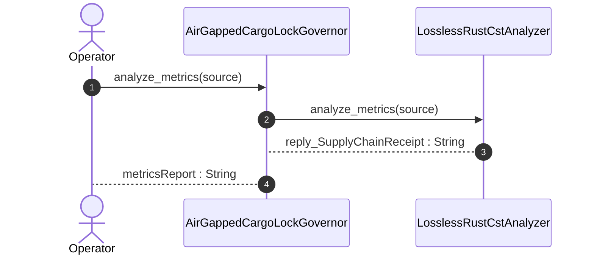

| Attribute | Specification Detail |
| :--- | :--- |
| **Issue ID** | #808 |
| **Title** | User Story 58: analyze metrics |
| **Type** | user-story |
| **Parent Epic** | [EPIC-08-BP_08_Lossless_Rust_CST_Codemod_Engine_and_Unified_rustc_Compatible_JSON_Diagnostics](../epics/EPIC-08-BP_08_Lossless_Rust_CST_Codemod_Engine_and_Unified_rustc_Compatible_JSON_Diagnostics.md) |
| **SysML Interaction** | `BP_08_Lossless_Rust_CST_Codemod_Engine_and_Unified_rustc_Compatible_JSON_Diagnostics_SequenceInteraction` |
| **SysML Test Case** | `Test_analyze_metrics` |
| **Generation Mode** | subagent |
| **Specification Source** | [schema/model.sysml](../../schema/model.sysml) |

# User Story 58: analyze metrics

## User Story
As a `AirGappedCargoLockGovernor`, I want to invoke `analyze_metrics()` on `LosslessRustCstAnalyzer`, so that analyze_metrics(source).

## Architectural Realization (3-Layer Definition of Done)

### Layer 1: Domain State & Data Model
- Domain state attributes on `LosslessRustCstAnalyzer`: `max_fn_exec_sloc: Integer`, `max_fn_param_count: Integer`, `max_mut_bool_flags: Integer`, `max_predicate_arity: Integer`, `lossless_roundtrip_required: Boolean`, `deterministic_uuid: String`.
- **Contract A (100% Normative OMG SysML v2.0 + KerML 1.0 Grammar Coverage)**: Preserves full Definition and Usage symmetry across the OMG SysML v2.0 and KerML 1.0 textual grammar with zero 16-construct artificial caps.
- **Contract B AST Metrics Data Model**: `ra_ap_syntax::SourceFile` (`ast::{MatchExpr, MatchArmList, CallExpr, MethodCallExpr, TryExpr, Fn, HasDocComments, HasAttrs}`), `rowan::GreenNode`, `ra_ap_line_index::LineIndex`, and `DeapV2AstMetrics` (`production_exec_sloc`, per-function `exec_sloc`, formal parameter counts excluding `self`/`&self`/`&mut self`, `let mut flag: bool` counts, and compound boolean predicate arity) bound to `analyze_metrics(source: String)`.
- Declared lifecycle state model: `BP_08_Lossless_Rust_CST_Codemod_Engine_and_Unified_rustc_Compatible_JSON_Diagnostics_LifecycleState` (`Idle`, `ParsingLosslessCst`, `AnalyzingMetricsAndTiers`, `ValidatingDisjointSpans`, `EmittingJsonDiagnostics`, `SplicingAndFormatting`, `RewritingCheck37Paths`, `VerifyingSelfHostFixedPoint`, `VerifiedClean`).

### Layer 2: Logic & State Management
- Behavioral execution contract: invokes `analyze_metrics(source)` on `LosslessRustCstAnalyzer` via `ra_ap_syntax` and `rowan` to evaluate `C_CST_01..C_CST_06` with zero hand-rolled line/char/string scanners.
- State transition management: `Idle -> ParsingLosslessCst` (trigger `parseRustCst`).
- Formal constraints and requirements enforced: `C_CST_01 (max_fn_exec_sloc >= 1 and max_fn_exec_sloc <= 50)`, `C_CST_02 (max_fn_param_count >= 0 and max_fn_param_count <= 5)`, `C_CST_03 (max_mut_bool_flags >= 0 and max_mut_bool_flags <= 0)`, `C_CST_04 (stage_fixed_point_mismatch_files >= 0 and stage_fixed_point_mismatch_files <= 0)`, `C_CST_05 (runtime_llm_token_count >= 0 and runtime_llm_token_count <= 0)`, `C_CST_06 (tier_bc_max_doc_lines >= 2 and tier_bc_max_doc_lines <= 2)`, `REQ-0608 (REQ_0608_BP_08_Lossless_Rust_CST_Codemod_Engine_and_Unified_rustc_Compatible_JSON_Diagnostics)`.
- Modularity & net-negative scanner deletion target: bounds implementation inside `< 380` exec SLOC submodules (`crates/deap-core/src/rust_cst/{mod,vfs,parse,items}.rs`) while executing explicit net-negative deletion of ~19,700+ lines of hand-rolled scanners (`crates/deap-core/src/rust_cst.rs` (599 lines), `crates/compile-sysml/src/docstring.rs` (549 lines), `crates/verify-baseline/src/checks/docstring_tier_rules.rs` (729 lines), `crates/verify-baseline/src/checks/structural.rs` (980 lines), `crates/deap-core/src/workspace.rs` (356 lines), and `crates/verify-baseline/src/ratchet_table.rs`).

### Layer 3: Presentation & Actuator Interface Binding
- Component port bindings on `LosslessRustCstAnalyzer`: `rust_source_in: String (in)`, `item_inventory_out: String (out)`, `metrics_report_out: String (out)`.
- Interaction binding (`BP_08_Lossless_Rust_CST_Codemod_Engine_and_Unified_rustc_Compatible_JSON_Diagnostics_SequenceInteraction`): routes `analyze_metrics` invocation from `AirGappedCargoLockGovernor` to `LosslessRustCstAnalyzer` and returns `reply_SupplyChainReceipt`.
- Diagnostic fault surface: emits deterministic single-line `rustc`-compatible NDJSON diagnostics across the declared interface boundary when `C_CST_01`, `C_CST_02`, or `C_CST_03` is violated.

## UML Sequence Diagram



## Formal SysML Test Case & Verification Binding
```sysml
test case def Test_analyze_metrics {
    subject LosslessRustCstAnalyzer;
    verify requirement REQ_0608_BP_08_Lossless_Rust_CST_Codemod_Engine_and_Unified_rustc_Compatible_JSON_Diagnostics;
    objective "Verify DEAP v2.0 AST metrics (production_exec_sloc, C_CST_01 max_fn_exec_sloc <= 50, C_CST_02 max_fn_param_count <= 5, C_CST_03 max_mut_bool_flags == 0) via ra_ap_syntax and rowan.";
    step invoke_analyze_metrics;
    step assert_deap_v2_ast_metrics_and_constraints;
}
```

## Acceptance Criteria (BDD)
- [ ] AC-US-58-01: Given `LosslessRustCstAnalyzer` is in declared state `Idle` with domain state attributes (`max_fn_exec_sloc: Integer`, `max_fn_param_count: Integer`, `max_mut_bool_flags: Integer`, `max_predicate_arity: Integer`, `lossless_roundtrip_required: Boolean`, `deterministic_uuid: String`), When `AirGappedCargoLockGovernor` invokes `analyze_metrics` on `LosslessRustCstAnalyzer`, Then `LosslessRustCstAnalyzer` validates and binds the request against `LosslessRustCstAnalyzer` domain state (`max_fn_exec_sloc: Integer`, `max_fn_param_count: Integer`, `max_mut_bool_flags: Integer`, `max_predicate_arity: Integer`, `lossless_roundtrip_required: Boolean`, `deterministic_uuid: String`) and transitions to `ParsingLosslessCst`.
- [ ] AC-US-58-02: Given `LosslessRustCstAnalyzer` active state management during `analyze_metrics`, When `LosslessRustCstAnalyzer` evaluates formal constraint `C_CST_01 (max_fn_exec_sloc >= 1 and max_fn_exec_sloc <= 50)`, Then `LosslessRustCstAnalyzer` verifies constraint satisfaction before committing state updates.
- [ ] AC-US-58-03: Given `LosslessRustCstAnalyzer` active state management during `analyze_metrics`, When `LosslessRustCstAnalyzer` evaluates formal constraint `C_CST_02 (max_fn_param_count >= 0 and max_fn_param_count <= 5)`, Then `LosslessRustCstAnalyzer` verifies constraint satisfaction before committing state updates.
- [ ] AC-US-58-04: Given `LosslessRustCstAnalyzer` active state management during `analyze_metrics`, When `LosslessRustCstAnalyzer` evaluates formal constraint `C_CST_03 (max_mut_bool_flags >= 0 and max_mut_bool_flags <= 0)`, Then `LosslessRustCstAnalyzer` verifies constraint satisfaction before committing state updates.
- [ ] AC-US-58-05: Given `LosslessRustCstAnalyzer` active state management during `analyze_metrics`, When `LosslessRustCstAnalyzer` evaluates formal constraint `C_CST_04 (stage_fixed_point_mismatch_files >= 0 and stage_fixed_point_mismatch_files <= 0)`, Then `LosslessRustCstAnalyzer` verifies constraint satisfaction before committing state updates.
- [ ] AC-US-58-06: Given `LosslessRustCstAnalyzer` active state management during `analyze_metrics`, When `LosslessRustCstAnalyzer` evaluates formal constraint `C_CST_05 (runtime_llm_token_count >= 0 and runtime_llm_token_count <= 0)`, Then `LosslessRustCstAnalyzer` verifies constraint satisfaction before committing state updates.
- [ ] AC-US-58-07: Given `LosslessRustCstAnalyzer` ingress port binding (`rust_source_in: String`), When `LosslessRustCstAnalyzer` completes `analyze_metrics`, Then `LosslessRustCstAnalyzer` delivers `reply_SupplyChainReceipt` across egress port (`item_inventory_out: String`, `metrics_report_out: String`) to `AirGappedCargoLockGovernor`.
- [ ] AC-US-58-08: Given violated formal constraint `C_CST_01 (max_fn_exec_sloc >= 1 and max_fn_exec_sloc <= 50)`, When `AirGappedCargoLockGovernor` invokes `analyze_metrics` on `LosslessRustCstAnalyzer`, Then `LosslessRustCstAnalyzer` rejects the request without partial state mutation, preserves prior verified state, and emits a deterministic fault diagnostic across the interface binding.

## Required Features
- [ ] #835 - [Feature 37: [BP 08 Lossless Rust CST Codemod Engine and Unified rustc Compatible JSON Diagnostics] LosslessRustCstAnalyzer](../features/FEAT-37-LosslessRustCstAnalyzer.md) (computes `DeapV2AstMetrics` enforcing `C_CST_01`, `C_CST_02`, and `C_CST_03` via `ra_ap_syntax` and `rowan`)
- [ ] #834 - [Feature 36: [BP 08 Lossless Rust CST Codemod Engine and Unified rustc Compatible JSON Diagnostics] AirGappedCargoLockGovernor](../features/FEAT-36-AirGappedCargoLockGovernor.md) (enforces `Invariant_REQ_0608_SC_01` and `REQ-0608` governance invariants)

## Source References
Operational concept definitions and system sequence interaction models:
- System Architecture Model: `schema/model.sysml`
- Normative Systems Engineering Standard: ISO/IEC/IEEE 29148:2018 §6.4.2 Concept of Operations

Authoritative user story flows and interaction lifelines derive from `schema/model.sysml` pursuant to ISO/IEC/IEEE 29148.
