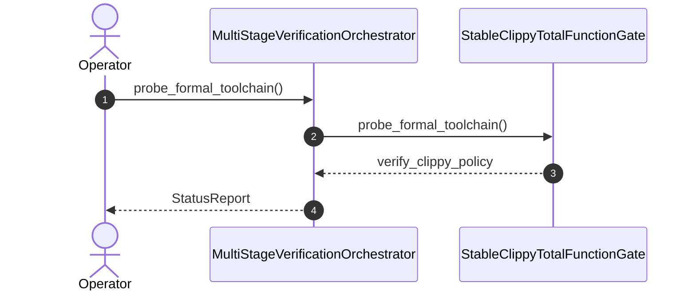

| Attribute | Specification Detail |
| :--- | :--- |
| **Issue ID** | #808 |
| **Title** | User Story 59: probe formal toolchain |
| **Type** | user-story |
| **Parent Epic** | [EPIC-09-BP_09_Multi_Stage_Compiler_and_Formal_Verification_Gatekeeper](../epics/EPIC-09-BP_09_Multi_Stage_Compiler_and_Formal_Verification_Gatekeeper.md) |
| **SysML Interaction** | `BP_09_Multi_Stage_Compiler_and_Formal_Verification_Gatekeeper_SequenceInteraction` |
| **SysML Test Case** | `Test_probe_formal_toolchain` |
| **Generation Mode** | subagent |
| **Specification Source** | [schema/model.sysml](../../schema/model.sysml) |

# User Story 59: probe formal toolchain

## User Story
As a `MultiStageVerificationOrchestrator`, I want to invoke `probe_formal_toolchain()` on `StableClippyTotalFunctionGate`, so that probe_formal_toolchain(config).

## Architectural Realization (3-Layer Definition of Done)

### Layer 1: Domain State & Data Model
- Domain state attributes on `StableClippyTotalFunctionGate`: `denied_clippy_lint_count: Integer`, `too_many_lines_threshold: Integer`, `too_many_arguments_threshold: Integer`, `disallowed_types_count: Integer`, `json_diagnostic_stream: Boolean`, `deterministic_uuid: String`, `Blueprint_ID: String`, `Requirement_ID: String`, `Title: String`, `Status: String`, `Target_Crates: String`, `Tracked_Issues: String`, `Generation_Mode: String`, `Specification_Source: String`, `too_many_lines_threshold: Real`, `too_many_arguments_threshold: Real`, `max_rt_heap_allocations: Real`, `max_miri_ub_violations: Real`, `max_kani_counterexamples: Real`, `default_kani_unwind_bound: Real`, `max_module_exec_sloc: Real`, `min_toolchain_discovery_probes: Real`.
- Action `probe_formal_toolchain` invocation message envelope bound to `StableClippyTotalFunctionGate` typed domain schema.
- Declared lifecycle state model: `BP_09_Multi_Stage_Compiler_and_Formal_Verification_Gatekeeper_LifecycleState`, `Idle`, `ProbingFormalDrivers`, `RunningStage1Clippy`, `FailedClosedJsonDiagnostic`, `RunningStage2DylintMir`, `RunningStage3FrbAndMiri`, `RunningStage4KaniCbmc`, `VerifiedAllFourStages`.

### Layer 2: Logic & State Management
- Behavioral execution contract: invokes `probe_formal_toolchain()` on `StableClippyTotalFunctionGate` with atomic precondition verification.
- State transition management: `Idle -> ProbingFormalDrivers` (trigger `probe_formal_toolchain`).
- Formal constraints and requirements enforced: `C_VER_01 (too_many_lines_threshold >= 1 and too_many_lines_threshold <= 80)`, `C_VER_02 (too_many_arguments_threshold >= 0 and too_many_arguments_threshold <= 5)`, `C_VER_03 (max_rt_heap_allocations >= 0 and max_rt_heap_allocations <= 0)`, `C_VER_04 (max_miri_ub_violations >= 0 and max_miri_ub_violations <= 0)`, `C_VER_05 (max_kani_counterexamples >= 0 and max_kani_counterexamples <= 0)`, `C_VER_06 (default_kani_unwind_bound >= 1 and default_kani_unwind_bound <= 64)`, `C_VER_07 (max_module_exec_sloc >= 1 and max_module_exec_sloc <= 380)`, `C_VER_08 (min_toolchain_discovery_probes >= 1 and min_toolchain_discovery_probes <= 3)`, `REQ-0609 (REQ_0609_BP_09_Multi_Stage_Compiler_and_Formal_Verification_Gatekeeper)`.
- Modularity & net-negative ratchet target: bounds implementation inside `< 380` exec SLOC submodules (`crates/verify-baseline/src/formal_gates/`, `crates/compile-sysml/src/kani_synth/`, `crates/compile-sysml/src/frb_guard/`) while retiring unguarded FFI/string-template harness emitters and ratcheting Check 34 ceilings.

### Layer 3: Presentation & Actuator Interface Binding
- Component port bindings on `StableClippyTotalFunctionGate`: `workspace_manifest_in: String (in)`, `clippy_ndjson_out: String (out)`.
- Interaction binding (`BP_09_Multi_Stage_Compiler_and_Formal_Verification_Gatekeeper_SequenceInteraction`): routes `probe_formal_toolchain` invocation from `MultiStageVerificationOrchestrator` to `StableClippyTotalFunctionGate` and returns `verify_clippy_policy`.
- Diagnostic fault surface: reports deterministic rejection diagnostics to `MultiStageVerificationOrchestrator` across the declared interface boundary when guard or invariant checks fail.

## UML Sequence Diagram

## Acceptance Criteria (BDD)
- [ ] AC-US-59-01: Given `StableClippyTotalFunctionGate` is in declared state `Idle` with domain state attributes (`denied_clippy_lint_count: Integer`, `too_many_lines_threshold: Integer`, `too_many_arguments_threshold: Integer`, `disallowed_types_count: Integer`, `json_diagnostic_stream: Boolean`, `deterministic_uuid: String`), When `MultiStageVerificationOrchestrator` invokes `probe_formal_toolchain` on `StableClippyTotalFunctionGate`, Then `StableClippyTotalFunctionGate` validates and binds the request against `StableClippyTotalFunctionGate` domain state (`denied_clippy_lint_count: Integer`, `too_many_lines_threshold: Integer`, `too_many_arguments_threshold: Integer`, `disallowed_types_count: Integer`, `json_diagnostic_stream: Boolean`, `deterministic_uuid: String`) and transitions to `ProbingFormalDrivers`.
- [ ] AC-US-59-02: Given `StableClippyTotalFunctionGate` active state management during `probe_formal_toolchain`, When `StableClippyTotalFunctionGate` evaluates formal constraint `C_VER_01 (too_many_lines_threshold >= 1 and too_many_lines_threshold <= 80)`, Then `StableClippyTotalFunctionGate` verifies constraint satisfaction before committing state updates.
- [ ] AC-US-59-03: Given `StableClippyTotalFunctionGate` active state management during `probe_formal_toolchain`, When `StableClippyTotalFunctionGate` evaluates formal constraint `C_VER_02 (too_many_arguments_threshold >= 0 and too_many_arguments_threshold <= 5)`, Then `StableClippyTotalFunctionGate` verifies constraint satisfaction before committing state updates.
- [ ] AC-US-59-04: Given `StableClippyTotalFunctionGate` active state management during `probe_formal_toolchain`, When `StableClippyTotalFunctionGate` evaluates formal constraint `C_VER_03 (max_rt_heap_allocations >= 0 and max_rt_heap_allocations <= 0)`, Then `StableClippyTotalFunctionGate` verifies constraint satisfaction before committing state updates.
- [ ] AC-US-59-05: Given `StableClippyTotalFunctionGate` active state management during `probe_formal_toolchain`, When `StableClippyTotalFunctionGate` evaluates formal constraint `C_VER_04 (max_miri_ub_violations >= 0 and max_miri_ub_violations <= 0)`, Then `StableClippyTotalFunctionGate` verifies constraint satisfaction before committing state updates.
- [ ] AC-US-59-06: Given `StableClippyTotalFunctionGate` active state management during `probe_formal_toolchain`, When `StableClippyTotalFunctionGate` evaluates formal constraint `C_VER_05 (max_kani_counterexamples >= 0 and max_kani_counterexamples <= 0)`, Then `StableClippyTotalFunctionGate` verifies constraint satisfaction before committing state updates.
- [ ] AC-US-59-07: Given `StableClippyTotalFunctionGate` ingress port binding (`workspace_manifest_in: String`), When `StableClippyTotalFunctionGate` completes `probe_formal_toolchain`, Then `StableClippyTotalFunctionGate` delivers `verify_clippy_policy` across egress port (`clippy_ndjson_out: String`) to `MultiStageVerificationOrchestrator`.
- [ ] AC-US-59-08: Given violated formal constraint `C_VER_01 (too_many_lines_threshold >= 1 and too_many_lines_threshold <= 80)`, When `MultiStageVerificationOrchestrator` invokes `probe_formal_toolchain` on `StableClippyTotalFunctionGate`, Then `StableClippyTotalFunctionGate` rejects the request without partial state mutation, preserves prior verified state, and emits a deterministic fault diagnostic across the interface binding.

## Required Features
- [ ] [Feature 44: [BP 09 Multi Stage Compiler and Formal Verification Gatekeeper] MultiStageVerificationOrchestrator](../features/FEAT-44-MultiStageVerificationOrchestrator.md)
- [ ] [Feature 45: [BP 09 Multi Stage Compiler and Formal Verification Gatekeeper] StableClippyTotalFunctionGate](../features/FEAT-45-StableClippyTotalFunctionGate.md)

## Source References
Operational concept definitions and system sequence interaction models:
- System Architecture Model: `schema/model.sysml`
- Normative Systems Engineering Standard: ISO/IEC/IEEE 29148:2018 §6.4.2 Concept of Operations

Authoritative user story flows and interaction lifelines derive from `schema/model.sysml` pursuant to ISO/IEC/IEEE 29148.
