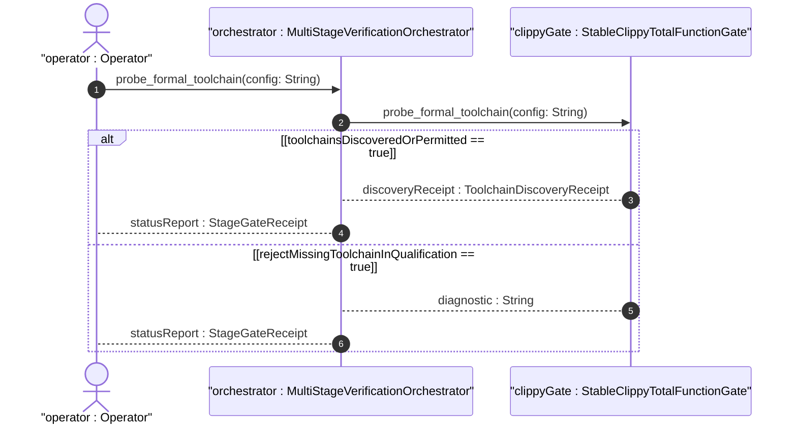
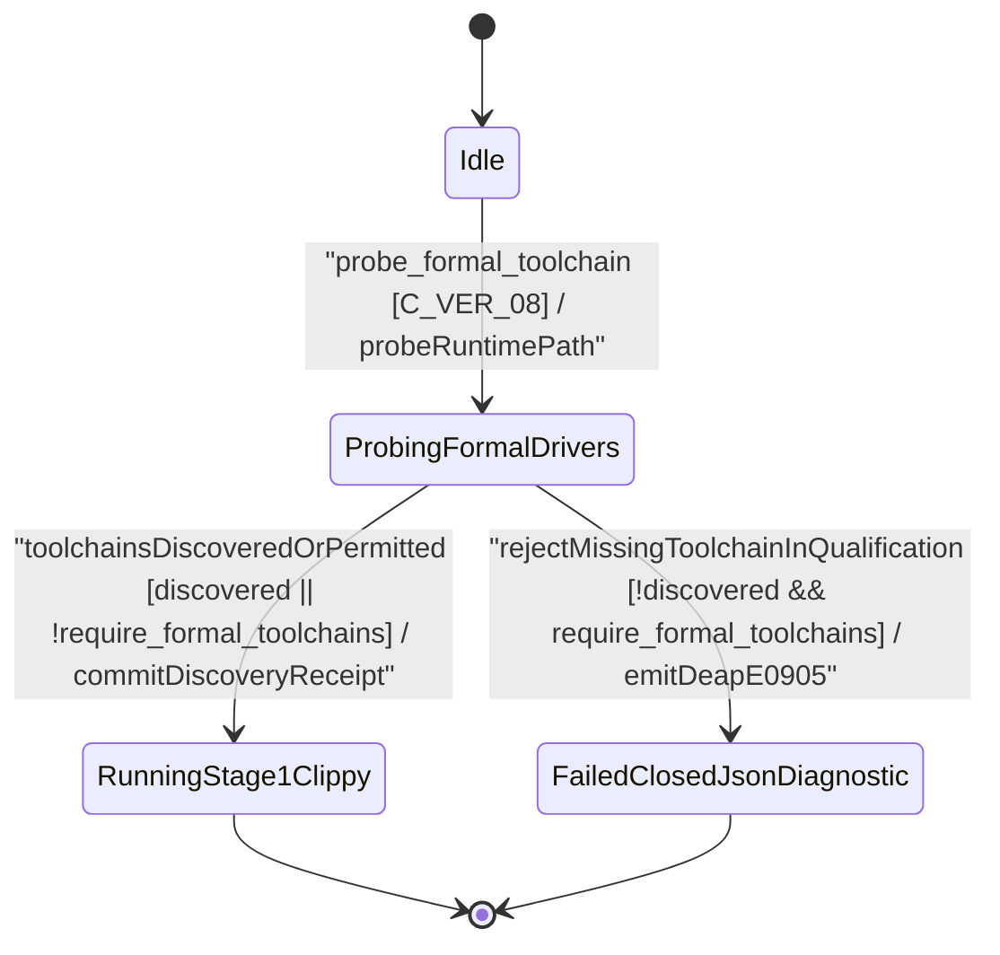

| Attribute | Specification Detail |
| :--- | :--- |
| **Issue ID** | #808 |
| **Title** | User Story 59: probe formal toolchain |
| **Type** | user-story |
| **Parent Epic** | [EPIC-09-BP_09_Multi_Stage_Compiler_and_Formal_Verification_Gatekeeper](../epics/EPIC-09-BP_09_Multi_Stage_Compiler_and_Formal_Verification_Gatekeeper.md) |
| **SysML Interaction** | `BP_09_Multi_Stage_Compiler_and_Formal_Verification_Gatekeeper_SequenceInteraction` |
| **SysML Test Case** | `Test_probe_formal_toolchain` |
| **Generation Mode** | subagent |
| **Specification Source** | [schema/model.sysml](../../schema/model.sysml) |

# User Story 59: probe formal toolchain

## User Story
As a `MultiStageVerificationOrchestrator`, I want to invoke `probe_formal_toolchain(config)` across `MultiStageVerificationOrchestrator` and `StableClippyTotalFunctionGate`, so that cross-platform formal verification drivers (`cargo-clippy`, `cargo-dylint`, `cargo-miri`, `cargo-kani`, and `dart`) are discovered dynamically via runtime `PATH`, `CARGO_HOME`, and `RUSTUP_HOME` using `std::env::consts::{DLL_PREFIX, DLL_SUFFIX, EXE_SUFFIX}` and `camino::Utf8Path` without hardcoded host paths before transitioning to `RunningStage1Clippy` or failing closed in `--require-formal-toolchains` qualification mode.

## Architectural Realization (3-Layer Definition of Done)

### Layer 1: Domain State & Data Model
- **Contract A (100% OMG SysML v2.0 + KerML 1.0 Grammar Coverage)**: Binds `FormalToolchainProbeConfig` and `ToolchainDiscoveryReceipt` across the full OMG SysML v2.0 and KerML 1.0 textual grammar (`package`/`library package`/`standard library package`, `import`, `metadata def`/`metadata`/`@Metadata`/`#user_keyword` (`#hazard`, `#risk`, `#capability`, `#rt_loop`, `#dal`, `#fls` and legacy `hazard def`/`risk def`/`capability def`), `part def`/`part`, `item def`/`item`, `attribute def`/`attribute`, `enum def`/`enum`, `port def`/`port`, `connection def`/`connection`, `interface def`/`interface`, `flow def`/`flow`, `allocation def`/`allocation`, `occurrence def`/`occurrence`, `action def`/`action`, `state def`/`state`, `calc def`/`calc`, `constraint def`/`constraint`, `requirement def`/`requirement`, `concern def`/`concern`, `use case def`/`use case`, `analysis def`/`analysis`, `verification def`/`verification`, `test case def`/`test case`, `interaction def`/`interaction`, `view def`/`view`, `viewpoint def`/`viewpoint`, `rendering def`/`rendering`, `variation`/`variant`, and KerML specialization/multiplicity/expressions) with zero 16-construct artificial caps.
- Domain state attributes on `MultiStageVerificationOrchestrator` and `StableClippyTotalFunctionGate`: `verification_stage_count: Integer`, `fail_closed_short_circuit: Boolean`, `require_formal_toolchains: Boolean`, `denied_clippy_lint_count: Integer`, `too_many_lines_threshold: Integer`, `too_many_arguments_threshold: Integer`, `disallowed_types_count: Integer`, `json_diagnostic_stream: Boolean`, `deterministic_uuid: String`, `max_rt_heap_allocations: Real`, `max_miri_ub_violations: Real`, `max_kani_counterexamples: Real`, `default_kani_unwind_bound: Real`, `max_module_exec_sloc: Real`, `min_toolchain_discovery_probes: Real`.
- Action `probe_formal_toolchain` invocation message envelope bound to `MultiStageVerificationOrchestrator` and `StableClippyTotalFunctionGate` typed domain schemas.
- Declared lifecycle state model: `BP_09_Multi_Stage_Compiler_and_Formal_Verification_Gatekeeper_LifecycleState` (`Idle`, `ProbingFormalDrivers`, `RunningStage1Clippy`, `FailedClosedJsonDiagnostic`, `RunningStage2DylintMir`, `RunningStage3FrbAndMiri`, `RunningStage4KaniCbmc`, `VerifiedAllFourStages`).

### Layer 2: Logic & State Management
- **Contract B (Cross-Platform 5-Stage Pipeline & Dynamic Runtime `PATH` Discovery, Zero Hand-Rolled Scanners)**: Behavioral execution contract invokes `probe_formal_toolchain(config)` across macOS, Linux, and Windows using `std::env::consts::{DLL_PREFIX, DLL_SUFFIX, EXE_SUFFIX}` and `camino::Utf8Path` (`1 <= min_toolchain_discovery_probes <= 3` per `C_VER_08`) to discover Stage 1 `cargo-clippy` -> Stage 2 isolated `./lints/deap-dylint-mir/` `cargo-dylint` -> Stage 3 `cargo-miri` + `flutter_rust_bridge` + `dart` -> Stage 4 `cargo-kani` (`#[kani::proof]` synthesis via `syn` + `proc-macro2` + `quote` + `prettyplease`) -> Stage 5 Ferrocene qualification drivers with zero hardcoded OS/user/machine paths and zero hand-rolled string/line/char-by-char scanners.
- State transition management: `Idle -> ProbingFormalDrivers` (trigger `probe_formal_toolchain`); `ProbingFormalDrivers -> RunningStage1Clippy` (guard `toolchainsDiscoveredOrPermitted`); `ProbingFormalDrivers -> FailedClosedJsonDiagnostic` (guard `rejectMissingToolchainInQualification`, emitting `DEAP-E0905`).
- Formal constraints and requirements enforced: `C_VER_01 (too_many_lines_threshold >= 1 and too_many_lines_threshold <= 80)`, `C_VER_02 (too_many_arguments_threshold >= 0 and too_many_arguments_threshold <= 5)`, `C_VER_03 (max_rt_heap_allocations >= 0 and max_rt_heap_allocations <= 0)`, `C_VER_04 (max_miri_ub_violations >= 0 and max_miri_ub_violations <= 0)`, `C_VER_05 (max_kani_counterexamples >= 0 and max_kani_counterexamples <= 0)`, `C_VER_06 (default_kani_unwind_bound >= 1 and default_kani_unwind_bound <= 64)`, `C_VER_07 (max_module_exec_sloc >= 1 and max_module_exec_sloc <= 380)`, `C_VER_08 (min_toolchain_discovery_probes >= 1 and min_toolchain_discovery_probes <= 3)`, `Invariant_REQ_0609_SC_05`, `REQ-0609 (REQ_0609_BP_09_Multi_Stage_Compiler_and_Formal_Verification_Gatekeeper)`.
- Modularity & net-negative ratchet target: bounds implementation inside `< 380` exec SLOC submodules (`./crates/verify-baseline/src/formal_gates/`, `./crates/compile-sysml/src/kani_synth/`, `./crates/compile-sysml/src/frb_guard/`, and excluded `./lints/deap-dylint-mir/`) while explicitly deleting legacy hand-rolled scanners, unguarded FFI/string-template harness emitters, and hardcoded host path assumptions.

### Layer 3: Presentation & Actuator Interface Binding
- Component port bindings on `MultiStageVerificationOrchestrator` and `StableClippyTotalFunctionGate`: `gate_invocation_in: String (in)`, `unified_gate_ndjson_out: String (out)`, `workspace_manifest_in: String (in)`, `clippy_ndjson_out: String (out)`.
- Interaction binding (`BP_09_Multi_Stage_Compiler_and_Formal_Verification_Gatekeeper_SequenceInteraction`): routes `probe_formal_toolchain(config)` from `MultiStageVerificationOrchestrator` to `StableClippyTotalFunctionGate` and returns `discoveryReceipt : ToolchainDiscoveryReceipt`.
- Diagnostic fault surface: reports deterministic single-line NDJSON rejection diagnostics (`DEAP-E0905`) on `unified_gate_ndjson_out` when a required formal driver is absent during `--require-formal-toolchains` qualification or when `C_VER_08` is violated.

## UML Sequence Diagram



## UML State Machine Diagram



## Formal SysML Test Case & Verification Binding
- **SysML Test Case Def:** `Test_probe_formal_toolchain`
- **Subject Part:** `MultiStageVerificationOrchestrator`
- **Verified Safety Requirement:** `REQ_0609_BP_09_Multi_Stage_Compiler_and_Formal_Verification_Gatekeeper`
- **Verification Objective:** "Verify cross-platform runtime PATH discovery of formal verification drivers (`C_VER_08`) and fail-closed `DEAP-E0905` rejection when `--require-formal-toolchains` is active and a driver is absent."

```sysml
test case def Test_probe_formal_toolchain {
    subject MultiStageVerificationOrchestrator;
    verify requirement REQ_0609_BP_09_Multi_Stage_Compiler_and_Formal_Verification_Gatekeeper;
    objective "Verify cross-platform runtime PATH toolchain discovery and fail-closed DEAP-E0905 qualification enforcement";
    step inject_probe_formal_toolchain_config;
    step assert_discovery_receipt_or_deap_e0905;
}
```

## Acceptance Criteria (BDD)
- [ ] AC-US-59-01: Given `StableClippyTotalFunctionGate` and `MultiStageVerificationOrchestrator` are in declared state `Idle` with domain state attributes (`denied_clippy_lint_count: Integer`, `too_many_lines_threshold: Integer`, `too_many_arguments_threshold: Integer`, `disallowed_types_count: Integer`, `json_diagnostic_stream: Boolean`, `deterministic_uuid: String`, `require_formal_toolchains: Boolean`), When `MultiStageVerificationOrchestrator` invokes `probe_formal_toolchain` on `StableClippyTotalFunctionGate`, Then `StableClippyTotalFunctionGate` validates and binds the request against typed domain state and transitions to `ProbingFormalDrivers`.
- [ ] AC-US-59-02: Given `StableClippyTotalFunctionGate` active state management during `probe_formal_toolchain`, When `StableClippyTotalFunctionGate` evaluates formal constraint `C_VER_01 (too_many_lines_threshold >= 1 and too_many_lines_threshold <= 80)`, Then `StableClippyTotalFunctionGate` verifies constraint satisfaction before committing state updates.
- [ ] AC-US-59-03: Given `StableClippyTotalFunctionGate` active state management during `probe_formal_toolchain`, When `StableClippyTotalFunctionGate` evaluates formal constraint `C_VER_02 (too_many_arguments_threshold >= 0 and too_many_arguments_threshold <= 5)`, Then `StableClippyTotalFunctionGate` verifies constraint satisfaction before committing state updates.
- [ ] AC-US-59-04: Given `StableClippyTotalFunctionGate` active state management during `probe_formal_toolchain`, When `StableClippyTotalFunctionGate` evaluates formal constraint `C_VER_03 (max_rt_heap_allocations >= 0 and max_rt_heap_allocations <= 0)`, Then `StableClippyTotalFunctionGate` verifies constraint satisfaction before committing state updates.
- [ ] AC-US-59-05: Given `StableClippyTotalFunctionGate` active state management during `probe_formal_toolchain`, When `StableClippyTotalFunctionGate` evaluates formal constraint `C_VER_04 (max_miri_ub_violations >= 0 and max_miri_ub_violations <= 0)`, Then `StableClippyTotalFunctionGate` verifies constraint satisfaction before committing state updates.
- [ ] AC-US-59-06: Given `StableClippyTotalFunctionGate` active state management during `probe_formal_toolchain`, When `StableClippyTotalFunctionGate` evaluates formal constraints `C_VER_05 (max_kani_counterexamples >= 0 and max_kani_counterexamples <= 0)` and `C_VER_08 (min_toolchain_discovery_probes >= 1 and min_toolchain_discovery_probes <= 3)`, Then `StableClippyTotalFunctionGate` verifies constraint satisfaction before committing state updates.
- [ ] AC-US-59-07: Given `StableClippyTotalFunctionGate` ingress port binding (`workspace_manifest_in: String`), When `StableClippyTotalFunctionGate` completes `probe_formal_toolchain` with all drivers discovered or `require_formal_toolchains == false`, Then `StableClippyTotalFunctionGate` delivers `discoveryReceipt : ToolchainDiscoveryReceipt` across egress port (`clippy_ndjson_out: String`) to `MultiStageVerificationOrchestrator` and transitions to `RunningStage1Clippy`.
- [ ] AC-US-59-08: Given violated formal constraint `C_VER_08` or a missing formal driver when `require_formal_toolchains == true`, When `MultiStageVerificationOrchestrator` invokes `probe_formal_toolchain` on `StableClippyTotalFunctionGate`, Then `StableClippyTotalFunctionGate` rejects the request without partial state mutation, transitions to `FailedClosedJsonDiagnostic`, and emits single-line NDJSON diagnostic `DEAP-E0905` across `unified_gate_ndjson_out`.

## Required Features
- [ ] #750 - [Feature 44: [BP 09 Multi Stage Compiler and Formal Verification Gatekeeper] MultiStageVerificationOrchestrator](../features/FEAT-44-MultiStageVerificationOrchestrator.md) (Coordinates cross-platform runtime `PATH` probing and `--require-formal-toolchains` fail-closed state transitions)
- [ ] #751 - [Feature 45: [BP 09 Multi Stage Compiler and Formal Verification Gatekeeper] StableClippyTotalFunctionGate](../features/FEAT-45-StableClippyTotalFunctionGate.md) (Binds Stage 1 Clippy driver discovery and manifest readiness checks)

## Source References
Operational concept definitions and system sequence interaction models:
- System Architecture Model: `schema/model.sysml`
- Engineering Design Blueprint: `./docs/designs/blueprint-09-clippy-dylint-miri-kani-formal-verification-gate.md`
- Normative Systems Engineering Standard: ISO/IEC/IEEE 29148:2018 §6.4.2 Concept of Operations

Authoritative user story flows and interaction lifelines derive from `schema/model.sysml` pursuant to ISO/IEC/IEEE 29148.
