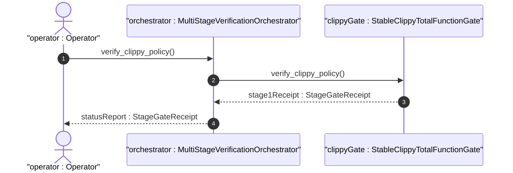
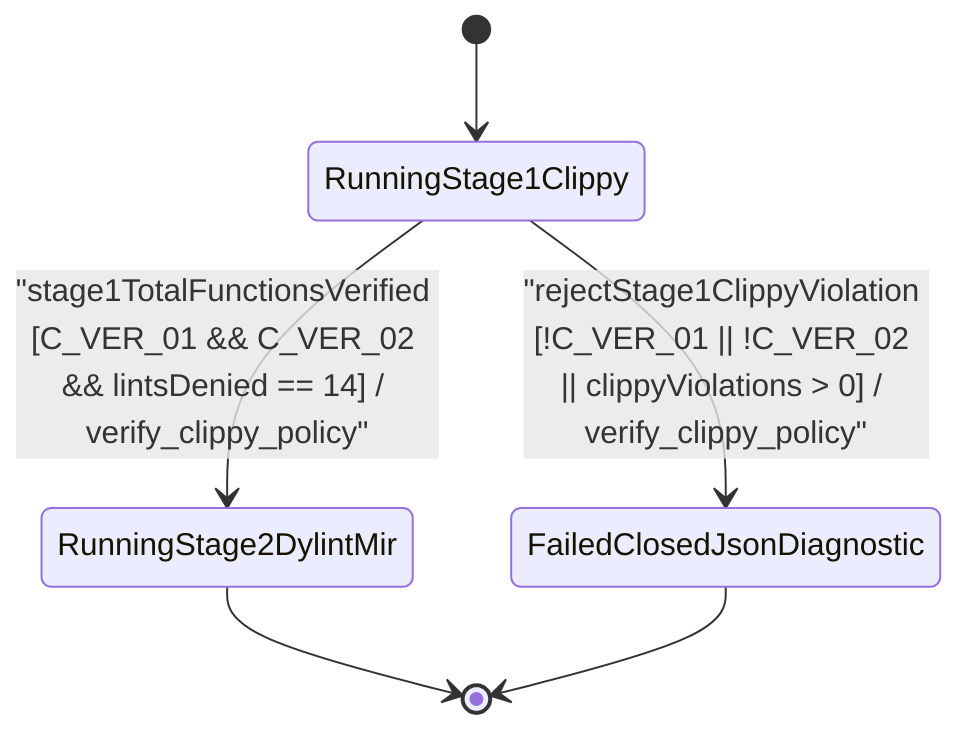

| Attribute | Specification Detail |
| :--- | :--- |
| **Issue ID** | #810 |
| **Title** | User Story 60: Verify Clippy Policy |
| **Type** | user-story |
| **Parent Epic** | [EPIC-09-BP_09_Multi_Stage_Compiler_and_Formal_Verification_Gatekeeper](../epics/EPIC-09-BP_09_Multi_Stage_Compiler_and_Formal_Verification_Gatekeeper.md) (#854) |
| **SysML Interaction** | `BP_09_Multi_Stage_Compiler_and_Formal_Verification_Gatekeeper_SequenceInteraction` |
| **SysML Test Case** | `Test_verify_clippy_policy` |
| **Generation Mode** | subagent |
| **Specification Source** | [schema/model.sysml](../../schema/model.sysml) |

# User Story 60: Verify Clippy Policy

## User Story
As a `MultiStageVerificationOrchestrator`, I want to invoke `verify_clippy_policy(policy, manifest_lints)` on `StableClippyTotalFunctionGate`, so that workspace `Cargo.toml` (`[workspace.lints.clippy]`) and root `clippy.toml` (`too-many-lines-threshold <= 80`, `too-many-arguments-threshold <= 5`, `disallowed-types`) are verified via `cargo_metadata` and `toml_edit` and `cargo clippy --workspace --all-targets --message-format=json` enforces all 14 total-function, arithmetic, cast, unsafe-doc, and complexity lints before promoting to Stage 2.

## Architectural Realization (3-Layer Definition of Done)

### Layer 1: Domain State & Data Model
- **Contract A (100% OMG SysML v2.0 + KerML 1.0 Grammar Coverage)**: Enforces Stage 1 total-function invariants across all crates ingesting and lowering the complete OMG SysML v2.0 and KerML 1.0 textual grammar (`package`/`library package`/`standard library package`, `import`, `metadata def`/`metadata`/`@Metadata`/`#user_keyword` (`#hazard`, `#risk`, `#capability`, `#rt_loop`, `#dal`, `#fls` and legacy `hazard def`/`risk def`/`capability def`), `part def`/`part`, `item def`/`item`, `attribute def`/`attribute`, `enum def`/`enum`, `port def`/`port`, `connection def`/`connection`, `interface def`/`interface`, `flow def`/`flow`, `allocation def`/`allocation`, `occurrence def`/`occurrence`, `action def`/`action`, `state def`/`state`, `calc def`/`calc`, `constraint def`/`constraint`, `requirement def`/`requirement`, `concern def`/`concern`, `use case def`/`use case`, `analysis def`/`analysis`, `verification def`/`verification`, `test case def`/`test case`, `interaction def`/`interaction`, `view def`/`view`, `viewpoint def`/`viewpoint`, `rendering def`/`rendering`, `variation`/`variant`, and KerML specialization/multiplicity/expressions) with zero 16-construct artificial caps.
- Domain state attributes on `StableClippyTotalFunctionGate`: `denied_clippy_lint_count: Integer`, `too_many_lines_threshold: Integer`, `too_many_arguments_threshold: Integer`, `disallowed_types_count: Integer`, `json_diagnostic_stream: Boolean`, `deterministic_uuid: String`, `Blueprint_ID: String`, `Requirement_ID: String`, `Title: String`, `Status: String`, `Target_Crates: String`, `Tracked_Issues: String`, `Generation_Mode: String`, `Specification_Source: String`, `too_many_lines_threshold: Real`, `too_many_arguments_threshold: Real`, `max_rt_heap_allocations: Real`, `max_miri_ub_violations: Real`, `max_kani_counterexamples: Real`, `default_kani_unwind_bound: Real`, `max_module_exec_sloc: Real`, `min_toolchain_discovery_probes: Real`.
- Action `verify_clippy_policy` invocation message envelope (`ClippyThresholdPolicy` and `manifest_lints` `BTreeMap<String, String>`) bound to `StableClippyTotalFunctionGate` typed domain schema.
- Declared lifecycle state model: `BP_09_Multi_Stage_Compiler_and_Formal_Verification_Gatekeeper_LifecycleState` (`Idle`, `ProbingFormalDrivers`, `RunningStage1Clippy`, `FailedClosedJsonDiagnostic`, `RunningStage2DylintMir`, `RunningStage3FrbAndMiri`, `RunningStage4KaniCbmc`, `VerifiedAllFourStages`).

### Layer 2: Logic & State Management
- **Contract B (Official Cargo & `toml_edit` Stack in 5-Stage Pipeline, Zero Hand-Rolled Scanners)**: Behavioral execution contract invokes `verify_clippy_policy(policy, manifest_lints)` on `StableClippyTotalFunctionGate` using `cargo_metadata`, `cargo-lock`, `cargo-util-schemas`, `cargo-platform`, and `toml_edit` (with zero hand-rolled TOML/string scanners) to verify all 14 total-function Clippy lints (`unwrap_used`, `expect_used`, `panic`, `indexing_slicing`, `todo`, `unimplemented`, `unreachable`, `dbg_macro`, `arithmetic_side_effects`, `cast_possible_truncation`, `cast_sign_loss`, `cast_possible_wrap`, `float_cmp`, `undocumented_unsafe_blocks`), `C_VER_01`, `C_VER_02`, and `disallowed_types_count >= 3`, feeding Stage 2 (`./lints/deap-dylint-mir/`), Stage 3 (`cargo miri` + `flutter_rust_bridge`), Stage 4 (`cargo kani` `outer kani::proof` via `syn`+`proc-macro2`+`quote`+`prettyplease`), and Stage 5 Ferrocene qualification.
- State transition management: `RunningStage1Clippy -> RunningStage2DylintMir` (guard `stage1TotalFunctionsVerified`); `RunningStage1Clippy -> FailedClosedJsonDiagnostic` (guard `rejectStage1ClippyViolation`, emitting `DEAP-E0900`).
- Formal constraints and requirements enforced: `C_VER_01 (too_many_lines_threshold >= 1 and too_many_lines_threshold <= 80)`, `C_VER_02 (too_many_arguments_threshold >= 0 and too_many_arguments_threshold <= 5)`, `C_VER_03 (max_rt_heap_allocations >= 0 and max_rt_heap_allocations <= 0)`, `C_VER_04 (max_miri_ub_violations >= 0 and max_miri_ub_violations <= 0)`, `C_VER_05 (max_kani_counterexamples >= 0 and max_kani_counterexamples <= 0)`, `C_VER_06 (default_kani_unwind_bound >= 1 and default_kani_unwind_bound <= 64)`, `C_VER_07 (max_module_exec_sloc >= 1 and max_module_exec_sloc <= 380)`, `C_VER_08 (min_toolchain_discovery_probes >= 1 and min_toolchain_discovery_probes <= 3)`, `Invariant_REQ_0609_SC_01`, `REQ-0609 (REQ_0609_BP_09_Multi_Stage_Compiler_and_Formal_Verification_Gatekeeper)`.
- Modularity & net-negative ratchet target: bounds implementation inside `< 380` exec SLOC submodules (`./crates/verify-baseline/src/formal_gates/`, `./crates/compile-sysml/src/kani_synth/`, `./crates/compile-sysml/src/frb_guard/`, and excluded `./lints/deap-dylint-mir/`) while explicitly deleting legacy hand-rolled manifest/attribute string scanners and ratcheting Check 34 ceilings.

### Layer 3: Presentation & Actuator Interface Binding
- Component port bindings on `StableClippyTotalFunctionGate`: `workspace_manifest_in: String (in)`, `clippy_ndjson_out: String (out)`.
- Interaction binding (`BP_09_Multi_Stage_Compiler_and_Formal_Verification_Gatekeeper_SequenceInteraction`): routes `verify_clippy_policy(policy, manifest_lints)` invocation from `MultiStageVerificationOrchestrator` to `StableClippyTotalFunctionGate` and returns `stage1Receipt : StageGateReceipt` across `BP_09_ClippyToOrchestratorConnection`.
- Diagnostic fault surface: reports deterministic single-line NDJSON rejection diagnostics (`DEAP-E0900`) to `MultiStageVerificationOrchestrator` across `clippy_ndjson_out` when any required lint denial or `clippy.toml` threshold check fails.

## UML Sequence Diagram



## UML State Machine Diagram



## Formal SysML Test Case & Verification Binding
- **SysML Test Case Def:** `Test_verify_clippy_policy`
- **Subject Part:** `StableClippyTotalFunctionGate`
- **Verified Safety Requirement:** `REQ_0609_BP_09_Multi_Stage_Compiler_and_Formal_Verification_Gatekeeper`
- **Verification Objective:** "Verify Stage 1 Clippy policy enforcement of all 14 total-function lints, `C_VER_01` (`<= 80` lines), `C_VER_02` (`<= 5` arguments), and `disallowed-types` (`>= 3`), failing closed with `DEAP-E0900` on violation."

```sysml
test case def Test_verify_clippy_policy {
    subject StableClippyTotalFunctionGate;
    verify requirement REQ_0609_BP_09_Multi_Stage_Compiler_and_Formal_Verification_Gatekeeper;
    objective "Verify Stage 1 Clippy total-function and clippy.toml threshold enforcement (C_VER_01, C_VER_02)";
    step inject_clippy_policy_and_manifest;
    step assert_stage1_receipt_or_deap_e0900;
}
```

## Acceptance Criteria (BDD)
- [ ] AC-US-60-01: Given `StableClippyTotalFunctionGate` is in declared state `RunningStage1Clippy` with domain state attributes (`denied_clippy_lint_count: Integer`, `too_many_lines_threshold: Integer`, `too_many_arguments_threshold: Integer`, `disallowed_types_count: Integer`, `json_diagnostic_stream: Boolean`, `deterministic_uuid: String`), When `MultiStageVerificationOrchestrator` invokes `verify_clippy_policy` on `StableClippyTotalFunctionGate`, Then `StableClippyTotalFunctionGate` validates and binds the request against `StableClippyTotalFunctionGate` domain state and transitions to `RunningStage2DylintMir` on zero violations.
- [ ] AC-US-60-02: Given `StableClippyTotalFunctionGate` active state management during `verify_clippy_policy`, When `StableClippyTotalFunctionGate` evaluates formal constraint `C_VER_01 (too_many_lines_threshold >= 1 and too_many_lines_threshold <= 80)`, Then `StableClippyTotalFunctionGate` verifies constraint satisfaction before committing state updates.
- [ ] AC-US-60-03: Given `StableClippyTotalFunctionGate` active state management during `verify_clippy_policy`, When `StableClippyTotalFunctionGate` evaluates formal constraint `C_VER_02 (too_many_arguments_threshold >= 0 and too_many_arguments_threshold <= 5)`, Then `StableClippyTotalFunctionGate` verifies constraint satisfaction before committing state updates.
- [ ] AC-US-60-04: Given `StableClippyTotalFunctionGate` active state management during `verify_clippy_policy`, When `StableClippyTotalFunctionGate` evaluates formal constraint `C_VER_03 (max_rt_heap_allocations >= 0 and max_rt_heap_allocations <= 0)`, Then `StableClippyTotalFunctionGate` verifies constraint satisfaction before committing state updates.
- [ ] AC-US-60-05: Given `StableClippyTotalFunctionGate` active state management during `verify_clippy_policy`, When `StableClippyTotalFunctionGate` evaluates formal constraint `C_VER_04 (max_miri_ub_violations >= 0 and max_miri_ub_violations <= 0)`, Then `StableClippyTotalFunctionGate` verifies constraint satisfaction before committing state updates.
- [ ] AC-US-60-06: Given `StableClippyTotalFunctionGate` active state management during `verify_clippy_policy`, When `StableClippyTotalFunctionGate` evaluates formal constraint `C_VER_05 (max_kani_counterexamples >= 0 and max_kani_counterexamples <= 0)`, Then `StableClippyTotalFunctionGate` verifies constraint satisfaction before committing state updates.
- [ ] AC-US-60-07: Given `StableClippyTotalFunctionGate` ingress port binding (`workspace_manifest_in: String`), When `StableClippyTotalFunctionGate` completes `verify_clippy_policy`, Then `StableClippyTotalFunctionGate` delivers `stage1Receipt : StageGateReceipt` across egress port (`clippy_ndjson_out: String`) to `MultiStageVerificationOrchestrator`.
- [ ] AC-US-60-08: Given violated formal constraint `C_VER_01 (too_many_lines_threshold >= 1 and too_many_lines_threshold <= 80)`, `C_VER_02`, or a missing total-function lint denial, When `MultiStageVerificationOrchestrator` invokes `verify_clippy_policy` on `StableClippyTotalFunctionGate`, Then `StableClippyTotalFunctionGate` rejects the request without partial state mutation, transitions to `FailedClosedJsonDiagnostic`, and emits single-line NDJSON diagnostic `DEAP-E0900` across `clippy_ndjson_out`.

## Required Features
- [ ] #842 - [Feature 44: [BP 09 Multi Stage Compiler and Formal Verification Gatekeeper] MultiStageVerificationOrchestrator](../features/FEAT-44-MultiStageVerificationOrchestrator.md) (Invokes Stage 1 Clippy verification and short-circuits Stage 2 promotion on `DEAP-E0900`)
- [ ] #843 - [Feature 45: [BP 09 Multi Stage Compiler and Formal Verification Gatekeeper] StableClippyTotalFunctionGate](../features/FEAT-45-StableClippyTotalFunctionGate.md) (Executes `verify_clippy_policy` over `Cargo.toml` and `clippy.toml` via `cargo_metadata` and `toml_edit`)

## Source References
Operational concept definitions and system sequence interaction models:
- System Architecture Model: `schema/model.sysml`
- Engineering Design Blueprint: `./docs/designs/blueprint-09-clippy-dylint-miri-kani-formal-verification-gate.md`
- Normative Systems Engineering Standard: ISO/IEC/IEEE 29148:2018 §6.4.2 Concept of Operations

Authoritative user story flows and interaction lifelines derive from `schema/model.sysml` pursuant to ISO/IEC/IEEE 29148.
