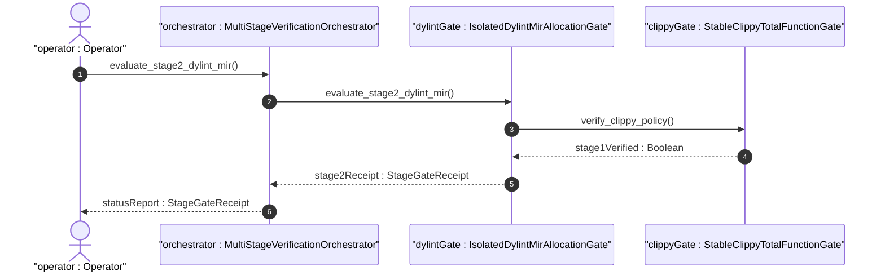
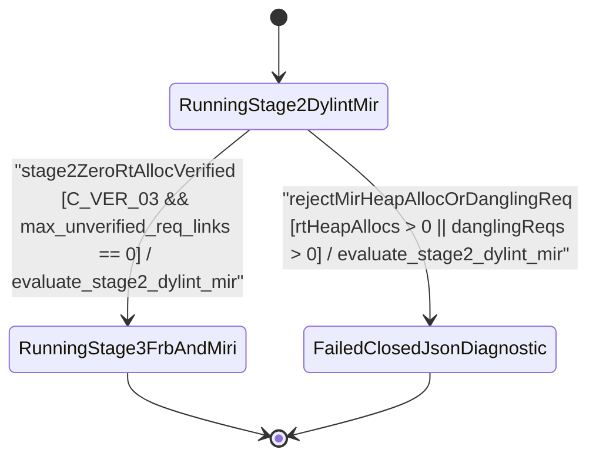

| Attribute | Specification Detail |
| :--- | :--- |
| **Issue ID** | #811 |
| **Title** | User Story 61: Evaluate Stage2 Dylint Mir |
| **Type** | user-story |
| **Parent Epic** | [EPIC-09-BP_09_Multi_Stage_Compiler_and_Formal_Verification_Gatekeeper](../epics/EPIC-09-BP_09_Multi_Stage_Compiler_and_Formal_Verification_Gatekeeper.md) (#854) |
| **SysML Interaction** | `BP_09_Multi_Stage_Compiler_and_Formal_Verification_Gatekeeper_SequenceInteraction` |
| **SysML Test Case** | `Test_evaluate_stage2_dylint_mir` |
| **Generation Mode** | subagent |
| **Specification Source** | [schema/model.sysml](../../schema/model.sysml) |

# User Story 61: Evaluate Stage2 Dylint Mir

## User Story
As a `MultiStageVerificationOrchestrator`, I want to invoke `evaluate_stage2_dylint_mir(input)` on `IsolatedDylintMirAllocationGate`, so that the standalone nightly Dylint MIR plugin at `./lints/deap-dylint-mir/` (excluded from the root stable `Cargo.toml`) proves zero transitive heap allocations or dynamic drop terminators (`C_VER_03: max_rt_heap_allocations == 0`) across `#rt_loop` control loops and verifies 100% of `outer realises("REQ-*")` / `/// Realises: [REQ-*]` bindings against active SysML `.digest.json` inventories before promoting to Stage 3.

## Architectural Realization (3-Layer Definition of Done)

### Layer 1: Domain State & Data Model
- **Contract A (100% OMG SysML v2.0 + KerML 1.0 Grammar Coverage)**: Evaluates `#rt_loop` / `@RtLoop`, `#dal` / `@Dal`, `#fls` / `@Fls`, `#hazard`, `#risk`, `#capability` metadata usages (`metadata def` / `metadata` / `@Metadata` / `#user_keyword` plus legacy `hazard def` / `risk def` / `capability def`) and `requirement def`/`requirement` (`subject`, `actor`, `stakeholder`, `framed concern`, `satisfy ... by ...`) digests across the full OMG SysML v2.0 and KerML 1.0 textual grammar with Definition and Usage symmetry and zero 16-construct artificial caps.
- Domain state attributes on `IsolatedDylintMirAllocationGate` and `StableClippyTotalFunctionGate`: `max_rt_heap_allocations: Integer`, `max_unverified_req_links: Integer`, `isolated_nightly_workspace: Boolean`, `plugin_toolchain_channel: String`, `denied_clippy_lint_count: Integer`, `too_many_lines_threshold: Integer`, `too_many_arguments_threshold: Integer`, `disallowed_types_count: Integer`, `json_diagnostic_stream: Boolean`, `deterministic_uuid: String`, `max_miri_ub_violations: Real`, `max_kani_counterexamples: Real`, `default_kani_unwind_bound: Real`, `max_module_exec_sloc: Real`, `min_toolchain_discovery_probes: Real`.
- Action `evaluate_stage2_dylint_mir` invocation message envelope (`Stage2MirEvalInput` with `rt_loop_roots`, `call_edges`, `alloc_primitives`, `claimed_req_ids`, and `valid_sysml_req_ids`) bound to `IsolatedDylintMirAllocationGate` typed domain schema.
- Declared lifecycle state model: `BP_09_Multi_Stage_Compiler_and_Formal_Verification_Gatekeeper_LifecycleState` (`Idle`, `ProbingFormalDrivers`, `RunningStage1Clippy`, `FailedClosedJsonDiagnostic`, `RunningStage2DylintMir`, `RunningStage3FrbAndMiri`, `RunningStage4KaniCbmc`, `VerifiedAllFourStages`).

### Layer 2: Logic & State Management
- **Contract B (Excluded `./lints/deap-dylint-mir/` Nightly MIR Plugin in 5-Stage Pipeline, Zero Hand-Rolled Scanners)**: Behavioral execution contract invokes `evaluate_stage2_dylint_mir(input)` on `IsolatedDylintMirAllocationGate` inside the excluded `./lints/deap-dylint-mir/` nightly plugin (`inner feature(rustc_private)`, `rustc_lint`, `rustc_middle::mir::Body`) and `./crates/verify-baseline/src/formal_gates/` evaluator inside the 5-Stage pipeline (Stage 1 Clippy -> Stage 2 excluded `./lints/deap-dylint-mir/` -> Stage 3 Miri + `flutter_rust_bridge` -> Stage 4 Kani `outer kani::proof` via `syn`+`proc-macro2`+`quote`+`prettyplease` -> Stage 5 Ferrocene qualification) with dynamic runtime `PATH` discovery and zero hand-rolled string/line/char-by-char scanners.
- State transition management: `RunningStage2DylintMir -> RunningStage3FrbAndMiri` (guard `stage2ZeroRtAllocVerified`); `RunningStage2DylintMir -> FailedClosedJsonDiagnostic` (guard `rejectMirHeapAllocOrDanglingReq`, emitting `DEAP-E0901` on `#rt_loop` heap allocation or `DEAP-E0902` on dangling `REQ-*` link).
- Formal constraints and requirements enforced: `C_VER_01 (too_many_lines_threshold >= 1 and too_many_lines_threshold <= 80)`, `C_VER_02 (too_many_arguments_threshold >= 0 and too_many_arguments_threshold <= 5)`, `C_VER_03 (max_rt_heap_allocations >= 0 and max_rt_heap_allocations <= 0)`, `C_VER_04 (max_miri_ub_violations >= 0 and max_miri_ub_violations <= 0)`, `C_VER_05 (max_kani_counterexamples >= 0 and max_kani_counterexamples <= 0)`, `C_VER_06 (default_kani_unwind_bound >= 1 and default_kani_unwind_bound <= 64)`, `C_VER_07 (max_module_exec_sloc >= 1 and max_module_exec_sloc <= 380)`, `C_VER_08 (min_toolchain_discovery_probes >= 1 and min_toolchain_discovery_probes <= 3)`, `Invariant_REQ_0609_SC_02`, `REQ-0609 (REQ_0609_BP_09_Multi_Stage_Compiler_and_Formal_Verification_Gatekeeper)`.
- Modularity & net-negative ratchet target: bounds implementation inside `< 380` exec SLOC submodules (`./crates/verify-baseline/src/formal_gates/`, `./crates/compile-sysml/src/kani_synth/`, `./crates/compile-sysml/src/frb_guard/`, and excluded `./lints/deap-dylint-mir/`) while explicitly deleting legacy hand-rolled attribute/call-graph string scanners and ratcheting Check 34 ceilings.

### Layer 3: Presentation & Actuator Interface Binding
- Component port bindings on `IsolatedDylintMirAllocationGate` and `StableClippyTotalFunctionGate`: `mir_body_graph_in: String (in)`, `dylint_ndjson_out: String (out)`, `workspace_manifest_in: String (in)`, `clippy_ndjson_out: String (out)`.
- Interaction binding (`BP_09_Multi_Stage_Compiler_and_Formal_Verification_Gatekeeper_SequenceInteraction`): routes `evaluate_stage2_dylint_mir(input)` invocation from `MultiStageVerificationOrchestrator` to `IsolatedDylintMirAllocationGate` and returns `stage2Receipt : StageGateReceipt`.
- Diagnostic fault surface: reports deterministic single-line NDJSON rejection diagnostics (`DEAP-E0901` or `DEAP-E0902`) to `MultiStageVerificationOrchestrator` across `dylint_ndjson_out` when transitive `#rt_loop` heap allocations or unverified `REQ-*` bindings are detected.

## UML Sequence Diagram



## UML State Machine Diagram



## Formal SysML Test Case & Verification Binding
- **SysML Test Case Def:** `Test_evaluate_stage2_dylint_mir`
- **Subject Part:** `IsolatedDylintMirAllocationGate`
- **Verified Safety Requirement:** `REQ_0609_BP_09_Multi_Stage_Compiler_and_Formal_Verification_Gatekeeper`
- **Verification Objective:** "Verify Stage 2 isolated `./lints/deap-dylint-mir/` transitive MIR zero-allocation proofs (`C_VER_03`, `DEAP-E0901`) and `REQ-*` SysML digest binding checks (`DEAP-E0902`)."

```sysml
test case def Test_evaluate_stage2_dylint_mir {
    subject IsolatedDylintMirAllocationGate;
    verify requirement REQ_0609_BP_09_Multi_Stage_Compiler_and_Formal_Verification_Gatekeeper;
    objective "Verify Stage 2 isolated Dylint MIR zero-allocation and REQ-* digest binding enforcement";
    step inject_stage2_mir_eval_input;
    step assert_zero_alloc_receipt_or_deap_e0901_e0902;
}
```

## Acceptance Criteria (BDD)
- [ ] AC-US-61-01: Given `IsolatedDylintMirAllocationGate` is in declared state `RunningStage2DylintMir` with domain state attributes (`max_rt_heap_allocations: Integer`, `max_unverified_req_links: Integer`, `isolated_nightly_workspace: Boolean`, `plugin_toolchain_channel: String`), When `MultiStageVerificationOrchestrator` invokes `evaluate_stage2_dylint_mir` on `IsolatedDylintMirAllocationGate`, Then `IsolatedDylintMirAllocationGate` validates and binds the request against typed domain state and transitions to `RunningStage3FrbAndMiri` when zero transitive heap allocations and zero dangling `REQ-*` links exist.
- [ ] AC-US-61-02: Given `IsolatedDylintMirAllocationGate` active state management during `evaluate_stage2_dylint_mir`, When `IsolatedDylintMirAllocationGate` evaluates formal constraint `C_VER_01 (too_many_lines_threshold >= 1 and too_many_lines_threshold <= 80)`, Then `IsolatedDylintMirAllocationGate` verifies constraint satisfaction before committing state updates.
- [ ] AC-US-61-03: Given `IsolatedDylintMirAllocationGate` active state management during `evaluate_stage2_dylint_mir`, When `IsolatedDylintMirAllocationGate` evaluates formal constraint `C_VER_02 (too_many_arguments_threshold >= 0 and too_many_arguments_threshold <= 5)`, Then `IsolatedDylintMirAllocationGate` verifies constraint satisfaction before committing state updates.
- [ ] AC-US-61-04: Given `IsolatedDylintMirAllocationGate` active state management during `evaluate_stage2_dylint_mir`, When `IsolatedDylintMirAllocationGate` evaluates formal constraint `C_VER_03 (max_rt_heap_allocations >= 0 and max_rt_heap_allocations <= 0)`, Then `IsolatedDylintMirAllocationGate` verifies zero transitive heap allocations across all `#rt_loop` call graphs before committing state updates.
- [ ] AC-US-61-05: Given `IsolatedDylintMirAllocationGate` active state management during `evaluate_stage2_dylint_mir`, When `IsolatedDylintMirAllocationGate` evaluates formal constraint `C_VER_04 (max_miri_ub_violations >= 0 and max_miri_ub_violations <= 0)`, Then `IsolatedDylintMirAllocationGate` verifies constraint satisfaction before committing state updates.
- [ ] AC-US-61-06: Given `IsolatedDylintMirAllocationGate` active state management during `evaluate_stage2_dylint_mir`, When `IsolatedDylintMirAllocationGate` evaluates formal constraint `C_VER_05 (max_kani_counterexamples >= 0 and max_kani_counterexamples <= 0)`, Then `IsolatedDylintMirAllocationGate` verifies constraint satisfaction before committing state updates.
- [ ] AC-US-61-07: Given `IsolatedDylintMirAllocationGate` ingress port binding (`mir_body_graph_in: String`), When `IsolatedDylintMirAllocationGate` completes `evaluate_stage2_dylint_mir`, Then `IsolatedDylintMirAllocationGate` delivers `stage2Receipt : StageGateReceipt` across egress port (`dylint_ndjson_out: String`) to `MultiStageVerificationOrchestrator`.
- [ ] AC-US-61-08: Given violated formal constraint `C_VER_03 (max_rt_heap_allocations == 0)` or a dangling `REQ-*` identifier absent from the compiled `.digest.json`, When `MultiStageVerificationOrchestrator` invokes `evaluate_stage2_dylint_mir` on `IsolatedDylintMirAllocationGate`, Then `IsolatedDylintMirAllocationGate` rejects the request without partial state mutation, transitions to `FailedClosedJsonDiagnostic`, and emits single-line NDJSON diagnostic `DEAP-E0901` or `DEAP-E0902` across `dylint_ndjson_out`.

## Required Features
- [ ] #840 - [Feature 42: [BP 09 Multi Stage Compiler and Formal Verification Gatekeeper] IsolatedDylintMirAllocationGate](../features/FEAT-42-IsolatedDylintMirAllocationGate.md) (Executes `evaluate_stage2_dylint_mir` over lowered `rustc_middle::mir::Body` call/drop graphs inside excluded `./lints/deap-dylint-mir/`)
- [ ] #842 - [Feature 44: [BP 09 Multi Stage Compiler and Formal Verification Gatekeeper] MultiStageVerificationOrchestrator](../features/FEAT-44-MultiStageVerificationOrchestrator.md) (Dispatches Stage 2 MIR verification and short-circuits Stage 3 promotion on `DEAP-E0901` or `DEAP-E0902`)
- [ ] #843 - [Feature 45: [BP 09 Multi Stage Compiler and Formal Verification Gatekeeper] StableClippyTotalFunctionGate](../features/FEAT-45-StableClippyTotalFunctionGate.md) (Supplies verified Stage 1 manifest and total-function preconditions)

## Source References
Operational concept definitions and system sequence interaction models:
- System Architecture Model: `schema/model.sysml`
- Engineering Design Blueprint: `./docs/designs/blueprint-09-clippy-dylint-miri-kani-formal-verification-gate.md`
- Normative Systems Engineering Standard: ISO/IEC/IEEE 29148:2018 §6.4.2 Concept of Operations

Authoritative user story flows and interaction lifelines derive from `schema/model.sysml` pursuant to ISO/IEC/IEEE 29148.
