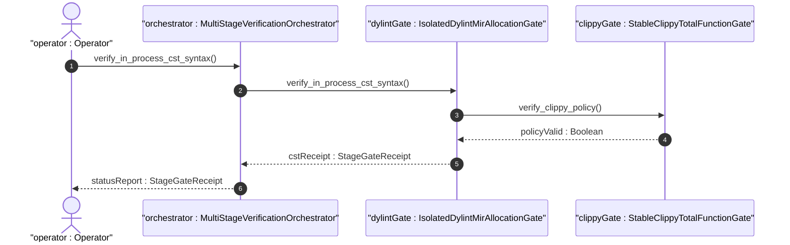
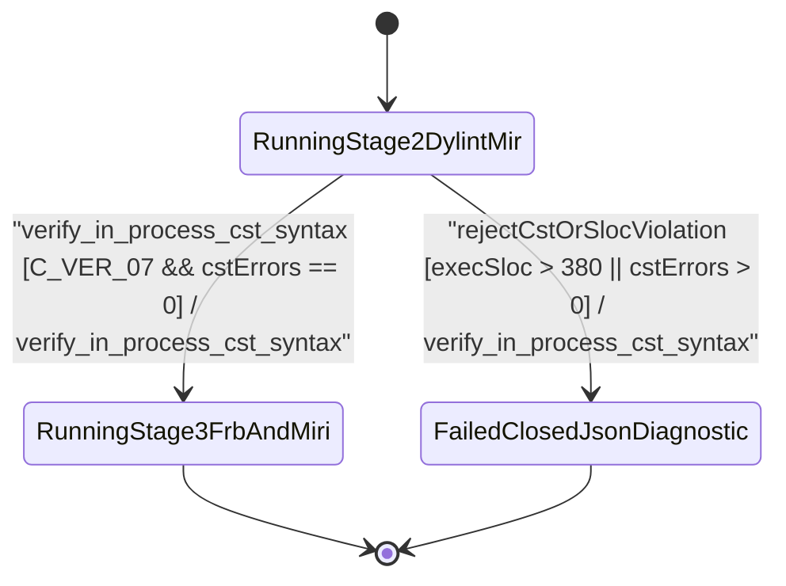

| Attribute | Specification Detail |
| :--- | :--- |
| **Issue ID** | #812 |
| **Title** | User Story 62: Verify In Process Cst Syntax |
| **Type** | user-story |
| **Parent Epic** | [EPIC-09-BP_09_Multi_Stage_Compiler_and_Formal_Verification_Gatekeeper](../epics/EPIC-09-BP_09_Multi_Stage_Compiler_and_Formal_Verification_Gatekeeper.md) (#854) |
| **SysML Interaction** | `BP_09_Multi_Stage_Compiler_and_Formal_Verification_Gatekeeper_SequenceInteraction` |
| **SysML Test Case** | `Test_verify_in_process_cst_syntax` |
| **Generation Mode** | subagent |
| **Specification Source** | [schema/model.sysml](../../schema/model.sysml) |

# User Story 62: Verify In Process Cst Syntax

## User Story
As a `MultiStageVerificationOrchestrator`, I want to invoke `verify_in_process_cst_syntax(module_path, max_exec_sloc)` on `IsolatedDylintMirAllocationGate` and `StableClippyTotalFunctionGate`, so that every formal verification submodule (`./crates/verify-baseline/src/formal_gates/`, `./crates/compile-sysml/src/kani_synth/`, `./crates/compile-sysml/src/frb_guard/`, and excluded `./lints/deap-dylint-mir/`) is parsed losslessly via `ra_ap_syntax` (`SourceFile::parse`, `Edition::Edition2024`) with zero syntax errors and bounded to `<= 380` executable SLOC (`C_VER_07`).

## Architectural Realization (3-Layer Definition of Done)

### Layer 1: Domain State & Data Model
- **Contract A (100% OMG SysML v2.0 + KerML 1.0 Grammar Coverage)**: Verifies CST structural integrity and `< 380`-SLOC modularity across all compiler and verification submodules handling the full OMG SysML v2.0 and KerML 1.0 textual grammar (`package`/`library package`/`standard library package`, `import`, `metadata def`/`metadata`/`@Metadata`/`#user_keyword` (`#hazard`, `#risk`, `#capability`, `#rt_loop`, `#dal`, `#fls` and legacy `hazard def`/`risk def`/`capability def`), `part def`/`part`, `item def`/`item`, `attribute def`/`attribute`, `enum def`/`enum`, `port def`/`port`, `connection def`/`connection`, `interface def`/`interface`, `flow def`/`flow`, `allocation def`/`allocation`, `occurrence def`/`occurrence`, `action def`/`action`, `state def`/`state`, `calc def`/`calc`, `constraint def`/`constraint`, `requirement def`/`requirement`, `concern def`/`concern`, `use case def`/`use case`, `analysis def`/`analysis`, `verification def`/`verification`, `test case def`/`test case`, `interaction def`/`interaction`, `view def`/`view`, `viewpoint def`/`viewpoint`, `rendering def`/`rendering`, `variation`/`variant`, and KerML specialization/multiplicity/expressions) with zero 16-construct artificial caps.
- Domain state attributes on `IsolatedDylintMirAllocationGate` and `StableClippyTotalFunctionGate`: `max_rt_heap_allocations: Integer`, `max_unverified_req_links: Integer`, `isolated_nightly_workspace: Boolean`, `plugin_toolchain_channel: String`, `denied_clippy_lint_count: Integer`, `too_many_lines_threshold: Integer`, `too_many_arguments_threshold: Integer`, `disallowed_types_count: Integer`, `json_diagnostic_stream: Boolean`, `deterministic_uuid: String`, `max_miri_ub_violations: Real`, `max_kani_counterexamples: Real`, `default_kani_unwind_bound: Real`, `max_module_exec_sloc: Real`, `min_toolchain_discovery_probes: Real`.
- Action `verify_in_process_cst_syntax(module_path, max_exec_sloc)` invocation message envelope bound to `IsolatedDylintMirAllocationGate` and `StableClippyTotalFunctionGate` typed domain schemas.
- Declared lifecycle state model: `BP_09_Multi_Stage_Compiler_and_Formal_Verification_Gatekeeper_LifecycleState` (`Idle`, `ProbingFormalDrivers`, `RunningStage1Clippy`, `FailedClosedJsonDiagnostic`, `RunningStage2DylintMir`, `RunningStage3FrbAndMiri`, `RunningStage4KaniCbmc`, `VerifiedAllFourStages`).

### Layer 2: Logic & State Management
- **Contract B (Lossless `ra_ap_syntax` & `rowan` CST Stack in 5-Stage Pipeline, Zero Hand-Rolled Scanners)**: Behavioral execution contract invokes `verify_in_process_cst_syntax(module_path, max_exec_sloc)` using `ra_ap_syntax` (`SourceFile::parse`, `SyntaxKind::{COMMENT, WHITESPACE}`), `ra_ap_vfs`, `ra_ap_paths`, `ra_ap_line_index`, `rowan`, and `camino::Utf8Path` (with zero hand-rolled string/line/char-by-char scanners) inside the 5-Stage pipeline (Stage 1 Clippy -> Stage 2 excluded `./lints/deap-dylint-mir/` -> Stage 3 Miri + `flutter_rust_bridge` -> Stage 4 Kani `outer kani::proof` via `syn`+`proc-macro2`+`quote`+`prettyplease` -> Stage 5 Ferrocene qualification) with dynamic runtime `PATH` discovery.
- State transition management: preserves active stage progression when `cst.errors().is_empty()` and `exec_sloc <= max_exec_sloc` (`380` SLOC per `C_VER_07`), or transitions to `FailedClosedJsonDiagnostic` with `DEAP-E0905` on CST parse error or SLOC ceiling breach.
- Formal constraints and requirements enforced: `C_VER_01 (too_many_lines_threshold >= 1 and too_many_lines_threshold <= 80)`, `C_VER_02 (too_many_arguments_threshold >= 0 and too_many_arguments_threshold <= 5)`, `C_VER_03 (max_rt_heap_allocations >= 0 and max_rt_heap_allocations <= 0)`, `C_VER_04 (max_miri_ub_violations >= 0 and max_miri_ub_violations <= 0)`, `C_VER_05 (max_kani_counterexamples >= 0 and max_kani_counterexamples <= 0)`, `C_VER_06 (default_kani_unwind_bound >= 1 and default_kani_unwind_bound <= 64)`, `C_VER_07 (max_module_exec_sloc >= 1 and max_module_exec_sloc <= 380)`, `C_VER_08 (min_toolchain_discovery_probes >= 1 and min_toolchain_discovery_probes <= 3)`, `Invariant_REQ_0609_SC_05`, `REQ-0609 (REQ_0609_BP_09_Multi_Stage_Compiler_and_Formal_Verification_Gatekeeper)`.
- Modularity & net-negative ratchet target: bounds implementation inside `< 380` exec SLOC submodules (`./crates/verify-baseline/src/formal_gates/`, `./crates/compile-sysml/src/kani_synth/`, `./crates/compile-sysml/src/frb_guard/`, and excluded `./lints/deap-dylint-mir/`) while explicitly deleting legacy hand-rolled line-counting/comment-stripping scanners and ratcheting Check 34 ceilings.

### Layer 3: Presentation & Actuator Interface Binding
- Component port bindings on `IsolatedDylintMirAllocationGate` and `StableClippyTotalFunctionGate`: `mir_body_graph_in: String (in)`, `dylint_ndjson_out: String (out)`, `workspace_manifest_in: String (in)`, `clippy_ndjson_out: String (out)`.
- Interaction binding (`BP_09_Multi_Stage_Compiler_and_Formal_Verification_Gatekeeper_SequenceInteraction`): routes `verify_in_process_cst_syntax(module_path, max_exec_sloc)` from `MultiStageVerificationOrchestrator` to `IsolatedDylintMirAllocationGate` and `StableClippyTotalFunctionGate` and returns `cstReceipt : StageGateReceipt`.
- Diagnostic fault surface: reports deterministic single-line NDJSON rejection diagnostics (`DEAP-E0905`) across `dylint_ndjson_out` / `unified_gate_ndjson_out` when any submodule fails `ra_ap_syntax` CST parsing or exceeds `380` executable SLOC (`C_VER_07`).

## UML Sequence Diagram



## UML State Machine Diagram



## Formal SysML Test Case & Verification Binding
- **SysML Test Case Def:** `Test_verify_in_process_cst_syntax`
- **Subject Part:** `IsolatedDylintMirAllocationGate`
- **Verified Safety Requirement:** `REQ_0609_BP_09_Multi_Stage_Compiler_and_Formal_Verification_Gatekeeper`
- **Verification Objective:** "Verify lossless `ra_ap_syntax` CST parsing and `< 380` executable SLOC ceiling (`C_VER_07`) across all formal verification submodules, failing closed with `DEAP-E0905` on violation."

```sysml
test case def Test_verify_in_process_cst_syntax {
    subject IsolatedDylintMirAllocationGate;
    verify requirement REQ_0609_BP_09_Multi_Stage_Compiler_and_Formal_Verification_Gatekeeper;
    objective "Verify in-process ra_ap_syntax CST parse integrity and <= 380 executable SLOC ceiling (C_VER_07)";
    step inject_module_source_and_sloc_limit;
    step assert_cst_receipt_or_deap_e0905;
}
```

## Acceptance Criteria (BDD)
- [ ] AC-US-62-01: Given `IsolatedDylintMirAllocationGate` and `StableClippyTotalFunctionGate` with domain state attributes (`max_rt_heap_allocations: Integer`, `max_unverified_req_links: Integer`, `isolated_nightly_workspace: Boolean`, `denied_clippy_lint_count: Integer`, `too_many_lines_threshold: Integer`, `too_many_arguments_threshold: Integer`), When `MultiStageVerificationOrchestrator` invokes `verify_in_process_cst_syntax(module_path, max_exec_sloc)` via `ra_ap_syntax`, Then the target module is parsed losslessly and verified to contain `<= 380` executable SLOC (`C_VER_07`).
- [ ] AC-US-62-02: Given active state management during `verify_in_process_cst_syntax`, When `StableClippyTotalFunctionGate` evaluates formal constraint `C_VER_01 (too_many_lines_threshold >= 1 and too_many_lines_threshold <= 80)`, Then constraint satisfaction is verified before committing state updates.
- [ ] AC-US-62-03: Given active state management during `verify_in_process_cst_syntax`, When `StableClippyTotalFunctionGate` evaluates formal constraint `C_VER_02 (too_many_arguments_threshold >= 0 and too_many_arguments_threshold <= 5)`, Then constraint satisfaction is verified before committing state updates.
- [ ] AC-US-62-04: Given active state management during `verify_in_process_cst_syntax`, When `IsolatedDylintMirAllocationGate` evaluates formal constraint `C_VER_03 (max_rt_heap_allocations >= 0 and max_rt_heap_allocations <= 0)`, Then constraint satisfaction is verified before committing state updates.
- [ ] AC-US-62-05: Given active state management during `verify_in_process_cst_syntax`, When `IsolatedDylintMirAllocationGate` evaluates formal constraint `C_VER_04 (max_miri_ub_violations >= 0 and max_miri_ub_violations <= 0)`, Then constraint satisfaction is verified before committing state updates.
- [ ] AC-US-62-06: Given active state management during `verify_in_process_cst_syntax`, When `IsolatedDylintMirAllocationGate` evaluates formal constraints `C_VER_05 (max_kani_counterexamples >= 0 and max_kani_counterexamples <= 0)` and `C_VER_07 (max_module_exec_sloc >= 1 and max_module_exec_sloc <= 380)`, Then constraint satisfaction is verified before committing state updates.
- [ ] AC-US-62-07: Given ingress port binding (`mir_body_graph_in: String` / `workspace_manifest_in: String`), When `verify_in_process_cst_syntax` completes cleanly, Then `cstReceipt : StageGateReceipt` is delivered across egress port (`dylint_ndjson_out: String` / `clippy_ndjson_out: String`) to `MultiStageVerificationOrchestrator`.
- [ ] AC-US-62-08: Given violated formal constraint `C_VER_07 (max_module_exec_sloc <= 380)` or an `ra_ap_syntax` CST syntax error, When `MultiStageVerificationOrchestrator` invokes `verify_in_process_cst_syntax`, Then the gate rejects the request without partial state mutation, transitions to `FailedClosedJsonDiagnostic`, and emits single-line NDJSON diagnostic `DEAP-E0905`.

## Required Features
- [ ] #840 - [Feature 42: [BP 09 Multi Stage Compiler and Formal Verification Gatekeeper] IsolatedDylintMirAllocationGate](../features/FEAT-42-IsolatedDylintMirAllocationGate.md) (Executes `verify_in_process_cst_syntax` across `./crates/verify-baseline/src/formal_gates/` and excluded `./lints/deap-dylint-mir/`)
- [ ] #842 - [Feature 44: [BP 09 Multi Stage Compiler and Formal Verification Gatekeeper] MultiStageVerificationOrchestrator](../features/FEAT-44-MultiStageVerificationOrchestrator.md) (Coordinates submodule CST and `< 380`-SLOC verification across all formal verification gates)
- [ ] #843 - [Feature 45: [BP 09 Multi Stage Compiler and Formal Verification Gatekeeper] StableClippyTotalFunctionGate](../features/FEAT-45-StableClippyTotalFunctionGate.md) (Enforces Stage 1 CST and `clippy.toml` structural complexity alignment)

## Source References
Operational concept definitions and system sequence interaction models:
- System Architecture Model: `schema/model.sysml`
- Engineering Design Blueprint: `./docs/designs/blueprint-09-clippy-dylint-miri-kani-formal-verification-gate.md`
- Normative Systems Engineering Standard: ISO/IEC/IEEE 29148:2018 §6.4.2 Concept of Operations

Authoritative user story flows and interaction lifelines derive from `schema/model.sysml` pursuant to ISO/IEC/IEEE 29148.
