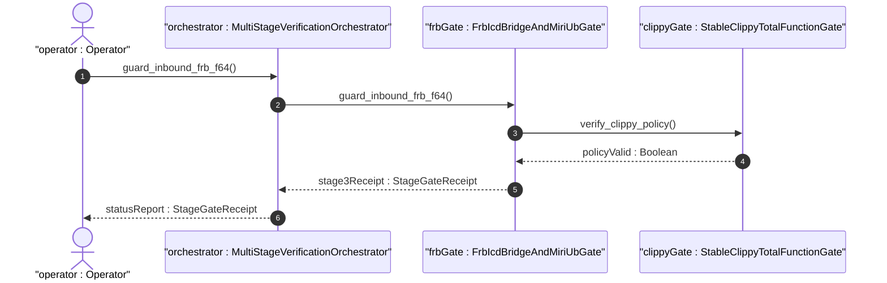
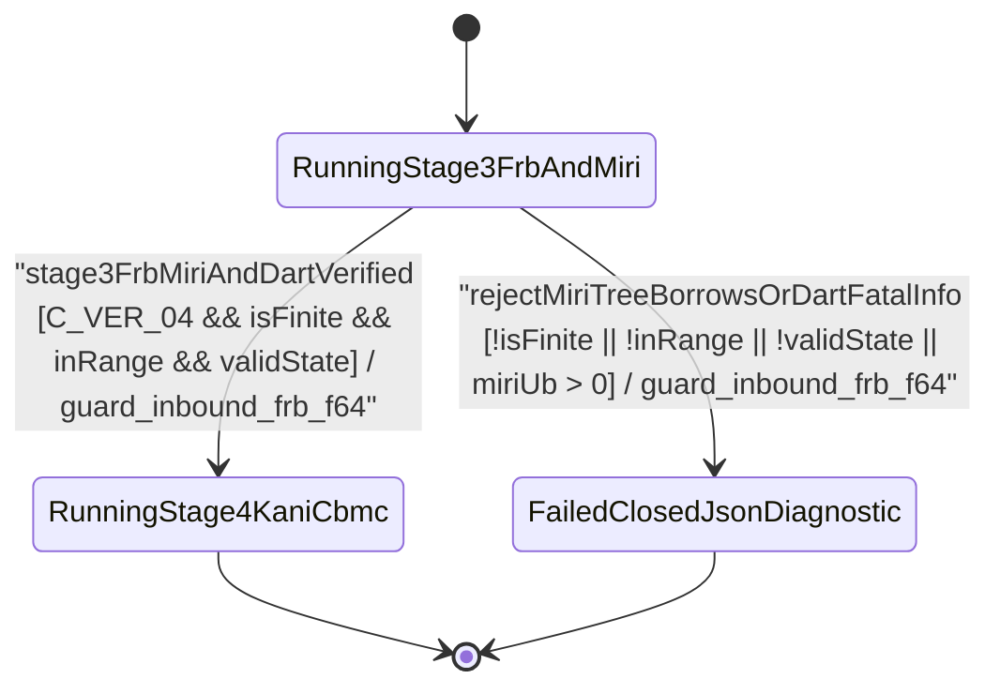

| Attribute | Specification Detail |
| :--- | :--- |
| **Issue ID** | #813 |
| **Title** | User Story 63: Guard Inbound Frb F64 |
| **Type** | user-story |
| **Parent Epic** | [EPIC-09-BP_09_Multi_Stage_Compiler_and_Formal_Verification_Gatekeeper](../epics/EPIC-09-BP_09_Multi_Stage_Compiler_and_Formal_Verification_Gatekeeper.md) |
| **SysML Interaction** | `BP_09_Multi_Stage_Compiler_and_Formal_Verification_Gatekeeper_SequenceInteraction` |
| **SysML Test Case** | `Test_guard_inbound_frb_f64` |
| **Generation Mode** | subagent |
| **Specification Source** | [schema/model.sysml](../../schema/model.sysml) |

# User Story 63: Guard Inbound Frb F64

## User Story
As a `MultiStageVerificationOrchestrator`, I want to invoke `guard_inbound_frb_f64(spec, raw_value, active_fsm_state)` on `FrbIcdBridgeAndMiriUbGate`, so that every inbound `flutter_rust_bridge` FFI signal is checked for IEEE 754 finiteness (`is_finite()`), closed `[min..max]` interval bounds, and admissible `state def` operational modes before entering `inner forbid(unsafe_code)` domain logic, while Stage 3 Miri `-Zmiri-tree-borrows` and `dart analyze --fatal-infos` verify zero undefined behavior (`C_VER_04`).

## Architectural Realization (3-Layer Definition of Done)

### Layer 1: Domain State & Data Model
- **Contract A (100% OMG SysML v2.0 + KerML 1.0 Grammar Coverage)**: Extracts `IcdSignalGuardSpec` bounds and admissible FSM states from full OMG SysML v2.0 and KerML 1.0 `port def`/`port` (`in`, `out`, `inout`, `~`), `item def`/`item`, `flow def`/`flow` (`of ... from ... to ...`), `interface def`/`interface`, `connection def`/`connection`, `state def`/`state` (`exhibit`, `parallel`, `entry`, `do`, `exit`, `transition first ... accept ... if ... do ... then ...`), `constraint def`/`constraint` (`assert`, `assume`, `require`), `#hazard`/`#risk`/`#dal`/`#fls`/`#rt_loop` metadata usages, and `ISQ`/`SI`/`ScalarValues` typed intervals (`[lo..hi]`) with Definition and Usage symmetry and zero 16-construct artificial caps.
- Domain state attributes on `FrbIcdBridgeAndMiriUbGate` and `StableClippyTotalFunctionGate`: `max_miri_ub_violations: Integer`, `max_dart_analyze_infos: Integer`, `forbid_unsafe_in_domain: Boolean`, `miri_aliasing_model: String`, `denied_clippy_lint_count: Integer`, `too_many_lines_threshold: Integer`, `too_many_arguments_threshold: Integer`, `disallowed_types_count: Integer`, `json_diagnostic_stream: Boolean`, `deterministic_uuid: String`, `max_rt_heap_allocations: Real`, `max_kani_counterexamples: Real`, `default_kani_unwind_bound: Real`, `max_module_exec_sloc: Real`, `min_toolchain_discovery_probes: Real`.
- Action `guard_inbound_frb_f64(spec, raw_value, active_fsm_state)` invocation message envelope bound to `FrbIcdBridgeAndMiriUbGate` typed domain schema.
- Declared lifecycle state model: `BP_09_Multi_Stage_Compiler_and_Formal_Verification_Gatekeeper_LifecycleState` (`Idle`, `ProbingFormalDrivers`, `RunningStage1Clippy`, `FailedClosedJsonDiagnostic`, `RunningStage2DylintMir`, `RunningStage3FrbAndMiri`, `RunningStage4KaniCbmc`, `VerifiedAllFourStages`).

### Layer 2: Logic & State Management
- **Contract B (Stage 3 `flutter_rust_bridge` + Miri `-Zmiri-tree-borrows` in 5-Stage Pipeline, Zero Hand-Rolled Scanners)**: Behavioral execution contract invokes `guard_inbound_frb_f64(spec, raw_value, active_fsm_state)` on `FrbIcdBridgeAndMiriUbGate`, synthesizing `inner forbid(unsafe_code)` domain crates and isolated `flutter_rust_bridge` FFI guards via `syn` + `proc-macro2` + `quote` + `prettyplease`, verifying Dart bindings via `deap_core::dart_cst` (`logos` + `rowan`) and `dart analyze --fatal-infos`, and executing `cargo +nightly miri test` under `MIRIFLAGS="-Zmiri-tree-borrows"` (`C_VER_04: max_miri_ub_violations == 0`) inside the 5-Stage pipeline (Stage 1 Clippy -> Stage 2 excluded `./lints/deap-dylint-mir/` -> Stage 3 Miri + `flutter_rust_bridge` -> Stage 4 Kani `outer kani::proof` -> Stage 5 Ferrocene qualification) with dynamic runtime `PATH` discovery and zero hand-rolled scanners.
- State transition management: `RunningStage3FrbAndMiri -> RunningStage4KaniCbmc` (guard `stage3FrbMiriAndDartVerified`); `RunningStage3FrbAndMiri -> FailedClosedJsonDiagnostic` (guard `rejectMiriTreeBorrowsOrDartFatalInfo`, emitting `DEAP-E0903`).
- Formal constraints and requirements enforced: `C_VER_01 (too_many_lines_threshold >= 1 and too_many_lines_threshold <= 80)`, `C_VER_02 (too_many_arguments_threshold >= 0 and too_many_arguments_threshold <= 5)`, `C_VER_03 (max_rt_heap_allocations >= 0 and max_rt_heap_allocations <= 0)`, `C_VER_04 (max_miri_ub_violations >= 0 and max_miri_ub_violations <= 0)`, `C_VER_05 (max_kani_counterexamples >= 0 and max_kani_counterexamples <= 0)`, `C_VER_06 (default_kani_unwind_bound >= 1 and default_kani_unwind_bound <= 64)`, `C_VER_07 (max_module_exec_sloc >= 1 and max_module_exec_sloc <= 380)`, `C_VER_08 (min_toolchain_discovery_probes >= 1 and min_toolchain_discovery_probes <= 3)`, `Invariant_REQ_0609_SC_03`, `REQ-0609 (REQ_0609_BP_09_Multi_Stage_Compiler_and_Formal_Verification_Gatekeeper)`.
- Modularity & net-negative ratchet target: bounds implementation inside `< 380` exec SLOC submodules (`./crates/compile-sysml/src/frb_guard/`, `./crates/verify-baseline/src/formal_gates/`, `./crates/compile-sysml/src/kani_synth/`, and excluded `./lints/deap-dylint-mir/`) while explicitly deleting legacy unguarded FFI emitters and hand-rolled Dart/FFI string scanners.

### Layer 3: Presentation & Actuator Interface Binding
- Component port bindings on `FrbIcdBridgeAndMiriUbGate` and `StableClippyTotalFunctionGate`: `sysml_icd_ast_in: String (in)`, `frb_facade_and_dart_out: String (out)`, `miri_and_dart_receipt_out: String (out)`, `workspace_manifest_in: String (in)`, `clippy_ndjson_out: String (out)`.
- Interaction binding (`BP_09_Multi_Stage_Compiler_and_Formal_Verification_Gatekeeper_SequenceInteraction`): routes `guard_inbound_frb_f64(spec, raw_value, active_fsm_state)` from `MultiStageVerificationOrchestrator` to `FrbIcdBridgeAndMiriUbGate` and returns `stage3Receipt : StageGateReceipt`.
- Diagnostic fault surface: reports deterministic single-line NDJSON rejection diagnostics (`DEAP-E0903`) across `miri_and_dart_receipt_out` when an inbound FFI value is `NaN`, infinite, out of `[min..max]` bounds, arrives in a disallowed FSM state, or when Miri Tree Borrows / `dart analyze --fatal-infos` detects a violation.

## UML Sequence Diagram



## UML State Machine Diagram



## Formal SysML Test Case & Verification Binding
- **SysML Test Case Def:** `Test_guard_inbound_frb_f64`
- **Subject Part:** `FrbIcdBridgeAndMiriUbGate`
- **Verified Safety Requirement:** `REQ_0609_BP_09_Multi_Stage_Compiler_and_Formal_Verification_Gatekeeper`
- **Verification Objective:** "Verify Stage 3 `flutter_rust_bridge` inbound `f64` finiteness, closed `[min..max]` interval, and FSM state precondition guards alongside Miri `-Zmiri-tree-borrows` (`C_VER_04`), failing closed with `DEAP-E0903` on violation."

```sysml
test case def Test_guard_inbound_frb_f64 {
    subject FrbIcdBridgeAndMiriUbGate;
    verify requirement REQ_0609_BP_09_Multi_Stage_Compiler_and_Formal_Verification_Gatekeeper;
    objective "Verify Stage 3 flutter_rust_bridge FFI boundary guards and Miri Tree Borrows zero-UB enforcement (C_VER_04)";
    step inject_frb_f64_signal_and_fsm_state;
    step assert_guarded_value_or_deap_e0903;
}
```

## Acceptance Criteria (BDD)
- [ ] AC-US-63-01: Given `FrbIcdBridgeAndMiriUbGate` is in declared state `RunningStage3FrbAndMiri` with domain state attributes (`max_miri_ub_violations: Integer`, `max_dart_analyze_infos: Integer`, `forbid_unsafe_in_domain: Boolean`, `miri_aliasing_model: String`), When `MultiStageVerificationOrchestrator` invokes `guard_inbound_frb_f64(spec, raw_value, active_fsm_state)` on `FrbIcdBridgeAndMiriUbGate`, Then `FrbIcdBridgeAndMiriUbGate` validates finiteness, closed `[min..max]` bounds, and FSM state preconditions and transitions to `RunningStage4KaniCbmc`.
- [ ] AC-US-63-02: Given active state management during `guard_inbound_frb_f64`, When `StableClippyTotalFunctionGate` evaluates formal constraint `C_VER_01 (too_many_lines_threshold >= 1 and too_many_lines_threshold <= 80)`, Then constraint satisfaction is verified before committing state updates.
- [ ] AC-US-63-03: Given active state management during `guard_inbound_frb_f64`, When `StableClippyTotalFunctionGate` evaluates formal constraint `C_VER_02 (too_many_arguments_threshold >= 0 and too_many_arguments_threshold <= 5)`, Then constraint satisfaction is verified before committing state updates.
- [ ] AC-US-63-04: Given active state management during `guard_inbound_frb_f64`, When `FrbIcdBridgeAndMiriUbGate` evaluates formal constraint `C_VER_03 (max_rt_heap_allocations >= 0 and max_rt_heap_allocations <= 0)`, Then constraint satisfaction is verified before committing state updates.
- [ ] AC-US-63-05: Given active state management during `guard_inbound_frb_f64`, When `FrbIcdBridgeAndMiriUbGate` evaluates formal constraint `C_VER_04 (max_miri_ub_violations >= 0 and max_miri_ub_violations <= 0)` under `-Zmiri-tree-borrows`, Then `FrbIcdBridgeAndMiriUbGate` verifies zero undefined-behavior violations before committing state updates.
- [ ] AC-US-63-06: Given active state management during `guard_inbound_frb_f64`, When `FrbIcdBridgeAndMiriUbGate` evaluates formal constraint `C_VER_05 (max_kani_counterexamples >= 0 and max_kani_counterexamples <= 0)`, Then constraint satisfaction is verified before committing state updates.
- [ ] AC-US-63-07: Given `FrbIcdBridgeAndMiriUbGate` ingress port binding (`sysml_icd_ast_in: String`), When `FrbIcdBridgeAndMiriUbGate` completes `guard_inbound_frb_f64`, Then `FrbIcdBridgeAndMiriUbGate` delivers `stage3Receipt : StageGateReceipt` across egress port (`miri_and_dart_receipt_out: String`) to `MultiStageVerificationOrchestrator`.
- [ ] AC-US-63-08: Given `NaN`, infinite, out-of-range `raw_value`, disallowed `active_fsm_state`, or violated `C_VER_04`, When `MultiStageVerificationOrchestrator` invokes `guard_inbound_frb_f64` on `FrbIcdBridgeAndMiriUbGate`, Then `FrbIcdBridgeAndMiriUbGate` rejects the request without partial state mutation, transitions to `FailedClosedJsonDiagnostic`, and emits single-line NDJSON diagnostic `DEAP-E0903`.

## Required Features
- [ ] #839 - [Feature 41: [BP 09 Multi Stage Compiler and Formal Verification Gatekeeper] FrbIcdBridgeAndMiriUbGate](../features/FEAT-41-FrbIcdBridgeAndMiriUbGate.md) (Implements `guard_inbound_frb_f64`, `inner forbid(unsafe_code)` domain isolation, `dart analyze --fatal-infos`, and Miri `-Zmiri-tree-borrows` verification)
- [ ] #842 - [Feature 44: [BP 09 Multi Stage Compiler and Formal Verification Gatekeeper] MultiStageVerificationOrchestrator](../features/FEAT-44-MultiStageVerificationOrchestrator.md) (Orchestrates Stage 3 FFI and Miri evaluation and short-circuits Stage 4 promotion on `DEAP-E0903`)
- [ ] #843 - [Feature 45: [BP 09 Multi Stage Compiler and Formal Verification Gatekeeper] StableClippyTotalFunctionGate](../features/FEAT-45-StableClippyTotalFunctionGate.md) (Enforces Stage 1 total-function and `undocumented_unsafe_blocks = "deny"` prerequisites)

## Source References
Operational concept definitions and system sequence interaction models:
- System Architecture Model: `schema/model.sysml`
- Engineering Design Blueprint: `./docs/designs/blueprint-09-clippy-dylint-miri-kani-formal-verification-gate.md`
- Normative Systems Engineering Standard: ISO/IEC/IEEE 29148:2018 §6.4.2 Concept of Operations

Authoritative user story flows and interaction lifelines derive from `schema/model.sysml` pursuant to ISO/IEC/IEEE 29148.
