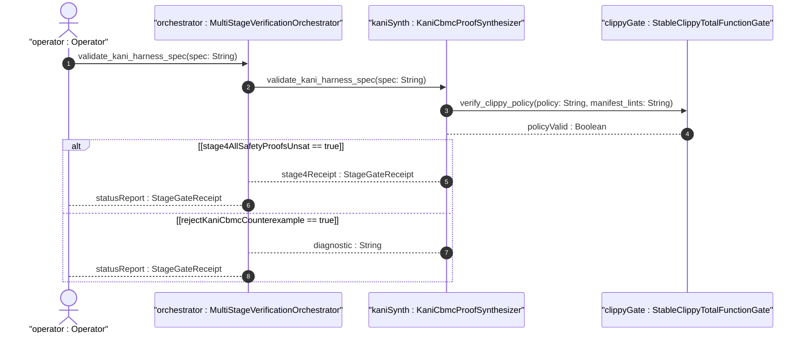
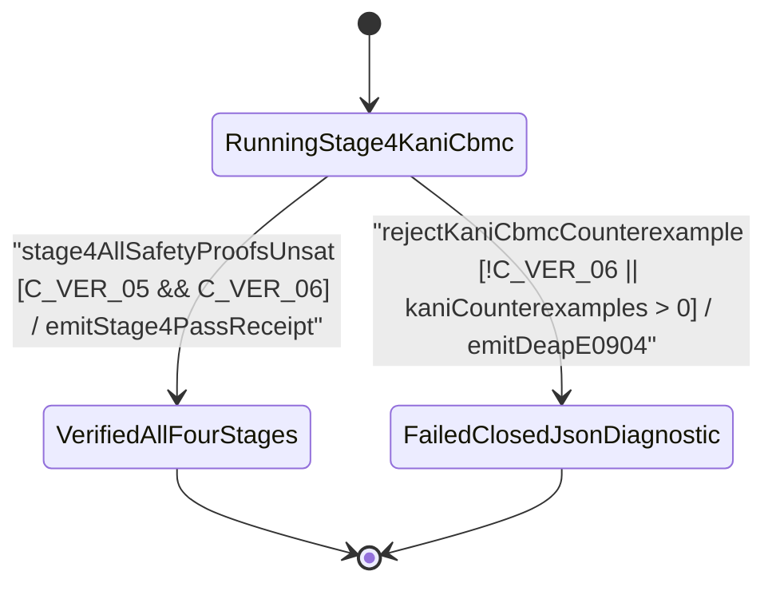

| Attribute | Specification Detail |
| :--- | :--- |
| **Issue ID** | #813 |
| **Title** | User Story 64: validate kani harness spec |
| **Type** | user-story |
| **Parent Epic** | [EPIC-09-BP_09_Multi_Stage_Compiler_and_Formal_Verification_Gatekeeper](../epics/EPIC-09-BP_09_Multi_Stage_Compiler_and_Formal_Verification_Gatekeeper.md) |
| **SysML Interaction** | `BP_09_Multi_Stage_Compiler_and_Formal_Verification_Gatekeeper_SequenceInteraction` |
| **SysML Test Case** | `Test_validate_kani_harness_spec` |
| **Generation Mode** | subagent |
| **Specification Source** | [schema/model.sysml](../../schema/model.sysml) |

# User Story 64: validate kani harness spec

## User Story
As a `MultiStageVerificationOrchestrator`, I want to invoke `validate_kani_harness_spec(spec)` on `KaniCbmcProofSynthesizer`, so that SysML v2.0 + KerML 1.0 safety constraints and STPA `UCA-*` / `SC-*` invariants are validated for non-empty `kani::assume(...)` domains and bounded unwind ceilings (`C_VER_06: 1 <= default_kani_unwind_bound <= 64`), lowered into byte-deterministic `#[cfg(kani)]` `#[kani::proof]` harnesses via `syn` + `proc-macro2` + `quote` + `prettyplease`, and proved `UNSAT` (`C_VER_05: max_kani_counterexamples == 0`) by `cargo kani`.

## Architectural Realization (3-Layer Definition of Done)

### Layer 1: Domain State & Data Model
- **Contract A (100% OMG SysML v2.0 + KerML 1.0 Grammar Coverage)**: Lowers `KaniProofHarnessSpec` from full OMG SysML v2.0 and KerML 1.0 `constraint def`/`constraint` (`assert`, `assume`, `require`), `calc def`/`calc` (`return`), `port def`/`port` (`in`, `out`, `inout`, `~`), `state def`/`state` (`exhibit`, `parallel`, `entry`, `do`, `exit`, `transition first ... accept ... if ... do ... then ...`), `action def`/`action`, `requirement def`/`requirement`, `verification def`/`verification` (`verify requirement`), `test case def`/`test case`, `#hazard`/`#risk`/`#dal`/`#fls`/`#rt_loop` metadata usages, and KerML expressions (`implies`, `xor`, `??`, `->`, `collect`, `select`, `forAll`, `exists`, `[lo..hi]`, `ISQ`/`SI`/`ScalarValues`) with Definition and Usage symmetry and zero 16-construct artificial caps.
- Domain state attributes on `KaniCbmcProofSynthesizer` and `StableClippyTotalFunctionGate`: `max_kani_counterexamples: Integer`, `default_kani_unwind_bound: Integer`, `structured_prettyplease_codegen: Boolean`, `denied_clippy_lint_count: Integer`, `too_many_lines_threshold: Integer`, `too_many_arguments_threshold: Integer`, `disallowed_types_count: Integer`, `json_diagnostic_stream: Boolean`, `deterministic_uuid: String`, `max_rt_heap_allocations: Real`, `max_miri_ub_violations: Real`, `max_module_exec_sloc: Real`, `min_toolchain_discovery_probes: Real`.
- Action `validate_kani_harness_spec(spec)` invocation message envelope bound to `KaniCbmcProofSynthesizer` typed domain schema.
- Declared lifecycle state model: `BP_09_Multi_Stage_Compiler_and_Formal_Verification_Gatekeeper_LifecycleState` (`Idle`, `ProbingFormalDrivers`, `RunningStage1Clippy`, `FailedClosedJsonDiagnostic`, `RunningStage2DylintMir`, `RunningStage3FrbAndMiri`, `RunningStage4KaniCbmc`, `VerifiedAllFourStages`).

### Layer 2: Logic & State Management
- **Contract B (Stage 4 `#[kani::proof]` Synthesis via `syn` + `proc-macro2` + `quote` + `prettyplease` in 5-Stage Pipeline, Zero Hand-Rolled Scanners)**: Behavioral execution contract invokes `validate_kani_harness_spec(spec)` on `KaniCbmcProofSynthesizer`, validating non-empty `kani::assume(...)` precondition domains, STPA `UCA-*` falsification assertions, and `C_VER_06` unwind bounds (`1..=64`), synthesizing `#[cfg(kani)]` `#[kani::proof]` and `#[kani::unwind(N)]` proof modules via `syn` + `proc-macro2` + `quote` + `prettyplease` (with zero raw `format!` string-template harness concatenation and zero hand-rolled scanners), and executing `cargo kani` inside the 5-Stage pipeline (Stage 1 Clippy -> Stage 2 excluded `./lints/deap-dylint-mir/` -> Stage 3 Miri + `flutter_rust_bridge` -> Stage 4 Kani `#[kani::proof]` -> Stage 5 Ferrocene qualification) with dynamic runtime `PATH` discovery.
- State transition management: `RunningStage4KaniCbmc -> VerifiedAllFourStages` (guard `stage4AllSafetyProofsUnsat`); `RunningStage4KaniCbmc -> FailedClosedJsonDiagnostic` (guard `rejectKaniCbmcCounterexample`, emitting `DEAP-E0904`).
- Formal constraints and requirements enforced: `C_VER_01 (too_many_lines_threshold >= 1 and too_many_lines_threshold <= 80)`, `C_VER_02 (too_many_arguments_threshold >= 0 and too_many_arguments_threshold <= 5)`, `C_VER_03 (max_rt_heap_allocations >= 0 and max_rt_heap_allocations <= 0)`, `C_VER_04 (max_miri_ub_violations >= 0 and max_miri_ub_violations <= 0)`, `C_VER_05 (max_kani_counterexamples >= 0 and max_kani_counterexamples <= 0)`, `C_VER_06 (default_kani_unwind_bound >= 1 and default_kani_unwind_bound <= 64)`, `C_VER_07 (max_module_exec_sloc >= 1 and max_module_exec_sloc <= 380)`, `C_VER_08 (min_toolchain_discovery_probes >= 1 and min_toolchain_discovery_probes <= 3)`, `Invariant_REQ_0609_SC_04`, `REQ-0609 (REQ_0609_BP_09_Multi_Stage_Compiler_and_Formal_Verification_Gatekeeper)`.
- Modularity & net-negative ratchet target: bounds implementation inside `< 380` exec SLOC submodules (`./crates/compile-sysml/src/kani_synth/`, `./crates/verify-baseline/src/formal_gates/`, `./crates/compile-sysml/src/frb_guard/`, and excluded `./lints/deap-dylint-mir/`) while explicitly deleting legacy raw string-template harness emitters and hand-rolled scanners.

### Layer 3: Presentation & Actuator Interface Binding
- Component port bindings on `KaniCbmcProofSynthesizer` and `StableClippyTotalFunctionGate`: `sysml_safety_ast_in: String (in)`, `kani_proof_module_out: String (out)`, `cbmc_proof_receipt_out: String (out)`, `workspace_manifest_in: String (in)`, `clippy_ndjson_out: String (out)`.
- Interaction binding (`BP_09_Multi_Stage_Compiler_and_Formal_Verification_Gatekeeper_SequenceInteraction`): routes `validate_kani_harness_spec(spec)` from `MultiStageVerificationOrchestrator` to `KaniCbmcProofSynthesizer` and returns `stage4Receipt : StageGateReceipt`.
- Diagnostic fault surface: reports deterministic single-line NDJSON rejection diagnostics (`DEAP-E0904`) across `cbmc_proof_receipt_out` when a harness specification is invalid or when CBMC discovers a reachable counterexample (`SAT`).

## UML Sequence Diagram



## UML State Machine Diagram



## Formal SysML Test Case & Verification Binding
- **SysML Test Case Def:** `Test_validate_kani_harness_spec`
- **Subject Part:** `KaniCbmcProofSynthesizer`
- **Verified Safety Requirement:** `REQ_0609_BP_09_Multi_Stage_Compiler_and_Formal_Verification_Gatekeeper`
- **Verification Objective:** "Verify Stage 4 `#[kani::proof]` harness validation (`C_VER_06`), `syn` + `proc-macro2` + `quote` + `prettyplease` AST synthesis, and CBMC `UNSAT` verification (`C_VER_05`), failing closed with `DEAP-E0904` on violation."

```sysml
test case def Test_validate_kani_harness_spec {
    subject KaniCbmcProofSynthesizer;
    verify requirement REQ_0609_BP_09_Multi_Stage_Compiler_and_Formal_Verification_Gatekeeper;
    objective "Verify Stage 4 Kani proof harness validation, prettyplease synthesis, and CBMC UNSAT verification (C_VER_05, C_VER_06)";
    step inject_kani_harness_spec;
    step assert_unsat_proof_receipt_or_deap_e0904;
}
```

## Acceptance Criteria (BDD)
- [ ] AC-US-64-01: Given `KaniCbmcProofSynthesizer` is in declared state `RunningStage4KaniCbmc` with domain state attributes (`max_kani_counterexamples: Integer`, `default_kani_unwind_bound: Integer`, `structured_prettyplease_codegen: Boolean`), When `MultiStageVerificationOrchestrator` invokes `validate_kani_harness_spec(spec)` on `KaniCbmcProofSynthesizer`, Then `KaniCbmcProofSynthesizer` validates the harness specification, synthesizes `#[cfg(kani)]` `#[kani::proof]` modules via `syn` + `proc-macro2` + `quote` + `prettyplease`, and transitions to `VerifiedAllFourStages` when CBMC proves all assertions `UNSAT`.
- [ ] AC-US-64-02: Given active state management during `validate_kani_harness_spec`, When `StableClippyTotalFunctionGate` evaluates formal constraint `C_VER_01 (too_many_lines_threshold >= 1 and too_many_lines_threshold <= 80)`, Then constraint satisfaction is verified before committing state updates.
- [ ] AC-US-64-03: Given active state management during `validate_kani_harness_spec`, When `StableClippyTotalFunctionGate` evaluates formal constraint `C_VER_02 (too_many_arguments_threshold >= 0 and too_many_arguments_threshold <= 5)`, Then constraint satisfaction is verified before committing state updates.
- [ ] AC-US-64-04: Given active state management during `validate_kani_harness_spec`, When `KaniCbmcProofSynthesizer` evaluates formal constraint `C_VER_03 (max_rt_heap_allocations >= 0 and max_rt_heap_allocations <= 0)`, Then constraint satisfaction is verified before committing state updates.
- [ ] AC-US-64-05: Given active state management during `validate_kani_harness_spec`, When `KaniCbmcProofSynthesizer` evaluates formal constraint `C_VER_04 (max_miri_ub_violations >= 0 and max_miri_ub_violations <= 0)`, Then constraint satisfaction is verified before committing state updates.
- [ ] AC-US-64-06: Given active state management during `validate_kani_harness_spec`, When `KaniCbmcProofSynthesizer` evaluates formal constraints `C_VER_05 (max_kani_counterexamples >= 0 and max_kani_counterexamples <= 0)` and `C_VER_06 (default_kani_unwind_bound >= 1 and default_kani_unwind_bound <= 64)`, Then `KaniCbmcProofSynthesizer` verifies constraint satisfaction before committing state updates.
- [ ] AC-US-64-07: Given `KaniCbmcProofSynthesizer` ingress port binding (`sysml_safety_ast_in: String`), When `KaniCbmcProofSynthesizer` completes `validate_kani_harness_spec`, Then `KaniCbmcProofSynthesizer` delivers `stage4Receipt : StageGateReceipt` across egress port (`cbmc_proof_receipt_out: String`) to `MultiStageVerificationOrchestrator`.
- [ ] AC-US-64-08: Given violated formal constraint `C_VER_05 (max_kani_counterexamples == 0)` or `C_VER_06 (1 <= default_kani_unwind_bound <= 64)`, When `MultiStageVerificationOrchestrator` invokes `validate_kani_harness_spec` on `KaniCbmcProofSynthesizer`, Then `KaniCbmcProofSynthesizer` rejects the request without partial state mutation, transitions to `FailedClosedJsonDiagnostic`, and emits single-line NDJSON diagnostic `DEAP-E0904`.

## Required Features
- [ ] #749 - [Feature 43: [BP 09 Multi Stage Compiler and Formal Verification Gatekeeper] KaniCbmcProofSynthesizer](../features/FEAT-43-KaniCbmcProofSynthesizer.md) (Implements `validate_kani_harness_spec` and `syn` + `proc-macro2` + `quote` + `prettyplease` `#[kani::proof]` synthesis)
- [ ] #750 - [Feature 44: [BP 09 Multi Stage Compiler and Formal Verification Gatekeeper] MultiStageVerificationOrchestrator](../features/FEAT-44-MultiStageVerificationOrchestrator.md) (Dispatches Stage 4 Kani CBMC verification and transitions to `VerifiedAllFourStages` or `FailedClosedJsonDiagnostic`)
- [ ] #751 - [Feature 45: [BP 09 Multi Stage Compiler and Formal Verification Gatekeeper] StableClippyTotalFunctionGate](../features/FEAT-45-StableClippyTotalFunctionGate.md) (Enforces Stage 1 total-function lint discipline on synthesized proof modules)

## Source References
Operational concept definitions and system sequence interaction models:
- System Architecture Model: `schema/model.sysml`
- Engineering Design Blueprint: `./docs/designs/blueprint-09-clippy-dylint-miri-kani-formal-verification-gate.md`
- Normative Systems Engineering Standard: ISO/IEC/IEEE 29148:2018 §6.4.2 Concept of Operations

Authoritative user story flows and interaction lifelines derive from `schema/model.sysml` pursuant to ISO/IEC/IEEE 29148.
