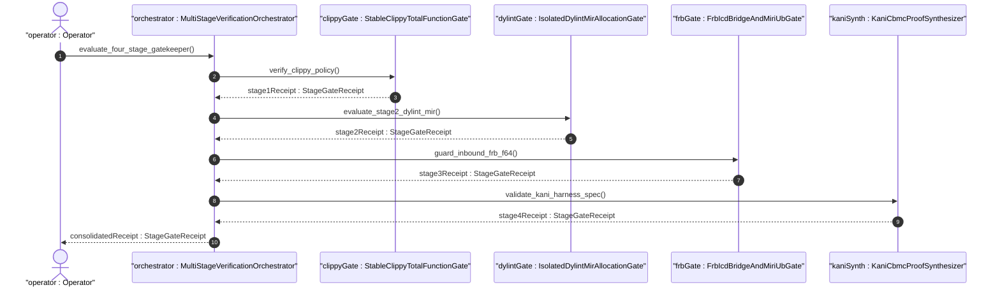
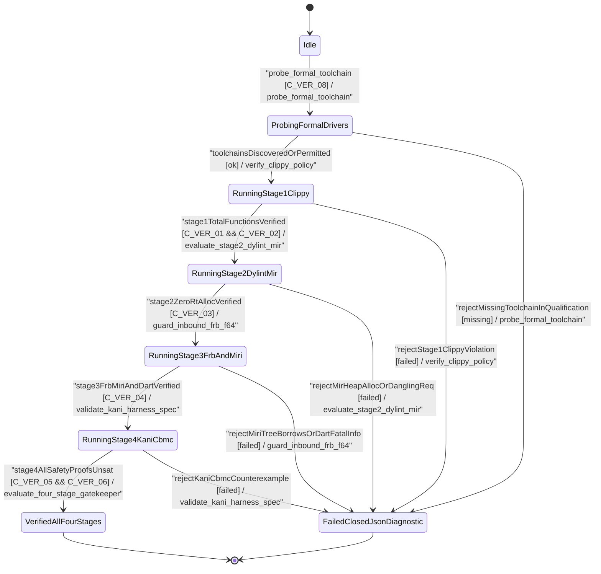

| Attribute | Specification Detail |
| :--- | :--- |
| **Issue ID** | #815 |
| **Title** | User Story 65: Evaluate Four Stage Gatekeeper |
| **Type** | user-story |
| **Parent Epic** | [EPIC-09-BP_09_Multi_Stage_Compiler_and_Formal_Verification_Gatekeeper](../epics/EPIC-09-BP_09_Multi_Stage_Compiler_and_Formal_Verification_Gatekeeper.md) (#854) |
| **SysML Interaction** | `BP_09_Multi_Stage_Compiler_and_Formal_Verification_Gatekeeper_SequenceInteraction` |
| **SysML Test Case** | `Test_evaluate_four_stage_gatekeeper` |
| **Generation Mode** | subagent |
| **Specification Source** | [schema/model.sysml](../../schema/model.sysml) |

# User Story 65: Evaluate Four Stage Gatekeeper

## User Story
As a `MultiStageVerificationOrchestrator`, I want to invoke `evaluate_four_stage_gatekeeper(receipts)` across `StableClippyTotalFunctionGate`, `IsolatedDylintMirAllocationGate`, `FrbIcdBridgeAndMiriUbGate`, and `KaniCbmcProofSynthesizer`, so that the entire cross-platform formal verification pipeline short-circuits fail-closed on the first non-zero stage diagnostic (`DEAP-E0900`..`DEAP-E0905`) or transitions to `VerifiedAllFourStages` (`DEAP-0000`) ready for Stage 5 Ferrocene qualification when all stages pass.

## Architectural Realization (3-Layer Definition of Done)

### Layer 1: Domain State & Data Model
- **Contract A (100% OMG SysML v2.0 + KerML 1.0 Grammar Coverage)**: Consolidates `StageGateReceipt` records verifying full Definition and Usage symmetry across all normative OMG SysML v2.0 and KerML 1.0 constructs (`package`/`library package`/`standard library package`, `import`, `metadata def`/`metadata`/`@Metadata`/`#user_keyword` (`#hazard`, `#risk`, `#capability`, `#rt_loop`, `#dal`, `#fls` and legacy `hazard def`/`risk def`/`capability def`), `part def`/`part`, `item def`/`item`, `attribute def`/`attribute`, `enum def`/`enum`, `port def`/`port`, `connection def`/`connection`, `interface def`/`interface`, `flow def`/`flow`, `allocation def`/`allocation`, `occurrence def`/`occurrence`, `action def`/`action`, `state def`/`state`, `calc def`/`calc`, `constraint def`/`constraint`, `requirement def`/`requirement`, `concern def`/`concern`, `use case def`/`use case`, `analysis def`/`analysis`, `verification def`/`verification`, `test case def`/`test case`, `interaction def`/`interaction`, `view def`/`view`, `viewpoint def`/`viewpoint`, `rendering def`/`rendering`, `variation`/`variant`, and KerML specialization/multiplicity/expressions) with zero 16-construct artificial caps.
- Domain state attributes across `MultiStageVerificationOrchestrator`, `StableClippyTotalFunctionGate`, `IsolatedDylintMirAllocationGate`, `FrbIcdBridgeAndMiriUbGate`, and `KaniCbmcProofSynthesizer`: `verification_stage_count: Integer`, `fail_closed_short_circuit: Boolean`, `require_formal_toolchains: Boolean`, `denied_clippy_lint_count: Integer`, `too_many_lines_threshold: Integer`, `too_many_arguments_threshold: Integer`, `disallowed_types_count: Integer`, `json_diagnostic_stream: Boolean`, `deterministic_uuid: String`, `max_rt_heap_allocations: Real`, `max_miri_ub_violations: Real`, `max_kani_counterexamples: Real`, `default_kani_unwind_bound: Real`, `max_module_exec_sloc: Real`, `min_toolchain_discovery_probes: Real`.
- Action `evaluate_four_stage_gatekeeper(receipts)` invocation message envelope bound to `MultiStageVerificationOrchestrator` typed domain schema.
- Declared lifecycle state model: `BP_09_Multi_Stage_Compiler_and_Formal_Verification_Gatekeeper_LifecycleState` (`Idle`, `ProbingFormalDrivers`, `RunningStage1Clippy`, `FailedClosedJsonDiagnostic`, `RunningStage2DylintMir`, `RunningStage3FrbAndMiri`, `RunningStage4KaniCbmc`, `VerifiedAllFourStages`).

### Layer 2: Logic & State Management
- **Contract B (Cross-Platform 5-Stage Formal Verification Pipeline, Zero Hand-Rolled Scanners)**: Behavioral execution contract invokes `evaluate_four_stage_gatekeeper(receipts)` sequentially across Stage 1 (`cargo clippy --message-format=json` via `cargo_metadata` + `toml_edit` + `ra_ap_syntax`) -> Stage 2 (excluded `./lints/deap-dylint-mir/` `rustc_middle::mir` zero-allocation and `REQ-*` digest plugin) -> Stage 3 (`cargo +nightly miri test` under `-Zmiri-tree-borrows` + `flutter_rust_bridge` FFI guards + `deap_core::dart_cst`) -> Stage 4 (`cargo kani` `outer kani::proof` synthesis via `syn` + `proc-macro2` + `quote` + `prettyplease`) -> Stage 5 Ferrocene qualification (`criticalup.toml` + `FLS fls_...` + `symbol-report`/`blanket` MC/DC + 3-Ring DAL-A..E partitioning), with dynamic runtime `PATH` discovery and zero hand-rolled string/line/char-by-char scanners.
- State transition management: `Idle -> ProbingFormalDrivers -> RunningStage1Clippy -> RunningStage2DylintMir -> RunningStage3FrbAndMiri -> RunningStage4KaniCbmc -> VerifiedAllFourStages` (or immediate short-circuit to `FailedClosedJsonDiagnostic` on any stage failure when `fail_closed_short_circuit == true`).
- Formal constraints and requirements enforced: `C_VER_01 (too_many_lines_threshold >= 1 and too_many_lines_threshold <= 80)`, `C_VER_02 (too_many_arguments_threshold >= 0 and too_many_arguments_threshold <= 5)`, `C_VER_03 (max_rt_heap_allocations >= 0 and max_rt_heap_allocations <= 0)`, `C_VER_04 (max_miri_ub_violations >= 0 and max_miri_ub_violations <= 0)`, `C_VER_05 (max_kani_counterexamples >= 0 and max_kani_counterexamples <= 0)`, `C_VER_06 (default_kani_unwind_bound >= 1 and default_kani_unwind_bound <= 64)`, `C_VER_07 (max_module_exec_sloc >= 1 and max_module_exec_sloc <= 380)`, `C_VER_08 (min_toolchain_discovery_probes >= 1 and min_toolchain_discovery_probes <= 3)`, `Invariant_REQ_0609_SC_01`..`Invariant_REQ_0609_SC_05`, `REQ-0609 (REQ_0609_BP_09_Multi_Stage_Compiler_and_Formal_Verification_Gatekeeper)`.
- Modularity & net-negative ratchet target: bounds implementation inside `< 380` exec SLOC submodules (`./crates/verify-baseline/src/formal_gates/`, `./crates/compile-sysml/src/kani_synth/`, `./crates/compile-sysml/src/frb_guard/`, and excluded `./lints/deap-dylint-mir/`) while explicitly deleting legacy hand-rolled scanners and unguarded FFI/string-template harness emitters.

### Layer 3: Presentation & Actuator Interface Binding
- Component port bindings on `MultiStageVerificationOrchestrator` and `StableClippyTotalFunctionGate`: `gate_invocation_in: String (in)`, `unified_gate_ndjson_out: String (out)`, `workspace_manifest_in: String (in)`, `clippy_ndjson_out: String (out)`.
- Interaction binding (`BP_09_Multi_Stage_Compiler_and_Formal_Verification_Gatekeeper_SequenceInteraction`): routes `evaluate_four_stage_gatekeeper(receipts)` across all 4 stage gate components and emits the consolidated `StageGateReceipt` (`DEAP-0000` or `DEAP-E0900`..`DEAP-E0905`) on `unified_gate_ndjson_out`.
- Diagnostic fault surface: reports deterministic single-line NDJSON rejection diagnostics to `Operator` on `unified_gate_ndjson_out` and halts promotion immediately on the first stage failure.

## UML Sequence Diagram



## UML State Machine Diagram



## Formal SysML Test Case & Verification Binding
- **SysML Test Case Def:** `Test_evaluate_four_stage_gatekeeper`
- **Subject Part:** `MultiStageVerificationOrchestrator`
- **Verified Safety Requirement:** `REQ_0609_BP_09_Multi_Stage_Compiler_and_Formal_Verification_Gatekeeper`
- **Verification Objective:** "Verify sequential 4-stage formal verification gatekeeper orchestration with fail-closed short-circuiting (`DEAP-E0900`..`DEAP-E0905`) and consolidated `VerifiedAllFourStages` (`DEAP-0000`) receipt emission."

```sysml
test case def Test_evaluate_four_stage_gatekeeper {
    subject MultiStageVerificationOrchestrator;
    verify requirement REQ_0609_BP_09_Multi_Stage_Compiler_and_Formal_Verification_Gatekeeper;
    objective "Verify end-to-end 4-stage formal verification gatekeeper evaluation and fail-closed short-circuiting";
    step inject_four_stage_receipts;
    step assert_verified_all_four_stages_or_short_circuit_diagnostic;
}
```

## Acceptance Criteria (BDD)
- [ ] AC-US-65-01: Given `MultiStageVerificationOrchestrator` and `StableClippyTotalFunctionGate` with domain state attributes (`verification_stage_count: Integer`, `fail_closed_short_circuit: Boolean`, `denied_clippy_lint_count: Integer`, `too_many_lines_threshold: Integer`, `too_many_arguments_threshold: Integer`, `disallowed_types_count: Integer`, `json_diagnostic_stream: Boolean`, `deterministic_uuid: String`), When `MultiStageVerificationOrchestrator` invokes `evaluate_four_stage_gatekeeper(receipts)` across all 4 stages and all stages pass, Then `MultiStageVerificationOrchestrator` transitions to `VerifiedAllFourStages` and emits `DEAP-0000`.
- [ ] AC-US-65-02: Given active state management during `evaluate_four_stage_gatekeeper`, When `StableClippyTotalFunctionGate` evaluates formal constraint `C_VER_01 (too_many_lines_threshold >= 1 and too_many_lines_threshold <= 80)`, Then constraint satisfaction is verified before committing state updates.
- [ ] AC-US-65-03: Given active state management during `evaluate_four_stage_gatekeeper`, When `StableClippyTotalFunctionGate` evaluates formal constraint `C_VER_02 (too_many_arguments_threshold >= 0 and too_many_arguments_threshold <= 5)`, Then constraint satisfaction is verified before committing state updates.
- [ ] AC-US-65-04: Given active state management during `evaluate_four_stage_gatekeeper`, When `IsolatedDylintMirAllocationGate` evaluates formal constraint `C_VER_03 (max_rt_heap_allocations >= 0 and max_rt_heap_allocations <= 0)`, Then constraint satisfaction is verified before committing state updates.
- [ ] AC-US-65-05: Given active state management during `evaluate_four_stage_gatekeeper`, When `FrbIcdBridgeAndMiriUbGate` evaluates formal constraint `C_VER_04 (max_miri_ub_violations >= 0 and max_miri_ub_violations <= 0)`, Then constraint satisfaction is verified before committing state updates.
- [ ] AC-US-65-06: Given active state management during `evaluate_four_stage_gatekeeper`, When `KaniCbmcProofSynthesizer` evaluates formal constraints `C_VER_05 (max_kani_counterexamples >= 0 and max_kani_counterexamples <= 0)` and `C_VER_06 (default_kani_unwind_bound >= 1 and default_kani_unwind_bound <= 64)`, Then constraint satisfaction is verified before committing state updates.
- [ ] AC-US-65-07: Given `MultiStageVerificationOrchestrator` ingress port binding (`gate_invocation_in: String`), When `evaluate_four_stage_gatekeeper` completes all 4 stages cleanly, Then `MultiStageVerificationOrchestrator` delivers `consolidatedReceipt : StageGateReceipt` across egress port (`unified_gate_ndjson_out: String`).
- [ ] AC-US-65-08: Given any stage receipt with `passed == false` or `exit_code != 0`, When `MultiStageVerificationOrchestrator` invokes `evaluate_four_stage_gatekeeper`, Then `MultiStageVerificationOrchestrator` short-circuits remaining stages (`fail_closed_short_circuit == true`), transitions to `FailedClosedJsonDiagnostic`, and emits the failing stage's single-line NDJSON diagnostic (`DEAP-E0900`..`DEAP-E0905`).

## Required Features
- [ ] #839 - [Feature 41: [BP 09 Multi Stage Compiler and Formal Verification Gatekeeper] FrbIcdBridgeAndMiriUbGate](../features/FEAT-41-FrbIcdBridgeAndMiriUbGate.md) (Supplies Stage 3 `flutter_rust_bridge` FFI, `dart analyze`, and Miri `-Zmiri-tree-borrows` verification receipts)
- [ ] #840 - [Feature 42: [BP 09 Multi Stage Compiler and Formal Verification Gatekeeper] IsolatedDylintMirAllocationGate](../features/FEAT-42-IsolatedDylintMirAllocationGate.md) (Supplies Stage 2 excluded `./lints/deap-dylint-mir/` zero-allocation and `REQ-*` digest verification receipts)
- [ ] #841 - [Feature 43: [BP 09 Multi Stage Compiler and Formal Verification Gatekeeper] KaniCbmcProofSynthesizer](../features/FEAT-43-KaniCbmcProofSynthesizer.md) (Supplies Stage 4 Kani `outer kani::proof` CBMC `UNSAT` verification receipts)
- [ ] #842 - [Feature 44: [BP 09 Multi Stage Compiler and Formal Verification Gatekeeper] MultiStageVerificationOrchestrator](../features/FEAT-44-MultiStageVerificationOrchestrator.md) (Executes `evaluate_four_stage_gatekeeper(receipts)` with fail-closed short-circuiting)
- [ ] #843 - [Feature 45: [BP 09 Multi Stage Compiler and Formal Verification Gatekeeper] StableClippyTotalFunctionGate](../features/FEAT-45-StableClippyTotalFunctionGate.md) (Supplies Stage 1 universal stable Clippy total-function and `clippy.toml` verification receipts)

## Source References
Operational concept definitions and system sequence interaction models:
- System Architecture Model: `schema/model.sysml`
- Engineering Design Blueprint: `./docs/designs/blueprint-09-clippy-dylint-miri-kani-formal-verification-gate.md`
- Normative Systems Engineering Standard: ISO/IEC/IEEE 29148:2018 §6.4.2 Concept of Operations

Authoritative user story flows and interaction lifelines derive from `schema/model.sysml` pursuant to ISO/IEC/IEEE 29148.
