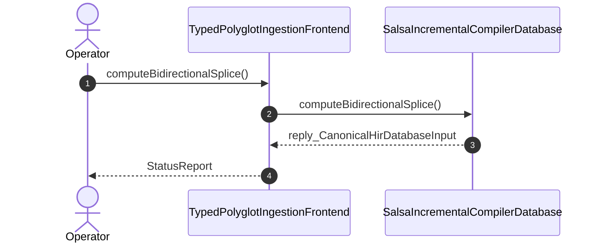

| Attribute | Specification Detail |
| :--- | :--- |
| **Issue ID** | TBD |
| **Title** | User Story 66: compute Bidirectional Splice |
| **Type** | user-story |
| **Parent Epic** | [EPIC-10-BP_10_Incremental_Lossless_SysML_v2_and_Polyglot_Compiler_Engine](../epics/EPIC-10-BP_10_Incremental_Lossless_SysML_v2_and_Polyglot_Compiler_Engine.md) |
| **SysML Interaction** | `BP_10_Incremental_Lossless_SysML_v2_and_Polyglot_Compiler_Engine_SequenceInteraction` |
| **SysML Test Case** | `Test_computeBidirectionalSplice` |
| **Generation Mode** | subagent |
| **Specification Source** | [schema/model.sysml](../../schema/model.sysml) |

# User Story 66: compute Bidirectional Splice

## User Story

As a `TypedPolyglotIngestionFrontend`, I want to invoke `computeBidirectionalSplice()` on `SalsaIncrementalCompilerDatabase`, so that computeBidirectionalSplice(fileId).

## Architectural Realization (3-Layer Definition of Done)

### Layer 1: Domain State & Data Model
- Domain state attributes on `SalsaIncrementalCompilerDatabase`: `query_layer_count: Integer`, `trivia_edit_downstream_recomputations: Integer`, `pure_deterministic_btreemap: Boolean`, `cycle_recovery_fail_closed: Boolean`, `Blueprint_ID: String`, `Requirement_ID: String`, `Title: String`, `Status: String`, `Target_Crates: String`, `Tracked_Issues: String`, `Generation_Mode: String`, `Specification_Source: String`, `max_ast_depth: Real`, `untouched_trivia_mutation_bytes: Real`, `stage_fixed_point_mismatch_files: Real`, `query_layer_count: Real`, `trivia_edit_downstream_recomputations: Real`, `polyglot_frontend_count: Real`.
- Action `computeBidirectionalSplice` invocation message envelope bound to `SalsaIncrementalCompilerDatabase` typed domain schema.
- Declared lifecycle state model: `BP_10_Incremental_Lossless_SysML_v2_and_Polyglot_Compiler_Engine_LifecycleState`, `Idle`, `RecordingSalsaInputRevision`, `LexingAndBuildingRowanCst`, `EmittingJsonDiagnostics`, `LoweringTriviaErasedHir`, `EarlyCutoffShortCircuited`, `EvaluatingSafetyAndKaniQueries`, `SplicingFormattingPreservingSync`, `VerifiedIncrementalClean`.

### Layer 2: Logic & State Management
- Behavioral execution contract: invokes `computeBidirectionalSplice()` on `SalsaIncrementalCompilerDatabase` with atomic precondition verification.
- State transition management: `Idle -> RecordingSalsaInputRevision` (trigger `setFileSource`).
- Formal constraints and requirements enforced: `C_INC_01 (max_ast_depth >= 1 and max_ast_depth <= 64)`, `C_INC_02 (untouched_trivia_mutation_bytes >= 0 and untouched_trivia_mutation_bytes <= 0)`, `C_INC_03 (stage_fixed_point_mismatch_files >= 0 and stage_fixed_point_mismatch_files <= 0)`, `C_INC_04 (query_layer_count >= 4 and query_layer_count <= 4)`, `C_INC_05 (trivia_edit_downstream_recomputations >= 0 and trivia_edit_downstream_recomputations <= 0)`, `C_INC_06 (polyglot_frontend_count >= 5 and polyglot_frontend_count <= 5)`, `REQ-0610 (REQ_0610_BP_10_Incremental_Lossless_SysML_v2_and_Polyglot_Compiler_Engine)`.

### Layer 3: Presentation & Actuator Interface Binding
- Component port bindings on `SalsaIncrementalCompilerDatabase`: `source_revision_in: String (in)`, `hir_model_out: String (out)`, `safety_verification_out: String (out)`.
- Interaction binding (`BP_10_Incremental_Lossless_SysML_v2_and_Polyglot_Compiler_Engine_SequenceInteraction`): routes `computeBidirectionalSplice` invocation from `TypedPolyglotIngestionFrontend` to `SalsaIncrementalCompilerDatabase` and returns `reply_CanonicalHirDatabaseInput`.
- Diagnostic fault surface: reports deterministic rejection diagnostics to `TypedPolyglotIngestionFrontend` across the declared interface boundary when guard or invariant checks fail.

## UML Sequence Diagram

## Acceptance Criteria (BDD)
- [ ] AC-US-66-01: Given `SalsaIncrementalCompilerDatabase` is in declared state `Idle` with domain state attributes (`query_layer_count: Integer`, `trivia_edit_downstream_recomputations: Integer`, `pure_deterministic_btreemap: Boolean`, `cycle_recovery_fail_closed: Boolean`), When `TypedPolyglotIngestionFrontend` invokes `computeBidirectionalSplice` on `SalsaIncrementalCompilerDatabase`, Then `SalsaIncrementalCompilerDatabase` validates and binds the request against `SalsaIncrementalCompilerDatabase` domain state (`query_layer_count: Integer`, `trivia_edit_downstream_recomputations: Integer`, `pure_deterministic_btreemap: Boolean`, `cycle_recovery_fail_closed: Boolean`) and transitions to `RecordingSalsaInputRevision`.
- [ ] AC-US-66-02: Given `SalsaIncrementalCompilerDatabase` active state management during `computeBidirectionalSplice`, When `SalsaIncrementalCompilerDatabase` evaluates formal constraint `C_INC_01 (max_ast_depth >= 1 and max_ast_depth <= 64)`, Then `SalsaIncrementalCompilerDatabase` verifies constraint satisfaction before committing state updates.
- [ ] AC-US-66-03: Given `SalsaIncrementalCompilerDatabase` active state management during `computeBidirectionalSplice`, When `SalsaIncrementalCompilerDatabase` evaluates formal constraint `C_INC_02 (untouched_trivia_mutation_bytes >= 0 and untouched_trivia_mutation_bytes <= 0)`, Then `SalsaIncrementalCompilerDatabase` verifies constraint satisfaction before committing state updates.
- [ ] AC-US-66-04: Given `SalsaIncrementalCompilerDatabase` active state management during `computeBidirectionalSplice`, When `SalsaIncrementalCompilerDatabase` evaluates formal constraint `C_INC_03 (stage_fixed_point_mismatch_files >= 0 and stage_fixed_point_mismatch_files <= 0)`, Then `SalsaIncrementalCompilerDatabase` verifies constraint satisfaction before committing state updates.
- [ ] AC-US-66-05: Given `SalsaIncrementalCompilerDatabase` active state management during `computeBidirectionalSplice`, When `SalsaIncrementalCompilerDatabase` evaluates formal constraint `C_INC_04 (query_layer_count >= 4 and query_layer_count <= 4)`, Then `SalsaIncrementalCompilerDatabase` verifies constraint satisfaction before committing state updates.
- [ ] AC-US-66-06: Given `SalsaIncrementalCompilerDatabase` active state management during `computeBidirectionalSplice`, When `SalsaIncrementalCompilerDatabase` evaluates formal constraint `C_INC_05 (trivia_edit_downstream_recomputations >= 0 and trivia_edit_downstream_recomputations <= 0)`, Then `SalsaIncrementalCompilerDatabase` verifies constraint satisfaction before committing state updates.
- [ ] AC-US-66-07: Given `SalsaIncrementalCompilerDatabase` ingress port binding (`source_revision_in: String`), When `SalsaIncrementalCompilerDatabase` completes `computeBidirectionalSplice`, Then `SalsaIncrementalCompilerDatabase` delivers `reply_CanonicalHirDatabaseInput` across egress port (`hir_model_out: String`, `safety_verification_out: String`) to `TypedPolyglotIngestionFrontend`.
- [ ] AC-US-66-08: Given violated formal constraint `C_INC_01 (max_ast_depth >= 1 and max_ast_depth <= 64)`, When `TypedPolyglotIngestionFrontend` invokes `computeBidirectionalSplice` on `SalsaIncrementalCompilerDatabase`, Then `SalsaIncrementalCompilerDatabase` rejects the request without partial state mutation, preserves prior verified state, and emits a deterministic fault diagnostic across the interface binding.

## Required Features
- [ ] [Feature 54: [BP 10 Incremental Lossless SysML v2 and Polyglot Compiler Engine] TypedPolyglotIngestionFrontend](../features/FEAT-54-TypedPolyglotIngestionFrontend.md)
- [ ] [Feature 53: [BP 10 Incremental Lossless SysML v2 and Polyglot Compiler Engine] SalsaIncrementalCompilerDatabase](../features/FEAT-53-SalsaIncrementalCompilerDatabase.md)

## Source References
Operational concept definitions and system sequence interaction models:
- System Architecture Model: `schema/model.sysml`
- Normative Systems Engineering Standard: ISO/IEC/IEEE 29148:2018 §6.4.2 Concept of Operations

Authoritative user story flows and interaction lifelines derive from `schema/model.sysml` pursuant to ISO/IEC/IEEE 29148.
