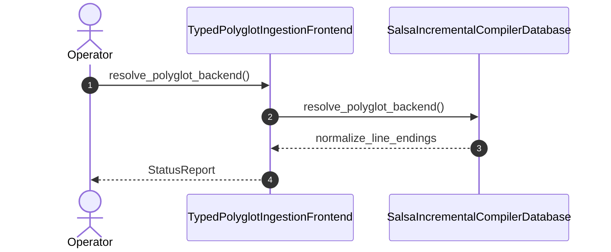

| Attribute | Specification Detail |
| :--- | :--- |
| **Issue ID** | #816 |
| **Title** | User Story 66: Resolve Polyglot Backend |
| **Type** | user-story |
| **Parent Epic** | [EPIC-10-BP_10_Incremental_Lossless_SysML_v2_and_Polyglot_Compiler_Engine](../epics/EPIC-10-BP_10_Incremental_Lossless_SysML_v2_and_Polyglot_Compiler_Engine.md) (#855) |
| **SysML Interaction** | `BP_10_Incremental_Lossless_SysML_v2_and_Polyglot_Compiler_Engine_SequenceInteraction` |
| **SysML Test Case** | `Test_resolve_polyglot_backend` |
| **Generation Mode** | subagent |
| **Specification Source** | [schema/model.sysml](../../schema/model.sysml) |

# User Story 66: Resolve Polyglot Backend

## User Story
As a `TypedPolyglotIngestionFrontend`, I want to invoke `resolve_polyglot_backend()` on `SalsaIncrementalCompilerDatabase`, so that `resolve_polyglot_backend(format)` deterministically dispatches all 6 polyglot specification formats (`ra_ap_syntax` Rust CST, `deap_core::dart_cst` Dart CST, typed `serde_json` OpenAPI/JSON-Schema AST, `logos` + `rowan` OMG IDL and IETF YANG CSTs in `ingest_sysml::cst::{idl_cst, yang_cst}`, and `pulldown-cmark` + `pulldown-cmark-to-cmark` Markdown AST) into 100% normative OMG SysML v2.0 + KerML 1.0 HIR with zero 16-construct caps and zero hand-rolled scanners.

## Architectural Realization (3-Layer Definition of Done)

### Layer 1: Domain State & Data Model
- Domain state attributes on `SalsaIncrementalCompilerDatabase`: `query_layer_count: Integer`, `trivia_edit_downstream_recomputations: Integer`, `pure_deterministic_btreemap: Boolean`, `cycle_recovery_fail_closed: Boolean`, `Blueprint_ID: String`, `Requirement_ID: String`, `Title: String`, `Status: String`, `Target_Crates: String`, `Tracked_Issues: String`, `Generation_Mode: String`, `Specification_Source: String`, `Layer_1_Domain_State_Data_Model: String`, `Layer_2_Logic_State_Management: String`, `Layer_3_Presentation_Actuator_Interface_Binding: String`, `max_ast_depth: Real`, `untouched_trivia_mutation_bytes: Real`, `stage_fixed_point_mismatch_files: Real`, `query_layer_count: Real`, `trivia_edit_downstream_recomputations: Real`, `polyglot_frontend_count: Real`, `rustc_private_feature_count: Real`.
- Action `resolve_polyglot_backend` invocation message envelope bound to `SalsaIncrementalCompilerDatabase` typed domain schema across all 6 `PolyglotFormat` variants (`Rust`, `Dart`, `OpenApiJson`, `OmgIdl`, `IetfYang`, `MarkdownSpec`) and Contract A (100% normative OMG SysML v2.0 + KerML 1.0 Definition and Usage symmetry across `package`/`library package`/`standard library package`, `import`, `alias`, `doc`, `comment`, `rep`, `dependency`, `metadata def`/`@Metadata`/`#user_keyword` for `#hazard`/`#risk`/`#capability`/`#rt_loop`/`#dal`/`#fls` plus backward-compatible legacy `hazard def`/`risk def`/`capability def`, `attribute def`/`attribute`, `enum def`/`enum`, `item def`/`item`, `part def`/`part`, `port def`/`port`, `connection def`/`connection`, `interface def`/`interface`, `flow def`/`flow`, `allocation def`/`allocation`, `occurrence def`/`occurrence`, `action def`/`action`, `state def`/`state`, `calc def`/`calc`, `constraint def`/`constraint`, `requirement def`/`requirement`, `concern def`/`concern`, `use case def`/`use case`, `analysis def`/`analysis`, `verification def`/`verification`, `test case def`/`test case`, `interaction def`/`interaction`, `view def`/`view`, `viewpoint def`/`viewpoint`, `rendering def`/`rendering`, `variation`/`variant`, and KerML specialization/expressions with zero 16-construct caps).
- Declared lifecycle state model: `BP_10_Incremental_Lossless_SysML_v2_and_Polyglot_Compiler_Engine_LifecycleState`, `Idle`, `NormalizingSourceRevision`, `LexingAndBuildingRowanCst`, `EmittingAriadneAndJsonDiagnostics`, `LoweringTriviaErasedHir`, `EarlyCutoffShortCircuited`, `EvaluatingSafetyAndKaniQueries`, `SplicingFormattingPreservingSync`, `VerifiedIncrementalClean`.

### Layer 2: Logic & State Management
- Behavioral execution contract: invokes `resolve_polyglot_backend()` on `SalsaIncrementalCompilerDatabase` with atomic precondition verification under Contract B (`ra_ap_syntax` Rust CST, `deap_core::dart_cst` Dart CST, typed `serde_json` OpenAPI/JSON-Schema AST, `logos` + `rowan` OMG IDL & IETF YANG CSTs in `ingest_sysml::cst::{idl_cst, yang_cst}`, `pulldown-cmark` + `pulldown-cmark-to-cmark` Markdown AST, and `logos` + `rowan` + `salsa` + `ariadne` in `deap_core::sysml_cst` and `compile_sysml::salsa_db` with zero hand-rolled string/line/char-by-char scanners).
- State transition management: `Idle -> NormalizingSourceRevision` (trigger `normalize_line_endings`).
- Formal constraints and requirements enforced: `C_INC_01 (max_ast_depth >= 1 and max_ast_depth <= 64)`, `C_INC_02 (untouched_trivia_mutation_bytes >= 0 and untouched_trivia_mutation_bytes <= 0)`, `C_INC_03 (stage_fixed_point_mismatch_files >= 0 and stage_fixed_point_mismatch_files <= 0)`, `C_INC_04 (query_layer_count >= 4 and query_layer_count <= 4)`, `C_INC_05 (trivia_edit_downstream_recomputations >= 0 and trivia_edit_downstream_recomputations <= 0)`, `C_INC_06 (polyglot_frontend_count >= 6 and polyglot_frontend_count <= 6)`, `C_INC_07 (rustc_private_feature_count >= 0 and rustc_private_feature_count <= 0)`, `REQ-0610 (REQ_0610_BP_10_Incremental_Lossless_SysML_v2_and_Polyglot_Compiler_Engine)`.
- Modularity & net-negative ratchet target: bounds implementation inside `< 380` exec SLOC submodules (`./crates/deap-core/src/sysml_cst/`, `./crates/compile-sysml/src/salsa_db/`, `./crates/ingest-sysml/src/cst/`, `./crates/ingest-sysml/src/polyglot_cst/`) while explicitly deleting legacy hand-rolled scanners in `./crates/deap-core/src/sysml_ast/mod.rs` (`-2,400+` SLOC), `./crates/compile-sysml/src/parser.rs` (`-1,100+` SLOC), and `./crates/ingest-sysml/src/extractors.rs` (`-900+` SLOC).

### Layer 3: Presentation & Actuator Interface Binding
- Component port bindings on `SalsaIncrementalCompilerDatabase`: `source_revision_in: String (in)`, `hir_model_out: String (out)`, `safety_verification_out: String (out)`.
- Interaction binding (`BP_10_Incremental_Lossless_SysML_v2_and_Polyglot_Compiler_Engine_SequenceInteraction`): routes `resolve_polyglot_backend` invocation from `TypedPolyglotIngestionFrontend` to `SalsaIncrementalCompilerDatabase` and returns `normalize_line_endings`.
- Diagnostic fault surface: reports deterministic ANSI-free `ariadne` byte-span diagnostics and single-line `--message-format=json` NDJSON error reports (`DEAP-E1005`) to `TypedPolyglotIngestionFrontend` across the declared interface boundary when guard or invariant checks fail.

## UML Sequence Diagram



## Formal SysML Test Case & Verification Binding
```sysml
test case def Test_resolve_polyglot_backend {
    subject SalsaIncrementalCompilerDatabase;
    verify requirement REQ_0610_BP_10_Incremental_Lossless_SysML_v2_and_Polyglot_Compiler_Engine;
    objective "Verify deterministic 6-frontend polyglot CST/AST backend dispatch (ra_ap_syntax, deap_core::dart_cst, serde_json, ingest_sysml::cst::{idl_cst, yang_cst}, pulldown-cmark) with zero hand-rolled scanners.";
    step resolve_polyglot_backend;
}
```

## Acceptance Criteria (BDD)
- [ ] AC-US-66-01: Given `SalsaIncrementalCompilerDatabase` is in declared state `Idle` with domain state attributes (`query_layer_count: Integer`, `trivia_edit_downstream_recomputations: Integer`, `pure_deterministic_btreemap: Boolean`, `cycle_recovery_fail_closed: Boolean`), When `TypedPolyglotIngestionFrontend` invokes `resolve_polyglot_backend` on `SalsaIncrementalCompilerDatabase`, Then `SalsaIncrementalCompilerDatabase` validates and binds the request against `SalsaIncrementalCompilerDatabase` domain state (`query_layer_count: Integer`, `trivia_edit_downstream_recomputations: Integer`, `pure_deterministic_btreemap: Boolean`, `cycle_recovery_fail_closed: Boolean`) across all 6 polyglot CST/AST frontends (`ra_ap_syntax`, `deap_core::dart_cst`, `serde_json`, `ingest_sysml::cst::{idl_cst, yang_cst}`, `pulldown-cmark`) and transitions to `NormalizingSourceRevision`.
- [ ] AC-US-66-02: Given `SalsaIncrementalCompilerDatabase` active state management during `resolve_polyglot_backend`, When `SalsaIncrementalCompilerDatabase` evaluates formal constraint `C_INC_01 (max_ast_depth >= 1 and max_ast_depth <= 64)`, Then `SalsaIncrementalCompilerDatabase` verifies constraint satisfaction before committing state updates.
- [ ] AC-US-66-03: Given `SalsaIncrementalCompilerDatabase` active state management during `resolve_polyglot_backend`, When `SalsaIncrementalCompilerDatabase` evaluates formal constraint `C_INC_02 (untouched_trivia_mutation_bytes >= 0 and untouched_trivia_mutation_bytes <= 0)`, Then `SalsaIncrementalCompilerDatabase` verifies constraint satisfaction before committing state updates.
- [ ] AC-US-66-04: Given `SalsaIncrementalCompilerDatabase` active state management during `resolve_polyglot_backend`, When `SalsaIncrementalCompilerDatabase` evaluates formal constraint `C_INC_03 (stage_fixed_point_mismatch_files >= 0 and stage_fixed_point_mismatch_files <= 0)`, Then `SalsaIncrementalCompilerDatabase` verifies constraint satisfaction before committing state updates.
- [ ] AC-US-66-05: Given `SalsaIncrementalCompilerDatabase` active state management during `resolve_polyglot_backend`, When `SalsaIncrementalCompilerDatabase` evaluates formal constraint `C_INC_04 (query_layer_count >= 4 and query_layer_count <= 4)`, Then `SalsaIncrementalCompilerDatabase` verifies constraint satisfaction before committing state updates.
- [ ] AC-US-66-06: Given `SalsaIncrementalCompilerDatabase` active state management during `resolve_polyglot_backend`, When `SalsaIncrementalCompilerDatabase` evaluates formal constraint `C_INC_05 (trivia_edit_downstream_recomputations >= 0 and trivia_edit_downstream_recomputations <= 0)`, `C_INC_06 (polyglot_frontend_count == 6)`, and `C_INC_07 (rustc_private_feature_count == 0)`, Then `SalsaIncrementalCompilerDatabase` verifies constraint satisfaction inside `< 380`-SLOC submodules (`./crates/ingest-sysml/src/cst/`, `./crates/compile-sysml/src/salsa_db/`) with legacy `./crates/ingest-sysml/src/extractors.rs` (`-900+` SLOC) retired.
- [ ] AC-US-66-07: Given `SalsaIncrementalCompilerDatabase` ingress port binding (`source_revision_in: String`), When `SalsaIncrementalCompilerDatabase` completes `resolve_polyglot_backend`, Then `SalsaIncrementalCompilerDatabase` delivers `normalize_line_endings` across egress port (`hir_model_out: String`, `safety_verification_out: String`) to `TypedPolyglotIngestionFrontend`.
- [ ] AC-US-66-08: Given violated formal constraint `C_INC_01 (max_ast_depth >= 1 and max_ast_depth <= 64)` or `C_INC_07 (rustc_private_feature_count > 0)`, When `TypedPolyglotIngestionFrontend` invokes `resolve_polyglot_backend` on `SalsaIncrementalCompilerDatabase`, Then `SalsaIncrementalCompilerDatabase` rejects the request without partial state mutation, preserves prior verified state, and emits a deterministic `DEAP-E1005` fault diagnostic across the interface binding.

## Required Features
- [ ] #847 - [Feature 49: [BP 10 Incremental Lossless SysML v2 and Polyglot Compiler Engine] TypedPolyglotIngestionFrontend](../features/FEAT-49-TypedPolyglotIngestionFrontend.md) (provides `resolve_polyglot_backend` 6-frontend CST/AST dispatch)
- [ ] #846 - [Feature 48: [BP 10 Incremental Lossless SysML v2 and Polyglot Compiler Engine] SalsaIncrementalCompilerDatabase](../features/FEAT-48-SalsaIncrementalCompilerDatabase.md) (provides the target 4-layer `salsa` incremental compiler database)

## Source References
Operational concept definitions and system sequence interaction models:
- System Architecture Model: `schema/model.sysml`
- Normative Systems Engineering Standard: ISO/IEC/IEEE 29148:2018 §6.4.2 Concept of Operations

Authoritative user story flows and interaction lifelines derive from `schema/model.sysml` pursuant to ISO/IEC/IEEE 29148.
