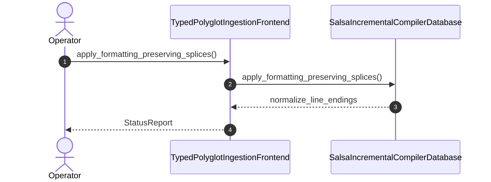

| Attribute | Specification Detail |
| :--- | :--- |
| **Issue ID** | #821 |
| **Title** | User Story 71: apply formatting preserving splices |
| **Type** | user-story |
| **Parent Epic** | [EPIC-10-BP_10_Incremental_Lossless_SysML_v2_and_Polyglot_Compiler_Engine](../epics/EPIC-10-BP_10_Incremental_Lossless_SysML_v2_and_Polyglot_Compiler_Engine.md) |
| **SysML Interaction** | `BP_10_Incremental_Lossless_SysML_v2_and_Polyglot_Compiler_Engine_SequenceInteraction` |
| **SysML Test Case** | `Test_apply_formatting_preserving_splices` |
| **Generation Mode** | subagent |
| **Specification Source** | [schema/model.sysml](../../schema/model.sysml) |

# User Story 71: apply formatting preserving splices

## User Story
As a `TypedPolyglotIngestionFrontend`, I want to invoke `apply_formatting_preserving_splices()` on `SalsaIncrementalCompilerDatabase`, so that `apply_formatting_preserving_splices(file_id, source, patches)` splices only modified CST declaration spans (`Utf8TextRange`) across forward and reverse synchronization while preserving 100% of untouched comments, whitespace, and sibling declarations (`untouched_trivia_mutation_bytes == 0`, `C_INC_02`) and Stage-1 == Stage-2 fixed-point identity (`stage_fixed_point_mismatch_files == 0`, `C_INC_03`).

## Architectural Realization (3-Layer Definition of Done)

### Layer 1: Domain State & Data Model
- Domain state attributes on `SalsaIncrementalCompilerDatabase`: `query_layer_count: Integer`, `trivia_edit_downstream_recomputations: Integer`, `pure_deterministic_btreemap: Boolean`, `cycle_recovery_fail_closed: Boolean`, `Blueprint_ID: String`, `Requirement_ID: String`, `Title: String`, `Status: String`, `Target_Crates: String`, `Tracked_Issues: String`, `Generation_Mode: String`, `Specification_Source: String`, `Layer_1_Domain_State_Data_Model: String`, `Layer_2_Logic_State_Management: String`, `Layer_3_Presentation_Actuator_Interface_Binding: String`, `max_ast_depth: Real`, `untouched_trivia_mutation_bytes: Real`, `stage_fixed_point_mismatch_files: Real`, `query_layer_count: Real`, `trivia_edit_downstream_recomputations: Real`, `polyglot_frontend_count: Real`, `rustc_private_feature_count: Real`.
- Action `apply_formatting_preserving_splices` invocation message envelope bound to `SalsaIncrementalCompilerDatabase` (`HirSourceMap` / `Utf8TextRange` / `FormattingPreservingSyncSplicer`) typed domain schema and Contract A (100% normative OMG SysML v2.0 + KerML 1.0 Definition and Usage symmetry across namespaces, `#hazard`/`#risk`/`#capability`/`#rt_loop`/`#dal`/`#fls` `metadata def` plus backward-compatible legacy `hazard def`/`risk def`/`capability def`, structural, behavioral, state, calculation, constraint, requirement, use-case, verification, view, and KerML specialization/expression clauses with zero 16-construct caps).
- Declared lifecycle state model: `BP_10_Incremental_Lossless_SysML_v2_and_Polyglot_Compiler_Engine_LifecycleState`, `Idle`, `NormalizingSourceRevision`, `LexingAndBuildingRowanCst`, `EmittingAriadneAndJsonDiagnostics`, `LoweringTriviaErasedHir`, `EarlyCutoffShortCircuited`, `EvaluatingSafetyAndKaniQueries`, `SplicingFormattingPreservingSync`, `VerifiedIncrementalClean`.

### Layer 2: Logic & State Management
- Behavioral execution contract: invokes `apply_formatting_preserving_splices()` on `SalsaIncrementalCompilerDatabase` (`deap_core::sysml_cst::printer::apply_formatting_preserving_splices`) with atomic precondition verification under Contract B (`logos` + `rowan` + `salsa` + `ariadne`, `pulldown-cmark` + `pulldown-cmark-to-cmark`, `syn` + `proc-macro2` + `quote` + `prettyplease`, `ra_ap_syntax`, `deap_core::dart_cst`, `serde_json`, and `ingest_sysml::cst::{idl_cst, yang_cst}` with zero hand-rolled string/line/char-by-char scanners).
- State transition management: `EvaluatingSafetyAndKaniQueries -> SplicingFormattingPreservingSync` (trigger `apply_formatting_preserving_splices`).
- Formal constraints and requirements enforced: `C_INC_01 (max_ast_depth >= 1 and max_ast_depth <= 64)`, `C_INC_02 (untouched_trivia_mutation_bytes >= 0 and untouched_trivia_mutation_bytes <= 0)`, `C_INC_03 (stage_fixed_point_mismatch_files >= 0 and stage_fixed_point_mismatch_files <= 0)`, `C_INC_04 (query_layer_count >= 4 and query_layer_count <= 4)`, `C_INC_05 (trivia_edit_downstream_recomputations >= 0 and trivia_edit_downstream_recomputations <= 0)`, `C_INC_06 (polyglot_frontend_count >= 6 and polyglot_frontend_count <= 6)`, `C_INC_07 (rustc_private_feature_count >= 0 and rustc_private_feature_count <= 0)`, `REQ-0610 (REQ_0610_BP_10_Incremental_Lossless_SysML_v2_and_Polyglot_Compiler_Engine)`.
- Modularity & net-negative ratchet target: bounds implementation inside `< 380` exec SLOC submodules (`./crates/deap-core/src/sysml_cst/`, `./crates/compile-sysml/src/salsa_db/`, `./crates/ingest-sysml/src/cst/`, `./crates/ingest-sysml/src/polyglot_cst/`) while explicitly deleting legacy hand-rolled scanners in `./crates/deap-core/src/sysml_ast/mod.rs` (`-2,400+` SLOC), `./crates/compile-sysml/src/parser.rs` (`-1,100+` SLOC), and `./crates/ingest-sysml/src/extractors.rs` (`-900+` SLOC).

### Layer 3: Presentation & Actuator Interface Binding
- Component port bindings on `SalsaIncrementalCompilerDatabase`: `source_revision_in: String (in)`, `hir_model_out: String (out)`, `safety_verification_out: String (out)`.
- Interaction binding (`BP_10_Incremental_Lossless_SysML_v2_and_Polyglot_Compiler_Engine_SequenceInteraction`): routes `apply_formatting_preserving_splices` invocation from `TypedPolyglotIngestionFrontend` to `SalsaIncrementalCompilerDatabase` and returns `normalize_line_endings`.
- Diagnostic fault surface: reports deterministic ANSI-free `ariadne` byte-span diagnostics and single-line `--message-format=json` NDJSON error reports (`DEAP-E1003`) to `TypedPolyglotIngestionFrontend` across the declared interface boundary when overlapping `Utf8TextRange` splice intervals or post-splice syntax errors occur.

## UML Sequence Diagram



## Formal SysML Test Case & Verification Binding
```sysml
test case def Test_apply_formatting_preserving_splices {
    subject SalsaIncrementalCompilerDatabase;
    verify requirement REQ_0610_BP_10_Incremental_Lossless_SysML_v2_and_Polyglot_Compiler_Engine;
    objective "Verify pairwise-disjoint Utf8TextRange CST splicing with untouched_trivia_mutation_bytes == 0 (C_INC_02), stage_fixed_point_mismatch_files == 0 (C_INC_03), and DEAP-E1003 overlap rejection.";
    step apply_formatting_preserving_splices;
}
```

## Acceptance Criteria (BDD)
- [ ] AC-US-71-01: Given `SalsaIncrementalCompilerDatabase` is in declared state `EvaluatingSafetyAndKaniQueries` with domain state attributes (`query_layer_count: Integer`, `trivia_edit_downstream_recomputations: Integer`, `pure_deterministic_btreemap: Boolean`, `cycle_recovery_fail_closed: Boolean`), When `TypedPolyglotIngestionFrontend` invokes `apply_formatting_preserving_splices` on `SalsaIncrementalCompilerDatabase`, Then `SalsaIncrementalCompilerDatabase` validates and binds the request against `SalsaIncrementalCompilerDatabase` domain state (`query_layer_count: Integer`, `trivia_edit_downstream_recomputations: Integer`, `pure_deterministic_btreemap: Boolean`, `cycle_recovery_fail_closed: Boolean`) inside `< 380`-SLOC submodules (`./crates/deap-core/src/sysml_cst/printer.rs`) and transitions to `SplicingFormattingPreservingSync`.
- [ ] AC-US-71-02: Given `SalsaIncrementalCompilerDatabase` active state management during `apply_formatting_preserving_splices`, When `SalsaIncrementalCompilerDatabase` evaluates formal constraint `C_INC_01 (max_ast_depth >= 1 and max_ast_depth <= 64)`, Then `SalsaIncrementalCompilerDatabase` verifies constraint satisfaction before committing state updates.
- [ ] AC-US-71-03: Given `SalsaIncrementalCompilerDatabase` active state management during `apply_formatting_preserving_splices`, When `SalsaIncrementalCompilerDatabase` evaluates formal constraint `C_INC_02 (untouched_trivia_mutation_bytes >= 0 and untouched_trivia_mutation_bytes <= 0)`, Then `SalsaIncrementalCompilerDatabase` verifies that 100% of untouched comments and whitespace remain byte-for-byte identical before committing state updates.
- [ ] AC-US-71-04: Given `SalsaIncrementalCompilerDatabase` active state management during `apply_formatting_preserving_splices`, When `SalsaIncrementalCompilerDatabase` evaluates formal constraint `C_INC_03 (stage_fixed_point_mismatch_files >= 0 and stage_fixed_point_mismatch_files <= 0)`, Then `SalsaIncrementalCompilerDatabase` verifies Stage-1 == Stage-2 fixed-point identity before committing state updates.
- [ ] AC-US-71-05: Given `SalsaIncrementalCompilerDatabase` active state management during `apply_formatting_preserving_splices`, When `SalsaIncrementalCompilerDatabase` evaluates formal constraint `C_INC_04 (query_layer_count >= 4 and query_layer_count <= 4)`, Then `SalsaIncrementalCompilerDatabase` verifies constraint satisfaction before committing state updates.
- [ ] AC-US-71-06: Given `SalsaIncrementalCompilerDatabase` active state management during `apply_formatting_preserving_splices`, When `SalsaIncrementalCompilerDatabase` evaluates formal constraint `C_INC_05 (trivia_edit_downstream_recomputations >= 0 and trivia_edit_downstream_recomputations <= 0)`, Then `SalsaIncrementalCompilerDatabase` verifies constraint satisfaction before committing state updates.
- [ ] AC-US-71-07: Given `SalsaIncrementalCompilerDatabase` ingress port binding (`source_revision_in: String`), When `SalsaIncrementalCompilerDatabase` completes `apply_formatting_preserving_splices`, Then `SalsaIncrementalCompilerDatabase` delivers `normalize_line_endings` across egress port (`hir_model_out: String`, `safety_verification_out: String`) to `TypedPolyglotIngestionFrontend`.
- [ ] AC-US-71-08: Given violated formal constraint `C_INC_01 (max_ast_depth >= 1 and max_ast_depth <= 64)` or overlapping `Utf8TextRange` splice intervals (`DEAP-E1003`), When `TypedPolyglotIngestionFrontend` invokes `apply_formatting_preserving_splices` on `SalsaIncrementalCompilerDatabase`, Then `SalsaIncrementalCompilerDatabase` rejects the request without partial state mutation, preserves prior verified state, and emits a deterministic `DEAP-E1003` fault diagnostic across the interface binding.

## Required Features
- [ ] #844 - [Feature 46: [BP 10 Incremental Lossless SysML v2 and Polyglot Compiler Engine] FormattingPreservingSyncSplicer](../features/FEAT-46-FormattingPreservingSyncSplicer.md) (executes pairwise-disjoint `Utf8TextRange` CST splicing and post-splice re-parse verification)
- [ ] #847 - [Feature 49: [BP 10 Incremental Lossless SysML v2 and Polyglot Compiler Engine] TypedPolyglotIngestionFrontend](../features/FEAT-49-TypedPolyglotIngestionFrontend.md) (supplies lowered HIR deltas and source map spans)
- [ ] #846 - [Feature 48: [BP 10 Incremental Lossless SysML v2 and Polyglot Compiler Engine] SalsaIncrementalCompilerDatabase](../features/FEAT-48-SalsaIncrementalCompilerDatabase.md) (coordinates `HirSourceMap` spans and incremental verification receipts)

## Source References
Operational concept definitions and system sequence interaction models:
- System Architecture Model: `schema/model.sysml`
- Normative Systems Engineering Standard: ISO/IEC/IEEE 29148:2018 §6.4.2 Concept of Operations

Authoritative user story flows and interaction lifelines derive from `schema/model.sysml` pursuant to ISO/IEC/IEEE 29148.
