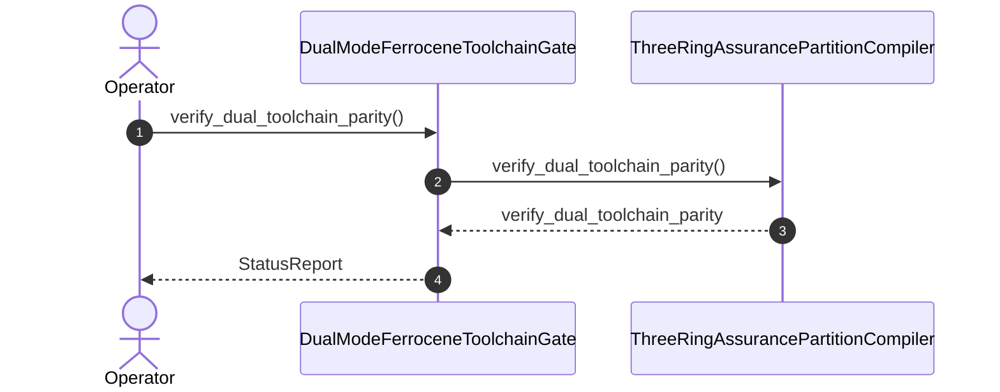

| Attribute | Specification Detail |
| :--- | :--- |
| **Issue ID** | #824 |
| **Title** | User Story 74: Verify Dual Toolchain Parity |
| **Type** | user-story |
| **Parent Epic** | [EPIC-11-BP_11_Ferrocene_Qualified_Toolchain_FLS_Traceability_Structural_Coverage_and_3_Ring_Rust_Flutter_DO_178C_DO_330_Certification_Architecture](../epics/EPIC-11-BP_11_Ferrocene_Qualified_Toolchain_FLS_Traceability_Structural_Coverage_and_3_Ring_Rust_Flutter_DO_178C_DO_330_Certification_Architecture.md) (#856) |
| **SysML Interaction** | `BP_11_Ferrocene_Qualified_Toolchain_FLS_Traceability_Structural_Coverage_and_3_Ring_Rust_Flutter_DO_178C_DO_330_Certification_Architecture_SequenceInteraction` |
| **SysML Test Case** | `Test_verify_dual_toolchain_parity` |
| **Generation Mode** | subagent |
| **Specification Source** | [schema/model.sysml](../../schema/model.sysml) |

# User Story 74: Verify Dual Toolchain Parity

## User Story
As a `DualModeFerroceneToolchainGate`, I want to invoke `verify_dual_toolchain_parity()` on `ThreeRingAssurancePartitionCompiler`, so that `verify_dual_toolchain_parity(spec)` enforces DO-178C / DO-330 `criticalup.toml` + `rust-toolchain.toml` semantic version and target-triple parity (`max_toolchain_version_drift == 0`, `C_CERT_01`) and Stage-1 == Stage-2 self-hosted modular codegen SHA-256 fixed-point identity (`stage_fixed_point_mismatch_files == 0`, `C_CERT_02`) via `toml_edit`, `cargo-platform`, `cargo_metadata`, `cargo-lock`, and `cargo-util-schemas` with zero hand-rolled scanners.

## Architectural Realization (3-Layer Definition of Done)

### Layer 1: Domain State & Data Model
- Domain state attributes on `ThreeRingAssurancePartitionCompiler` and `DualModeFerroceneToolchainGate`: `assurance_ring_count: Integer`, `max_ring1_heap_allocations: Integer`, `max_unguarded_ffi_entrypoints: Integer`, `enable_ring1_safety_monitor: Boolean`, `Blueprint_ID: String`, `Requirement_ID: String`, `Title: String`, `Status: String`, `Target_Crates: String`, `Tracked_Issues: String`, `Generation_Mode: String`, `Specification_Source: String`, `max_toolchain_version_drift: Real`, `stage_fixed_point_mismatch_files: Real`, `unmapped_fls_item_count: Real`, `uncertified_core_symbol_count: Real`, `dal_a_mcdc_coverage_min_pct: Real`, `assurance_ring_count: Real`, `max_module_exec_sloc: Real`, `min_toolchain_discovery_probes: Real`.
- Action `verify_dual_toolchain_parity` invocation message envelope bound to `ThreeRingAssurancePartitionCompiler` typed domain schema, paired `criticalup.toml` / `rust-toolchain.toml` AST structures (`toml_edit`, `cargo-platform`), and full OMG SysML v2.0 + KerML 1.0 CST/AST (`deap_core::sysml_cst` via `logos` + `rowan` + `salsa` + `ariadne`, Contract A, zero 16-construct caps).
- Declared lifecycle state model: `BP_11_Ferrocene_Qualified_Toolchain_FLS_Traceability_Structural_Coverage_and_3_Ring_Rust_Flutter_DO_178C_DO_330_Certification_Architecture_LifecycleState`, `Idle`, `ProbingCrossPlatformToolchain`, `RejectedFailClosed`, `VerifyingDualToolchainParity`, `SynthesizingThreeRingPartitions`, `EmbeddingFlsTraceability`, `AuditingCoreSubsetAndMcdc`, `VerifyingRing1SafetyMonitor`, `CertifiedPackageReady`.

### Layer 2: Logic & State Management
- Behavioral execution contract: invokes `verify_dual_toolchain_parity()` on `ThreeRingAssurancePartitionCompiler` with atomic precondition verification, validating zero semantic `rustc` version or target-triple drift (`C_CERT_01`) and Stage-1 == Stage-2 SHA-256 fixed-point codegen parity (`C_CERT_02`) under `Invariant_REQ_0611_SC_01` (Contract B).
- State transition management: `Idle -> ProbingCrossPlatformToolchain` (trigger `probeToolchainPath`), `ProbingCrossPlatformToolchain -> VerifyingDualToolchainParity` (trigger `toolchainDiscovered`), and `VerifyingDualToolchainParity -> SynthesizingThreeRingPartitions` (trigger `toolchainAndStage2ParityLocked`) or `RejectedFailClosed` (trigger `rejectToolchainDriftE1101` with `DEAP-E1101` / `E0705`).
- Formal constraints and requirements enforced: `C_CERT_01 (max_toolchain_version_drift >= 0 and max_toolchain_version_drift <= 0)`, `C_CERT_02 (stage_fixed_point_mismatch_files >= 0 and stage_fixed_point_mismatch_files <= 0)`, `C_CERT_03 (unmapped_fls_item_count >= 0 and unmapped_fls_item_count <= 0)`, `C_CERT_04 (uncertified_core_symbol_count >= 0 and uncertified_core_symbol_count <= 0)`, `C_CERT_05 (dal_a_mcdc_coverage_min_pct >= 100 and dal_a_mcdc_coverage_min_pct <= 100)`, `C_CERT_06 (assurance_ring_count >= 3 and assurance_ring_count <= 3)`, `C_CERT_07 (max_module_exec_sloc >= 1 and max_module_exec_sloc <= 380)`, `C_CERT_08 (min_toolchain_discovery_probes >= 1 and min_toolchain_discovery_probes <= 3)`, `REQ-0611 (REQ_0611_BP_11_Ferrocene_Qualified_Toolchain_FLS_Traceability_Structural_Coverage_and_3_Ring_Rust_Flutter_DO_178C)`.
- Modularity & net-negative ratchet target: bounds implementation inside `< 380` exec SLOC submodules (`crates/compile-sysml/src/ring_partition/`, `crates/verify-baseline/src/ferrocene_gate/`, `crates/deap-core/src/fls_trace/`) while explicitly deleting legacy hand-rolled line/string manifest scanners, retiring unpartitioned workspace templates, and enforcing zero Check 34 ratchet violations.

### Layer 3: Presentation & Actuator Interface Binding
- Component port bindings on `ThreeRingAssurancePartitionCompiler` and `DualModeFerroceneToolchainGate`: `sysml_assurance_ast_in: String (in)`, `partitioned_workspace_out: String (out)`, `partition_diag_out: String (out)`, `toolchain_manifests_in: String (in)`, `qualification_dossier_out: String (out)`, `toolchain_diag_out: String (out)`.
- Interaction binding (`BP_11_Ferrocene_Qualified_Toolchain_FLS_Traceability_Structural_Coverage_and_3_Ring_Rust_Flutter_DO_178C_DO_330_Certification_Architecture_SequenceInteraction`): routes `verify_dual_toolchain_parity` invocation from `DualModeFerroceneToolchainGate` to `ThreeRingAssurancePartitionCompiler` and returns `verify_dual_toolchain_parity`.
- Diagnostic fault surface: reports deterministic rejection diagnostics (`DEAP-E1101`, `E0705`) to `DualModeFerroceneToolchainGate` across the declared interface boundary when guard or invariant checks fail.

## UML Sequence Diagram



## Formal SysML Test Case & Verification Binding
- **SysML Test Case Def:** `Test_verify_dual_toolchain_parity`
- **Subject Part:** `DualModeFerroceneToolchainGate`
- **Verified Safety Requirement:** `REQ_0611_BP_11_Ferrocene_Qualified_Toolchain_FLS_Traceability_Structural_Coverage_and_3_Ring_Rust_Flutter_DO_178C` (`REQ-0611`)
- **Verification Objective:** "Verify dual-mode `criticalup.toml` + `rust-toolchain.toml` semantic parity (`C_CERT_01`) and Stage-1 == Stage-2 SHA-256 fixed-point codegen verification (`C_CERT_02`) under `Invariant_REQ_0611_SC_01`."

```sysml
test case def Test_verify_dual_toolchain_parity {
    subject DualModeFerroceneToolchainGate;
    verify requirement REQ_0611_BP_11_Ferrocene_Qualified_Toolchain_FLS_Traceability_Structural_Coverage_and_3_Ring_Rust_Flutter_DO_178C;
    objective "Verify criticalup.toml and rust-toolchain.toml semantic parity and Stage-1 == Stage-2 SHA-256 fixed-point compilation.";
    step verify_dual_toolchain_parity;
    step synthesize_three_ring_workspace;
}
```

## Acceptance Criteria (BDD)
- [ ] AC-US-74-01: Given `ThreeRingAssurancePartitionCompiler` is in declared state `Idle` with domain state attributes (`assurance_ring_count: Integer`, `max_ring1_heap_allocations: Integer`, `max_unguarded_ffi_entrypoints: Integer`, `enable_ring1_safety_monitor: Boolean`), When `DualModeFerroceneToolchainGate` invokes `verify_dual_toolchain_parity` on `ThreeRingAssurancePartitionCompiler`, Then `ThreeRingAssurancePartitionCompiler` validates and binds the request against `ThreeRingAssurancePartitionCompiler` domain state (`assurance_ring_count: Integer`, `max_ring1_heap_allocations: Integer`, `max_unguarded_ffi_entrypoints: Integer`, `enable_ring1_safety_monitor: Boolean`) and transitions to `ProbingCrossPlatformToolchain` and `VerifyingDualToolchainParity`.
- [ ] AC-US-74-02: Given `ThreeRingAssurancePartitionCompiler` active state management during `verify_dual_toolchain_parity`, When `ThreeRingAssurancePartitionCompiler` evaluates formal constraint `C_CERT_01 (max_toolchain_version_drift >= 0 and max_toolchain_version_drift <= 0)` via `toml_edit` and `cargo-platform`, Then `ThreeRingAssurancePartitionCompiler` verifies constraint satisfaction before committing state updates.
- [ ] AC-US-74-03: Given `ThreeRingAssurancePartitionCompiler` active state management during `verify_dual_toolchain_parity`, When `ThreeRingAssurancePartitionCompiler` evaluates formal constraint `C_CERT_02 (stage_fixed_point_mismatch_files >= 0 and stage_fixed_point_mismatch_files <= 0)`, Then `ThreeRingAssurancePartitionCompiler` verifies Stage-1 == Stage-2 SHA-256 fixed-point satisfaction before committing state updates.
- [ ] AC-US-74-04: Given `ThreeRingAssurancePartitionCompiler` active state management during `verify_dual_toolchain_parity`, When `ThreeRingAssurancePartitionCompiler` evaluates formal constraint `C_CERT_03 (unmapped_fls_item_count >= 0 and unmapped_fls_item_count <= 0)`, Then `ThreeRingAssurancePartitionCompiler` verifies constraint satisfaction before committing state updates.
- [ ] AC-US-74-05: Given `ThreeRingAssurancePartitionCompiler` active state management during `verify_dual_toolchain_parity`, When `ThreeRingAssurancePartitionCompiler` evaluates formal constraint `C_CERT_04 (uncertified_core_symbol_count >= 0 and uncertified_core_symbol_count <= 0)`, Then `ThreeRingAssurancePartitionCompiler` verifies constraint satisfaction before committing state updates.
- [ ] AC-US-74-06: Given `ThreeRingAssurancePartitionCompiler` active state management during `verify_dual_toolchain_parity`, When `ThreeRingAssurancePartitionCompiler` evaluates formal constraint `C_CERT_05 (dal_a_mcdc_coverage_min_pct >= 100 and dal_a_mcdc_coverage_min_pct <= 100)`, Then `ThreeRingAssurancePartitionCompiler` verifies constraint satisfaction before committing state updates.
- [ ] AC-US-74-07: Given `ThreeRingAssurancePartitionCompiler` ingress port binding (`sysml_assurance_ast_in: String`), When `ThreeRingAssurancePartitionCompiler` completes `verify_dual_toolchain_parity` inside `< 380`-SLOC submodules (`C_CERT_07`), Then `ThreeRingAssurancePartitionCompiler` delivers `verify_dual_toolchain_parity` across egress port (`partitioned_workspace_out: String`, `partition_diag_out: String`) to `DualModeFerroceneToolchainGate`.
- [ ] AC-US-74-08: Given violated formal constraint `C_CERT_01 (max_toolchain_version_drift >= 0 and max_toolchain_version_drift <= 0)` or `C_CERT_02 (stage_fixed_point_mismatch_files >= 0 and stage_fixed_point_mismatch_files <= 0)`, When `DualModeFerroceneToolchainGate` invokes `verify_dual_toolchain_parity` on `ThreeRingAssurancePartitionCompiler`, Then `ThreeRingAssurancePartitionCompiler` rejects the request without partial state mutation, preserves prior verified state, and emits deterministic fault diagnostic `DEAP-E1101` or `E0705` across the interface binding.

## Required Features
- [ ] #849 - [Feature 51: [BP 11 Ferrocene Qualified Toolchain FLS Traceability Structural Coverage and 3 Ring Rust_Flutter DO 178 C DO 330 Certification Architecture] DualModeFerroceneToolchainGate](../features/FEAT-51-DualModeFerroceneToolchainGate.md)
- [ ] #851 - [Feature 53: [BP 11 Ferrocene Qualified Toolchain FLS Traceability Structural Coverage and 3 Ring Rust_Flutter DO 178 C DO 330 Certification Architecture] ThreeRingAssurancePartitionCompiler](../features/FEAT-53-ThreeRingAssurancePartitionCompiler.md)

## Source References
Operational concept definitions and system sequence interaction models:
- System Architecture Model: `schema/model.sysml`
- Normative Systems Engineering Standard: ISO/IEC/IEEE 29148:2018 §6.4.2 Concept of Operations

Authoritative user story flows and interaction lifelines derive from `schema/model.sysml` pursuant to ISO/IEC/IEEE 29148.
