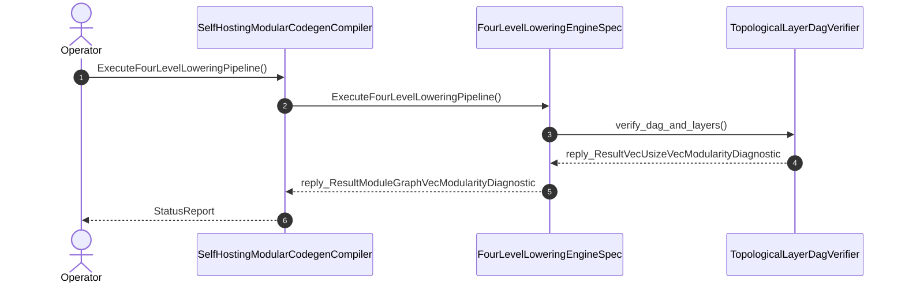

| Attribute | Specification Detail |
| :--- | :--- |
| **Issue ID** | #862 |
| **Title** | User Story 79: Execute Four Level Lowering Pipeline |
| **Type** | user-story |
| **Parent Epic** | [EPIC-07-BP_07_Self_Hosting_4_Level_Modular_Multi_File_Code_Generator_Blueprint](../epics/EPIC-07-BP_07_Self_Hosting_4_Level_Modular_Multi_File_Code_Generator_Blueprint.md) |
| **SysML Interaction** | `BP_07_Self_Hosting_4_Level_Modular_Multi_File_Code_Generator_Blueprint_SequenceInteraction` |
| **SysML Test Case** | `Test_ExecuteFourLevelLoweringPipeline` |
| **Generation Mode** | subagent |
| **Specification Source** | [schema/model.sysml](../../schema/model.sysml) |

# User Story 79: Execute Four Level Lowering Pipeline

## User Story
As a `SelfHostingModularCodegenCompiler`, I want to invoke `ExecuteFourLevelLoweringPipeline(in package_count: Integer, out unit_count: Integer)` on `FourLevelLoweringEngineSpec` and `TopologicalLayerDagVerifier`, so that the self-hosting 4-level modular multi-file lowering pipeline defined in `schema/modular_codegen.sysml` and `schema/model.sysml` deterministically lowers full OMG SysML v2.0 + KerML 1.0 AST hierarchies into bounded Rust and Dart compilation units obeying `ValidBoundsEnvelope`, `NonUpwardLayerImport`, `UnitObeysBounds`, `LoweringLevelsComplete`, and `FixedPointBootstrapParity`.

## Architectural Realization (3-Layer Definition of Done)

### Layer 1: Domain State & Data Model
- Domain state attributes across `FourLevelLoweringEngineSpec`, `ModularityBoundsSpec`, `LayerHierarchySpec`, `CompilationUnitSpec`, `ModularEmitterSuiteSpec`, and `TopologicalLayerDagVerifier`: `active_level_count: Integer`, `fail_closed_on_cycle: Boolean`, `fail_closed_on_upward_layer: Boolean`, `max_file_lines: Integer`, `max_items_per_file: Integer`, `max_cyclomatic_complexity: Integer`, `max_action_steps_per_stage: Integer`, `max_transitions_per_handler: Integer`, `domain_tier: Integer`, `application_tier: Integer`, `presentation_tier: Integer`, `relative_path: String`, `layer_tier: Integer`, `item_count: Integer`, `line_count: Integer`, `max_function_vg: Integer`, `atomic_persistence: Boolean`, `check36_docstrings_enabled: Boolean`, `stage_mismatch_files: Integer`, `max_layer_tier: Integer`, `zero_recursion_kahn: Boolean`, and calculation `ComputeCyclomaticComplexity(in decision_points : Integer) : Integer`.
- **Contract A (100% Normative OMG SysML v2.0 + KerML 1.0 Grammar Coverage -- Zero 16-Construct Caps)**: Ingests and lowers full Definition and Usage symmetry across all OMG SysML v2.0 and KerML 1.0 constructs (`package`/`library package`/`standard library package`, `import`, `metadata def`/`@Metadata`/`#user_keyword` `#hazard`/`#risk`/`#capability`/`#rt_loop`/`#dal`/`#fls` while preserving backward-compatible parsing of legacy `hazard def`/`risk def`/`capability def`, `part def`/`part`, `item def`/`item`, `attribute def`/`attribute`, `enum def`/`enum`, `port def`/`port`, `connection def`/`connection`, `interface def`/`interface`, `flow def`/`flow`, `allocation def`/`allocation`, `occurrence def`/`occurrence`, `action def`/`action`, `state def`/`state`, `calc def`/`calc`, `constraint def`/`constraint`, `requirement def`/`requirement`, `concern def`/`concern`, `use case def`/`use case`, `analysis def`/`analysis`, `verification def`/`verification`, `test case def`/`test case`, `interaction def`/`interaction`, `view def`/`view`, `viewpoint def`/`viewpoint`, `rendering def`/`rendering`, `variation`/`variant`, and KerML specialization/multiplicity/expressions) via `deap_core::sysml_cst` (`logos` + `rowan` + `salsa` + `ariadne`).
- Action `ExecuteFourLevelLoweringPipeline` typed data contract: input arguments (`package_count: Integer`), output values (`unit_count: Integer`), and 12 sequential steps (`resolve_package_hierarchy`, `extract_part_layer_annotations`, `build_directed_dependency_edges`, `run_kahn_topological_cycle_check`, `verify_non_upward_layer_edges`, `partition_package_directories`, `split_part_responsibility_facets`, `outline_sequential_action_stages`, `outline_source_state_handlers`, `hoist_anf_boolean_subpredicates`, `synthesize_barrel_reexport_facades`, `verify_in_memory_modularity_bounds`).
- Declared lifecycle state models: `ModularCodegenLifecycle` (`Idle`, `ResolvingLayers`, `VerifyingDag`, `PartitioningPackages`, `SplittingFacets`, `OutliningBehaviors`, `HoistingPredicates`, `SynthesizingTree`, `VerifyingBounds`, `PersistingAtomic`, `Verified`, `AbortedFailClosed`) and `BP_07_Self_Hosting_4_Level_Modular_Multi_File_Code_Generator_Blueprint_LifecycleState`.

### Layer 2: Logic & State Management
- Behavioral execution contract: invokes `ExecuteFourLevelLoweringPipeline(in package_count: Integer, out unit_count: Integer)` on `FourLevelLoweringEngineSpec` and `TopologicalLayerDagVerifier` with atomic precondition verification across all 12 lowering steps.
- State transition management: `Idle -> ResolvingLayers -> VerifyingDag -> PartitioningPackages -> SplittingFacets -> OutliningBehaviors -> HoistingPredicates -> SynthesizingTree -> VerifyingBounds -> PersistingAtomic -> Verified` (or `AbortedFailClosed` on `on_cycle_e0702`, `on_upward_layer_e0703`, or `on_fixed_point_drift_e0705`).
- Formal constraints and requirements enforced: `ValidBoundsEnvelope`, `NonUpwardLayerImport`, `UnitObeysBounds`, `LoweringLevelsComplete`, `FixedPointBootstrapParity`, `C_MOD_01 (max_file_lines >= 50 and max_file_lines <= 400)`, `C_MOD_02 (max_items_per_file >= 1 and max_items_per_file <= 12)`, `C_MOD_03 (max_cyclomatic_complexity >= 1 and max_cyclomatic_complexity <= 8)`, `C_MOD_04 (stage_fixed_point_mismatch_files >= 0 and stage_fixed_point_mismatch_files <= 0)`, `C_MOD_05 (runtime_llm_subagent_count >= 0 and runtime_llm_subagent_count <= 0)`, `REQ-0607 (REQ_0607_BP_07_Self_Hosting_4_Level_Modular_Multi_File_Code_Generator_Blueprint)`.
- **Contract B & Submodule Modularity Ratchet (`< 380` SLOC)**: Enforces `syn` + `proc-macro2` + `quote` + `prettyplease` deterministic fixed-point Rust codegen (`SHA-256(Stage 1) == SHA-256(Stage 2)`) and `ra_ap_syntax` lossless CST analysis with zero hand-rolled string/line/char-by-char scanners, bounding implementation inside `< 380` exec SLOC submodules (`./crates/compile-sysml/src/modular_codegen/` and `./crates/deap-core/src/rust_cst/`) while explicitly deleting legacy hand-rolled scanners and string-concatenation codegen templates in `./crates/compile-sysml/src/driver.rs` (`-450+` SLOC) and `./crates/compile-sysml/src/flutter_codegen.rs` (`-650+` SLOC).

### Layer 3: Presentation & Actuator Interface Binding
- Component port bindings across `FourLevelLoweringEngineSpec`, `ModularEmitterSuiteSpec`, and `TopologicalLayerDagVerifier`: `schema_in: SchemaPackageAstPort (in)`, `graph_out: VerifiedModuleGraphPort (out)`, `rust_tree_out: ModularRustEmitPort (out)`, `flutter_tree_out: ModularFlutterEmitPort (out)`, `dependency_edges_in: String (in)`, `topological_order_out: String (out)`.
- Interaction binding (`BP_07_Self_Hosting_4_Level_Modular_Multi_File_Code_Generator_Blueprint_SequenceInteraction`): routes `ExecuteFourLevelLoweringPipeline` invocation from `SelfHostingModularCodegenCompiler` to `FourLevelLoweringEngineSpec` and `TopologicalLayerDagVerifier` and returns `reply_ResultVecUsizeVecModularityDiagnostic`.
- Diagnostic fault surface: reports deterministic rejection diagnostics (`E0701`, `E0702`, `E0703`, `E0705`) to `SelfHostingModularCodegenCompiler` across the declared interface boundary when guard or invariant checks fail.

## UML Sequence Diagram

## Acceptance Criteria (BDD)
- [ ] AC-US-79-01: Given `FourLevelLoweringEngineSpec` and `TopologicalLayerDagVerifier` are in declared state `Idle` with typed input arguments (`package_count: Integer`), When `SelfHostingModularCodegenCompiler` invokes `ExecuteFourLevelLoweringPipeline` on `FourLevelLoweringEngineSpec`, Then `FourLevelLoweringEngineSpec` validates and binds the request against `ModularityBoundsSpec` (`ValidBoundsEnvelope`) and `LayerHierarchySpec` (`NonUpwardLayerImport`) and transitions through `ModularCodegenLifecycle` from `Idle` to `ResolvingLayers` and `VerifyingDag`.
- [ ] AC-US-79-02: Given `FourLevelLoweringEngineSpec` active state management during `ExecuteFourLevelLoweringPipeline`, When `FourLevelLoweringEngineSpec` evaluates formal constraint `C_MOD_01 (max_file_lines >= 50 and max_file_lines <= 400)` and `UnitObeysBounds`, Then `FourLevelLoweringEngineSpec` verifies constraint satisfaction before committing state updates.
- [ ] AC-US-79-03: Given `FourLevelLoweringEngineSpec` active state management during `ExecuteFourLevelLoweringPipeline`, When `FourLevelLoweringEngineSpec` evaluates formal constraint `C_MOD_02 (max_items_per_file >= 1 and max_items_per_file <= 12)` and `LoweringLevelsComplete (active_level_count == 4)`, Then `FourLevelLoweringEngineSpec` verifies constraint satisfaction before committing state updates.
- [ ] AC-US-79-04: Given `FourLevelLoweringEngineSpec` active state management during `ExecuteFourLevelLoweringPipeline`, When `FourLevelLoweringEngineSpec` evaluates formal constraint `C_MOD_03 (max_cyclomatic_complexity >= 1 and max_cyclomatic_complexity <= 8)` via `ComputeCyclomaticComplexity`, Then `FourLevelLoweringEngineSpec` verifies constraint satisfaction before committing state updates.
- [ ] AC-US-79-05: Given `ModularEmitterSuiteSpec` active state management during `ExecuteFourLevelLoweringPipeline`, When `ModularEmitterSuiteSpec` evaluates formal constraint `C_MOD_04 (stage_fixed_point_mismatch_files >= 0 and stage_fixed_point_mismatch_files <= 0)` and `FixedPointBootstrapParity (stage_mismatch_files == 0)`, Then `ModularEmitterSuiteSpec` verifies constraint satisfaction before committing state updates.
- [ ] AC-US-79-06: Given `FourLevelLoweringEngineSpec` active state management during `ExecuteFourLevelLoweringPipeline`, When `FourLevelLoweringEngineSpec` evaluates formal constraint `C_MOD_05 (runtime_llm_subagent_count >= 0 and runtime_llm_subagent_count <= 0)`, Then `FourLevelLoweringEngineSpec` verifies constraint satisfaction before committing state updates.
- [ ] AC-US-79-07: Given `FourLevelLoweringEngineSpec` ingress port binding (`schema_in: SchemaPackageAstPort`), When `FourLevelLoweringEngineSpec` completes `ExecuteFourLevelLoweringPipeline`, Then `FourLevelLoweringEngineSpec` materializes verified output (`unit_count: Integer`) across `graph_out: VerifiedModuleGraphPort` and `ModularEmitterSuiteSpec` (`rust_tree_out: ModularRustEmitPort`, `flutter_tree_out: ModularFlutterEmitPort`).
- [ ] AC-US-79-08: Given violated formal constraint `C_MOD_01 (max_file_lines >= 50 and max_file_lines <= 400)` or `NonUpwardLayerImport`, When `SelfHostingModularCodegenCompiler` invokes `ExecuteFourLevelLoweringPipeline` on `FourLevelLoweringEngineSpec`, Then `FourLevelLoweringEngineSpec` transitions to `AbortedFailClosed` without partial state mutation, preserves prior verified state, and emits a deterministic fault diagnostic across the interface binding.

## Required Features
- [ ] [Feature 34: [BP 07 Self Hosting 4 Level Modular Multi File Code Generator Blueprint] SelfHostingModularCodegenCompiler](../features/FEAT-34-SelfHostingModularCodegenCompiler.md)
- [ ] [Feature 35: [BP 07 Self Hosting 4 Level Modular Multi File Code Generator Blueprint] TopologicalLayerDagVerifier](../features/FEAT-35-TopologicalLayerDagVerifier.md)
- [ ] [Feature 54: [BP 07 Self Hosting 4 Level Modular Multi File Code Generator Blueprint] ModularityBoundsSpec](../features/FEAT-54-ModularityBoundsSpec.md)
- [ ] [Feature 55: [BP 07 Self Hosting 4 Level Modular Multi File Code Generator Blueprint] LayerHierarchySpec](../features/FEAT-55-LayerHierarchySpec.md)
- [ ] [Feature 56: [BP 07 Self Hosting 4 Level Modular Multi File Code Generator Blueprint] CompilationUnitSpec](../features/FEAT-56-CompilationUnitSpec.md)
- [ ] [Feature 57: [BP 07 Self Hosting 4 Level Modular Multi File Code Generator Blueprint] FourLevelLoweringEngineSpec](../features/FEAT-57-FourLevelLoweringEngineSpec.md)
- [ ] [Feature 58: [BP 07 Self Hosting 4 Level Modular Multi File Code Generator Blueprint] ModularEmitterSuiteSpec](../features/FEAT-58-ModularEmitterSuiteSpec.md)

## Source References
Operational concept definitions and system sequence interaction models:
- System Architecture Model: `schema/model.sysml`
- Normative Systems Engineering Standard: ISO/IEC/IEEE 29148:2018 §6.4.2 Concept of Operations

Authoritative user story flows and interaction lifelines derive from `schema/model.sysml` pursuant to ISO/IEC/IEEE 29148.
