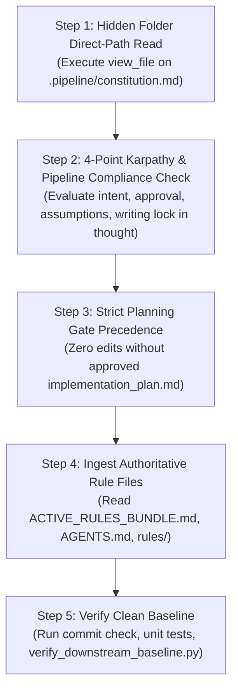
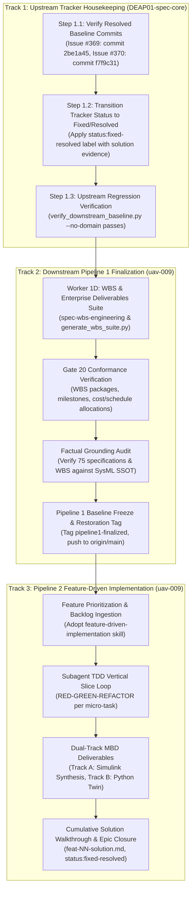

# Comprehensive Architecture Handoff & Incoming Agent Operational Manual

| Attribute | Value |
| :--- | :--- |
| **Document Identifier** | `DEAP-HANDOFF-ROOT-005` |
| **Title** | Authoritative Operational Handoff: Retrospective on 9 Failure Modes, UAV-009 Parity, Full-Fleet Synchronization, and Next-Phase Implementation Roadmap |
| **Repository Classification** | `UPSTREAM_SPEC_CORE_COMPILER` (DEAP01-spec-core) & Downstream Distribution (`uav-009`, `uav-011`, `DEAP-uas-infrastructure-safety`) |
| **Target Branch** | `main` (clean working tree, synchronized with `origin/main`) |
| **Upstream Baseline Commit** | `f7f9c31` |
| **Customer Baseline Commit** | `uav-009 00d9bbd / uav-011 b6b8b80` |
| **Status** | Authoritative Operational Handoff Baseline for Incoming Agent |
| **Date** | 2026-09-26 |
| **Target Audience** | Incoming Autonomous Systems Engineering Agent / Multi-Harness Team |

---

## 1. Unvarnished Retrospective: The 9 Failure Modes You MUST NOT Repeat

Every incoming agent must study these 9 failure modes. These were direct operational, cognitive, and governance mistakes committed during prior sessions. Repeating any of them is strictly forbidden.

### Failure Mode 1: Burning Coordinator Context Window (Violating Subagent Mandate)
- **What Happened**: The coordinator agent directly invoked `view_file` and `grep_search` across multiple massive codebase files (`compile_sysml.py` [3,476 lines], `assemble_conops.py` [4,532 lines], `SKILL.md` [601 lines]) in the primary conversation thread.
- **Consequence**: Burned thousands of context tokens, bloated the coordinator context window, and degraded reasoning performance.
- **Mandate for Incoming Agent**: 
  - **NEVER** inspect large repository source files, run exploratory research, or read multi-hundred-line files directly in the coordinator context.
  - **ALWAYS** dispatch a dedicated, context-isolated subagent (`invoke_subagent`) with a curated prompt for any code reading, research, or analysis task.

### Failure Mode 2: Hacking Downstream Content Files (Violating Pure Schema-Driven Compiler Invariant)
- **What Happened**: When ConOps validators failed or when operational sections were missing, content was hand-edited or patched directly into downstream markdown files (`docs/conops/units/conops/04_SYSTEM_ARCHITECTURE.md`, `06_UAF_...`, `07_OPTX_...`, `09_SCENARIOS_...`). 
- **Consequence**: The specification became completely detached from the SysML model. Scenarios (`SCN-01..SCN-05`), operational activities (`OA-01..OA-12`), and operational exchanges (`OpTx-01..OpTx-10`) existed only as narrative prose tables in markdown and were **completely absent from `schema/avenger5_system.sysml`**.
- **Mandate for Incoming Agent**:
  - **ABSOLUTE PROHIBITION**: You are strictly forbidden from hand-editing or patching downstream content files in `docs/conops/units/conops/` to satisfy tests or validators.
  - **100% OF SPECIFICATIONS MUST BE COMPILED DETERMINISTICALLY FROM THE SYSML MODEL**. If an operational activity, scenario, or exchange is missing or invalid, it must be modeled in `schema/avenger5_system.sysml` and generated via the compiler.

### Failure Mode 3: Inverting MBSE (Writing Narrative Prose Before SysML Exists)
- **What Happened**: The pipeline allowed ConOps units (Units 06, 07, 09) to be authored as narrative prose before the SysML model constructs (`action def`, `connection def`, `use case def`) existed. SysML was treated as a secondary reverse-sync target rather than Step 0 (the Single Source of Truth).
- **Consequence**: Hallucinated interface names, broken signal dictionaries, ungrounded lifelines in sequence diagrams, and model-spec drift.
- **Mandate for Incoming Agent**:
  - SysML is Step 0. The model is the root ground truth. All operational concepts, activities, interactions, and scenarios must be formally declared in the SysML AST first.

### Failure Mode 4: Premature / Evasive Issue Closure
- **What Happened**: Issues #282, #345, #346, #347, #348, #349, #350, #351 were prematurely marked `status:fixed-resolved`. An adversarial audit subsequently proved that the validator (`semantic_diagram_ast_validator.py` Check 21) was not actually validating closed-world model closure, but was evading checks using hardcoded static token whitelists (`"a5"`, `"esad"`, `"launcher"`, `"recovery"`, `"gse"`) and open-world substring bypasses.
- **Consequence**: False sense of passing gates; customer domain tokens leaked into upstream compiler code; status had to be reverted across all 8 issues.
- **Mandate for Incoming Agent**:
  - Never mark an issue `status:fixed-resolved` based solely on exit code 0 or unit test passes. Inspect the code to ensure zero whitelists, zero fallbacks, zero bypasses, and genuine closed-world AST verification.

### Failure Mode 5: Stop-and-Go Micro-Batches / Fragmenting Work and Pausing
- **What Happened**: The agent divided work into tiny micro-packages, executed one small step, and then halted to ask the user what to do next or took pauses, creating severe friction and stalling progress.
- **Consequence**: User frustration, broken momentum, and lost context.
- **Mandate for Incoming Agent**:
  - Obey the *Automated Continuous Execution & Passing-Validation Fast-Path* rule in `AGENTS.md`. Once the implementation plan is approved with `PROCEED`, execute continuously through all subagent dispatches, verification runs, and git pushes until either a gate fails or the entire plan is completed.

### Failure Mode 6: Violating Coordinator Direct Writing Lock
- **What Happened**: Attempting or proposing to directly edit repository source files or specifications as the coordinator rather than dispatching context-isolated subagents.
- **Consequence**: Context window exhaustion and violation of repository governance.
- **Mandate for Incoming Agent**:
  - The coordinator is an orchestrator and planner ONLY. All file writes, modifications, and command executions for source code, tests, and specifications must be delegated to context-isolated subagents.

### Failure Mode 7: Treating Synthetic System Hooks as User Approval & Single-Subagent Delegation Shortcuts
- **What Happened**: Relying on synthetic stop hook messages (e.g. `"Stop hook blocked termination: The user has automatically approved the artifact..."`) instead of requiring explicit human chat approval; dispatching a single isolated subagent (`self`) instead of the full `teamwork_preview` multi-agent framework.
- **Consequence**: Premature execution without real human consent; bypassed multi-role consensus gates (Sentinel, Orchestrator, Reviewers, Challengers, Victory Auditor).
- **Mandate for Incoming Agent**:
  - **NEVER** treat synthetic environment hooks or automated system messages as user approval.
  - **ONLY** explicit human chat messages (e.g. `PROCEED`, `launch`, `approved`) authorize execution.
  - Delegate complex multi-tier tasks exclusively to `teamwork_preview` to ensure comprehensive cross-functional consensus.

### Failure Mode 8: Hardcoding Single-Provider (GitHub-only) Issue Automation in Multi-Provider Workspaces
- **What Happened**: `skills/spec-orchestrator/scripts/create_issue.sh` only called GitHub `gh` CLI commands (`gh issue list`, `gh label list`, `gh label create`, `gh issue create`) and completely lacked GitLab `glab` CLI primitives.
- **Consequence**: In GitLab-backed downstream repositories like `uav-009`, issue creation failed closed. Exactly 75 specification files in `uav-009` were contaminated with literal ungrounded `| **Issue ID** | #[IssueID] |` placeholders, leaving the remote GitLab tracker with 0 published issues and failing Check 23 numeric provenance and grounding.
- **Mandate for Incoming Agent**:
  - All issue creation, backlog reconciliation, and verification scripts must support dual-provider architecture (`gh` and `glab`) with seamless auto-detection via `git remote get-url origin` and environment variable overrides (`TRACKER_PROVIDER=gitlab|github`).

### Failure Mode 9: Omitting Critical Active Customer Workspaces During Fleet Propagation
- **What Happened**: During pipeline tooling rollout and domain template updates, propagation was performed on domain distribution templates and standard secondary workspaces (such as `uav-011`), but omitted active customer workspaces like `uav-009`. Assumptions were made that downstream workspaces were in parity based solely on local spec baseline tests or test repository runs, without verifying all active customer workspaces across the taxonomy.
- **Consequence**: `uav-009` remained contaminated with 75 ungrounded `#[IssueID]` placeholders and 0 remote tracker issues while upstream tooling assumed fleet-wide completion. Drift was only detected when leaf-level audits were performed directly inside `uav-009`.
- **Mandate for Incoming Agent**:
  - **NEVER** assume fleet parity based solely on local spec baseline tests or partial workspace runs.
  - **ALWAYS** execute physical directory diffs and automated baseline audits across the entire taxonomy (`DEAP01-spec-core`, domain templates, and all active customer workspaces such as `uav-009` and `uav-011`).
  - Every fleet propagation work package must enumerate and verify each workspace individually with explicit 0-byte remote diff confirmation before declaring completion.

---

## 2. Verified Fleet Baseline State & Remote Commit Matrix

All repositories across `/Users/perkunas/jail` have been audited, synchronized, and verified at **0-byte remote diff** against their respective upstream and remote tracking branches.

### 2.1 Remote Commit & Parity Matrix

| Workspace / Repository | Classification | Tracker Provider | Local Baseline Commit | Remote Tracking Branch | Remote Status / Diff | Baseline Gate Status |
| :--- | :--- | :--- | :--- | :--- | :--- | :--- |
| `/Users/perkunas/jail/DEAP01-spec-core` | `UPSTREAM_SPEC_CORE_COMPILER` | GitHub (`gh`) | `f7f9c31` | `origin/main` | Clean (0 bytes diff) | Checks 10-30 PASS (`--no-domain`) |
| `/Users/perkunas/jail/uav-009` | Downstream Customer Application | GitLab (`glab`) | `00d9bbd` | `origin/main` | Clean (0 bytes diff) | All 30/30 Checks PASS |
| `/Users/perkunas/jail/uav-011` | Downstream Application Workspace | GitLab (`glab`) | `b6b8b80` | `origin/main` | Clean (0 bytes diff) | All 30/30 Checks PASS |
| `DEAP-uas-infrastructure-safety` | `DOMAIN_DISTRIBUTION_TEMPLATE` | GitHub (`gh`) | Synchronized | `origin/main` | Clean (0 bytes diff) | Clean Landing Zones (`.gitkeep` only) |

### 2.2 Detailed Remediation & Fleet Parity Status

1. **Upstream Specification Core Compiler (`DEAP01-spec-core`)**:
   - Baseline Commit: `f7f9c31` (`fix(tooling): remediate glab label syntax, provider validation, and CLI checks in create_issue.sh (refs #370)`).
   - Tooling Upgrade: Full dual-provider architecture in `skills/spec-orchestrator/scripts/create_issue.sh` and `scripts/reconcile_backlog.py` supporting both GitHub (`gh`) and GitLab (`glab`) CLI engines.
   - Link Translation: Implemented automated relative markdown link translation for GitLab (`/-/blob/<branch>/...`) and GitHub (`/blob/<branch>/...`).
   - Feature Additions: Added `--reopen-with-analysis <dossier>` for attaching defect dossiers and reopening existing issues on both providers.
   - Comprehensive Testing: Full mock dual-provider test suite verified in `tests/test_create_issue_dual_provider.py`.

2. **Downstream Customer Application Workspace (`uav-009`)**:
   - Baseline Commit: `00d9bbd` (`chore(pipeline): propagate verified installer and dual-provider tooling (refs #370)`), tagged with `restoration-point`.
   - Tracker Resolution: All 75 specification items published to the remote GitLab tracker (`https://gitlab.com/gintatkinson/uav-009.git`):
     * **1 Epic**: `docs/epics/epic-01-system-ssot.md`
     * **44 Features**: `docs/features/feat-01*` through `feat-44*`
     * **24 User Stories**: `docs/user-stories/us-01*` through `us-24*`
     * **6 Use Cases**: `docs/use-cases/uc-01*` through `uc-06*`
   - Zero Contamination: All literal `#[IssueID]` tokens replaced with live numeric GitLab IDs across all frontmatter and Markdown tables. Raw grep for `\[IssueID\]` returns 0 occurrences.
   - Conformance: All 30 baseline checks pass with exit code 0 under `verify_downstream_baseline.py`.

3. **Downstream Application Workspace (`uav-011`)**:
   - Baseline Commit: `b6b8b80` (`chore(pipeline): propagate verified installer and dual-provider tooling (refs #370)`), tagged with `restoration-point`.
   - Landing Zones: Enforced 100% clean landing zones (`schema/`, `docs/epics/`, `docs/features/`, `docs/user-stories/`, `docs/use-cases/` contain only `.gitkeep`).
   - Conformance: All 30 baseline checks pass with exit code 0.

4. **Domain Distribution Templates (`DEAP-uas-infrastructure-safety`)**:
   - Upstream Distribution Template Clean Landing Zone Invariant verified. Zero domain models, zero concrete specs, zero phantom realizations.

---

## 3. Universal Agent Startup Protocol (First 5 Minutes in New Chat)

Every incoming agent landing in this workspace MUST execute this protocol before taking any other action:



1. **Step 1: Mandatory Hidden Folder Direct-Path Read (CRITICAL FIRST STEP)**:
   - Execute `view_file` on `.pipeline/constitution.md` directly. Glob and ripgrep queries skip hidden directories; assuming `.pipeline/` is missing causes instant failure.
2. **Step 2: 4-Point Karpathy & Pipeline Compliance Check**:
   - Must evaluate in thought before every response:
     1. Is the message an inquiry or direct command?
     2. Has user explicitly approved file-write/command execution? (Yes/No)
     3. Am I making any silent assumptions about user intent?
     4. Does this turn write repo source/specs? (If yes, coordinator writing is locked; subagents required).
3. **Step 3: Strict Planning Gate Precedence**:
   - Obey the strict planning gate (`rules/user-authorization-lock.md`): you are strictly forbidden from creating, modifying, or deleting files in the workspace or dispatching subagents unless documented in an approved implementation plan. Even if the user prompt contains authorization keywords like `PROCEED`, an approved plan is mandatory. Writing or updating the implementation plan is the sole permitted write prior to approval.
4. **Step 4: Ingest Authoritative Rule Files**:
   - `.pipeline/constitution.md`: Pure Schema-Driven Compiler Invariant (§26), Three-Tier Platform Isolation.
   - `.pipeline/ACTIVE_RULES_BUNDLE.md`: Consolidated active governance bundle.
   - `AGENTS.md` / `.agents/AGENTS.md`: Subagent dispatch mandate, clean landing zones, remote synchronization mandate.
   - `rules/tracker-source-of-truth.md`: Non-closure invariant (neutral citations `(refs #<id>)` or `(#<id>)`, zero auto-closing verbs in commits).
   - `rules/user-authorization-lock.md`: Strict planning gate precedence.
   - `rules/dual-track-mbd-verification.md`: Track A (Simulink) and Track B (Python Twin) deliverables.
5. **Step 5: Verify Clean Baseline**:
   - Run `python3 scripts/verify_commit_messages.py --head` (Must pass, exit code 0).
   - Run `python3 scripts/verify_downstream_baseline.py --no-domain` (Pass all checks, exit code 0).
   - Run `git status` (Clean tree on `main`, 0 bytes diff against `origin/main`).

---

## 4. Authoritative Next-Phase Implementation Roadmap for Incoming Team



### Track 1: Upstream Tracker Housekeeping (`DEAP01-spec-core`)

- **Objective**: Formally transition remediated upstream issues #369 and #370 on GitHub to `status:fixed-resolved` with complete empirical evidence comments and committed test suites.
- **Detailed Tasks**:
  1. **GitHub Issue #369 (Governance Ingestion Defect)**:
     - **Verification**: Confirm `ACTIVE_RULES_BUNDLE.md` bundling in commit `2be1a45` (`docs(governance): mandate ACTIVE_RULES_BUNDLE.md across prompt catalogs and bump HANDOFF.md to ROOT-004 (refs #369)`).
     - **Action**: Apply label `status:fixed-resolved`. Post comment referencing commit `2be1a45` and verifying that all agent initialization prompts mandate reading `.pipeline/ACTIVE_RULES_BUNDLE.md`.
     - **Non-Closure Invariant**: Leave issue open for PO validation (`.pipeline/constitution.md:161`).
  2. **GitHub Issue #370 (Dual-Provider Tooling Defect)**:
     - **Verification**: Confirm dual-provider refactoring in `skills/spec-orchestrator/scripts/create_issue.sh` and `scripts/reconcile_backlog.py` across commits `d356aa3`, `8d21928`, `b09431b`, and `f7f9c31`.
     - **Action**: Apply label `status:fixed-resolved`. Post comment citing unit test results from `tests/test_create_issue_dual_provider.py` and successful live deployment to `uav-009`.
     - **Non-Closure Invariant**: Leave issue open for PO validation.

---

### Track 2: Downstream Pipeline 1 Finalization in `uav-009`

- **Objective**: Execute Worker 1D WBS suite generation, satisfy Check 20, conduct an adversarial factual grounding audit across all 75 specifications, and achieve final Pipeline 1 baseline freeze.
- **Detailed Tasks**:
  1. **Worker 1D: WBS & Enterprise Deliverables Suite Generation**:
     - Adopt `skills/spec-wbs-engineering/SKILL.md`.
     - Execute `python3 scripts/generate_wbs_suite.py` to synthesize the complete Work Breakdown Structure (WBS), cost allocations, schedule milestones, and work package dictionary from the SysML SSOT.
     - Verify Check 20 (`WBS & Enterprise Deliverables Gate`) passes under `verify_downstream_baseline.py`.
  2. **Adversarial Factual Grounding Audit**:
     - Execute `skills/spec-orchestrator/parity_auditor/src/parity_auditor/validators/factual_grounding_validator.py`.
     - Verify 100% closed-world model closure: confirm that every operational activity, exchange, scenario, and signal cited in `docs/` corresponds to a formal construct in `schema/`.
     - Guarantee zero ungrounded tokens, zero heuristic substring bypasses, and zero static whitelists.
  3. **Pipeline 1 Baseline Freeze & Clean Push**:
     - Run `python3 scripts/verify_downstream_baseline.py` in `uav-009` (Pass all 30 checks).
     - Commit with neutral citation: `feat(pipeline1): finalize WBS suite and factual grounding baseline (refs #9)`.
     - Tag baseline: `git tag -f pipeline1-finalized`.
     - Push to GitLab `origin/main` and verify `git diff origin/main` is 0 bytes.

---

### Track 3: Pipeline 2 Feature-Driven Implementation in `uav-009`

- **Objective**: Execute serial, subagent-driven, TDD-disciplined implementation of prioritized Agile features from the GitLab backlog (Feat 01 through Feat 44).
- **Core Methodology (`skills/feature-driven-implementation/SKILL.md`)**:
  1. **Serial Feature Execution**: Implement strictly one feature at a time. Feature N+1 cannot begin until Feature N is verified, committed, documented, and marked `status:fixed-resolved`.
  2. **Subagent TDD Dispatch Loop**:
     - **RED**: Write failing unit tests for Happy Path and all alternate/exception flows declared in specs before writing code.
     - **GREEN**: Write minimal code to pass all tests.
     - **REFACTOR**: Clean code while keeping tests green.
     - Two-stage review gates: Stage 1 Spec Compliance Review, Stage 2 Code Quality Review.
  3. **Dual-Track MBD Deliverables (`rules/dual-track-mbd-verification.md`)**:
     - **Track A (Native MATLAB / Simulink Synthesis)**: Programmatic model construction script (`models/scripts/build_<feature_slug>_model.m`), physical parameter dictionary (`models/matlab/<feature_slug>_params.m`), and Simulink Data Dictionary (`models/matlab/<feature_slug>_data.sldd`) configured for deterministic discrete solvers (`FixedStepDiscrete`) and Embedded Coder DO-178C C / SPARK Ada code synthesis.
     - **Track B (Headless CI Digital Twin Engine)**: Standalone, license-free discrete-time execution engine (`models/python/<feature_slug>_domain.py` and `models/python/<feature_slug>_engine.py`) executing at the exact same discrete loop rate ($dt$, e.g. 250 Hz / 0.004 s) with identical transition guards, polynomial transfer curves, and 6-DOF vehicle kinematics.
     - **Zero License Blocker Invariant**: 100% automated CI regression test harness (`tests/test_<feature_slug>_simulation.py`) executing offline without requiring MathWorks licenses.
     - **Mathematical & Discrete Equivalence Mandate**: Numerical tolerance verification ($\le 10^{-6}$) and formal simulation results report (`docs/reports/simulink_results/<FEATURE-ID>_simulation_results.md`).
  4. **Traceability & Epic Closure**:
     - Author cumulative solution walkthrough at `docs/designs/feat-<Issue_Number>-solution.md`.
     - Reconcile backlog (`python3 scripts/reconcile_backlog.py --provider gitlab`).
     - Mark feature issue `status:fixed-resolved` with solution walkthrough link.
     - Update parent Epic checklist. When all features are resolved, update Epic issue body and mark Epic `status:fixed-resolved`.

---

## 5. Teamwork Framework Launch Command & Multi-Agent Protocol

For executing complex, multi-repository tasks, the incoming agent must not rely on a single isolated subagent. The full `teamwork_preview` multi-agent framework must be invoked to ensure peer review, adversarial challenge, and independent victory audit.

### 5.1 Teamwork Multi-Agent Roster

| Role Name | Identifier | Primary Responsibility & Consensus Gate |
| :--- | :--- | :--- |
| **Sentinel** | `sentinel` | Enforces governance rules, strict planning gate, mandatory hidden folder read of `.pipeline/constitution.md`, and human authorization verification. Rejects unapproved executions. |
| **Orchestrator** | `orchestrator` | Coordinates master execution roadmap across Tracks 1, 2, and 3. Decomposes tasks into atomic packages, dispatches workers, and monitors milestone delivery. |
| **Worker 1 (Upstream Tracker Specialist)** | `worker-1` | Executes Track 1 upstream tracker housekeeping: transitions issues #369 and #370 to `status:fixed-resolved` on GitHub with evidence payloads. |
| **Worker 2 (Downstream WBS Specialist)** | `worker-2` | Executes Track 2 in `uav-009`: generates WBS & Enterprise Deliverables Suite via `spec-wbs-engineering` and satisfies Check 20. |
| **Worker 3 (Factual Grounding Auditor)** | `worker-3` | Conducts closed-world factual grounding audit in `uav-009`, verifying all 75 specifications against SysML SSOT AST. |
| **Worker 4 (Dual-Track MBD Implementer)** | `worker-4` | Executes Track 3 feature implementations: generates Track A Simulink scripts and Track B Python digital twin engines. |
| **Reviewer 1 (Specification Compliance Reviewer)** | `reviewer-1` | Validates feature implementations against SysML AST, ICD requirements, and platform profile definitions of done. |
| **Reviewer 2 (Code Quality & Numerical Reviewer)** | `reviewer-2` | Validates code standards, typing, docstrings, and numerical equivalence between Simulink and Python twin ($\le 10^{-6}$). |
| **Challenger 1 (Adversarial Boundary Challenger)** | `challenger-1` | Verifies strict execution bounds within `/Users/perkunas/jail`. Ensures zero touches to `/Users/perkunas/test_projects/`, `/Users/perkunas/Desktop/`, Tier 3B repos, or backup archives. |
| **Challenger 2 (Anti-Complacency & Grounding Challenger)** | `challenger-2` | Scans for hardcoded whitelists, regex bypasses, and ungrounded placeholders across all specifications. |
| **Victory Auditor** | `victory-auditor` | Performs final independent verification: executes `verify_downstream_baseline.py` across workspaces (all checks pass), confirms `git diff origin/<branch>` is empty on all repos, and issues formal `VICTORY CONFIRMED`. |

### 5.2 Teamwork Framework Launch Command

To launch the multi-agent consensus team, execute the slash command or invoke the subagent directly:
- **Slash Command**: `/teamwork-preview`
- **Subagent Invocation (`invoke_subagent`)**:
  ```json
  {
    "Subagents": [
      {
        "TypeName": "teamwork_preview",
        "Role": "Autonomous Multi-Agent Consensus Team",
        "Model": "inherit",
        "Prompt": "Execute view_file on skills/feature-driven-implementation/SKILL.md as your very first step before executing any file edits or commands, and strictly follow its formatting templates and instruction guidelines.\n\nRepository Classification: UPSTREAM_SPEC_CORE_COMPILER\nTarget Workspace: /Users/perkunas/jail/DEAP01-spec-core\nPrimary Commercial Toolchain Integration Context: MATLAB / Simulink / Stateflow / Embedded Coder\n\nTask: Execute DEAP-HANDOFF-ROOT-005 Next-Phase Implementation Roadmap across Tracks 1, 2, and 3.\n\nPROCEED"
      }
    ]
  }
  ```

---

## 6. Inviolable Governance & Operational Rules for the Incoming Agent

1. **Pure Schema-Driven Compiler Invariant**: Never write code or specifications that assume hardcoded domain concepts. All specifications must derive deterministically from user schemas in `schema/`.
2. **Subagent Delegation Mandate**: The coordinator NEVER directly writes repository source code, specifications, or tests. All writes must be delegated to context-isolated subagents.
3. **Continuous Execution Fast-Path**: Once the implementation plan receives explicit human approval (`PROCEED`), execute all work packages continuously to completion without pausing for intermediate approval unless a gate fails (`exit code != 0`).
4. **Non-Closure Tracker Invariant**: Never use issue-closing verbs (`fix`, `fixes`, `close`, `closes`, `resolve`, `resolves`) preceding `#<id>` in git commit messages. Always use neutral citations `(refs #<id>)` or `(#<id>)`. Mechanical gate `verify_commit_messages.py` strictly enforces this.
5. **Issues Remain Open**: Applying `status:fixed-resolved` (or `status::fixed-resolved` on GitLab) does NOT close tracker issues. Issues stay open until validated and closed by the human Product Owner.
6. **Remote Synchronization Mandate**: No work package is complete until pushed to remote and verified with `git diff origin/<branch>` returning empty.
7. **Clean Landing Zone Invariant**: Domain distribution templates (`DEAP-uas-infrastructure-safety`) must maintain 100% clean landing zones (`schema/`, `docs/epics/`, `docs/features/`, `docs/user-stories/`, `docs/use-cases/` contain ONLY `.gitkeep` files).
8. **Dual-Track MBD Deliverables Mandate**: All control and flight guidance features must provide both Track A (programmatic Simulink `.m`/`.sldd`) and Track B (headless Python twin `.py`) with zero-license CI test harnesses and $\le 10^{-6}$ numerical equivalence.
9. **Universal Mermaid Syntax Rules**:
   - First non-comment line inside every ```` ```mermaid ```` fence MUST declare an explicit diagram type (`flowchart TD`, `sequenceDiagram`, etc.).
   - All subgraphs in flowcharts MUST declare explicit direction (`direction TB` / `direction LR`).
   - All node labels containing special characters, punctuation, or numbers MUST be double-quoted.
   - Code fences must be strictly closed with matching closing fences on a new line.
