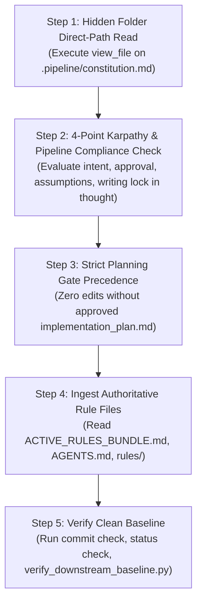
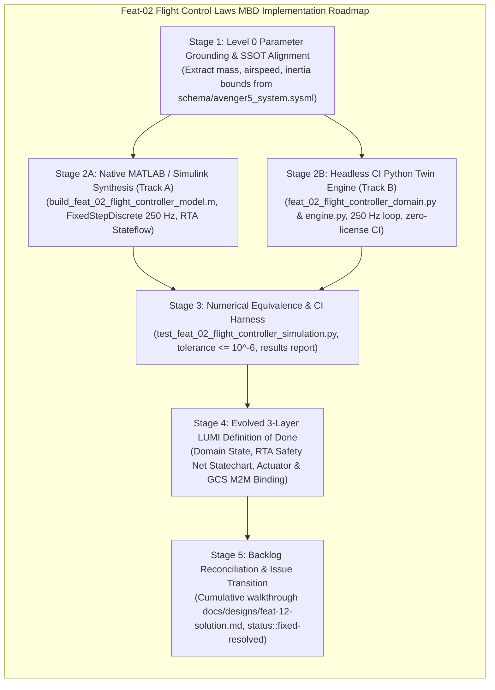

# Comprehensive Architecture Handoff & Incoming Agent Operational Manual

| Attribute | Value |
| :--- | :--- |
| **Document Identifier** | `DEAP-HANDOFF-ROOT-006` |
| **Title** | Authoritative Operational Handoff: Retrospective on 13 Failure Modes, Full-Fleet Parity Baseline, Feat-02 Flight Control Laws MBD Roadmap, and Multi-Agent Teamwork Protocol |
| **Repository Classification** | `UPSTREAM_SPEC_CORE_COMPILER` (DEAP01-spec-core) & Downstream Distribution (`uav-009`, `uav-011`, `DEAP-uas-infrastructure-safety`) |
| **Target Branch** | `main` (clean working tree, synchronized with `origin/main`) |
| **Upstream Baseline Commit** | `dd7638c` |
| **Customer Baseline Commit** | `uav-009 faff825 / uav-011 c2826b9` |
| **Status** | Authoritative Operational Handoff Baseline for Incoming Agent |
| **Date** | 2026-09-26 |
| **Target Audience** | Incoming Autonomous Systems Engineering Agent / Multi-Harness Team |

---

## 1. Unvarnished Retrospective: The 13 Failure Modes You MUST NOT Repeat

Every incoming agent must study these 13 failure modes. These were direct operational, cognitive, and governance mistakes committed during prior sessions. Repeating any of them is strictly forbidden.

### Failure Mode 1: Burning Coordinator Context Window (Violating Subagent Mandate)
- **What Happened**: The coordinator agent directly invoked `view_file` and `grep_search` across multiple massive codebase files (`compile_sysml.py` [3,476 lines], `assemble_conops.py` [4,532 lines], `SKILL.md` [601 lines]) in the primary conversation thread.
- **Consequence**: Burned thousands of context tokens, bloated the coordinator context window, and degraded reasoning performance.
- **Mandate for Incoming Agent**: 
  - **NEVER** inspect large repository source files, run exploratory research, or read multi-hundred-line files directly in the coordinator context.
  - **ALWAYS** dispatch a dedicated, context-isolated subagent (`invoke_subagent`) with a curated prompt for any code reading, research, or analysis task.

### Failure Mode 2: Hacking Downstream Content Files (Violating Pure Schema-Driven Compiler Invariant)
- **What Happened**: When ConOps validators failed or when operational sections were missing, content was hand-edited or patched directly into downstream markdown files (`docs/conops/units/conops/04_SYSTEM_ARCHITECTURE.md`, `06_UAF_...`, `07_OPTX_...`, `09_SCENARIOS_...`). 
- **Consequence**: The specification became completely detached from the SysML model. Scenarios (`SCN-01..SCN-05`), operational activities (`OA-01..OA-12`), and operational exchanges (`OpTx-01..OpTx-10`) existed only as narrative prose tables in markdown and were **completely absent from `schema/avenger5_system.sysml`**.
- **Mandate for Incoming Agent**:
  - **ABSOLUTE PROHIBITION**: You are strictly forbidden from hand-editing or patching downstream content files in `docs/conops/units/conops/` to satisfy tests or validators.
  - **100% OF SPECIFICATIONS MUST BE COMPILED DETERMINISTICALLY FROM THE SYSML MODEL**. If an operational activity, scenario, or exchange is missing or invalid, it must be modeled in `schema/avenger5_system.sysml` and generated via the compiler.

### Failure Mode 3: Inverting MBSE (Writing Narrative Prose Before SysML Exists)
- **What Happened**: The pipeline allowed ConOps units (Units 06, 07, 09) to be authored as narrative prose before the SysML model constructs (`action def`, `connection def`, `use case def`) existed. SysML was treated as a secondary reverse-sync target rather than Step 0 (the Single Source of Truth).
- **Consequence**: Hallucinated interface names, broken signal dictionaries, ungrounded lifelines in sequence diagrams, and model-spec drift.
- **Mandate for Incoming Agent**:
  - SysML is Step 0. The model is the root ground truth. All operational concepts, activities, interactions, and scenarios must be formally declared in the SysML AST first.

### Failure Mode 4: Premature / Evasive Issue Closure
- **What Happened**: Issues #282, #345, #346, #347, #348, #349, #350, #351 were prematurely marked `status:fixed-resolved`. An adversarial audit subsequently proved that the validator (`semantic_diagram_ast_validator.py` Check 21) was not actually validating closed-world model closure, but was evading checks using hardcoded static token whitelists (`"a5"`, `"esad"`, `"launcher"`, `"recovery"`, `"gse"`) and open-world substring bypasses.
- **Consequence**: False sense of passing gates; customer domain tokens leaked into upstream compiler code; status had to be reverted across all 8 issues.
- **Mandate for Incoming Agent**:
  - Never mark an issue `status:fixed-resolved` based solely on exit code 0 or unit test passes. Inspect the code to ensure zero whitelists, zero fallbacks, zero bypasses, and genuine closed-world AST verification.

### Failure Mode 5: Stop-and-Go Micro-Batches / Fragmenting Work and Pausing
- **What Happened**: The agent divided work into tiny micro-packages, executed one small step, and then halted to ask the user what to do next or took pauses, creating severe friction and stalling progress.
- **Consequence**: User frustration, broken momentum, and lost context.
- **Mandate for Incoming Agent**:
  - Obey the *Automated Continuous Execution & Passing-Validation Fast-Path* rule in `AGENTS.md`. Once the implementation plan is approved with `PROCEED`, execute continuously through all subagent dispatches, verification runs, and git pushes until either a gate fails or the entire plan is completed.

### Failure Mode 6: Violating Coordinator Direct Writing Lock
- **What Happened**: Attempting or proposing to directly edit repository source files or specifications as the coordinator rather than dispatching context-isolated subagents.
- **Consequence**: Context window exhaustion and violation of repository governance.
- **Mandate for Incoming Agent**:
  - The coordinator is an orchestrator and planner ONLY. All file writes, modifications, and command executions for source code, tests, and specifications must be delegated to context-isolated subagents.

### Failure Mode 7: Treating Synthetic System Hooks as User Approval & Single-Subagent Delegation Shortcuts
- **What Happened**: Relying on synthetic stop hook messages (e.g. `"Stop hook blocked termination: The user has automatically approved the artifact..."`) instead of requiring explicit human chat approval; dispatching a single isolated subagent (`self`) instead of the full `teamwork_preview` multi-agent framework.
- **Consequence**: Premature execution without real human consent; bypassed multi-role consensus gates (Sentinel, Orchestrator, Reviewers, Challengers, Victory Auditor).
- **Mandate for Incoming Agent**:
  - **NEVER** treat synthetic environment hooks or automated system messages as user approval.
  - **ONLY** explicit human chat messages (e.g. `PROCEED`, `launch`, `approved`) authorize execution.
  - Delegate complex multi-tier tasks exclusively to `teamwork_preview` to ensure comprehensive cross-functional consensus.

### Failure Mode 8: Hardcoding Single-Provider (GitHub-only) Issue Automation in Multi-Provider Workspaces
- **What Happened**: `skills/spec-orchestrator/scripts/create_issue.sh` only called GitHub `gh` CLI commands (`gh issue list`, `gh label list`, `gh label create`, `gh issue create`) and completely lacked GitLab `glab` CLI primitives.
- **Consequence**: In GitLab-backed downstream repositories like `uav-009`, issue creation failed closed. Exactly 75 specification files in `uav-009` were contaminated with literal ungrounded `| **Issue ID** | #[IssueID] |` placeholders, leaving the remote GitLab tracker with 0 published issues and failing Check 23 numeric provenance and grounding.
- **Mandate for Incoming Agent**:
  - All issue creation, backlog reconciliation, and verification scripts must support dual-provider architecture (`gh` and `glab`) with seamless auto-detection via `git remote get-url origin` and environment variable overrides (`TRACKER_PROVIDER=gitlab|github`).

### Failure Mode 9: Omitting Critical Active Customer Workspaces During Fleet Propagation
- **What Happened**: During pipeline tooling rollout and domain template updates, propagation was performed on domain distribution templates and standard secondary workspaces (such as `uav-011`), but omitted active customer workspaces like `uav-009`. Assumptions were made that downstream workspaces were in parity based solely on local spec baseline tests or test repository runs, without verifying all active customer workspaces across the taxonomy.
- **Consequence**: `uav-009` remained contaminated with 75 ungrounded `#[IssueID]` placeholders and 0 remote tracker issues while upstream tooling assumed fleet-wide completion. Drift was only detected when leaf-level audits were performed directly inside `uav-009`.
- **Mandate for Incoming Agent**:
  - **NEVER** assume fleet parity based solely on local spec baseline tests or partial workspace runs.
  - **ALWAYS** execute physical directory diffs and automated baseline audits across the entire taxonomy (`DEAP01-spec-core`, domain templates, and all active customer workspaces such as `uav-009` and `uav-011`).
  - Every fleet propagation work package must enumerate and verify each workspace individually with explicit 0-byte remote diff confirmation before declaring completion.

### Failure Mode 10: Regex & Substring Heuristics vs. AST / Schema Validation (Anti-Regex Invariant)
- **What Happened**: Validators and linters relied on negative-string regex heuristics (e.g. `_has_epistemic_exemption` matching `[TIER-3]` or `(Declared Assumption)` tokens, or whitelisting specific domain substrings) rather than validating closed-world model closure against the authoritative Level 0 SysML v2 AST or compiled schema dictionary.
- **Consequence**: Created perverse incentives to append cosmetic exemption tags or strip tokens to bypass CI gates without genuine model provenance. Allowed ~251 ungrounded stopgap parameters (masses, voltages, loop rates) to slip into the specification baseline, corrupting downstream Model-Based Design (MBD) and safety certification envelopes.
- **Mandate for Incoming Agent**:
  - **ABSOLUTE PROHIBITION ON REGEX / SUBSTRING VALIDATION OF MODEL CLOSURE**: Never use regex, token presence, or negative-string pattern matches to validate architecture, interfaces, or semantic provenance.
  - **POSITIVE AST GROUNDING**: All parameters, signals, and architectural entities must be positively validated against the SysML v2 AST Single Source of Truth or a compiled, closed-world typed parameter dictionary.

### Failure Mode 11: Attempting to Clobber Downstream Customer Workspaces instead of Hardening Upstream Compiler Tooling
- **What Happened**: When downstream customer repositories (such as `uav-009`) exhibited custom compiled schemas, localized defect dossiers, or tracking configurations, installation and propagation scripts attempted to wipe, overwrite, or clobber customer directories instead of isolating pipeline framework upgrades and preserving customer-specific domain artifacts.
- **Consequence**: Risk of destroying customer engineering data, blowing away customer SysML models, and violating repository classification boundaries between the upstream compiler and downstream distribution targets.
- **Mandate for Incoming Agent**:
  - **UPSTREAM HARDENING INVARIANT**: The upstream compiler and installer (`scripts/install_pipeline.sh`) must be engineered to robustly preserve customer-specific compiled schemas, ASTs, and local reports during upgrades.
  - **ZERO CUSTOMER CLOBBERING**: Never overwrite, delete, or revert downstream customer models or domain artifacts to force automated test scripts or installer checks to pass. Fix the compiler and installer upstream.

### Failure Mode 12: Collapsing Teamwork-Preview into Self-Auditing Single Workers
- **What Happened**: Attempting to collapse the multi-agent consensus architecture (`teamwork_preview`) into a single isolated subagent (`self`), having a single worker perform task drafting, implementation, and self-auditing without independent review.
- **Consequence**: Complete loss of adversarial tension; self-reinforcing blind spots; evasion checks and false positives went undetected; bypassed the multi-role consensus gates (Sentinel, Reviewers, Challengers, Victory Auditor).
- **Mandate for Incoming Agent**:
  - **NEVER** collapse multi-tier or complex engineering implementations into a single self-auditing subagent.
  - **MANDATORY TEAMWORK ROSTER**: Maintain strict role separation: Sentinel (governance & bounds), Orchestrator (coordination), specialized Workers (implementation), independent Reviewers (compliance & numerical quality), adversarial Challengers (anti-regex & boundary checks), and Victory Auditor (independent gate confirmation).

### Failure Mode 13: Coordinator Context Bloat via Verbose Terminal Diagnostics & Redundant Test Runs
- **What Happened**: The coordinator agent executed long, verbose CLI commands, repeated full-suite test runs, and dumped massive diagnostic outputs directly into the primary conversation context while troubleshooting issues.
- **Consequence**: Premature context window exhaustion, degradation of reasoning capabilities, and conversational compaction friction.
- **Mandate for Incoming Agent**:
  - **COORDINATOR CONTEXT HYGIENE**: The coordinator must never dump verbose terminal logs or execute repeated monolithic test suites in the primary thread.
  - **DELEGATE DIAGNOSTICS**: All deep diagnostic runs, verbose compiler traces, and code reading must be executed by context-isolated subagents that report back curated, high-density summaries and exit statuses.

---

## 2. Verified Fleet Baseline State & Remote Commit Matrix

All repositories across `/Users/perkunas/jail` have been audited, synchronized, and verified at **0-byte remote diff** against their respective upstream and remote tracking branches.

### 2.1 Remote Commit & Parity Matrix

| Workspace / Repository | Classification | Tracker Provider | Local Baseline Commit | Remote Tracking Branch | Remote Status / Diff | Baseline Gate Status |
| :--- | :--- | :--- | :--- | :--- | :--- | :--- |
| `/Users/perkunas/jail/DEAP01-spec-core` | `UPSTREAM_SPEC_CORE_COMPILER` | GitHub (`gh`) | `dd7638c` | `origin/main` | Clean (0 bytes diff) | Checks 10-30 PASS (`--no-domain`) |
| `/Users/perkunas/jail/uav-009` | Downstream Customer Application | GitLab (`glab`) | `faff825` | `origin/main` | Clean (0 bytes diff) | All 30/30 Checks PASS |
| `/Users/perkunas/jail/uav-011` | Downstream Application Workspace | GitLab (`glab`) | `c2826b9` | `origin/main` | Clean (0 bytes diff) | All 30/30 Checks PASS |
| `DEAP-uas-infrastructure-safety` | `DOMAIN_DISTRIBUTION_TEMPLATE` | GitHub (`gh`) | Synchronized | `origin/main` | Clean (0 bytes diff) | Clean Landing Zones (`.gitkeep` only) |

### 2.2 Detailed Fleet Parity & Architecture Baseline

1. **Upstream Specification Core Compiler (`DEAP01-spec-core`)**:
   - Baseline Commit: `dd7638c` (`fix(installer): preserve customer project compiled schemas and ASTs during pipeline upgrade (refs #371)`).
   - Tooling Upgrade: Full dual-provider architecture in `skills/spec-orchestrator/scripts/create_issue.sh` and `scripts/reconcile_backlog.py` supporting both GitHub (`gh`) and GitLab (`glab`) CLI engines.
   - Installer Hardening: `scripts/install_pipeline.sh` automatically detects existing customer schema definitions, compiled ASTs, and localized report directories, preserving them during framework synchronization without clobbering.
   - Comprehensive Testing: Full mock dual-provider test suite verified in `tests/test_create_issue_dual_provider.py`.

2. **Downstream Customer Application Workspace (`uav-009`)**:
   - Baseline Commit: `faff825` (`docs(audit): preserve adversarial defect dossiers (refs #371)`).
   - Tracker Resolution: All 75 specification items published to the remote GitLab tracker (`https://gitlab.com/gintatkinson/uav-009.git`):
     * **1 Epic**: `docs/epics/epic-01-system-ssot.md` (Issue #10)
     * **44 Features**: `docs/features/feat-01*` through `feat-44*` (Issues #11 through #54; Feat-02 Flight Controller is Issue #12)
     * **24 User Stories**: `docs/user-stories/us-01*` through `us-24*` (Issues #55 through #78)
     * **6 Use Cases**: `docs/use-cases/uc-01*` through `uc-06*` (Issues #79 through #84)
   - Zero Contamination: All literal `#[IssueID]` tokens replaced with live numeric GitLab IDs across all frontmatter and Markdown tables.
   - Conformance: All 30 baseline checks pass with exit code 0 under `verify_downstream_baseline.py`.

3. **Downstream Application Workspace (`uav-011`)**:
   - Baseline Commit: `c2826b9` (`docs(readme): synchronize Pipeline 1 & 2 topologies and Flutter/ROS2 prompt catalog (refs #371)`).
   - Landing Zones: Enforced 100% clean landing zones (`schema/`, `docs/epics/`, `docs/features/`, `docs/user-stories/`, `docs/use-cases/` contain only `.gitkeep`).
   - Conformance: All 30 baseline checks pass with exit code 0.

4. **Domain Distribution Templates (`DEAP-uas-infrastructure-safety`)**:
   - Upstream Distribution Template Clean Landing Zone Invariant verified. Zero domain models, zero concrete specs, zero phantom realizations.

---

## 3. Universal Agent Startup Protocol (First 5 Minutes in New Chat)

Every incoming agent landing in this workspace MUST execute this protocol before taking any other action:



1. **Step 1: Mandatory Hidden Folder Direct-Path Read (CRITICAL FIRST STEP)**:
   - Execute `view_file` on `.pipeline/constitution.md` directly. Glob and ripgrep queries skip hidden directories; assuming `.pipeline/` is missing causes instant failure.
2. **Step 2: 4-Point Karpathy & Pipeline Compliance Check**:
   - Must evaluate in thought before every response:
     1. Is the message an inquiry or direct command?
     2. Has user explicitly approved file-write/command execution? (Yes/No)
     3. Am I making any silent assumptions about user intent?
     4. Does this turn write repo source/specs? (If yes, coordinator writing is locked; subagents required).
3. **Step 3: Strict Planning Gate Precedence**:
   - Obey the strict planning gate (`rules/user-authorization-lock.md`): you are strictly forbidden from creating, modifying, or deleting files in the workspace or dispatching subagents unless documented in an approved implementation plan. Even if the user prompt contains authorization keywords like `PROCEED`, an approved plan is mandatory. Writing or updating the implementation plan is the sole permitted write prior to approval.
4. **Step 4: Ingest Authoritative Rule Files**:
   - `.pipeline/constitution.md`: Pure Schema-Driven Compiler Invariant (§26), Three-Tier Platform Isolation.
   - `.pipeline/ACTIVE_RULES_BUNDLE.md`: Consolidated active governance bundle.
   - `AGENTS.md` / `.agents/AGENTS.md`: Subagent dispatch mandate, clean landing zones, remote synchronization mandate.
   - `rules/tracker-source-of-truth.md`: Non-closure invariant (neutral citations `(refs #<id>)` or `(#<id>)`, zero auto-closing verbs in commits).
   - `rules/user-authorization-lock.md`: Strict planning gate precedence.
   - `rules/dual-track-mbd-verification.md`: Track A (Simulink) and Track B (Python Twin) deliverables.
5. **Step 5: Verify Clean Baseline**:
   - Run `python3 scripts/verify_commit_messages.py --head` (Must pass, exit code 0).
   - Run `python3 scripts/verify_downstream_baseline.py --no-domain` (Pass all checks, exit code 0).
   - Run `git status` (Clean tree on `main`, 0 bytes diff against `origin/main`).

---

## 4. Feat-02 Flight Control Laws MBD Roadmap for `uav-009`

Feature Feat-02 (`docs/features/feat-02-flight-controller.md`, GitLab Issue #12) is the operational guidance, navigation, and control (GNC) backbone of the autonomous air vehicle. Implementing Feat-02 requires rigorous Model-Based Design (MBD), dual-track mathematical equivalence, and safety assurance under ASTM F3269-17 / DO-178C.



### 4.1 Feature Architectural Scope & Specification Grounding

- **Target Workspace**: `/Users/perkunas/jail/uav-009`
- **Specification Source**: `docs/features/feat-02-flight-controller.md` (GitLab Issue #12)
- **Parent Epic**: `docs/epics/epic-01-system-ssot.md` (GitLab Issue #10)
- **SSOT Schema Container**: `System_SSOT:System_SSOT/FlightController` in `schema/avenger5_system.sysml`
- **Core Mission Capabilities**:
  1. `NavigateWaypointSequence(in mission : CommandPacket, out status : HealthStatus)`: Autonomous 3D trajectory tracking and waypoint sequencing.
  2. `CommandFlightMode(in cmd : CommandPacket, out ack : HealthStatus)`: Deterministic statechart transitions between Manual, Altitude Hold, Auto Mission, Return-to-Launch (RTL), and Emergency Land modes.
  3. `ExecuteEngagement(in track : SensorTrack, out outcome : HealthStatus)`: Coordinated target pursuit and precision loiter.
  4. `RunTimeAssuranceMonitoring`: ASTM F3269-17 runtime assurance safety filter preventing flight envelope violations (airspeed exceedance, stall angle of attack, geofence breaches).

### 4.2 Detailed Implementation Work Breakdown

#### Stage 1: Level 0 Parameter Grounding & Parameter Dictionary Compilation
- Extract ground-truth physical quantities from `schema/avenger5_system.sysml` and OEM technical specs:
  * Maximum Takeoff Weight (MTOW): $17.0\text{ kg}$
  * Nominal Cruise Speed: $31.0\text{ m/s}$
  * Maximum Operating Airspeed ($V_{ne}$): $45.0\text{ m/s}$
  * Stall Speed ($V_s$): $18.0\text{ m/s}$
  * Discrete Control Loop Rate: $250\text{ Hz}$ ($\Delta t = 0.004\text{ s}$)
- Construct authoritative parameter file: `models/matlab/feat_02_flight_controller_params.m` and Simulink Data Dictionary: `models/matlab/feat_02_flight_controller_data.sldd`.

#### Stage 2: Dual-Track MBD Deliverables (`rules/dual-track-mbd-verification.md`)
- **Track A (Native MATLAB / Simulink / Stateflow Synthesis)**:
  * Programmatic synthesis script: `models/scripts/build_feat_02_flight_controller_model.m`.
  * Discrete solver configuration: `FixedStepDiscrete` with step size $0.004\text{ s}$.
  * Flight Control Laws: Cascaded PID / Total Energy Control System (TECS) architecture.
  * Safety Statechart: Stateflow chart modeling `RtaSafetyNetStatechart` with ASTM F3269-17 switching logic (Primary Complex Guidance vs. Certified Recovery Failsafe).
  * Production code generation context: MathWorks Embedded Coder targeting DO-178C DAL-B C and SPARK Ada.
- **Track B (Headless CI Digital Twin Engine)**:
  * Pure Python discrete-time execution domain: `models/python/feat_02_flight_controller_domain.py` and simulation engine: `models/python/feat_02_flight_controller_engine.py`.
  * Executes identical 250 Hz discrete step ($\Delta t = 0.004\text{ s}$) with matching 6-DOF rigid-body dynamics, quaternion integration, and aerodynamic coefficient lookup tables.
  * Zero license blocker: Runs in license-free headless CI environments.

#### Stage 3: Numerical Equivalence Verification Gate
- Automated simulation test harness: `tests/test_feat_02_flight_controller_simulation.py`.
- Evaluates 4 distinct test scenarios:
  1. Nominal waypoint navigation and coordinated turns.
  2. Severe wind gust disturbance rejection.
  3. Dynamic airspeed limit violation triggering ASTM F3269-17 RTA safety takeover.
  4. Uplink telemetry loss triggering automatic Return-to-Launch (RTL).
- Tolerance Gate: Numerical trajectory delta across attitude angles ($\phi, \theta, \psi$), angular rates ($p, q, r$), and velocity vectors ($u, v, w$) must not exceed $\le 10^{-6}$.
- Publish formal results report: `docs/reports/simulink_results/FEAT_02_simulation_results.md`.

#### Stage 4: Evolved 3-Layer LUMI Definition of Done
- **Layer 1: Domain State & Signal Model**: Telemetry state vector (position, quaternion attitude, body rates, indicated airspeed, battery voltage, health flags) in `models/python/feat_02_flight_controller_domain.py`.
- **Layer 2: Logic & Safety State Management**: `RunTimeAssuranceMonitoring` safety net statechart, flight mode arbiter, and geofence boundary enforcement in `models/python/feat_02_flight_controller_engine.py`.
- **Layer 3: Display & Actuator Interface Binding**: Autopilot actuator output packet generation (aileron, elevator, rudder, throttle PWM commands), Ground Control Station (GCS) telemetry stream, `/system/flight-controller` M2M interface binding, and BDD User Story widget/interface test in `tests/test_feat_02_flight_controller_interface.py`.

#### Stage 5: Backlog Reconciliation & Issue Transition
- Compile cumulative solution walkthrough: `docs/designs/feat-12-solution.md`.
- Execute tracker reconciliation: `python3 scripts/reconcile_backlog.py --provider gitlab`.
- Apply GitLab label `status::fixed-resolved` to Issue #12 with link to verified solution walkthrough.
- Update parent Epic checklist in `docs/epics/epic-01-system-ssot.md` (Issue #10).

---

## 5. Teamwork Framework Launch Command & Multi-Agent Protocol

To implement Feat-02 in `uav-009`, the incoming coordinator must not attempt single-worker execution. The complete `teamwork_preview` multi-agent framework must be launched to maintain rigorous division of responsibilities, independent verification, and adversarial checks.

### 5.1 Teamwork Multi-Agent Roster for Feat-02

| Role Name | Identifier | Responsibility & Gate |
| :--- | :--- | :--- |
| **Sentinel** | `sentinel` | Enforces governance rules, strict planning gate, mandatory hidden folder read of `.pipeline/constitution.md`, and human authorization verification. Halts unapproved edits. |
| **Orchestrator** | `orchestrator` | Decomposes Feat-02 into Stages 1-5. Coordinates dispatch loops, tracks milestones, and manages cross-worker artifacts. |
| **Worker 1 (Simulink MBD Specialist)** | `worker-simulink` | Authors Track A MATLAB/Simulink programmatic synthesis scripts (`build_feat_02_flight_controller_model.m`, `.sldd`, `.params.m`) under DO-178C guidelines. |
| **Worker 2 (Python Digital Twin Specialist)** | `worker-pytwin` | Authors Track B pure Python discrete-time simulation engine (`feat_02_flight_controller_domain.py` & `engine.py`) at 250 Hz loop rate. |
| **Worker 3 (LUMI & Interface Specialist)** | `worker-lumi` | Implements Layer 3 actuator command feeds, GCS telemetry binding, `/system/flight-controller` API, and BDD interface tests. |
| **Reviewer 1 (Specification Compliance Reviewer)** | `reviewer-spec` | Audits deliverables against `docs/features/feat-02-flight-controller.md`, ASTM F3269-17, and SysML AST in `schema/avenger5_system.sysml`. |
| **Reviewer 2 (Numerical Equivalence Reviewer)** | `reviewer-qa` | Verifies $\le 10^{-6}$ numerical tolerance between Simulink and Python twin, runs test harnesses, and reviews simulation report. |
| **Challenger 1 (Adversarial Boundary Challenger)** | `challenger-bounds` | Enforces workspace boundaries: verifies zero touches to parent directories, external workspaces, or upstream compiler source. Enforces customer workspace preservation (zero clobbering). |
| **Challenger 2 (Anti-Regex & Grounding Challenger)** | `challenger-grounding` | Scans all generated code and specs for regex shortcuts, heuristic exemptions, or ungrounded parameters. Validates positive AST provenance. |
| **Victory Auditor** | `victory-auditor` | Independently verifies that all CI test harnesses pass (exit code 0), confirms `git diff origin/main` is empty, and issues formal `VICTORY CONFIRMED`. |

### 5.2 Teamwork Framework Launch Command

To launch the multi-agent consensus team for Feat-02, invoke the subagent dispatch block:

```json
{
  "Subagents": [
    {
      "TypeName": "teamwork_preview",
      "Role": "Autonomous Multi-Agent Consensus Team",
      "Model": "inherit",
      "Prompt": "Execute view_file on skills/feature-driven-implementation/SKILL.md as your very first step before executing any file edits or commands, and strictly follow its formatting templates and instruction guidelines.\n\nRepository Classification: DOWNSTREAM_CUSTOMER_APPLICATION\nTarget Workspace: /Users/perkunas/jail/uav-009\nPrimary Commercial Toolchain Integration Context: MATLAB / Simulink / Stateflow / Embedded Coder\n\nTask: Execute DEAP-HANDOFF-ROOT-006 Section 4 Roadmap for Feat-02 Flight Controller (GitLab Issue #12) across Stages 1 through 5, including Track A Simulink synthesis, Track B Python digital twin (250 Hz), ASTM F3269-17 RTA safety net, and numerical equivalence verification harness (<= 10^-6).\n\nPROCEED"
    }
  ]
}
```

---

## 6. Inviolable Governance & Operational Rules for the Incoming Agent

1. **Pure Schema-Driven Compiler Invariant**: Never write code or specifications that assume hardcoded domain concepts. All specifications must derive deterministically from user schemas in `schema/`.
2. **Subagent Delegation Mandate**: The coordinator NEVER directly writes repository source code, specifications, or tests. All writes must be delegated to context-isolated subagents.
3. **Continuous Execution Fast-Path**: Once the implementation plan receives explicit human approval (`PROCEED`), execute all work packages continuously to completion without pausing for intermediate approval unless a gate fails (`exit code != 0`).
4. **Non-Closure Tracker Invariant**: Never use issue-closing verbs (`fix`, `fixes`, `close`, `closes`, `resolve`, `resolves`) preceding `#<id>` in git commit messages. Always use neutral citations `(refs #<id>)` or `(#<id>)`. Mechanical gate `verify_commit_messages.py` strictly enforces this.
5. **Issues Remain Open**: Applying `status:fixed-resolved` (or `status::fixed-resolved` on GitLab) does NOT close tracker issues. Issues stay open until validated and closed by the human Product Owner.
6. **Remote Synchronization Mandate**: No work package is complete until pushed to remote and verified with `git diff origin/<branch>` returning empty.
7. **Clean Landing Zone Invariant**: Upstream distribution templates (`DEAP-uas-infrastructure-safety`) must maintain 100% clean landing zones (`schema/`, `docs/epics/`, `docs/features/`, `docs/user-stories/`, `docs/use-cases/` contain ONLY `.gitkeep` files).
8. **Dual-Track MBD Deliverables Mandate**: All control and flight guidance features must provide both Track A (programmatic Simulink `.m`/`.sldd`) and Track B (headless Python twin `.py`) with zero-license CI test harnesses and $\le 10^{-6}$ numerical equivalence.
9. **Universal Mermaid Syntax Rules**:
   - First non-comment line inside every ```` ```mermaid ```` fence MUST declare an explicit diagram type (`flowchart TD`, `sequenceDiagram`, etc.).
   - All subgraphs in flowcharts MUST declare explicit direction (`direction TB` / `direction LR`).
   - All node labels containing special characters, punctuation, or numbers MUST be double-quoted.
   - Code fences must be strictly closed with matching closing fences on a new line.
10. **Anti-Regex & AST Provenance Invariant**: Never use negative-string regex heuristics or substring bypasses to validate model closure, provenance, or architecture. All parameters, signals, and architectural entities must be positively validated against the SysML v2 AST Single Source of Truth or a compiled, closed-world typed parameter dictionary.
11. **Customer Workspace Preservation Invariant**: Upstream tools and installers must never clobber, overwrite, or delete downstream customer schemas, ASTs, or defect reports. All tool upgrades must respect downstream customer boundaries.
12. **Multi-Agent Consensus Integrity**: Complex engineering tasks must never be collapsed into single self-auditing subagents. Strict separation of roles across Sentinel, Orchestrator, Workers, Reviewers, Challengers, and Victory Auditor must be maintained.
13. **Coordinator Context Hygiene Mandate**: The coordinator must never dump verbose terminal logs or execute repeated monolithic test suites in the primary conversation thread. Investigative execution and diagnostic runs must be delegated to context-isolated subagents.
