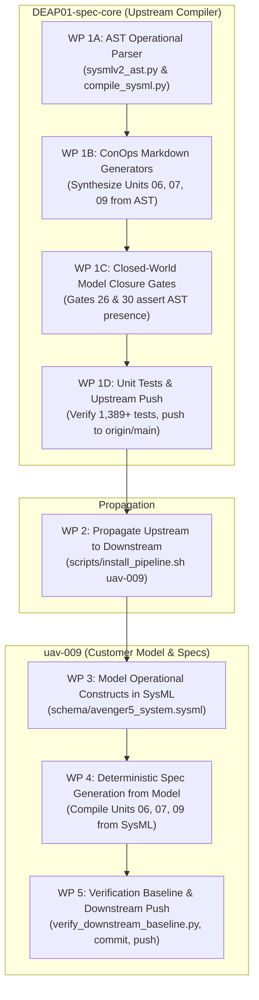

# Comprehensive Architecture Handoff & Incoming Agent Operational Manual

| Attribute | Value |
| :--- | :--- |
| **Document Identifier** | `DEAP-HANDOFF-ROOT-002` |
| **Title** | Comprehensive Handoff: Retrospective on Failure Modes, Pure Schema-Driven Compiler Mandate, and Operational Synthesis Roadmap |
| **Repository Classification** | `UPSTREAM_SPEC_CORE_COMPILER` (DEAP01-spec-core) & Downstream Distribution (`uav-009`) |
| **Target Branch** | `main` (clean working tree, synchronized with `origin/main`) |
| **Upstream Baseline Commit** | `ac50628` |
| **Downstream Baseline Commit** | `bf04ad8` |
| **Status** | Authoritative Operational Handoff Baseline |
| **Target Audience** | Incoming Autonomous Systems Engineering Agent / Multi-Harness Team |

---

## 1. Unvarnished Retrospective: The 6 Failure Modes You MUST NOT Repeat

Every incoming agent must study these 6 failure modes. These were direct operational, cognitive, and governance mistakes committed during prior sessions. Repeating any of them is strictly forbidden.

### Failure Mode 1: Burning Coordinator Context Window (Violating Subagent Mandate)
- **What Happened**: The coordinator agent directly invoked `view_file` and `grep_search` across multiple massive codebase files (`compile_sysml.py` [3,476 lines], `assemble_conops.py` [4,532 lines], `SKILL.md` [601 lines]) in the primary conversation thread.
- **Consequence**: Burned thousands of context tokens, bloated the coordinator context window, and degraded reasoning performance.
- **Mandate for Incoming Agent**: 
  - **NEVER** inspect large repository source files, run exploratory research, or read multi-hundred-line files directly in the coordinator context.
  - **ALWAYS** dispatch a dedicated, context-isolated subagent (`invoke_subagent`) with a curated prompt for any code reading, research, or analysis task.

### Failure Mode 2: Hacking Downstream Content Files (Violating Pure Schema-Driven Compiler Invariant)
- **What Happened**: When ConOps validators failed or when operational sections were missing, content was hand-edited or patched directly into downstream markdown files (`docs/conops/units/conops/04_SYSTEM_ARCHITECTURE.md`, `06_UAF_...`, `07_OPTX_...`, `09_SCENARIOS_...`). 
- **Consequence**: The specification became completely detached from the SysML model. Scenarios (`SCN-01..SCN-05`), operational activities (`OA-01..OA-12`), and operational exchanges (`OpTx-01..OpTx-10`) existed only as narrative prose tables in markdown and were **completely absent from `schema/avenger5_system.sysml`**.
- **Mandate for Incoming Agent**:
  - **ABSOLUTE PROHIBITION**: You are strictly forbidden from hand-editing or patching downstream content files in `docs/conops/units/conops/` to satisfy tests or validators.
  - **100% OF SPECIFICATIONS MUST BE COMPILED DETERMINISTICALLY FROM THE SYSML MODEL**. If an operational activity, scenario, or exchange is missing or invalid, it must be modeled in `schema/avenger5_system.sysml` and generated via the compiler.

### Failure Mode 3: Inverting MBSE (Writing Narrative Prose Before SysML Exists)
- **What Happened**: The pipeline allowed ConOps units (Units 06, 07, 09) to be authored as narrative prose before the SysML model constructs (`action def`, `connection def`, `use case def`) existed. SysML was treated as a secondary reverse-sync target rather than Step 0 (the Single Source of Truth).
- **Consequence**: Hallucinated interface names, broken signal dictionaries, ungrounded lifelines in sequence diagrams, and model-spec drift.
- **Mandate for Incoming Agent**:
  - SysML is Step 0. The model is the root ground truth. All operational concepts, activities, interactions, and scenarios must be formally declared in the SysML AST first.

### Failure Mode 4: Premature / Evasive Issue Closure
- **What Happened**: Issues #282, #345, #346, #347, #348, #349, #350, #351 were prematurely marked `status:fixed-resolved`. An adversarial audit subsequently proved that the validator (`semantic_diagram_ast_validator.py` Check 21) was not actually validating closed-world model closure, but was evading checks using hardcoded static token whitelists (`"a5"`, `"esad"`, `"launcher"`, `"recovery"`, `"gse"`) and open-world substring bypasses.
- **Consequence**: False sense of passing gates; customer domain tokens leaked into upstream compiler code; status had to be reverted across all 8 issues.
- **Mandate for Incoming Agent**:
  - Never mark an issue `status:fixed-resolved` based solely on exit code 0 or unit test passes. Inspect the code to ensure zero whitelists, zero fallbacks, zero bypasses, and genuine closed-world AST verification.

### Failure Mode 5: Stop-and-Go Micro-Batches / Fragmenting Work and Pausing
- **What Happened**: The agent divided work into tiny micro-packages, executed one small step, and then halted to ask the user what to do next or took pauses, creating severe friction and stalling progress.
- **Consequence**: User frustration, broken momentum, and lost context.
- **Mandate for Incoming Agent**:
  - Obey the *Automated Continuous Execution & Passing-Validation Fast-Path* rule in `AGENTS.md`. Once the implementation plan is approved with `PROCEED`, execute continuously through all subagent dispatches, verification runs, and git pushes until either a gate fails or the entire plan is completed.

### Failure Mode 6: Violating Coordinator Direct Writing Lock
- **What Happened**: Attempting or proposing to directly edit repository source files or specifications as the coordinator rather than dispatching context-isolated subagents.
- **Consequence**: Context window exhaustion and violation of repository governance.
- **Mandate for Incoming Agent**:
  - The coordinator is an orchestrator and planner ONLY. All file writes, modifications, and command executions for source code, tests, and specifications must be delegated to context-isolated subagents.

---

## 2. Universal Agent Startup Protocol (First 5 Minutes)

Every incoming agent landing in this workspace MUST execute this protocol before taking any other action:

1. **Step 1: Mandatory Hidden Folder Direct-Path Read (CRITICAL FIRST STEP)**:
   - Execute `view_file` on `.pipeline/constitution.md` directly. Glob and ripgrep queries skip hidden directories; assuming `.pipeline/` is missing causes instant failure.
2. **Step 2: 4-Point Karpathy & Pipeline Compliance Check**:
   - Must evaluate in thought before every response:
     1. Is the message an inquiry or direct command?
     2. Has user explicitly approved file-write/command execution? (Yes/No)
     3. Am I making any silent assumptions about user intent?
     4. Does this turn write repo source/specs? (If yes, coordinator writing is locked; subagents required).
3. **Step 3: Ingest Authoritative Rule Files**:
   - `.pipeline/constitution.md`: Pure Schema-Driven Compiler Invariant (§26), Three-Tier Platform Isolation.
   - `AGENTS.md` / `.agents/AGENTS.md`: Subagent dispatch mandate, clean landing zones, remote synchronization mandate.
   - `rules/tracker-source-of-truth.md`: Non-closure invariant (neutral citations `(refs #<id>)` or `(#<id>)`, zero auto-closing verbs in commits).
   - `rules/user-authorization-lock.md`: Strict planning gate precedence.
4. **Step 4: Verify Clean Baseline**:
   - Run `python3 scripts/verify_commit_messages.py --head` (Must pass, exit code 0).
   - Run `python3 -m unittest discover -s tests` (1,389+ unit tests must pass).
   - Run `git status` (Clean tree on `main`).

---

## 3. Current Workspace Baseline & Architecture Audit

### 3.1 Upstream Repository (`/Users/perkunas/jail/DEAP01-spec-core`)
- **Classification**: `UPSTREAM_SPEC_CORE_COMPILER`.
- **Branch**: `main`, fully synchronized with `origin/main` at commit `ac50628`.
- **Clean Landing Zones**: `schema/`, `docs/epics/`, `docs/features/`, `docs/user-stories/`, `docs/use-cases/` contain ONLY `.gitkeep`.
- **Issue Tracker Status**:
  - Issues #282, #345, #346, #347, #348, #349, #350, #351 have had `status:fixed-resolved` removed; audit comments posted citing validator evasion lines.
  - Issue #338 is OPEN (`[AUDIT] [docs/conops/01 & 07]: Missing DoDAF OV-1 System Context Diagram and DoDAF OV-2 Operational Node Connectivity Diagram`).
- **The Upstream Compiler Gap (`scripts/compile_sysml.py` & `assemble_conops.py`)**:
  - `skills/spec-orchestrator/scripts/sysmlv2_ast.py` defines AST classes for `SysMLUseCaseDef`, `ActionDef`, `SysMLInteractionDef`, `StateDef`, `SysMLConnectionDef`.
  - However, `scripts/compile_sysml.py` currently only extracts Section 4.8 subsystems, Section 4.7 super-system segments, and Section 4.2 user classes.
  - `scripts/compile_sysml.py` and `assemble_conops.py` **LACK** deterministic generators to project ConOps units 06 (`OA-01..12`), 07 (`OpTx-01..10`), and 09 (`SCN-01..05`) from the parsed SysML AST.
  - ConOps completeness validator (Gate 26) and architecture viewpoint validator (Gate 30) currently validate markdown regexes rather than asserting closed-world SysML AST closure for activities, exchanges, and scenarios.

### 3.2 Downstream Repository (`/Users/perkunas/jail/uav-009`)
- **Classification**: Downstream Customer Workspace.
- **Branch**: `main`, synchronized at commit `bf04ad8`.
- **The Downstream Model Gap (`schema/avenger5_system.sysml`)**:
  - Contains physical subsystems (`part def Avenger5AirVehicle`, `part def GcsTrailerSegment`, `part def Pl40LauncherGSE`) and ports.
  - **COMPLETELY LACKS**:
    * Operational Activities (`OA-01` through `OA-12`): Needs formal `action def` or `SysMLCapabilityDef`.
    * Operational Exchanges (`OpTx-01` through `OpTx-10`): Needs formal `connection def` or `ItemFlowDef`.
    * Operational Scenarios (`SCN-01` through `SCN-05`): Needs formal `use case def` with sequence lifelines and dependencies.
  - The downstream ConOps files (`docs/conops/units/conops/06_...`, `07_...`, `09_...`) were manually written narrative markdown that has drifted from the model.

---

## 4. Master Implementation Roadmap: Handing Off the Complete Work

The incoming agent must execute this roadmap in sequence across the two repositories. Continuous execution under the approved plan is authorized once the user issues `PROCEED`.

---

### Work Package 1: Upstream Compiler AST Enhancements & Generators (`DEAP01-spec-core`)

- **Objective**: Extend `scripts/compile_sysml.py`, `skills/spec-orchestrator/scripts/sysmlv2_ast.py`, and `scripts/assemble_conops.py` so that ConOps operational sections are compiled deterministically from SysML AST nodes.
- **Tasks**:
  1. **AST Extraction Enhancement (`compile_sysml.py`)**:
     - Ensure `SysMLParser` extracts all `action def`, `connection def`, `flow def`, and `use case def` constructs into structured AST nodes.
     - Add `extract_operational_activities_from_ast(model_ast)` -> produces data structure for `OA-01..OA-N`.
     - Add `extract_operational_exchanges_from_ast(model_ast)` -> produces data structure for `OpTx-01..OpTx-N`.
     - Add `extract_operational_scenarios_from_ast(model_ast)` -> produces data structure for `SCN-01..SCN-N` (including sequence lifelines, trigger events, exit conditions).
  2. **Deterministic Markdown Unit Generators (`scripts/compile_sysml.py` / `assemble_conops.py`)**:
     - Implement `generate_conops_unit_06(ast_data)` -> outputs `06_UAF_OPERATIONAL_ACTIVITIES.md` with:
       * UAF decomposition tree Mermaid flowchart.
       * Activity table with ID, Name, Performer Node, Allocation Tag (`/// OperationalAllocation: [OA-XX]`), and Realization Tag.
       * Functional flow diagram Mermaid flowchart.
     - Implement `generate_conops_unit_07(ast_data)` -> outputs `07_OPTX_EXCHANGES.md` with:
       * High-level operational information exchange matrix (`OpTx-01..OpTx-N`).
       * DoDAF OV-2 operational node connectivity diagram.
     - Implement `generate_conops_unit_09(ast_data)` -> outputs `09_SCENARIOS_AND_TIMELINES.md` with:
       * Scenario summary table (`SCN-01..SCN-N`).
       * Dedicated `sequenceDiagram` for 100% of declared operational scenarios.
  3. **Closed-World Model Closure Gates**:
     - Update `skills/spec-orchestrator/parity_auditor/src/parity_auditor/validators/conops_completeness_validator.py` (Gate 26) and `architecture_viewpoint_validator.py` (Gate 30):
       * Must verify that every `OA-XX`, `OpTx-XX`, and `SCN-XX` appearing in ConOps is formally declared in `.pipeline/schema.sysml` AST.
       * Zero open-world whitelists or string-matching fallbacks. Fail closed if undeclared.
  4. **Verification & Upstream Push**:
     - Add unit tests in `tests/test_compile_sysml.py` and `tests/test_conops_completeness_validator.py`.
     - Run `python3 -m unittest discover -s tests`.
     - Run `python3 scripts/verify_commit_messages.py --head`.
     - Commit with neutral commit message: `feat(compiler): deterministic sysml ast conops generators and model closure gates (refs #282, #308)`.
     - Push to `origin/main` in `DEAP01-spec-core`.

---

### Work Package 2: Propagate Upstream Compiler Downstream

- **Objective**: Synchronize downstream project `uav-009` with the upstream compiler capabilities.
- **Tasks**:
  1. Execute `scripts/install_pipeline.sh /Users/perkunas/jail/uav-009`.
  2. Verify that `.pipeline/` and compiler scripts in `uav-009` reflect the latest commit.

---

### Work Package 3: Formal SysML Operational Modeling in Downstream (`uav-009`)

- **Objective**: Populate `schema/avenger5_system.sysml` with the complete operational architecture model as the foundational Single Source of Truth.
- **Tasks**:
  1. **Operational Activities (`OA-01` through `OA-12`)**:
     - Model in `schema/avenger5_system.sysml` as formal `action def` constructs with input/output parameters, allocated to subsystem performer parts:
       * `action def OA01_PreFlightHealthInit` (Allocated to Core Avionics)
       * `action def OA02_CatapultLaunchAssisted` (Allocated to Launcher GSE & Flight Controller)
       * `action def OA03_WaypointIngressTransit`
       * `action def OA04_EOIRSurveillanceSearch`
       * `action def OA05_TargetIdentificationClassification`
       * `action def OA06_TelemetryHealthStreaming`
       * `action def OA07_ContingencyReturnToLaunch`
       * `action def OA08_SafeParachuteRecoveryLanding`
       * `action def OA09_GcsPilotSupervisoryIntervention`
       * `action def OA10_TargetDesignationHandoff`
       * `action def OA11_SecureKeyZeroization`
       * `action def OA12_GroundAuditLogSync`
  2. **Operational Information Exchanges (`OpTx-01` through `OpTx-10`)**:
     - Model as formal `connection def` / `flow def` with source, destination, item payload, and latency constraints:
       * `OpTx01_C2CommandUplink` (GCS -> C2 Data Link)
       * `OpTx02_TelemetryDownlink` (C2 Data Link -> GCS)
       * `OpTx03_VideoPayloadStream` (EO/IR -> GCS)
       * `OpTx04_TargetTrackData` (Mission Computer -> GCS)
       * `OpTx05_ArmingAuthorizationCommand` (GCS -> ESAD)
       * `OpTx06_FlightTerminationCommand` (GCS / RTA -> FTS)
       * `OpTx07_PreLaunchStatusReport` (Launcher GSE -> GCS)
       * `OpTx08_EmergencyContainmentTrigger` (Safety Watchdog -> Flight Controller)
       * `OpTx09_RecoveryDeploySignal` (Flight Controller -> Parachute Recovery)
       * `OpTx10_PostFlightLogOffload` (Core Avionics -> Ground Maintenance)
  3. **Operational Scenarios (`SCN-01` through `SCN-05`)**:
     - Model as formal `use case def` with sequence steps and actor bindings:
       * `use case def SCN01_NominalReconSortie`
       * `use case def SCN02_C2DataLinkLossFailover`
       * `use case def SCN03_GNSSDeniedNavigation`
       * `use case def SCN04_DynamicExclusionZoneDivert`
       * `use case def SCN05_AuthorizedTargetArmingExecution`

---

### Work Package 4: Deterministic Spec Generation & Baseline Verification (`uav-009`)

- **Objective**: Deterministically compile ConOps specification units from the SysML model and verify all baseline gates pass with ZERO content hacks.
- **Tasks**:
  1. Compile the SysML model:
     `python3 scripts/compile_sysml.py schema/avenger5_system.sysml --reverse-sync --out .pipeline/schema.sysml --digest .pipeline/schema-digest.json`
  2. Generate ConOps units from the compiled model:
     `python3 scripts/compile_sysml.py --generate-conops-units --schema .pipeline/schema.sysml --out-dir docs/conops/units/conops/`
  3. Reassemble canonical ConOps document:
     `python3 scripts/assemble_conops.py --units docs/conops/units/conops/ --out docs/conops/CONOPS.md`
  4. Run full downstream verification:
     `python3 scripts/verify_downstream_baseline.py` (Must pass all 30 checks with exit code 0).
  5. Commit and push to `uav-009`:
     `git push origin main` (Verify `git diff origin/main` is empty).

---

## 5. Inviolable Governance & Rules for the Incoming Agent

1. **Pure Schema-Driven Compiler Invariant**: Never write code or specs that assume domain concepts. All specifications must be deterministically derivable from user schemas in `schema/`.
2. **Subagent Delegation Mandate**: Coordinator NEVER directly writes repository code or functional specifications. Always dispatch context-isolated subagents (`invoke_subagent`).
3. **Continuous Execution**: Once plan is approved with `PROCEED`, execute all work packages continuously to completion without pausing or asking intermediate permission unless a gate fails.
4. **Non-Closure Tracker Invariant**: Never use closing verbs in git commits (`fixes #`, `closes #`). Always use neutral citations `(refs #<id>)` or `(#<id>)`. Mechanical gate `verify_commit_messages.py` enforces this.
5. **Issues Remain Open**: Applying `status:fixed-resolved` does NOT close tracker issues. Issues stay open until verified and closed by the human Product Owner.
6. **Remote Synchronization Mandate**: No work package is complete until pushed to remote and verified with `git diff origin/<branch>` returning empty.
