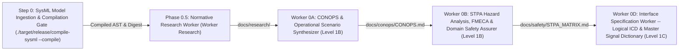
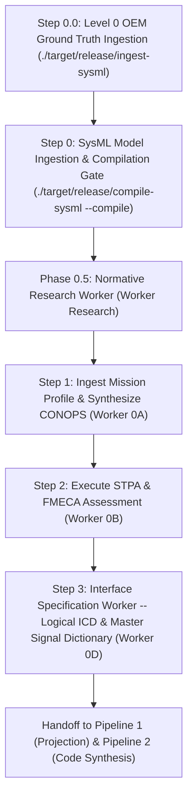
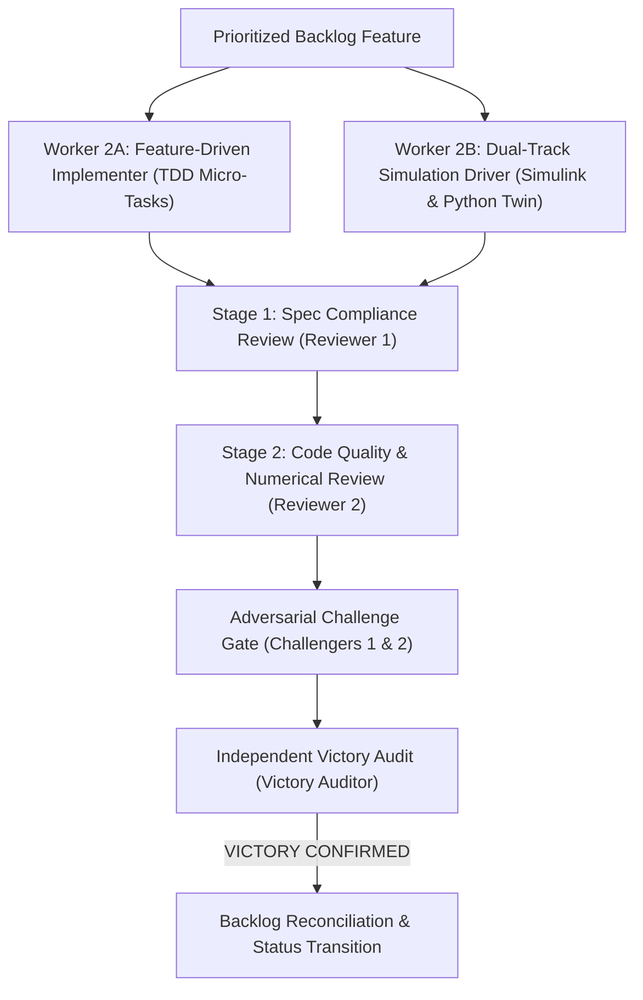

# Digital Engineering Agent Platform (DEAP) -- Core Specification Compiler

> **Repository Identifier:** `DEAP01-spec-core`  
> **Repository Role:** `UPSTREAM_SPEC_CORE_COMPILER` (Digital Engineering Agent Platform Core Specification Compiler)  
> **Classification:** `Abstract Model-Based Systems Engineering (MBSE) Compiler & Multi-Agent Verification Platform`  
> **Status:** `PRODUCTION-GRADE / ACTIVE`  
> **Primary Commercial Toolchain Integration:** `MATLAB / Simulink / Stateflow / Embedded Coder`  
> **Supported Schema Standards:** `SysML v2 (OMG)` | `OMG IDL` | `AUTOSAR ARXML` | `YANG (Network Topology)` | `OpenAPI v3` | `Protobuf v3`  
> **Multi-Provider Issue Tracking:** `GitHub Issues` | `GitLab Issues` | `Atlassian Jira (Cloud & Data Center)`  

---

## 1. System Overview

The **Digital Engineering Agent Platform Core Specification Compiler (`DEAP01-spec-core`)** is the upstream abstract systems engineering compiler and multi-agent verification framework for DEAP. It provides deterministic translation, model-based validation, bidirectional synchronization, and quality gate enforcement bridging formal engineering models (SysML v2, YANG, IDL, ARXML, OpenAPI, Protobuf) with downstream Agile specification backlogs and autonomous code generation.

Operating purely on Abstract Syntax Tree (AST) tokens without hardcoding domain concepts, `DEAP01-spec-core` serves as the upstream parent compiler (`UPSTREAM_SPEC_CORE_COMPILER`) from which Tier 2 domain-specific distribution templates across 6 canonical cyber-physical sectors (Aerospace & Defense, Medical & Healthcare, Space & Satellites, Industrial Robotics, Subsea & Maritime, Rail & Transportation) are maintained, and from which Tier 3 downstream customer application workspaces are onboarded via domain distribution templates.

### 1.1 Primary Commercial Toolchain Integration

This platform explicitly declares **MATLAB / Simulink / Stateflow / Embedded Coder** as the Primary Tier-1 Commercial Toolchain Integration (Model-Based Design, Control Law Synthesis, DO-178C C/SPARK Ada Code Generation).

### 1.2 Three-Tier Architecture & Repository Boundaries: Upstream Compiler vs. Domain Templates vs. Customer Workspaces

The DEAP framework strictly enforces a clean three-tier architecture separating upstream compiler tooling propagation from downstream customer onboarding:

```text
+-----------------------------------------------------------------------------------+
| Tier 1: Upstream Specification Core Compiler                                      |
| Repository: DEAP01-spec-core (Role: UPSTREAM_SPEC_CORE_COMPILER)                  |
| Sentinel: .pipeline/upstream/ present | Pure Schema-Driven Abstract Compiler       |
+-----------------------------------------------------------------------------------+
                                         |
                                         |  Compiler Tooling Propagation (Maintainers)
                                         |  Template Distribution & verify-baseline setup-hooks
                                         v
+-----------------------------------------------------------------------------------+
| Tier 2: Domain Distribution Templates (Canonical Cyber-Physical Sectors)         |
| Repositories: DEAP-* (e.g. DEAP-surgical-robotics-console, DEAP-industrial-agv)   |
| Role: DOMAIN_DISTRIBUTION_TEMPLATE | Sentinel: .pipeline/upstream/ removed        |
| Content: Domain SysML v2 schemas (schema/), sector blueprints, domain profiles    |
| Landing zones (docs/epics/, docs/features/, etc.) remain clean (.gitkeep)         |
+-----------------------------------------------------------------------------------+
                                         |
                                         |  Customer Project Onboarding (End-Users)
                                         |  Self-contained bootstrap via Domain URL
                                         v
+-----------------------------------------------------------------------------------+
| Tier 3: Customer Application Workspaces                                           |
| Repositories: customer-project-* (e.g. downstream domain workspaces)              |
| Role: DOWNSTREAM_APPLICATION_WORKSPACE / DOWNSTREAM_CUSTOMER_PROJECT             |
| Content: Concrete application code, ROS2 nodes, embedded modules, SIL/HIL tests    |
+-----------------------------------------------------------------------------------+
```

#### Tier 1: Upstream Specification Core Compiler (`DEAP01-spec-core`)
- **Upstream Spec Core Compiler (`DEAP01-spec-core`):** Abstract, domain-agnostic specification compiler and multi-agent verification platform. Operates with the sentinel `.pipeline/upstream/` directory present. All upstream landing zones (`docs/conops/`, `docs/safety/`, `docs/epics/`, `docs/features/`, `docs/user-stories/`, `docs/use-cases/`, `schema/`) remain pristine with zero concrete domain specifications or domain-specific `.sysml` files.
- **Pure Schema-Driven Compiler Invariant:** `DEAP01-spec-core` is an abstract Model-Based Systems Engineering (MBSE) compiler; all domain semantics, safety statecharts, and specifications derive deterministically from user-provided schemas in `schema/`.

#### Tier 2: Domain Distribution Templates (`DEAP-*`)
- **Tier 2 Domain Distribution Templates (`DEAP-*`):** Canonical sector repositories derived from `DEAP01-spec-core` by compiler maintainers. Tooling propagation removes `.pipeline/upstream/`, enabling domain-specific SysML v2 models, schemas in `schema/`, and sector architecture blueprints across 6 canonical domains:
  1. **Aerospace & Defense:** `DEAP-uas-infrastructure-safety` (SORA, ASTM F3269, DO-365B)
  2. **Medical & Healthcare:** `DEAP-surgical-robotics-console` (IEC 62304 Class C, ISO 14971, FDA Class III)
  3. **Space & Satellites:** `DEAP-space-cubesat-constellation` (ECSS-E-ST-40C, NASA-STD-8739.8)
  4. **Industrial Robotics:** `DEAP-industrial-warehouse-agv` (ISO 3691-4, IEC 61508, VDA 5050)
  5. **Subsea & Maritime:** `DEAP-subsea-oceanographic-auv` (DNV-GL-ST-E403, IMO MASS)
  6. **Rail & Transportation:** `DEAP-rail-autonomous-locomotive` (EN 50126, EN 50128 SIL 4)
  In Tier 2 domain templates, specification landing zones (`docs/epics/`, `docs/features/`, `docs/user-stories/`, `docs/use-cases/`) remain clean landing zones with `.gitkeep` files until projected for a concrete implementation.

#### Tier 3: Customer Application Workspaces
- **Customer Application Workspaces (`DOWNSTREAM_APPLICATION_WORKSPACE` / `DOWNSTREAM_CUSTOMER_PROJECT`):** Concrete engineering repositories where end-user engineering teams build proprietary software, ROS2 nodes, embedded modules, and hardware-in-the-loop tests.
- **Clean Customer Boundary Mandate:** Customer projects onboard strictly from their relevant **Domain Distribution Template** (`DEAP-*`), NOT from the upstream compiler (`DEAP01-spec-core`). Onboarding from the domain template guarantees that all domain-specific SysML v2 schemas, safety contracts, and profile rules are seeded directly into the customer workspace in a single self-contained command with zero external sibling path dependencies.
- **Illustrative Schema Payloads:** Any concrete flight controller, robotic surgical console, satellite bus, AGV guidance, subsea vehicle, rail locomotive controller, STPA hazard analysis, or domain safety examples presented throughout this README and documentation are strictly **illustrative schema payloads** demonstrating compiler ingestion, AST synthesis, projection, and verification capabilities.

---

## 2. Supported Schema & Modeling Standards

The `schema/` directory accepts only supported formal schema formats (`.sysml`, `.idl`, `.arxml`/`.xml`, `.proto`, and `.json`/`.yaml`/`.yml`). Ingestion and compilation fail closed with an explicit error on unsupported file extensions or unrecognized payloads (e.g. `.pdf`, `.docx`, `.exe`), preventing silent format misclassification.

| Standard / Format | Modeling Scope | AST Mapping Primitives | Compiler Ingestion & Validation |
| :--- | :--- | :--- | :--- |
| **SysML v2 (OMG)** | Systems architecture, behavior, requirements | `package`, `part def`, `port def`, `action def`, `state def`, `requirement def` | Bidirectional SSOT synchronization, full-AST compilation, invariant proving via SLDV hooks. |
| **OMG IDL (v4.2)** | Interface definition, RPC contracts, DDS types | `module`, `interface`, `struct`, `union`, `enum`, `@topic` | Automatic projection to port interfaces, data transfer objects, and real-time middleware bindings. |
| **AUTOSAR ARXML** | Automotive E/E architecture, software components | `AR-PACKAGE`, `SW-COMPONENT-TYPE`, `P-PORT-PROTOTYPE`, `RUNNABLE-ENTITY` | Component-to-Feature allocation, runnable sequence mapping, and lifecycle constraint validation. |
| **YANG (Network Topology)** | Network topology, operational state, configuration | `module`, `container`, `list`, `leaf`, `rpc`, `notification` | Multi-layer network model compilation, JSON/RESTCONF serialization, and AST parity gates. |
| **OpenAPI v3** | REST API endpoints, web service schemas | `paths`, `components/schemas`, `parameters`, `responses` | Automatic projection to Feature API boundaries, User Story contract tests, and request/response models. |
| **Protobuf v3** | Serialization schemas, gRPC service methods | `message`, `service`, `rpc`, `enum` | High-throughput binary serialization mapping, RPC sequence diagram generation, and payload validation. |

---

## 3. Multi-Platform Implementation Profiles Overview

DEAP supports decoupled downstream implementation profiles residing under `.pipeline/profiles/`:
- **Logical UI / Mobile (`flutter.md`):** Cross-platform Flutter desktop/mobile with 60 FPS viewport guarantees and decoupled state management.
- **Operator Console / Web (`react.md`):** React/TypeScript web application architecture with REST/WebSocket interfaces.
- **Embedded Real-Time / Robotics (`ros2_cpp.md`):** ROS2 C++ real-time lifecycle nodes with deterministic zero-allocation execution.
- **Flight Autopilot & Safety Nets (`px4_module.md`):** PX4 flight modules with uORB messaging and ASTM F3269-17 run-time assurance monitors.
- **Safety-Critical Firmware (C / SPARK Ada):** MISRA C and formal SPARK Ada kernels synthesized via MATLAB / Simulink Embedded Coder.

---

## 4. Repository Structure & Canonical Specifications

All architecture blueprints, concept papers, SysML v2 models, and specifications for DEAP are hosted centrally in the Single Source of Truth repository: **[DEAP01-spec-core](https://github.com/gintatkinson/DEAP01-spec-core)** and in repository blueprints.

### Canonical Specifications & Architecture Blueprints:
- **Deterministic Safety Specification Compiler Blueprint**: [DEAP_DETERMINISTIC_SAFETY_SPECIFICATION_COMPILER_BLUEPRINT.md](docs/architecture/blueprints/DEAP_DETERMINISTIC_SAFETY_SPECIFICATION_COMPILER_BLUEPRINT.md) (`DEAP-BLUEPRINT-SAFETY-004`)
- **SysML v2 Ingestion Engine Blueprint**: [DEAP_SYSML_V2_INGESTION_ENGINE_BLUEPRINT.md](docs/architecture/blueprints/DEAP_SYSML_V2_INGESTION_ENGINE_BLUEPRINT.md) (`DEAP-BLUEPRINT-SYSML-003`)
- **Multi-Toolchain Synthesis Architecture**: [DEAP_MULTI_TOOLCHAIN_SYNTHESIS_ARCHITECTURE.md](docs/architecture/blueprints/DEAP_MULTI_TOOLCHAIN_SYNTHESIS_ARCHITECTURE.md)
- **Bidirectional SysML v2 Synchronization Blueprint**: [SYSML_SSOT_BIDIRECTIONAL_SYNCHRONIZATION_ARCHITECTURE.md](docs/architecture/blueprints/SYSML_SSOT_BIDIRECTIONAL_SYNCHRONIZATION_ARCHITECTURE.md) (`DEAP-BLUEPRINT-SYSML-SSOT-001`)
- **Logical Interface Specification Blueprint**: [DEAP_LOGICAL_INTERFACE_SPECIFICATION_BLUEPRINT.md](docs/architecture/blueprints/DEAP_LOGICAL_INTERFACE_SPECIFICATION_BLUEPRINT.md) (`DEAP-BLUEPRINT-LOGICAL-ICD-001`)
- **Multi-Provider GitLab Infrastructure Blueprint**: [MULTI_PROVIDER_GITLAB_INFRASTRUCTURE_ARCHITECTURE.md](docs/architecture/blueprints/MULTI_PROVIDER_GITLAB_INFRASTRUCTURE_ARCHITECTURE.md) (`DEAP-BLUEPRINT-GITLAB-001`)
- **Persistence Architecture Blueprint**: [PERSISTENCE_ARCHITECTURE.md](docs/architecture/blueprints/PERSISTENCE_ARCHITECTURE.md)
- **Safety-Critical Real-Time UI Framework**: [SAFETY_CRITICAL_REALTIME_UI_FRAMEWORK.md](docs/architecture/blueprints/SAFETY_CRITICAL_REALTIME_UI_FRAMEWORK.md) (`DEAP-BLUEPRINT-SAFETY-UI-001`)
- **Runtime Metadata Engine Blueprint**: [RUNTIME_METADATA_ENGINE.md](docs/architecture/blueprints/RUNTIME_METADATA_ENGINE.md)
- **SpecKit Native Integration Blueprint**: [SPECKIT_NATIVE_INTEGRATION.md](docs/architecture/blueprints/SPECKIT_NATIVE_INTEGRATION.md)
- **Local Air-Gapped DeepSeek Workstation Blueprint**: [DEAP_LOCAL_AIRGAPPED_DEEPSEEK_WORKSTATION_BLUEPRINT.md](docs/architecture/blueprints/DEAP_LOCAL_AIRGAPPED_DEEPSEEK_WORKSTATION_BLUEPRINT.md)
- **DeepSeek Harness Integration Blueprint**: [DEAP_DEEPSEEK_HARNESS_INTEGRATION_BLUEPRINT.md](docs/architecture/blueprints/DEAP_DEEPSEEK_HARNESS_INTEGRATION_BLUEPRINT.md)

### Repository Trees:

#### Upstream Spec Core Compiler (`DEAP01-spec-core`):
```text
DEAP01-spec-core/
├── .agents/
│   ├── AGENTS.md                  # Project-scoped agentic governance rules & delegation gates
│   └── skills -> ../skills        # Project skills symlink
├── .pipeline/
│   ├── upstream/                  # Sentinel directory marking UPSTREAM_SPEC_CORE_COMPILER role
│   ├── constitution.md            # Platform-independent functional safety governance tier
│   └── profiles/                  # Multi-platform execution profiles (ros2_cpp, px4_module, etc.)
├── docs/
│   ├── architecture/
│   │   └── blueprints/            # Canonical architecture specifications & multi-provider blueprints
│   ├── conops/                    # Abstract landing zone (.gitkeep)
│   │   └── units/                 # Modular ConOps unit landing zones (.gitkeep)
│   │       ├── conops/
│   │       └── mission_intent/
│   ├── interfaces/                # Level 1C ICD interface matrix & signal dictionary landing zone (.gitkeep)
│   ├── safety/                    # Abstract landing zone (.gitkeep)
│   ├── epics/                     # Abstract landing zone (.gitkeep)
│   ├── features/                  # Abstract landing zone (.gitkeep)
│   ├── user-stories/              # Abstract landing zone (.gitkeep)
│   ├── use-cases/                 # Abstract landing zone (.gitkeep)
│   └── management/                # Abstract landing zone (.gitkeep)
├── rules/                         # Abstract verification & governance rules
├── schema/                        # Abstract landing zone (.gitkeep)
├── scripts/                       # Turnkey installer, compiler, and parity verification scripts
├── skills/                        # Multi-agent orchestrator & implementation skills
├── pyproject.toml                 # Project metadata & packaging configuration
└── README.md                      # Upstream compiler master specification & usage guide
```

#### Tier 2: Domain Distribution Template Repository (e.g. DEAP-surgical-robotics-console, DEAP-industrial-warehouse-agv):
```text
domain-distribution-template/ (e.g. DEAP-surgical-robotics-console, DEAP-industrial-warehouse-agv, ...)
├── .agents/
│   ├── AGENTS.md                  # Project-scoped agentic governance rules & delegation gates
│   └── skills -> ../skills        # Project skills symlink
├── .pipeline/
│   ├── constitution.md            # Platform-independent functional safety governance tier
│   └── profiles/
│       ├── ros2_cpp.md            # ROS2 C++ Real-Time Nodes platform execution profile
│       └── px4_module.md          # PX4 Autopilot / Embedded platform execution profile
├── docs/
│   ├── conops/                    # Domain mission intent & Concept of Operations landing zone
│   │   └── units/                 # Modular ConOps unit landing zones (.gitkeep)
│   │       ├── conops/
│   │       └── mission_intent/
│   ├── interfaces/                # Level 1C ICD interface matrix & signal dictionary landing zone (.gitkeep)
│   ├── safety/                    # STPA hazard analysis, FMECA & domain safety landing zone
│   ├── management/                # Level 4 WBS & Enterprise Realization deliverables (.md, .csv, .json)
│   └── architecture/
│       └── blueprints/            # Canonical architecture specifications & multi-provider blueprints
├── schema/                        # Domain-specific structural schemas & SysML v2 models
├── pyproject.toml                 # Project metadata & packaging configuration
└── README.md                      # Domain template master specification & usage guide
```

Tier 3 Customer Application Workspaces inherit this layout from the domain distribution template, populating `docs/epics/`, `docs/features/`, and application source directories (`app_flutter/`, `web_react/`, `ros2/`, `px4/`).

### 4.1 Supported Tier 2 Domain Distribution Templates (Canonical Taxonomies)
1. **Aerospace & Defense:** `DEAP-uas-infrastructure-safety` (SORA, ASTM F3269, DO-365B)
2. **Medical & Healthcare:** `DEAP-surgical-robotics-console` (IEC 62304 Class C, ISO 14971, FDA Class III)
3. **Space & Satellites:** `DEAP-space-cubesat-constellation` (ECSS-E-ST-40C, NASA-STD-8739.8)
4. **Industrial Robotics:** `DEAP-industrial-warehouse-agv` (ISO 3691-4, IEC 61508, VDA 5050)
5. **Subsea & Maritime:** `DEAP-subsea-oceanographic-auv` (DNV-GL-ST-E403, IMO MASS)
6. **Rail & Transportation:** `DEAP-rail-autonomous-locomotive` (EN 50126, EN 50128 SIL 4)

---

## 5. Installation & Developer Quick-Start Guide

### 5.1 Prerequisites & Python 3.12 Setup

The platform requires **Python 3.12+**, the configured tracker CLI (or native REST credentials), and git. Python scripts require `PyYAML`.

#### Installing Python 3.12
- **macOS (Homebrew)**:
  ```bash
  brew install python@3.12
  python3.12 -m venv .venv
  source .venv/bin/activate
  pip install -r requirements.txt
  ```
- **Ubuntu / Debian**:
  ```bash
  sudo apt-get update && sudo apt-get install -y python3.12 python3.12-venv
  python3.12 -m venv .venv
  source .venv/bin/activate
  pip install -r requirements.txt
  ```

### 5.2 Running & Verifying the Upstream Compiler

As the upstream specification core compiler, `DEAP01-spec-core` compiles SysML v2 schemas into canonical AST digests, generates STPA safety artifacts, executes bidirectional traceability checks, and enforces verification gates.

#### 1. Execute Pipeline 0 SysML v2 Compilation Gate
Parse and compile the formal SysML v2 model into `.pipeline/schema.sysml` and `.pipeline/schema-digest.json`:
```bash
./target/release/compile-sysml --compile
```

#### 2. Verify Upstream Baseline Conformance
Verify compiler baseline conformance and abstract MBSE baseline checks:
```bash
./target/release/verify-baseline .
```

#### 3. Verify Upstream Compiler Conformance Baseline
Verify all 30 abstract MBSE compiler baseline checks:
```bash
./target/release/verify-baseline . --no-domain
```

---

### 5.3 Propagating Compiler Tooling to Domain Distribution Templates

This workflow is for **DEAP platform maintainers** propagating compiler tooling, governance rules, and verification scripts from `DEAP01-spec-core` to the canonical domain distribution template repositories (`DEAP-*`).

#### Local Propagation
When maintaining a local domain template checkout alongside `DEAP01-spec-core`, build the pure-Rust compiler binaries and install git hooks:
```bash
cargo build --release --workspace
./target/release/verify-baseline setup-hooks
```

#### Remote Bootstrap Propagation
To bootstrap or synchronize a domain distribution template directly from the upstream compiler repository:
```bash
git clone https://github.com/gintatkinson/DEAP01-spec-core.git
cargo build --release --workspace
./target/release/verify-baseline setup-hooks
```

#### In-Place Governance & Tooling Updates
Inside an already-installed domain template repository, update git hooks and run baseline verification:
```bash
./target/release/verify-baseline setup-hooks
./target/release/verify-baseline .
```

---

### 5.4 Architectural Boundary: Customer Project Onboarding

The DEAP three-tier architecture strictly decouples compiler tooling propagation from customer project onboarding:
- **Compiler Propagation (Tier 1 Compiler -> Tier 2 Domain Templates):** Maintainers propagate abstract compiler tooling and governance from `DEAP01-spec-core` to canonical sector distribution templates (`DEAP-*`).
- **Customer Onboarding (Tier 2 Domain Templates -> Tier 3 Customer Workspaces):** Application engineers and customer teams onboard concrete project workspaces exclusively from the appropriate **Domain Distribution Template** (`DEAP-*`), never from `DEAP01-spec-core`.

> **Critical Architecture Rule:** End-user customer projects clone from their designated domain distribution template (e.g. `DEAP-surgical-robotics-console` or `DEAP-industrial-warehouse-agv`), NOT from `DEAP01-spec-core`. Bootstrapping from the domain template seeds the customer workspace with domain-specific SysML v2 schemas, safety statecharts, and platform execution profiles.

```text
+-----------------------------------------------------------------------------------+
| Tier 1: Upstream Specification Core Compiler                                      |
| DEAP01-spec-core (UPSTREAM_SPEC_CORE_COMPILER)                                     |
+-----------------------------------------------------------------------------------+
                                         │
                                         │  cargo build --release && verify-baseline setup-hooks
                                         ▼
+-----------------------------------------------------------------------------------+
| Tier 2: Domain Distribution Templates                                             |
| DEAP-* (DOMAIN_DISTRIBUTION_TEMPLATE)                                              |
| Contains: Domain SysML v2 schemas (schema/), sector blueprints, domain profiles    |
+-----------------------------------------------------------------------------------+
                                         │
                                         │  git clone "<domain-url>" ./.tmp-pipeline && ...
                                         ▼
+-----------------------------------------------------------------------------------+
| Tier 3: Customer Application Workspaces                                           |
| customer-workspace (DOWNSTREAM_CUSTOMER_PROJECT)                                  |
| Contains: Concrete proprietary application code, ROS2 nodes, embedded modules, SIL/HIL tests |
+-----------------------------------------------------------------------------------+
```

For customer onboarding instructions and domain-specific schemas, refer to the documentation in the respective canonical domain distribution template repository (see [Section 4.1](#41-supported-tier-2-domain-distribution-templates-canonical-taxonomies)).

---

### 5.5 Setup for Google Antigravity

Google Antigravity automatically discovers workspace customizations, governance rules, and skills by traversing up to the repository root. Ensure native configuration parity with Claude Code (`CLAUDE.md`) and Cursor (`.cursor/rules/`) by maintaining persistent workspace rules without requiring manual chat steering:

1. **Native Configuration Discovery & Governance Rules**:
   Google Antigravity natively loads project-scoped governance rules from `AGENTS.md` directly into `<user_rules>` upon workspace initialization. Custom pipeline skills located in `.agents/skills/` are automatically indexed and discovered via progressive disclosure on demand. Ad-hoc interactive prompting or manual steering directives to ingest rules are unnecessary and strictly avoided to prevent turn-1 coordinator context bloat and subagent self-rejection gate trips. To read the consolidated active governance rules bundle, agents execute a direct-path read via `view_file` on `.pipeline/ACTIVE_RULES_BUNDLE.md`.
2. **Execute Universal Initialization**:
   Follow the mandatory post-install initialization sequence in [Section 5.6 (Universal Agent Governance & Initialization Sequence)](#56-universal-agent-governance--initialization-sequence-agentsmd).

### 5.6 Universal Agent Governance & Initialization Sequence (AGENTS.md)

When configuring repositories, the governance configuration defines `AGENTS.md` with the appropriate role classifications and governance rules for the target repository tier:
- **Upstream Compiler (`DEAP01-spec-core`):** `UPSTREAM_SPEC_CORE_COMPILER` (abstract MBSE compiler, zero hardcoded domain concepts).
- **Domain Distribution Templates (`DEAP-*`):** `DOMAIN_DISTRIBUTION_TEMPLATE` (domain SysML schemas, sector blueprints).
- **Customer Application Workspaces:** `DOWNSTREAM_CUSTOMER_PROJECT` (proprietary application code, ROS2 nodes, embedded software).

Immediately following turnkey installation, any AI agent (Antigravity, Claude Code, Cursor, Windsurf, Cascade, Devin) initializing in this repository MUST execute the following sequence before accepting user directives or executing task implementations:

0. **Detect Repository Role & Scope (Direct-Path Read)**:
   - Inspect whether `.pipeline/upstream/` exists on disk by executing a direct-path read via `list_dir` or `view_file` (e.g. `list_dir` on `.pipeline/upstream` or `view_file` on `.pipeline/upstream/pipeline-tooling.md`). Do NOT rely on glob or search tools (`find_by_name`, `grep_search`), which ignore hidden dot-directories by default.
   - If present -> **Upstream Compiler Mode**: The active repository is the upstream core compiler (`UPSTREAM_SPEC_CORE_COMPILER`). Customer application artifacts and concrete domain specifications are prohibited; work is restricted to pipeline compiler logic, verification tooling, and abstract schema parsers.
   - If absent -> **Downstream Customer Project / Domain Template Mode**: The active repository is an initialized workspace. Authorized for domain specification or concrete application code implementation.
1. **Enforce Karpathy Compliance & Strict Planning Gate**:
   - Every agent thought block MUST begin with the mandatory 4-Point Karpathy & Pipeline Compliance Check:
     * Is the user's message a question/inquiry or a direct command?
     * Has the user explicitly approved a file-write/command execution for this turn? (Yes/No)
     * Am I making any silent assumptions about the user's intent?
     * Does the active skill mandate context-isolated subagent dispatches, or does this turn write any repository source or specification file? (If yes to either, coordinator direct file-writing is locked).
   - **Strict Planning Gate**: Agents are strictly forbidden from creating, modifying, or deleting files in the workspace or dispatching any subagents unless that action is documented in an approved implementation plan. Even if the user prompt contains authorization keywords like "PROCEED", agents MUST first write/update the implementation plan, stop, and wait for explicit user approval before execution.
2. **Read Governance Constitution**: Execute `view_file` on `.pipeline/constitution.md` to ingest the platform-independent functional governance layer and zero-mocking persistence mandates.
3. **Load Project Skills (Tier-Differentiated)**:
   - For **Upstream Compiler (`UPSTREAM_SPEC_CORE_COMPILER`)**: Execute `view_file` on `skills/spec-orchestrator/SKILL.md` (and `skills/schema-specification-engineering/SKILL.md`, `skills/adversarial-code-auditor/SKILL.md`) to initialize compiler orchestration and audit protocols.
   - For **Downstream Customer Project / Domain Template Mode**: Execute `view_file` on `skills/feature-driven-implementation/SKILL.md` (and any active skills under `skills/` or `.agents/skills/`, such as `skills/spec-wbs-engineering/SKILL.md`) to initialize feature-driven implementation protocols and review gates.
4. **Load Governance Rules**: Execute `view_file` on `.pipeline/ACTIVE_RULES_BUNDLE.md` to ingest the complete, consolidated suite of active governance rules in a single read (covering dual-track MBD, SysML SSOT completeness, role boundary locks, and TDD mandates). Ingest `AGENTS.md` to enforce project-scoped agentic rules, context-isolated subagent dispatch loops, and role boundary locks.
5. **Load Platform Profile (Conditional / Downstream Workspaces Only)**:
   - Applies ONLY to Downstream Customer Projects: read the target platform execution profile (`.pipeline/profiles/flutter.md`, `.pipeline/profiles/react.md`, `.pipeline/profiles/ros2_cpp.md`, or `.pipeline/profiles/px4_module.md`) to establish platform-specific build, test, and lifecycle constraints.
   - N/A for Upstream Compiler Mode: SKIP this step when in `UPSTREAM_SPEC_CORE_COMPILER` mode; upstream specification compiler workflows are platform-independent and strictly forbidden from ingesting downstream execution profiles.
6. **Bootstrap Tracker Labels & Verify Baseline**: Verify that repository issue tracker labels are synchronized and baseline conformance passes by running `./target/release/verify-baseline . --no-domain`.
7. **Transition to Operator Prompt Catalog**: Navigate to [Section 9 (Multi-Pipeline Operator Prompt Catalog & Autonomous Execution Workflows)](#9-multi-pipeline-operator-prompt-catalog--autonomous-execution-workflows) to select and execute the canonical agent prompts for Pipeline 0 (Pre-Spec Safety & Model Formulation), Pipeline 1 (Agile Specification Backlog Projection), or Pipeline 2 (Autonomous Feature Implementation & Simulation Driver).

### 5.7 Setup for Claude Code

Configure Claude Code to follow the universal initialization sequence in [Section 5.6 (Universal Agent Governance & Initialization Sequence)](#56-universal-agent-governance--initialization-sequence-agentsmd):

```bash
# Add to CLAUDE.md
echo "Follow the universal initialization sequence in Section 5.6 of README.md and execute view_file on .pipeline/ACTIVE_RULES_BUNDLE.md before starting any task." >> CLAUDE.md
```

### 5.8 Setup for Cursor / Windsurf / Cascade

Create `.cursor/rules/pipeline.mdc` or `.windsurf/rules/pipeline.md` referencing `.agents/skills/`, `skills/`, `AGENTS.md`, and `.pipeline/`. All agent sessions must follow the universal initialization sequence defined in [Section 5.6 (Universal Agent Governance & Initialization Sequence)](#56-universal-agent-governance--initialization-sequence-agentsmd).

### 5.9 Compiler Verification & Baseline Gate

The verification gate acts as a post-installation and post-implementation compliance check:

```bash
./target/release/verify-baseline .
./target/release/verify-baseline . --no-domain
```

### 5.10 Supported Runtimes Table

| Runtime | Subagent Dispatch | Two-Stage Review |
|---|---|---|
| **Claude Code** | `Task("prompt")` -- native isolated subagent | Separate reviewer subagents |
| **Gemini CLI / Antigravity** | Subagent tool call with curated context | Separate reviewer subagents |
| **Cascade (Windsurf/Devin)** | Coordinator re-reads files per task to simulate isolation | Explicit self-audit documented in `task.md` |
| **Cursor** | Context-isolated subagent prompt execution | Sequential self-audit checklist |

---

## 6. Multi-Provider VCS & Issue Tracker Operations (GitHub & GitLab)

The DEAP platform features a unified, zero-dependency **Tracker Abstraction Architecture** supporting both GitHub and GitLab (SaaS, Self-Hosted Enterprise, and Air-Gapped / SCIF defense enclaves). The platform decouples Version Control System (VCS) transport from agile issue tracking, backlog reconciliation, and continuous integration.

### 6.1 Multi-Provider Comparison & Authentication Hierarchy

| Architectural Dimension | GitHub.com (SaaS / Enterprise) | GitLab.com SaaS | Self-Hosted GitLab (EE/CE) | Air-Gapped / SCIF GitLab (EE/CE) |
| :--- | :--- | :--- | :--- | :--- |
| **API Version** | GitHub REST API v3 / GraphQL | GitLab REST API v4 | GitLab REST API v4 | GitLab REST API v4 |
| **Primary Tokens** | `GITHUB_TOKEN`, `GH_TOKEN`, PAT | `GITLAB_TOKEN`, `GL_TOKEN`, PAT | `GITLAB_TOKEN`, `CI_JOB_TOKEN` | `GITLAB_TOKEN`, `CI_JOB_TOKEN` |
| **Base URL Config** | `https://api.github.com` | `https://gitlab.com` | `GITLAB_URL` (custom domain) | `GITLAB_URL` (private air-gapped domain) |
| **Client Engine** | `gh` CLI or REST Driver | Zero-Dependency `urllib.request` | Zero-Dependency `urllib.request` | Zero-Dependency `urllib.request` |
| **Scoped Labels** | Emulated via colon strings | Native Scoped (`key::value`) | Native Scoped (`key::value`) | Native Scoped (`key::value`) |
| **CI/CD Pipeline** | GitHub Actions (`.github/`) | GitLab CI (`.gitlab-ci.yml`) | GitLab CI (`.gitlab-ci.yml`) | GitLab CI (`.gitlab-ci.yml`) |
| **Air-Gap Security** | Egress Required | Egress Required | Private Root CA / Internal VPC | Zero External Egress / Private Root CA |

#### Authentication Resolution Hierarchy:
1. **GitLab**: Checks `GITLAB_TOKEN` $\rightarrow$ `GL_TOKEN` $\rightarrow$ `CI_JOB_TOKEN`. If connecting to a self-hosted or private air-gapped instance, specify `GITLAB_URL` (e.g. `export GITLAB_URL="https://gitlab.internal.defense.gov"`).
2. **GitHub**: Checks `GITHUB_TOKEN` $\rightarrow$ `GH_TOKEN` $\rightarrow$ `gh auth token`.
3. **Offline Mode**: Specify `--offline` or run without tokens in air-gapped evaluation environments (add `--upstream` when reconciling the upstream compiler repository itself).

### 6.2 Backlog Reconciliation CLI Usage

The backlog reconciliation engine synchronizes markdown specifications (`docs/epics/`, `docs/features/`, `docs/user-stories/`, `docs/use-cases/`) with remote issue trackers:

```bash
# Reconcile against GitHub Issues - default
./target/release/reconcile-backlog --provider github

# Reconcile against GitLab Issues
./target/release/reconcile-backlog --provider gitlab

# Reconcile against Self-Hosted / Air-Gapped GitLab Instance
./target/release/reconcile-backlog --provider gitlab --gitlab-url https://gitlab.internal.defense.gov

# Perform Offline Reconciliation - No remote mutation
./target/release/reconcile-backlog --provider gitlab --offline
```

### 6.3 GitLab Scoped Label Lifecycle (`key::value`)

GitLab native scoped labels enforce state machine mutual exclusivity and map directly to DO-178C / SORA SAIL verification objectives:

| Scoped Label | Category | Exclusivity | Description / Verification Rule |
| :--- | :--- | :--- | :--- |
| `type::epic` | Metamodel Type | Mutually Exclusive | Top-level system capability container. |
| `type::feature` | Metamodel Type | Mutually Exclusive | High-Level Requirement / Subsystem component specification. |
| `type::user-story` | Metamodel Type | Mutually Exclusive | Behavioral interaction unit with BDD acceptance criteria. |
| `type::use-case` | Metamodel Type | Mutually Exclusive | Operational sequence and scenario execution unit. |
| `status::draft` | Lifecycle Status | Mutually Exclusive | Initial specification authoring and structural AST draft. |
| `status::in-progress` | Lifecycle Status | Mutually Exclusive | Active development, control law synthesis, or test implementation. |
| `status::ready-for-review` | Lifecycle Status | Mutually Exclusive | Implementation complete; queued for multi-stage automated review. |
| `status::fixed-resolved` | Lifecycle Status | Mutually Exclusive | All 22 mechanical verification gates passed; ready for sign-off. |
| `status::closed` | Lifecycle Status | Mutually Exclusive | Final certification authority / Product Owner approval. |

### 6.4 Standardized 3-Stage GitLab CI/CD Pipeline Matrix

The platform provides a standardized 3-stage `.gitlab-ci.yml` pipeline ensuring continuous safety and MBSE parity:

$$\text{Pipeline} = \text{Stage}_{\text{lint}} \xrightarrow{\text{pass}} \text{Stage}_{\text{test}} \xrightarrow{\text{pass}} \text{Stage}_{\text{verify}}$$

| Pipeline Stage | Target Job Name | Executed Verification Command | Pass / Fail Criteria |
| :--- | :--- | :--- | :--- |
| **Stage 1: `lint`** | `lint:downstream-baseline` | `./target/release/verify-baseline . --no-domain` | Checks 10-20 (zero .DS_Store, KaTeX math integrity, valid entrypoints, clean landing zones, Safety Integrity & SORA completeness, domain AST cleanliness, and Check 20: WBS & Enterprise Deliverables Suite Validation). |
| **Stage 2: `test`** | `test:unit-and-parity` | `./target/release/verify-baseline .` | Semantic acceptance verification suites, ROS2 node lifecycle tests, and PX4 safety mode tests pass with 0 failures. |
| **Stage 3: `verify`** | `verify:model-coverage` | `./target/release/verify-baseline . --spec-only` | All 22 Parity Verification Gates pass with zero specification-model drift. |

---

## 7. Closed-Loop Bidirectional SysML v2 Compilation (Zero Drift)

To eliminate specification-model drift between systems engineering models and agile software backlogs, DEAP implements an automated **Closed-Loop Bidirectional SysML v2 Compilation & Synchronization Engine**. The canonical SysML v2 model (`.pipeline/schema.sysml` or `schema/*.sysml`) serves as the Single Source of Truth (SSOT).

### 7.1 Bidirectional Compilation & Verification Commands

```bash
# 1. Forward AST Ingestion: Compile SysML v2 formal model into agile specification scaffolding
./target/release/ingest-sysml --schema schema/model.sysml

# 2. Reverse AST Closed-Loop Synchronization: Extract markdown spec deltas back into SysML v2 SSOT
./target/release/compile-sysml --reverse-sync --docs docs/ --schema schema/model.sysml --out .pipeline/schema.sysml

# 3. 22-Gate Mechanical Parity Lock: Verify 100% semantic alignment across all artifacts
./target/release/verify-baseline . --spec-only
```

### 7.2 The 6-Layer MBSE Parity Architecture

The bidirectional compiler maintains mathematical equivalence across 6 distinct architectural layers:

| Parity Layer | SysML v2 Source Concept | Markdown Backlog Representation | Commercial Toolchain Realization |
| :--- | :--- | :--- | :--- |
| **1. Structural** | `package`, `part def`, `item def` | `docs/features/FEAT-*.md` (Class Diagrams) | Simulink Subsystem Hierarchy & Bus Definitions |
| **2. Behavioral** | `action def`, `state def`, `port` | `docs/features/FEAT-*.md` (Statecharts) | Stateflow Discrete State Transition Charts |
| **3. Operational** | `use case def`, `interaction` | `docs/use-cases/UC-*.md` (Sequence Diagrams) | Operational Test Scenario Scripts & Mission Harness |
| **4. Interface** | `port def`, `flow`, `interface` | `docs/user-stories/US-*.md` (Lifelines) | ROS2 Topics / MAVLink Messages / DDS Topics |
| **5. Safety / Constraints** | `req`, `constraint def`, `assert` | `docs/safety/STPA_MATRIX.md` (UCAs & SCs) | Simulink Design Verifier (SLDV) Formal Properties |
| **6. Verification** | `verify`, `satisfy`, `test case` | Acceptance Criteria & BDD Scenarios | Embedded Coder DO-178C C / SPARK Ada Test Suite |

### 7.3 Primary Tier-1 Commercial Toolchain Integration (MATLAB / Simulink / Stateflow / Embedded Coder)

This platform explicitly declares **MATLAB / Simulink / Stateflow / Embedded Coder** as the Primary Tier-1 Commercial Toolchain Integration Context:
- **Structural Synthesis:** SysML `part def` and port hierarchies synthesize directly into hierarchical Simulink subsystems and typed bus interfaces.
- **Behavioral Statecharts:** SysML `state def` Run-Time Assurance (RTA) and fail-safe transitions map to Stateflow state machines with deterministic execution semantics.
- **Formal Invariant Proving:** SysML `assert constraint` formulations translate to Simulink Design Verifier (SLDV) proof objectives for automated reachability and dead-lock free verification.
- **Safety-Critical Code Synthesis:** Embedded Coder generates MISRA C / DO-178C qualified C code and SPARK Ada kernels for deployment to Pixhawk and ROS2 real-time hardware.

### 7.4 Work Breakdown Structure & Enterprise Realization Tooling

The platform includes deterministic Work Breakdown Structure (WBS) & Enterprise Realization synthesis conforming to MIL-STD-881E decomposition hierarchies, traceability matrices, and multi-platform enterprise project management exports:
- **Purpose**: Synthesizes MIL-STD-881E Work Breakdown Structures (WBS), 7-column end-to-end traceability matrix, multi-platform CSV export (Jira, Monday.com, MS Project), and hierarchical JSON AST from SysML AST, ConOps, Safety matrices, and Agile Backlog items.
- **Verification & Compliance**:
  ```bash
  ./target/release/verify-baseline . --strict
  ```
- **Synthesized Deliverables**:
  1. `docs/management/WBS_DELIVERABLES_SUITE.md`: Authoritative markdown specification suite with CommonMark metadata table and 7-column end-to-end traceability matrix.
  2. `docs/management/wbs_export_jira_monday_ms_project.csv`: Multi-platform RFC 4180 compliant CSV export formatted for Atlassian Jira, Monday.com, and Microsoft Project.
  3. `docs/management/wbs_export.json`: Validated hierarchical JSON Abstract Syntax Tree conforming to formal WBS schema.

---

## 8. Multi-Pipeline Master-Worker Subagent Topologies & Safety Engineering Workflows

The Digital Engineering Agent Platform (DEAP) lifecycle coordinates context-isolated subagent topologies across three core pipelines:
- **Pipeline 0 (Pre-Spec Safety Engineering):** Front-end systems engineering, operational scenario extraction, STPA/FMECA safety modeling, and SysML v2 textual AST formulation.
- **Pipeline 1 (Agile Backlog Projection):** Deterministic transformation of SysML AST elements into formal Epics, Features, BDD User Stories, and UML Use Cases.
- **Pipeline 2 (Autonomous Feature Implementation & Simulation):** Serial TDD micro-task code synthesis, dual-track MBD verification (Simulink + headless Python digital twin), and independent multi-agent consensus gates.

### 8.1 Pipeline 0 Pre-Spec Safety Engineering Subagent Topology: Workers 00, Research, 0A, 0B, 0D

Pipeline 0 deploys specialized, context-isolated subagent workers operating in a strict serial execution loop to prevent context bloat and memory leakage:



#### 8.1.1 Worker 0A: CONOPS & Mission Scenario Synthesizer
- **Role Description:** Context-isolated front-end synthesizer responsible for executing Universal Multi-Document & Schema Ingestion across operational intent documents, interface schemas, and architectural blueprints to produce modular Concept of Operations units (`docs/conops/units/conops/`) and Tactical Mission Intent units (`docs/conops/units/mission_intent/`), compiling them deterministically via `./target/release/assemble-conops` into canonical `docs/conops/CONOPS.md` and `docs/conops/MISSION_INTENT.md` artifacts with 1:1 Level 1C interface matrix alignment.
- **Primary Inputs (Universal Multi-Document & Schema Ingestion):**
  - **Compiled AST:** SysML compilation output from Step 0 (`.pipeline/schema.sysml` and `.pipeline/schema-digest.json`).
  - **Normative Research Baselines:** `docs/research/RESEARCH_INVENTORY.md` and `docs/research/FAILURE_MODE_REGISTRY.md` from Phase 0.5.
  - **Operational Intent Documents (`docs/conops/*.md`):** All customer mission intent specifications and operational scenario markdown files in `docs/conops/` (excluding `README.md`).
  - **Interface & Model Schemas (`schema/*`):** Pre-existing customer models and interface definitions (`*.sysml`, `*.proto`, `*.arxml`, `*.json`, `*.yaml`, `*.idl`) establishing physical and functional boundaries, port definitions, and telemetry contracts.
  - **Architectural Blueprints (`docs/architecture/*.md`):** Existing system architectural specifications, network topology blueprints, and safety frameworks in `docs/architecture/` (and `docs/architecture/blueprints/`).
  - **Interface Scaffolding:** Level 1C Interface Control Documents (`docs/interfaces/` or `docs/icd/` containing `ICD_01_SYSTEM_INTERFACE_MATRIX.md` and `ICD_02_MASTER_SIGNAL_DICTIONARY.md`).
  - **Prompt-Based Fallback Directives:** Raw natural language prompt parameters, stakeholder objectives, and operational constraints when no intent files exist in `docs/conops/` (triggering auto-persistence of `docs/conops/MISSION_INTENT.md`).
  - Stakeholder role definitions.
- **Deliverables & Outputs:**
  - `docs/conops/units/conops/`: 12 canonical ConOps modular markdown units (`01_METADATA_AND_OVERVIEW.md` through `12_EMERGENCY_DECISION_MATRIX.md`) conforming to `conops_specification_schema.json`.
  - `docs/conops/units/mission_intent/`: 10 canonical Tactical Mission Intent modular units (`01_COMMANDERS_INTENT.md` through `10_OPERATIONAL_ALLOCATION_TAGS.md`) conforming to `mission_intent_specification_schema.json`.
  - `docs/conops/MISSION_INTENT.md`: Compiled customer mission intent contract under git version control, assembled deterministically via `./target/release/assemble-conops`.
  - `docs/conops/CONOPS.md`: Compiled Concept of Operations detailing mission objectives, operational phases (Initialization, Standby, Active Operation, Degraded Mode, Failsafe), system physical and functional boundaries reconciled with customer schemas, Level 1C interface matrices (`docs/interfaces/`), environmental envelope constraints, and MATLAB / Simulink / Stateflow control law synthesis hooks.

#### 8.1.2 Worker 0B: STPA Hazard Analysis & FMECA Assurer
- **Role Description:** Safety engineering subagent that performs System-Theoretic Process Analysis (STPA), Failure Mode, Effects, and Criticality Analysis (FMECA), and risk assessment on the system boundary defined by Worker 0A to produce the authoritative 8-pillar `docs/safety/STPA_MATRIX.md` safety baseline.
- **Primary Inputs:**
  - `CONOPS.md` generated by Worker 0A.
  - Compiled AST from Step 0 (`.pipeline/schema.sysml` and `.pipeline/schema-digest.json`).
  - `docs/research/FAILURE_MODE_REGISTRY.md` from Phase 0.5.
  - Regulatory safety mandates.
- **Deliverables & Outputs:**
  - `docs/safety/STPA_MATRIX.md`: Complete 8-pillar STPA assurance specification adhering to:
    1. **System Losses (L-1..N):** High-level unacceptable losses to stakeholders, people, or equipment.
    2. **System Hazards (H-1..N):** Hazardous system states and containment boundaries.
    3. **Hierarchical Control Structure Topology:** Control loops, controllers, actuators, sensors, and RTA safety monitors.
    4. **Unsafe Control Actions (UCA-1..N):** Comprehensive identification across all 4 failure modes.
    5. **Loss Scenarios (LS-1..N) & Causal Factors:** Failure and loss causal scenarios.
    6. **Formal Safety Constraints (SC-1..N):** Mandatory safety invariants and envelope protections.
    7. **FMECA Criticality Matrix:** Component failure modes with 15+ rows, Severity (S), Occurrence (O), Detection (D), and Risk Priority Numbers (RPN = S * O * D).
    8. **Risk Mitigations Traceability Table.**
    - **Run-Time Assurance (RTA) Architecture & Safety Net:** Certified recovery switching logic and advanced control isolation.
    - **MATLAB / Simulink / Stateflow Hooks:** SLDV proof invariants and Stateflow supervisor statecharts for control law synthesis.

#### 8.1.3 Phase 0.5 Normative Research Worker (Worker Research)
- **Role Description:** Context-isolated research subagent responsible for ingesting the compiled SysML v2 AST (`.pipeline/schema.sysml` and `.pipeline/schema-digest.json`), extracting all declared AST `part def` component nodes, and systematically cataloging regulatory standards, public clause citations, and multi-mode component failure modes across the 4 Universal Failure Dimensions (Interface, State, Action, Resource).
- **Primary Inputs:**
  - Canonical SysML v2 AST (`.pipeline/schema.sysml` and `.pipeline/schema-digest.json`) compiled at Step 0.
  - Applicable regulatory, safety, and domain standards (e.g. ISO/IEC/IEEE 29148, NATO STANAG 4586, RTCA DO-178C / DO-254, SAE ARP4754A / ARP4761, MIL-STD-882E, JARUS SORA v2.5, ASTM F3269-17).
- **Deliverables & Outputs:**
  - `docs/research/RESEARCH_INVENTORY.md`: Comprehensive cited research inventory with Declared-Total Population Register carrying 100% public clause citations.
  - `docs/research/FAILURE_MODE_REGISTRY.md`: Authoritative multi-mode component failure registry covering 100% of declared AST parts with >= 3 distinct failure modes per part across the 4 universal failure dimensions, integer RPN, and explicit SSOT/Derived basis tags.
- **Note on Worker 0C Elimination:** The legacy inverted authoring step (Worker 0C authoring SysML models after ConOps and STPA) is superseded and eliminated. SysML model ingestion and compilation executes at Step 0 before research and ConOps, establishing the immutable AST Single Source of Truth and preventing circular AST ingestion deadlock (refs #311).

#### 8.1.4 Worker 0D: Interface Specification Worker (Logical ICD & Signal Dictionary)
- **Role Description:** Interface specification subagent that transforms SysML v2 AST ports, connections, and item flows into Level 1C Logical Interface Specifications and Master Signal Dictionaries.
- **Primary Inputs:** Compiled SysML v2 AST (`.pipeline/schema.sysml`), `schema/`, and allocated safety constraints from `STPA_MATRIX.md`.
- **Deliverables & Outputs:** `docs/interfaces/ICD_01_SYSTEM_INTERFACE_MATRIX.md` (subsystem boundary graphs, N^2 communication matrix, topological port bindings) and `docs/interfaces/ICD_02_MASTER_SIGNAL_DICTIONARY.md` (signal IDs, types, units, sample rates, latency bounds, and failsafe values).

#### 8.1.5 Pipeline 0 Execution Steps & Handoff Workflow



#### 8.1.6 Pipeline 0 Handoff JSON Contract (`pipeline0_handoff_contract.json`)

The interface between Pipeline 0 safety modeling, Pipeline 1 specification engineering, and Pipeline 2 safety implementation is strictly governed by `pipeline0_handoff_contract.json`. The `pipeline0_handoff_contract.json` is finalized after Gate 23 (ICD completeness validation) passes for `ICD_01` and `ICD_02`:

```json
{
  "$schema": "https://deap.engine/schemas/pipeline0_handoff_v1.json",
  "metadata": {
    "identifier": "DEAP-PIPELINE-0-HANDOFF-001",
    "timestamp": "2026-08-11T00:00:00Z",
    "source_model": "schema/model.sysml",
    "governance_status": "APPROVED"
  },
  "conops_summary": {
    "mission_intent_path": "docs/conops/MISSION_INTENT.md",
    "document_path": "docs/conops/CONOPS.md",
    "mission_type": "System Supervision & Mission Control",
    "operational_phases": ["INITIALIZATION", "STANDBY", "ACTIVE_OPERATION", "DEGRADED_MODE", "FAILSAFE"]
  },
  "safety_matrix": {
    "document_path": "docs/safety/STPA_MATRIX.md",
    "system_losses": [
      { "id": "L-1", "title": "Loss of System Operational Safety / Physical Asset Damage" }
    ],
    "hazards": [
      { "id": "H-1", "loss_refs": ["L-1"], "title": "Actuator Command Saturation / Unbounded Control Output" }
    ],
    "unsafe_control_actions": [
      {
        "id": "UCA-1",
        "hazard_ref": "H-1",
        "control_action": "Execute Actuator Command",
        "failure_mode": "Provided Wrong / Out of Range",
        "safety_constraint": "SC-1: Actuator command must be rate-limited and bounded by envelope protection safety statechart."
      }
    ]
  },
  "sysml_ast_export": {
    "requirements": [
      {
        "id": "REQ-SYS-001",
        "name": "ActuatorConstraintRequirement",
        "text": "The system controller shall enforce actuation angle limits.",
        "stpa_ref": "SC-1",
        "dal": "DAL A"
      }
    ],
    "parts": [
      {
        "id": "PART-SYS-001",
        "name": "SystemController",
        "ports": ["p_telemetry", "p_actuator_cmd"],
        "subparts": ["PrimaryController", "RunTimeAssuranceMonitor"]
      }
    ],
    "statecharts": [
      {
        "name": "SafetyModeStatechart",
        "states": ["NORMAL", "DEGRADED", "RTA_BACKUP_ENGAGED", "EMERGENCY_FAILSAFE"]
      }
    ]
  }
}
```

### 8.2 Pipeline 1 Agile Backlog Subagent Topology: Workers 1A-1D

Pipeline 1 projects the compiled SysML v2 AST into a completely grounded, closed-loop Agile backlog tracked in the project VCS issue tracker (GitHub, GitLab, or Jira):

```mermaid
flowchart LR
    AST[".pipeline/schema.sysml & Digest"] --> Worker_1A["Worker 1A: Structural Spec Worker (Epics & Features)"]
    Worker_1A -->|"docs/epics/ & docs/features/"| Worker_1B["Worker 1B: Behavioral Spec Worker (User Stories & Statecharts)"]
    Worker_1B -->|"docs/user-stories/"| Worker_1C["Worker 1C: Operational Spec Worker (Use Cases & Realization)"]
    Worker_1C -->|"docs/use-cases/"| Worker_1D["Worker 1D: WBS & Work Package Decomposition Spec Worker"]
    Worker_1D -->|"docs/management/WBS_DELIVERABLES_SUITE.md"| Reconciliation["Grounding Auditor & Backlog Reconciliation Gate"]
```



#### 8.2.1 Worker 1A: Structural Specification Worker (Epics & Features)
- **Role Description:** Subagent responsible for ingesting SysML v2 AST packages, structural components (`part def`), and data payloads (`item def`) to decompose the architecture into formal Agile Epics (`docs/epics/epic-*.md`) and independently testable Features (`docs/features/feat-*.md`).
- **Primary Inputs:** Canonical SysML model (`.pipeline/schema.sysml`), schema digest (`.pipeline/schema-digest.json`).
- **Deliverables & Outputs:** Epics and Features registered with unique tracker issue IDs, passing model coverage linter (`verify-baseline`).

#### 8.2.2 Worker 1B: Behavioral Specification Worker (User Stories & Statecharts)
- **Role Description:** Subagent responsible for deriving Behavior-Driven Development (BDD) User Stories, UML Sequence Lifelines, and Stateflow transition triggers from SysML v2 behavioral AST nodes (`action def`, `state def`, `port def`, `interaction def`).
- **Primary Inputs:** `.pipeline/schema.sysml`, operational text, feature definitions.
- **Deliverables & Outputs:** BDD User Stories (`docs/user-stories/us-*.md`) with Given-When-Then scenarios mapped to formal SysML `test case def` elements.

#### 8.2.3 Worker 1C: Operational Specification Worker (Use Cases & Realization Matrices)
- **Role Description:** Subagent responsible for deriving formal UML System Use Cases (`docs/use-cases/uc-*.md`) directly from SysML v2 `use case def` AST blocks and interaction scenarios.
- **Primary Inputs:** `.pipeline/schema.sysml`, `docs/features/`, `docs/user-stories/`.
- **Deliverables & Outputs:** Complete Use Case definitions with Preconditions, Main Success Scenario, Alternate/Exception Flows, Postconditions, and the authoritative Realization Matrix resolving specific tracker issue IDs.

#### 8.2.4 Worker 1D: Work Breakdown Structure (WBS) & Work Package Decomposition Worker
- **Role Description:** Subagent responsible for synthesizing MIL-STD-881E Work Breakdown Structures (WBS), 7 concrete Model-Based Design (MBD) work packages per feature (`WP-xxx-SPEC`, `WP-xxx-MAT-PARAM`, `WP-xxx-SL-BLD`, `WP-xxx-PY-DOM`, `WP-xxx-PY-ENG`, `WP-xxx-TST`, `WP-xxx-REP`), and enterprise project management exports.
- **Primary Inputs:** SysML AST, ConOps, Safety Matrices, Agile Backlog items.
- **Deliverables & Outputs:** `docs/management/WBS_DELIVERABLES_SUITE.md`, RFC 4180 CSV exports for Jira/Monday.com/MS Project, and JSON AST `docs/management/wbs_export.json`.

### 8.3 Pipeline 2 Autonomous Feature Implementation & Simulation Subagent Topology: Workers 2A, 2B, Reviewers 1-2, Challengers 1-2, Victory Auditor

Pipeline 2 executes autonomous code generation, dual-track MBD simulation verification, and multi-agent peer review across dedicated, context-isolated subagent roles:



#### 8.3.1 Subagent Execution Roles

1. **Worker 2A (Feature-Driven Implementation & Synthesis Driver)**:
   Executes serial TDD RED-GREEN-REFACTOR micro-tasks (2-5 minutes each) adhering strictly to the target platform profile (e.g., `app_flutter/` MVVM architecture with the 15 mandatory Domain Engineering Standards, ROS2 C++ lifecycle nodes, or PX4 flight modules). Enforces the 3-Layer Definition of Done (Domain State & Signal Model, Logic & Safety State Management, Display & Actuator Interface Binding).
2. **Worker 2B (Two-Path / Dual-Track Simulation Driver)**:
   Delivers the complete dual-track MBD simulation package: Track A (Native MATLAB / Simulink / Stateflow synthesis builder `build_<feature_slug>_model.m`, physical parameter dictionary `<feature_slug>_params.m`, and `.sldd` data dictionary) and Track B (Headless, license-free Python discrete twin engine `<feature_slug>_domain.py` and `_engine.py` executing at identical dt, e.g. 250 Hz, offline CI test harness `tests/test_<feature_slug>_simulation.py`, and DO-331 simulation report `<FEATURE-ID>_simulation_results.md` verifying numerical tolerance <= 10^-6).
3. **Reviewer 1 (Specification Compliance Reviewer)**:
   Stage 1 Review Gate: Verifies that the implementation strictly matches the approved implementation plan, SysML AST, acceptance criteria, and 3-Layer LUI DoD. Asserts zero in-memory stubs against live emulators / databases.
4. **Reviewer 2 (Code Quality & Numerical Equivalence Reviewer)**:
   Stage 2 Review Gate: Verifies code quality, strict typing, public member docstrings (DartDoc `///`), UML traceability tags (`/// Realises: [...]`), immutability (`@immutable`), value equality, zero `dynamic`, and numerical parity (<= 10^-6).
5. **Challenger 1 (Adversarial Boundary & Resource Challenger)**:
   Adversarially probes for directory confinement, memory leaks, unclosed streams/controllers, unauthorized file modifications outside workspace boundaries, and hardcoded assumptions.
6. **Challenger 2 (Anti-Complacency & Grounding Challenger)**:
   Adversarially tests edge cases, missing error handlers, ungrounded tokens, empty outputs, broken links, non-closure commit citations `(refs #<id>)`, and mock bypasses.
7. **Victory Auditor**:
   Executes independent 3-phase audit: Timeline Reconstruction, Anti-Mocking Verification, and Independent Test Execution. Confirms all baseline verification checks pass with exit code 0 and `git diff origin/<branch>` is 0 bytes before issuing `VICTORY CONFIRMED`.

---

## 9. Multi-Pipeline Operator Prompt Catalog & Autonomous Execution Workflows

This catalog contains the complete, unabridged, copy-pasteable operator prompt suite for executing all stages of the Digital Engineering Agent Platform (DEAP) lifecycle across context-isolated subagents in Antigravity, Claude Code, Gemini CLI, Cursor, and Cascade.

### 9.1 Pipeline 0 Prompts (Pre-Spec Safety & Model Formulation)

Execute the following prompts in sequence to transform unstructured intent, operational scenarios, and interface schemas into formal CONOPS, STPA hazard matrices, and SysML v2 AST models:

#### 9.1.0 Worker 00: OEM Prose / BOM Ingestion & Model Synthesis Prompt (Step 0.0)

**Step 0.0 Entrypoint for Unstructured / Prose Customer Documentation:**
For customer projects starting with unstructured OEM prose manuals, PDF documentation, markdown tables, or Bill of Materials (BOM) specifications, Worker 00 provides the sanctioned, deterministic entrypoint. Extracting OEM Bill of Materials (BOM) and physical parameters into `schema/extracted/` and synthesizing canonical SysML v2 textual models in `schema/model.sysml` (or `.pipeline/schema.sysml`) is fully authorized under Check 23 (Factual Grounding & Numeric Provenance Gate) and serves as the mandatory precursor to executing the Step 0 compilation gate (`./target/release/compile-sysml --compile`).

```text
Execute `view_file` on `skills/spec-orchestrator/SKILL.md` as your very first step before taking any action.

Repository Classification: UPSTREAM_SPEC_CORE_COMPILER (or DOWNSTREAM_CUSTOMER_PROJECT depending on execution context)

Role: Worker 00 -- OEM Prose / BOM Ingestion & Model Synthesizer (Step 0.0)

Primary Commercial Toolchain Integration Context:
This project explicitly declares MATLAB / Simulink / Stateflow / Embedded Coder as the Primary Tier-1 Commercial Toolchain Integration Context (Model-Based Design, Control Law Synthesis, DO-178C C/SPARK Ada code generation).

Directive:
Execute Level 0 OEM Ground Truth Ingestion and initial SysML v2 textual model synthesis for customer projects starting from unstructured OEM prose manuals, PDF documentation, markdown tables, or Bill of Materials (BOM) specifications:

1. Unstructured & Semi-Structured Ingestion Scope:
   - Ingest raw OEM technical documentation, system/operating manuals, ICD tables, and BOM markdown tables located in `schema/` and `schema/extracted/`.
   - Authorized Under Check 23: Extract physical parameters, component hierarchies, mass/power budgets, port/pin interfaces, and operational envelopes into machine-readable Markdown tables in `schema/extracted/` (e.g., `schema/extracted/oem_bom.md`, `schema/extracted/interface_table.md`, `schema/extracted/parametric_limits.md`).

2. Canonical SysML v2 Model Synthesis:
   - Execute the Level 0 ingestion translator:
     ./target/release/ingest-sysml --schema "schema/extracted/" --format markdown --out "schema/model.sysml"
   - Alternatively, synthesize a formal SysML v2 textual model `schema/model.sysml` directly, defining:
     * Root `package` matching the target cyber-physical system.
     * All component definitions as canonical `part def` elements with typed attributes (mass, power, dimensions, channel count, part numbers).
     * Directional communication and electrical interface boundaries as `port def` elements (`in`, `out`, `inout`).
     * Physical, environmental, and operational constraints as `constraint def` / `assert constraint` blocks.
     * State machine structures and operational lifecycle phases as `state def` elements.

3. Compilation Gate Precursor Verification:
   - Verify that the generated `schema/model.sysml` passes the Step 0 SysML Compilation Gate:
     ./target/release/compile-sysml --compile
   - Ensure `.pipeline/schema.sysml` and `.pipeline/schema-digest.json` are successfully generated without compilation errors.
   - Verify Check 23 compliance (Factual Grounding & Numeric Provenance Gate): all physical parameters and component counts in `schema/model.sysml` strictly match the Level 0 OEM ground truth in `schema/extracted/`.

Defect Filing Directive:
If any compiler fault, schema inconsistency, or invariant violation is discovered, you are strictly forbidden from filing raw issues directly. You MUST dispatch a fresh context-isolated subagent with `skills/adversarial-code-auditor/SKILL.md` to perform the 5-pillar audit, generate the verified 7-section defect dossier, and submit it via `./target/release/verify-baseline check-defect` (or `./target/release/reconcile-backlog create-issue --label bug`). Issue auto-closing keywords or issue close commands are strictly forbidden.

PROCEED
```

#### 9.1.1 Worker 0A: CONOPS & Operational Scenario Synthesis Prompt

```text
Execute `view_file` on `skills/spec-conops-engineering/SKILL.md` as your very first step before taking any action.

Repository Classification: UPSTREAM_SPEC_CORE_COMPILER (or DOWNSTREAM_CUSTOMER_PROJECT depending on execution context)

Role: Worker 0A -- CONOPS & Operational Scenario Synthesizer

Primary Commercial Toolchain Integration Context:
This project explicitly declares MATLAB / Simulink / Stateflow / Embedded Coder as the Primary Tier-1 Commercial Toolchain Integration Context (Model-Based Design, Control Law Synthesis, DO-178C C/SPARK Ada code generation).

Directive:
Execute front-end modular CONOPS and Tactical Mission Intent synthesis for the target cyber-physical system using Universal Multi-Document & Schema Ingestion:

1. Ingestion & Baseline Analysis:
   - Ingest Normative Research Baselines: Ingest `docs/research/RESEARCH_INVENTORY.md` and `docs/research/FAILURE_MODE_REGISTRY.md` to map allocated obligations (`OBL-*`) and component failure modes.
   - Interface & Model Schema Ingestion: Ingest canonical SysML v2 AST model (`.pipeline/schema.sysml`), `schema/`, and `.pipeline/schema-digest.json`. Enforce 100% representation of declared `part def` nodes in Section 4 physical architecture. Scan `schema/` for pre-existing customer models and interface definitions (`*.sysml`, `*.proto`, `*.arxml`, `*.json`, `*.yaml`, `*.idl`).
   - Architectural Blueprint Ingestion: Scan `docs/architecture/` (and `docs/architecture/blueprints/`) for existing architectural specifications, network blueprints, and safety frameworks (`*.md`). Reconcile customer interface schemas and architectural blueprints with system boundaries and MATLAB / Simulink / Stateflow control law synthesis hooks.
   - Interface Scaffolding Ingestion: Ingest Level 1C Interface Control Documents (`docs/interfaces/` or `docs/icd/` containing `ICD_01_SYSTEM_INTERFACE_MATRIX.md` and `ICD_02_MASTER_SIGNAL_DICTIONARY.md`) to establish physical and logical interface boundaries, port bindings, and signal allocations in lockstep with ConOps Section 4.
   - Operational Intent Discovery: Ingest mission directives, operational purpose statements, and domain operational boundaries.

2. Ingestion & Analysis Scope:
   - Schema-derived operational envelope (physical boundaries, operating dynamics, environmental constraints, payload/actuator configurations).
   - Domain-specific operational lifecycle phases: Initialization, Normal Operation, Degraded/Contingency Modes, and Safe Shutdown/Transition.
   - Dynamic stakeholder roles derived from the system operational context (e.g., System Operators, Dispatchers/Supervisors, Field Maintenance Technicians, External Management/Telemetry Interfaces).
   - Domain-specific regulatory and safety classification relevant to the operational envelope.

3. Modular Deliverable Generation:
   - Do NOT draft monolithic files directly. Author modular units conforming to JSON Schema contracts under:
     * `docs/conops/units/conops/`: 12 canonical units (`01_METADATA_AND_OVERVIEW.md` through `12_EMERGENCY_DECISION_MATRIX.md`), including decoupled 3-tier architecture in `04_SYSTEM_ARCHITECTURE.md`.
     * `docs/conops/units/mission_intent/`: 10 canonical units (`01_COMMANDERS_INTENT.md` through `10_OPERATIONAL_ALLOCATION_TAGS.md`), including operational `06_SAFETY_INTERLOCKS.md` and tactical `08_GO_NO_GO_MATRIX.md`.
   - Ensure clear operational phase boundaries, system physical and functional boundaries, and environmental envelope constraints.
   - Interface Scaffolding Integration: Reconcile all system interface boundaries with Level 1C interface matrices under `docs/interfaces/` (`ICD_01_SYSTEM_INTERFACE_MATRIX.md` and `ICD_02_MASTER_SIGNAL_DICTIONARY.md`), maintaining 1:1 bidirectional connection parity (`CONN-01`..`CONN-N`).
   - Include MATLAB / Simulink / Stateflow model integration baseline hooks for downstream control law synthesis.
   - Relative Link Mandate: Intra-document and schema links must use valid file-relative paths (`../../schema/...`, `../<dir>/...`).
   - KaTeX / LaTeX Math Formatting Mandate: All multi-line aligned equations MUST be enclosed in `\begin{aligned} ... \end{aligned}` within `$$` delimiters on dedicated lines. Bare alignment tabs `&` outside an alignment environment (`aligned`, `matrix`, `cases`) and `\begin{align*}` environments are strictly forbidden. Markdown Table Math Prohibition Rule: Strictly ban `$ ... $` and `$$ ... $$` LaTeX math delimiters inside table headers, rows, and cells; plain text and Unicode (e.g. `Initial S`, `ΔV`, `λ`, `°C`, `≥`, `≤`, `→`, `10⁻⁶`) must be used instead, with 1:1 column count match between header and delimiter rows.

4. Assembly & Verification Gates:
   - Execute deterministic assembly: `./target/release/assemble-conops --input-dir docs/conops/units/ --output-dir docs/conops/ --verify`.
   - Compile master specification documents: `./target/release/assemble-conops --input-dir docs/conops/units/ --output-dir docs/conops/`.
   - Gate 26 Validation: Execute `./target/release/verify-baseline . --spec-only`.

Defect Filing Directive:
If any compiler fault, schema inconsistency, or invariant violation is discovered, you are strictly forbidden from filing raw issues directly. You MUST dispatch a fresh context-isolated subagent with `skills/adversarial-code-auditor/SKILL.md` to perform the 5-pillar audit, generate the verified 7-section defect dossier, and submit it via `./target/release/verify-baseline check-defect` (or `./target/release/reconcile-backlog create-issue --label bug`). Issue auto-closing keywords or issue close commands are strictly forbidden.

PROCEED
```

#### 9.1.2 Worker 0B: STPA Hazard Analysis, FMECA & Domain Safety Assurer Prompt

```text
Execute `view_file` on `skills/spec-orchestrator/SKILL.md` as your very first step before taking any action.

Repository Classification: UPSTREAM_SPEC_CORE_COMPILER (or DOWNSTREAM_CUSTOMER_PROJECT depending on execution context)

Role: Worker 0B -- STPA Hazard Analysis, FMECA & Domain Safety Assurer

Primary Commercial Toolchain Integration Context:
This project explicitly declares MATLAB / Simulink / Stateflow / Embedded Coder as the Primary Tier-1 Commercial Toolchain Integration Context (Model-Based Design, Control Law Synthesis, DO-178C C/SPARK Ada code generation).

Directive:
Perform STPA hazard analysis, FMECA failure mode criticality evaluation, and domain safety risk assessment based on `docs/conops/CONOPS.md`.

1. Standards Compliance & Domain Safety Framework:
   - Dynamic Domain Safety Framework Selection: Apply the applicable safety framework governing the target domain (e.g., ISO 14971/IEC 62304 for Medical, EN 50128 for Rail, DNV-GL for Marine, ECSS for Space, ISO 3691-4 for Industrial AGV, SORA/DO-178C for Aviation).
   - Run-Time Assurance (RTA) Monitor Architecture & Safety Net switching (e.g., ASTM F3269-17 or domain-equivalent safety monitor pattern).
   - Domain-specific hazard detection, telemetry monitoring, and contingency guidance standards.

2. Output Requirements:
   - Generate `STPA_MATRIX.md` under `docs/safety/STPA_MATRIX.md` adhering strictly to the 8-pillar schema:
     1. System Losses ($L-1..N$)
     2. System Hazards ($H-1..N$)
     3. Hierarchical Control Structure Topology (defining System Controllers, Supervisors/RTA Monitors, Actuators, Sensors)
     4. Unsafe Control Actions ($UCA-1..N$) covering all 4 failure modes: (a) Not providing causes hazard, (b) Providing causes hazard, (c) Providing too early, too late, or out of order, (d) Stopped too soon or applied too long
     5. Loss Scenarios ($LS-1..N$) & Causal Factors
     6. Formal Safety Constraints ($SC-1..N$)
     7. FMECA Criticality Matrix: Component failure modes with 15+ rows, Severity ($S$), Occurrence ($O$), Detection ($D$), and Risk Priority Numbers ($\text{RPN} = S \times O \times D$)
     8. Domain Safety Framework & Risk Mitigations Table: Risk class classification, integrity levels, and comprehensive mapping of domain safety objectives and mitigations (e.g., ISO 14971/IEC 62304, EN 50128, DNV-GL, ECSS, ISO 3691-4, SORA OSO-01..24)
   - Include Run-Time Assurance (RTA) Safety Net monitor architecture.
   - Include MATLAB / Simulink / Stateflow / Embedded Coder model integration baseline hooks and SLDV formal proof properties.
   - KaTeX / LaTeX Math Formatting Mandate: All multi-line aligned equations MUST be enclosed in `\begin{aligned} ... \end{aligned}` within `$$` delimiters on dedicated lines. Bare alignment tabs `&` outside an alignment environment (`aligned`, `matrix`, `cases`) and `\begin{align*}` environments are strictly forbidden. Markdown Table Math Prohibition Rule: Strictly ban `$ ... $` and `$$ ... $$` LaTeX math delimiters inside table headers, rows, and cells; plain text and Unicode (e.g. `Initial S`, `ΔV`, `λ`, `°C`, `≥`, `≤`, `→`, `10⁻⁶`) must be used instead, with 1:1 column count match between header and delimiter rows.

PROCEED
```

#### 9.1.3 Phase 0.5 Normative Research Worker Prompt (Worker Research)

```text
Execute `view_file` on `skills/spec-orchestrator/SKILL.md` as your very first step before taking any action.

Repository Classification: UPSTREAM_SPEC_CORE_COMPILER (or DOWNSTREAM_CUSTOMER_PROJECT depending on execution context)

Role: Normative Research Worker (Phase 0.5)

Primary Commercial Toolchain Integration Context:
This project explicitly declares MATLAB / Simulink / Stateflow / Embedded Coder as the Primary Tier-1 Commercial Toolchain Integration Context (Model-Based Design, Control Law Synthesis, DO-178C C/SPARK Ada code generation).

Directive:
Execute Phase 0.5 Normative-Completeness Research by ingesting the compiled SysML v2 AST model (`.pipeline/schema.sysml` and `.pipeline/schema-digest.json`), extracting all declared AST `part def` nodes, and systematically mapping regulatory standards, public clauses, and component failure modes across the 4 Universal Failure Dimensions (Interface, State, Action, Resource).

1. Ingestion & Baseline Analysis:
   - Ingest Canonical AST Model: Ingest `.pipeline/schema.sysml` and `.pipeline/schema-digest.json` produced by Step 0 Model Ingestion & Compilation Gate. Extract 100% of declared `part def` component nodes {P_1, P_2, ..., P_N}.
   - Ingest Applicable Standards: Ingest all applicable regulatory, safety, and domain standards governing the target domain (e.g., ISO/IEC/IEEE 29148, NATO STANAG 4586, RTCA DO-178C / DO-254, SAE ARP4754A / ARP4761, MIL-STD-882E, JARUS SORA v2.5, ASTM F3269-17 / F3411-22a, RTCA DO-365B).
   - Clause-Level Extraction: Map mandatory obligations (`OBL-*`), safety constraints (`SC-*`), control actions (`CTL-*`), and METL tasks (`MET-*`) directly to verifiable public clauses.

2. Component Failure Mode Research Swarm:
   - For every extracted AST `part def` component, evaluate the 4 Universal Failure Dimensions: Interface, State, Action, and Resource.
   - Assign integer ratings: Severity ($S \in [1, 10]$), Occurrence ($O \in [1, 10]$), Detection ($D \in [1, 10]$), integer RPN ($RPN = S \times O \times D$), and explicit `SSOT` or `Derived` basis annotations.
   - Enforce a minimum of 3 distinct failure modes per declared component across the universal failure dimensions.

3. Output Deliverables:
   - Cited Research Inventory (`docs/research/RESEARCH_INVENTORY.md`): Synthesize comprehensive inventory with full standard titles, revision baselines, formal references, and the Declared-Total Population Register with 100% public clause citations.
   - Component Failure Mode Registry (`docs/research/FAILURE_MODE_REGISTRY.md`): Authoritative multi-mode component failure registry covering 100% of declared AST parts with >= 3 distinct failure modes per part.

4. Validation Gate:
   - Verify zero placeholder tokens (`{{...}}`).
   - Verify 100% public clause citations and 100% AST component failure mode coverage.

Defect Filing Directive:
If any compiler fault, schema inconsistency, or invariant violation is discovered, you are strictly forbidden from filing raw issues directly. You MUST dispatch a fresh context-isolated subagent with `skills/adversarial-code-auditor/SKILL.md` to perform the 5-pillar audit, generate the verified 7-section defect dossier, and submit it via `./target/release/verify-baseline check-defect` (or `./target/release/reconcile-backlog create-issue --label bug`). Issue auto-closing keywords or issue close commands are strictly forbidden.

PROCEED
```

> **Architectural Note on Worker 0C Elimination (refs #311):** Worker 0C (the legacy role scheduled to author SysML models after ConOps and STPA) is superseded and eliminated. SysML model ingestion and compilation executes at Step 0 before research and ConOps, establishing the immutable AST Single Source of Truth and preventing circular AST ingestion deadlock.

#### 9.1.4 Worker 0D: Interface Specification Worker (Logical ICD & Signal Dictionary) Prompt

```text
Execute `view_file` on `skills/spec-icd-engineering/SKILL.md` as your very first step before taking any action.

Repository Classification: UPSTREAM_SPEC_CORE_COMPILER (or DOWNSTREAM_CUSTOMER_PROJECT depending on execution context)

Role: Worker 0D -- Interface Specification Worker (Worker ICD)

Primary Commercial Toolchain Integration Context:
This project explicitly declares MATLAB / Simulink / Stateflow / Embedded Coder as the Primary Tier-1 Commercial Toolchain Integration Context (Model-Based Design, Control Law Synthesis, DO-178C C/SPARK Ada code generation).

Directive:
Synthesize Level 1C Logical Interface Specifications and Signal Dictionaries from formal SysML v2 AST interface blocks:

1. AST Interface Parsing:
   - Ingest `.pipeline/schema.sysml` and `.pipeline/schema-digest.json`.
   - Extract directional ports (`port def`), connection bindings (`connection`), formal interface contracts (`interface def`), and information payloads (`item flow`).
   - Ingest safety constraints (`SC-1..N`) and hazard allocations from `docs/safety/STPA_MATRIX.md` to map safety-critical signal bounds.

2. Deliverable Generation & Quality Gate:
   - Generate `docs/interfaces/ICD_01_SYSTEM_INTERFACE_MATRIX.md` containing subsystem boundary graphs, N² communication matrix, and topological port bindings.
   - Generate `docs/interfaces/ICD_02_MASTER_SIGNAL_DICTIONARY.md` containing signal identifiers (`SIG-*`), data types, units, sampling frequencies, update rates, latency bounds, and fail-safe default values.
   - Run Gate 23/24 Level 1C ICD completeness validation: `./target/release/verify-baseline . --spec-only`.
   - Finalize `pipeline0_handoff_contract.json` under `.pipeline/contracts/pipeline0_handoff_contract.json` incorporating frozen interface matrices and signal flow dictionaries.
   - Register the ICD suite under the `icd` issue label using `gh issue create --title "<title>" --body-file "<file>" --label "icd"` (or `./target/release/reconcile-backlog`).
   - Verify published issue body integrity via live tracker inspection.

Defect Filing Directive:
If any compiler fault, schema inconsistency, or invariant violation is discovered, you are strictly forbidden from filing raw issues directly. You MUST dispatch a fresh context-isolated subagent with `skills/adversarial-code-auditor/SKILL.md` to perform the 5-pillar audit, generate the verified 7-section defect dossier, and submit it via `./target/release/verify-baseline check-defect` (or `./target/release/reconcile-backlog create-issue --label bug`). Issue auto-closing keywords or issue close commands are strictly forbidden.

PROCEED
```

### 9.2 Pipeline 1 Prompts (Agile Specification Backlog Projection)

Execute the following prompts to extract full Agile backlogs (Epics, BDD User Stories, and UML Use Cases) with closed-loop tracker synchronization:

#### 9.2.1 Worker 1A: Structural Spec Worker (Epics & Features) Prompt

```text
Execute `view_file` on `skills/schema-specification-engineering/SKILL.md` as your very first step before taking any action.

Repository Classification: UPSTREAM_SPEC_CORE_COMPILER (or DOWNSTREAM_CUSTOMER_PROJECT depending on execution context)

Role: Worker 1A -- Structural Specification Worker (Epics & Features)

Primary Commercial Toolchain Integration Context:
This project explicitly declares MATLAB / Simulink / Stateflow / Embedded Coder as the Primary Tier-1 Commercial Toolchain Integration Context (Model-Based Design, Control Law Synthesis, DO-178C C/SPARK Ada code generation).

Directive:
Transform structural schemas and SysML v2 AST models into formal Agile Epics and Features adhering to OOA/OOD principles:

1. AST Parsing & Subsystem Extraction:
   - Ingest canonical SysML v2 model (`.pipeline/schema.sysml`) and schema digest (`.pipeline/schema-digest.json`).
   - Parse all subsystem `package` declarations to identify Epic boundaries (`docs/epics/epic-*.md`).
   - Parse all `part def` (structural components) and `item def` (data payloads) elements to identify Feature boundaries (`docs/features/feat-*.md`).
   - Dispatch fresh context-isolated subagents for each individual Epic and Feature with YAML frontmatter declaring `generation_mode: "subagent"`.

2. Local Validation & Issue Registration:
   - Execute the local model coverage linter: `./target/release/verify-baseline . --spec-only --only "<spec_file>"`.
   - Register Features first via `./target/release/reconcile-backlog create-issue --body-file "<file>" --label "feature" --title "<title>"`.
   - Verify live published payload on the issue tracker (`gh issue view <ID> --json body` or `glab issue view <ID>`).
   - Inject verified Feature Issue IDs into Epic tasklists.
   - Register Epics via `./target/release/reconcile-backlog create-issue --body-file "<file>" --label "epic" --title "<title>"`.

Defect Filing Directive:
If any compiler fault, schema inconsistency, or invariant violation is discovered, you are strictly forbidden from filing raw issues directly. You MUST dispatch a fresh context-isolated subagent with `skills/adversarial-code-auditor/SKILL.md` to perform the 5-pillar audit, generate the verified 7-section defect dossier, and submit it via `./target/release/verify-baseline check-defect` (or `./target/release/reconcile-backlog create-issue --label bug`). Issue auto-closing keywords or issue close commands are strictly forbidden.

PROCEED
```

#### 9.2.2 Worker 1B: Behavioral Spec Worker (User Stories & Statecharts) Prompt

```text
Execute `view_file` on `skills/spec-user-story-engineering/SKILL.md` as your very first step before taking any action.

Repository Classification: UPSTREAM_SPEC_CORE_COMPILER (or DOWNSTREAM_CUSTOMER_PROJECT depending on execution context)

Role: Worker 1B -- Behavioral Specification Worker (User Stories & Statecharts)

Primary Commercial Toolchain Integration Context:
This project explicitly declares MATLAB / Simulink / Stateflow / Embedded Coder as the Primary Tier-1 Commercial Toolchain Integration Context (Model-Based Design, Control Law Synthesis, DO-178C C/SPARK Ada code generation).

Directive:
Extract Behavior-Driven Development (BDD) User Stories, UML Sequence Lifelines, and Stateflow transition triggers from SysML v2 behavioral AST nodes:

1. Behavioral AST Ingestion:
   - Ingest `.pipeline/schema.sysml` and operational text.
   - Parse `action def` (computations & transformations), `state def` (lifecycle states & transition guards), `port def` (message triggers), and `interaction def` (lifeline sequences).
   - Extract algorithmic calculation stories for dynamic computations and temporal expiration stories for state lifecycles.
   - Map acceptance criteria BDD scenarios to formal SysML `test case def` elements with `verify requirement` tags.

2. Deliverable Generation & Issue Registration:
   - Dispatch fresh context-isolated subagents per User Story (`docs/user-stories/us-*.md`) with YAML frontmatter (`generation_mode: "subagent"`).
   - Execute local model coverage linter: `./target/release/verify-baseline . --spec-only --only "<spec_file>"`.
   - Register User Stories via `./target/release/reconcile-backlog create-issue --body-file "<file>" --label "user-story" --title "<title>"`.
   - Verify live published payload on the issue tracker (`gh issue view <ID> --json body` or `glab issue view <ID>`).

Defect Filing Directive:
If any compiler fault, schema inconsistency, or invariant violation is discovered, you are strictly forbidden from filing raw issues directly. You MUST dispatch a fresh context-isolated subagent with `skills/adversarial-code-auditor/SKILL.md` to perform the 5-pillar audit, generate the verified 7-section defect dossier, and submit it via `./target/release/verify-baseline check-defect` (or `./target/release/reconcile-backlog create-issue --label bug`). Issue auto-closing keywords or issue close commands are strictly forbidden.

PROCEED
```

#### 9.2.3 Worker 1C: Operational Spec Worker (Use Cases & Realization Matrices) Prompt

```text
Execute `view_file` on `skills/spec-usecase-engineering/SKILL.md` as your very first step before taking any action.

Repository Classification: UPSTREAM_SPEC_CORE_COMPILER (or DOWNSTREAM_CUSTOMER_PROJECT depending on execution context)

Role: Worker 1C -- Operational Specification Worker (Use Cases & Realization Matrices)

Primary Commercial Toolchain Integration Context:
This project explicitly declares MATLAB / Simulink / Stateflow / Embedded Coder as the Primary Tier-1 Commercial Toolchain Integration Context (Model-Based Design, Control Law Synthesis, DO-178C C/SPARK Ada code generation).

Directive:
Derive formal UML System Use Cases directly from SysML v2 `use case def` AST blocks and system interaction scenarios:

1. Use Case AST Ingestion:
   - Ingest `.pipeline/schema.sysml`, `docs/features/`, and `docs/user-stories/`.
   - Extract `use case def` AST nodes, identifying `subject` (`part def`), typed `actor` ports, `objective`, and `include`/`extend` relations.
   - Maintain 1:1 Use Case Def mapping with Primary/Secondary Actors, Preconditions, Trigger, Main Success Scenario, Alternate/Exception Flows (covering 100% of validation constraints across realized features), and Postconditions (Success & Failure Guarantees).
   - Construct UML Use Case diagrams and UML State Machine diagrams.

2. Realization Matrix & Registration:
   - Construct `## Realization Matrix` resolving specific, unique tracker Issue IDs for each intersecting User Story and Feature.
   - Execute local model coverage check: `./target/release/verify-baseline . --spec-only --only "<spec_file>"`.
   - Register Use Cases via `./target/release/reconcile-backlog create-issue --body-file "<file>" --label "use-case" --title "<title>"`.
   - Verify live published payload on the issue tracker (`gh issue view <ID> --json body` or `glab issue view <ID>`).

Defect Filing Directive:
If any compiler fault, schema inconsistency, or invariant violation is discovered, you are strictly forbidden from filing raw issues directly. You MUST dispatch a fresh context-isolated subagent with `skills/adversarial-code-auditor/SKILL.md` to perform the 5-pillar audit, generate the verified 7-section defect dossier, and submit it via `./target/release/verify-baseline check-defect` (or `./target/release/reconcile-backlog create-issue --label bug`). Issue auto-closing keywords or issue close commands are strictly forbidden.

PROCEED
```

#### 9.2.4 Worker 1D: WBS & Work Package Decomposition Spec Worker Prompt

```text
Execute `view_file` on `skills/spec-wbs-engineering/SKILL.md` as your very first step before taking any action.

Repository Classification: UPSTREAM_SPEC_CORE_COMPILER (or DOWNSTREAM_CUSTOMER_PROJECT depending on execution context)

Role: Worker 1D -- Work Breakdown Structure (WBS) & Work Package Decomposition Spec Worker

Primary Commercial Toolchain Integration Context:
This project explicitly declares MATLAB / Simulink / Stateflow / Embedded Coder as the Primary Tier-1 Commercial Toolchain Integration Context (Model-Based Design, Control Law Synthesis, DO-178C C/SPARK Ada code generation).

Directive:
Synthesize MIL-STD-881E Work Breakdown Structures (WBS), Technical Realization Registers, and Enterprise Project Management Exports (Jira, Monday.com, MS Project CSV and JSON AST) from SysML AST, ConOps, Safety Matrices, and Agile Backlog items:

1. WBS & Enterprise Realization Synthesis:
   - Ingest `.pipeline/schema.sysml`, `docs/conops/`, `docs/safety/`, `docs/epics/`, `docs/features/`, `docs/user-stories/`, and `docs/use-cases/`.
   - Synthesize the complete 5-tier WBS hierarchy and concrete Model-Based Design (MBD) work packages per feature.
   - Construct the authoritative 7-Column End-to-End Traceability Matrix linking SysML components, Feature specs, User Stories, MATLAB/Simulink models, native simulation engines, and DO-178C/DO-331 verification evidence.
   - Verify deliverable integrity: `./target/release/verify-baseline . --strict`.

2. Deliverable Generation & Issue Registration:
   - Generate `docs/management/WBS_DELIVERABLES_SUITE.md` with CommonMark metadata table.
   - Generate multi-platform export `docs/management/wbs_export_jira_monday_ms_project.csv` (RFC 4180 compliant with Jira, Monday.com, and MS Project field mappings).
   - Generate validated machine-readable JSON AST `docs/management/wbs_export.json`.
   - Register the WBS suite under the `wbs` issue label using `./target/release/reconcile-backlog create-issue --body-file "docs/management/WBS_DELIVERABLES_SUITE.md" --label "wbs" --title "<title>"`.
   - Verify published issue body integrity via live tracker inspection (`gh issue view <ID> --json body` or `glab issue view <ID>`).

Defect Filing Directive:
If any compiler fault, schema inconsistency, or invariant violation is discovered, you are strictly forbidden from filing raw issues directly. You MUST dispatch a fresh context-isolated subagent with `skills/adversarial-code-auditor/SKILL.md` to perform the 5-pillar audit, generate the verified 7-section defect dossier, and submit it via `./target/release/verify-baseline check-defect` (or `./target/release/reconcile-backlog create-issue --label bug`). Issue auto-closing keywords or issue close commands are strictly forbidden.

PROCEED
```

### 9.3 Pipeline 1 Review & Verification Prompts: Grounding Auditor & Backlog Reconciliation

Execute the following prompts and commands to audit specification factual grounding against the SysML AST and synchronize the Agile backlog:

#### 9.3.1 Worker 1E: Grounding Auditor Prompt

```text
Execute `view_file` on `skills/spec-orchestrator/SKILL.md` as your very first step before taking any action.

Repository Classification: UPSTREAM_SPEC_CORE_COMPILER (or DOWNSTREAM_CUSTOMER_PROJECT depending on execution context)

Role: Worker 1E -- Factual Grounding Auditor

Primary Commercial Toolchain Integration Context:
This project explicitly declares MATLAB / Simulink / Stateflow / Embedded Coder as the Primary Tier-1 Commercial Toolchain Integration Context (Model-Based Design, Control Law Synthesis, DO-178C C/SPARK Ada code generation).

Directive:
Conduct a closed-world factual grounding audit across all generated specifications in `docs/epics/`, `docs/features/`, `docs/user-stories/`, and `docs/use-cases/` against the canonical SysML v2 AST model (`.pipeline/schema.sysml`) and Level 1C ICD specifications (`docs/interfaces/`):

1. Closed-World AST Parity Audit:
   - Verify that 100% of classes, ports, signals, attributes, statechart transitions, and constraints in the specification files resolve to authoritative AST elements.
   - Enforce Check 23 (Factual Grounding & Numeric Provenance Gate): assert zero fabricated numerical values or ungrounded physical dimensions.
   - Verify that all specification files contain numeric tracker issue IDs and exactly zero ungrounded `#[IssueID]` tokens.

2. Parity Verification Gate:
   - Run the model coverage verification linter:
     ./target/release/verify-baseline . --spec-only
   - Verify that all cross-references between Epics, Features, User Stories, and Use Cases resolve cleanly with zero broken links.

Defect Filing Directive:
If any compiler fault, schema inconsistency, or invariant violation is discovered, you are strictly forbidden from filing raw issues directly. You MUST dispatch a fresh context-isolated subagent with `skills/adversarial-code-auditor/SKILL.md` to perform the 5-pillar audit, generate the verified 7-section defect dossier, and submit it via `./target/release/verify-baseline check-defect` (or `./target/release/reconcile-backlog create-issue --label bug`). Issue auto-closing keywords or issue close commands are strictly forbidden.

PROCEED
```

#### 9.3.2 Backlog Reconciliation Commands (Multi-Provider & Verification Gates)

Execute backlog reconciliation and model parity verification across your target VCS platform or offline air-gapped environment:

##### Option A: GitLab SaaS Reconciliation
```bash
./target/release/reconcile-backlog --provider gitlab
```

##### Option B: GitLab Self-Managed / SCIF Air-Gapped Reconciliation
```bash
./target/release/reconcile-backlog --provider gitlab --gitlab-url https://gitlab.internal.defense.gov --project systems-safety/project-001
```

##### Option C: GitHub Issues Reconciliation
```bash
./target/release/reconcile-backlog --provider github
```

##### Option D: Offline Verification & 23-Gate Parity Lock
```bash
# Closed-loop reverse SysML v2 AST synchronization
./target/release/compile-sysml --reverse-sync

# Offline backlog checklist and status synchronization
./target/release/reconcile-backlog --offline

# 23-Gate Model Coverage and UML Compliance Lock
./target/release/verify-baseline . --spec-only
```

### 9.4 Pipeline 2 Prompts (Autonomous Feature Implementation & Two-Path Simulation Driver)

> **Execution Boundary Invariant:** Pipeline 2 prompts are strictly confined to downstream customer application workspaces (`DOWNSTREAM_CUSTOMER_PROJECT`). Autonomous feature implementation, UI widgets (`app_flutter/`), real-time robotic nodes (`ros2/`, `px4/`), and digital twin simulation engines must NEVER be executed directly within the upstream specification compiler (`UPSTREAM_SPEC_CORE_COMPILER`), preserving the Upstream Clean Landing Zone and Pure Schema-Driven Compiler Invariants.

Execute the following prompts within downstream customer application workspaces to drive feature implementation and two-path (dual-track) simulation verification through context-isolated TDD micro-tasks:

#### 9.4.1 Worker 2A: Feature-Driven Implementation Prompts

##### 9.4.1.1 Worker 2A: Flutter Feature Implementation Prompt (app_flutter/, MVVM, 15 Domain Standards)

```text
Execute `view_file` on `skills/feature-driven-implementation/SKILL.md` as your very first step before taking any action.

Repository Classification: DOWNSTREAM_CUSTOMER_PROJECT

Role: Worker 2A -- Flutter Feature-Driven Implementation Specialist

Primary Commercial Toolchain Integration Context:
This project explicitly declares MATLAB / Simulink / Stateflow / Embedded Coder as the Primary Tier-1 Commercial Toolchain Integration Context (Model-Based Design, Control Law Synthesis, DO-178C C/SPARK Ada code generation).

Target Directory & Confinement Invariant:
All source code, assets, configurations, and tests MUST reside exclusively under `app_flutter/`. Writing source code or configuration files at repository root is strictly prohibited.

Architecture Pattern:
MVVM (Model-View-ViewModel). Views are stateless widgets consuming ViewModels via dependency injection. ViewModels manage domain state and event streams. Domain entities are decoupled from presentation. All persistence transactions must interact exclusively with abstract repositories resolved dynamically at bootstrap.

The 15 Mandatory Domain Engineering Standards:
1. Result<T> Over Exceptions: All fallible domain operations and repository methods MUST return explicit Result<T> signatures (Success<T> or Failure<T>) rather than throwing untyped runtime exceptions.
2. Sealed Class Hierarchies: Domain states, algebraic data types, events, and error hierarchies MUST use sealed class hierarchies (`sealed class`) to enforce exhaustive pattern matching.
3. Named Constructors with Validation: Complex domain entities MUST declare private or named constructors performing assertion and validation logic to guarantee invalid objects cannot be instantiated.
4. Typed Errors per Domain: Every domain module MUST define explicit, strongly-typed error classes extending a sealed domain error base (`DomainError`) rather than returning raw error strings or untyped exceptions.
5. @immutable Annotation Mandatory: Every domain class, entity, value object, event, and state container MUST be annotated with `@immutable` to enforce compile-time immutability.
6. Interface Segregation: Domain interfaces and repository contracts MUST be narrow, lean, and highly cohesive so clients do not depend on unused methods.
7. Zero dynamic: The use of `dynamic` or untyped `Object?` in domain signatures, interfaces, properties, or variables is strictly prohibited. All data flows must be strongly typed.
8. BDD Test Naming: Unit and integration test names for domain logic MUST use explicit BDD behavior-driven naming patterns (`given_when_then` or `should [behavior] when [condition]`).
9. UML Traceability Tags Mandatory: Every public domain class, interface, mixin, extension, or typedef header MUST include a DartDoc traceability tag (`/// Realises: [SpecName/ClassName]`) referencing its underlying specification or UML classifier.
10. Public Member Docstrings Mandatory: Full DartDoc comments (`///`) are mandatory for every public class, interface, method, function, constructor, getter, and property in the domain layer.
11. const Constructors: Immutable domain classes and value objects with final fields MUST declare const constructors to support compile-time constant canonicalization.
12. Value Equality: All domain value objects and entities MUST override `operator ==` and `hashCode` (or extend Equatable) to guarantee value-based equality.
13. Typedefs for Callbacks: Callback functions, listener signatures, and event handlers MUST be declared as explicit typedef aliases rather than raw inline function types.
14. Private Constructors with Public Factories: Domain entities requiring construction validation MUST restrict direct instantiation via private constructors (`._()`) and expose public factory constructors.
15. Separation of Serialization: Domain models MUST remain completely decoupled from JSON, database, or network serialization logic (`fromJson`/`toJson`). Serialization logic MUST reside strictly in separate DTOs or data layer adapters.

Execution Standards & Governance Mandates:
- Adopt the feature-driven-implementation skill by reading `.pipeline/constitution.md`, `.pipeline/ACTIVE_RULES_BUNDLE.md`, and `.pipeline/profiles/flutter.md`.
- Section 1.9 Zero-Mocking Live Persistence Mandate: All client-side application targets MUST connect to a live persistent database, emulator, or local register map at runtime; in-memory mocks are strictly prohibited.
- 3-Layer Definition of Done (DoD):
  1. Layer 1: Domain State & Signal Model -- Strongly-typed domain models, value objects, and repository interfaces.
  2. Layer 2: Logic & Safety State Management -- ViewModels, statecharts, reactive bindings, and event streams.
  3. Layer 3: Display & Actuator Interface Binding -- High-density Flutter widgets, container queries, and BDD User Story Widget tests.
- TDD RED-GREEN-REFACTOR cycle: Write failing test first, verify failure, write minimal passing code, verify pass, refactor.

Verification Commands:
cd app_flutter && flutter analyze
cd app_flutter && flutter test

---GOVERNANCE-END---

Implement prioritized Feature [Issue Number, e.g. #1] adhering strictly to the above standards.

PROCEED
```

##### 9.4.1.2 Worker 2A: ROS2 / PX4 Real-Time Control Node Prompt

```text
Execute `view_file` on `skills/feature-driven-implementation/SKILL.md` as your very first step before taking any action.

Repository Classification: DOWNSTREAM_CUSTOMER_PROJECT

Role: Worker 2A -- Real-Time Robotics & Autopilot Implementation Specialist

Primary Commercial Toolchain Integration Context:
This project explicitly declares MATLAB / Simulink / Stateflow / Embedded Coder as the Primary Tier-1 Commercial Toolchain Integration Context (Model-Based Design, Control Law Synthesis, DO-178C C/SPARK Ada code generation).

Platform Profiles & Target Standards:
Follow `.pipeline/profiles/ros2_cpp.md` (ROS 2 Humble/Iron/Jazzy, `rclcpp_lifecycle::LifecycleNode`, zero dynamic allocations in real-time loops via `rttest`, hardened QoS `RELIABILITY_RELIABLE`) and `.pipeline/profiles/px4_module.md` (PX4 Autopilot Firmware, `ModuleBase<T>`, uORB pub/sub messaging, ASTM F3269-17 Run-Time Assurance monitors).

Execution Standards & Governance Mandates:
- Adopt the feature-driven-implementation skill by reading `.pipeline/constitution.md`, `.pipeline/ACTIVE_RULES_BUNDLE.md`, and the target platform profile.
- 3-Layer Definition of Done: Domain State Model, Lifecycle State Machine & Safety Monitor, Middleware Binding (uORB / ROS2 Topic) with automated unit and integration tests.
- TDD RED-GREEN-REFACTOR cycle with context-isolated micro-tasks.

Verification Commands:
colcon build --symlink-install --cmake-args -DCMAKE_BUILD_TYPE=Release
colcon test --event-handlers console_direct+

---GOVERNANCE-END---

Implement prioritized Feature [Issue Number, e.g. #1] adhering strictly to the above standards.

PROCEED
```

#### 9.4.2 Worker 2B / Simulation Driver: Two-Path (Dual-Track) Simulation & Digital Twin Verification Prompt

```text
Execute `view_file` on `skills/feature-driven-implementation/SKILL.md` as your very first step before taking any action.

Repository Classification: DOWNSTREAM_CUSTOMER_PROJECT

Role: Worker 2B -- Two-Path (Dual-Track) Simulation & Digital Twin Verification Driver

Primary Commercial Toolchain Integration Context:
This project explicitly declares MATLAB / Simulink / Stateflow / Embedded Coder as the Primary Tier-1 Commercial Toolchain Integration Context (Model-Based Design, Control Law Synthesis, DO-178C C/SPARK Ada code generation).

Governance Preamble & Execution Directive:
Adopt the feature-driven-implementation skill by reading `.pipeline/constitution.md`, `.pipeline/ACTIVE_RULES_BUNDLE.md`, and `docs/architecture/blueprints/SYSML_SSOT_BIDIRECTIONAL_SYNCHRONIZATION_ARCHITECTURE.md`.

Execute Two-Path (Dual-Track) Model-Based Design (MBD) simulation synthesis and digital twin verification for Feature [Issue Number, e.g. #1]:

1. Track A (Native MATLAB / Simulink / Stateflow Synthesis):
   - Programmatic Model Construction: Deliver `models/scripts/build_<feature_slug>_model.m` to programmatically synthesize native `.slx` block diagrams and Stateflow charts using official MATLAB APIs.
   - Parameter & Signal Dictionaries: Deliver physical parameter dictionary `models/matlab/<feature_slug>_params.m` and Simulink Data Dictionary `models/matlab/<feature_slug>_data.sldd`.
   - Solver & Synthesis Baseline: Configure models for deterministic fixed-step discrete solvers (`FixedStepDiscrete`, dt = 0.004 s / 250 Hz) and Embedded Coder DO-178C C / SPARK Ada code synthesis.

2. Track B (Headless CI Digital Twin Engine):
   - License-Free Discrete Execution Engine: Deliver standalone Python simulation engine (`models/python/<feature_slug>_domain.py` and `models/python/<feature_slug>_engine.py`) executing at identical discrete loop rate (dt) with exact transition guards, polynomial transfer curves, and 6-DOF kinematics.
   - Zero License Blocker CI Harness: Deliver automated regression test suite `tests/test_<feature_slug>_simulation.py` running 100% offline in containerized CI environments without MathWorks licenses.

3. Mathematical & Discrete Equivalence Mandate:
   - Numerical Tolerance Verification: Guarantee state vector and output trajectory error between Track A reference and Track B digital twin satisfies error <= 10^-6.
   - Formal DO-331 Verification Report: Generate comprehensive verification report `docs/reports/simulink_results/<FEATURE-ID>_simulation_results.md` detailing MC/DC coverage mapping, transition truth tables, fault-injection scenarios, and numerical parity logs.

Defect Filing Directive:
If any compiler fault, schema inconsistency, or invariant violation is discovered, you are strictly forbidden from filing raw issues directly. You MUST dispatch a fresh context-isolated subagent with `skills/adversarial-code-auditor/SKILL.md` to perform the 5-pillar audit, generate the verified 7-section defect dossier, and submit it via `./target/release/verify-baseline check-defect` (or `./target/release/reconcile-backlog create-issue --label bug`). Issue auto-closing keywords or issue close commands are strictly forbidden.

PROCEED
```

#### 9.4.3 Two-Path MBD Artifact & Deliverable Hierarchy

Every feature containing control laws, operating dynamics, physical plant estimators, or safety state machines delivers the canonical two-path MBD artifact suite:

```text
models/
├── scripts/
│   └── build_<feature_slug>_model.m        # Track A: Programmatic Simulink/Stateflow builder script
├── matlab/
│   ├── <feature_slug>_params.m            # Track A: MATLAB physical plant & control parameters
│   └── <feature_slug>_data.sldd           # Track A: Simulink Data Dictionary (data types & signals)
└── python/
    ├── <feature_slug>_domain.py           # Track B: Strongly-typed domain models & state vectors
    └── <feature_slug>_engine.py           # Track B: Standalone discrete-time simulation engine

tests/
└── test_<feature_slug>_simulation.py      # Automated CI regression suite for Track B engine

docs/reports/simulink_results/
└── <FEATURE-ID>_simulation_results.md     # Formal DO-331 simulation & numerical parity report
```

##### Dual-Track Artifact Descriptions:

1. **`models/scripts/build_<feature_slug>_model.m` (Track A Builder)**:
   Programmatically constructs native MATLAB / Simulink (`.slx`) block diagrams and Stateflow charts via official MATLAB APIs (`new_system`, `add_block`, `Stateflow.Data`, `Stateflow.State`, `Stateflow.Transition`). Configures deterministic discrete fixed-step solvers (`FixedStepDiscrete`) and Embedded Coder DO-178C C / SPARK Ada code synthesis.

2. **`models/matlab/<feature_slug>_params.m` & `.sldd` (Track A Dictionaries)**:
   Declares physical plant constants, control gains, rate limits, sensor noise variances, and discrete sample time (dt = 0.004 s / 250 Hz) in typed MATLAB structures and Simulink Data Dictionaries.

3. **`models/python/<feature_slug>_domain.py` & `_engine.py` (Track B Digital Twin)**:
   Pure Python, license-free, headless discrete simulation engine executing identical algebraic formulations, cubic polynomial blending curves, and safety transition guards. Exposes typed state vectors and `step(dt, inputs) -> outputs` execution interface.

4. **`tests/test_<feature_slug>_simulation.py` (Automated CI Verification Suite)**:
   Semantic acceptance verification suite executing offline in CI/CD runners without MathWorks license blockers. Validates nominal control tracks, fault-injection responses, emergency safety transitions, and state invariants.

5. **`docs/reports/simulink_results/<FEATURE-ID>_simulation_results.md` (DO-331 Verification Report)**:
   Formal DO-178C / DO-331 verification deliverable documenting mathematical equivalence, step-by-step state transition logs, fault injection test results, and numerical tolerance parity (<= 10^-6).

#### 9.4.4 Step-by-Step Operator Execution Guide

To implement features and verify simulations end-to-end using context-isolated subagents:

1. **Backlog Selection & Plan Formulation ("The Grill")**:
   Select the highest-priority Feature from the issue tracker (`gh issue list --label feature` or `glab issue list --label feature`). Ingest the specification (`docs/features/feat-*.md`) and related User Stories. Formulate an implementation plan decomposing the feature into 2-5 minute vertical slice micro-tasks with driving tests. Obtain human approval (`PROCEED`).

2. **Context-Isolated Implementer Dispatch (Worker 2A)**:
   Dispatch a fresh subagent with the concrete prompt payload matching the target platform profile (Section 9.4.1.1 for Flutter or Section 9.4.1.2 for ROS2/PX4). Include the un-degraded governance preamble and `---GOVERNANCE-END---` sentinel. Authorize with `PROCEED`.

3. **Two-Stage Review Enforcement**:
   - **Stage 1 (Spec Compliance Review - Reviewer 1)**: Verify code against the approved plan, SysML AST, acceptance criteria, live persistence (no mocks), and 3-layer LUI DoD.
   - **Stage 2 (Code Quality Review - Reviewer 2)**: Verify strict typing, public member docstrings (DartDoc `///`), UML traceability tags (`/// Realises: [...]`), immutability, value equality, and zero `dynamic`.

4. **Dual-Track Simulation Synthesis & Parity (Worker 2B)**:
   For features involving control laws or operating dynamics, dispatch Worker 2B (Section 9.4.2) to synthesize Track A (native Simulink builder `models/scripts/build_<feature_slug>_model.m` and data dictionaries) and Track B (license-free Python discrete twin engine `models/python/<feature_slug>_engine.py`). Run offline regression suite (`tests/test_<feature_slug>_simulation.py`) and verify numerical parity (<= 10^-6).

5. **Cumulative Solution Walkthrough & Epic Resolution**:
   Author the cumulative solution walkthrough at `docs/designs/feat-<Issue_Number>-solution.md`. Run backlog reconciliation (`./target/release/reconcile-backlog`). Apply `status:fixed-resolved` label to the feature issue and post verification comment with the walkthrough link. Update parent Epic checklist; when all features are resolved, update Epic issue body and mark Epic `status:fixed-resolved`.

---

## 10. License & Governance

Governed under the **Digital Engineering Agent Platform (DEAP)** specification framework. All safety claims and traceability tags are mechanically validated on commit.
