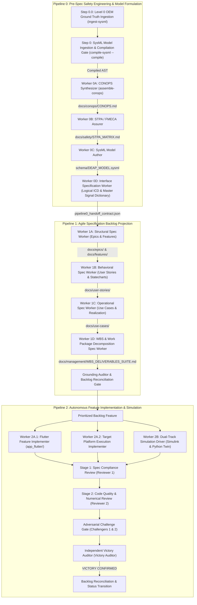

# dumpiler-01 -- Downstream Systems Engineering Project

> **Repository Role:** `DOWNSTREAM_CUSTOMER_PROJECT`  
> **Primary Technology Profiles:** `Target Platform Execution Profile`  
> **Target Regulatory Frameworks:** `Schema-Derived Regulatory Standards`  

---

## 1. System Overview

This repository is an installed downstream implementation workspace governed by the **Digital Engineering Agent Platform (DEAP)** for cyber-physical infrastructure safety, real-time control, run-time assurance (RTA), and autonomous operations.

### 1.1 Customer Application Workspace Scope

As a **Tier 3 Customer Application Workspace**, this repository is authorized for concrete engineering delivery, proprietary application code, domain lifecycle components, target execution nodes, hardware-in-the-loop tests, and verified Agile backlog implementations.

### 1.2 Primary Commercial Toolchain Integration Context

This platform explicitly declares **MATLAB / Simulink / Stateflow / Embedded Coder** as the Primary Tier-1 Commercial Toolchain Integration Context (Model-Based Design, Control Law Synthesis, DO-178C C/SPARK Ada code generation).

---

## 2. Pipeline Structure & Governance

- `AGENTS.md`: Agent behavior rules, role boundaries, and subagent dispatch protocols.
- `CLAUDE.md`: Claude Code guidelines and verification gates.
- `docs/USER_MANUAL.md`: Authoritative operations and user manual covering quick start, the zero-shell cross-platform policy, complete CLI tooling reference, Git conventions, and troubleshooting.
- `.pipeline/`: Constitution (`constitution.md`), active governance rules bundle (`ACTIVE_RULES_BUNDLE.md`), domain specifications, and execution profiles (`profiles/<platform>.md`).
- `rules/` & `skills/`: Platform engineering rules and agent workflow skills.
- `schema/`: Contract definitions and SysML v2 schemas.
- Semantic acceptance verification: Automated baseline verification and compliance checks via pipeline scripts.

---

## High-Performance Native Rust Toolchain

The repository embeds a compiled, high-performance native Rust toolchain (`Cargo.toml` workspace) delivering sub-second execution across all core digital engineering compiler gates:

| Crate | Binary / Target | Role & Architectural Responsibilities |
| :--- | :--- | :--- |
| `crates/ingest-sysml` | `./target/release/ingest-sysml` | **Ground 0.0 Ingestion Engine**: High-throughput parsing and normalization of unstructured OEM documentation, PDF manuals, BOM markdown tables, and Level 1C ICD registers into canonical SysML v2 textual models. |
| `crates/compile-sysml` | `./target/release/compile-sysml` | **SysML v2 / KerML Compiler & STPA Transpiler**: Deterministic SysML v2 compilation, semantic validation, bidirectional AST synchronization (`--reverse-sync`, `--forward-sync`), and formal STPA / FMECA constraint transpilation. |
| `crates/assemble-conops` | `./target/release/assemble-conops` | **ConOps & Mission Intent Assembly Engine**: High-throughput deterministic assembly of modular ConOps and Mission Intent units into canonical master specifications with parameter binding and TOC generation. |
| `crates/reconcile-backlog` | `./target/release/reconcile-backlog` | **Backlog Reconciliation Engine**: High-performance bidirectional synchronization of local Markdown specifications, frontmatter metadata, and issue tracker checklists. |
| `crates/verify-baseline` | `./target/release/verify-baseline` | **Checks 10-32 Quality Gate Verifier**: Ultra-fast baseline conformance, KaTeX math parsing, Mermaid diagram validation, and semantic diagram-to-AST parity auditor. |
| `crates/deap-core` | `libdeap_core.rlib` | **Shared Core Foundation**: Shared AST representations, Markdown & KaTeX lexer/scanner, diagnostic reporting, defect dossier synthesis, and repository rule engines. |

### Toolchain Build & Verification Commands

```bash
# Verify all crates compile cleanly (0 issues)
cargo check

# Run all unit, integration, and doc-tests
cargo test

# Build optimized release binaries
cargo build --release
```

---

## 3. Project Lifecycle & Tooling Maintenance

### 3.1 Downstream Baseline Verification & Ingestion Workflows (Quick Start)

To verify that all repository issue tracker labels, baseline contracts, and safety fixtures pass downstream conformance gates, run:

```bash
# Run baseline conformance verification (native Rust binary)
./target/release/verify-baseline . --no-domain
```

For customer projects starting with unstructured OEM technical documentation, PDF flight manuals, or Bill of Materials (BOM) specifications, execute Level 0 OEM Ground Truth Ingestion (Step 0.0):

```bash
# Run Level 0 OEM Ground Truth ingestion (native Rust binary)
./target/release/ingest-sysml --schema "schema/extracted/" --format markdown --out "schema/model.sysml"

# Verify model compilation gate (native Rust binary)
./target/release/compile-sysml --compile
```

### 3.2 In-Place Pipeline Tooling Update

To update local pipeline tooling, governance rules, and verification scripts in-place at any time without re-onboarding:

```bash
# Update local pipeline tooling in-place
cargo build --release --workspace && ./target/release/verify-baseline setup-hooks
```

### 3.3 Mandatory Agent Initialization Sequence (Universal Initialization Sequence)

Immediately following installation, any AI agent (Antigravity, Claude Code, Cursor) initializing in this repository MUST execute the following sequence before accepting user directives or executing task implementations:

0. **Detect Repository Role & Scope (Direct-Path Read)**: Inspect whether `.pipeline/upstream/` exists on disk via direct-path read (`list_dir` or `view_file`). Do not rely on glob or search tools that ignore hidden dot-directories.
   - If absent -> **Downstream Customer Project Mode**: Authorized for customer feature implementation and domain codebase delivery.
1. **Read Governance Constitution**: Execute `view_file` on `.pipeline/constitution.md` to ingest the platform-independent functional governance layer and zero-mocking persistence mandates.
2. **Load Project Skills**: Execute `view_file` on `skills/feature-driven-implementation/SKILL.md` (and any active skills under `skills/` or `.agents/skills/`) to initialize feature-driven implementation protocols and review gates.
3. **Load Governance Rules**: Execute `view_file` on `.pipeline/ACTIVE_RULES_BUNDLE.md` to ingest the complete, consolidated suite of active governance rules in a single read (covering dual-track MBD, SysML SSOT completeness, role boundary locks, and TDD mandates).
4. **Verify Compiler Toolchain Baseline**: Verify that the compiler workspace builds cleanly by executing cargo check --workspace. (In downstream customer application workspaces executing feature-driven implementation, load the project's designated platform profile).
5. **Bootstrap Tracker Labels & Verify Baseline**: Verify that repository issue tracker labels and baseline conformance pass by running `./target/release/verify-baseline . --no-domain`.

---
## 4. Multi-Pipeline Operator Prompt Catalog & Autonomous Execution Workflows

This catalog contains the complete, unabridged operator prompt suite for executing all stages of the Digital Engineering Agent Platform (DEAP) lifecycle across context-isolated subagents in Antigravity, Claude Code, and Cursor.

### 4.1 Master-Worker Subagent Topology



### 4.2 Pipeline 0 Execution Prompts

Execute the following prompts in sequence using context-isolated subagents to transform unstructured intent, operational scenarios, and interface schemas into formal CONOPS, STPA hazard matrices, and SysML v2 AST models:

#### 4.2.0 Worker 00: OEM Prose / BOM Ingestion & Model Synthesis Prompt (Step 0.0)

**Step 0.0 Entrypoint for Unstructured / Prose Customer Documentation:**
For customer projects starting with unstructured OEM prose manuals, PDF documentation, markdown tables, or Bill of Materials (BOM) specifications, Worker 00 provides the sanctioned, deterministic entrypoint. Extracting OEM Bill of Materials (BOM) and physical parameters into `schema/extracted/` and synthesizing canonical SysML v2 textual models in `schema/model.sysml` (or `.pipeline/schema.sysml`) is fully authorized under Check 23 (Factual Grounding & Numeric Provenance Gate) and serves as the mandatory precursor to executing the Step 0 compilation gate (`./target/release/compile-sysml --compile`).

```text
Execute `view_file` on `skills/spec-orchestrator/SKILL.md` as your very first step before taking any action.

Repository Classification: UPSTREAM_SPEC_CORE_COMPILER (or DOWNSTREAM_CUSTOMER_PROJECT depending on execution context)

Role: Worker 00 -- OEM Prose / BOM Ingestion & Model Synthesizer (Step 0.0)

Primary Commercial Toolchain Integration Context:
This project explicitly declares MATLAB / Simulink / Stateflow / Embedded Coder as the Primary Tier-1 Commercial Toolchain Integration Context (Model-Based Design, Control Law Synthesis, DO-178C C/SPARK Ada code generation).

Directive:
Execute Level 0 OEM Ground Truth Ingestion and initial SysML v2 textual model synthesis for customer projects starting from unstructured OEM prose manuals, PDF documentation, markdown tables, or Bill of Materials (BOM) specifications:

1. Unstructured & Semi-Structured Ingestion Scope:
   - Ingest raw OEM technical documentation, flight/operating manuals, ICD tables, and BOM markdown tables located in `schema/` and `schema/extracted/`.
   - Authorized Under Check 23: Extract physical parameters, component hierarchies, mass/power budgets, port/pin interfaces, and operational envelopes into machine-readable Markdown tables in `schema/extracted/` (e.g., `schema/extracted/oem_bom.md`, `schema/extracted/interface_table.md`, `schema/extracted/parametric_limits.md`).

2. Canonical SysML v2 Model Synthesis:
   - Execute the Level 0 ingestion translator:
     ./target/release/ingest-sysml --schema "schema/extracted/" --format markdown --out "schema/model.sysml"
   - Alternatively, synthesize a formal SysML v2 textual model `schema/model.sysml` directly, defining:
     * Root `package` matching the target cyber-physical system.
     * All component definitions as canonical `part def` elements with typed attributes (mass, power, dimensions, channel count, part numbers).
     * Directional communication and electrical interface boundaries as `port def` elements (`in`, `out`, `inout`).
     * Physical, environmental, and operational constraints as `constraint def` / `assert constraint` blocks.
     * State machine structures and operational lifecycle phases as `state def` elements.

3. Compilation Gate Precursor Verification:
   - Verify that the generated `schema/model.sysml` passes the Step 0 SysML Compilation Gate:
     ./target/release/compile-sysml --compile
   - Ensure `.pipeline/schema.sysml` and `.pipeline/schema-digest.json` are successfully generated without compilation errors.
   - Verify Check 23 compliance (Factual Grounding & Numeric Provenance Gate): all physical parameters and component counts in `schema/model.sysml` strictly match the Level 0 OEM ground truth in `schema/extracted/`.

Defect Filing Directive:
If any compiler fault, schema inconsistency, or invariant violation is discovered, you are strictly forbidden from filing raw issues directly. You MUST dispatch a fresh context-isolated subagent with `skills/adversarial-code-auditor/SKILL.md` to perform the 5-pillar audit, generate the verified 7-section defect dossier, and submit it via `./target/release/reconcile-backlog create-issue --label bug` (or `./target/release/file-defect`). Issue auto-closing keywords or issue close commands are strictly forbidden.

PROCEED
```

#### 4.2.1 Worker 0A: CONOPS & Operational Scenario Synthesis Prompt

```text
Execute `view_file` on `skills/spec-conops-engineering/SKILL.md` as your very first step before taking any action.

Repository Classification: UPSTREAM_SPEC_CORE_COMPILER (or DOWNSTREAM_CUSTOMER_PROJECT depending on execution context)

Role: Worker 0A -- CONOPS & Operational Scenario Synthesizer

Primary Commercial Toolchain Integration Context:
This project explicitly declares MATLAB / Simulink / Stateflow / Embedded Coder as the Primary Tier-1 Commercial Toolchain Integration Context (Model-Based Design, Control Law Synthesis, DO-178C C/SPARK Ada code generation).

Directive:
Execute front-end modular CONOPS and Tactical Mission Intent synthesis for the target cyber-physical system using Universal Multi-Document & Schema Ingestion:

1. Ingestion & Pre-Flight Analysis:
   - Ingest Normative Research Baselines: Ingest `docs/research/RESEARCH_INVENTORY.md` and `docs/research/FAILURE_MODE_REGISTRY.md` to map allocated obligations (`OBL-*`) and component failure modes.
   - Interface & Model Schema Ingestion: Ingest canonical SysML v2 AST model (`.pipeline/schema.sysml`), `schema/`, and `.pipeline/schema-digest.json`. Enforce 100% representation of declared `part def` nodes in Section 4 physical architecture. Scan `schema/` for pre-existing customer models and interface definitions (`*.sysml`, `*.proto`, `*.arxml`, `*.json`, `*.yaml`, `*.idl`).
   - Architectural Blueprint Ingestion: Scan `docs/architecture/` (and `docs/architecture/blueprints/`) for existing architectural specifications, network blueprints, and safety frameworks (`*.md`). Reconcile customer interface schemas and architectural blueprints with system boundaries and MATLAB / Simulink / Stateflow control law synthesis hooks.
   - Operational Intent Discovery: Ingest mission directives, operational purpose statements, and domain operational boundaries.

2. Ingestion & Analysis Scope:
   - Schema-derived operational envelope (physical boundaries, operating dynamics, environmental constraints, payload/actuator configurations).
   - Domain-specific operational lifecycle phases: Initialization, Normal Operation, Degraded/Contingency Modes, and Safe Shutdown/Transition.
   - Dynamic stakeholder roles derived from the system operational context (e.g., System Operators, Dispatchers/Supervisors, Field Maintenance Technicians, External Management/Telemetry Interfaces).
   - Domain-specific regulatory and safety classification relevant to the operational envelope.

3. Modular Deliverable Generation:
   - Do NOT draft monolithic files directly. Author modular units conforming to JSON Schema contracts under:
     * `docs/conops/units/conops/`: 12 canonical units (`01_METADATA_AND_OVERVIEW.md` through `12_EMERGENCY_DECISION_MATRIX.md`), including decoupled 3-tier architecture in `04_SYSTEM_ARCHITECTURE.md`.
     * `docs/conops/units/mission_intent/`: 10 canonical units (`01_COMMANDERS_INTENT.md` through `10_OPERATIONAL_ALLOCATION_TAGS.md`), including operational `06_ROE_SAFETY_INTERLOCKS.md` and tactical `08_GO_NO_GO_MATRIX.md`.
   - Ensure clear operational phase boundaries, system physical and functional boundaries, and environmental envelope constraints.
   - Include MATLAB / Simulink / Stateflow model integration baseline hooks for downstream control law synthesis.
   - Relative Link Mandate: Intra-document and schema links must use valid file-relative paths (`../../schema/...`, `../<dir>/...`).
   - KaTeX / LaTeX Math Formatting Mandate: All multi-line aligned equations MUST be enclosed in `\begin{aligned} ... \end{aligned}` within `$$` delimiters on dedicated lines. Bare alignment tabs `&` outside an alignment environment (`aligned`, `matrix`, `cases`) and `\begin{align*}` environments are strictly forbidden. Markdown Table Math Prohibition Rule: Strictly ban `$ ... $` and `$$ ... $$` LaTeX math delimiters inside table headers, rows, and cells; plain text and Unicode (e.g. `Initial S`, `ΔV`, `λ`, `°C`, `≥`, `≤`, `→`, `10⁻⁶`) must be used instead, with 1:1 column count match between header and delimiter rows.

4. Assembly & Verification Gates:
   - Execute deterministic assembly: `./target/release/assemble-conops --input-dir docs/conops/units/ --output-dir docs/conops/ --verify`.
   - Compile master specification documents: `./target/release/assemble-conops --input-dir docs/conops/units/ --output-dir docs/conops/`.
   - Gate 26 Validation: Execute `./target/release/verify-baseline . --no-domain`.

Defect Filing Directive:
If any compiler fault, schema inconsistency, or invariant violation is discovered, you are strictly forbidden from filing raw issues directly. You MUST dispatch a fresh context-isolated subagent with `skills/adversarial-code-auditor/SKILL.md` to perform the 5-pillar audit, generate the verified 7-section defect dossier, and submit it via `./target/release/reconcile-backlog create-issue --label bug` (or `./target/release/file-defect`). Issue auto-closing keywords or issue close commands are strictly forbidden.

PROCEED
```

#### 4.2.2 Worker 0B: STPA Hazard Analysis, FMECA & Domain Safety Assurer Prompt

```text
Execute `view_file` on `skills/spec-orchestrator/SKILL.md` as your very first step before taking any action.

Repository Classification: UPSTREAM_SPEC_CORE_COMPILER (or DOWNSTREAM_CUSTOMER_PROJECT depending on execution context)

Role: Worker 0B -- STPA Hazard Analysis, FMECA & Domain Safety Assurer

Primary Commercial Toolchain Integration Context:
This project explicitly declares MATLAB / Simulink / Stateflow / Embedded Coder as the Primary Tier-1 Commercial Toolchain Integration Context (Model-Based Design, Control Law Synthesis, DO-178C C/SPARK Ada code generation).

Directive:
Perform STPA hazard analysis, FMECA failure mode criticality evaluation, and domain safety risk assessment based on `docs/conops/CONOPS.md`.

1. Standards Compliance & Domain Safety Framework:
   - Dynamic Domain Safety Framework Selection: Apply the applicable schema-derived safety framework and regulatory standards governing the target domain.
   - Run-Time Assurance (RTA) Monitor Architecture & Safety Net switching (e.g., ASTM F3269-17 or domain-equivalent safety monitor pattern).
   - Domain-specific hazard detection, telemetry monitoring, and contingency guidance standards.

2. Output Requirements:
   - Generate `STPA_MATRIX.md` under `docs/safety/STPA_MATRIX.md` adhering strictly to the 8-pillar schema:
     1. System Losses (L-1..N)
     2. System Hazards (H-1..N)
     3. Hierarchical Control Structure Topology (defining System Controllers, Supervisors/RTA Monitors, Actuators, Sensors)
     4. Unsafe Control Actions (UCA-1..N) covering all 4 failure modes: (a) Not providing causes hazard, (b) Providing causes hazard, (c) Providing too early, too late, or out of order, (d) Stopped too soon or applied too long
     5. Loss Scenarios (LS-1..N) & Causal Factors
     6. Formal Safety Constraints (SC-1..N)
     7. FMECA Criticality Matrix: Component failure modes with 15+ rows, Severity (S), Occurrence (O), Detection (D), and Risk Priority Numbers (RPN = S * O * D)
     8. Domain Safety Framework & Risk Mitigations Table: Risk class classification, integrity levels, and comprehensive mapping of domain safety objectives and mitigations to schema-derived regulatory requirements
   - Include Run-Time Assurance (RTA) Safety Net monitor architecture.
   - Include MATLAB / Simulink / Stateflow / Embedded Coder model integration baseline hooks and SLDV formal proof properties.
   - KaTeX / LaTeX Math Formatting Mandate: All multi-line aligned equations MUST be enclosed in `\begin{aligned} ... \end{aligned}` within `$$` delimiters on dedicated lines. Bare alignment tabs `&` outside an alignment environment (`aligned`, `matrix`, `cases`) and `\begin{align*}` environments are strictly forbidden. Markdown Table Math Prohibition Rule: Strictly ban `$ ... $` and `$$ ... $$` LaTeX math delimiters inside table headers, rows, and cells; plain text and Unicode (e.g. `Initial S`, `ΔV`, `λ`, `°C`, `≥`, `≤`, `→`, `10⁻⁶`) must be used instead, with 1:1 column count match between header and delimiter rows.

PROCEED
```

#### 4.2.3 Worker 0C: SysML v2 Architectural & Safety Model Author Prompt

```text
Execute `view_file` on `skills/spec-orchestrator/SKILL.md` as your very first step before taking any action.

Repository Classification: UPSTREAM_SPEC_CORE_COMPILER (or DOWNSTREAM_CUSTOMER_PROJECT depending on execution context)

Role: Worker 0C -- SysML v2 Architectural & Safety Model Author

Primary Commercial Toolchain Integration Context:
This project explicitly declares MATLAB / Simulink / Stateflow / Embedded Coder as the Primary Tier-1 Commercial Toolchain Integration Context (Model-Based Design, Control Law Synthesis, DO-178C C/SPARK Ada code generation).

Directive:
Formalize the CONOPS (`CONOPS.md`), STPA hazard matrices, FMECA ratings, and domain safety requirements (`STPA_MATRIX.md`) into a canonical SysML v2 textual model and serialized AST handoff contract based on the derived domain architecture.

1. Model Engineering Mandate:
   - Construct canonical `DEAP_MODEL.sysml` conforming to SysML v2 textual specification standards (`package`, `req`, `part`, `port`, `state`, `satisfy`, `verify`) based on the derived domain architecture.
   - Define safety statecharts for Run-Time Assurance (RTA) switching logic, contingency operational modes, and fail-safe transitions.
   - Establish MATLAB / Simulink / Stateflow export compatibility for safety-critical code synthesis.
   - KaTeX / LaTeX Math Formatting Mandate: Ensure any statechart/mathematical transition guards and formal expressions follow standard escaping and valid KaTeX blocks (all multi-line aligned equations MUST be enclosed in `\begin{aligned} ... \end{aligned}` within `$$` delimiters on dedicated lines; bare alignment tabs `&` outside an alignment environment and `\begin{align*}` are strictly forbidden). Markdown Table Math Prohibition Rule: Strictly ban `$ ... $` and `$$ ... $$` LaTeX math delimiters inside table headers, rows, and cells; plain text and Unicode (e.g. `Initial S`, `ΔV`, `λ`, `°C`, `≥`, `≤`, `→`, `10⁻⁶`) must be used instead, with 1:1 column count match between header and delimiter rows.

2. Output Requirements:
   - Generate canonical `DEAP_MODEL.sysml` under `schema/DEAP_MODEL.sysml` (or `.pipeline/schema.sysml`).
   - Generate canonical `pipeline0_handoff_contract.json` under `.pipeline/contracts/pipeline0_handoff_contract.json` for downstream Pipeline 1 Agile projection and Pipeline 2 code generation.

PROCEED
```

#### 4.2.4 Worker 0D: Interface Specification Worker (Logical ICD & Signal Dictionary) Prompt

```text
Execute `view_file` on `skills/spec-icd-engineering/SKILL.md` as your very first step before taking any action.

Repository Classification: UPSTREAM_SPEC_CORE_COMPILER (or DOWNSTREAM_CUSTOMER_PROJECT depending on execution context)

Role: Worker 0D -- Interface Specification Worker (Logical ICD & Signal Dictionary)

Primary Commercial Toolchain Integration Context:
This project explicitly declares MATLAB / Simulink / Stateflow / Embedded Coder as the Primary Tier-1 Commercial Toolchain Integration Context (Model-Based Design, Control Law Synthesis, DO-178C C/SPARK Ada code generation).

Directive:
Synthesize Level 1C Logical Interface Specifications and Signal Dictionaries from formal SysML v2 AST interface blocks:

1. AST Interface Parsing:
   - Ingest `.pipeline/schema.sysml` and `.pipeline/schema-digest.json`.
   - Extract directional ports (`port def`), connection bindings (`connection`), formal interface contracts (`interface def`), and information payloads (`item flow`).
   - Ingest safety constraints (`SC-1..N`) and hazard allocations from `docs/safety/STPA_MATRIX.md` to map safety-critical signal bounds.

2. Deliverable Generation & Quality Gate:
   - Generate `docs/interfaces/ICD_01_SYSTEM_INTERFACE_MATRIX.md` containing subsystem boundary graphs, N² communication matrix, and topological port bindings.
   - Generate `docs/interfaces/ICD_02_MASTER_SIGNAL_DICTIONARY.md` containing signal identifiers (`SIG-*`), data types, units, sampling frequencies, update rates, latency bounds, and fail-safe default values.
   - Run Gate 23 ICD completeness validation: `./target/release/verify-baseline . --no-domain`.
   - Register the ICD suite under the `icd` issue label using `./target/release/reconcile-backlog create-issue "<file>" "icd" "<title>"`.
   - Verify published issue body integrity via live tracker inspection.

Defect Filing Directive:
If any compiler fault, schema inconsistency, or invariant violation is discovered, you are strictly forbidden from filing raw issues directly. You MUST dispatch a fresh context-isolated subagent with `skills/adversarial-code-auditor/SKILL.md` to perform the 5-pillar audit, generate the verified 7-section defect dossier, and submit it via `./target/release/reconcile-backlog create-issue --label bug` (or `./target/release/file-defect`). Issue auto-closing keywords or issue close commands are strictly forbidden.

PROCEED
```

### 4.3 Pipeline 1 Agile Backlog Projection Prompts

Execute the following prompts to extract full Agile backlogs (Epics, Level 1C ICD Interface Matrices, BDD User Stories, and UML Use Cases) with closed-loop tracker synchronization:

#### 4.3.1 Worker 1A: Structural Spec Worker (Epics & Features) Prompt

```text
Execute `view_file` on `skills/schema-specification-engineering/SKILL.md` as your very first step before taking any action.

Repository Classification: DOWNSTREAM_CUSTOMER_PROJECT (or UPSTREAM_SPEC_CORE_COMPILER depending on execution context)

Role: Worker 1A -- Structural Specification Worker (Epics & Features)

Primary Commercial Toolchain Integration Context:
This project explicitly declares MATLAB / Simulink / Stateflow / Embedded Coder as the Primary Tier-1 Commercial Toolchain Integration Context (Model-Based Design, Control Law Synthesis, DO-178C C/SPARK Ada code generation).

Directive:
Transform structural schemas and SysML v2 AST models into formal Agile Epics and Features adhering to OOA/OOD principles:

1. AST Parsing & Subsystem Extraction:
   - Ingest canonical SysML v2 model (`.pipeline/schema.sysml`) and schema digest (`.pipeline/schema-digest.json`).
   - Parse all subsystem `package` declarations to identify Epic boundaries (`docs/epics/epic-*.md`).
   - Parse all `part def` (structural components) and `item def` (data payloads) elements to identify Feature boundaries (`docs/features/feat-*.md`).
   - Dispatch fresh context-isolated subagents for each individual Epic and Feature with YAML frontmatter declaring `generation_mode: "subagent"`.

2. Local Validation & Issue Registration:
   - Execute the local model coverage linter: `./target/release/verify-baseline . --spec-only`.
   - Register Features first via `./target/release/reconcile-backlog create-issue "<file>" "feature" "<title>"`.
   - Verify live published payload on the issue tracker (`gh issue view <ID> --json body` or `glab issue view <ID>`).
   - Inject verified Feature Issue IDs into Epic tasklists.
   - Register Epics via `./target/release/reconcile-backlog create-issue "<file>" "epic" "<title>"`.

Defect Filing Directive:
If any compiler fault, schema inconsistency, or invariant violation is discovered, you are strictly forbidden from filing raw issues directly. You MUST dispatch a fresh context-isolated subagent with `skills/adversarial-code-auditor/SKILL.md` to perform the 5-pillar audit, generate the verified 7-section defect dossier, and submit it via `./target/release/reconcile-backlog create-issue --label bug` (or `./target/release/file-defect`). Issue auto-closing keywords or issue close commands are strictly forbidden.

PROCEED
```

#### 4.3.2 Worker 1B: Behavioral Spec Worker (User Stories & Statecharts) Prompt

```text
Execute `view_file` on `skills/spec-user-story-engineering/SKILL.md` as your very first step before taking any action.

Repository Classification: DOWNSTREAM_CUSTOMER_PROJECT (or UPSTREAM_SPEC_CORE_COMPILER depending on execution context)

Role: Worker 1B -- Behavioral Specification Worker (User Stories & Statecharts)

Primary Commercial Toolchain Integration Context:
This project explicitly declares MATLAB / Simulink / Stateflow / Embedded Coder as the Primary Tier-1 Commercial Toolchain Integration Context (Model-Based Design, Control Law Synthesis, DO-178C C/SPARK Ada code generation).

Directive:
Extract Behavior-Driven Development (BDD) User Stories, UML Sequence Lifelines, and Stateflow transition triggers from SysML v2 behavioral AST nodes:

1. Behavioral AST Ingestion:
   - Ingest `.pipeline/schema.sysml` and operational text.
   - Parse `action def` (computations & transformations), `state def` (lifecycle states & transition guards), `port def` (message triggers), and `interaction def` (lifeline sequences).
   - Extract algorithmic calculation stories for dynamic computations and temporal expiration stories for state lifecycles.
   - Map acceptance criteria BDD scenarios to formal SysML `test case def` elements with `verify requirement` tags.

2. Deliverable Generation & Issue Registration:
   - Dispatch fresh context-isolated subagents per User Story (`docs/user-stories/us-*.md`) with YAML frontmatter (`generation_mode: "subagent"`).
   - Execute local model coverage linter: `./target/release/verify-baseline . --spec-only`.
   - Register User Stories via `./target/release/reconcile-backlog create-issue "<file>" "user-story" "<title>"`.
   - Verify live published payload on the issue tracker (`gh issue view <ID> --json body` or `glab issue view <ID>`).

Defect Filing Directive:
If any compiler fault, schema inconsistency, or invariant violation is discovered, you are strictly forbidden from filing raw issues directly. You MUST dispatch a fresh context-isolated subagent with `skills/adversarial-code-auditor/SKILL.md` to perform the 5-pillar audit, generate the verified 7-section defect dossier, and submit it via `./target/release/reconcile-backlog create-issue --label bug` (or `./target/release/file-defect`). Issue auto-closing keywords or issue close commands are strictly forbidden.

PROCEED
```

#### 4.3.3 Worker 1C: Operational Spec Worker (Use Cases & Realization Matrices) Prompt

```text
Execute `view_file` on `skills/spec-usecase-engineering/SKILL.md` as your very first step before taking any action.

Repository Classification: DOWNSTREAM_CUSTOMER_PROJECT (or UPSTREAM_SPEC_CORE_COMPILER depending on execution context)

Role: Worker 1C -- Operational Spec Worker (Use Cases & Realization Matrices)

Primary Commercial Toolchain Integration Context:
This project explicitly declares MATLAB / Simulink / Stateflow / Embedded Coder as the Primary Tier-1 Commercial Toolchain Integration Context (Model-Based Design, Control Law Synthesis, DO-178C C/SPARK Ada code generation).

Directive:
Derive formal UML System Use Cases directly from SysML v2 `use case def` AST blocks and system interaction scenarios:

1. Use Case AST Ingestion:
   - Ingest `.pipeline/schema.sysml`, `docs/features/`, and `docs/user-stories/`.
   - Extract `use case def` AST nodes, identifying `subject` (`part def`), typed `actor` ports, `objective`, and `include`/`extend` relations.
   - Maintain 1:1 Use Case Def mapping with Primary/Secondary Actors, Preconditions, Trigger, Main Success Scenario, Alternate/Exception Flows (covering 100% of validation constraints across realized features), and Postconditions (Success & Failure Guarantees).
   - Construct UML Use Case diagrams and UML State Machine diagrams.

2. Realization Matrix & Registration:
   - Construct `## Realization Matrix` resolving specific, unique tracker Issue IDs for each intersecting User Story and Feature.
   - Execute local model coverage check: `./target/release/verify-baseline . --spec-only`.
   - Register Use Cases via `./target/release/reconcile-backlog create-issue "<file>" "use-case" "<title>"`.
   - Verify live published payload on the issue tracker (`gh issue view <ID> --json body` or `glab issue view <ID>`).

Defect Filing Directive:
If any compiler fault, schema inconsistency, or invariant violation is discovered, you are strictly forbidden from filing raw issues directly. You MUST dispatch a fresh context-isolated subagent with `skills/adversarial-code-auditor/SKILL.md` to perform the 5-pillar audit, generate the verified 7-section defect dossier, and submit it via `./target/release/reconcile-backlog create-issue --label bug` (or `./target/release/file-defect`). Issue auto-closing keywords or issue close commands are strictly forbidden.

PROCEED
```

#### 4.3.4 Worker 1D: WBS & Work Package Decomposition Spec Worker Prompt

```text
Execute `view_file` on `skills/spec-wbs-engineering/SKILL.md` as your very first step before taking any action.

Repository Classification: DOWNSTREAM_CUSTOMER_PROJECT (or UPSTREAM_SPEC_CORE_COMPILER depending on execution context)

Role: Worker 1D -- WBS & Work Package Decomposition Spec Worker

Primary Commercial Toolchain Integration Context:
This project explicitly declares MATLAB / Simulink / Stateflow / Embedded Coder as the Primary Tier-1 Commercial Toolchain Integration Context (Model-Based Design, Control Law Synthesis, DO-178C C/SPARK Ada code generation).

Directive:
Synthesize MIL-STD-881E Work Breakdown Structures (WBS), Technical Realization Registers, and Enterprise Project Management Exports (Jira, Monday.com, MS Project CSV and JSON AST) from SysML AST, ConOps, Safety Matrices, and Agile Backlog items:

1. WBS & Enterprise Realization Synthesis:
   - Ingest `.pipeline/schema.sysml`, `docs/conops/`, `docs/safety/`, `docs/epics/`, `docs/features/`, `docs/user-stories/`, and `docs/use-cases/`.
   - Synthesize the complete 5-tier WBS hierarchy and 7 concrete Model-Based Design (MBD) work packages per feature (`WP-xxx-SPEC`, `WP-xxx-MAT-PARAM`, `WP-xxx-SL-BLD`, `WP-xxx-PY-DOM`, `WP-xxx-PY-ENG`, `WP-xxx-TST`, `WP-xxx-REP`).
   - Construct the authoritative 7-Column End-to-End Traceability Matrix linking SysML components, Feature specs, User Stories, MATLAB/Simulink models, Python 250 Hz engines, semantic acceptance verification suites, and DO-178C/DO-331 simulation evidence.
   - Run the deterministic WBS suite generator: `./target/release/generate-wbs`.

2. Deliverable Generation & Issue Registration:
   - Generate `docs/management/WBS_DELIVERABLES_SUITE.md` with CommonMark metadata table.
   - Generate multi-platform export `docs/management/wbs_export_jira_monday_ms_project.csv` (RFC 4180 compliant with Jira, Monday.com, and MS Project field mappings).
   - Generate validated machine-readable JSON AST `docs/management/wbs_export.json`.
   - Register the WBS suite under the `wbs` issue label using `./target/release/reconcile-backlog create-issue "docs/management/WBS_DELIVERABLES_SUITE.md" "wbs" "<title>"`.
   - Verify published issue body integrity via live tracker inspection (`gh issue view <ID> --json body` or `glab issue view <ID>`).

Defect Filing Directive:
If any compiler fault, schema inconsistency, or invariant violation is discovered, you are strictly forbidden from filing raw issues directly. You MUST dispatch a fresh context-isolated subagent with `skills/adversarial-code-auditor/SKILL.md` to perform the 5-pillar audit, generate the verified 7-section defect dossier, and submit it via `./target/release/reconcile-backlog create-issue --label bug` (or `./target/release/file-defect`). Issue auto-closing keywords or issue close commands are strictly forbidden.

PROCEED
```

### 4.4 Multi-Provider Backlog Reconciliation Commands

Execute backlog reconciliation and model parity verification across your target VCS platform or offline air-gapped environment:

#### 4.4.1 Option A: GitLab SaaS Reconciliation
```bash
./target/release/reconcile-backlog --provider gitlab
```

#### 4.4.2 Option B: GitLab Self-Managed / SCIF Air-Gapped Reconciliation
```bash
./target/release/reconcile-backlog --provider gitlab --gitlab-url https://gitlab.internal.defense.gov --project uas-safety/uav-010
```

#### 4.4.3 Option C: GitHub Issues Reconciliation
```bash
./target/release/reconcile-backlog --provider github
```

#### 4.4.4 Option D: Offline Verification & 23-Gate Parity Lock
```bash
# Closed-loop reverse SysML v2 AST synchronization (Rust native)
./target/release/compile-sysml --reverse-sync

# Forward SysML v2 AST synchronization (Rust native)
./target/release/compile-sysml --forward-sync

# Offline backlog checklist and status synchronization
./target/release/reconcile-backlog --offline

# Baseline conformance verification (Checks 10-32 quality gate verifier)
./target/release/verify-baseline . --no-domain

# 23-Gate Model Coverage & UML Compliance Lock
./target/release/verify-baseline . --spec-only
```

### 4.5 Pipeline 2 Autonomous Feature Implementation Prompts

Execute the following prompts to drive feature implementation and two-path (dual-track) simulation verification through context-isolated TDD micro-tasks:

#### 4.5.1 Worker 2A.1 / Synthesis Driver: Flutter Feature Implementation Prompt

```text
Execute `view_file` on `skills/feature-driven-implementation/SKILL.md` as your very first step before taking any action.

Repository Classification: DOWNSTREAM_CUSTOMER_PROJECT

Role: Worker 2A.1 -- Flutter Feature-Driven Implementation Specialist

Primary Commercial Toolchain Integration Context:
This project explicitly declares MATLAB / Simulink / Stateflow / Embedded Coder as the Primary Tier-1 Commercial Toolchain Integration Context (Model-Based Design, Control Law Synthesis, DO-178C C/SPARK Ada code generation).

Target Directory & Confinement Invariant:
All source code, assets, configurations, and tests MUST reside exclusively under `app_flutter/`. Writing source code or configuration files at repository root is strictly prohibited.

Architecture Pattern:
MVVM (Model-View-ViewModel) layered architecture. Views are stateless widgets consuming ViewModels via dependency injection. ViewModels manage domain state and event streams. Domain entities are decoupled from presentation. All persistence transactions must interact exclusively with abstract repositories resolved dynamically at bootstrap.

The 15 Mandatory Domain Engineering Standards:
1. Result<T> Over Exceptions: All fallible domain operations and repository methods MUST return explicit Result<T> signatures (Success<T> or Failure<T>) rather than throwing untyped runtime exceptions.
2. Sealed Class Hierarchies: Domain states, algebraic data types, events, and error hierarchies MUST use sealed class hierarchies (`sealed class`) to enforce exhaustive pattern matching.
3. Named Constructors with Validation: Complex domain entities MUST declare private or named constructors performing assertion and validation logic to guarantee invalid objects cannot be instantiated.
4. Typed Errors per Domain: Every domain module MUST define explicit, strongly-typed error classes extending a sealed domain error base (`DomainError`) rather than returning raw error strings or untyped exceptions.
5. @immutable Annotation Mandatory: Every domain class, entity, value object, event, and state container MUST be annotated with `@immutable` to enforce compile-time immutability.
6. Interface Segregation: Domain interfaces and repository contracts MUST be narrow, lean, and highly cohesive so clients do not depend on unused methods.
7. Zero dynamic: The use of `dynamic` or untyped `Object?` in domain signatures, interfaces, properties, or variables is strictly prohibited. All data flows must be strongly typed.
8. BDD Test Naming: Unit and integration test names for domain logic MUST use explicit BDD behavior-driven naming patterns (`given_when_then` or `should [behavior] when [condition]`).
9. UML Traceability Tags Mandatory: Every public domain class, interface, mixin, extension, or typedef header MUST include a DartDoc traceability tag (`/// Realises: [SpecName/ClassName]`) referencing its underlying specification or UML classifier.
10. Public Member Docstrings Mandatory: Full DartDoc comments (`///`) are mandatory for every public class, interface, method, function, constructor, getter, and property in the domain layer.
11. const Constructors: Immutable domain classes and value objects with final fields MUST declare const constructors to support compile-time constant canonicalization.
12. Value Equality: All domain value objects and entities MUST override `operator ==` and `hashCode` (or extend Equatable) to guarantee value-based equality.
13. Typedefs for Callbacks: Callback functions, listener signatures, and event handlers MUST be declared as explicit typedef aliases rather than raw inline function types.
14. Private Constructors with Public Factories: Domain entities requiring construction validation MUST restrict direct instantiation via private constructors (`._()`) and expose public factory constructors.
15. Separation of Serialization: Domain models MUST remain completely decoupled from JSON, database, or network serialization logic (`fromJson`/`toJson`). Serialization logic MUST reside strictly in separate DTOs or data layer adapters.

Execution Standards & Governance Mandates:
- Adopt the feature-driven-implementation skill by reading `.pipeline/constitution.md`, `.pipeline/ACTIVE_RULES_BUNDLE.md`, and `.pipeline/profiles/flutter.md`.
- Section 1.9 Zero-Mocking Live Persistence Mandate: All client-side application targets MUST connect to a live persistent database, emulator, or local register map at runtime; in-memory mocks are strictly prohibited.
- 3-Layer Definition of Done (DoD):
  1. Layer 1: Domain State & Signal Model -- Strongly-typed domain models, value objects, and repository interfaces.
  2. Layer 2: Logic & Safety State Management -- ViewModels, statecharts, reactive bindings, and event streams.
  3. Layer 3: Display & Actuator Interface Binding -- High-density Flutter widgets, container queries, and BDD User Story Widget tests.
- TDD RED-GREEN-REFACTOR cycle: Write failing test first, verify failure, write minimal passing code, verify pass, refactor.

Verification Commands:
cd app_flutter && flutter analyze && flutter test

---GOVERNANCE-END---

Implement prioritized Feature [Issue Number, e.g. #1] adhering strictly to the above standards.

PROCEED
```

#### 4.5.2 Worker 2A.2 / Synthesis Driver: Target Platform Feature Implementation Prompt

```text
Execute `view_file` on `skills/feature-driven-implementation/SKILL.md` as your very first step before taking any action.

Repository Classification: DOWNSTREAM_CUSTOMER_PROJECT

Role: Worker 2A.2 -- Target Platform Execution Specialist

Primary Commercial Toolchain Integration Context:
This project explicitly declares MATLAB / Simulink / Stateflow / Embedded Coder as the Primary Tier-1 Commercial Toolchain Integration Context (Model-Based Design, Control Law Synthesis, DO-178C C/SPARK Ada code generation).

Platform Profiles & Target Standards:
Follow `.pipeline/profiles/<target_platform>.md` (Target Platform Execution Profile, lifecycle state management, and real-time execution bounds). Target platform verification tests must validate real-time execution bounds, timing jitter tolerances, and fail-safe actuation responses against target execution environments.

Execution Standards & Governance Mandates:
- Adopt the feature-driven-implementation skill by reading `.pipeline/constitution.md`, `.pipeline/ACTIVE_RULES_BUNDLE.md`, and the target platform profile.
- Architecture Pattern: Real-time target platform execution nodes and lifecycle state machine modules with deterministic execution semantics.
- 3-Layer Definition of Done: Domain State Model, Lifecycle State Machine & Safety Monitor, Middleware Binding (Target Platform Topic / Bus Binding) with automated unit, integration, and hardware-in-the-loop tests.
- TDD RED-GREEN-REFACTOR cycle with context-isolated micro-tasks.

Verification Commands:
<target_platform_build_command>
<target_platform_test_command>

---GOVERNANCE-END---

Implement prioritized Feature [Issue Number, e.g. #1] adhering strictly to the above standards.

PROCEED
```

#### 4.5.3 Worker 2B / Simulation Driver: Two-Path (Dual-Track) Simulation & Digital Twin Verification Prompt

```text
Execute `view_file` on `skills/feature-driven-implementation/SKILL.md` as your very first step before taking any action.

Repository Classification: DOWNSTREAM_CUSTOMER_PROJECT

Role: Worker 2B -- Two-Path (Dual-Track) Simulation & Digital Twin Verification Driver

Primary Commercial Toolchain Integration Context:
This project explicitly declares MATLAB / Simulink / Stateflow / Embedded Coder as the Primary Tier-1 Commercial Toolchain Integration Context (Model-Based Design, Control Law Synthesis, DO-178C C/SPARK Ada code generation).

Governance Preamble & Execution Directive:
Adopt the feature-driven-implementation skill by reading `.pipeline/constitution.md`, `.pipeline/ACTIVE_RULES_BUNDLE.md`, and `docs/architecture/blueprints/SYSML_SSOT_BIDIRECTIONAL_SYNCHRONIZATION_ARCHITECTURE.md`.

Execute Two-Path (Dual-Track) Model-Based Design (MBD) simulation synthesis and digital twin verification for Feature [Issue Number, e.g. #1]:

1. Track A (Native MATLAB / Simulink / Stateflow Synthesis):
   - Programmatic Model Construction: Deliver `models/scripts/build_<feature_slug>_model.m` to programmatically synthesize native `.slx` block diagrams and Stateflow charts using official MATLAB APIs.
   - Parameter & Signal Dictionaries: Deliver physical parameter dictionary `models/matlab/<feature_slug>_params.m` and Simulink Data Dictionary `models/matlab/<feature_slug>_data.sldd`.
   - Solver & Synthesis Baseline: Configure models for deterministic fixed-step discrete solvers (`FixedStepDiscrete`, $dt = 0.004\,\text{s}$ / 250 Hz) and Embedded Coder DO-178C C / SPARK Ada code synthesis.

2. Track B (Headless CI Digital Twin Engine):
   - License-Free Discrete Execution Engine: Deliver standalone Python simulation engine (`models/python/<feature_slug>_domain.py` and `models/python/<feature_slug>_engine.py`) executing at identical discrete loop rate ($dt$) with exact transition guards, polynomial transfer curves, and 6-DOF kinematics.
   - Zero License Blocker CI Harness: Deliver automated regression test suite `tests/test_<feature_slug>_simulation.py` running 100% offline in containerized CI environments without MathWorks licenses.

3. Mathematical & Discrete Equivalence Mandate:
   - Numerical Tolerance Verification: Guarantee state vector and output trajectory error between Track A reference and Track B digital twin satisfies $\|x_{\text{Simulink}} - x_{\text{DigitalTwin}}\|_\infty \le 10^{-6}$.
   - Formal DO-331 Verification Report: Generate comprehensive verification report `docs/reports/simulink_results/<FEATURE-ID>_simulation_results.md` detailing MC/DC coverage mapping, transition truth tables, fault-injection scenarios, and numerical parity logs.

Defect Filing Directive:
If any compiler fault, schema inconsistency, or invariant violation is discovered, you are strictly forbidden from filing raw issues directly. You MUST dispatch a fresh context-isolated subagent with `skills/adversarial-code-auditor/SKILL.md` to perform the 5-pillar audit, generate the verified 7-section defect dossier, and submit it via `./target/release/reconcile-backlog create-issue --label bug` (or `./target/release/file-defect`). Issue auto-closing keywords or issue close commands are strictly forbidden.

PROCEED
```

#### 4.5.4 Two-Path MBD Artifact & Deliverable Hierarchy

Every feature containing control laws, operating dynamics, physical plant estimators, or safety state machines delivers the canonical two-path MBD artifact suite:

```text
models/
├── scripts/
│   └── build_<feature_slug>_model.m        # Track A: Programmatic Simulink/Stateflow builder script
├── matlab/
│   ├── <feature_slug>_params.m            # Track A: MATLAB physical plant & control parameters
│   └── <feature_slug>_data.sldd           # Track A: Simulink Data Dictionary (data types & signals)
└── python/
    ├── <feature_slug>_domain.py           # Track B: Strongly-typed domain models & state vectors
    └── <feature_slug>_engine.py           # Track B: Standalone discrete-time simulation engine

tests/
└── test_<feature_slug>_simulation.py      # Automated CI regression suite for Track B engine

docs/reports/simulink_results/
└── <FEATURE-ID>_simulation_results.md     # Formal DO-331 simulation & numerical parity report
```

##### Dual-Track Artifact Descriptions:

1. **`models/scripts/build_<feature_slug>_model.m` (Track A Builder)**:
   Programmatically constructs native MATLAB / Simulink (`.slx`) block diagrams and Stateflow charts via official MATLAB APIs (`new_system`, `add_block`, `Stateflow.Data`, `Stateflow.State`, `Stateflow.Transition`). Configures deterministic discrete fixed-step solvers (`FixedStepDiscrete`) and Embedded Coder DO-178C C / SPARK Ada code synthesis.

2. **`models/matlab/<feature_slug>_params.m` & `.sldd` (Track A Dictionaries)**:
   Declares physical plant constants, control gains, rate limits, sensor noise variances, and discrete sample time ($dt = 0.004\,\text{s}$ / 250 Hz) in typed MATLAB structures and Simulink Data Dictionaries.

3. **`models/python/<feature_slug>_domain.py` & `_engine.py` (Track B Digital Twin)**:
   Pure Python, license-free, headless discrete simulation engine executing identical algebraic formulations, cubic polynomial blending curves ($\lambda(\tau) = 3\tau^2 - 2\tau^3$), and safety transition guards. Exposes typed state vectors and `step(dt, inputs) -> outputs` execution interface.

4. **`tests/test_<feature_slug>_simulation.py` (Automated CI Verification Suite)**:
   Semantic acceptance verification suite executing offline in CI/CD runners without MathWorks license blockers. Validates nominal control tracks, fault-injection responses, emergency safety transitions, and state invariants.

5. **`docs/reports/simulink_results/<FEATURE-ID>_simulation_results.md` (DO-331 Verification Report)**:
   Formal DO-178C / DO-331 verification deliverable documenting mathematical equivalence, step-by-step state transition logs, fault injection test results, and numerical tolerance parity ($\le 10^{-6}$).

---

## 5. Verification & Quality Gates (Universal Initialization Sequence)

Execute baseline and safety governance verification:

```bash
# Run downstream conformance gate (native Rust binary)
./target/release/verify-baseline . --no-domain
```
