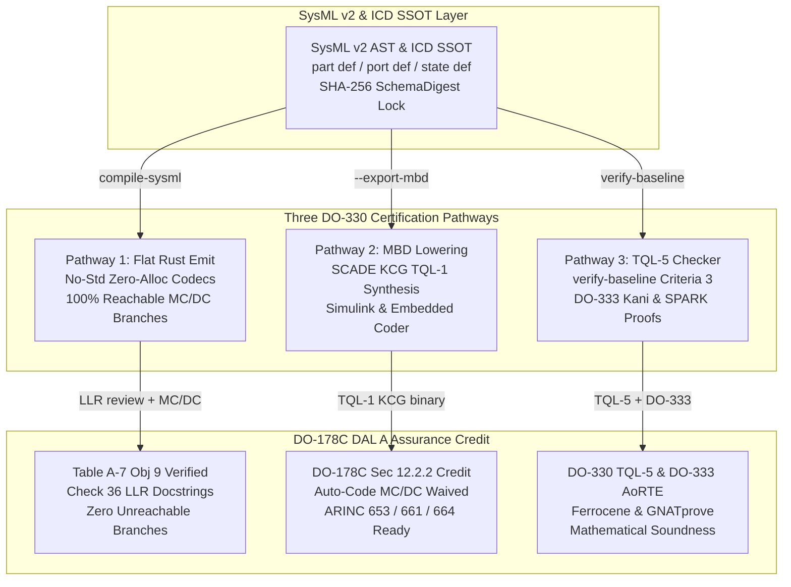

# Real-Time Safety-Critical ARINC Avionics Serialization & RTCA DO-330 Tool Qualification Solution White Paper

**Document ID:** `SPEC-DEAP-AVIONICS-SERIALIZATION-DO330-01`  
**Classification:** `SAFETY_CRITICAL_COMPILER_AND_CERTIFICATION_ARCHITECTURE`  
**Version:** `1.0.0`  
**Date:** 2026-10-25  
**Applicable Standards:** `RTCA DO-178C / DO-330 / DO-331 / DO-333 | ARINC 653P1-5 | ARINC 664 Part 7 (AFDX) | ARINC 661 | ARINC 429 / 825 | ISO 26262 ASIL D | IEC 61508 SIL 4`  
**Target Repository:** `gintatkinson/DEAP01-spec-core` (Upstream Specification Core Compiler)  
**Applicable Governance:** [.pipeline/constitution.md](../../.pipeline/constitution.md), [.pipeline/ACTIVE_RULES_BUNDLE.md](../../.pipeline/ACTIVE_RULES_BUNDLE.md), [Cargo.toml](../../Cargo.toml)

---

## 1. Executive Summary & Problem Statement

### 1.1 Engineering Evaluation Question

Avionics systems architects and safety engineers frequently evaluate whether **`prost`** (the widely adopted Rust Protocol Buffers implementation comprising `prost`, `prost-derive`, `prost-build`, the upstream C++ `protoc` compiler, and the `bytes` buffer substrate) is suitable for **hard real-time, safety-critical ARINC avionics control applications and services**.

### 1.2 Architectural Verdict & Assurance Boundary

For **hard real-time, flight-critical airborne software** governed by **RTCA DO-178C Design Assurance Levels (DAL) A, B, or C** and executing within **ARINC 653 Integrated Modular Avionics (IMA)** time/space partitions over **ARINC 664 Part 7 (AFDX)**, **ARINC 661 Cockpit Display System (CDS) User Applications**, **ARINC 429**, or **ARINC 825 (CANAerospace)** buses:

> **`prost` (and the standard Protocol Buffers wire format) is architecturally unsuitable for DAL A through DAL C real-time avionics control loops and airborne data buses.**

The suitability of `prost` across airborne and ground segments is strictly bounded by the criticality tier:

| Avionics Domain Tier | Target Standards & DAL | Suitability of `prost` | Architectural Justification |
| :--- | :--- | :--- | :--- |
| **Primary Flight Controls, Autoland, FADEC, FMS & Display Kernel** | RTCA DO-178C **DAL A / DAL B**, ARINC 653 `NORMAL` mode, ARINC 664 AFDX, ARINC 661 UA/CDS, ARINC 429 | **Strictly Unsuitable (Prohibited)** | Requires dynamic heap (`alloc`), exhibits variable-length `varint` WCET jitter, elides default zero values (`proto3`), relies on `unsafe` inside `bytes`, and introduces an unqualifiable `protoc` + `prost-derive` tool chain under DO-330 **TQL-1**. |
| **Major Mission Management & Secondary Avionics Services** | RTCA DO-178C **DAL C**, ARINC 653 Partitioned Services | **Unsuitable** | Fails deterministic static partition memory allocation invariants and introduces unreachable macro-generated defensive branches that obstruct structural coverage verification. |
| **Non-Essential Cabin Systems, EFB Off-Board Telemetry & Ground Support Equipment (GSE)** | RTCA DO-178C **DAL D / DAL E** (No Safety Effect), Linux/POSIX Ground Segment | **Conditionally Suitable (DAL E / Ground Only)** | Acceptable exclusively outside the certified ARINC 653 real-time flight control loop (such as post-flight maintenance log offload, engineering simulation replay, or ground telemetry ingestion). |

This white paper provides:
1. A rigorous **four-dimensional engineering evaluation** of `prost` across **Determinism**, **Performance (WCET)**, **Reliability**, and **Quality / Certification Assurance**.
2. A comprehensive architectural breakdown of how the **Digital Engineering Agent Platform (DEAP)** overcomes the **RTCA DO-178C / DO-330 Tool Qualification Barrier** via three complementary certification pathways.
3. A prescriptive matrix of **deterministic avionics serialization alternatives** for airborne deployments.

---

## 2. Four-Dimensional Avionics Assurance Evaluation of `prost`

### 2.1 Determinism & Bounded Resource Allocation (`alloc` Heap Dependency vs. ARINC 653 Static Partitioning)

In **ARINC 653 Part 1 (`ARINC 653P1-5`)**, an Integrated Modular Avionics (IMA) partition transitions from `COLD_START` or `WARM_START` initialization into **`NORMAL` operating mode**. Once the partition enters `NORMAL` mode:
- **Dynamic Heap Allocation is Strictly Forbidden**: All memory buffers, Apex Queuing Ports (`CREATE_QUEUING_PORT`), and Apex Sampling Ports (`CREATE_SAMPLING_PORT`) must be statically pre-allocated prior to locking the partition schedule.
- **No Unbounded Dynamic Containers**: Runtime heap allocation (`malloc`/`free` or Rust `alloc`) introduces non-deterministic allocator search latency, heap fragmentation over multi-hour flight legs, and catastrophic Out-Of-Memory (OOM) abort hazards.

**Why `prost` Violates ARINC 653 Memory Determinism:**
1. **Mandatory `alloc` Crate Dependency**: Even when compiled with `default-features = false` for `#![no_std]` environments, `prost` requires the Rust `alloc` crate (`extern crate alloc;`).
2. **Heap-Allocated Message Representations**:
   - Repeated fields (`repeated T`) are unconditionally materialized as `alloc::vec::Vec<T>`.
   - String and byte fields (`string`, `bytes`) allocate `alloc::string::String` or `alloc::vec::Vec<u8>` (or reference-counted `bytes::Bytes` slices backed by atomic or heap structures).
   - Recursive or nested message graphs require `alloc::boxed::Box<T>`.
3. **Lack of Native `heapless` Fixed-Capacity Stack Decoding**: `prost` does not natively deserialize into statically bounded stack arrays (`[T; N]`) or `heapless::Vec<T, N>` / `heapless::String<N>` where maximum capacities $N$ are enforced at compile time from the Interface Control Document (ICD). Every `Message::decode` invocation on variable or repeated fields risks invoking the global allocator during a hard real-time minor frame.

---

### 2.2 Performance & Worst-Case Execution Time (WCET) Jitter

Under **RTCA DO-178C Section 6.3.4.f**, DAL A and DAL B software must prove bounded **Worst-Case Execution Time (WCET)** with zero deadline misses across all periodic minor frames (typically $5\text{ ms}$ to $20\text{ ms}$, or $1\text{ ms}$ for inner-loop actuator control).

**Why `prost` Introduces Unacceptable WCET Jitter and Wire Incompatibility:**
1. **Data-Dependent LEB128 (`varint`) Loop Bounds**:
   Protocol Buffers encodes integers (`int32`, `int64`, `uint32`, `uint64`, `sint32`, `sint64`), field tags, and length prefixes using **Base-128 Variable-Length Integer (`varint`)** encoding. Decoding a 64-bit integer requires a data-dependent loop of $1$ to $10$ iterations inspecting the Most Significant Bit (MSB) continuation flag ($b_i \ \& \ \text{0x80}$):
   $$
   \begin{aligned}
   N_{\text{steps}}(v) &= \max\left(1, \left\lceil \frac{\lfloor \log_2(v) \rfloor + 1}{7} \right\rceil\right), \quad 1 \le N_{\text{steps}}(v) \le 10
   \end{aligned}
   $$
   On modern superscalar airborne processors (such as PowerPC e500mc/e6500 or ARM Cortex-R52/A53), data-dependent loop termination causes branch misprediction penalties and widens the ratio between Best-Case Execution Time (BCET) and WCET, complicating static timing analysis in tools such as AbsInt `aiT` or Rapita `RapiTime`.
2. **Arbitrary Field Ordering & Unknown-Field Skipping**:
   The Protobuf wire specification does not mandate canonical field order; fields may arrive out of sequence, be duplicated (last-wins merge semantics for scalars, concatenation for repeated fields), or interleave unknown field tags that the parser must dynamically skip. Proving a tight static upper bound on parser loop iterations requires external structural proofs that `prost`'s recursive-descent decoder does not provide.
3. **Incompatibility with Native ARINC Hardware & Bus Framing**:
   - **ARINC 661 (Cockpit Display System / User Application Protocol)**: Mandates deterministic **big-endian**, 32-bit aligned block structures (`Block_Header`, `Parameter_Structure`, padded strings).
   - **ARINC 664 Part 7 (AFDX)**: Uses statically configured Virtual Links (VLs) with bounded SkewMax and deterministic UDP/IP payload offsets mapped directly to ICD signal offsets.
   - **ARINC 429**: Uses fixed 32-bit words (8-bit octal label, 2-bit Source/Destination Identifier SDI, 19-bit BNR/BCD data field, 2-bit Sign/Status Matrix SSM, and 1-bit odd parity).
   `prost` emits little-endian wire tags and variable-length payloads that cannot map zero-copy onto hardware DMA buffers or ARINC wire frames, forcing an additional marshaling/transcoding stage on every frame.

---

### 2.3 Reliability, Signal Validity Semantics & High-Assurance Rust Lint Gates

#### 2.3.1 The `proto3` Implicit Zero-Default Wire Elision Hazard

In safety-critical avionics, distinguishing between a **transmitted value of zero (`0.0`)** and an **omitted, stale, or unpopulated field** is a primary flight-safety invariant:
- In **ARINC 429**, every 32-bit word carries a 2-bit **Sign/Status Matrix (SSM)** encoding `Failure Warning (FW)`, `No Computed Data (NCD)`, `Functional Test (FT)`, or `Normal Operation (NO)`.
- In **ARINC 664 Part 7 (AFDX)**, datasets are partitioned into Functional Datasets (FDS) accompanied by a **Functional Status Set (FSS)** tracking explicit signal validity and freshness.

Under **`proto3`** canonical serialization (the default model of `prost`), **scalar fields equal to their default value (`0`, `0.0`, `false`, `""`) are silently omitted from the wire** unless explicitly wrapped in `optional`. If an avionics engineer defines a scalar field such as `pitch_rate_deg_per_sec: f32` without `optional`, a genuine $0.0^\circ/\text{s}$ command is indistinguishable on the wire from a dropped field, creating a latent **loss-of-signal / stale-zero spoofing hazard**.

#### 2.3.2 Direct Conflict with DEAP High-Assurance Rust Workspace Lints

The DEAP specification compiler and target safety profile (`Cargo.toml` lines 16--64) enforce strict compile-time lint barriers across all crates:

```toml
[workspace.lints.rust]
unsafe_code = "forbid"

[workspace.lints.clippy]
unwrap_used = "forbid"
expect_used = "forbid"
panic = "forbid"
indexing_slicing = "forbid"
todo = "forbid"
unimplemented = "forbid"
unreachable = "forbid"
```

When evaluated against this high-assurance Rust profile:
- **`unsafe` Proliferation in `bytes`**: `prost::Message::encode` and `decode` are parameterized over `bytes::Buf` and `bytes::BufMut`. The `bytes` crate relies extensively on `unsafe` raw pointer arithmetic, custom vtable reference counting (`Bytes`), and unchecked slice advances.
- **Hidden Panic Paths**: `prost::Message::encode_raw` and `BufMut::put_*` trait methods panic if the destination buffer capacity is exceeded, violating `panic = "forbid"` unless every caller wraps calls in pre-calculated `encoded_len()` checks.

---

### 2.4 Quality & The RTCA DO-178C / DO-330 Tool Qualification Barrier

Under **RTCA DO-178C Section 12.2** and **RTCA DO-330 (*Software Tool Qualification Considerations*)**, any software tool whose output is part of the airborne software and whose use eliminates, reduces, or automates development or verification processes must be qualified:
- A **code generator or serialization compiler** whose generated output is not independently subjected to complete manual Low-Level Requirement (LLR) traceability and structural coverage review is classified as a **Criteria 1 Tool**.
- For **DO-178C DAL A and DAL B**, a Criteria 1 tool requires **Tool Qualification Level 1 (TQL-1)** or **TQL-2** -- the highest and most expensive tool qualification regimes in aerospace, requiring a complete Tool Operational Requirements (TOR) baseline, Tool Software Design Description, and MC/DC coverage of the tool itself.

**Why `prost-build` + `prost-derive` Cannot Clear DO-178C / DO-330 DAL A Audits:**
1. **Unqualifiable C++ `protoc` Dependency (~500,000+ LoC)**:
   `prost-build` invokes Google's C++ `protoc` compiler binary (or `protox`) to parse `.proto` schemas into a `FileDescriptorSet`. `protoc` has no DO-330 TQL-1 qualification package, no requirements traceability matrix, and an enormous C++ attack/defect surface.
2. **Opaque Procedural Macro Expansion (`prost-derive` + `syn` + `quote`)**:
   `#[derive(prost::Message)]` expands at compile time inside the Rust compiler frontend. The generated Rust AST does not exist as a flat, line-numbered source file on disk (`*.rs`) with deterministic Low-Level Requirement (`Realises: [<REQ-ID>]`) docstrings.
3. **Unreachable Defensive Branches Violating DO-178C Table A-7 Objective 9 (MC/DC)**:
   For DAL A, **100% Modified Condition/Decision Coverage (MC/DC)** and **100% absence of dead/deactivated code** are mandatory on the compiled object code. `prost-derive` synthesizes generic trait implementations (`merge_field`, `encoded_len`, `clear`, `Debug`, wire-type mismatch branches, and recursion limit checks) containing defensive branches that are unreachable for constrained avionics message profiles. In a DAL A audit, every unreachable branch emitted by `prost-derive` becomes a structural coverage failure requiring expensive manual compiler-assembly justification dossiers.

---

### 2.5 Summary Assurance Evaluation Matrix for `prost`

| Assurance Dimension | Avionics Standard / Clause | `prost` / Protobuf Behavior | Compliance Verdict |
| :--- | :--- | :--- | :--- |
| **1. Determinism (Memory)** | ARINC 653P1-5 Static Partitioning (`NORMAL` mode) | Requires `alloc` (`Vec`, `String`, `Box`); dynamic allocations during `decode`. | **FAIL** (DAL A--C) |
| **2. Performance (WCET)** | RTCA DO-178C Sec 6.3.4.f, ARINC 664 / 661 / 429 | Data-dependent LEB128 `varint` loops ($1\text{--}10$ bytes); arbitrary tag order; non-big-endian wire framing. | **FAIL** (DAL A--C) |
| **3. Reliability & Semantics** | ARINC 429 SSM, AFDX FSS, DEAP `[workspace.lints]` | `proto3` silent zero-default wire elision; `unsafe` pointer ops in `bytes`; panic paths in `BufMut`. | **FAIL** (DAL A--C) |
| **4. Quality & Tool Qual** | RTCA DO-178C Table A-7 Obj 9, RTCA DO-330 TQL-1 | ~500k LoC C++ `protoc` + `prost-derive` proc-macros; no LLR source lines; unreachable branches break MC/DC. | **FAIL** (DAL A--C) |

---

## 3. How DEAP Overcomes the RTCA DO-178C / DO-330 Tool Qualification Barrier

To eliminate the certification dead-ends demonstrated by `prost`, `protoc`, and procedural macros, the **Digital Engineering Agent Platform (DEAP)** implements a **three-pathway certification architecture** rooted in a deterministic, zero-regex **SysML v2 Abstract Syntax Tree (`crates/deap-core/src/sysml_ast.rs`)** and **Level 1C Logical Interface Specification (`ICD_01` / `ICD_02`)**.



---

### 3.1 Pathway 1 -- Eliminating TQL-1 Codegen Need via Flat, Macro-Free, LLR-Traced Source Emit (`crates/compile-sysml`)

Under **RTCA DO-178C Section 12.2.1**, a code synthesis tool **does not require DO-330 TQL-1 qualification** if the generated source code is treated identically to hand-written airborne source code and subjected to the full suite of DO-178C Table A-5 (Source Code Verification) and Table A-7 (Structural Coverage Analysis) objectives.

`prost-derive` fails this pathway because its code exists only inside ephemeral compiler macro expansions with unreachable generic branches. DEAP's native Rust compiler (`crates/compile-sysml`) explicitly designs its output to pass Table A-5 and Table A-7 directly:

1. **Zero Procedural Macros, 100% Flat On-Disk Source Files**:
   DEAP synthesizes explicit, flat `#![no_std]` Rust source files on disk containing zero `#[derive(prost::Message)]` macros, zero `alloc` imports, zero `unsafe` blocks, and zero `panic!` calls. Every line of serialization logic is a physical line on disk with a deterministic line number.
2. **Branch-Minimal Fixed-Offset Slice Codecs for 100% Reachable MC/DC**:
   Rather than emitting variable-length `varint` state machines and unknown-field skip loops, DEAP codecs map Level 1C ICD signal definitions (`ICD_02_MASTER_SIGNAL_DICTIONARY.md`) to fixed byte offsets. Decoding uses exactly three reachable verification gates per frame:
   - Gate 1: Exact frame length check via safe `.get(offset..offset + len)` slice bounds checking (satisfying `indexing_slicing = "forbid"`).
   - Gate 2: Explicit ARINC 429 SSM / AFDX FSS signal validity enumeration check.
   - Gate 3: Physical range invariant check (`min <= val && val <= max`) traced directly to SysML v2 `assert constraint` AST nodes.
   Because no unreachable defensive branches are emitted, every boolean condition can be toggled independently by a deterministic unit test plus its negative mutation probe, achieving **100% MC/DC coverage (DO-178C Table A-7 Objective 9)**.
3. **Automated 7-Section DO-178C Safety Docstring Synthesis & Gate Enforcement**:
   `./target/release/compile-sysml --inject-safety-docstrings` (`crates/compile-sysml/src/docstring.rs`) automatically synthesizes and injects a deterministic 7-section safety docstring header on every public `fn`, `struct`, `enum`, and `trait`:
   - `/// # Summary`
   - `/// # Details`
   - `/// # Parameters`
   - `/// # Returns`
   - `/// # Errors`
   - `/// # Safety & Preconditions`
   - `/// # Traceability` (`/// - Realises: [<REQ-ID>]`, `/// - Contributes to: [<SC-ID>]`)
   This traceability link is mechanically audited on every commit by `./target/release/verify-baseline` **Check 36** (`crates/verify-baseline/src/checks/docstring_gate.rs`), providing complete bidirectional Low-Level Requirement (LLR) to source-code traceability required by **DO-178C Table A-5 Objectives 1--7**.

---

### 3.2 Pathway 2 -- Lowering SysML v2 AST to Pre-Qualified TQL-1 / TQL-5 Commercial MBD Backends (`--export-mbd`, RTCA DO-331)

When an aerospace program requires **automated code generation credit that legally eliminates low-level object-code MC/DC unit testing** under **RTCA DO-178C Section 12.2.2** and **RTCA DO-331 (*Model-Based Development and Verification Supplement to DO-178C and DO-278A*)**, DEAP does not attempt to qualify an open-source macro library to TQL-1. Instead, DEAP acts as the **upstream formal specification compiler** and lowers the verified SysML v2 AST directly into **pre-qualified commercial Model-Based Design (MBD) code generators**.

Implemented in `crates/compile-sysml/src/lib.rs` (`synthesize_mbd_bundle`, invoked via `./target/release/compile-sysml --export-mbd <dir>`):

1. **Tier 1A: ANSYS SCADE Suite (`.scade` Synchronous Lustre AST) & SCADE Display (ARINC 661)**:
   - DEAP lowers SysML v2 `part def`, `port def`, `state def`, and `assert constraint` blocks into deterministic synchronous dataflow equations (`node ... returns ... let ... tel`).
   - Those `.scade` models and ARINC 661 Definition Files (DF) are compiled by the **ANSYS SCADE KCG Code Generator**, which holds **existing commercial RTCA DO-330 TQL-1 qualification across Airbus, Boeing, Dassault, and Honeywell DAL A flight controls**.
   - Because SCADE KCG is qualified to **TQL-1**, the applicant receives **DO-178C Section 12.2.2 credit**: model-level simulation and model coverage (DO-331 Section MB.6.7) satisfy high-to-low-level verification, waiving redundant manual MC/DC testing on the generated C source code.
2. **Tier 1B: MathWorks MATLAB / Simulink / Stateflow (`.slx` / `.sldd`) & Embedded Coder**:
   - DEAP emits programmatic model construction bundles and Simulink Data Dictionaries (`.sldd`) encoding bus objects, fixed-point / IEEE-754 types, physical min/max constraints, and state machine transitions.
   - Paired with **Simulink Design Verifier (SLDV)** and **Embedded Coder** under the **MathWorks DO Qualification Kit (DO-330 TQL-5)**, this provides automated Theorem Proving, Test Generation, and Code-to-Model Equivalence Verification under DO-331.

---

### 3.3 Pathway 3 -- Asymmetric DO-330 Criteria 3 (TQL-5) Checker Qualification (`crates/verify-baseline`) & RTCA DO-333 Formal Proofs

#### 3.3.1 Mathematical Formulation of the RTCA DO-330 Tool Qualification Asymmetry

RTCA DO-330 classifies software tools into three criteria based on tool impact:
- **Criteria 1**: A tool whose output is part of the airborne software and that can **insert an error** into the airborne software.
- **Criteria 2**: A tool that automates verification processes and whose malfunction could **fail to detect an error**, where the tool output is used to justify the elimination or reduction of other development or verification processes.
- **Criteria 3**: A tool that, within its scope, **cannot insert an error** into the airborne software, but may **fail to detect an error**.

Let $\mathcal{L} \in \{\text{DAL A}, \text{DAL B}, \text{DAL C}, \text{DAL D}\}$ denote the target software Design Assurance Level, and let $\mathcal{C} \in \{\text{Criteria 1}, \text{Criteria 2}, \text{Criteria 3}\}$ denote the tool impact class. Under **RTCA DO-330 Table T-0 (Tool Qualification Level Determination)**, the required Tool Qualification Level mapping $\Phi_{\text{DO-330}}(\mathcal{L}, \mathcal{C})$ is defined as:

$$
\begin{aligned}
\Phi_{\text{DO-330}}(\text{DAL A}, \text{Criteria 1}) &= \text{TQL-1} \\
\Phi_{\text{DO-330}}(\text{DAL A}, \text{Criteria 2}) &= \text{TQL-4} \\
\Phi_{\text{DO-330}}(\text{DAL A}, \text{Criteria 3}) &= \text{TQL-5}
\end{aligned}
$$

Let $\Omega(\text{TQL-}k)$ denote the number of mandatory tool verification and lifecycle objectives required by **RTCA DO-330 Annex A Tables T-1 through T-10**:
- At **TQL-1**, $\Omega(\text{TQL-1})$ mandates complete Tool Requirements, Tool Design Description, Source-to-Object Traceability, and MC/DC Structural Coverage of the tool executable itself.
- At **TQL-5**, $\Omega(\text{TQL-5})$ requires only black-box **Tool Operational Requirements (TOR)** verification, deterministic requirement-based test cases (including negative fault-injection probes), and configuration management.

DEAP deliberately exploits this mathematical asymmetry:
- `crates/verify-baseline` never mutates or generates airborne object code; it operates strictly as an **independent Criteria 3 verification tool** evaluating repository state $S_t$ against $N$ discrete mechanical invariants:
  $$
  \begin{aligned}
  \Psi_{\text{baseline}}(S_t) &= \prod_{i=1}^{N} \left(1 - G_i(S_t)\right) \in \{0, 1\}
  \end{aligned}
  $$
- Because `verify-baseline` is a **Criteria 3 tool**, qualifying it even for **DO-178C DAL A** requires only **TQL-5** rather than TQL-1!

#### 3.3.2 How `crates/verify-baseline` Satisfies DO-330 TQL-5 Determinism

To make `crates/verify-baseline` immediately auditable under DO-330 TQL-5, DEAP enforces strict architectural invariants across its entire Rust codebase:
1. **Zero Legacy Scripting Dependencies (Checks 32 & 33)**:
   Legacy interpreted shell and Python scripts are strictly prohibited and retired across the repository under Check 32 and Check 33. The entire compiler and verification suite is compiled as native, statically typed Rust binaries (`verify-baseline`, `compile-sysml`, `ingest-sysml`, `reconcile-backlog`, `assemble-conops`).
2. **Zero Regular Expressions -- $O(N)$ Single-Pass State Machines (Check 34)**:
   Backtracking regular expression engines (`regex`, `RegexSet`, `pcre2`) are strictly forbidden in production AST and verification code under Check 34. Both `crates/deap-core/src/sysml_ast.rs` and `crates/deap-core/src/source_ast.rs` implement deterministic $O(N)$ single-pass lexical and structural state machines with proven linear time complexity and zero ReDoS vulnerability.
3. **Cryptographic SHA-256 `SchemaDigest` Idempotency**:
   Every compiler synthesis pass computes a canonical SHA-256 digest over `.pipeline/schema.sysml` and stamps all downstream specifications (`<!-- SchemaDigest: sha256:... -->`). Any manual out-of-band edit causes a deterministic hash mismatch in `verify-baseline`.
4. **Built-In Negative Mutation Probe Suite**:
   Every verification gate in `crates/verify-baseline/src/checks/` is paired with native Rust `#[test]` positive and **negative fault-injection probes** (proving that each gate deterministically fails when a structural, mathematical, or traceability defect is injected), directly satisfying DO-330 TQL-5 Tool Operational Verification requirements.

#### 3.3.3 Tier-2 Formal Verification Credit under RTCA DO-333 (Ferrocene + Kani + SPARK Ada)

Under **RTCA DO-333 (*Formal Methods Supplement to DO-178C and DO-278A*)**, formal deductive proofs and bounded model checking can replace or supplement dynamic testing for Low-Level Requirements and Absence of Run-Time Errors (AoRTE):
- **Ferrocene Qualified Rust Compiler + Kani Model Checker (`#[kani::proof]`)**:
  DEAP synthesizes flat Rust source modules and self-contained **`#[kani::proof]`** symbolic verification harnesses (`crates/compile-sysml`). Compiled with the **Ferrocene** safety-qualified Rust toolchain (qualified to **ISO 26262 ASIL D** and **IEC 61508 SIL 4**, with DO-178C/DO-330 airborne qualification packages), Kani mathematically proves that for all symbolic input byte arrays $B \in [0, 255]^L$, zero index-out-of-bounds panics, zero arithmetic overflows, and zero SysML `assert constraint` violations can occur.
- **AdaCore SPARK Ada (`GNATprove`) Synthesis**:
  Via `--export-mbd`, DEAP also synthesizes **SPARK 2014 (`pragma SPARK_Mode (On)`)** package specifications (`.ads`) with `Subprogram_Variant` and `Pre`/`Post` contracts derived directly from SysML v2 `assert constraint` blocks, enabling `GNATprove` Silver/Gold deductive AoRTE proofs under DO-333 Section FM.6.3.

---

### 3.4 Side-by-Side Comparison: `prost` Toolchain vs. DEAP Certification Architecture

| Architectural Attribute | `prost` + `protoc` + `prost-derive` | DEAP Deterministic Compiler & Verification Suite |
| :--- | :--- | :--- |
| **Single Source of Truth (SSOT)** | `.proto` schema (lacks state machines, ports, physical units, and STPA safety constraints) | Canonical `.pipeline/schema.sysml` (`part def`, `port def`, `state def`, `assert constraint`) + Level 1C ICD (`ICD_01` / `ICD_02`) |
| **Parser Engine** | ~500k LoC C++ `protoc` binary + Rust `syn`/`quote` proc-macros | Pure-Rust, zero-regex $O(N)$ state machines (`crates/deap-core/src/sysml_ast.rs`, `source_ast.rs`) enforced by Check 34 |
| **Generated Code Artifact** | Hidden inside ephemeral proc-macro hygiene spans | 100% flat, human-inspectable `#![no_std]` `.rs`, `.scade`, `.slx`, and `.ads` files on disk |
| **Memory Allocation Model** | Requires `alloc` (`Vec`, `String`, `Box`) | Zero `alloc`; fixed-capacity stack slices and static ARINC 653 buffers |
| **Wire Encoding & WCET** | Variable-length LEB128 `varint` ($1\text{--}10$ bytes), out-of-order tags, data-dependent loops | Fixed-offset big-endian / native ARINC 664 / 661 / 429 framing; $O(1)$ constant-time bounds-checked slice access |
| **Signal Validity Semantics** | `proto3` silently elides default `0` / `false` values from wire | Explicit ARINC 429 SSM (`FW`, `NCD`, `FT`, `NO`) and AFDX FSS validity/freshness enumerations |
| **LLR Source Traceability** | None on macro-expanded tokens | Automated 7-section DO-178C safety docstrings (`Realises: [<REQ-ID>]`) enforced by Check 36 |
| **MC/DC Coverage (DO-178C Table A-7)** | Unreachable generic macro branches break 100% MC/DC | Branch-minimal codecs with 100% reachable conditions + SCADE KCG TQL-1 option |
| **DO-330 Qualification Strategy** | Would require unachievable TQL-1 on `protoc` + `prost-derive` | Pathway 1 (TQL-exempt inspected source) + Pathway 2 (Pre-qualified TQL-1 SCADE KCG) + Pathway 3 (TQL-5 `verify-baseline` + DO-333 Kani/SPARK) |

---

## 4. Recommended Deterministic Avionics Serialization Alternatives

For engineering teams designing real-time avionics data buses, inter-partition queuing/sampling ports, or airborne-to-ground telemetry links, the following four deterministic serialization architectures are recommended in priority order:

### 4.1 Option 1 (Primary Recommended): Direct DEAP SysML v2 / Level 1C ICD AST-to-Rust `#![no_std]` Fixed-Frame Codec Synthesis

For **ARINC 653 Intra-IMA Partition Messaging**, **ARINC 664 Part 7 (AFDX) Functional Datasets**, **ARINC 661 CDS/UA Runtime Blocks**, and **ARINC 429 / 825 Words**:
- **Architecture**: Define all structural ports, item flows, physical ranges, and state machines in `.pipeline/schema.sysml` and generate the Level 1C Logical Interface Specification (`ICD_01_SYSTEM_INTERFACE_MATRIX.md` and `ICD_02_MASTER_SIGNAL_DICTIONARY.md`). Synthesize flat `#![no_std]` Rust structs with fixed byte offsets, explicit `u8::from_be_bytes` / `f32::from_be_bytes` conversions, explicit SSM/FSS status words, and `Result<T, CodecError>` bounds checks.
- **Assurance Advantages**:
  - Zero external C/C++ or proc-macro dependencies.
  - $O(1)$ constant-time WCET with zero data-dependent loops.
  - Zero dynamic heap allocation (`#![no_std]`, zero `alloc`).
  - 100% compliant with `unsafe_code = "forbid"`, `unwrap_used = "forbid"`, `panic = "forbid"`, and `indexing_slicing = "forbid"`.
  - 100% reachable branches for DO-178C DAL A MC/DC verification and Kani (`#[kani::proof]`) formal verification.

### 4.2 Option 2: ASN.1 with ACN (`asn1scc` Space/Avionics Compiler Methodology)

For **Cross-Vendor Avionics & Space Command/Telemetry Buses (CCSDS / ESA / Bit-Packed ICDs)**:
- **Architecture**: Use Abstract Syntax Notation One (**ASN.1**) paired with the **ASN.1 Encoding Control Notation (ACN)** as pioneered by the European Space Agency (`asn1scc`).
- **Assurance Advantages**:
  - `asn1scc` compiles `.asn1` + `.acn` schemas into flat, human-readable C or **SPARK Ada** source code with **zero dynamic memory allocation** (all maximum array bounds are statically constrained in the schema).
  - ACN allows exact bit-level wire layout control (matching legacy ARINC 429, MIL-STD-1553, or AFDX big-endian layouts bit-for-bit) while keeping the logical type definition clean.
  - Emits self-contained automatic test suites and SPARK AoRTE proof annotations.

### 4.3 Option 3: Simple Binary Encoding (SBE) Fixed-Offset Wire Framing

For **High-Throughput Mission Computers, Sensor Fusion Backplanes & Deterministic Ethernet (TSN / AFDX)**:
- **Architecture**: SBE (originally standardized for ultra-low-latency deterministic messaging) places all fixed-size fields at static compile-time byte offsets in a message root block, with bounded repeating groups following a strict sequential header layout.
- **Assurance Advantages**:
  - Enables $O(1)$ direct offset read/write access without `varint` continuation scanning or tag dispatch loops.
  - Provides explicit `nullValue` / validity encodings on the wire so omitted or invalid sensor readings are never conflated with $0.0$.

### 4.4 Option 4: `#![no_std]` Zero-Alloc Embedded Protobuf (`micropb` or `femtopb`) for Ground / M2M Boundary Gateways

When an external interface requirement **mandates wire compatibility with `.proto` (Protocol Buffers)** -- such as an airborne **DAL D / DAL E** maintenance gateway, Flight Data Acquisition Unit (FDAU) ground offload link, or unmanned aerial vehicle (UAV) C2 ground station link:
- **Architecture**: Replace `prost` with **`micropb`** (which compiles `.proto` into pure `#![no_std]`, zero-`alloc` Rust structs backed by **`heapless::Vec<T, MAX_LEN>`** and **`heapless::String<MAX_LEN>`** with static compile-time capacity bounds) or **`femtopb`** (zero-alloc slice views).
- **Assurance Boundary**: Even with `micropb` or `femtopb`, the underlying Protobuf wire format still uses variable-length `varint` encoding. Consequently, `micropb` / `femtopb` must remain segregated inside an **ARINC 653 DAL D/E gateway partition** and must never be used on inner-loop DAL A--C flight control buses.

---

### 4.5 Comparative Trade-Off Matrix of Serialization Alternatives

| Serialization Architecture | Heap (`alloc`) Required? | WCET Complexity | Exact ARINC 664 / 661 / 429 Bit Layout? | Explicit Signal Validity (SSM / FSS)? | Max Recommended DO-178C DAL |
| :--- | :--- | :--- | :--- | :--- | :--- |
| **DEAP Flat `#![no_std]` ICD Codec** | **No** (100% stack/static) | **$O(1)$ Constant Time** | **Yes** (Big-endian / bit-exact) | **Yes** (Native SSM / FSS + range gates) | **DAL A** (with Pathway 1/2/3) |
| **ASN.1 + ACN (`asn1scc` / SPARK)** | **No** (100% static bounds) | **$O(1)$ Bounded Static** | **Yes** (ACN bit-level control) | **Yes** (Explicit choice/validity fields) | **DAL A** |
| **Simple Binary Encoding (SBE)** | **No** (Fixed-offset slices) | **$O(1)$ Fixed Offset** | **Partial** (Byte-aligned structs) | **Yes** (Explicit `nullValue` sentinel) | **DAL B / DAL A** |
| **`micropb` / `femtopb` (`heapless`)** | **No** (`heapless::Vec<T, N>`) | **$O(N)$ `varint` Scan** | **No** (Protobuf wire tags) | **Partial** (`optional` presence bitmask) | **DAL D / DAL E** (Gateway only) |
| **`prost` + `bytes` + `prost-derive`** | **Yes** (`alloc::vec::Vec`) | **Unbounded / High Jitter** | **No** (Protobuf wire tags) | **No** (`proto3` zero-default elision) | **DAL E / Ground Only** |

---

## 5. Governance Traceability Matrix & Source References

### 5.1 Repository Source & Blueprint Traceability Matrix

| Architectural Component / Gate | Repository Source File | Role in Avionics Serialization & DO-330 Assurance |
| :--- | :--- | :--- |
| **High-Assurance Workspace Lints** | [Cargo.toml](../../Cargo.toml) | Enforces `unsafe_code = "forbid"`, `unwrap_used = "forbid"`, `expect_used = "forbid"`, `panic = "forbid"`, and `indexing_slicing = "forbid"` across all workspace crates. |
| **Functional Governance Constitution** | [.pipeline/constitution.md](../../.pipeline/constitution.md) | Defines Tier-1 platform-independent MBSE specification invariants and mandatory quality gates. |
| **Consolidated Governance Rules** | [.pipeline/ACTIVE_RULES_BUNDLE.md](../../.pipeline/ACTIVE_RULES_BUNDLE.md) | Establishes deterministic schema compilation, zero-mocking persistence, and verification rules. |
| **Multi-Toolchain Synthesis Blueprint** | [docs/architecture/blueprints/DEAP_MULTI_TOOLCHAIN_SYNTHESIS_ARCHITECTURE.md](blueprints/DEAP_MULTI_TOOLCHAIN_SYNTHESIS_ARCHITECTURE.md) | Specifies Tier-1 MBD lowering (ANSYS SCADE KCG TQL-1, MathWorks Simulink/Embedded Coder TQL-5) and Tier-2 Formal Methods (Ferrocene + Kani, SPARK Ada). |
| **Deterministic Safety Compiler Blueprint** | [docs/architecture/blueprints/DEAP_DETERMINISTIC_SAFETY_SPECIFICATION_COMPILER_BLUEPRINT.md](blueprints/DEAP_DETERMINISTIC_SAFETY_SPECIFICATION_COMPILER_BLUEPRINT.md) | Formulates the DO-330 Criteria 3 (TQL-5) verification asymmetry, SHA-256 `SchemaDigest` locking, and STPA/FMECA synthesis pipeline. |
| **Logical Interface Specification Blueprint** | [docs/architecture/blueprints/DEAP_LOGICAL_INTERFACE_SPECIFICATION_BLUEPRINT.md](blueprints/DEAP_LOGICAL_INTERFACE_SPECIFICATION_BLUEPRINT.md) | Defines Level 1C ICD generation (`ICD_01_SYSTEM_INTERFACE_MATRIX.md` and `ICD_02_MASTER_SIGNAL_DICTIONARY.md`) from SysML v2 ports and item flows. |
| **Safety Docstring Synthesizer Design** | [docs/designs/blueprint-05-deterministic-safety-docstring-synthesizer.md](../designs/blueprint-05-deterministic-safety-docstring-synthesizer.md) | Specifies deterministic 7-section DO-178C / ISO 26262 / IEC 61508 docstring synthesis and Check 36 enforcement. |
| **Zero-Regex SysML v2 AST Parser** | [crates/deap-core/src/sysml_ast.rs](../../crates/deap-core/src/sysml_ast.rs) | Implements the deterministic $O(N)$ single-pass SysML v2 parser extracting `part def`, `port def`, `state def`, and `assert constraint` nodes. |
| **Zero-Regex Multi-Language Source Scanner** | [crates/deap-core/src/source_ast.rs](../../crates/deap-core/src/source_ast.rs) | Implements the $O(N)$ state-machine source scanner verifying public symbols and safety docstrings without regular expressions. |
| **SysML Compiler & MBD Export Engine** | [crates/compile-sysml/src/lib.rs](../../crates/compile-sysml/src/lib.rs) | Implements `synthesize_mbd_bundle` (`--export-mbd`) for SCADE `.scade`, Simulink `.m`, SPARK Ada `.ads`, and Kani `#[kani::proof]` harnesses. |
| **DO-178C Safety Docstring Injector** | [crates/compile-sysml/src/docstring.rs](../../crates/compile-sysml/src/docstring.rs) | Synthesizes deterministic 7-section safety docstrings (`--inject-safety-docstrings`) with `Realises: [<REQ-ID>]` traceability. |
| **DO-330 TQL-5 Baseline Verification Runner** | [crates/verify-baseline/src/runner.rs](../../crates/verify-baseline/src/runner.rs) | Orchestrates mechanical baseline verification Checks 10 through 40 (including Checks 12, 13, 13B, 24, 32, 33, 34, and 36). |

### 5.2 Audit Metadata

- **Document Ratification Date:** 2026-10-25
- **Authoring Context:** DEAP Safety-Critical Compiler & Certification Architecture Team
- **Verification Gate Command:** `./target/release/verify-baseline . --no-domain`
