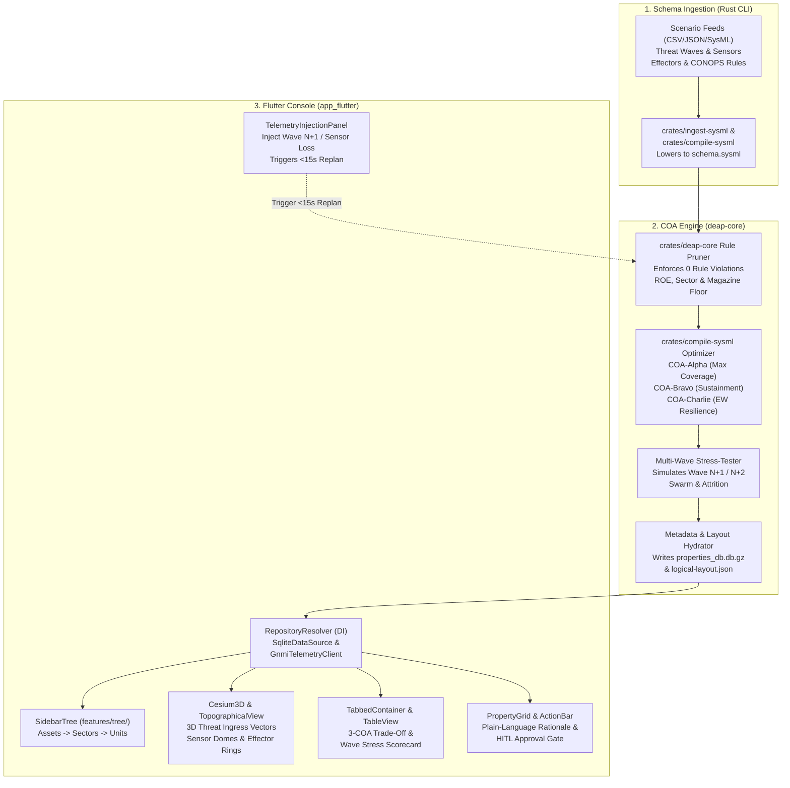

# Solution Blueprint -- `DEAP C-UAS COA Engine` on `DEAP-profile-flutter-app`

This blueprint (`DEAP-BLUEPRINT-CUAS-COA-002`) designs the **C-UAS Course of Action (COA) Generation & Multi-Wave Stress-Testing Engine** specifically to snap into `DEAP-profile-flutter-app` with **zero hardcoded domain widgets**.

| Attribute | Specification Detail |
| --- | --- |
| **Document ID** | `DEAP-BLUEPRINT-CUAS-COA-002` |
| **Application Name** | `DEAP C-UAS COA Engine` |
| **Target Platform Profile** | `flutter-app` (`.pipeline/profiles/flutter.md` / `app_flutter/`) |
| **Core Architecture** | Rust SysML v2 Pareto COA Solver + Flutter Runtime Metadata Engine (`TypeDescriptor` / LUMI) |

---

### 1. End-to-End Architecture: Rust Solver Sidecar + Flutter Metadata Console

Instead of writing custom C-UAS screens in Dart, we leverage the exact components already built in `app_flutter/lib/`:



---

### 2. Mapping Every C-UAS Requirement to Existing `app_flutter/lib/` Modules

Every capability promised in your SOW maps 1-to-1 onto an existing module in `DEAP-profile-flutter-app`:

| SOW Capability Requirement | Existing `app_flutter/lib/` Module | How It Works Without Hardcoding Domain Logic |
| --- | --- | --- |
| **Single Planning Picture (Assets, Sectors, Sensors, Effectors, Threats)** | `lib/features/tree/sidebar_tree.dart` + `lib/features/topology/topographical_view.dart` + `lib/features/map_viewport/cesium_3d/` | `SqliteDataSource` loads `ProtectedAsset`, `DefenseSector`, `SensorUnit`, `EffectorUnit`, and `ThreatWave` from `type_definitions` and `type_relations`. `SidebarTree` renders the hierarchy; `TopographicalView` & `CesiumEngine` render the 3D/2D engagement domes and threat ingress vectors from `topology_data.json`. |
| **Side-by-Side Comparison of 3 Feasible COAs (`COA-Alpha`, `COA-Bravo`, `COA-Charlie`)** | `lib/features/tables/tabbed_container.dart` + `lib/features/tables/table_view_widget.dart` (`column_model.dart`) | The 3 generated COAs are stored as `CandidateCoa` instances. `TabbedContainer` and `TableViewWidget` display the side-by-side comparison columns: `Coverage (%)`, `Wave 1 Interceptor Burn`, `Wave 2 Residual Magazine (%)`, `Collateral Risk Score`, and `Rule Violations (0)`. |
| **Plain-Language Reasoning & Traceability to Rules/Scenario Data** | `lib/features/properties/properties_panel.dart` + `property_grid.dart` | Selecting any COA or effector allocation opens `PropertyGrid` grouped by `sectionGroup`: (1) `Plain-Language Rationale`, (2) `CONOPS/TTP Rule Citations`, (3) `Wave Stress-Test Metrics`, and (4) `Sensor-Effector Pairing Parameters`. |
| **Planner Check, Challenge, Override & `< 15s` Replanning** | `lib/features/properties/property_grid.dart` + `lib/domain/validation.dart` (`validateFields`) | Planners edit priority weights, reserve floors, or lock/unlock effectors in `PropertyGrid`. `validateFields` immediately blocks any override that violates CONOPS bounds (`minValue`, `maxValue`, `enumOptions`) before triggering a `< 15s` Rust re-solve. |
| **Multi-Wave Stress-Testing & Dynamic Mid-Battle Updates** | `lib/features/telemetry/telemetry_injection_panel.dart` + `lib/data/remote/gnmi_telemetry_client.dart` | Planners (or trial evaluators) use `TelemetryInjectionPanel` to inject a new drone wave, jam a radar sensor, or deplete magazine levels, streaming the update via `GnmiTelemetryClient` and refreshing the 3 COAs in real time. |
| **Human-in-the-Loop (HITL) Approval Gate** | `UseCaseActionBar` (`test/features/properties/use_case_action_bar_test.dart`) + `ActionButton` LUMI primitive | Explicit `Authorize Selected COA` action button with `confirmPrompt` interlock guard; no COA transitions to `APPROVED` without human sign-off. |

---

### 3. Runtime Metadata Schema (`sqlite_data_source.dart` & `logical-layout.json`)

Because `SqliteDataSource` (`app_flutter/lib/data/data_sources/sqlite_data_source.dart`) discovers types dynamically from `type_definitions`, `type_attributes`, and `type_relations`, onboarding the C-UAS COA domain requires **only seeding those 3 tables** in `assets/properties_db.db.gz` and `assets/logical-layout.json`:

#### 3.1 `type_definitions` & `type_relations` Seed for C-UAS COA

| `type_name` | `display_name` | `icon_name` | Child Relations (`type_relations`) |
| --- | --- | --- | --- |
| `ScenarioWave` | `Multi-Wave Threat Scenario` | `radar` | `contains -> ThreatTrack`, `generates -> CandidateCoa` |
| `CandidateCoa` | `Course of Action (COA)` | `shield` | `allocates -> EngagementAssignment`, `verified_by -> StressTestRun` |
| `ProtectedAsset` | `Protected Asset & Sector` | `security` | `guarded_by -> SensorUnit`, `defended_by -> EffectorUnit` |
| `SensorUnit` | `C-UAS Sensor Node` | `sensors` | `tracks -> ThreatTrack` |
| `EffectorUnit` | `C-UAS Effector & Magazine` | `bolt` | `engages -> EngagementAssignment` |
| `EngagementAssignment` | `Sensor-Effector Allocation` | `hub` | -- |
| `StressTestRun` | `Wave Stress-Test Evaluation` | `analytics` | -- |

#### 3.2 `CandidateCoa` Field Descriptors (`type_attributes` / `logical-layout.json`)

```json
{
  "attributes": [
    {
      "key": "coa/identity/coa_id",
      "label": "COA Designation",
      "type": "enum",
      "sectionGroup": "1. COA Summary & Trade-Off Profile",
      "options": ["COA-Alpha (Max Coverage)", "COA-Bravo (Multi-Wave Sustainment)", "COA-Charlie (EW/Sensor Resilience)"],
      "isRequired": true
    },
    {
      "key": "coa/metrics/asset_coverage_pct",
      "label": "Protected-Asset Sector Coverage (%)",
      "type": "double",
      "sectionGroup": "1. COA Summary & Trade-Off Profile",
      "minValue": 0.0,
      "maxValue": 100.0,
      "isRequired": true
    },
    {
      "key": "coa/metrics/kinetic_magazine_residual_pct",
      "label": "Post-Wave Kinetic Magazine Reserve (%)",
      "type": "double",
      "sectionGroup": "2. Consumable & Sustainment Optimization",
      "minValue": 25.0,
      "maxValue": 100.0,
      "isRequired": true
    },
    {
      "key": "coa/compliance/conops_violation_count",
      "label": "CONOPS / TTP Rule Violations",
      "type": "int",
      "sectionGroup": "3. Rules Encoding & Safety Interlocks",
      "minValue": 0,
      "maxValue": 0,
      "isRequired": true
    },
    {
      "key": "coa/explainability/plain_language_rationale",
      "label": "Plain-Language Planner Reasoning & Trade-Off Explanation",
      "type": "string",
      "sectionGroup": "4. Explainable Reasoning & Traceability",
      "isRequired": true
    },
    {
      "key": "coa/explainability/source_trace_citation",
      "label": "Scenario & TTP Clause Traceability",
      "type": "string",
      "sectionGroup": "4. Explainable Reasoning & Traceability",
      "regexPattern": "^schema/.*§[0-9]+\\.[0-9]+$",
      "isRequired": true
    },
    {
      "key": "coa/stress_test/wave_n_plus_1_survival_pct",
      "label": "Wave N+1 Swarm Stress-Test Robustness (%)",
      "type": "double",
      "sectionGroup": "5. Multi-Wave Adversarial Stress-Test",
      "minValue": 0.0,
      "maxValue": 100.0,
      "isRequired": true
    }
  ]
}
```

(Notice how setting `"minValue": 0, "maxValue": 0` on `coa/compliance/conops_violation_count` and `"minValue": 25.0` on `kinetic_magazine_residual_pct` allows `validateFields` in `app_flutter/lib/domain/validation.dart` to mechanically enforce the CONOPS rules on the client side as well.)

---

### 4. Mapping to Pipeline 0 Modular Units (`skills/spec-conops-engineering/resources/units/`)

In `DEAP-profile-flutter-app`, Pipeline 0 assembles `docs/conops/CONOPS.md` and `docs/conops/MISSION_INTENT.md` from 22 modular unit templates under `skills/spec-conops-engineering/resources/units/`. When we run `assemble-conops` for the C-UAS COA project, each unit maps cleanly:

* **ConOps Units (`resources/units/conops/01`..`12`):**
  * `04_SYSTEM_ARCHITECTURE.md` & `04_SYSTEM_CAPABILITIES_AND_FUNCTIONS.md`: Binds the SysML v2 `part def` blocks (`ConopsTtpRuleEngine`, `ParetoCoaSolverEngine`, `MultiWaveStressTester`, `HitlDecisionConsole`).
  * `05_OPERATIONAL_STATE_SPACE_AND_RISK.md`: Encodes the multi-wave state transitions (`WAVE_INGESTION -> RULE_PRUNING -> PARETO_SOLVE -> WAVE_STRESS_TEST -> HITL_REVIEW -> PLAN_COMMIT`).
  * `09_SCENARIOS_AND_TIMELINES.md`: Encodes the `< 60s` 3-COA generation budget and `< 15s` mid-wave replanning timeline.
  * `11_IMPACTS_AND_TRADE_STUDIES.md`: Formalizes the 3-COA Pareto frontier (`COA-Alpha` vs. `COA-Bravo` vs. `COA-Charlie`).
  * `12_EMERGENCY_DECISION_MATRIX.md`: Defines `EMG-01`..`EMG-07` contingencies (e.g., C2 link jamming, radar loss, magazine depletion below reserve floor).

* **Mission Intent Units (`resources/units/mission_intent/01`..`10`):**
  * `03_INCOSE_MOE_MOP_MATH.md`: Binds the KaTeX equations for Sector Coverage ($J_{\mathrm{coverage}}$), Magazine Sustainment ($J_{\mathrm{sustainment}}$), and Next-Wave Resilience ($J_{\mathrm{resilience}}$).
  * `04_MULTI_DOMAIN_THREAT_MATRIX.md`: Defines Group 1-3 UAS wave profiles, RCS, ingress speeds, and EW jamming modes.
  * `05_PACE_C2_PLAN.md`: Defines Primary, Alternate, Contingency, and Emergency C2 channels between sensors, C2 node, and effectors.
  * `06_ROE_SAFETY_INTERLOCKS.md`: Defines hard interlocks (`INT-01`..`INT-06`), collateral risk ceilings, and mandatory HITL authorization.
  * `07_AIRSPACE_GEOZONES.md`: Defines Protected Asset keep-out volumes, friendly transit corridors, and engagement sectors.
  * `08_GO_NO_GO_MATRIX.md` & `09_BINGO_ENERGY_MATH.md`: Adapts Bingo/magazine depletion math to multi-wave effector consumable thresholds.

---

### 5. Step-by-Step Plan to Upgrade `DEAP-profile-flutter-app` & Build the C-UAS PoC

Once your current agent finishes stabilizing the upstream `DEAP01-spec-core` repository, here is the clean sequence to stand up the C-UAS COA downstream repo:

1. **Step 1 -- Upgrade `DEAP-profile-flutter-app` to the Pure-Rust Toolchain:**
   * Synchronize the workspace crates (`crates/deap-core`, `crates/verify-baseline`, `crates/ingest-sysml`, `crates/compile-sysml`, `crates/assemble-conops`, `crates/reconcile-backlog`) and compiled release binaries (`verify-baseline`, `ingest-sysml`, `compile-sysml`, `assemble-conops`, `reconcile-backlog`) along with `AGENTS.md` and `rules/` from `DEAP01-spec-core`.

2. **Step 2 -- Extend `crates/deap-core` and `crates/compile-sysml` for C-UAS COA Evaluation:**
   * Implement the deterministic Pareto solver and multi-wave stress-tester within `crates/deap-core` and `crates/compile-sysml` that reads `.pipeline/schema.sysml` + scenario JSON/CSV feeds and outputs:
     1. The 3 stress-tested COAs (`COA-Alpha`, `COA-Bravo`, `COA-Charlie`) with plain-language rationale and `<!-- Source: ... -->` citations.
     2. Updated `app_flutter/assets/properties_db.db.gz` and `app_flutter/assets/logical-layout.json` (and `topology_data.json` for the 3D/2D sector viewport).

3. **Step 3 -- Run the Flutter Test & Golden Suite (`flutter test`):**
   * Verify all existing widget, unit, FFI, and golden tests in `app_flutter/test/` and `app_flutter/integration_test/` pass against the C-UAS COA seeded database.
