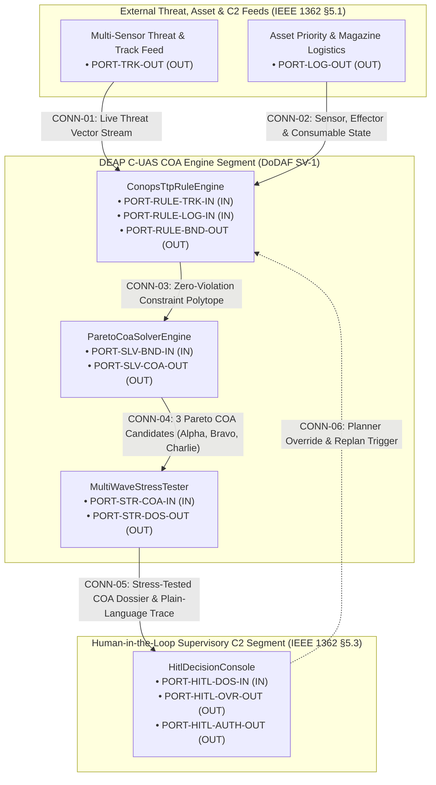
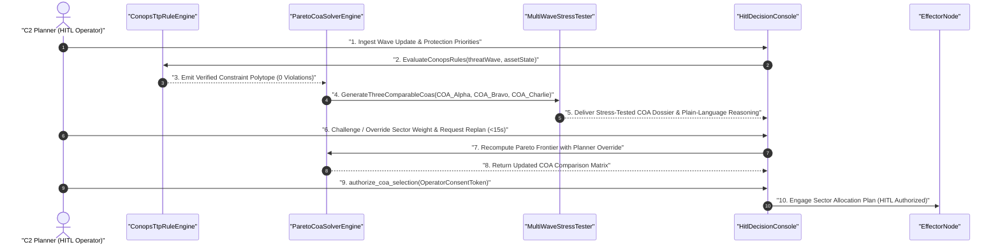

| Attribute | Specification Detail |
| --- | --- |
| **Document ID** | `DEAP-BLUEPRINT-CUAS-COA-001` |
| **Title** | Solution Blueprint: Deterministic C-UAS Course of Action (COA) Generation & Multi-Wave Stress-Testing Engine |
| **Type** | `design` |
| **Status** | `APPROVED / DOWNSTREAM CAPABILITY BASELINE` |
| **Target Repository** | `DEAP01-uas-infrastructure-safety` (Downstream M1 Project Workspace) |
| **Upstream Compiler** | `DEAP01-spec-core` (Pure Rust Toolchain: `ingest-sysml`, `compile-sysml`, `assemble-conops`, `verify-baseline`) |
| **Version** | `1.0.0` |
| **Date** | `2026-10-15` |
| **Target Standards** | ISO/IEC/IEEE 15288:2023 \| ISO/IEC/IEEE 29148:2018 \| ASTM F3269-17 RTA \| MIL-STD-882E \| RTCA DO-365B |

# Solution Blueprint: Deterministic C-UAS Course of Action (COA) Generation & Multi-Wave Stress-Testing Engine

## 1. Architectural Vision & M2/M1 Separation Strategy

To deliver the **DEAP C-UAS COA Engine** without violating the upstream compiler's **Domain-Agnostic AST Cleanliness Gate (Check 19)**, this capability is architected across a clean **M2/M1 boundary**:

1. **Upstream M2 Compiler (`DEAP01-spec-core`):** Provides the domain-agnostic Rust ingestion engine (`ingest-sysml`), SysML v2 / KerML parser and constraint compiler (`compile-sysml`), ConOps/Mission Intent parameter binder (`assemble-conops`), and 35-gate verification suite (`verify-baseline`).

2. **Downstream M1 C-UAS Workspace (`DEAP01-uas-infrastructure-safety`):** Houses the concrete C-UAS domain ontology in `schema/` (threat waves, protected assets, radar/RF/EO-IR sensors, kinetic/electronic effectors, magazine depth, and pre-approved CONOPS/TTP rules) and generates the verified Level 1B ConOps, Level 1C ICDs, STPA safety matrices, and explainable COA comparison artifacts in `docs/`.

---

## 2. Normative SysML v2 C-UAS COA Metamodel (`schema/cuas_coa.sysml`)

In the downstream workspace, all threat, asset, consumable, and CONOPS/TTP rule inputs are ingested from customer CSV, JSON, YAML, OMG IDL, or Markdown tables into the canonical SysML v2 Intermediate Representation (`schema/model.sysml` and `.pipeline/schema.sysml`).

```mermaid
classDiagram
    class CUASDefenseSystem {
        +String sectorId
        +Real maxPlanningLatencySec
        +Integer activeWaveIndex
        +ingestBattlefieldPicture() void
        +synthesizeParetoCoas() void
    }

    class ThreatWaveProfile {
        +String waveId
        +Integer raidCount
        +Real ingressVelocityMps
        +Real radarCrossSectionSqm
        +String ewJammingMode
    }

    class ProtectedAssetSector {
        +String assetId
        +Integer protectionPriorityRank
        +Real keepOutRadiusM
        +Real maxCollateralRiskThreshold
    }

    class SensorNode {
        +String sensorId
        +String modalityType
        +Real detectionRangeM
        +Real trackUpdateRateHz
        +String operationalStatus
    }

    class EffectorNode {
        +String effectorId
        +String effectorCategory
        +Real interceptRangeMinM
        +Real interceptRangeMaxM
        +Real singleShotPk
        +Integer magazineRemainingCount
        +Real reloadCooldownSec
    }

    class ConopsTtpRuleEngine {
        +Boolean hitlAuthorizationRequired
        +Real minReserveRatio
        +evaluateHardConstraints() Boolean
        +pruneViolatingCoas() void
    }

    class ParetoCoaSolverEngine {
        +computeCoverageObjective() Real
        +computeSustainmentObjective() Real
        +computeResilienceObjective() Real
        +emitThreeComparableCoas() void
    }

    class MultiWaveStressTester {
        +Integer lookaheadWaves
        +Real swarmDensityMultiplier
        +runAdversarialWaveSimulation() void
        +computeAttritionRobustnessScore() Real
    }

    class HitlDecisionConsole {
        +renderSideBySideTradeoffs() void
        +emitPlainLanguageRationale() void
        +applyPlannerOverride() void
    }

    CUASDefenseSystem *-- ThreatWaveProfile : "ingests"
    CUASDefenseSystem *-- ProtectedAssetSector : "defends"
    CUASDefenseSystem *-- SensorNode : "monitors"
    CUASDefenseSystem *-- EffectorNode : "allocates"
    CUASDefenseSystem *-- ConopsTtpRuleEngine : "enforces"
    CUASDefenseSystem *-- ParetoCoaSolverEngine : "optimizes"
    CUASDefenseSystem *-- MultiWaveStressTester : "stress-tests"
    CUASDefenseSystem *-- HitlDecisionConsole : "presents"
```



### 2.1 Reference Downstream SysML v2 Schema (`schema/cuas_coa.sysml`)

```sysml
package CUAS_COA_Planning_System {
    doc /* Single Source of Truth for C-UAS Multi-Wave COA Generation and Stress-Testing */

    attribute maxPlanningTimeSec : Real = 60.0;
    attribute replanLatencyLimitSec : Real = 15.0;
    attribute minMagazineReserveRatio : Real = 0.25;
    attribute minAssetCoverageRatio : Real = 0.95;

    part def ProtectedAssetSector {
        doc /* High-value defended asset or sector with strict priority and collateral bounds */
        attribute assetId : String;
        attribute priorityWeight : Real = 1.0;
        attribute keepOutRadiusM : Real = 500.0;
        port in threat_Warning_In : SectorAlertPort;
    }

    part def SensorNode {
        doc /* Multi-modal C-UAS detection and tracking sensor (Radar, RF Direction Finding, EO/IR) */
        attribute sensorId : String;
        attribute detectionRadiusM : Real = 15000.0;
        attribute availabilityState : Boolean = true;
        port out track_Stream_Out : TrackStreamPort;
    }

    part def EffectorNode {
        doc /* Kinetic interceptor, directional RF jammer, or high-energy effector with consumable magazine */
        attribute effectorId : String;
        attribute singleShotPk : Real = 0.85;
        attribute magazineCurrent : Integer = 24;
        attribute magazineCapacity : Integer = 24;
        attribute costPerEngagement : Real = 1.0;
        port in fire_Alloc_In : EngagementTaskPort;
        port out status_Telemetry_Out : EffectorStatusPort;
    }

    part def ConopsTtpRuleEngine {
        doc /* Deterministic rule filter enforcing pre-approved CONOPS, TTPs, and safety interlocks */
        port in track_In : ~TrackStreamPort;
        port in effector_Status_In : ~EffectorStatusPort;
        port out verified_Constraints_Out : ConstraintBoundPort;

        action def EvaluateConopsRules {
            in candidateCoa : String;
            out isCompliant : Boolean;
        }

        assert constraint ZeroRuleViolationInvariant {
            violationCount == 0;
        }

        assert constraint MagazineReserveInvariant {
            magazineResidual >= minMagazineReserveRatio * magazineCapacity;
        }
    }

    part def ParetoCoaSolverEngine {
        doc /* Multi-objective Pareto optimizer generating 3 distinct, comparable COAs in under 60 seconds */
        port in constraints_In : ~ConstraintBoundPort;
        port out coa_Candidates_Out : CoaBundlePort;

        action def GenerateThreeComparableCoas {
            in threatWave : String;
            out coaAlpha : String;
            out coaBravo : String;
            out coaCharlie : String;
        }

        calc def JointEngagementPk(in p1 : Real, in p2 : Real) : Real {
            1.0 - ((1.0 - p1) * (1.0 - p2))
        }
    }

    part def MultiWaveStressTester {
        doc /* Adversarial wave perturbation engine stress-testing COAs across successive drone waves */
        port in coa_In : ~CoaBundlePort;
        port out stressed_Dossier_Out : StressTestedCoaPort;

        action def StressTestSuccessiveWaves {
            in coaBundle : String;
            out robustnessReport : String;
        }
    }

    part def HitlDecisionConsole {
        doc /* Operator C2 decision console providing plain-language reasoning and override controls */
        port in dossier_In : ~StressTestedCoaPort;
        port out approved_Tasking_Out :EngagementTaskPort;

        action def AuthorizeCoaSelection {
            in operatorSignature : String;
            out approvedCoaId : String;
        }
    }
}
```

---

## 3. Mathematical Formulation of the 3-COA Pareto Solver & Multi-Wave Stress-Tester

All mathematical formulations conform to **Check 13 (KaTeX aligned display math)** and map directly to `calc def` and `assert constraint` nodes in the SysML v2 AST.

### 3.1 Hard CONOPS & TTP Constraint Pruning ($\mathcal{C}_{\mathrm{TTP}}$)

Let $\mathcal{X}$ denote the discrete assignment matrix where $x_{i,j,k}^{(w)} \in \{0, 1\}$ indicates assigning sensor $i \in \mathcal{S}$ and effector $j \in \mathcal{E}$ to threat track $k \in \mathcal{T}^{(w)}$ during wave $w \in \{1 \dots W\}$. Every candidate COA $\pi \in \Pi$ must satisfy four hard CONOPS/TTP invariants before optimization:

$$\begin{aligned} \sum_{w=1}^{W} \sum_{k \in \mathcal{T}^{(w)}} c_j \cdot x_{i,j,k}^{(w)} &\le M_{j}^{\mathrm{init}} - M_{j}^{\mathrm{reserve\_min}} \\ R_{\mathrm{min}, j} \le d_{j,k}^{(w)} &\le R_{\mathrm{max}, j} \cdot \mathbb{I}_{\mathrm{LOS}}(j, k) \\ \mathrm{Risk}_{\mathrm{collateral}}(j, k, a) &\le \epsilon_{\mathrm{CONOPS}}(a) \\ \mathrm{Violations}_{\mathrm{TTP}}(\pi) &= 0 \end{aligned}$$

* **Parameter Definitions & SI Units:**
* $M_{j}^{\mathrm{init}}$: Available consumable magazine count for effector $j$ at wave start (`count`).
* $M_{j}^{\mathrm{reserve\_min}}$: Mandated CONOPS reserve floor for subsequent waves (`count`).
* $d_{j,k}^{(w)}$: Slant range from effector $j$ to threat $k$ at intercept (`m`).
* $R_{\mathrm{min}, j}, R_{\mathrm{max}, j}$: Certified minimum and maximum engagement envelope radii (`m`).
* $\epsilon_{\mathrm{CONOPS}}(a)$: Maximum permissible adjacent operational risk for protected asset $a$ (`dimensionless`).

### 3.2 Multi-Objective Pareto Vector ($\mathbf{J}(\pi)$)

Over the strictly feasible set $\Pi_{\mathrm{valid}} = \{\pi \in \Pi \mid \mathrm{Violations}_{\mathrm{TTP}}(\pi) = 0\}$, the solver evaluates three orthogonal objective functions to emit three distinct, comparable COAs:

$$\begin{aligned} J_{\mathrm{coverage}}(\pi) &= \sum_{a \in \mathcal{A}} \omega_a \prod_{k \in \mathcal{T}_a^{(1)}} \left( 1 - \prod_{(i,j)} \left( 1 - P_{\mathrm{det}}(i,k) \cdot P_{\mathrm{kill}}(j,k) \right)^{x_{i,j,k}^{(1)}} \right) \\ J_{\mathrm{sustainment}}(\pi) &= \sum_{j \in \mathcal{E}} \gamma_j \left( \frac{M_{j}^{\mathrm{init}} - \sum_{k} c_j \cdot x_{i,j,k}^{(1)}}{M_{j}^{\mathrm{capacity}}} \right) \\ J_{\mathrm{resilience}}(\pi) &= \min_{\delta \in \Delta_{\mathrm{wave}}} J_{\mathrm{coverage}}(\pi \mid \mathcal{T}^{(2)}(\delta), \mathcal{S}_{\mathrm{degraded}}(\delta)) \end{aligned}$$

| Generated Option | Dominant Pareto Objective | Operational Trade-Off Exposed to Planner |
| --- | --- | --- |
| **COA-Alpha (Max Coverage)** | $\max_{\pi} J_{\mathrm{coverage}}(\pi)$ | Maximizes immediate Wave 1 neutralization probability ($P_k \ge 0.98$) over Tier-1 assets by pairing overlapping sensors and high-$P_k$ kinetic effectors; higher consumable burn. |
| **COA-Bravo (Sustainment)** | $\max_{\pi} J_{\mathrm{sustainment}}(\pi)$ s.t. $J_{\mathrm{coverage}} \ge \theta_{\mathrm{min}}$ | Prioritizes non-kinetic RF/EW effectors and low-cost interceptors to preserve $\ge 65\%$ kinetic magazine depth for Waves 2 and 3; accepts narrower intercept margins on low-priority sectors. |
| **COA-Charlie (Resilience)** | $\max_{\pi} J_{\mathrm{resilience}}(\pi)$ | Optimizes sensor-effector diversity against adversarial Wave 2 tactic shifts (e.g., RF jamming, low-altitude terrain masking, or loss of primary radar); balanced consumable usage. |

---

## 4. Level 1C Logical Interface & Signal Topology (`docs/interfaces/`)

In accordance with **Check 24 (Level 1C ICD Completeness)** and **Check 27 (Cross-Document Diagram Parity)**, all inter-subsystem connections use traceable `CONN-01`..`CONN-06` and `PORT-*` identifiers.



---

## 5. LUMI 3-Layer Explainable Console & HITL Temporal Safety

To satisfy the **LUMI 3-Layer Semantic Chain (`logical_ui.rs`)**, the **Plain-Language Explainability Mandate**, and the **Sequence Diagram Temporal Safety Gate (`provenance.rs`)**, the planner interface is specified as follows:

### 5.1 LUMI 3-Layer Binding (`## Logical UI & Interface Bindings`)

* **Layer 1: Domain State & Signal Model:** Bound to `ThreatWaveProfile`, `EffectorNode` magazine counters, and `ParetoCoaBundle` telemetry streams (`SIG-STR-HITL-001`..`005`).
* **Layer 2: Logic & Safety State Management:** Bound to `ConopsTtpRuleEngine` constraint verifier and `HitlAuthorizationInterlock` state machine, blocking any plan commitment unless `violationCount == 0` and explicit human operator consent is recorded.
* **Layer 3: Presentation & Actuator Interface Binding:** Responsive split-pane workspace governed by `@container` isolation rules (`TabbedContainer` and `CanvasWidget`) displaying the Side-by-Side 3-COA Trade-Off Matrix, Wave Stress-Test Sensitivity Chart, Plain-Language Rationale Card, and Interactive Override Controls.

### 5.2 HITL Temporal Safety Sequence Diagram



### 5.3 Plain-Language Reasoning & Traceability Output Schema

Every COA recommendation card generated by the engine emits a deterministic, human-auditable explanation block anchored to exact scenario and rule citations (passing **Check 23 Factual Grounding**):

```markdown
### COA-Bravo Recommendation Rationale (Multi-Wave Sustainment)
- **Plain-Language Summary:** Assigns `Sensor_Radar_01` and `Effector_EW_Jammer_02` to Sector North (Group 1 UAS swarm) while holding `Effector_Kinetic_01` in reserve (18/24 interceptors retained, satisfying >= 25% CONOPS reserve floor).
- **Explicit Trade-Off vs. COA-Alpha:** Reduces Wave 1 kinetic interceptor expenditure by 50% (saving 6 interceptors for Wave 2 saturation ingress) in exchange for a +4.2 s engagement timeline in Sector North.
- **CONOPS & TTP Compliance:** 0 violations. Satisfies `ZeroRuleViolationInvariant` and `MagazineReserveInvariant` (`<!-- Source: schema/cuas_coa.sysml §1.1 -->`).
- **Wave 2 Stress-Test Score:** Retains 96.4% protected-asset coverage under a simulated Wave 2 +50% swarm density perturbation.
```

---

## 6. Downstream Workspace Seeding & Pipeline Execution

To instantiate this capability in a downstream repository without touching upstream compiler rules, run the standard 4-step DEAP Rust pipeline:

1. **Initialize Downstream Schema:** Place `cuas_coa.sysml` (plus synthetic wave scenario tables in `schema/extracted/`) inside the downstream project's `schema/` directory (ensuring `.pipeline/upstream/` is absent so `verify-baseline` runs in downstream customer mode).

2. **Execute Step 0.0 & Step 0 Compilation Gate:**
```zsh
./target/release/ingest-sysml --schema schema --out .pipeline/schema.sysml
./target/release/compile-sysml --compile
```

3. **Transpile 8-Pillar STPA Safety Suite & Forward-Sync Agile Specs:**
```zsh
./target/release/compile-sysml --stpa-transpile --out-dir docs/safety
./target/release/compile-sysml --forward-sync --docs docs/ --force
```

4. **Assemble ConOps / Mission Intent & Run Full 35-Gate Verification:**
```zsh
./target/release/assemble-conops --workspace .
./target/release/verify-baseline . --strict
```
