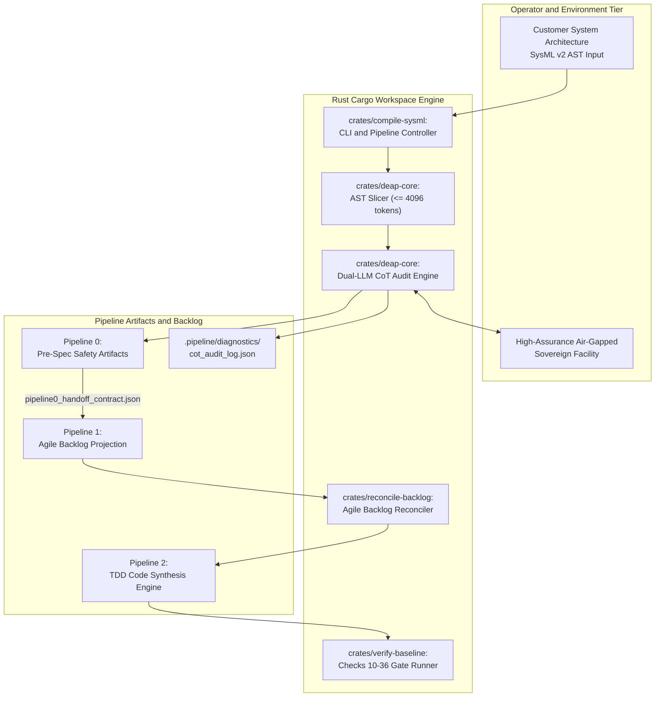
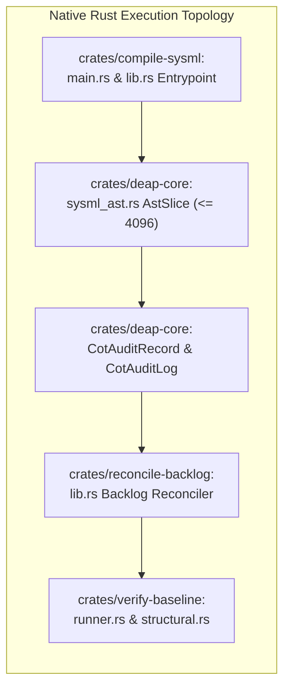
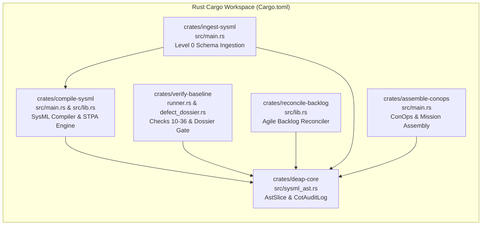
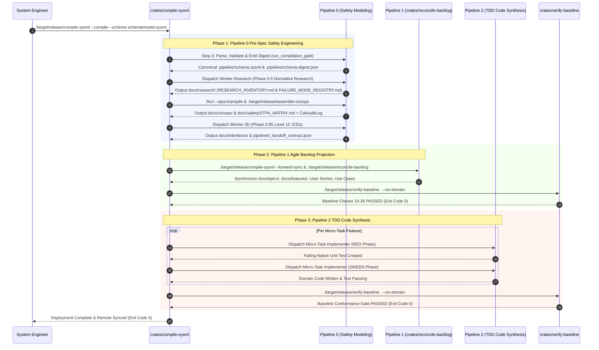

# DEAP Agent Orchestration Engine -- DeepSeek Engine Integration Blueprint

| Attribute | Specification Detail |
| :--- | :--- |
| **Version** | 1.2.0 |
| **Date** | 2026-09-22 |

> **Document Identifier:** `DEAP-BLUEPRINT-HARNESS-001`  
> **Status:** `APPROVED / PRODUCTION-GRADE`  
> **Classification:** `Modular Pure Rust Cargo Workspace Architecture & Native Pipeline Orchestration`  
> **Target Frameworks:** `JARUS SORA v2.5` | `ASTM F3269-17 RTA` | `RTCA DO-178C` | `RTCA DO-365B DAA` | `AssuranceLevel::Tier1..5`  
> **Primary Technology Profile:** `Modular Cargo Workspace: crates/deap-core, crates/compile-sysml, crates/verify-baseline, crates/reconcile-backlog, crates/ingest-sysml, crates/assemble-conops`

---

## 1. Executive Summary & Product Branding

The **DEAP Agent Orchestration Engine**, powered by the **DEAP-Seek Agent Engine**, establishes a unified, air-gapped agentic orchestration framework for the Digital Engineering Agent Platform (DEAP).

Formally architected as a **Modular Pure Rust Cargo Workspace Architecture** (`Cargo.toml`), the platform organizes SysML v2 compilation, strongly-typed AST slicing (`<= 4,096` tokens), Chain-of-Thought (CoT) audit persistence, and baseline verification across the workspace crates:
1. **`crates/deap-core`** (`crates/deap-core/src/sysml_ast.rs`, `crates/deap-core/src/diagnostics.rs`, `crates/deap-core/src/markdown.rs`, `crates/deap-core/src/rules.rs`, `crates/deap-core/src/source_ast.rs`, `crates/deap-core/src/workspace.rs`): Core systems engineering SysML v2 AST metamodel (`PackageDef`, `PartDef`, `RequirementDef`, `PortDef`, `ActionDef`, `StateDef`, `UseCaseDef`, `TestCaseDef`, `SysmlModel`), bounded AST context slicing (`AstSlice`, `IncrementalAstCache`), Chain-of-Thought audit structures (`CotAuditRecord`, `CotAuditLog`), and formal assurance level definitions (`AssuranceLevel::Tier1..5`).
2. **`crates/compile-sysml`** (`crates/compile-sysml/src/main.rs`, `crates/compile-sysml/src/lib.rs`): SysML v2 / KerML compilation gate (`run_compilation_gate`), `SemanticValidator`, `SchemaDigest`, 10-pillar STPA safety suite transpilation (`--stpa-transpile`, `--stpa`), 7-section safety docstring synthesis (`--inject-safety-docstrings`, `--extract-source`), and bidirectional specification synchronization (`--forward-sync`, `--reverse-sync`).
3. **`crates/verify-baseline`** (`crates/verify-baseline/src/runner.rs`, `crates/verify-baseline/src/defect_dossier.rs`, `crates/verify-baseline/src/checks/structural.rs`): Baseline verification runner orchestrating Checks 10 through 36 (`BaselineOptions`, `write_defect_dossier`), 12-check adversarial defect dossier validation (`DossierSection`, `DossierSeverity`, `DefectDossierArgs`, `DefectSchemaValidation`), and structural repository checks (`check_gitignore_exists`, `check_no_ds_store_files`, `check_no_duplicate_master_blueprints`, `check_downstream_instructions_exist`).
4. **`crates/reconcile-backlog`** (`crates/reconcile-backlog/src/lib.rs`): Pure Rust Agile backlog reconciler (`LoadedSpec`, `ReconcileOptions`, `ReconcileSummary`) synchronizing Epics, Features, User Stories, and Use Cases with the issue tracker.
5. **`crates/ingest-sysml`** (`crates/ingest-sysml/src/main.rs`) and **`crates/assemble-conops`** (`crates/assemble-conops/src/main.rs`): Level 0 multi-format schema ingestion (`./target/release/ingest-sysml`) and deterministic Concept of Operations / Tactical Mission Intent assembly (`./target/release/assemble-conops`).

This architecture ties **Pipeline 0 (Pre-Spec Safety Engineering)**, **Pipeline 1 (Agile Backlog Projection)**, and **Pipeline 2 (TDD Code Synthesis)** into an end-to-end, autonomous, self-hosted engineering pipeline with enterprise-grade commercial IP protection and zero customer-visible compiler source code.



---

## 2. Core Architectural Objectives

1. **Air-Gapped & Off-Grid Defense Operations**:
   Enable high-assurance organizations operating under DO-178C / DO-254 or SORA SAIL High-Risk categories to execute complete DEAP pipelines in 100% air-gapped labs without transmitting proprietary control laws, CONOPS, or safety statecharts to cloud LLM endpoints.

2. **Deterministic Chain-of-Thought (CoT) Safety Audit Evidence**:
   Automatically capture and archive raw DeepSeek-R1 reasoning traces (`<think>...</think>`) into `.pipeline/diagnostics/cot_audit_log.json` using `CotAuditRecord` and `CotAuditLog` in `crates/deap-core/src/sysml_ast.rs`. Every safety constraint (`SC-1..N`), System-Theoretic Process Analysis (STPA) Unsafe Control Action (`UCA-1..N`), and Run-Time Assurance (RTA) switching threshold is backed by immutable, traceable LLM reasoning evidence for multi-authority regulatory reviews (`AssuranceLevel::Tier1..5`).

3. **Autonomous End-to-End Pipeline State Machine**:
   Eliminate manual human context-switching between pipeline stages. The native Rust workspace binaries (`./target/release/ingest-sysml`, `./target/release/compile-sysml`, `./target/release/assemble-conops`, `./target/release/reconcile-backlog`, and `./target/release/verify-baseline`) orchestrate the handoff from Pipeline 0 (SysML v2 textual model and `pipeline0_handoff_contract.json`) to Pipeline 1 (Agile backlog generation) and Pipeline 2 (serial subagent RED-GREEN TDD code synthesis) with automated quality gate enforcement (`./target/release/verify-baseline . --no-domain`).

---

## 3. System Architecture & Component Topology

The DEAP orchestration architecture is structured across the Cargo workspace crates coordinating native execution across discrete token slots:



### 3.1 Dual-LLM Air-Gapped Agent Dispatch Pattern (DeepSeek-R1 -> Qwen-2.5-Coder)

The DEAP orchestration engine establishes a deterministic **Dual-LLM Air-Gapped Agent Dispatch** pattern that decouples deep mathematical reasoning from high-speed code synthesis:

1. **Reasoning Slot (DeepSeek-R1)**:
   - **Role**: Mathematical, architectural, and safety invariant reasoning (STPA hazard analysis, SORA SAIL risk bounds, SysML v2 metamodel consistency, and temporal logic).
   - **Streaming CoT Audit**: Emits raw `<think>...</think>` Chain-of-Thought tokens serialized via `CotAuditRecord` and `CotAuditLog` (`crates/deap-core/src/sysml_ast.rs`) directly to `.pipeline/diagnostics/cot_audit_log.json` with cryptographic `prompt_sha256` verification.
   - **Contract Synthesis**: Emits verified semantic specifications and JSON handoff contracts (`pipeline0_handoff_contract.json`).

2. **Execution Slot (Qwen-2.5-Coder)**:
   - **Role**: Deterministic code generation, BDD scenario realization, ROS 2 C++ / SPARK Ada 2014 / Rust implementation, and artifact packaging.
   - **Bounded Context**: Ingests the finalized reasoning state along with bounded, strongly-typed `AstSlice` windows (`<= 4,096` tokens) partitioned by `crates/deap-core/src/sysml_ast.rs`.
   - **High-Velocity Synthesis**: Runs with low temperature ($T = 0.1$) for deterministic, syntax-compliant code synthesis with zero hallucinated API methods.

### 3.2 Modular Cargo Workspace Architecture

The DEAP platform is implemented as a **Modular Pure Rust Cargo Workspace** (`Cargo.toml`), ensuring compile-time memory safety (`unsafe_code = "forbid"`), strict lint hygiene (`unwrap_used = "deny"`, `expect_used = "deny"`, `panic = "deny"`, `indexing_slicing = "deny"`), zero-cost abstractions, and sub-millisecond execution:



#### 3.2.1 Workspace Crate Breakdown

1. **`crates/deap-core`**:
   - **`crates/deap-core/src/sysml_ast.rs`**: Canonical SysML v2 AST metamodel (`PackageDef`, `PartDef`, `RequirementDef`, `PortDef`, `ActionDef`, `StateDef`, `UseCaseDef`, `TestCaseDef`, `HazardDef`, `RiskDef`, `ConnectionDef`, `CalcDef`, `FlowDef`, `AttributeDef`, `SysmlModel`, `UnifiedSchemaModelExtractor`), bounded AST slicing (`AstSlice`, `IncrementalAstCache`), and Chain-of-Thought audit logging (`CotAuditRecord`, `CotAuditLog`).
   - **`crates/deap-core/src/diagnostics.rs`, `crates/deap-core/src/markdown.rs`, `crates/deap-core/src/rules.rs`, `crates/deap-core/src/source_ast.rs`, `crates/deap-core/src/workspace.rs`**: Shared diagnostic structures (`DefectDossier`, `Diagnostic`, `DiagnosticSeverity`, `WhyEntry`), Mermaid/LaTeX syntax validators, source AST extractors, and workspace topology rules.

2. **`crates/compile-sysml`**:
   - **`crates/compile-sysml/src/main.rs` & `crates/compile-sysml/src/lib.rs`**: Pipeline 0 SysML v2 / KerML compilation gate (`run_compilation_gate`, `resolve_schema_targets`, `resolve_schema_file`), `SemanticValidator`, `SchemaDigest`, 10-pillar STPA safety artifact suite transpilation (`--stpa-transpile`, `--stpa`), 7-section safety docstring synthesis (`--inject-safety-docstrings`, `--extract-source`), and bidirectional specification synchronization (`--forward-sync`, `--reverse-sync`).

3. **`crates/verify-baseline`**:
   - **`crates/verify-baseline/src/runner.rs`**: Baseline verification runner (`BaselineOptions`, `has_concrete_specifications`, `has_clean_landing_zones`, `write_defect_dossier`) sequentially executing Checks 10 through 36 and specification audits.
   - **`crates/verify-baseline/src/defect_dossier.rs`**: Native 12-check adversarial defect dossier validator (`DossierSection`, `DossierSeverity`, `DefectDossierArgs`, `DefectSchemaValidation`) and closed-loop GitHub SSOT verification gate.
   - **`crates/verify-baseline/src/checks/structural.rs`**: Structural repository integrity checks (`check_gitignore_exists`, `check_no_ds_store_files`, `check_no_duplicate_master_blueprints`, `check_downstream_instructions_exist`).

4. **`crates/reconcile-backlog`**:
   - **`crates/reconcile-backlog/src/lib.rs`**: Deterministic Agile backlog reconciler (`LoadedSpec`, `ReconcileOptions`, `ReconcileSummary`) synchronizing local Markdown specifications, hierarchical checklists, and Mermaid diagrams with the issue tracker.

5. **`crates/ingest-sysml` & `crates/assemble-conops`**:
   - **`crates/ingest-sysml/src/main.rs`**: Ground 0.0 universal schema ingestion CLI (`./target/release/ingest-sysml`) translating Level 0 schemas into `.pipeline/schema.sysml` and `.pipeline/schema-digest.json`.
   - **`crates/assemble-conops/src/main.rs`**: Deterministic Concept of Operations (`CONOPS.md`) and Tactical Mission Intent (`MISSION_INTENT.md`) assembly CLI (`./target/release/assemble-conops`).

### 3.3 Strongly-Typed AST Slicing & Caching Mechanics ($\le 4,096$ Tokens)

To prevent LLM context saturation and reasoning degradation during large-scale system synthesis, `crates/deap-core/src/sysml_ast.rs` defines strongly-typed AST slicing (`AstSlice`) and content-addressed AST caching (`IncrementalAstCache`):

$$
\text{AST}_{\text{slice}} = \text{Closure}(\mathcal{N}_{\text{target}}, \mathcal{E}_{\text{deps}}) \quad \text{such that} \quad |\text{Tokens}(\text{AST}_{\text{slice}})| \le 4096
$$

* **Semantic Closure Extraction**: For any target component, part definition, or action definition $\mathcal{N}_{\text{target}}$, the slicer traverses ports, bindings, and type hierarchies in `PackageDef`, extracting only necessary invariant boundaries into an `AstSlice`.
* **Bounded Context Allocation**: Every subagent dispatch receives a bounded `AstSlice` (`<= 4,096` tokens) cached via `IncrementalAstCache`, guaranteeing deterministic attention and eliminating hallucinations caused by bloated prompt windows.

```rust
// Grounded in crates/deap-core/src/sysml_ast.rs

#[derive(Debug, Clone, PartialEq, Serialize, Deserialize, Default)]
pub struct AstSlice {
    pub slice_id: String,
    pub target_node: String,
    pub token_count: usize,
    pub package_slice: PackageDef,
    pub external_interface_stubs: Vec<String>,
}

#[derive(Debug, Clone, PartialEq, Serialize, Deserialize, Default)]
pub struct IncrementalAstCache {
    pub cache_dir: PathBuf,
    pub digests: BTreeMap<String, String>,
}
```

---

## 4. End-to-End Multi-Pipeline Orchestration Workflow

The sequence diagram below illustrates how the native Rust workspace binaries drive an autonomous multi-pipeline run:



---

## 5. Regulatory Chain-of-Thought (CoT) Audit Log Specification

Every reasoning step is captured using the strongly-typed `CotAuditRecord` and `CotAuditLog` structures grounded in `crates/deap-core/src/sysml_ast.rs` and persisted at `.pipeline/diagnostics/cot_audit_log.json`:

### 5.1 Rust Data Structures (`crates/deap-core/src/sysml_ast.rs`)

```rust
// Grounded in crates/deap-core/src/sysml_ast.rs

#[derive(Debug, Clone, PartialEq, Serialize, Deserialize, Default)]
pub struct CotAuditRecord {
    pub step_id: String,
    pub model_id: String,
    pub prompt_sha256: String,
    pub reasoning_trace: String,
    pub verified_ast_refs: Vec<String>,
}

#[derive(Debug, Clone, PartialEq, Serialize, Deserialize, Default)]
pub struct CotAuditLog {
    pub records: Vec<CotAuditRecord>,
}

impl CotAuditLog {
    pub fn append_record(&mut self, record: CotAuditRecord) {
        self.records.push(record);
    }

    pub fn to_json_pretty(&self) -> Result<String, serde_json::Error> {
        serde_json::to_string_pretty(self)
    }
}
```

### 5.2 Serialized JSON Payload (`.pipeline/diagnostics/cot_audit_log.json`)

```json
{
  "records": [
    {
      "step_id": "PIPELINE_0_STPA_HAZARD_ANALYSIS",
      "model_id": "deepseek-r1:70b-q4_K_M",
      "prompt_sha256": "e3b0c44298fc1c149afbf4c8996fb92427ae41e4649b934ca495991b7852b855",
      "reasoning_trace": "Analyzing pitch command saturation under high-wind gusts. STPA UCA-1 identifies out-of-range pitch commands leading to Loss L-1. To enforce RTA safety net switching under ASTM F3269-17, pitch rate must be clamped between -15 deg and +25 deg before sending commands to actuator ports.",
      "verified_ast_refs": [
        "PartDef::FlightControlComputer",
        "RequirementDef::SC_1",
        "HazardDef::H_1"
      ]
    }
  ]
}
```

---

## 6. Configuration & Execution Interface

### 6.1 Configuration File (`deap_harness_config.yaml`)

```yaml
version: "1.2"
engine_branding: "DEAP Orchestration Engine / Pure Rust Workspace"

compiler:
  engine: "cargo_workspace"
  crates:
    - "crates/deap-core"
    - "crates/compile-sysml"
    - "crates/verify-baseline"
    - "crates/reconcile-backlog"
    - "crates/ingest-sysml"
    - "crates/assemble-conops"
  timeout_ms: 5000
  strict_checks: true

provider:
  type: "ollama" # Options: ollama, vllm, sglang
  base_url: "http://localhost:11434"
  api_key: "DEAP_LOCAL_AIRGAPPED_TOKEN"

models:
  reasoning: "deepseek-r1:70b-q4_K_M"
  execution: "qwen2.5-coder:32b-instruct-q4_K_M"

ast_slicing:
  enabled: true
  max_slice_tokens: 4096
  strategy: "semantic_closure"
  source_module: "crates/deap-core/src/sysml_ast.rs"

pipeline_settings:
  pipeline0:
    auto_ingest_sysml: true
    default_schema_path: "schema/model.sysml"
  pipeline1:
    reconcile_backlog_on_completion: true
  pipeline2:
    enforce_tdd_red_green: true
    target_profile: "rust" # Options: ros2_cpp, spark_ada, rust

audit_logging:
  enabled: true
  output_path: ".pipeline/diagnostics/cot_audit_log.json"
  schema_types:
    record: "deap_core::sysml_ast::CotAuditRecord"
    log: "deap_core::sysml_ast::CotAuditLog"
```

### 6.2 CLI Usage Commands

```bash
# 1. Ingest Level 0 schema inputs into canonical SysML v2 AST and SHA-256 digest
./target/release/ingest-sysml --schema schema/ --out .pipeline/schema.sysml --digest .pipeline/schema-digest.json

# 2. Execute Pipeline 0 SysML v2 compilation and semantic validation gate
./target/release/compile-sysml --compile --schema .pipeline/schema.sysml --out .pipeline/schema.sysml --digest .pipeline/schema-digest.json

# 3. Transpile SysML v2 AST into the 10-pillar STPA safety artifact suite
./target/release/compile-sysml --stpa-transpile --schema .pipeline/schema.sysml --out-dir docs/safety

# 4. Assemble Concept of Operations (CONOPS.md) and Mission Intent (MISSION_INTENT.md)
./target/release/assemble-conops --input-dir docs/conops/units --output-dir docs/conops

# 5. Synchronize Agile backlog specifications with the issue tracker
./target/release/reconcile-backlog

# 6. Execute baseline verification runner (Checks 10 through 36)
./target/release/verify-baseline . --no-domain
```

### 6.3 Web GUI Dashboard & Interactive Command Center

The DEAP orchestration architecture supports an integrated local Web GUI Dashboard (`http://localhost:3000`) for interactive pipeline monitoring, visual safety auditing, and human-in-the-loop governance:

#### 6.3.1 Key Web GUI Subsystem Modules:
1. **Live Chain-of-Thought (CoT) Streamer**:
   Real-time WebSocket rendering of DeepSeek-R1 `CotAuditRecord` entries (`step_id`, `model_id`, `prompt_sha256`, `reasoning_trace`, `verified_ast_refs`) from `.pipeline/diagnostics/cot_audit_log.json` side-by-side with generated artifacts (`CONOPS.md`, `STPA_MATRIX.md`, `.pipeline/schema.sysml`).
2. **Interactive Multi-Pipeline DAG Visualizer**:
   Visual node graph tracking real-time progress across Pipeline 0 (Worker 0A -> 0B -> 0C) -> Pipeline 1 (Agile Backlog Projection via `crates/reconcile-backlog`) -> Pipeline 2 (TDD Micro-tasks).
3. **STPA Hazard & SORA SAIL Audit Explorer**:
   Searchable grid mapping System Hazards (`H-1..N`), Unsafe Control Actions (`UCA-1..N`), Safety Constraints (`SC-1..N`), and Operational Safety Objectives (OSOs) directly to `CotAuditLog` records.
4. **Human-in-the-Loop Review & Approval Gates**:
   Interactive modal gates allowing Product Owners and Safety Officers to review and approve generated AST handoff contracts (`pipeline0_handoff_contract.json`) before downstream TDD code synthesis begins.

### 6.4 VS Code & IDE Native Integration Architecture

All native Rust workspace binaries are 100% usable directly inside **Visual Studio Code (VS Code)** through native terminal and task integration modes:

#### 6.4.1 Integrated Terminal Execution (Zero Setup)
Run all native Rust CLI binaries directly within VS Code's integrated terminal (`Cmd+\`` / `Ctrl+\``):
```bash
./target/release/compile-sysml --compile --schema schema/model.sysml
./target/release/verify-baseline . --no-domain
```

#### 6.4.2 VS Code Build & Task Automation (`.vscode/tasks.json`)
Bind `compile-sysml`, `reconcile-backlog`, and `verify-baseline` commands directly to VS Code build tasks (`Cmd+Shift+B` / `Ctrl+Shift+B`):
```json
{
  "version": "2.0.0",
  "tasks": [
    {
      "label": "DEAP: Compile SysML v2 Schema Gate",
      "type": "shell",
      "command": "${workspaceFolder}/target/release/compile-sysml --compile --schema ${workspaceFolder}/schema/model.sysml",
      "group": { "kind": "build", "isDefault": true },
      "presentation": { "reveal": "always", "panel": "new" }
    },
    {
      "label": "DEAP: Verify Baseline Checks 10-36",
      "type": "shell",
      "command": "${workspaceFolder}/target/release/verify-baseline . --no-domain",
      "group": "test"
    }
  ]
}
```

#### 6.4.3 AI Agent Sidecar Protocol (Antigravity / Claude Code / Cursor / Gemini CLI)
AI agent extensions inside VS Code invoke the compiled workspace binaries (`./target/release/compile-sysml`, `./target/release/verify-baseline`, `./target/release/reconcile-backlog`) and inspect `.pipeline/diagnostics/cot_audit_log.json` (`CotAuditLog`) to validate subagent dispatches natively.

### 6.5 Modular Cargo Workspace Build & Compilation Pipeline

The pure Rust compiler and verification suite uses Cargo workspace compilation executed during upstream packaging:

#### 6.5.1 Workspace Compilation (`target/release/`)
All six workspace crates (`crates/deap-core`, `crates/compile-sysml`, `crates/verify-baseline`, `crates/reconcile-backlog`, `crates/ingest-sysml`, `crates/assemble-conops`) are compiled in release mode:

```bash
# Build all workspace crates in release mode
cargo build --workspace --release

# Run full workspace unit and integration test suite
cargo test --workspace
```

#### 6.5.2 Automated AST Validation & Baseline Verification
```bash
# Execute Pipeline 0 SysML compilation and semantic validation gate
./target/release/compile-sysml --compile

# Validate adversarial defect dossier schema and Mermaid compliance
./target/release/verify-baseline check-defect --file .pipeline/defects/defect_report.md

# Execute baseline conformance gate (Checks 10-36)
./target/release/verify-baseline . --no-domain
```

---

## 7. Commercial Release Packaging & Zero-Source Distribution Standard

To preserve enterprise intellectual property while providing maximum transparency and agentic steerability, DEAP enforces a strict **Two-Tier Separation Standard**:

### 7.1 Tier 1: Upstream Source Repository (`DEAP01-spec-core`)
The upstream repository is the confidential engineering core containing full source code and engineering assets:
* **Cargo Workspace Crates**: Located in `crates/deap-core`, `crates/compile-sysml`, `crates/verify-baseline`, `crates/reconcile-backlog`, `crates/ingest-sysml`, and `crates/assemble-conops`, implementing the SysML v2 AST metamodel (`crates/deap-core/src/sysml_ast.rs`), AST slicing (`AstSlice`, `IncrementalAstCache`), CoT audit logging (`CotAuditRecord`, `CotAuditLog`), compilation (`crates/compile-sysml/src/main.rs`, `crates/compile-sysml/src/lib.rs`), and verification (`crates/verify-baseline/src/runner.rs`, `crates/verify-baseline/src/defect_dossier.rs`, `crates/verify-baseline/src/checks/structural.rs`) with 7-section safety rustdoc documentation.
* **Build System & Packaging Automation**: Workspace `Cargo.toml`, `Cargo.lock`, and native Rust CLI entrypoints.
* **Test Suites & Continuous Integration**: Native Rust `#[test]` unit and integration suites (`cargo test --workspace`) validating compiler, backlog reconciler, and baseline verifier invariants.

### 7.2 Tier 2: Downstream Customer Deliverable (Zero-Source Binary Distribution)
Downstream customer repositories and on-premises client distributions receive a clean, zero-source operational deployment:
* **Pre-Compiled Native Rust Binaries (`target/release/`)**:
  * `./target/release/compile-sysml`
  * `./target/release/verify-baseline`
  * `./target/release/reconcile-backlog`
  * `./target/release/ingest-sysml`
  * `./target/release/assemble-conops`
* **Strict Zero-Source Invariant**: Downstream customer workspaces contain **exactly 0 `.rs`, 0 `.cpp`, and 0 `.hpp` compiler source files**. Customers cannot view, decompile, or tamper with proprietary compiler or verification algorithms.
* **Compile-Time Hardening & Optimization**:
  * Compiled with release optimizations and `unsafe_code = "forbid"` enforced across the workspace.
  * Stripped of debugging and symbol tables for distribution.
* **Plain Markdown Governance Layer**: Retained in plain human- and agent-readable Markdown so that AI coding agents (Antigravity, Claude Code, Cursor, Gemini CLI) can seamlessly parse and enforce constitutional requirements:
  * `.pipeline/constitution.md` (Constitutional rules, quality gates, and invariant definitions)
  * `AGENTS.md` and `.agents/AGENTS.md` (Agent role boundaries and tool discipline)
  * `rules/*.md` (Specific operational rules and constraints)
  * `skills/*/SKILL.md` (Agent skill definitions and workflows)
  * `schema/` (Clean landing zone for customer SysML v2 / schema inputs)

---

## 8. Downstream Roadmap & Migration Schedule

The modular Rust workspace release architecture follows a four-phase rollout schedule:

| Phase | Milestone | Scope & Deliverables | Verification Gate |
| :--- | :--- | :--- | :--- |
| **Phase 1** | **Modular Cargo Workspace & AST Slicing Specification** | Define workspace crates (`crates/deap-core`, `crates/compile-sysml`, `crates/verify-baseline`, `crates/reconcile-backlog`, `crates/ingest-sysml`, `crates/assemble-conops`); formalize strongly-typed AST slicing (`AstSlice`, `IncrementalAstCache`) and CoT audit structures (`CotAuditRecord`, `CotAuditLog`) in `crates/deap-core/src/sysml_ast.rs`. | Cargo workspace manifests validated; AST slicing and CoT audit schemas verified. |
| **Phase 2** | **Core Engine Checks 10--36 & AST Metamodel Implementation** | Implement native SysML v2 AST parser (`crates/deap-core/src/sysml_ast.rs`), compilation gate (`crates/compile-sysml/src/main.rs`, `crates/compile-sysml/src/lib.rs`), formal Checks 10--36 (`crates/verify-baseline/src/runner.rs`, `crates/verify-baseline/src/checks/structural.rs`), and deterministic ConOps assembly (`crates/assemble-conops/src/main.rs`). | 100% mechanical parity across Checks 10--36; `cargo test --workspace` passes. |
| **Phase 3** | **Dual-LLM Air-Gapped CoT Audit & Defect Dossier Hardening** | Persist DeepSeek-R1 reasoning traces via `CotAuditRecord` and `CotAuditLog` (`crates/deap-core/src/sysml_ast.rs`) to `.pipeline/diagnostics/cot_audit_log.json` and enforce 12-check defect dossier validation (`crates/verify-baseline/src/defect_dossier.rs`). | End-to-end air-gapped verification run passes without external network access. |
| **Phase 4** | **Zero-Source Downstream Packaging & Verification Pipeline** | Deploy pre-compiled native Rust binaries (`compile-sysml`, `verify-baseline`, `reconcile-backlog`, `ingest-sysml`, `assemble-conops`) and Markdown governance. Verify downstream repository contains 0 compiler source files. | `./target/release/verify-baseline . --no-domain` passes with exit code 0. |

### 8.1 Maintenance & Upstream Tracking
1. **Repository Target**: Hosted centrally under `docs/architecture/blueprints/DEAP_DEEPSEEK_HARNESS_INTEGRATION_BLUEPRINT.md` in [`DEAP01-spec-core`](https://github.com/gintatkinson/DEAP01-spec-core).
2. **Backlog Reconciliation**: Integrated into `DEAP_SPECIFICATIONS_SITEMAP.md` and synchronized via `./target/release/reconcile-backlog` (`crates/reconcile-backlog/src/lib.rs`).
3. **Verification Entrypoints**: Enforced via `./target/release/verify-baseline . --no-domain` (`crates/verify-baseline/src/runner.rs`) and `./target/release/compile-sysml --compile` (`crates/compile-sysml/src/main.rs`).
