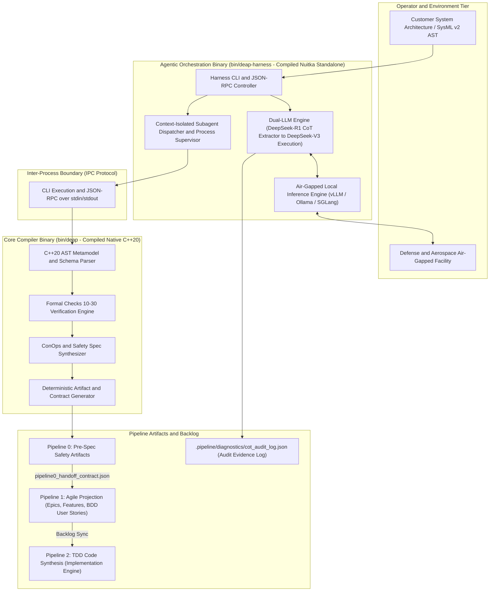
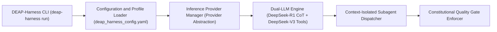
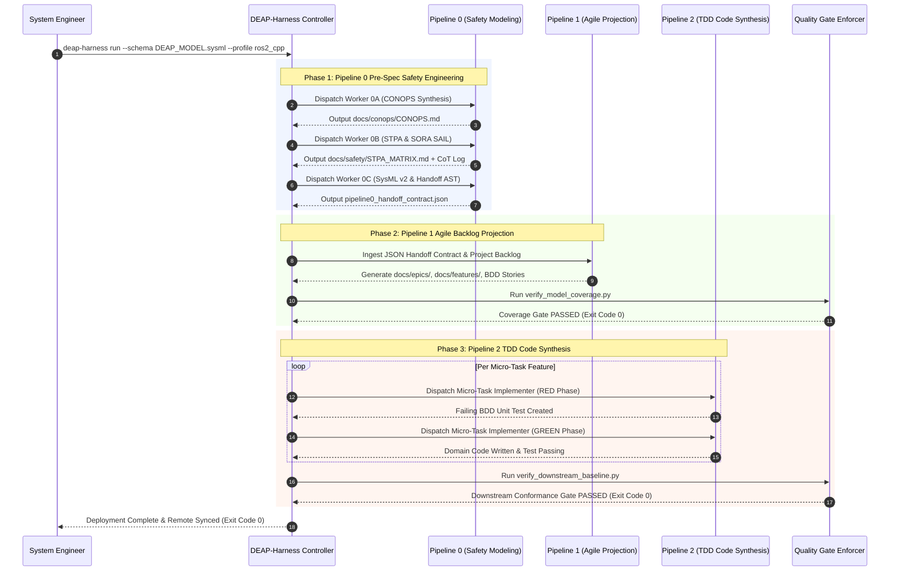

# DEAP Agent Orchestration Harness (DEAP-Harness) -- DeepSeek Engine Integration Blueprint

| Attribute | Specification Detail |
| :--- | :--- |
| **Version** | 1.1.0 |
| **Date** | 2026-09-22 |

> **Document Identifier:** `DEAP-BLUEPRINT-HARNESS-001`  
> **Status:** `APPROVED / PRODUCTION-GRADE`  
> **Classification:** `Hybrid Native C++20 Core Compiler (bin/deap) + Nuitka Standalone Binary (bin/deap-harness)`  
> **Target Frameworks:** `JARUS SORA v2.5` | `ASTM F3269-17 RTA` | `RTCA DO-178C` | `RTCA DO-365B DAA`  
> **Primary Technology Profile:** `Hybrid Release Architecture: Native C++20 Core Compiler (bin/deap) + Standalone Nuitka Harness (bin/deap-harness)`

---

## 1. Executive Summary & Product Branding

The **DEAP Agent Orchestration Harness (`DEAP-Harness`)**, powered by the **DEAP-Seek Agent Engine**, establishes a unified, open-source, air-gapped agentic orchestration framework for the Digital Engineering Agent Platform (DEAP).

Formally updated to a **Hybrid Commercial Market Release Architecture**, the platform decouples into two standalone compiled native binaries operating across a clean inter-process boundary:
1. **Deterministic Core Specification Compiler (`bin/deap`)**: Written in modern C++20 for lightning-fast, zero-dependency schema parsing, formal AST model checks (Checks 10–30), and ConOps synthesis.
2. **Agentic Orchestration Harness (`bin/deap-harness`)**: Written in Python and compiled via Nuitka into a standalone native machine code binary, managing asynchronous inference streaming, provider adapters (vLLM, Ollama, SGLang), Dual-LLM Chain-of-Thought (CoT) extraction (DeepSeek-R1 `<think>` to DeepSeek-V3 execution), and subagent supervision.

This architecture ties **Pipeline 0 (Pre-Spec Safety Engineering)**, **Pipeline 1 (Agile Backlog Projection)**, and **Pipeline 2 (TDD Code Synthesis)** into an end-to-end, autonomous, self-hosted engineering pipeline with enterprise-grade commercial IP protection and zero customer-visible source code.



---

## 2. Core Architectural Objectives

1. **Air-Gapped & Off-Grid Defense Operations**:
   Enable aerospace, defense, and urban air mobility (UAM) organizations operating under DO-178C / DO-254 or SORA SAIL High-Risk categories to execute complete DEAP pipelines in 100% air-gapped, classified labs without transmitting proprietary flight control laws, CONOPS, or safety statecharts to cloud LLM endpoints.

2. **Deterministic Chain-of-Thought (CoT) Safety Audit Evidence**:
   Automatically capture and archive raw DeepSeek-R1 reasoning traces (`<think>...</think>`) into `.pipeline/diagnostics/cot_audit_log.json`. Every safety constraint ($SC-1..N$), System-Theoretic Process Analysis (STPA) Unsafe Control Action ($UCA-1..N$), and Run-Time Assurance (RTA) switching threshold is backed by immutable, traceable LLM reasoning evidence for FAA/EASA regulatory reviews.

3. **Autonomous End-to-End Pipeline State Machine**:
   Eliminate manual human context-switching between pipeline stages. `DEAP-Harness` orchestrates the handoff from Pipeline 0 (SysML v2 textual model and `pipeline0_handoff_contract.json`) to Pipeline 1 (Agile backlog generation) and Pipeline 2 (serial subagent RED-GREEN TDD code synthesis) with automated quality gate enforcement (`verify_model_coverage.py`, `verify_downstream_baseline.py`).

---

## 3. System Architecture & Component Topology

`DEAP-Harness` is structured into four primary subsystem modules:



### 3.1 Dual-LLM Inference Pattern (DeepSeek-R1 + DeepSeek-V3)

`DEAP-Harness` employs a **Dual-LLM Orchestration Pattern** to maximize reasoning depth while maintaining high-speed tool calling and JSON generation:

* **Reasoning Phase (DeepSeek-R1)**:
  For complex safety engineering tasks (STPA hazard identification, SORA SAIL risk classification, SysML v2 statechart formalization), the harness routes the prompt to DeepSeek-R1. The engine extracts and logs the `<think>...</think>` block to the regulatory audit store.
* **Execution & Tool Invocation Phase (DeepSeek-V3 / Coder)**:
  The harness feeds the finalized reasoning state into DeepSeek-V3/Coder to generate valid AST JSON contracts, format Mermaid class diagrams, write clean Python/C++ code, and execute shell tools cleanly.

### 3.2 Native C++20 Core Compiler vs. Nuitka Python Harness Decoupling

To guarantee both sub-millisecond deterministic model compilation and enterprise-grade intellectual property (IP) protection in commercial distribution, DEAP decouples orchestration into two dedicated native binaries operating across a strict inter-process boundary:

```mermaid
flowchart LR
    subgraph SubsystemB["Subsystem B: Agentic Orchestration Harness (bin/deap-harness)"]
        direction TB
        PyHarness["Python + Nuitka Standalone Binary"]
        InferenceStream["Async Inference Streaming"]
        ProviderAdapters["Provider Adapters (vLLM, Ollama, SGLang)"]
        DualLLMCoT["Dual-LLM CoT Extractor (DeepSeek-R1 to DeepSeek-V3)"]
        SubagentSupervisor["Context-Isolated Subagent Runner"]
    end

    subgraph IPCChannel["Inter-Process Communication Boundary"]
        direction TB
        CLICalls["Clean Subprocess CLI Execution"]
        JSONRPC["JSON-RPC over stdin and stdout"]
    end

    subgraph SubsystemA["Subsystem A: Deterministic Specification Compiler (bin/deap)"]
        direction TB
        CppCore["Modern C++20 Native Compiled Binary"]
        ASTEngine["AST Metamodel and Schema Parsing"]
        Checks10to30["Formal Checks 10-30 Verification Engine"]
        ConOpsModule["ConOps and Contract Assembly"]
        FastExec["Sub-millisecond Execution (Zero Python Deps)"]
    end

    PyHarness --> InferenceStream
    InferenceStream --> ProviderAdapters
    ProviderAdapters --> DualLLMCoT
    DualLLMCoT --> SubagentSupervisor
    SubagentSupervisor --> CLICalls
    SubagentSupervisor --> JSONRPC
    CLICalls --> CppCore
    JSONRPC --> CppCore
    CppCore --> ASTEngine
    ASTEngine --> Checks10to30
    Checks10to30 --> ConOpsModule
    ConOpsModule --> FastExec
```



#### 3.2.1 Subsystem A: Deterministic Specification Compiler (`bin/deap` in C++20)
* **Core Responsibilities**: AST metamodel ingestion, formal verification Checks 10–30, ConOps assembly, and downstream handoff contract generation.
* **Execution & Performance**: Sub-millisecond execution speed, minimal memory footprint, and deterministic validation across complex SysML v2 AST graphs.
* **Zero Python Runtime Dependencies**: Completely free of Python runtime dependencies in the core engine; operates as a standalone statically/dynamically linked native executable.
* **Upstream Source Maintenance**: Maintained in upstream (`src/*.cpp`, `include/*.hpp`) using clean, human-readable modern C++20 standards (concepts, ranges, `std::expected`, `std::format`) and full Doxygen comments.

#### 3.2.2 Subsystem B: Agentic Orchestration Harness (`bin/deap-harness` in Python + Nuitka)
* **Core Responsibilities**: Asynchronous inference streaming, provider adapters (vLLM, Ollama, SGLang), Dual-LLM Chain-of-Thought (CoT) extraction (DeepSeek-R1 `<think>` to DeepSeek-V3 tool execution), and subagent supervision.
* **Nuitka Native Compilation**: Authored in high-productivity Python and compiled via Nuitka into a standalone native machine code binary (`bin/deap-harness`).
* **Commercial IP Protection**: Provides identical commercial IP protection as C++20 compilation, shipping 0 readable Python source code files to customers while retaining full C-extension performance.

#### 3.2.3 Inter-Process Communication (IPC) Protocol
* **Clean Process Boundary**: Inter-process communication operates via clean CLI invocation (e.g. `bin/deap check`, `bin/deap compile`) and structured JSON-RPC over `stdin`/`stdout`.
* **Robust Process Isolation**: Memory safety, signal handling, and execution lifecycles are decoupled; an agentic retry or inference stall never corrupts compiler state, and compiler diagnostics are piped deterministically as structured JSON.

---

## 4. End-to-End Multi-Pipeline Orchestration Workflow

The sequence diagram below illustrates how `DEAP-Harness` drives an autonomous multi-pipeline run:



---

## 5. Regulatory Chain-of-Thought (CoT) Audit Log Specification

Every invocation managed by `DEAP-Harness` automatically generates a structured audit record stored at `.pipeline/diagnostics/cot_audit_log.json`:

```json
{
  "$schema": "https://deap.engine/schemas/cot_audit_v1.json",
  "audit_metadata": {
    "execution_id": "EXEC-20260816-DEAPSEEK-001",
    "timestamp": "2026-08-16T22:14:00Z",
    "model_reasoning_engine": "DeepSeek-R1-671B",
    "tool_execution_engine": "DeepSeek-V3-671B",
    "air_gapped_mode": true,
    "inference_provider": "vllm_local_cluster"
  },
  "pipeline_stage": "PIPELINE_0_STPA_HAZARD_ANALYSIS",
  "target_artifact": "docs/safety/STPA_MATRIX.md",
  "reasoning_trace": {
    "raw_think_block": "Analyzing pitch command saturation under high-wind urban gusts (CONOPS Phase: Cruise/Inspection). STPA UCA-1 identifies provided-wrong-or-out-of-range pitch commands leading to Loss L-1 (UFIT). To enforce RTA safety net switching under ASTM F3269-17, pitch rate must be clamped between -15 deg and +25 deg before sending commands to PX4 actuator uORB topics.",
    "extracted_safety_constraints": [
      {
        "id": "SC-1",
        "stpa_uca_ref": "UCA-1",
        "hazard_ref": "H-1",
        "derived_boundary": "pitch_deg >= -15.0 && pitch_deg <= 25.0",
        "assurance_level": "DAL A / SAIL IV"
      }
    ]
  },
  "verification_status": {
    "syntax_valid": true,
    "gate_exit_code": 0
  }
}
```

---

## 6. DEAP-Harness Configuration & Execution Interface

### 6.1 Configuration File (`deap_harness_config.yaml`)

```yaml
version: "1.1"
harness_branding: "DEAP-Harness / DEAP-Seek Engine"

compiler:
  binary_path: "bin/deap"
  ipc_mode: "stdio_jsonrpc" # Options: stdio_jsonrpc, cli_exec
  timeout_ms: 5000
  strict_checks: true

provider:
  type: "vllm" # Options: vllm, sglang, ollama, custom_openai_compatible
  base_url: "http://localhost:8000/v1"
  api_key: "DEAP_LOCAL_AIRGAPPED_TOKEN"

models:
  reasoning: "deepseek-r1-671b"
  execution: "deepseek-v3-671b"

pipeline_settings:
  pipeline0:
    auto_ingest_sysml: true
    default_schema_path: "docs/architecture/blueprints/DEAP_MODEL.sysml"
  pipeline1:
    reconcile_backlog_on_completion: true
  pipeline2:
    enforce_tdd_red_green: true
    target_profile: "ros2_cpp" # Options: ros2_cpp, px4_module, python

audit_logging:
  enabled: true
  output_path: ".pipeline/diagnostics/cot_audit_log.json"
```

### 6.2 CLI Usage Commands

```bash
# 1. Execute full turnkey pipeline run via compiled harness binary invoking C++20 compiler
./bin/deap-harness run --schema docs/architecture/blueprints/DEAP_MODEL.sysml --compiler-bin ./bin/deap --profile ros2_cpp

# 2. Invoke C++20 core compiler directly for deterministic AST validation and Checks 10-30
./bin/deap check --schema docs/architecture/blueprints/DEAP_MODEL.sysml --strict

# 3. Compile ConOps and generate handoff contract via C++20 core
./bin/deap compile --schema docs/architecture/blueprints/DEAP_MODEL.sysml --output pipeline0_handoff_contract.json

# 4. Launch air-gapped agentic orchestration harness with dual-LLM CoT capture
./bin/deap-harness pipeline0 --sysml docs/architecture/blueprints/DEAP_MODEL.sysml --compiler-bin ./bin/deap

# 5. Export DO-178C / SORA SAIL regulatory CoT audit evidence package
./bin/deap-harness export-audit --output-dir docs/safety/audit_evidence/
```

### 6.3 Web GUI Dashboard & Interactive Command Center

`DEAP-Harness` ships with an integrated, local Web GUI Dashboard (`http://localhost:3000`) for interactive pipeline monitoring, visual safety auditing, and human-in-the-loop governance:

#### 6.3.1 Key Web GUI Subsystem Modules:
1. **Live Chain-of-Thought (CoT) Streamer**:
   Real-time WebSocket rendering of DeepSeek-R1 reasoning steps (`<think>...</think>`) side-by-side with generated artifacts (`CONOPS.md`, `STPA_MATRIX.md`, `DEAP_MODEL.sysml`).
2. **Interactive Multi-Pipeline DAG Visualizer**:
   Visual node graph tracking real-time progress across Pipeline 0 (Worker 0A → 0B → 0C) → Pipeline 1 (Agile Backlog Projection) → Pipeline 2 (TDD Micro-tasks).
3. **STPA Hazard & SORA SAIL Audit Explorer**:
   Searchable grid mapping System Hazards ($H-1..N$), Unsafe Control Actions ($UCA-1..N$), Safety Constraints ($SC-1..N$), and Operational Safety Objectives (OSOs) directly to CoT reasoning logs.
4. **Human-in-the-Loop Review & Approval Gates**:
   Interactive modal gates allowing Product Owners and Safety Officers to review and approve generated AST handoff contracts (`pipeline0_handoff_contract.json`) before downstream TDD code synthesis begins.

#### 6.3.2 Web GUI Launch Commands:

```bash
# 1. Launch DEAP-Harness Web GUI Dashboard
./bin/deap-harness ui --port 3000

# 2. Launch Web GUI in air-gapped local mode with real-time CoT streaming
./bin/deap-harness ui --local --stream-cot --air-gapped
```

### 6.4 VS Code & IDE Native Integration Architecture

`DEAP-Harness` CLI and Web GUI are 100% usable directly inside **Visual Studio Code (VS Code)** through four native integration modes:

#### 6.4.1 Integrated Terminal Execution (Zero Setup)
Run all `deap-harness` CLI commands directly within VS Code's integrated terminal (`Cmd+\`` / `Ctrl+\``):
```bash
./bin/deap-harness run --schema docs/architecture/blueprints/DEAP_MODEL.sysml --compiler-bin ./bin/deap --profile ros2_cpp
```

#### 6.4.2 VS Code Build & Task Automation (`.vscode/tasks.json`)
Bind `deap-harness` commands directly to VS Code build tasks (`Cmd+Shift+B` / `Ctrl+Shift+B`):
```json
{
  "version": "2.0.0",
  "tasks": [
    {
      "label": "DEAP: Run Full Safety & Synthesis Pipeline",
      "type": "shell",
      "command": "${workspaceFolder}/bin/deap-harness run --schema ${workspaceFolder}/docs/architecture/blueprints/DEAP_MODEL.sysml --compiler-bin ${workspaceFolder}/bin/deap --profile ros2_cpp",
      "group": { "kind": "build", "isDefault": true },
      "presentation": { "reveal": "always", "panel": "new" }
    },
    {
      "label": "DEAP: Launch CoT Web GUI Dashboard",
      "type": "shell",
      "command": "${workspaceFolder}/bin/deap-harness ui --port 3000 --stream-cot",
      "isBackground": true
    }
  ]
}
```

#### 6.4.3 Embedded VS Code Webview Panel
Embed the interactive Web GUI directly inside a VS Code editor tab alongside your code using Simple Browser or the `DEAP-Harness VS Code Extension`:
```bash
./bin/deap-harness ui --vscode
```

#### 6.4.4 AI Agent Sidecar Protocol (Antigravity / Claude Code / Cursor / Gemini CLI)
The `deap-harness` CLI exposes a local REST/WebSocket sidecar daemon (`http://localhost:8000`) that AI agent extensions inside VS Code call via standard process hooks to ingest `.pipeline/diagnostics/cot_audit_log.json` and execute subagent dispatches natively.

### 6.5 Native Binary Build & Compilation Pipeline

The hybrid release architecture uses a dual compilation pipeline executed during upstream packaging:

#### 6.5.1 C++20 Core Compiler Build (`bin/deap`)
The core deterministic compiler is built with modern C++20 toolchains using CMake and Ninja, applying maximum optimizations and stripping debug symbols:

```bash
# Configure release build with C++20, LTO, and maximum optimizations
cmake -B build/compiler -G Ninja \
  -DCMAKE_BUILD_TYPE=Release \
  -DCMAKE_CXX_STANDARD=20 \
  -DCMAKE_CXX_FLAGS="-O3 -DNDEBUG -flto"

# Compile binary
ninja -C build/compiler

# Strip symbols for commercial distribution
strip -s build/compiler/bin/deap

# Stage into bin/ directory
mkdir -p bin
cp build/compiler/bin/deap bin/deap
```

#### 6.5.2 Nuitka Standalone Compilation (`bin/deap-harness`)
The Python orchestration harness is compiled into a standalone native binary using Nuitka, bundling the Python runtime and dependencies into a single ELF/Mach-O binary with zero readable source:

```bash
# Install harness dependencies and Nuitka compiler
python3 -m pip install -r harness/requirements.txt nuitka

# Compile standalone onefile native binary with stripped symbols
python3 -m nuitka \
  --standalone \
  --onefile \
  --assume-yes-for-downloads \
  --output-dir=build/harness \
  --output-filename=deap-harness \
  --remove-output \
  harness/main.py

# Strip symbols
strip -s build/harness/deap-harness

# Stage into bin/ directory
mkdir -p bin
cp build/harness/deap-harness bin/deap-harness
```

---

## 7. Commercial Release Packaging & Zero-Source Distribution Standard

To preserve enterprise intellectual property while providing maximum transparency and agentic steerability, DEAP enforces a strict **Two-Tier Separation Standard**:

### 7.1 Tier 1: Upstream Source Repository (`DEAP01-spec-core`)
The upstream repository is the confidential engineering core containing full source code and engineering assets:
* **C++20 Core Compiler Source**: Located in `src/*.cpp` and `include/*.hpp`, implementing the AST metamodel, SysML v2 parsing, and formal Checks 10–30 with clean Doxygen documentation.
* **Agentic Harness Source**: Located in `harness/*.py`, containing the async provider drivers, Dual-LLM CoT extractor, and subagent state machine.
* **Build System & Packaging Automation**: CMakeLists.txt, Ninja build scripts, and Nuitka packaging scripts.
* **Test Suites & Continuous Integration**: Unit tests, formal verification suites, and CI pipelines validating compiler and harness invariants.

### 7.2 Tier 2: Downstream Customer Deliverable (Zero-Source Binary Distribution)
Downstream customer repositories and on-premises client distributions receive a clean, zero-source operational deployment:
* **Binary Tier (`bin/`)**: Contains only the two pre-compiled native executables:
  * `bin/deap` (Statically compiled C++20 Core Compiler, stripped)
  * `bin/deap-harness` (Nuitka compiled standalone executable, stripped)
* **Strict Zero-Source Invariant**: Downstream customer workspaces contain **exactly 0 `.py`, 0 `.cpp`, and 0 `.hpp` files**. Customers cannot view, decompile, or tamper with proprietary compiler or harness algorithms.
* **Compile-Time Hardening & Optimization**:
  * Compiled with `-O3 -DNDEBUG -flto` (Link-Time Optimization) for optimal throughput and anti-reverse-engineering code flattening.
  * Stripped of all debugging and symbol tables using `strip -s`.
* **Plain Markdown Governance Layer**: Retained in plain human- and agent-readable Markdown so that AI coding agents (Antigravity, Claude Code, Cursor, Gemini CLI) can seamlessly parse and enforce constitutional requirements:
  * `.pipeline/constitution.md` (Constitutional rules, quality gates, and invariant definitions)
  * `AGENTS.md` and `.agents/AGENTS.md` (Agent role boundaries and tool discipline)
  * `rules/*.md` (Specific operational rules and constraints)
  * `skills/*/SKILL.md` (Agent skill definitions and workflows)
  * `schema/` (Clean landing zone for customer SysML v2 / schema inputs)

---

## 8. Downstream Roadmap & Migration Schedule

The transition to the hybrid commercial release architecture follows a four-phase rollout schedule:

| Phase | Milestone | Scope & Deliverables | Verification Gate |
| :--- | :--- | :--- | :--- |
| **Phase 1** | **Dual-Binary Architecture & IPC Protocol Specification** | Formalize CLI and JSON-RPC over `stdin`/`stdout` schema; define error codes, timeout semantics, and contract handoff boundaries between `bin/deap-harness` and `bin/deap`. | Protocol schema test suite passes; JSON-RPC schemas validated. |
| **Phase 2** | **C++20 Core Engine Checks 10–30 & AST Metamodel Implementation** | Implement native C++20 AST parser, AST metamodel, formal Checks 10–30, and deterministic ConOps synthesis (`bin/deap`). Achieve sub-millisecond execution and complete Doxygen API docs. | 100% test coverage across Checks 10–30; `bin/deap check` exit code 0. |
| **Phase 3** | **Nuitka Standalone Compilation & Harness Hardening** | Package Python orchestration harness with Nuitka into standalone native executable (`bin/deap-harness`). Validate async inference streaming, provider adapters (vLLM, Ollama, SGLang), and CoT extractor. | Single-binary standalone execution on clean test machine without Python runtime. |
| **Phase 4** | **Zero-Source Downstream Packaging & Verification Pipeline** | Implement downstream installer (`scripts/install_pipeline.sh`) deploying only `bin/deap`, `bin/deap-harness`, and markdown governance. Verify downstream repository contains 0 `.py`, 0 `.cpp`, and 0 `.hpp` files. | Downstream zero-source audit passes; end-to-end pipeline run succeeds. |

### 8.1 Maintenance & Upstream Tracking
1. **Repository Target**: Hosted centrally under `docs/architecture/blueprints/DEAP_DEEPSEEK_HARNESS_INTEGRATION_BLUEPRINT.md` in [`DEAP01-spec-core`](https://github.com/gintatkinson/DEAP01-spec-core).
2. **Backlog Reconciliation**: Integrated into `DEAP_SPECIFICATIONS_SITEMAP.md` as the authoritative commercial market release architecture.
3. **Execution Script**: Implementation entry points provided via `bin/deap` and `bin/deap-harness`, with installation automation managed via `scripts/install_pipeline.sh`.

