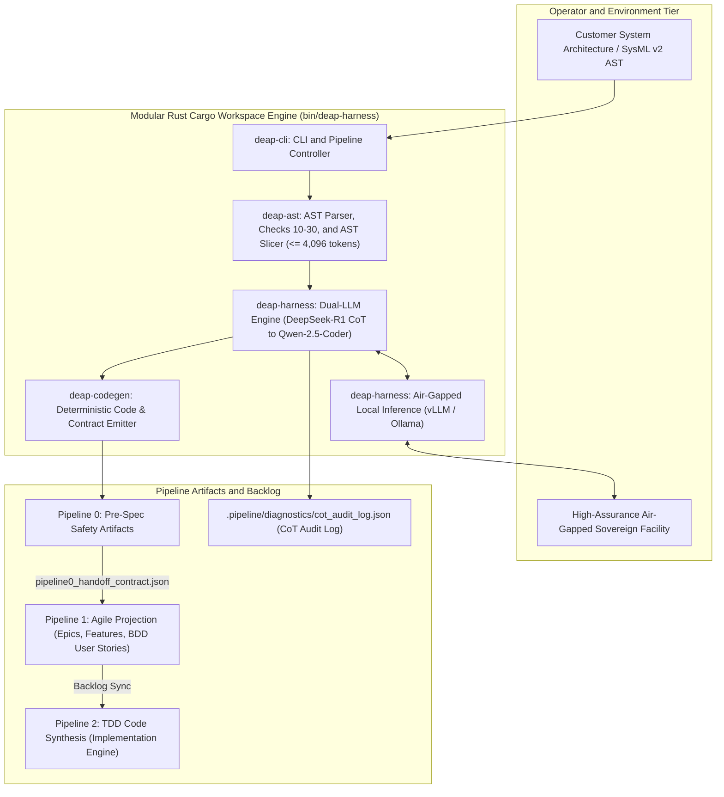
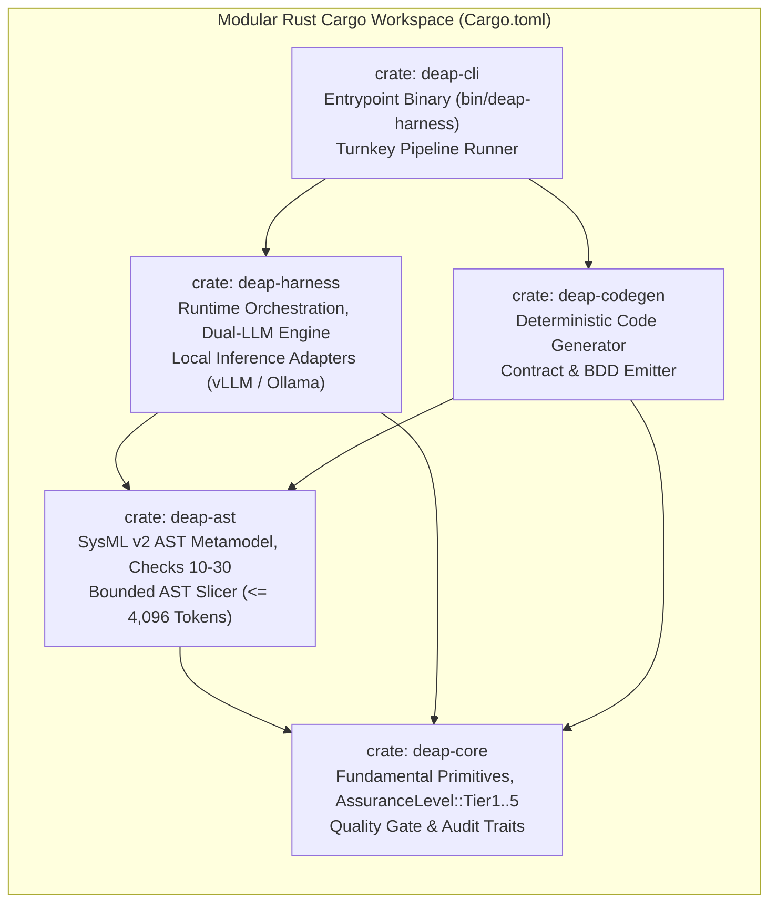

# DEAP Agent Orchestration Harness (DEAP-Harness) -- DeepSeek Engine Integration Blueprint

| Attribute | Specification Detail |
| :--- | :--- |
| **Version** | 1.1.0 |
| **Date** | 2026-09-22 |

> **Document Identifier:** `DEAP-BLUEPRINT-HARNESS-001`  
> **Status:** `APPROVED / PRODUCTION-GRADE`  
> **Classification:** `Modular Pure Rust Cargo Workspace Architecture & Native Harness Orchestration`  
> **Target Frameworks:** `JARUS SORA v2.5` | `ASTM F3269-17 RTA` | `RTCA DO-178C` | `RTCA DO-365B DAA` | `AssuranceLevel::Tier1..5`  
> **Primary Technology Profile:** `Modular Cargo Workspace: deap-core, deap-ast, deap-codegen, deap-harness, deap-cli`

---

## 1. Executive Summary & Product Branding

The **DEAP Agent Orchestration Harness (`DEAP-Harness`)**, powered by the **DEAP-Seek Agent Engine**, establishes a unified, open-source, air-gapped agentic orchestration framework for the Digital Engineering Agent Platform (DEAP).

Formally architected as a **Modular Pure Rust Cargo Workspace Architecture**, the platform organizes compilation, strongly-typed AST slicing (<= 4,096 tokens), and dual-LLM agentic orchestration across five cohesive crates:
1. **`deap-core`**: Core systems engineering metamodel abstractions, AST traits, and formal assurance level definitions (`AssuranceLevel::Tier1..5`).
2. **`deap-ast`**: Strongly-typed SysML v2 AST parsing, semantic model validation (Checks 10--30), and bounded AST context slicing ($\le 4,096$ tokens per dispatch).
3. **`deap-codegen`**: Deterministic code synthesis, BDD scenario generation, and formal contract emitter engines.
4. **`deap-harness`**: High-performance asynchronous execution engine managing local inference providers, Dual-LLM Chain-of-Thought (CoT) extraction (DeepSeek-R1 `<think>` reasoning slot streaming to `.pipeline/diagnostics/cot_audit_log.json`), and Qwen-2.5-Coder execution slot coordination.
5. **`deap-cli`**: Consolidated command-line entrypoint (`bin/deap-harness`) providing turnkey multi-pipeline execution (`deap-harness run`).

This architecture ties **Pipeline 0 (Pre-Spec Safety Engineering)**, **Pipeline 1 (Agile Backlog Projection)**, and **Pipeline 2 (TDD Code Synthesis)** into an end-to-end, autonomous, self-hosted engineering pipeline with enterprise-grade commercial IP protection and zero customer-visible source code.



---

## 2. Core Architectural Objectives

1. **Air-Gapped & Off-Grid Defense Operations**:
   Enable high-assurance organizations operating under DO-178C / DO-254 or SORA SAIL High-Risk categories to execute complete DEAP pipelines in 100% air-gapped labs without transmitting proprietary control laws, CONOPS, or safety statecharts to cloud LLM endpoints.

2. **Deterministic Chain-of-Thought (CoT) Safety Audit Evidence**:
   Automatically capture and archive raw DeepSeek-R1 reasoning traces (`<think>...</think>`) into `.pipeline/diagnostics/cot_audit_log.json`. Every safety constraint ($SC-1..N$), System-Theoretic Process Analysis (STPA) Unsafe Control Action ($UCA-1..N$), and Run-Time Assurance (RTA) switching threshold is backed by immutable, traceable LLM reasoning evidence for multi-authority regulatory reviews (AssuranceLevel::Tier1..5).

3. **Autonomous End-to-End Pipeline State Machine**:
   Eliminate manual human context-switching between pipeline stages. `DEAP-Harness` orchestrates the handoff from Pipeline 0 (SysML v2 textual model and `pipeline0_handoff_contract.json`) to Pipeline 1 (Agile backlog generation) and Pipeline 2 (serial subagent RED-GREEN TDD code synthesis) with automated quality gate enforcement (`verify_model_coverage.py`, `verify_downstream_baseline.py`).

---

## 3. System Architecture & Component Topology

`DEAP-Harness` is structured into five cohesive Cargo workspace crates coordinating native execution across discrete token slots:

```mermaid
flowchart LR
    CLI["deap-cli (deap-harness run)"] --> ConfigLoader["Configuration & Profile Loader (deap_harness_config.yaml)"]
    ConfigLoader --> ProviderManager["Inference Provider Manager (Provider Abstraction)"]
    ProviderManager --> ASTSlicer["deap-ast: Strongly-Typed AST Slicer (<= 4,096 tokens)"]
    ASTSlicer --> DualEngine["deap-harness: Dual-LLM Engine (DeepSeek-R1 CoT -> Qwen-2.5-Coder)"]
    DualEngine --> SubagentDispatcher["Context-Isolated Subagent Dispatcher"]
    SubagentDispatcher --> GateEnforcer["deap-core: Constitutional Quality Gate Enforcer"]
```



### 3.1 Dual-LLM Air-Gapped Agent Dispatch Pattern (DeepSeek-R1 -> Qwen-2.5-Coder)

`DEAP-Harness` establishes a deterministic **Dual-LLM Air-Gapped Agent Dispatch** pattern that decouples deep mathematical reasoning from high-speed code synthesis:

1. **Reasoning Slot (DeepSeek-R1)**:
   - **Role**: Mathematical, architectural, and safety invariant reasoning (STPA hazard analysis, SORA SAIL risk bounds, SysML v2 metamodel consistency, and temporal logic).
   - **Streaming CoT Audit**: Emits raw `<think>...</think>` Chain-of-Thought tokens streamed directly to `.pipeline/diagnostics/cot_audit_log.json` with cryptographic SHA-256 verification.
   - **Contract Synthesis**: Emits verified semantic specifications and JSON handoff contracts (`pipeline0_handoff_contract.json`).

2. **Execution Slot (Qwen-2.5-Coder)**:
   - **Role**: Deterministic code generation, BDD scenario realization, ROS 2 C++ / SPARK Ada 2014 implementation, and artifact packaging.
   - **Bounded Context**: Ingests the finalized reasoning state along with bounded, strongly-typed AST slices (<= 4,096 tokens) partitioned by `deap-ast`.
   - **High-Velocity Synthesis**: Runs with low temperature ($T = 0.1$) for deterministic, syntax-compliant code synthesis with zero hallucinated API methods.

### 3.2 Modular Cargo Workspace Architecture

The DEAP platform transitions from legacy hybrid languages to a **Modular Pure Rust Cargo Workspace**, ensuring compile-time memory safety, thread safety, zero-cost abstractions, and sub-millisecond execution:



#### 3.2.1 Workspace Crate Breakdown

1. **`deap-core`**:
   - Fundamental types, error taxonomies (`DeapError`), cryptographic hashing utilities, and abstract assurance definitions (`AssuranceLevel::Tier1` through `AssuranceLevel::Tier5`).
   - Shared traits for pipeline stage transitions, AST node visitors, and audit record writers.

2. **`deap-ast`**:
   - Strongly-typed SysML v2 textual model parser and KerML AST metamodel representation.
   - Automated 22-gate mechanical parity validator enforcing Checks 10 through 30.
   - **Strongly-Typed AST Slicer**: Context partitioner that slices complex, multi-thousand-node SysML v2 models into self-contained, semantically closed sub-graphs of $\le 4,096$ tokens for LLM context optimization.

3. **`deap-codegen`**:
   - Template and AST-driven code emitters for ROS 2 C++, PX4 Autopilot modules, SPARK Ada 2014, and Python.
   - Deterministic markdown specification synthesizers (Epics, Features, BDD User Stories, Use Cases).

4. **`deap-harness`**:
   - Async runtime built on `tokio` managing local air-gapped inference endpoints (Ollama, vLLM).
   - Dual-LLM agentic coordination engine streaming DeepSeek-R1 `<think>` traces to `.pipeline/diagnostics/cot_audit_log.json` and dispatching tasks to Qwen-2.5-Coder.
   - Context-isolated subagent supervision, retry budgets, and error recovery policies.

5. **`deap-cli`**:
   - Turnkey CLI entrypoint producing the compiled native executable `bin/deap-harness`.
   - Dispatches subcommands: `run`, `check`, `slice-ast`, `export-audit`, and `ui`.

### 3.3 Strongly-Typed AST Slicing Mechanics ($\le 4,096$ Tokens)

To prevent LLM context saturation and reasoning degradation during large-scale system synthesis, `deap-ast` enforces strongly-typed AST slicing:

$$\text{AST}_{\text{slice}} = \text{Closure}(\mathcal{N}_{\text{target}}, \mathcal{E}_{\text{deps}}) \quad \text{such that} \quad |\text{Tokens}(\text{AST}_{\text{slice}})| \le 4096$$

* **Semantic Closure Extraction**: For any target component, part definition, or action definition $\mathcal{N}_{\text{target}}$, the slicer traverses ports, bindings, and type hierarchies, extracting only necessary invariant boundaries.
* **Bounded Context Allocation**: Every subagent dispatch receives exactly one slice (<= 4,096 tokens), guaranteeing deterministic attention and eliminating hallucinations caused by bloated prompt windows.

---

## 4. End-to-End Multi-Pipeline Orchestration Workflow

The sequence diagram below illustrates how `DEAP-Harness` drives an autonomous multi-pipeline run:


---

## 5. Regulatory Chain-of-Thought (CoT) Audit Log Specification

Every invocation managed by `DEAP-Harness` automatically generates a structured audit record stored at `.pipeline/diagnostics/cot_audit_log.json`:

```json
{
  "$schema": "https://deap.engine/schemas/cot_audit_v1.json",
  "audit_metadata": {
    "execution_id": "EXEC-20260816-DEAPSEEK-001",
    "timestamp": "2026-08-16T22:14:00Z",
    "model_reasoning_engine": "deepseek-r1:70b-q4_K_M",
    "tool_execution_engine": "qwen2.5-coder:32b-q4_K_M",
    "air_gapped_mode": true,
    "inference_provider": "local_ollama_rocm"
  },
  "pipeline_stage": "PIPELINE_0_STPA_HAZARD_ANALYSIS",
  "target_artifact": "docs/safety/STPA_MATRIX.md",
  "reasoning_trace": {
    "raw_think_block": "Analyzing pitch command saturation under high-wind urban gusts (CONOPS Phase: Cruise/Inspection). STPA UCA-1 identifies provided-wrong-or-out-of-range pitch commands leading to Loss L-1 (UFIT). To enforce RTA safety net switching under ASTM F3269-17, pitch rate must be clamped between -15 deg and +25 deg before sending commands to actuator topics.",
    "extracted_safety_constraints": [
      {
        "id": "SC-1",
        "stpa_uca_ref": "UCA-1",
        "hazard_ref": "H-1",
        "derived_boundary": "pitch_deg >= -15.0 && pitch_deg <= 25.0",
        "assurance_level": "AssuranceLevel::Tier1"
      }
    ]
  },
  "verification_status": {
    "syntax_valid": true,
    "gate_exit_code": 0
  }
}
```

---

## 6. DEAP-Harness Configuration & Execution Interface

### 6.1 Configuration File (`deap_harness_config.yaml`)

```yaml
version: "1.1"
harness_branding: "DEAP-Harness / Pure Rust Engine"

compiler:
  engine: "cargo_workspace"
  crates: ["deap-core", "deap-ast", "deap-codegen", "deap-harness", "deap-cli"]
  timeout_ms: 5000
  strict_checks: true

provider:
  type: "ollama" # Options: ollama, vllm, sglang
  base_url: "http://localhost:11434"
  api_key: "DEAP_LOCAL_AIRGAPPED_TOKEN"

models:
  reasoning: "deepseek-r1:70b-q4_K_M"
  execution: "qwen2.5-coder:32b-instruct-q4_K_M"

ast_slicing:
  enabled: true
  max_slice_tokens: 4096
  strategy: "semantic_closure"

pipeline_settings:
  pipeline0:
    auto_ingest_sysml: true
    default_schema_path: "docs/architecture/blueprints/DEAP_MODEL.sysml"
  pipeline1:
    reconcile_backlog_on_completion: true
  pipeline2:
    enforce_tdd_red_green: true
    target_profile: "ros2_cpp" # Options: ros2_cpp, spark_ada, python

audit_logging:
  enabled: true
  output_path: ".pipeline/diagnostics/cot_audit_log.json"
```

### 6.2 CLI Usage Commands

```bash
# 1. Execute full turnkey pipeline run via native compiled deap-harness binary
./bin/deap-harness run --schema docs/architecture/blueprints/DEAP_MODEL.sysml --profile ros2_cpp

# 2. Invoke deap-ast directly for deterministic AST validation and Checks 10-30
cargo run -p deap-cli -- check --schema docs/architecture/blueprints/DEAP_MODEL.sysml --strict

# 3. Compile ConOps and generate handoff contract via deap-codegen
cargo run -p deap-cli -- compile --schema docs/architecture/blueprints/DEAP_MODEL.sysml --output pipeline0_handoff_contract.json

# 4. Launch air-gapped agentic orchestration harness with dual-LLM CoT capture
./bin/deap-harness pipeline0 --sysml docs/architecture/blueprints/DEAP_MODEL.sysml

# 5. Export regulatory CoT audit evidence package (AssuranceLevel::Tier1..5)
./bin/deap-harness export-audit --output-dir docs/safety/audit_evidence/
```

### 6.3 Web GUI Dashboard & Interactive Command Center

`DEAP-Harness` ships with an integrated, local Web GUI Dashboard (`http://localhost:3000`) for interactive pipeline monitoring, visual safety auditing, and human-in-the-loop governance:

#### 6.3.1 Key Web GUI Subsystem Modules:
1. **Live Chain-of-Thought (CoT) Streamer**:
   Real-time WebSocket rendering of DeepSeek-R1 reasoning steps (`<think>...</think>`) side-by-side with generated artifacts (`CONOPS.md`, `STPA_MATRIX.md`, `DEAP_MODEL.sysml`).
2. **Interactive Multi-Pipeline DAG Visualizer**:
   Visual node graph tracking real-time progress across Pipeline 0 (Worker 0A → 0B → 0C) → Pipeline 1 (Agile Backlog Projection) → Pipeline 2 (TDD Micro-tasks).
3. **STPA Hazard & SORA SAIL Audit Explorer**:
   Searchable grid mapping System Hazards ($H-1..N$), Unsafe Control Actions ($UCA-1..N$), Safety Constraints ($SC-1..N$), and Operational Safety Objectives (OSOs) directly to CoT reasoning logs.
4. **Human-in-the-Loop Review & Approval Gates**:
   Interactive modal gates allowing Product Owners and Safety Officers to review and approve generated AST handoff contracts (`pipeline0_handoff_contract.json`) before downstream TDD code synthesis begins.

#### 6.3.2 Web GUI Launch Commands:

```bash
# 1. Launch DEAP-Harness Web GUI Dashboard
./bin/deap-harness ui --port 3000

# 2. Launch Web GUI in air-gapped local mode with real-time CoT streaming
./bin/deap-harness ui --local --stream-cot --air-gapped
```

### 6.4 VS Code & IDE Native Integration Architecture

`DEAP-Harness` CLI and Web GUI are 100% usable directly inside **Visual Studio Code (VS Code)** through four native integration modes:

#### 6.4.1 Integrated Terminal Execution (Zero Setup)
Run all `deap-harness` CLI commands directly within VS Code's integrated terminal (`Cmd+\`` / `Ctrl+\``):
```bash
./bin/deap-harness run --schema docs/architecture/blueprints/DEAP_MODEL.sysml --compiler-bin ./bin/deap --profile ros2_cpp
```

#### 6.4.2 VS Code Build & Task Automation (`.vscode/tasks.json`)
Bind `deap-harness` commands directly to VS Code build tasks (`Cmd+Shift+B` / `Ctrl+Shift+B`):
```json
{
  "version": "2.0.0",
  "tasks": [
    {
      "label": "DEAP: Run Full Safety & Synthesis Pipeline",
      "type": "shell",
      "command": "${workspaceFolder}/bin/deap-harness run --schema ${workspaceFolder}/docs/architecture/blueprints/DEAP_MODEL.sysml --compiler-bin ${workspaceFolder}/bin/deap --profile ros2_cpp",
      "group": { "kind": "build", "isDefault": true },
      "presentation": { "reveal": "always", "panel": "new" }
    },
    {
      "label": "DEAP: Launch CoT Web GUI Dashboard",
      "type": "shell",
      "command": "${workspaceFolder}/bin/deap-harness ui --port 3000 --stream-cot",
      "isBackground": true
    }
  ]
}
```

#### 6.4.3 Embedded VS Code Webview Panel
Embed the interactive Web GUI directly inside a VS Code editor tab alongside your code using Simple Browser or the `DEAP-Harness VS Code Extension`:
```bash
./bin/deap-harness ui --vscode
```

#### 6.4.4 AI Agent Sidecar Protocol (Antigravity / Claude Code / Cursor / Gemini CLI)
The `deap-harness` CLI exposes a local REST/WebSocket sidecar daemon (`http://localhost:8000`) that AI agent extensions inside VS Code call via standard process hooks to ingest `.pipeline/diagnostics/cot_audit_log.json` and execute subagent dispatches natively.

### 6.5 Modular Cargo Workspace Build & Compilation Pipeline

The pure Rust compiler and harness release architecture uses Cargo workspace compilation executed during upstream packaging:

#### 6.5.1 Workspace Compilation (`target/release/deap-harness`)
All five crates (`deap-core`, `deap-ast`, `deap-codegen`, `deap-harness`, `deap-cli`) are compiled in release mode with Link-Time Optimization (LTO):

```bash
# Configure release build with LTO and codegen optimization
cargo build --workspace --release

# Strip debug symbols for distribution
strip -s target/release/deap-harness -o bin/deap-harness

# Stage binary
chmod +x bin/deap-harness
```

#### 6.5.2 Automated AST Slicing & Verification
```bash
# Verify AST slicing constraint (<= 4,096 tokens) across target schema models
./bin/deap-harness check-ast --max-tokens 4096 --schema docs/architecture/blueprints/DEAP_MODEL.sysml

# Execute baseline conformance gate
python3 scripts/verify_downstream_baseline.py --no-domain
```

---

## 7. Commercial Release Packaging & Zero-Source Distribution Standard

To preserve enterprise intellectual property while providing maximum transparency and agentic steerability, DEAP enforces a strict **Two-Tier Separation Standard**:

### 7.1 Tier 1: Upstream Source Repository (`DEAP01-spec-core`)
The upstream repository is the confidential engineering core containing full source code and engineering assets:
* **Cargo Workspace Crates**: Located in `crates/deap-*` (`crates/deap-core`, `crates/deap-ast`, `crates/deap-codegen`, `crates/deap-harness`, `crates/deap-cli`), implementing the AST metamodel, SysML v2 parsing, AST slicing (<= 4,096 tokens), and dual-LLM orchestration with complete rustdoc documentation.
* **Build System & Packaging Automation**: Workspace `Cargo.toml`, Cargo lockfiles, and packaging scripts.
* **Test Suites & Continuous Integration**: Semantic acceptance tests, formal verification suites, and CI pipelines validating compiler and harness invariants.

### 7.2 Tier 2: Downstream Customer Deliverable (Zero-Source Binary Distribution)
Downstream customer repositories and on-premises client distributions receive a clean, zero-source operational deployment:
* **Binary Tier (`bin/`)**: Contains only the pre-compiled native executable:
  * `bin/deap-harness` (Statically compiled native Rust binary, stripped)
* **Strict Zero-Source Invariant**: Downstream customer workspaces contain **exactly 0 `.rs`, 0 `.py`, 0 `.cpp`, and 0 `.hpp` files**. Customers cannot view, decompile, or tamper with proprietary compiler or harness algorithms.
* **Compile-Time Hardening & Optimization**:
  * Compiled with `opt-level = 3`, `lto = "fat"`, and `codegen-units = 1`.
  * Stripped of all debugging and symbol tables using `strip -s`.
* **Plain Markdown Governance Layer**: Retained in plain human- and agent-readable Markdown so that AI coding agents (Antigravity, Claude Code, Cursor, Gemini CLI) can seamlessly parse and enforce constitutional requirements:
  * `.pipeline/constitution.md` (Constitutional rules, quality gates, and invariant definitions)
  * `AGENTS.md` and `.agents/AGENTS.md` (Agent role boundaries and tool discipline)
  * `rules/*.md` (Specific operational rules and constraints)
  * `skills/*/SKILL.md` (Agent skill definitions and workflows)
  * `schema/` (Clean landing zone for customer SysML v2 / schema inputs)

---

## 8. Downstream Roadmap & Migration Schedule

The transition to the modular Rust workspace release architecture follows a four-phase rollout schedule:

| Phase | Milestone | Scope & Deliverables | Verification Gate |
| :--- | :--- | :--- | :--- |
| **Phase 1** | **Modular Cargo Workspace & AST Slicing Specification** | Define workspace crates (`deap-core`, `deap-ast`, `deap-codegen`, `deap-harness`, `deap-cli`); formalize strongly-typed AST slicing (<= 4,096 tokens) and dual-LLM CoT audit contract. | Cargo workspace manifests validated; AST slicing schemas verified. |
| **Phase 2** | **Core Engine Checks 10--30 & AST Metamodel Implementation** | Implement native SysML v2 AST parser, AST metamodel, formal Checks 10--30, and deterministic ConOps synthesis (`deap-ast`). Achieve sub-millisecond execution and complete rustdoc API docs. | 100% mechanical parity across Checks 10--30; `cargo check --workspace` passes. |
| **Phase 3** | **Dual-LLM Air-Gapped Harness Hardening** | Implement async Tokio runtime, local provider adapters (Ollama, vLLM), DeepSeek-R1 CoT streaming to `.pipeline/diagnostics/cot_audit_log.json`, and Qwen-2.5-Coder execution slot (`deap-harness`). | End-to-end air-gapped run on clean workstation without external network access. |
| **Phase 4** | **Zero-Source Downstream Packaging & Verification Pipeline** | Implement downstream installer (`scripts/install_pipeline.sh`) deploying only `bin/deap-harness` and markdown governance. Verify downstream repository contains 0 source code files. | Downstream zero-source audit passes; end-to-end pipeline run succeeds. |

### 8.1 Maintenance & Upstream Tracking
1. **Repository Target**: Hosted centrally under `docs/architecture/blueprints/DEAP_DEEPSEEK_HARNESS_INTEGRATION_BLUEPRINT.md` in [`DEAP01-spec-core`](https://github.com/gintatkinson/DEAP01-spec-core).
2. **Backlog Reconciliation**: Integrated into `DEAP_SPECIFICATIONS_SITEMAP.md` as the authoritative commercial market release architecture.
3. **Execution Script**: Implementation entry points provided via `bin/deap-harness`, with installation automation managed via `scripts/install_pipeline.sh`.

