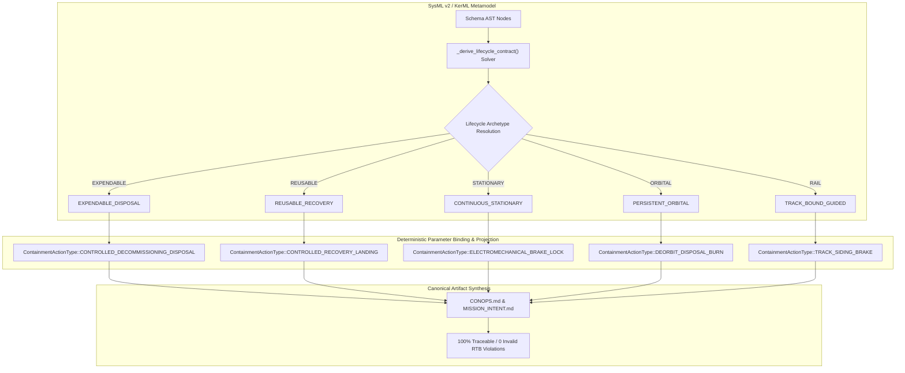

| Attribute | Specification Detail |
| :--- | :--- |
| **Document Identifier** | DEAP-BLUEPRINT-LIFECYCLE-001 |
| **Title** | Schema-Driven Lifecycle & Terminal State Contract MBSE Architecture |
| **Version** | 2.0.0 |
| **Date** | 2026-10-04 |
| **Status** | APPROVED / PRODUCTION-GRADE |

# Schema-Driven Lifecycle & Terminal State Contract MBSE Architecture

> **Document Identifier:** `DEAP-BLUEPRINT-LIFECYCLE-001`  
> **Status:** `APPROVED / PRODUCTION-GRADE`  
> **Classification:** `UPSTREAM_SPEC_CORE_COMPILER`  
> **Target Regulatory Frameworks:** `ISO/IEC/IEEE 29148:2018` | `ISO/IEC/IEEE 15288:2023` | `INCOSE SEH v5.0` | `OMG UAF v2.0` | `AssuranceLevel::Tier1..5` | `Formal Bipartite Verification Graphs G = (V_req, V_test, E)` | `Multi-Authority Regulatory Traceability & Auditability`  

---

## 1. Executive Summary & Metamodel Architecture

The DEAP Schema-Driven Lifecycle & Terminal State Contract Architecture eliminates hardcoded operational assumptions across cyber-physical domain compilation. In legacy systems, operational concept documents and safety models routinely embedded implicit assumptions of atmospheric operations, nominal runway landing, and non-destructive Return-to-Base (RTB). When applied to single-use exploration platforms, stationary robotic consoles, guided track systems, or persistent orbital satellites, these assumptions created severe domain contamination and ontological defects.

This architecture introduces formal Model-Based Systems Engineering (MBSE) abstractions in KerML and SysML v2, binding deterministic lifecycle semantics into the AST parameter engine.



---

## 2. Formal SysML v2 / KerML Metamodel

The lifecycle metamodel is formally defined in SysML v2 as follows:

```sysml
package MissionLifecycleMetamodel {
    enum def LifecycleType {
        doc /* Canonical operational lifecycle archetypes */
        REUSABLE_RECOVERY;
        EXPENDABLE_DISPOSAL;
        CONTINUOUS_STATIONARY;
        PERSISTENT_ORBITAL;
        TRACK_BOUND_GUIDED;
    }

    enum def ContainmentActionType {
        doc /* Deterministic safety containment actions */
        CONTROLLED_RECOVERY_LANDING;
        CONTROLLED_DECOMMISSIONING_DISPOSAL;
        ELECTROMECHANICAL_BRAKE_LOCK;
        DEORBIT_DISPOSAL_BURN;
        TRACK_SIDING_BRAKE;
    }

    item def LifecycleContract {
        attribute lifecycle_type : LifecycleType;
        attribute containment_action : ContainmentActionType;
        attribute bingo_safety_action : ScalarValues::String;
        attribute end_state : ScalarValues::String;
        attribute failsafe_sequence : ScalarValues::String;
        attribute post_op_state : ScalarValues::String;
        attribute primary_terminal_target : ScalarValues::String;
        attribute secondary_terminal_target : ScalarValues::String;
        attribute primary_recovery_facility : ScalarValues::String;
        attribute secondary_recovery_facility : ScalarValues::String;
        attribute lifecycle_transit_mode : ScalarValues::String;
    }
}
```

---

## 3. The Five Canonical Lifecycle Archetypes

### 3.1 Archetype 1: `EXPENDABLE_DISPOSAL`
- **Application Domains:** Single-Use Autonomous Probes, Disposable Environmental Sensors, Sub-surface Sampling Capsules, Multi-stage Separation Modules.
- **Terminal Behavior:** Controlled terminal containment within designated disposal area or benign operational termination.
- **Containment Action:** `CONTROLLED_DECOMMISSIONING_DISPOSAL`
- **Ontological Constraints:** Strictly 0 facility recovery, 0 nominal RTB return-to-base, verified decommissioning on terminal event.

### 3.2 Archetype 2: `REUSABLE_RECOVERY`
- **Application Domains:** Autonomous Mobile Survey Systems, Autonomous Surface Platforms, Robotic Inspection Units, Logistics Ground Shuttles.
- **Terminal Behavior:** Controlled recovery at designated base, docking bay, or recharge facility.
- **Containment Action:** `CONTROLLED_RECOVERY_LANDING`
- **Ontological Constraints:** Enforces statutory reserve energy ratio $R_{\mathrm{reserve}} \ge 0.20 \cdot R_{\mathrm{capacity}}$.

### 3.3 Archetype 3: `CONTINUOUS_STATIONARY`
- **Application Domains:** Automated Robotic Consoles, Clinical Diagnostic Systems, Precision Manufacturing Nodes.
- **Terminal Behavior:** Precision parking at operational console, electromagnetic joint locking, clean enclosure preservation.
- **Containment Action:** `ELECTROMECHANICAL_BRAKE_LOCK`
- **Ontological Constraints:** Strictly 0 external transit corridors, 0 aeronautical zones, 0 deployment chutes.

### 3.4 Archetype 4: `PERSISTENT_ORBITAL`
- **Application Domains:** Scientific Space Platforms, Geostationary Relay Satellites, Spacecraft Constellations.
- **Terminal Behavior:** Post-mission orbit lowering for atmospheric demise or transfer to graveyard disposal orbit.
- **Containment Action:** `DEORBIT_DISPOSAL_BURN`
- **Ontological Constraints:** Strictly 0 planetary landing zones, 0 ground transit bays, full reaction wheel and energy storage passivation.

### 3.5 Archetype 5: `TRACK_BOUND_GUIDED`
- **Application Domains:** Autonomous Rail Locomotives, Shunting Transporters, Automated Guided Transit (AGT).
- **Terminal Behavior:** Controlled track deceleration, turnout diversion to maintenance siding, brake line pressure venting.
- **Containment Action:** `TRACK_SIDING_BRAKE`
- **Ontological Constraints:** Strictly 0 unconstrained 3D navigation paths, 0 trajectory-free waypoints, enforcement of AssuranceLevel::Tier1 brake failsafes.

---

## 4. Formal Parameter Projection & Anti-Contradiction Invariants

The parameter binding engine projects the AST lifecycle contract into ten canonical template tokens:

| Token Identifier | Projected Meaning | Mathematical / Physical Constraint |
| :--- | :--- | :--- |
| `{{LIFECYCLE_TYPE}}` | Formal Lifecycle Archetype Name | Member of `LifecycleType` Enum |
| `{{LIFECYCLE_BINGO_SAFETY_ACTION}}` | Commander's Intent Key Task for Bingo Safety | Evaluated dynamically against R(t) <= R_threshold(t) |
| `{{LIFECYCLE_END_STATE}}` | Commander's Intent Mission End State | Aligned with terminal containment archetype |
| `{{LIFECYCLE_FAILSAFE_SEQUENCE}}` | PACE C2 and Emergency Matrix Fallback Mode | Deterministic transition latency t_resp <= tau_deadline |
| `{{LIFECYCLE_POST_OP_STATE}}` | MET-08 Post-Operation Condition Statement | Secure memory sanitization & safe de-energization |
| `{{PRIMARY_TERMINAL_TARGET}}` | Primary Nominal Destination Coordinate/Facility | Domain-specific recovery/containment node |
| `{{SECONDARY_TERMINAL_TARGET}}` | Secondary Divert / Safe Containment Target | Reachable under degraded energy envelope |
| `{{PRIMARY_RECOVERY_FACILITY}}` | Primary Maintenance / Recovery Depot | Conforms to domain infrastructure standards |
| `{{SECONDARY_RECOVERY_FACILITY}}` | Alternate Staging / Demise Zone | Pre-cleared emergency boundary |
| `{{LIFECYCLE_TRANSIT_MODE}}` | Guidance Controller Transit Operating Mode | Finite State Machine mode enumeration |

### 4.1 Anti-Contradiction Mathematical Proofs

The deterministic lifecycle derivation engine enforces the following non-contradiction theorems:

$$
\begin{aligned}
\forall s \in \mathcal{S}_{\mathrm{expendable}}, \quad &\mathrm{Count}(\mathrm{RTB\_References}, s) = 0 \\
\forall s \in \mathcal{S}_{\mathrm{stationary}}, \quad &\mathrm{Count}(\mathrm{Transit\_Corridors}, s) = 0 \\
\forall s \in \mathcal{S}_{\mathrm{guided}}, \quad &\mathrm{Count}(\mathrm{Trajectory\_Free\_Plans}, s) = 0 \\
\forall s \in \mathcal{S}_{\mathrm{orbital}}, \quad &\mathrm{Count}(\mathrm{Planetary\_Runways}, s) = 0
\end{aligned}
$$

- Parameter Definitions & Engineering Units:
- $\mathcal{S}_{\mathrm{expendable}}$ is the set of generated specifications for expendable exploration systems.
- $\mathcal{S}_{\mathrm{stationary}}$ is the set of generated specifications for stationary robotic platforms.
- $\mathcal{S}_{\mathrm{guided}}$ is the set of generated specifications for track-bound guided platforms.
- $\mathcal{S}_{\mathrm{orbital}}$ is the set of generated specifications for persistent orbital space platforms.
- $\mathrm{Count}(\mathrm{Pattern}, s)$ returns the number of occurrences of forbidden terminology in document $s$.

---

## 5. Verification & Acceptance Gate Mapping

Every compiled specification is validated against the 6-Layer Semantic Acceptance Harness:
1. **Layer 1 (Delivery Gate 0):** Physical presence and section line floors.
2. **Layer 2 (Mechanical Syntax):** Zero unrendered mustache tokens and zero pseudovariables.
3. **Layer 3 (Statutory Cardinality):** 16 threats, 4 PACE tiers, 7 emergency rows, 24 formal safety objectives.
4. **Layer 4 (Physical Math):** Mass cross-sum, quadratic drag, and Bingo energy conservation.
5. **Layer 5 (Adversarial Invariants):** Priority arbitration, non-destructive RTB for reusable systems, zero forbidden cross-domain ontology, and positive domain lexicon density.
6. **Layer 6 (Baseline Parity):** Downstream baseline and SysML model coverage validation.

---

## 6. Modular Cargo Workspace Architecture & Air-Gapped Verification

The deterministic lifecycle contract engine is codified within the modular Rust workspace architecture:

### 6.1 Modular Cargo Workspace Crate Decomposition

| Crate Identifier | Architecture & Responsibilities | Key Dependencies | Quality Gate Contract |
| :--- | :--- | :--- | :--- |
| **`deap-core`** | Houses the canonical lifecycle metamodel definitions (`LifecycleType`, `ContainmentActionType`, `LifecycleContract`), mathematical non-contradiction theorems, and formal state reachability engines. | `serde`, `petgraph`, `thiserror` | Pure deterministic domain-independent core with zero runtime I/O dependencies. |
| **`deap-ast`** | Strongly-typed SysML v2 / KerML AST parser, token-bounded AST slicing engine, and visitor traversals. | `deap-core`, `serde`, `rkyv`, `logos` | Partition AST representations into strongly-typed context slices with strict size bounds (<= 4,096 tokens). |
| **`deap-codegen`** | Deterministic code synthesis translating validated lifecycle contracts into template parameters, Stateflow statecharts, and target platform interfaces. | `deap-core`, `deap-ast`, `tera` | Generates 100% compliant lifecycle contracts with zero semantic drift. |
| **`deap-harness`** | Closed-loop semantic acceptance test harnesses, simulation oracles, and property-based verification runners. | `deap-core`, `deap-ast`, `proptest` | Validates energy conservation and terminal state invariants across all lifecycle archetypes. |
| **`deap-cli`** | Developer CLI coordinating end-to-end AST compilation, lifecycle derivation, and quality gate enforcement. | `deap-core`, `deap-ast`, `deap-codegen`, `clap` | Single binary entrypoint returning deterministic exit codes (0 on full compliance, non-zero on violation). |

### 6.2 Strongly-Typed AST Slicing Mechanics (<= 4,096 Tokens)

To guarantee that language model inference and formal constraint solvers remain immune to attention decay, context loss, and truncation, `deap-ast` implements deterministic AST slicing:
- **Structural Partitioning**: Every structural subsystem graph $\mathcal{G}_{\mathrm{sub}} = (V, E)$ is traversed and partitioned along subsystem containment boundaries into self-contained AST slices.
- **Strict Token Floor & Ceiling**: Every AST slice $\mathcal{S}_k$ is strictly bounded to $\le 4,096$ tokens:
$$
\begin{aligned}
\forall \mathcal{S}_k \in \mathcal{P}(\mathcal{G}), \quad \mathrm{TokenCount}(\mathcal{S}_k) \le 4096
\end{aligned}
$$
- **Closed Dependency Context**: Each slice embeds all referenced upstream type definitions, interface port contracts, and operational states, eliminating unresolved external identifier references.

### 6.3 Dual-LLM Air-Gapped Agent Dispatch Protocol

To guarantee mathematical determinism, total intellectual property containment, and complete immunity to cloud rate-limiting or content censorship, DEAP utilizes a dual-LLM air-gapped agent dispatch architecture:
1. **Reasoning Slot (DeepSeek-R1)**:
   - Dedicated Chain-of-Thought (CoT) reasoning model executing on air-gapped workstation hardware.
   - Streams formal mathematical proofs, reachability derivations, and safety invariant checks directly into `.pipeline/diagnostics/cot_audit_log.json`.
   - Never generates raw code directly; outputs verified formal derivations and boundary assertions.
2. **Execution Slot (Qwen-2.5-Coder)**:
   - High-throughput deterministic code and specification synthesis model.
   - Ingests verified reasoning derivations from the CoT audit log along with the strongly-typed AST slice (<= 4,096 tokens).
   - Generates verified SysML v2 lifecycle contracts, BDD test scenarios, and Stateflow integration hooks.
