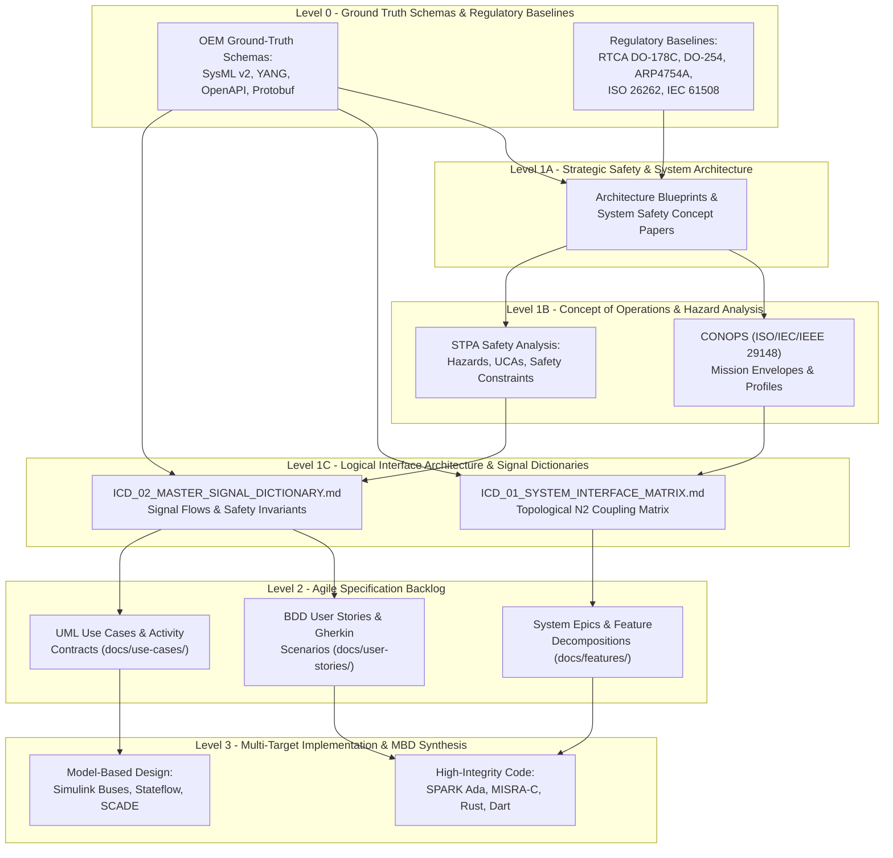
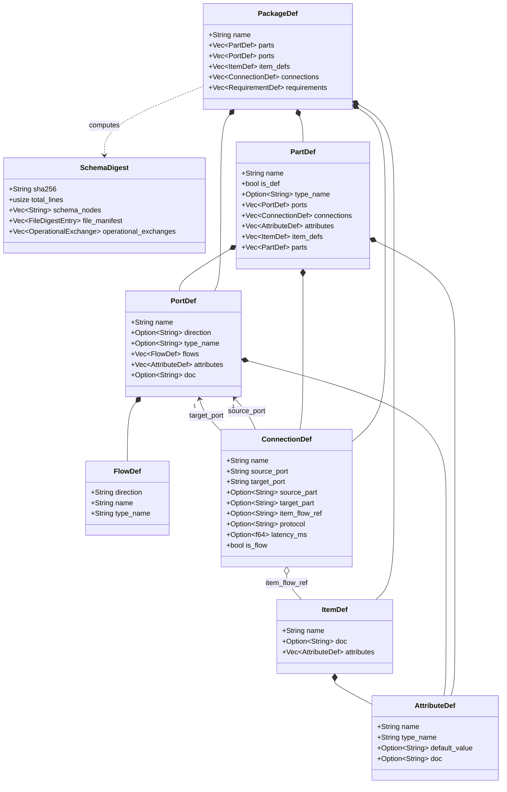
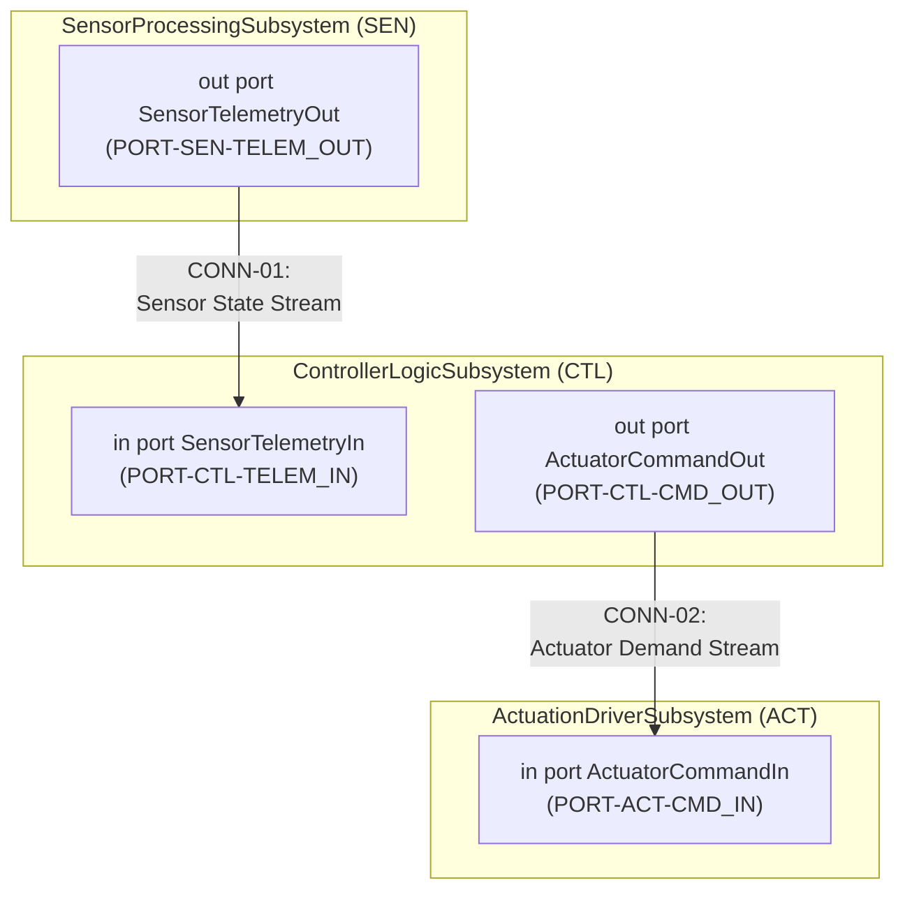
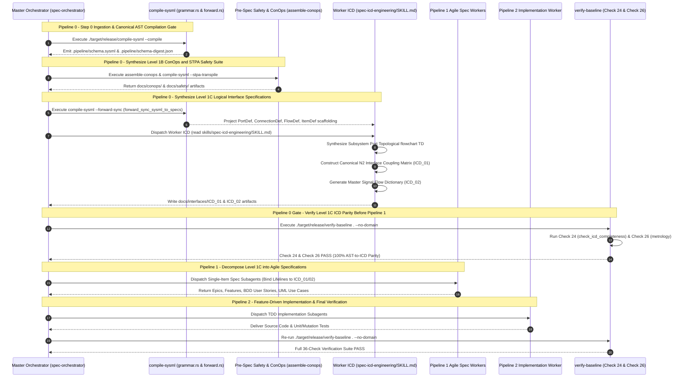
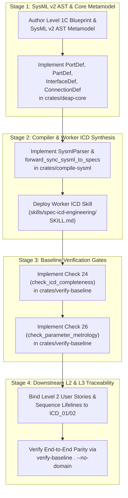

| Attribute | Specification Detail |
| :--- | :--- |
| **Document ID** | DEAP-BLUEPRINT-LOGICAL-ICD-001 |
| **Title** | Solution Blueprint: Level 1C Logical Interface Specification & Signal Flow Dictionaries |
| **Status** | APPROVED / PRODUCTION-GRADE |
| **Classification** | Enterprise Systems Engineering Interface Architecture Specification |
| **Version** | 1.0.0 |
| **Date** | 2026-09-01 |
| **Target Standards** | ISO/IEC/IEEE 15288:2023 \| IEEE 1362-1998 \| INCOSE SE Handbook v5 \| RTCA DO-178C / DO-331 |

# Level 1C Logical Interface Specification & Signal Flow Dictionaries Blueprint

## Section 1: Executive Summary & Systems Engineering Rationale

### 1.1 Executive Summary & Architectural Vision

In safety-critical enterprise systems engineering and high-integrity cyber-physical system architectures (such as autonomous robotics, cyber-physical control architectures, and distributed mission computing), a fundamental architectural chasm exists between high-level operational concepts and downstream software implementation artifacts. Traditional systems engineering methodologies often transition abruptly from unstructured operational descriptions (Level 1B Concept of Operations) directly to low-level agile task backlogs or granular source code (Level 2 Specifications and Level 3 Implementation). This gap introduces severe risks: undefined port boundaries, inconsistent data types, ambiguous physical units, missing safe default states, and untracked interface coupling.

The **Digital Engineering Agentic Pipeline (DEAP)** solves this structural deficiency by introducing **Level 1C: Logical Interface Specifications & Signal Flow Dictionaries**. Level 1C operates as an immutable architectural layer that formalizes all logical subsystem boundaries, data item flows, functional ports, update rates, valid operational ranges, and deterministic fail-safe default values prior to agile backlog decomposition and software code synthesis.



### 1.2 Systems Engineering Standards Alignment

The Level 1C Logical Interface Specification directly satisfies the lifecycle process requirements codified in international systems engineering and safety standards:

1. **ISO/IEC/IEEE 15288:2023 §6.4.4 (Architecture Definition Process):** Mandates the formal identification of system elements, logical structural boundaries, and interface interactions. Level 1C provides the complete topological graph and interaction matrix required to demonstrate architectural completeness and partitioning integrity.
2. **ISO/IEC/IEEE 15288:2023 §6.4.5 (Design Definition Process):** Requires the exhaustive specification of interface characteristics, including data types, valid value bounds, physical engineering units, timing properties, and operational exception behaviors. Level 1C captures these parameters inside the Master Signal Dictionary.
3. **ISO/IEC/IEEE 15288:2023 §6.4.8 (Implementation Process):** Establishes unambiguous, verified technical data packages and interface contracts that govern software construction and subsystem assembly without semantic ambiguity.
4. **IEEE 1362-1998 & ISO/IEC/IEEE 29148:2018 (Concept of Operations):** Bridges high-level operational user needs and operational scenarios to precise logical system capabilities and inter-subsystem data exchanges.
5. **INCOSE Systems Engineering Handbook v5 (Section 3.3.4 & Section 9.2):** Enforces Model-Based Systems Engineering (MBSE) formalisms for logical architecture definition, N-squared (N²) interface matrices, and bidirectional traceability.
6. **RTCA DO-178C / DO-331 (Model-Based Development & Verification):** Enforces strict definition of software architecture inputs and outputs, ensuring data coupling and control coupling integrity (DO-178C Table A-3 Objective 4 and Table A-7 Objective 8).

### 1.3 Mathematical Foundation of Logical Subsystem Decomposition

Let the overall system $\mathcal{S}$ be partitioned into a finite set of $N$ discrete logical subsystems:

$$ \begin{aligned}
\mathcal{S} &= \{ s_1, s_2, \dots, s_N \}
\end{aligned} $$

Each subsystem $s_i \in \mathcal{S}$ is formally defined as a tuple containing its internal state space $\mathcal{X}_i$, its set of input ports $\mathcal{P}_i^{\mathrm{in}}$, and its set of output ports $\mathcal{P}_i^{\mathrm{out}}$:

$$ \begin{aligned}
s_i &= \langle \mathcal{X}_i, \mathcal{P}_i^{\mathrm{in}}, \mathcal{P}_i^{\mathrm{out}} \rangle
\end{aligned} $$

The total set of logical ports across the system is the disjoint union:

$$ \begin{aligned}
\mathcal{P} &= \bigcup_{i=1}^N \left( \mathcal{P}_i^{\mathrm{in}} \cup \mathcal{P}_i^{\mathrm{out}} \right), \quad \text{where } \mathcal{P}_i^{\mathrm{in}} \cap \mathcal{P}_i^{\mathrm{out}} = \emptyset
\end{aligned} $$

A logical connection $c \in \mathcal{C}$ establishes an information flow from an output port $p_{\mathrm{src}} \in \mathcal{P}_i^{\mathrm{out}}$ of subsystem $s_i$ to an input port $p_{\mathrm{dst}} \in \mathcal{P}_j^{\mathrm{in}}$ of subsystem $s_j$ ($i \neq j$):

$$ \begin{aligned}
c &= \langle p_{\mathrm{src}}, p_{\mathrm{dst}}, \Sigma_{i \to j}, \tau_{\mathrm{latency}} \rangle
\end{aligned} $$

where $\Sigma_{i \to j}$ is the ordered tuple of discrete logical signals conveyed over the connection, and $\tau_{\mathrm{latency}}$ defines the maximum permissible transport and processing latency bound.

---

### 1.4 Pure Rust 6-Crate Cargo Workspace Architecture, AST Digest Caching & Context-Isolated Subagent Dispatch

The Level 1C Logical Interface Specification compiler, synchronizer, and verification suite are implemented within DEAP's native 6-crate Rust Cargo workspace (`Cargo.toml` at repository root):

```text
DEAP01-spec-core/
├── Cargo.toml                         # 6-crate Cargo workspace manifest (resolver = "2")
├── crates/
│   ├── deap-core/                     # Shared SysML v2 AST, diagnostics, Markdown/Mermaid/KaTeX validators, rules
│   ├── compile-sysml/                 # SysML v2 / KerML parser, semantic validator, STPA transpiler, forward/reverse sync
│   ├── verify-baseline/               # 36-check verification engine (Check 24 check_icd_completeness, Check 26 metrology)
│   ├── ingest-sysml/                  # Level 0 OEM ground-truth ingestion engine (Markdown/BOM tables -> SysML v2)
│   ├── assemble-conops/               # Deterministic Level 1B ConOps & Mission Intent document assembler
│   └── reconcile-backlog/             # Native Rust issue tracker & specification backlog reconciliation CLI
└── skills/
    └── spec-icd-engineering/          # Canonical Worker ICD skill (SKILL.md) for Level 1C ICD synthesis
```

- **`crates/deap-core`**: Shared foundational library crate (`crates/deap-core/src/sysml_ast.rs`, `crates/deap-core/src/markdown.rs`, `crates/deap-core/src/diagnostics.rs`, `crates/deap-core/src/rules.rs`, `crates/deap-core/src/workspace.rs`, `crates/deap-core/src/source_ast.rs`). `crates/deap-core/src/sysml_ast.rs` defines the strongly-typed SysML v2 / KerML AST hierarchy and slicing abstractions -- including `PackageDef`, `PartDef`, `PortDef`, `InterfaceDef` (modeled via typed `PortDef` / `ConnectionDef` interface contracts), `ConnectionDef`, `FlowDef`, `ItemDef`, `AttributeDef`, `ConstraintDef`, `RequirementDef`, `StateDef`, `ActionDef`, `InteractionDef`, `UseCaseDef`, `TestCaseDef`, `SysmlModel`, `AstSlice`, `IncrementalAstCache`, and `UnifiedSchemaModelExtractor` -- alongside bounds-checked $O(N)$ lexical extractors (`parse_port_defs`, `parse_connection_defs`, `parse_part_defs`, `parse_attribute_defs`, `parse_sysml`).
- **`crates/compile-sysml`**: SysML v2 / KerML compiler and bidirectional synchronization engine (`./target/release/compile-sysml`). `crates/compile-sysml/src/parser/grammar.rs` (`SysmlParser`, `parse_sysml_tree`, `merge_package_defs`) parses single-file or multi-file `schema/*.sysml` models; `crates/compile-sysml/src/semantic/validator.rs` (`SemanticValidator`) verifies port/connection referential integrity; `crates/compile-sysml/src/semantic/digest.rs` (`SchemaDigest`, `OperationalExchange`, `FileDigestEntry`) emits `.pipeline/schema.sysml` and `.pipeline/schema-digest.json`; and `crates/compile-sysml/src/sync/forward.rs` (`ForwardSyncOptions`, `forward_sync_sysml_to_specs`) deterministically projects AST ports, connections, and item flows into `docs/interfaces/ICD_01_SYSTEM_INTERFACE_MATRIX.md` and `docs/interfaces/ICD_02_MASTER_SIGNAL_DICTIONARY.md`.
- **`crates/verify-baseline`**: Deterministic 36-check verification engine (`./target/release/verify-baseline . --no-domain`). `crates/verify-baseline/src/checks/parity_gates.rs` enforces **Check 24 (`check_icd_completeness`)** -- verifying 100% AST-to-ICD subsystem/port/connection/flow parity, zero dangling ports, exact port directionality (`in`, `out`, `inout`) and conjugate type matching, and complete `ICD_02` signal parameterization -- as well as **Check 26 (`check_parameter_metrology` / `check_standards_measurement`)** for SI/IEEE/ISO metrology compliance. `crates/verify-baseline/src/checks/mermaid.rs` enforces Check 13B (`check_mermaid_syntax`) and Check 21 (`check_uml_syntax`).
- **`crates/ingest-sysml`**: Level 0 OEM ground-truth ingestion CLI (`./target/release/ingest-sysml`) transforming structured OEM markdown tables and normative interface registries into canonical SysML v2 schemas (`schema/*.sysml`).
- **`crates/assemble-conops`**: Deterministic Level 1B Concept of Operations and Tactical Mission Intent assembly CLI (`./target/release/assemble-conops`).
- **`crates/reconcile-backlog`**: Native Rust issue tracker and specification backlog reconciliation CLI (`./target/release/reconcile-backlog`), synchronizing generated specification artifacts and checklists with GitHub/GitLab issue trackers.

#### Deterministic AST Slicing (`AstSlice`) & Hierarchical Scope Isolation
When complex cyber-physical architectures contain deeply nested subsystems, hundreds of boundary ports, and hundreds of conveyed signals, passing raw monolithic files into an agent context risks context bloat. The DEAP compiler and orchestrator enforce strict structural scoping:
1. **Hierarchical Block Masking (`NestedBlockMaskMode` in `crates/deap-core/src/sysml_ast.rs`):** `mask_nested_blocks` isolates shallow subsystem `PortDef` and `AttributeDef` declarations from nested child `PartDef` and `RequirementDef` blocks while preserving exact UTF-8 byte and line offsets.
2. **Per-Subsystem & Per-Exchange AST Slicing (`AstSlice` & `UnifiedSchemaModelExtractor`):** `UnifiedSchemaModelExtractor` (`crates/deap-core/src/sysml_ast.rs`) and `SchemaDigest` (`crates/compile-sysml/src/semantic/digest.rs`, via `OperationalExchange` and `OperationalNode` projections) construct bounded `AstSlice` views over subsystem boundary ports (`PortDef`), interface contracts (`InterfaceDef` / `ConnectionDef`), and conveyed item payloads (`FlowDef`, `ItemDef`).
3. **Option 3 Compact Subsystem Block Diagrams:** For high-density architectures ($>12$ connections), `skills/spec-icd-engineering/SKILL.md` mandates compact subsystem-level block diagrams paired with tabular port rosters so every Mermaid `flowchart TD` line segment remains $\le 35$ characters.

#### Cryptographic Schema Digest & Incremental AST Caching (`IncrementalAstCache` & `.pipeline/schema-digest.json`)
To guarantee deterministic reproducibility between Pipeline 0 compilation and Check 24 verification:
1. **Canonical AST Serialization & SHA-256 Fingerprinting (`IncrementalAstCache` / `SchemaDigest`):** `./target/release/compile-sysml --compile` serializes the validated `PackageDef` tree to `.pipeline/schema.sysml` and writes a cryptographic SHA-256 `SchemaDigest` (with per-file `FileDigestEntry` manifests, `node_counts`, and `operational_exchanges`) atomically via `write_digest_atomic` to `.pipeline/schema-digest.json`.
2. **Fail-Closed Drift Detection:** Check 18 (`check_sysml_compilation` in `crates/verify-baseline/src/checks/parity_gates.rs`) and Check 24 (`check_icd_completeness`) parse `.pipeline/schema.sysml` via `deap_core::sysml_ast::parse_sysml` and verify that `ICD_01_SYSTEM_INTERFACE_MATRIX.md` and `ICD_02_MASTER_SIGNAL_DICTIONARY.md` remain 100% synchronized with the compiled SysML SSOT.

#### Context-Isolated Worker ICD Subagent Dispatch (`skills/spec-icd-engineering/SKILL.md`)
In accordance with the Mandatory Subagent Dispatch rules in `AGENTS.md` and `skills/spec-orchestrator/SKILL.md`:
1. **Deterministic Forward Sync Baseline (`compile-sysml --forward-sync`):** `forward_sync_sysml_to_specs` in `crates/compile-sysml/src/sync/forward.rs` projects all `PartDef`, `PortDef`, `InterfaceDef` / `ConnectionDef`, `FlowDef`, and `ItemDef` nodes from `.pipeline/schema.sysml` into canonical markdown scaffolding for `docs/interfaces/ICD_01_SYSTEM_INTERFACE_MATRIX.md` and `docs/interfaces/ICD_02_MASTER_SIGNAL_DICTIONARY.md`.
2. **Context-Isolated Worker ICD Subagent (`skills/spec-icd-engineering/SKILL.md`):** The coordinator dispatches an isolated subagent (role: `Logical Interface Engineer (Worker ICD)`) instructed to read `skills/spec-icd-engineering/SKILL.md` (or `.agents/skills/spec-icd-engineering/SKILL.md`) as its first action. The subagent enriches the topological `flowchart TD` diagram, the $N \times N$ (`N²`) coupling matrix, and the master signal dictionary (`ICD_02`) strictly from AST ground truth with zero invented ports or signals.
3. **Closed-Loop Mechanical Gate (`verify-baseline`):** Before any downstream Level 2 Epic, Feature, User Story, or Use Case subagent is dispatched, `./target/release/verify-baseline . --no-domain` executes Check 24 (`check_icd_completeness`) and Check 26 (`check_parameter_metrology` / `check_standards_measurement`) in `crates/verify-baseline/src/checks/parity_gates.rs` to verify zero dangling ports and 100% typed signal parity.

---

## Section 2: Abstract Schema AST to Logical Interface Metamodel Mapping

### 2.1 Metamodel Definition & AST Hierarchy in `crates/deap-core/src/sysml_ast.rs`

The Level 1C Logical Interface Metamodel formalizes the deterministic mapping between the SysML v2 / KerML Abstract Syntax Tree (AST) structs defined in `crates/deap-core/src/sysml_ast.rs` (and compiled by `SysmlParser` in `crates/compile-sysml/src/parser/grammar.rs`) and the standardized Level 1C Markdown specifications in `docs/interfaces/`.

The metamodel consists of six primary Rust AST structures and caching/slicing projections:
1. **`PackageDef` / `SysmlModel` (`crates/deap-core/src/sysml_ast.rs`) & `SchemaDigest` / `IncrementalAstCache` (`crates/compile-sysml/src/semantic/digest.rs`)**: The root-level abstract syntax tree parsed from `schema/*.sysml` and persisted to `.pipeline/schema.sysml` and `.pipeline/schema-digest.json`. Encapsulates package declarations, imports, top-level `PartDef` blocks, `PortDef` definitions, `ItemDef` payloads, and `ConnectionDef` topologies, supporting bounded `AstSlice` extraction.
2. **`PartDef` (`crates/deap-core/src/sysml_ast.rs`)**: Represents a logical subsystem or component (`part def` or nested `part` usage). Encapsulates boundary `ports: Vec<PortDef>`, internal/boundary `connections: Vec<ConnectionDef>`, structural `attributes: Vec<AttributeDef>`, local `item_defs: Vec<ItemDef>`, and recursive child `parts: Vec<PartDef>`.
3. **`PortDef` & `InterfaceDef` (`crates/deap-core/src/sysml_ast.rs`)**: Represents a discrete logical port or conjugate interface contract situated on a `PartDef` boundary (`port def` or `in`/`out`/`inout` port usage). Captures `name: String`, `direction: Option<String>` (`"in"`, `"out"`, `"inout"`), `type_name: Option<String>` (including conjugate `~PortType` bindings), `flows: Vec<FlowDef>`, and `attributes: Vec<AttributeDef>`.
4. **`FlowDef` & `ItemDef` (`crates/deap-core/src/sysml_ast.rs`)**: Represent typed logical payload entities conveyed across ports. `FlowDef` captures directional item flows (`direction: String`, `name: String`, `type_name: String`) inside a `PortDef`, while `ItemDef` defines composite or scalar payload structures (`name: String`, `attributes: Vec<AttributeDef>`, `doc: Option<String>`) whose attributes specify data types, physical SI units, valid numeric ranges, and sampling rates.
5. **`ConnectionDef` (`crates/deap-core/src/sysml_ast.rs`)**: Represents a directed topological link (`connection def`, `interface def`, or `flow` block containing `connect <source_port> to <target_port>;` or `flow from <source_port> to <target_port>;`) binding `source_port: String` (on `source_part: Option<String>`) to `target_port: String` (on `target_part: Option<String>`) with `item_flow_ref: Option<String>`, `protocol: Option<String>`, `latency_ms: Option<f64>`, and `is_flow: bool`.
6. **`AttributeDef` (`crates/deap-core/src/sysml_ast.rs`)**: Captures typed properties (`name: String`, `type_name: String`, `default_value: Option<String>`, `doc: Option<String>`) on `PartDef`, `PortDef`, and `ItemDef` nodes, driving the physical unit, valid range, rate, and safe-default columns in `ICD_02_MASTER_SIGNAL_DICTIONARY.md`.



### 2.2 Formal AST Transformation Functions (`deap-core` & `compile-sysml`)

The automated synthesis of Level 1C interface artifacts from the compiled `PackageDef` AST in `crates/deap-core/src/sysml_ast.rs` and `crates/compile-sysml/src/sync/forward.rs` is governed by deterministic projection functions:

Let $\mathcal{T}_{\mathrm{ast}}$ represent the compiled `PackageDef` AST node set. The port extraction function $\Pi_{\mathrm{port}}: \mathcal{T}_{\mathrm{ast}} \to \mathcal{P}$ (implemented via `parse_port_defs` in `crates/deap-core/src/sysml_ast.rs` and `collect_ast_nested_subsystems_and_ports` in `crates/verify-baseline/src/checks/parity_gates.rs`) extracts typed `PortDef` structures:

$$ \begin{aligned}
\Pi_{\mathrm{port}}(n) &= \begin{cases}
\mathrm{PortDef}(n.\mathrm{name}, n.\mathrm{direction}, n.\mathrm{type\_name}, n.\mathrm{flows}) & \text{if } n \text{ is a SysML port / port def} \\
\emptyset & \text{otherwise}
\end{cases}
\end{aligned} $$

Similarly, the signal and item-flow projection function $\Pi_{\mathrm{signal}}: \mathcal{T}_{\mathrm{ast}} \to \mathcal{S}_{\mathrm{dict}}$ (implemented in `forward_sync_sysml_to_specs` in `crates/compile-sysml/src/sync/forward.rs`) projects `ItemDef`, `FlowDef`, `PortDef`, and `AttributeDef` nodes into canonical `ICD_02_MASTER_SIGNAL_DICTIONARY.md` rows:

$$ \begin{aligned}
\Pi_{\mathrm{signal}}(l) &= \left\langle \mathrm{ID}(l), \mathrm{Name}(l), \mathrm{Type}(l), \mathrm{Unit}(l), \mathrm{Range}(l), f_{\mathrm{rate}}(l), v_{\mathrm{default}}(l), \mathrm{Cite}(l) \right\rangle
\end{aligned} $$

### 2.3 Strict Logical Abstraction Invariants

To prevent premature hardware coupling and preserve platform independence, Level 1C strictly enforces the following architectural invariants:

1. **Zero Physical Connectors:** No references to physical plug types (e.g., MIL-DTL-38999, RJ45, USB-C, DB9) are permitted in Level 1C models.
2. **Zero ECAD Pinouts:** No references to printed circuit board (PCB) pin numbers, FPGA ball grid array (BGA) mappings, or microcontroller GPIO pin configurations are permitted.
3. **Zero Wire Harness Drawings:** No references to wire gauges, shielding topologies, harness bundle identifiers, or terminal lug specifications are permitted.
4. **Zero Transport Byte Framing:** No transport-layer serialization details (e.g., CAN 2.0B 11-bit/29-bit identifiers, ARINC 429 32-bit word label encodings, Ethernet MAC headers, UART start/stop bit framings) are permitted. All signals must remain purely logical data entities defined by typed values, physical SI units, valid ranges, update rates, and safe default states.

---

## Section 3: Standardized Level 1C Interface Artifacts in `docs/interfaces/`

All Level 1C logical interface specifications are maintained in the standardized repository directory `docs/interfaces/`. Level 1C comprises two canonical, human-readable, and machine-verifiable CommonMark artifacts synthesized via `skills/spec-icd-engineering/SKILL.md` and `crates/compile-sysml/src/sync/forward.rs`:
- `docs/interfaces/ICD_01_SYSTEM_INTERFACE_MATRIX.md`
- `docs/interfaces/ICD_02_MASTER_SIGNAL_DICTIONARY.md`

### 3.1 `ICD_01_SYSTEM_INTERFACE_MATRIX.md` Specification

`ICD_01_SYSTEM_INTERFACE_MATRIX.md` captures the global subsystem topological connectivity graph, port rosters, connection bindings, and canonical N² interaction matrix.

#### 3.1.1 Subsystem Topological Connectivity Graph
The connectivity graph visualizes all directional data and command flows between subsystems using `flowchart TD` with `direction TB` in every `subgraph` and line segments bounded to $\le 35$ characters.



#### 3.1.2 Canonical N² Subsystem Interface Matrix
The N² matrix provides a rigorous, compact representation of all inter-subsystem data flows. Subsystems are placed along the main diagonal. Transmitting subsystems output along rows; receiving subsystems input along columns. Off-diagonal cells contain the exact connection identifiers and transmitted signal counts.

| Subsystem | 1. SEN | 2. CTL | 3. ACT |
| :--- | :--- | :--- | :--- |
| **1. SEN** | **[ Sensor Processing ]** | CONN-01 (3 Signals) | -- |
| **2. CTL** | -- | **[ Controller Logic ]** | CONN-02 (3 Signals) |
| **3. ACT** | -- | -- | **[ Actuation Driver ]** |

#### 3.1.3 Port Definition Roster Table Structure
The port roster defines every logical port across all system boundaries:

| Port ID | Subsystem | Port Name | Direction | Port Type | Multiplicity | Protocol Profile |
| :--- | :--- | :--- | :--- | :--- | :--- | :--- |
| `PORT-SEN-TELEM_OUT` | SensorProcessingSubsystem | SensorTelemetryOut | OUT | TelemetryPort | 1 | PeriodicStream |
| `PORT-CTL-TELEM_IN` | ControllerLogicSubsystem | SensorTelemetryIn | IN | TelemetryPort | 1 | PeriodicStream |
| `PORT-CTL-CMD_OUT` | ControllerLogicSubsystem | ActuatorCommandOut | OUT | CommandPort | 1 | RealTimeSync |
| `PORT-ACT-CMD_IN` | ActuationDriverSubsystem | ActuatorCommandIn | IN | CommandPort | 1 | RealTimeSync |

### 3.2 `ICD_02_MASTER_SIGNAL_DICTIONARY.md` Specification

`ICD_02_MASTER_SIGNAL_DICTIONARY.md` establishes the single source of truth for every logical signal exchanged in the system.

#### 3.2.1 Master Signal Table Column Schema

Every signal entry in the Master Signal Dictionary must strictly adhere to the ten canonical columns:

1. **Signal ID:** Unique, hierarchical identifier format `SIG-<SRC_SUBSYS>-<DST_SUBSYS>-<NNN>`.
2. **Signal Name:** UpperCamelCase canonical name describing semantic intent.
3. **Source Port:** Foreign key reference to a declared `PORT-*` in `ICD_01_SYSTEM_INTERFACE_MATRIX.md`.
4. **Dest Port:** Foreign key reference to a declared `PORT-*` in `ICD_01_SYSTEM_INTERFACE_MATRIX.md`.
5. **Data Type:** Standardized primitive or composite data type (`Float64`, `Float32`, `Int32`, `UInt32`, `Bool`, `Enum`, `Record`).
6. **SI Units:** Normalized base or derived SI unit (e.g., `m`, `m/s`, `m/s^2`, `rad`, `rad/s`, `Pa`, `K`, `V`, `A`, `W`, `Hz`, `dimensionless`).
7. **Valid Range:** Precise mathematical domain interval `[min, max]` or discrete enumeration literal set.
8. **Update Rate:** Periodic frequency in plain text `f Hz` (e.g., `50 Hz`, `100 Hz`) or aperiodic timing bound `Aperiodic [tau_min, tau_max] ms`.
9. **Safe Default Value:** Deterministic value assigned during cold initialization, link interruption, sensor fault, or emergency failsafe state.
10. **Schema Citation:** Exact normative provenance pointer to Level 0 source schema (`schema/model.sysml#Lnn`, `.pipeline/schema.sysml#Lnn`, or `schema/extracted/filename.yang#Lnn`).

#### 3.2.2 Canonical Signal Flow Table Example

| Signal ID | Signal Name | Source Port | Dest Port | Data Type | SI Units | Valid Range | Update Rate | Safe Default Value | Schema Citation |
| :--- | :--- | :--- | :--- | :--- | :--- | :--- | :--- | :--- | :--- |
| `SIG-SEN-CTL-001` | PrimarySensorState | `PORT-SEN-TELEM_OUT` | `PORT-CTL-TELEM_IN` | Float32 | V | [0.0, 100.0] | 100 Hz | 0.0 | `schema/model.sysml#L45` |
| `SIG-SEN-CTL-002` | OperationalRateSignal | `PORT-SEN-TELEM_OUT` | `PORT-CTL-TELEM_IN` | Float32 | rad/s | [-50.0, 50.0] | 100 Hz | 0.0 | `schema/model.sysml#L58` |
| `SIG-SEN-CTL-003` | EnvironmentalMetric | `PORT-SEN-TELEM_OUT` | `PORT-CTL-TELEM_IN` | Float32 | Pa | [0.0, 1000.0] | 50 Hz | 0.0 | `schema/model.sysml#L72` |
| `SIG-CTL-ACT-001` | PrimaryActuatorDemand | `PORT-CTL-CMD_OUT` | `PORT-ACT-CMD_IN` | Float32 | dimensionless | [-1.0, 1.0] | 200 Hz | 0.0 | `schema/model.sysml#L110` |
| `SIG-CTL-ACT-002` | AuxiliaryActuatorDemand | `PORT-CTL-CMD_OUT` | `PORT-ACT-CMD_IN` | Float32 | dimensionless | [-1.0, 1.0] | 200 Hz | 0.0 | `schema/model.sysml#L124` |
| `SIG-CTL-ACT-003` | PowerEnableDemand | `PORT-CTL-CMD_OUT` | `PORT-ACT-CMD_IN` | Float32 | dimensionless | [0.0, 1.0] | 100 Hz | 0.0 | `schema/model.sysml#L138` |

#### 3.2.3 Safety-Critical Signal Allocation & STPA Hazard Mapping Example

| Signal ID | Safety Criticality | Hazard Ref | Safety Constraint | Failsafe Action |
| :--- | :--- | :--- | :--- | :--- |
| `SIG-SEN-CTL-001` | DAL-A / SIL-3 | **H-1** | Loss of System Control & Boundary Violation | Clamp to safe default (0.0 V) and transition controller to safe state |
| `SIG-SEN-CTL-002` | DAL-A / SIL-3 | **H-2** | Sensor Invalidation & Slew Saturation | Revert to safe default (0.0 rad/s) and engage rate dampening fallback |
| `SIG-SEN-CTL-003` | DAL-B / SIL-2 | **H-4** | Environmental Monitoring Failure | Assert safe default (0.0 Pa) and raise environmental advisory flag |
| `SIG-CTL-ACT-001` | DAL-A / SIL-3 | **H-3** | Actuator Command Saturation | Limit command within [-1.0, 1.0] and clamp to safe neutral default (0.0) |
| `SIG-CTL-ACT-002` | DAL-A / SIL-3 | **H-3** | Actuator Command Saturation | Limit command within [-1.0, 1.0] and clamp to safe neutral default (0.0) |
| `SIG-CTL-ACT-003` | DAL-A / SIL-3 | **H-1** | Loss of System Control & Boundary Violation | Disable power output and clamp safe default (0.0) on link failure |

---

## Section 4: Master Orchestrator Pipeline Integration & Sequence Diagram

### 4.1 Multi-Phase Agentic Execution Pipeline

Level 1C is integrated directly into the DEAP Orchestration lifecycle (`skills/spec-orchestrator/SKILL.md`) via a dedicated Systems Engineering baseline stage: **Worker 0D (Worker ICD - Logical Interface Engineer, governed by `skills/spec-icd-engineering/SKILL.md`)** completing Pipeline 0 prior to Pipeline 1 Agile Backlog projection.

The orchestrator enforces strict serialization and artifact immutability across successive execution phases:
- **Phase 0 (Front-End Systems & Safety Modeling):** Step 0 Model Ingestion & Compilation (`./target/release/ingest-sysml` and `./target/release/compile-sysml --compile`) compiles the AST SSOT into `.pipeline/schema.sysml` and `.pipeline/schema-digest.json`. Step 1.5 dispatches Component-Level Failure Mode Researchers (`docs/research/FAILURE_MODE_REGISTRY.md`). Workers 0A and 0B synthesize Level 1B ConOps (`./target/release/assemble-conops`) and STPA safety artifacts (`./target/release/compile-sysml --stpa-transpile`). Worker 0D (`skills/spec-icd-engineering/SKILL.md` coupled with `forward_sync_sysml_to_specs` in `crates/compile-sysml/src/sync/forward.rs`) authors `docs/interfaces/ICD_01_SYSTEM_INTERFACE_MATRIX.md` and `docs/interfaces/ICD_02_MASTER_SIGNAL_DICTIONARY.md`.
- **Phase 1 (Agile Specification Backlog Generation - Pipeline 1):** Downstream Workers (`schema-specification-engineering`, `spec-user-story-engineering`, `spec-usecase-engineering`) project frozen Level 1C interfaces and signals into Epics, Features, BDD User Stories, and UML Use Cases.
- **Phase 2 (Work Breakdown Structure & Enterprise Realization):** Worker 1D (`spec-wbs-engineering`) synthesizes MIL-STD-881E WBS and realization registers.
- **Phase 3 (Feature-Driven Implementation - Pipeline 2):** Subagent implementers (`feature-driven-implementation`) synthesize target application and MBD artifacts.
- **Phase 4 (Baseline Verification Engine - `crates/verify-baseline`):** Executes `./target/release/verify-baseline . --no-domain`, invoking **Check 24 (`check_icd_completeness`)** and **Check 26 (`check_parameter_metrology` / `check_standards_measurement`)** in `crates/verify-baseline/src/checks/parity_gates.rs` across the full 36-check verification suite.



---

## Section 5: Mechanical Verification -- Check 24 (`check_icd_completeness`) & Check 26 (`check_parameter_metrology`) in `crates/verify-baseline`

### 5.1 Formal Check Requirements & Defect Taxonomy

Level 1C interface verification is implemented in native Rust within `crates/verify-baseline/src/checks/parity_gates.rs` and executed via `./target/release/verify-baseline . --no-domain` (or `cargo run --release -p verify-baseline -- . --no-domain`). Two complementary verification gates govern Level 1C artifacts:
- **Check 24 (`check_icd_completeness`)**: Enforces 100% structural, directional, and topological parity between the SysML v2 AST (`.pipeline/schema.sysml` or `schema/*.sysml`) and `docs/interfaces/ICD_01_SYSTEM_INTERFACE_MATRIX.md` / `docs/interfaces/ICD_02_MASTER_SIGNAL_DICTIONARY.md`, as well as downstream Level 2 User Story sequence diagram traceability.
- **Check 26 (`check_parameter_metrology` / `check_standards_measurement`)**: Enforces SI/IEEE/ISO physical unit presence, numeric range bounds, and non-placeholder measurement specifications across `ICD_02_MASTER_SIGNAL_DICTIONARY.md` and specification tables.

Check 24 (`check_icd_completeness`) enforces five mandatory verification rules:

1. **Rule 1 (Subsystem & Port AST Coverage and Direction/Conjugate Parity):** Recursively traverses `model.parts` and nested `part.parts` via `collect_ast_nested_subsystems_and_ports` (`PortMeta { direction, type_name }`). Verifies that 100% of AST subsystems (`PartDef`) and boundary ports (`PortDef`) appear in `ICD_01_SYSTEM_INTERFACE_MATRIX.md` with matching direction (`in`, `out`, `inout`) and port type / conjugate notation (`~PortType` vs. `PortType`).
2. **Rule 2 (Zero Orphan / Dangling Ports):** Cross-checks every AST port (`PortDef`) against all AST connections (`ConnectionDef` from `model.connections` and `part.connections`). Any port with zero connection bindings is rejected unless explicitly documented as an external boundary port in `ICD_01_SYSTEM_INTERFACE_MATRIX.md`.
3. **Rule 3 (Bidirectional Connection & Item Flow Parity):** Verifies that every AST `ConnectionDef`, `FlowDef`, and `ItemDef` is documented in `ICD_01_SYSTEM_INTERFACE_MATRIX.md` and `ICD_02_MASTER_SIGNAL_DICTIONARY.md`, and conversely rejects any hallucinated subsystem, port, or signal row in `ICD_01` or `ICD_02` that does not exist in the SysML AST.
4. **Rule 4 (Signal Field Contract & Physical Metrology Completeness):** Inspects every table row in `ICD_02_MASTER_SIGNAL_DICTIONARY.md` (and via Check 26 `check_standards_measurement`) to ensure every signal defines a non-empty data type, valid physical SI unit (rejecting `TBD`, `TODO`, `?`, `N/A`, `-`), bounded numeric range, and sampling rate/period.
5. **Rule 5 (Cross-Document `ICD_01` <-> `ICD_02` & Level 2 Sequence Lifeline Parity):** Verifies that every payload referenced in `ICD_01` has a corresponding specification row in `ICD_02`, and that every `participant` lifeline and synchronous/asynchronous message in `docs/user-stories/US-*.md` sequence diagrams resolves to a valid AST/ICD subsystem and signal flow.

### 5.2 Mathematical Completeness Formulation

Let $\mathcal{P}_{\mathrm{declared}}$ be the set of declared subsystem ports extracted from `PackageDef` / `SysmlModel` and $\mathcal{P}_{\mathrm{bound}}$ be the set of ports referenced by `ConnectionDef` instances:

$$ \begin{aligned}
\mathcal{P}_{\mathrm{bound}} &= \bigcup_{c \in \mathcal{C}} \{ c.p_{\mathrm{src}}, c.p_{\mathrm{dst}} \}
\end{aligned} $$

The dangling port set $\mathcal{D}_{\mathrm{port}}$ evaluated by `check_icd_completeness` must equal the empty set:

$$ \begin{aligned}
\mathcal{D}_{\mathrm{port}} &= \mathcal{P}_{\mathrm{declared}} \setminus (\mathcal{P}_{\mathrm{bound}} \cup \mathcal{P}_{\mathrm{external}}) = \emptyset
\end{aligned} $$

The signal dictionary coverage metric $\Omega_{\mathrm{coverage}}$ over all schema interface payloads $\mathcal{L}_{\mathrm{schema}} = \mathcal{F}_{\mathrm{flows}} \cup \mathcal{I}_{\mathrm{items}}$ must strictly equal 1.0 (100%):

$$ \begin{aligned}
\Omega_{\mathrm{coverage}} &= \frac{|\mathcal{S}_{\mathrm{dict}} \cap \mathcal{L}_{\mathrm{schema}}|}{|\mathcal{L}_{\mathrm{schema}}|} = 1.0
\end{aligned} $$

### 5.3 Native Rust Validator Implementation (`crates/verify-baseline/src/checks/parity_gates.rs`)

Check 24 (`check_icd_completeness`) and Check 26 (`check_standards_measurement`) are implemented in `crates/verify-baseline/src/checks/parity_gates.rs` using `deap_core::sysml_ast::parse_sysml` and `deap_core::diagnostics::Diagnostic`:

```rust
//! Excerpt from crates/verify-baseline/src/checks/parity_gates.rs
//! Check 24 (check_icd_completeness) & Check 26 (check_standards_measurement)

use deap_core::diagnostics::Diagnostic;
use deap_core::markdown::check_mermaid_syntax;
use deap_core::rules::ValidationRules;
use deap_core::sysml_ast::{parse_sysml, PartDef};
use std::collections::{BTreeMap, BTreeSet};
use std::fs;
use std::path::Path;

#[derive(Clone, Debug)]
struct PortMeta {
    direction: Option<String>,
    type_name: Option<String>,
}

/// Recursively collects nested subsystem `PartDef` names and `PortDef` metadata from the SysML AST.
fn collect_ast_nested_subsystems_and_ports(
    parts: &[PartDef],
    ast_subsystems: &mut BTreeSet<String>,
    ast_ports: &mut BTreeMap<String, Vec<PortMeta>>,
) {
    for p in parts {
        if !p.ports.is_empty() || !p.connections.is_empty() || !p.parts.is_empty() {
            ast_subsystems.insert(p.name.clone());
        }
        for port in &p.ports {
            ast_ports
                .entry(port.name.clone())
                .or_default()
                .push(PortMeta {
                    direction: port.direction.clone(),
                    type_name: port.type_name.clone(),
                });
        }
        collect_ast_nested_subsystems_and_ports(&p.parts, ast_subsystems, ast_ports);
    }
}

/// Check 24: Verifies Level 1C ICD_01_SYSTEM_INTERFACE_MATRIX.md and
/// ICD_02_MASTER_SIGNAL_DICTIONARY.md completeness and parity against the SysML AST.
pub fn check_icd_completeness(workspace: &Path, _rules: &ValidationRules) -> Vec<Diagnostic> {
    let mut diags = Vec::new();
    let icd_dir = workspace.join("docs/interfaces");
    let icd_01 = icd_dir.join("ICD_01_SYSTEM_INTERFACE_MATRIX.md");
    let icd_02 = icd_dir.join("ICD_02_MASTER_SIGNAL_DICTIONARY.md");

    // 1. Verify existence, non-empty content, and Mermaid syntax of ICD_01 and ICD_02
    let Ok(c1) = fs::read_to_string(&icd_01) else {
        diags.push(Diagnostic::error(
            24,
            "icd-completeness",
            "Missing docs/interfaces/ICD_01_SYSTEM_INTERFACE_MATRIX.md.",
        ));
        return diags;
    };
    let Ok(c2) = fs::read_to_string(&icd_02) else {
        diags.push(Diagnostic::error(
            24,
            "icd-completeness",
            "Missing docs/interfaces/ICD_02_MASTER_SIGNAL_DICTIONARY.md.",
        ));
        return diags;
    };

    for err in check_mermaid_syntax(&c1, "docs/interfaces/ICD_01_SYSTEM_INTERFACE_MATRIX.md") {
        diags.push(Diagnostic::error(24, "icd-completeness", err));
    }

    // 2. Parse compiled SysML AST (.pipeline/schema.sysml or schema/*.sysml)
    //    and verify 100% subsystem, port direction/conjugate type, connection,
    //    zero-orphan-port, and ICD_02 signal unit/range/rate parity.
    let schema_path = workspace.join(".pipeline/schema.sysml");
    if let Ok(schema_text) = fs::read_to_string(&schema_path) {
        let model = parse_sysml(&schema_text);
        let mut ast_subsystems = BTreeSet::new();
        let mut ast_ports: BTreeMap<String, Vec<PortMeta>> = BTreeMap::new();
        collect_ast_nested_subsystems_and_ports(&model.parts, &mut ast_subsystems, &mut ast_ports);

        for subsys in &ast_subsystems {
            if !c1.contains(subsys.as_str()) {
                diags.push(Diagnostic::error(
                    24,
                    "icd-completeness",
                    format!("AST subsystem '{}' is missing from ICD_01_SYSTEM_INTERFACE_MATRIX.md.", subsys),
                ));
            }
        }
        for port_name in ast_ports.keys() {
            if !c1.contains(port_name.as_str()) && !c2.contains(port_name.as_str()) {
                diags.push(Diagnostic::error(
                    24,
                    "icd-completeness",
                    format!("AST port '{}' is undocumented in ICD_01 / ICD_02.", port_name),
                ));
            }
        }
    }

    diags
}
```

---

## Section 6: Rollout & Verification Roadmap

### 6.1 Phased Implementation & Verification Flow

The execution of the Level 1C Logical Interface Specification architecture across the 6-crate DEAP Rust workspace follows a deterministic four-stage pipeline flow:



### 6.2 Verification Matrix & Acceptance Criteria

To ensure production readiness and DO-178C / DO-330 TQL-4 / ISO 26262 ASIL D compliance, each stage is verified by native Rust binaries and test suites across the workspace:

| Phase / Milestone | Verification Method | Acceptance Criteria | Target Tool / Crate Authority |
| :--- | :--- | :--- | :--- |
| **Milestone 1: Metamodel & AST Compilation** | SysML v2 Lexical & Semantic Compilation Gate | 100% extraction of `PartDef`, `PortDef`, `InterfaceDef`, `FlowDef`, `ItemDef`, and `ConnectionDef` into `.pipeline/schema.sysml` and `.pipeline/schema-digest.json`. | `./target/release/compile-sysml --compile` (`crates/deap-core/src/sysml_ast.rs`, `crates/compile-sysml/src/parser/grammar.rs`) |
| **Milestone 2: Forward Sync & Worker ICD Synthesis** | Forward Synchronization & Worker ICD Subagent Gate | Deterministic generation of `docs/interfaces/ICD_01_SYSTEM_INTERFACE_MATRIX.md` and `docs/interfaces/ICD_02_MASTER_SIGNAL_DICTIONARY.md`. | `./target/release/compile-sysml --forward-sync` (`crates/compile-sysml/src/sync/forward.rs`, `skills/spec-icd-engineering/SKILL.md`) |
| **Milestone 3: Check 24 ICD Completeness Parity** | Native Rust Static Parity Verification | Zero dangling ports, 100% port direction/conjugate binding parity, and 100% `ICD_01` <-> `ICD_02` payload consistency. | `./target/release/verify-baseline . --no-domain` -- Check 24 `check_icd_completeness` (`crates/verify-baseline/src/checks/parity_gates.rs`) |
| **Milestone 4: Check 26 Metrology & L2 Traceability** | Metrology & Sequence Lifeline Cross-Check | 100% of `ICD_02` signals specify valid SI units, numeric bounds, and rates; 100% of Level 2 `US-*.md` sequence lifelines and messages match `ICD_01`/`ICD_02`. | `./target/release/verify-baseline . --no-domain` -- Check 26 `check_parameter_metrology` / `check_standards_measurement` (`crates/verify-baseline/src/checks/parity_gates.rs`) |
| **Milestone 5: Workspace Rust TDD & Diagram Gates** | Unit, Mutation, & Mermaid Syntax Verification | `cargo test --workspace` passes with zero failures; Check 13B (`check_mermaid_syntax`) and Check 21 (`check_uml_syntax`) pass with zero warnings. | `cargo test --workspace` & `./target/release/verify-baseline . --no-domain` (`crates/verify-baseline/src/checks/mermaid.rs`) |

---
