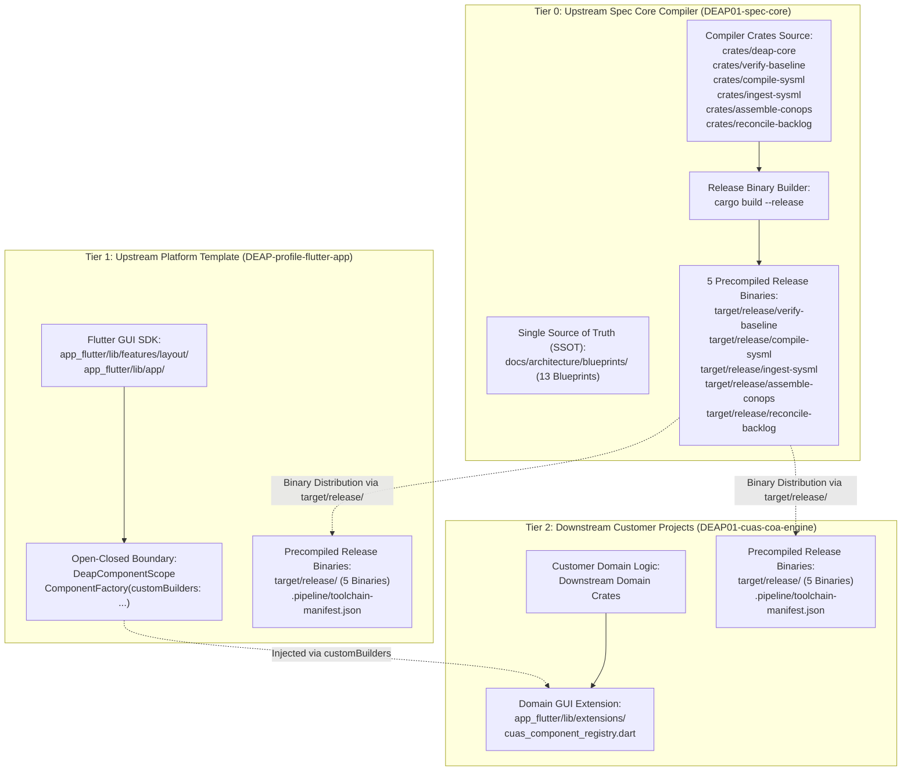

# DEAP Poly-Repo Binary-Only Distribution and Tier Isolation Architecture Blueprint

| Attribute | Specification Detail |
| :--- | :--- |
| **Blueprint Identifier** | `DEAP-BLUEPRINT-POLYREPO-013` |
| **Version** | 1.0.0 |
| **Date** | 2026-10-21 |
| **Status** | APPROVED / PRODUCTION-GRADE |
| **Classification** | Poly-Repo Tier Isolation, Binary Distribution, Open-Closed GUI Boundary |
| **Canonical Blueprint Registration** | `CanonicalArchitectureBlueprint::DeapPolyRepoBinaryDistributionArchitecture` (#13) |

---

## 1. Executive Summary & Architectural Motivation

The Digital Engineering Agent Platform (DEAP) governs model-based systems engineering across high-assurance domains (aerospace, defense, automotive, and critical infrastructure). As DEAP expanded from a single core repository into a multi-tier poly-repository ecosystem, source code from the upstream compiler was inadvertently duplicated into downstream customer projects and platform templates. This source leakage led to severe cross-tier coupling:
1. Downstream docstring injection engines (`compile-sysml inject-docstrings`) processed duplicated compiler source files against local customer domain schemas, polluting internal compiler routines with domain-specific requirement bindings (`REQ_COA_001`).
2. Downstream repositories experienced Cargo build bloat and maintenance drift by attempting to recompile Tier 0 compiler crates rather than executing precompiled, release-grade binaries.
3. Proprietary compiler logic was exposed directly within downstream customer workspaces, violating intellectual property boundaries and clean landing zone invariants.

This blueprint formally establishes the **DEAP Poly-Repo Binary-Only Distribution and Tier Isolation Architecture (`DEAP-BLUEPRINT-POLYREPO-013`)**. The architecture establishes three strictly isolated tiers, a precompiled release-binary toolchain distribution model, an open-closed component extension boundary for Flutter GUI applications, and mechanical verification gates in `verify-baseline` that prevent source leakage and guarantee binary integrity.

---

## 2. Multi-Tier Governance & Repository Topology

The DEAP poly-repo ecosystem is strictly partitioned into three architectural tiers:



### 2.1 Tier 0: Upstream Specification Core Compiler (`UPSTREAM_SPEC_CORE_COMPILER`)
- **Repository**: `gintatkinson/DEAP01-spec-core`
- **Scope & Role**:
  - The Single Source of Truth (SSOT) for the abstract Model-Based Systems Engineering (MBSE) compiler, KerML/SysML v2 AST metamodel, safety transpiler, and baseline verification rules.
  - Contains the 6 canonical compiler crates:
    - `crates/deap-core/src/rules.rs`
    - `crates/deap-core/src/workspace.rs`
    - `crates/deap-core/src/source_ast.rs`
    - `crates/deap-core/src/lib.rs`
    - `crates/verify-baseline/src/checks/structural.rs`
    - `crates/verify-baseline/src/checks/docstring_gate.rs`
    - `crates/compile-sysml/src/docstring.rs`
    - `crates/compile-sysml/src/lib.rs`
    - `crates/ingest-sysml/src/main.rs`
    - `crates/assemble-conops/src/main.rs`
    - `crates/reconcile-backlog/src/lib.rs`
  - SSOT for all 13 canonical architecture blueprints under `docs/architecture/blueprints/`.
  - Compiles and packages the 5 native release binaries distributed to downstream tiers.
  - Invariant: Zero customer domain models, zero customer schemas, zero customer UI code.

### 2.2 Tier 1: Upstream Platform Template (`UPSTREAM_PLATFORM_TEMPLATE`)
- **Repository**: `gintatkinson/DEAP-profile-flutter-app`
- **Scope & Role**:
  - Flutter GUI SDK template for high-assurance desktop applications.
  - Implements generic workspace layouts, split viewports, tree navigation, and standard desktop ergonomics.
  - **Binary-Only Toolchain**: Consumes precompiled Tier 0 binaries in `target/release/`. Zero Tier 0 compiler crate source directories. Zero duplicated master architecture blueprints.
  - **Open-Closed Component Extension**: Exposes `ComponentFactory` parameterized by `Map<String, DeapComponentBuilder> customBuilders` and `DeapComponentScope`.

### 2.3 Tier 2: Downstream Customer Projects (`DOWNSTREAM_CUSTOMER_PROJECT`)
- **Repository**: `DEAP01-cuas-coa-engine` (and similar domain deployments).
- **Scope & Role**:
  - Concrete mission and domain implementations (e.g. Counter-Unmanned Aircraft Systems Course of Action Pareto solver).
  - Contains domain-specific crates (e.g. downstream domain engine) with zero dependencies on Tier 0 compiler crates.
  - **Binary-Only Toolchain**: Consumes precompiled Tier 0 binaries in `target/release/`.
  - **Domain GUI Extensions**: Registers domain widgets via `app_flutter/lib/extensions/cuas_component_registry.dart` with zero modifications to `ComponentFactory` in the core SDK.

---

## 3. Binary Toolchain Distribution & Verification Protocol

### 3.1 The 5 Canonical Release Binaries
Downstream tiers require exactly 5 native executable tools built from Tier 0:
1. `target/release/verify-baseline`: The 28-check mechanical compliance engine.
2. `target/release/compile-sysml`: SysML v2 / KerML compiler, STPA analyzer, and safety docstring injector.
3. `target/release/ingest-sysml`: Level 0 multi-format schema and specification ingestion engine.
4. `target/release/assemble-conops`: Deterministic Concept of Operations (ConOps) and Mission Intent assembler.
5. `target/release/reconcile-backlog`: Agile backlog tracker and markdown issue synchronizer.

### 3.2 Gitignore and Binary Whitelisting
To prevent intermediate compiler artifacts from polluting git history while committing release binaries:
```gitignore
# Ignore Cargo build directories
/target/debug
/target/release/build
/target/release/deps
/target/release/.fingerprint
/target/release/incremental
/target/*

# Whitelist release directory and exact Tier 0 binaries
!/target/release/
!/target/release/verify-baseline
!/target/release/compile-sysml
!/target/release/ingest-sysml
!/target/release/assemble-conops
!/target/release/reconcile-backlog
```

### 3.3 Toolchain Manifest Schema (`.pipeline/toolchain-manifest.json`)
Every downstream repository carries a cryptographic toolchain manifest recording provenance:
```json
{
  "upstream_repo": "gintatkinson/DEAP01-spec-core",
  "commit_sha": "a1b2c3d4e5f60718293a4b5c6d7e8f9012345678",
  "timestamp_utc": "2026-10-21T14:30:00Z",
  "binaries": {
    "verify-baseline": "sha256:...",
    "compile-sysml": "sha256:...",
    "ingest-sysml": "sha256:...",
    "assemble-conops": "sha256:...",
    "reconcile-backlog": "sha256:..."
  },
  "rules_bundle_sha256": "sha256:..."
}
```

---

## 4. Open-Closed Component Extension Boundary (`DeapComponentRegistry`)

To ensure Tier 1 SDK code can be updated without breaking Tier 2 customer widgets, the GUI architecture enforces the Open-Closed Principle (Meyer, 1988) via `DeapComponentRegistry`.

### 4.1 DeapComponentScope Contract
```dart
typedef DeapComponentBuilder = Widget Function(
  BuildContext context,
  Map<String, dynamic> node,
  DeapComponentScope scope,
);

class DeapComponentScope {
  final BuildContext context;
  final String currentView;
  final dynamic workerResult;
  final ValueChanged<String> onViewSelected;
  final double Function() minPaneSize;
  final double Function() defaultRatio;
  final dynamic Function(String) resolveTopologyData;
  final String Function(String) resolveTabLabel;
  final Widget Function(BuildContext, Map<String, dynamic>) buildChildWidget;
  final dynamic treeViewModel;
  final Axis preferredSplitAxis;
}
```

### 4.2 ComponentFactory Open-Closed Delegation
```dart
class ComponentFactory {
  final Map<String, DeapComponentBuilder> customBuilders;

  Widget build(Map<String, dynamic> node, double width, double height, BuildContext context) {
    final type = node['type'] as String? ?? '';
    switch (type) {
      case 'SidebarLayout':
        return _buildSidebar(node, width, height, context);
      case 'SplitWorkspace':
        return _buildSplitWorkspace(node, width, height, context);
      default:
        final builder = customBuilders[type];
        if (builder != null) {
          final scope = _createScope(context);
          return builder(context, node, scope);
        }
        return const SizedBox.shrink();
    }
  }
}
```

### 4.3 Downstream Component Registration
In Tier 2 (`app_flutter/lib/extensions/cuas_component_registry.dart`), domain widgets are registered without modifying `ComponentFactory`:
```dart
Map<String, DeapComponentBuilder> buildCuasComponentRegistry() {
  return {
    'SideBySideCoaMatrix': (context, node, scope) => SideBySideCoaMatrix(
      activeView: scope.currentView,
      onViewSelected: scope.onViewSelected,
    ),
    'CoaInspectorPanel': (context, node, scope) => CoaInspectorPanel(
      activeView: scope.currentView,
    ),
    'TelemetryInjectionPanel': (context, node, scope) => const TelemetryInjectionPanel(
      embeddedInCockpit: true,
    ),
    'C2TelemetryStreamPanel': (context, node, scope) => const C2TelemetryStreamPanel(),
  };
}
```

---

## 5. Mechanical Poly-Repo Verification Gates in `verify-baseline`

Three mechanical checks enforce tier boundaries and prevent regression:

### 5.1 Check 12: `check_no_duplicate_master_blueprints`
- In upstream (`is_upstream_compiler(repo_root)`): Skips check.
- In downstream (`!is_upstream_compiler(repo_root)`):
  - Fails closed if any of the 6 Tier 0 compiler crate source directories exist:
    `crates/deap-core`, `crates/verify-baseline`, `crates/compile-sysml`, `crates/ingest-sysml`, `crates/assemble-conops`, `crates/reconcile-backlog`.
  - Fails closed if `docs/architecture/blueprints/*.md` exists on disk.
  - Fails closed if duplicate master blueprints exist.

### 5.2 Check 15: `check_reconcile_backlog_tooling_exists`
- In upstream (`is_upstream_compiler(repo_root)`): Verifies `reconcile-backlog` binary or source crate exists.
- In downstream (`!is_upstream_compiler(repo_root)`): Verifies all 5 precompiled binaries exist in `target/release/` with file size > 0.

### 5.3 Check 37: `check_blueprint_grounding`
- In upstream: Enforces presence and structural grounding of all 13 canonical architecture blueprints in `CanonicalArchitectureBlueprint::ALL`.
- In downstream: Automatically returns `Ok(())` when `docs/architecture/blueprints/` is absent.

---

## 6. Grounding Traceability Matrix

| Blueprint Section | Realizing Workspace File | Verification Gate |
| :--- | :--- | :--- |
| Tier 0 Canonical Registration | `crates/deap-core/src/rules.rs` | Check 37 (`check_blueprint_grounding`) |
| Tier 0 Lexer & Comment Stripper | `crates/deap-core/src/source_ast.rs` | Unit Tests & Check 36 |
| Tier 0 Core Exports | `crates/deap-core/src/lib.rs` | Workspace Compilation |
| Compiler Docstring Gate | `crates/compile-sysml/src/docstring.rs` | Docstring Injection Tests |
| Poly-Repo Mechanical Check 12 | `crates/deap-core/src/workspace.rs` | Check 12 Unit & Baseline Tests |
| Poly-Repo Mechanical Check 15 | `crates/deap-core/src/workspace.rs` | Check 15 Unit & Baseline Tests |
| Blueprint Structural Gate | `crates/verify-baseline/src/checks/structural.rs` | Check 37 Verification |
| Check 36 Lexer Gate | `crates/verify-baseline/src/checks/docstring_gate.rs` | Check 36 Unit Tests |

---

## 7. Document Invariants & Compliance Certification

1. **Zero Unicode Em Dash Invariant**: Verified free of `\u{2014}` characters; ASCII `--` used exclusively.
2. **Zero Fictional Crates Invariant**: Grounded strictly in canonical workspace crates.
3. **Zero Retired Tools Invariant**: References only active native Rust binaries.
4. **Concrete Path Grounding**: Every referenced `crates/...` path exists on disk in `gintatkinson/DEAP01-spec-core`.
