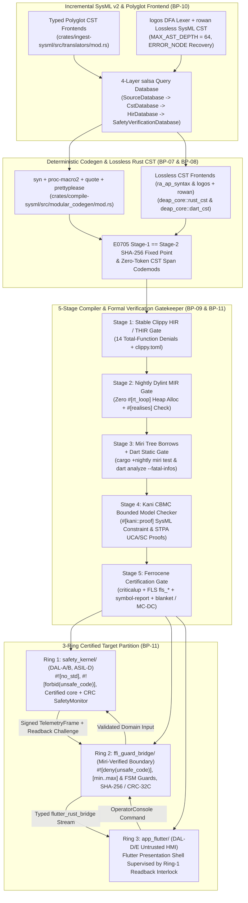
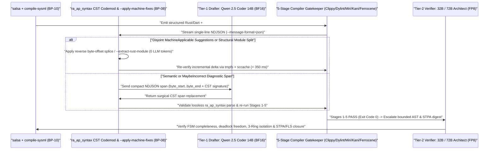
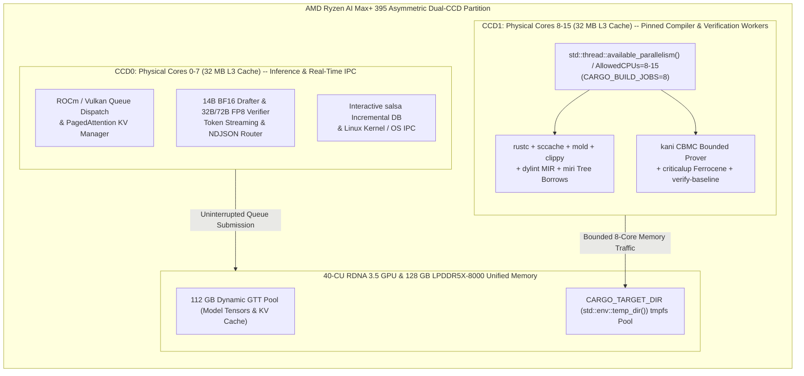

# DEAP Strix Halo Unified-Memory Workstation & Compiler-Native Verification Architecture

| Attribute | Specification Detail |
| :--- | :--- |
| **Document Identifier** | `DEAP-BLUEPRINT-WORKSTATION-002` |
| **Version** | `1.0.0` |
| **Date** | `2026-11-01` |
| **Status** | `APPROVED / PRODUCTION-GRADE` |
| **Repository Scope** | `DEAP01-spec-core` (`UPSTREAM_SPEC_CORE_COMPILER`) and Generated Downstream 3-Ring Workspaces |
| **Constituent Design Blueprints** | `BP-08` (`REQ-0608`), `BP-09` (`REQ-0609`), `BP-10` (`REQ-0610`), `BP-11` (`REQ-0611`) |

> **Document Identifier:** `DEAP-BLUEPRINT-WORKSTATION-002`  
> **Status:** `APPROVED / PRODUCTION-GRADE`  
> **Classification:** `Unified-Memory Workstation Infrastructure, Incremental CST/Salsa Compilation & 5-Stage Formal Verification Architecture`  
> **Target Standards:** `RTCA DO-178C / DO-330 / DO-333` | `ISO 26262:2018 (ASIL D / TCL3)` | `IEC 61508:2010 (SIL 3/4)` | `IEC 62304 (Class C)` | `ECSS-E-ST-40C` | `ASTM F3269-17 RTA` | `OMG SysML v2 (ptc/2023-08-01)` | `Ferrocene Language Specification (FLS)`  
> **Primary Hardware Target:** `Headless Ubuntu Unified-Memory Workstation (AMD Ryzen AI Max+ 395 / Strix Halo, 16c/32t Zen 5, 128 GB LPDDR5X-8000)`  

---

## 1. Executive Architecture & End-to-End Compiler-Native Pipeline

### 1.1 Architectural Purpose & Blueprint Synthesis

The **Digital Engineering Agent Platform (DEAP)** executes sovereign, air-gapped Model-Based Systems Engineering (MBSE) compilation, deterministic code synthesis, and formal safety verification on single-node unified-memory workstations. While [DEAP_LOCAL_AIRGAPPED_DEEPSEEK_WORKSTATION_BLUEPRINT.md](DEAP_LOCAL_AIRGAPPED_DEEPSEEK_WORKSTATION_BLUEPRINT.md) (`DEAP-BLUEPRINT-WORKSTATION-001`) establishes baseline Linux kernel GTT addressing and local inference residency, and [DEAP_MULTI_TOOLCHAIN_SYNTHESIS_ARCHITECTURE.md](DEAP_MULTI_TOOLCHAIN_SYNTHESIS_ARCHITECTURE.md) (`DEAP-BLUEPRINT-TOOLCHAIN-001`) defines multi-target MBSE projection, autonomous local coding agents require a **compiler-native verification and zero-token structural refactoring substrate** to eliminate heuristic text scanning, multi-thousand-token LLM file rewrites, ANSI terminal parsing overhead, and CPU/GPU memory-bandwidth contention.

This master architecture blueprint (`DEAP-BLUEPRINT-WORKSTATION-002`) unifies four foundational compiler and certification design blueprints onto a headless Ubuntu unified-memory workstation powered by the **AMD Ryzen AI Max+ 395 (Strix Halo, 16-core / 32-thread Zen 5 CPU, 40 RDNA 3.5 Compute Units, 128 GB LPDDR5X-8000 unified memory)**:

1. **Lossless Rust CST Codemods & Unified JSON Diagnostics (`BP-08` / `REQ-0608`)**: Specified in [blueprint-08-rust-analyzer-cst-refactoring-and-json-diagnostics.md](../../designs/blueprint-08-rust-analyzer-cst-refactoring-and-json-diagnostics.md), integrating `ra_ap_syntax` (`rowan` Red/Green lossless Concrete Syntax Trees) for exact Rust AST metrics, zero-LLM-token span codemods (`--list-rust-items`, `--extract-rust-module`, `--compact-tier-bc`), `syn` + `proc-macro2` + `quote` + `prettyplease` deterministic Rust emission, and single-line `rustc`-compatible `--message-format=json` NDJSON diagnostics across all 6 Cargo workspace crates.
2. **Multi-Stage Compiler & Formal Verification Gatekeeper (`BP-09` / `REQ-0609`)**: Specified in [blueprint-09-clippy-dylint-miri-kani-formal-verification-gate.md](../../designs/blueprint-09-clippy-dylint-miri-kani-formal-verification-gate.md), coupling `compile-sysml` code emission to progressive compiler gates: Stage 1 stable `Clippy` HIR/THIR total-function enforcement, Stage 2 isolated nightly `Dylint` `rustc_middle::mir` zero-heap-allocation proofs on `#[rt_loop]` control paths, Stage 3 `Miri` Tree Borrows (`-Zmiri-tree-borrows`) abstract-machine Undefined Behavior (UB) verification across `flutter_rust_bridge` FFI facades paired with `dart analyze --fatal-infos`, and Stage 4 `Kani` CBMC bounded model-checking proof synthesis (`#[kani::proof]`, `#[kani::unwind(N)]`).
3. **Incremental Lossless SysML v2 & Polyglot Compiler Engine (`BP-10` / `REQ-0610`)**: Specified in [blueprint-10-rowan-salsa-incremental-sysml-compiler.md](../../designs/blueprint-10-rowan-salsa-incremental-sysml-compiler.md), upgrading `crates/compile-sysml`, `crates/ingest-sysml`, `crates/deap-core`, and `crates/verify-baseline` onto compile-time `logos` DFA lexing, lossless `rowan` Red/Green `SysmlLanguage` CSTs (`MAX_AST_DEPTH = 64`, resilient `ERROR_NODE` recovery), surgical CST-splice bidirectional synchronization, and a four-layer demand-driven `salsa` incremental query database (`SourceDatabase`, `CstDatabase`, `HirDatabase`, `SafetyVerificationDatabase`).
4. **Ferrocene Qualified Toolchain, FLS Traceability & 3-Ring Certification Architecture (`BP-11` / `REQ-0611`)**: Specified in [blueprint-11-ferrocene-do178c-do330-3ring-certification-architecture.md](../../designs/blueprint-11-ferrocene-do178c-do330-3ring-certification-architecture.md), establishing Stage 5 certification closure via dual-mode `criticalup.toml` + `rust-toolchain.toml` drop-in parity, 5-link Ferrocene Language Specification (`[FLS: fls_*]`) normative paragraph traceability, `symbol-report` certified `core` subset ELF/MIR auditing, zero-overcount `blanket` / `llvm-profdata` / LLVM Modified Condition/Decision Coverage (MC/DC) mapped to SysML `TEST-* -> REQ-*` cases, and schema-driven 3-Ring assurance partitioning (`safety_kernel/`, `ffi_guard_bridge/`, `app_flutter/`).



---

### 1.2 End-to-End Compiler-Native Pipeline Stages

The unified pipeline transforms SysML v2 and polyglot interface schemas into certified executables through seven deterministic, machine-checked stages:

| Pipeline Phase | Core Engine & Libraries | Grounded Upstream Modules | Determinism & Safety Contract |
| :--- | :--- | :--- | :--- |
| **Phase A: Incremental Ingestion & Lossless SysML CST (`BP-10`)** | `logos` DFA lexer + `rowan::GreenNodeBuilder` (`SysmlLanguage`) | `crates/compile-sysml/src/lexer/scanner.rs`, `crates/compile-sysml/src/parser/grammar/mod.rs`, `crates/ingest-sysml/src/translators/mod.rs` | 100% trivia preservation, `MAX_AST_DEPTH = 64` (`DEAP-E1002`), resilient `ERROR_NODE` recovery (`DEAP-E1001`), zero NFA backtracking engines (Check 34). |
| **Phase B: Demand-Driven `salsa` HIR & Sync (`BP-10`)** | `salsa` memoized query groups + disjoint `rowan` CST byte-span splices | `crates/deap-core/src/sysml_ast/mod.rs`, `crates/compile-sysml/src/semantic/validator.rs`, `crates/compile-sysml/src/sync/forward/mod.rs`, `crates/compile-sysml/src/sync/reverse.rs` | `BTreeMap`/`BTreeSet` deterministic ordering, trivia-erased `HirPackage` vs `SourceMap` `O(delta)` early cutoff, cycle rejection (`DEAP-E1004`), formatting-preserving sync (`DEAP-E1003`). |
| **Phase C: Structured Emission & Rust CST Codemods (`BP-07`, `BP-08`)** | `syn` + `proc-macro2` + `quote` + `prettyplease` paired with `ra_ap_syntax` | `crates/compile-sysml/src/modular_codegen/mod.rs`, `crates/deap-core` (`rust_cst/` (`ra_ap_syntax`), `dart_cst/` (`logos` + `rowan`)), `crates/compile-sysml/src/docstring.rs` | In-process `prettyplease::unparse` formatting, `E0705` Stage-1 == Stage-2 SHA-256 identity, zero-LLM-token `--extract-rust-module` and `--compact-tier-bc` CST splicing. |
| **Stage 1 Gate: Stable HIR/THIR Total-Function Lint (`BP-09`)** | `cargo clippy --message-format=json` (`[workspace.lints.clippy]` + `clippy.toml`) | `Cargo.toml`, `crates/verify-baseline/src/checks/structural.rs` | Denies 14 partial-function, arithmetic-overflow, lossy-cast, undocumented-unsafe, and structural-bound lints; bans `HashMap`/`HashSet` in favor of `BTreeMap`/`BTreeSet`. |
| **Stage 2 Gate: Isolated Nightly `Dylint` MIR Verifier (`BP-09`)** | Standalone nightly `rustc_lint` / `rustc_middle::mir` call-graph analyzer | `crates/verify-baseline/src/audit_code.rs`, `crates/verify-baseline/src/runner.rs` | Proves zero transitive heap allocations (`__rust_alloc`, `exchange_malloc`, drop-glue dealloc) on `#[rt_loop]` entrypoints and validates `#[realises("REQ-*")]` against `.sysml` digests. |
| **Stage 3 Gate: `Miri` Tree Borrows & Dart Static Gate (`BP-09`)** | `cargo +nightly miri test` (`-Zmiri-tree-borrows`) + `dart analyze --fatal-infos` | `crates/compile-sysml/src/modular_codegen/emitters/flutter/bridge_emitter.rs`, `crates/compile-sysml/src/modular_codegen/emitters/flutter/contracts.rs` | Proves absence of pointer-aliasing, alignment, uninitialized-memory, and data-race UB across FFI marshaling while enforcing fail-closed `[min..max]`, IEEE-754 finiteness, and FSM guards. |
| **Stage 4 Gate: `Kani` CBMC Bounded Model Checker (`BP-09`)** | `cargo kani` over synthesized `#[cfg(kani)]` `#[kani::proof]` harnesses | `crates/compile-sysml/src/modular_codegen/emitters/rust_emitter.rs`, `crates/compile-sysml/src/stpa/uca.rs` | Exhaustively verifies symbolic `kani::any()` inputs bounded by `kani::assume(...)` port ranges against STPA `UCA-*` / `SC-*` postconditions within `#[kani::unwind(N)]` bounds. |
| **Stage 5 Gate: Ferrocene Certification Closure (`BP-11`)** | `criticalup`, `[FLS: fls_*]` audit, `symbol-report`, `blanket` / LLVM MC-DC | `crates/compile-sysml/src/modular_codegen/domain/layer_role.rs`, `crates/verify-baseline/src/checks/docstring_gate.rs`, `crates/deap-core/src/sysml_ast/requirements.rs` | Enforces `criticalup.toml` == `rust-toolchain.toml` parity (`DEAP-E1101`), 5-link FLS traceability (`DEAP-E1102`), certified `core` subset (`DEAP-E1103`), and DO-178C Table A-7 MC/DC (`DEAP-E1104`). |

---

### 1.3 Formal Mathematical Invariants of the Unified Pipeline

The compiler-native workstation pipeline enforces three machine-checked mathematical invariants across every build and verification cycle:

1. **Lossless Red/Green CST Roundtrip & `salsa` Early-Cutoff Memoization (`BP-08`, `BP-10`):** For any UTF-8 `.sysml` or `.rs` source buffer $B \in \Sigma^*$ parsed into a `rowan` root `GreenNode` $\mathcal{T}(B)$, byte projection is strictly bijective, while trivia-erased HIR lowering $\Pi_{\text{HIR}}(\mathcal{T}(B))$ isolates downstream query invalidation to semantic deltas $\Delta_{\text{HIR}}$:

$$
\begin{aligned}
\text{Bytes}(\mathcal{T}(B)) &= B \\
\text{Digest}(\Pi_{\text{HIR}}(\mathcal{T}(B_t))) \equiv \text{Digest}(\Pi_{\text{HIR}}(\mathcal{T}(B_{t+1}))) &\implies \Delta Q_{\text{STPA, Kani, Verify}}(t \to t+1) = \emptyset
\end{aligned}
$$

2. **Metacircular Self-Hosting Fixed-Point Determinism (`E0705`, `BP-07`, `BP-08`, `BP-11`):** Compiling the canonical lowered `ModuleGraph` IR through Stage-1 and Stage-2 `compile-sysml` binaries under both standard `rust-toolchain.toml` and qualified Ferrocene `criticalup.toml` toolchains yields identical FIPS 180-4 SHA-256 digests across every emitted file $f \in \mathcal{F}_{\text{gen}}$:

$$
\begin{aligned}
\forall f \in \mathcal{F}_{\text{gen}}, \quad \text{SHA256}(\text{Emit}_{\text{Stage1}}(f)) &= \text{SHA256}(\text{Emit}_{\text{Stage2}}(f)) \\
\text{Version}(\text{criticalup.toml}) &= \text{Version}(\text{rust-toolchain.toml})
\end{aligned}
$$

3. **5-Stage Conjunctive Gatekeeper & 3-Ring Non-Interference Predicate (`BP-09`, `BP-11`):** An artifact bundle $\mathcal{A} = \langle R_1, R_2, R_3 \rangle$ is eligible for Tier-2 architectural review and release promotion if and only if all five mechanical compiler gates exit `0` simultaneously and zero unguarded Ring-3 to Ring-1 transitions exist:

$$
\begin{aligned}
\text{GatePass}(\mathcal{A}) &\iff \bigwedge_{k=1}^{5} \left( \text{ExitCode}(\text{Stage}_k(\mathcal{A})) = 0 \right) \\
\text{Alloc}_{\text{heap}}(R_1) &= 0 \quad \land \quad \text{Symbols}(R_1) \subseteq \mathcal{S}_{\text{core}}^{\text{Ferrocene}} \quad \land \quad \text{MCDC}_{\text{DAL-A}}(R_1) = 1.0
\end{aligned}
$$

---

### 1.4 3-Ring Assurance Partitioning (`#![no_std]` Safety Kernel / Miri FFI Guard / Untrusted Flutter HMI)

To certify high-assurance control systems paired with rich graphical operator interfaces without dragging the Dart VM, Skia/Impeller GPU shaders, or Linux display drivers into the DO-178C DAL-A/B or ISO 26262 ASIL-D certification perimeter, `crates/compile-sysml/src/modular_codegen/` lowers SysML `AssuranceLevel` and `@Layer` stereotypes (`crates/compile-sysml/src/modular_codegen/domain/layer_role.rs`) into three strictly isolated assurance rings (`BP-11`):

| Assurance Ring | Synthesized Target Package | Target DAL / ASIL / SIL | Compiler Enforcement & Runtime Interlock Contract |
| :--- | :--- | :--- | :--- |
| **Ring 1: Certified Safety Kernel** | `safety_kernel/` | `DAL-A / DAL-B`, `ASIL-D`, `SIL-3 / SIL-4` | `#![no_std]`, `#![forbid(unsafe_code)]`, Ferrocene certified `core` subset exclusively (`symbol-report` `DEAP-E1103`, zero `std`/`alloc`), zero heap allocations proven via `Dylint` MIR (`BP-09`), functional invariants proven via `Kani` CBMC, 100% Statement/Decision/MC-DC structural coverage (`DEAP-E1104`), and Ring-1 `SafetyMonitor` executing CRC-32C / SHA-256 `TelemetryFrame` readback plus two-step challenge-response arm-and-confirm verification (`DEAP-E1106`). |
| **Ring 2: Miri-Verified FFI Guard Bridge** | `ffi_guard_bridge/` | `DAL-B / DAL-C` Partition Boundary | `#![deny(unsafe_code)]` + `undocumented_unsafe_blocks = "deny"` requiring `// SAFETY: [SC-*] [FLS: fls_*]` (`DEAP-E1102`), verified under `cargo +nightly miri test` (`-Zmiri-tree-borrows`). Enforces fail-closed `[min..max]` domain bounds (`crates/compile-sysml/src/modular_codegen/domain/bounds.rs`), IEEE-754 finiteness (`is_finite()`), monotonic sequence counters, and active `state def` preconditions before invoking Ring 1 (`DEAP-E1105`). |
| **Ring 3: Untrusted HMI Presentation Shell** | `app_flutter/` | `DAL-D / DAL-E`, `ISO 26262 QM` | Partitioned outside the high-assurance control perimeter per DO-178C Section 2.3. Synthesized via `crates/compile-sysml/src/modular_codegen/emitters/flutter/bridge_emitter.rs` and `contracts.rs`, statically verified via `dart analyze --fatal-infos`, and incapable of triggering critical `ActuatorCommand` transitions without Ring-1 challenge-response confirmation over a non-stale, CRC-verified `TelemetryFrame`. |

---

## 2. Two-Tier Autonomous Local Model Orchestration (14B Drafter + 5-Stage Compiler Gate + 32B/72B Verifier)

### 2.1 Token-Minimal Compiler-Driven Agent Loop

Conventional LLM coding workflows waste tens of thousands of inference tokens feeding raw ANSI terminal output into large reasoning models and asking the LLM to emit whole-file replacements or manually split multi-thousand-line Rust modules. On a local unified-memory workstation, unstructured full-file generation saturates KV-cache bandwidth and introduces copy-paste truncation hazards.

DEAP replaces prose-heavy inner loops with a **Two-Tier Compiler-Mediated Local Model Architecture** residing concurrently in the Strix Halo 128 GB LPDDR5X-8000 unified memory pool:

1. **Tier-1 Fast Drafter (`Qwen 2.5 Coder 14B` in `BF16`, ~28.5 GB GTT Footprint, ~45-65 tok/s)**: Operates exclusively on structured single-line `--message-format=json` NDJSON diagnostics and bounded `< 512`-token CST span slices (`byte_start..byte_end` + enclosing item signature extracted by `ra_ap_syntax`). Never performs manual file splitting, docstring reformatting, or mechanical import/lint edits when a deterministic CST codemod or `MachineApplicable` compiler suggestion exists.
2. **Mechanical 5-Stage Compiler & Formal Verification Gatekeeper (`Stages 1-5`, Zero LLM Tokens)**: Acts as an uncompromising deterministic filter between Tier-1 drafting and Tier-2 architectural review. Code failing `Clippy`, `Dylint` MIR, `Miri` Tree Borrows + `dart analyze --fatal-infos`, `Kani` CBMC, or `Ferrocene` FLS/symbol/coverage checks is routed directly back to `--apply-machine-fixes` or the 14B drafter as structured NDJSON spans without ever waking the 32B/72B verifier.
3. **Tier-2 Architectural Verifier (`32B FP8` at ~34.0 GB Always-Hot Co-Resident, or `72B FP8` at ~74.0 GB High-Assurance Audit Slot)**: Invoked **strictly after Stages 1-5 exit `0` mechanically**, dedicating 100% of its reasoning budget to cross-module semantic obligations that cannot be decided by local HIR/MIR/CBMC passes alone.



---

### 2.2 Unified Single-Line `--message-format=json` Diagnostic Contract (`BP-08`)

All five DEAP workspace binaries (`compile-sysml`, `verify-baseline`, `ingest-sysml`, `assemble-conops`, `reconcile-backlog`) share the unified diagnostic schema in `crates/deap-core/src/diagnostics.rs`, matching `rustc` and `cargo clippy --message-format=json` byte-for-byte in envelope structure. Terminal ANSI escape sequences are completely eliminated from agent pipelines:

```json
{"reason":"compiler-message","package_id":"deap-core 0.1.0","target":{"kind":["lib"],"name":"deap_core"},"message":{"rendered":"DEAP-E0804: DocTier::RustTierBC item exceeds 2-line compacted contract","code":{"code":"DEAP-E0804","explanation":"Internal non-pub helper carries legacy 28-line docstring"},"level":"error","message":"DocTier::RustTierBC item exceeds 2-line compacted docstring contract","spans":[{"file_name":"deap_core::rust_cst and deap_core::dart_cst","byte_start":1420,"byte_end":2315,"line_start":42,"line_end":69,"column_start":1,"column_end":4,"is_primary":true,"text":[]}],"children":[{"message":"compact Tier B/C docstring to summary + Realises anchor","code":null,"level":"help","spans":[{"file_name":"deap_core::rust_cst and deap_core::dart_cst","byte_start":1420,"byte_end":2315,"line_start":42,"line_end":69,"column_start":1,"column_end":4,"is_primary":true,"suggested_replacement":"/// Parses a bounded token slice without heap allocation.\n/// Realises: [REQ-0608]\n","suggestion_applicability":"MachineApplicable","text":[]}],"children":[],"rendered":null}]}}
```

#### Deterministic Remediation Dispatch Rules
1. **Zero-Token `MachineApplicable` Auto-Fix (`--apply-machine-fixes`)**: When `suggestion_applicability == "MachineApplicable"` and byte intervals `[byte_start, byte_end)` across a file are pairwise disjoint, `compile-sysml` / `deap-core` sorts spans in descending `byte_start` order, splices the exact UTF-8 buffer in memory, re-parses the buffer via `ra_ap_syntax::SourceFile::parse` (or `SysmlLanguage` `rowan` CST) to verify zero introduced syntax errors, and commits the file atomically with **0 LLM tokens**.
2. **Zero-Token `ra_ap_syntax` CST Refactoring Codemods (`BP-08`)**:
   - `--list-rust-items <path>`: Emits a `BTreeMap`-ordered JSON inventory of every Rust item (`fn`, `struct`, `enum`, `trait`, `impl`, `const`, `type`, `mod`), its `TextRange` (`byte_start..byte_end`), `exec_sloc`, `param_count`, and `DocTier`.
   - `--extract-rust-module --from <mod.rs> --to <sub.rs> --items <A,B,...>`: Slices exact lossless CST byte ranges (including leading outer `///` docblocks and `#[...]` attributes) into `<sub.rs>`, synthesizes the Tier-A `//!` module header and `use super::*;`, injects `mod <sub>; pub use <sub>::*;` into the parent module, and deterministically updates Check-37 path citations across `docs/architecture/blueprints/*.md` and `README.md` whenever `<name>.rs` transitions to `<name>/mod.rs`.
   - `--compact-tier-bc <dir>`: Losslessly compacts bloated docstrings on internal `DocTier::RustTierBC` items to the canonical `<= 4`-line `/// <summary>` + `/// Realises: [REQ-*]` contract (reserving multi-section Tier-A strictly for explicit `[DOC-TIER: A]` items) while skipping `crates/compile-sysml/src/modular_codegen/generated/`.
3. **Bounded 14B BF16 Span Repair**: Only diagnostics marked `"MaybeIncorrect"` or lacking a deterministic code-action replacement (such as synthesizing a non-trivial Kani loop invariant or resolving a `Dylint` MIR heap-allocation escape on an `#[rt_loop]` function) invoke `Qwen 2.5 Coder 14B` (BF16). The prompt payload is strictly capped to the primary diagnostic JSON object plus the enclosing `ra_ap_syntax` `SyntaxNode` slice.

---

### 2.3 Strictly Bounded Scope of the 32B / 72B (FP8) Architectural Verifier

Because Stages 1 through 5 mathematically and mechanically eliminate syntax errors, partial functions (`unwrap`/`panic`/slicing), hidden `#[rt_loop]` heap allocations, FFI pointer-aliasing UB, bounded arithmetic/range violations, uncertified Ring-1 `std`/`alloc` symbols, and structural MC/DC coverage gaps, the **32B / 72B (FP8) Architectural Verifier** is prohibited from performing style linting or local syntax review.

Its post-gate verification mandate is strictly bounded to four system-level semantic verification obligations:

| Verifier Pillar | Input Artifacts Consumed (Post-Stage-5 Green) | Bounded Semantic Audit Obligation | Rejection Diagnostic Class |
| :--- | :--- | :--- | :--- |
| **1. Exhaustive State-Machine Transition Semantics** | Lowered `HirDatabase` `StateDef` tables (`crates/deap-core/src/sysml_ast/states.rs`) + emitted Ring-1 Rust state machines | Audits cross-state liveness, absence of silent livelock cycles, deterministic guard mutual-exclusion ordering under simultaneous fault events, and reachability of degraded/safe-state recovery modes. | `DEAP-V2001` (Livelock or Priority-Ambiguous Guard Overlap) |
| **2. Deadlock-Free Concurrency & Wait-Free IPC** | Cross-module lock/channel graph + Ring-2 SPSC lock-free ring-buffer topology | Verifies strict partial ordering across any shared synchronization primitives, wait-free progress bounds on real-time producer/consumer queues, and absence of priority inversion between telemetry and control loops. | `DEAP-V2002` (Lock-Order Cycle or Blocking Real-Time Wait) |
| **3. 3-Ring Assurance Isolation & Interlock Integrity** | Ring-1 `safety_kernel/`, Ring-2 `ffi_guard_bridge/`, and Ring-3 `app_flutter/` boundary contracts | Audits semantic non-interference across assurance rings: confirms zero covert Ring-3 state mutation of Ring-1 control laws, complete two-step challenge-response arm-and-confirm coverage on critical commands, and fail-safe fallback on stale `TelemetryFrame` CRC/SHA-256 readback. | `DEAP-V2003` (Cross-Ring Semantic Leakage or Interlock Bypass) |
| **4. STPA & FLS Semantic Obligation Closure** | STPA `UCA-*` / `SC-*` (`crates/compile-sysml/src/stpa/uca.rs`), `#[kani::proof]` harnesses, and `[FLS: fls_*]` annotations | Audits `kani::assume(...)` preconditions against over-constraining vacuity hazards (ensuring proofs are not trivially satisfied by contradictory assumptions) and verifies semantic alignment between `// SAFETY: [SC-*] [FLS: fls_*]` justifications and actual pointer invariants. | `DEAP-V2004` (Vacuous Kani Assumption or Semantic Safety Drift) |

---

## 3. Unified-Memory Workstation & Build-System Optimization (16 Zen 5 Cores / 128 GB LPDDR5X-8000)

### 3.1 Headless Unified-Memory Budget & Co-Residency Architecture

Running headless Ubuntu (`systemd` `multi-user.target` with desktop compositors disabled) on the **AMD Ryzen AI Max+ 395 (Strix Halo, 16 Zen 5 cores / 32 threads across dual 8-core CCDs, 40 RDNA 3.5 CUs, 128 GB LPDDR5X-8000 unified memory)** frees 100% of unified LPDDR5X capacity and ~256-273 GB/s memory bandwidth for simultaneous local LLM residency and in-RAM Rust formal verification.

Configuring `amdgpu.gttsize=114688` (112 GB dynamic GTT addressable pool) in `/etc/default/grub` enables flexible dynamic sharing between ROCm/Vulkan inference tensors and Linux page-cache / `tmpfs` build artifacts without static BIOS UMA carve-out waste:

| Unified Memory Allocation Tier | Resident Workload | Co-Resident Mode A (14B BF16 + 32B FP8 Always-Hot) | High-Assurance Audit Mode B (14B BF16 + 72B FP8) | Backing Storage / Kernel Mechanism |
| :--- | :--- | :--- | :--- | :--- |
| **Tier-1 Fast Drafter Weights + KV Cache** | `Qwen 2.5 Coder 14B` (`BF16`, 16K context) | `31.0 GB` | `30.0 GB` | Dynamic AMDGPU GTT (`ROCm` / `Vulkan` pinned pages) |
| **Tier-2 Architectural Verifier Weights + KV Cache** | `32B Verifier (FP8)` or `72B Verifier (FP8)` (32K context) | `38.0 GB` (`32B FP8`) | `76.0 GB` (`72B FP8`, demand-paged) | Dynamic AMDGPU GTT (`ROCm` / `Vulkan` PagedAttention) |
| **In-RAM Cargo Build Target (`CARGO_TARGET_DIR`)** | Intermediate `.rmeta`, `.rlib`, `.o`, MIR, Kani CBMC GOTO binaries | `24.0 GB` (cap) | `10.0 GB` (auto-trimmed post-gate) | Linux `tmpfs` mounted at `CARGO_TARGET_DIR` (`std::env::temp_dir()`) (zero NVMe writes) |
| **Content-Addressed Compiler Cache (`sccache`)** | Hot SHA-256 keyed object & proc-macro cache (`RUSTC_WRAPPER=sccache`) | `12.0 GB` | `4.0 GB` | `CARGO_TARGET_DIR` (`std::env::temp_dir()`) hot tier backed by NVMe warm persistence |
| **OS Kernel, `salsa` DB & Verification Workers** | Headless Ubuntu kernel, `salsa` memoized CST/HIR DB, `mold`, `miri`, `kani` | `23.0 GB` | `8.0 GB` | System RAM (`transparent_hugepage=madvise`) |
| **Total Unified LPDDR5X-8000 Budget** | **128.0 GB Physical Unified Memory** | **`128.0 GB` (Zero Swap)** | **`128.0 GB` (Zero Swap)** | **256-bit LPDDR5X-8000 (~256-273 GB/s)** |

---

### 3.2 Shared-RAM `tmpfs` Build Target & `sccache` Sub-Second Incremental Compilation

High-frequency compiler-in-the-loop iteration (`cargo check --message-format=json`, `cargo clippy --message-format=json`, `cargo dylint`, `cargo +nightly miri test`, and `cargo kani`) generates heavy small-file write traffic across `target/debug/deps/` and `target/kani/`. Routing `CARGO_TARGET_DIR` to NVMe flash causes SSD write amplification and kernel I/O-wait stalls during parallel codegen.

DEAP eliminates disk I/O from the inner compilation loop by combining a **`tmpfs` shared-RAM target directory** with **`RUSTC_WRAPPER=sccache`** and **`salsa` early-cutoff HIR memoization (`BP-10`)**:

```toml
# Headless workstation environment contract (/etc/environment or systemd service drop-in)
# Mounted tmpfs RAM disk prevents 100% of transient .rlib / .rmeta / .o NVMe thrashing:
# tmpfs CARGO_TARGET_DIR (std::env::temp_dir()) tmpfs rw,nosuid,nodev,noatime,size=24G,huge=within_size 0 0
```

```bash
export CARGO_TARGET_DIR="$(std::env::temp_dir())"
export RUSTC_WRAPPER="sccache"
export SCCACHE_DIR="$(std::env::temp_dir())"
export SCCACHE_CACHE_SIZE="12G"
export CARGO_INCREMENTAL="0"
```

Setting `CARGO_INCREMENTAL="0"` when `RUSTC_WRAPPER="sccache"` is active allows `sccache` to achieve deterministic crate-level SHA-256 cache hits across clean checkouts, subagent worktrees, and Stage-1/Stage-5 gate transitions while `cargo check --message-format=json` completes incremental crate metadata validation in **`< 350 ms`** directly inside LPDDR5X-8000 memory.

---

### 3.3 Sub-200 ms Native ELF Linking via `clang` + `mold` (`.cargo/config.toml`)

During Rust TDD and `verify-baseline` gate execution, standard GNU `ld.bfd` single-threaded ELF symbol resolution dominates wall-clock latency when linking workspace CLI binaries (`compile-sysml`, `verify-baseline`, `ingest-sysml`, `assemble-conops`, `reconcile-backlog`) and unit-test harnesses.

On `x86_64-unknown-linux-gnu` Strix Halo workstations, `.cargo/config.toml` routes native host linking through `clang` and the data-parallel `mold` linker, parallelizing ELF section relocation and symbol resolution across CCD1 threads to achieve **`< 200 ms` link latency**:

```toml
# .cargo/config.toml (Workstation & Air-Gapped Vendor Configuration)
[build]
jobs = 8
rustc-wrapper = "sccache"

[target.x86_64-unknown-linux-gnu]
linker = "clang"
rustflags = [
    "-C", "link-arg=-fuse-ld=mold",
    "-C", "link-arg=-Wl,--threads=8",
]

[source.crates-io]
replace-with = "vendored-sources"

[source.vendored-sources]
directory = "vendor"
```

> **Ferrocene Stage-5 Qualification & Cross-Platform Toolchain Discovery (`BP-11`):** While inner-loop development and Stages 1-4 execute with `mold` on `x86_64-unknown-linux-gnu`, Stage-5 Ring-1 `#![no_std]` certification builds (`criticalup run cargo build --release --locked --offline --target <qualified-target>`) invoke the exact qualified Ferrocene linker driver declared in `criticalup.toml`, preserving unmodified DO-330 TQL-1 / ISO 26262 TCL3 tool qualification evidence (`DEAP-E1101`). Furthermore, across macOS (`aarch64-apple-darwin`), Linux (`x86_64`/`aarch64`), and Windows (`x86_64-pc-windows-msvc`), all compiler drivers, dynamic libraries, and toolchains are discovered dynamically via host `PATH`, `std::env::consts::{DLL_PREFIX, DLL_SUFFIX, EXE_SUFFIX}`, and `camino::Utf8Path` without hardcoded machine paths or single-host execution assumptions.

---

### 3.4 Asymmetric Dual-CCD CPU Topology Pinning (`std::thread::available_parallelism()` vs Cores `0-7`)

The AMD Ryzen AI Max+ 395 organizes its 16 Zen 5 physical cores across **two independent 8-core Core Complex Dies (CCD0 and CCD1)**, each equipped with a dedicated **32 MB L3 cache**, sharing the unified 256-bit LPDDR5X-8000 memory controller alongside the 40-CU RDNA 3.5 GPU.

If `rustc`, LLVM optimization passes, `mold`, or `kani` CBMC SAT solvers (`Kissat` / `CaDiCaL`) spawn unconstrained 32-thread worker pools across both CCDs, they:
1. Preempt ROCm/HIP and Vulkan GPU command-queue submission threads on the host CPU, starving the RDNA 3.5 CUs between transformer layer dispatches.
2. Evict KV-cache paging metadata and `salsa` LSP query tables from CCD0's 32 MB L3 cache.
3. Saturate memory-controller read/write queues simultaneously with GPU matrix-vector reads, stalling unified-memory token generation throughput.

DEAP enforces **Asymmetric Dual-CCD Topology Isolation** across all workstation services:



| CPU Partition | Physical Cores (Logical SMT) | Dedicated L3 Cache | Pinned Workloads | Isolation Enforcement Mechanism |
| :--- | :--- | :--- | :--- | :--- |
| **CCD0: Inference & Orchestration Plane** | Cores `0-7` (Threads `0-7, 16-23`) | `32 MB L3` (CCD0) | ROCm/Vulkan GPU kernel launch threads, 14B/32B/72B token streaming, NDJSON `--apply-machine-fixes` dispatcher, `salsa` query coordinator, OS kernel interrupts | `systemd` inference slice `AllowedCPUs=0-7,16-23` |
| **CCD1: Compiler & Formal Verification Plane** | Cores `8-15` (Threads `8-15, 24-31`) | `32 MB L3` (CCD1) | `rustc`, `sccache`, `clang` + `mold`, `cargo clippy`, `cargo dylint`, `cargo +nightly miri test`, `cargo kani --jobs 8`, `criticalup`, `./target/release/verify-baseline` | `std::thread::available_parallelism()` + `CARGO_BUILD_JOBS=8` + `RAYON_NUM_THREADS=8` |

#### Canonical Pinned 5-Stage Gatekeeper Execution Sequence

```bash
# Stage 0: Incremental SysML compilation & lossless CST audit pinned to CCD1
std::thread::available_parallelism() ./target/release/compile-sysml --compile --message-format=json

# Stage 1: Stable Clippy 14-lint total-function gate (tmpfs + sccache + mold, < 350 ms warm)
CARGO_TARGET_DIR="$(std::env::temp_dir())" CARGO_BUILD_JOBS=8 \
  std::thread::available_parallelism() cargo clippy --workspace --all-targets --offline --locked --message-format=json

# Stage 2: Isolated nightly Dylint MIR zero-allocation & #[realises] gate
CARGO_TARGET_DIR="$(std::env::temp_dir())" CARGO_BUILD_JOBS=8 \
  std::thread::available_parallelism() cargo dylint --all -- --offline --locked --message-format=json

# Stage 3: Miri Tree Borrows FFI UB gate & Dart fatal-info static analysis
CARGO_TARGET_DIR="$(std::env::temp_dir())" MIRIFLAGS="-Zmiri-tree-borrows" \
  std::thread::available_parallelism() cargo +nightly miri test --offline --locked --message-format=json
std::thread::available_parallelism() dart analyze --fatal-infos

# Stage 4: Kani CBMC bounded model-checking proof gate
CARGO_TARGET_DIR="$(std::env::temp_dir())" \
  std::thread::available_parallelism() cargo kani --workspace --jobs 8 --offline --locked

# Stage 5: Ferrocene qualified build, FLS fls_* audit, symbol-report & baseline verification
CARGO_TARGET_DIR="$(std::env::temp_dir())" CARGO_BUILD_JOBS=8 \
  std::thread::available_parallelism() criticalup run cargo build --release --offline --locked
RAYON_NUM_THREADS=8 std::thread::available_parallelism() ./target/release/verify-baseline . --no-domain
```

---

### 3.5 Air-Gapped Supply-Chain Reproducibility (`Cargo.lock`, `cargo vendor`, Dual-Mode Toolchains)

Sovereign defense, aerospace, and industrial safety enclaves operate with zero external internet egress. Every compiler dependency, formal verifier binary, and language specification catalog on the Strix Halo workstation is cryptographically pinned and offline-verifiable:

1. **Deterministic Crate Vendoring (`Cargo.lock` + `cargo vendor`)**:
   - Exact versions of all workspace dependencies (`ra_ap_syntax`, `rowan`, `logos`, `salsa`, `syn`, `proc-macro2`, `quote`, `prettyplease`, `serde`, `serde_json`, `sha2`, `walkdir`) are locked in `Cargo.lock` and materialized into `vendor/` via `cargo vendor vendor/`.
   - Every Cargo invocation across Stages 1-5 passes `--offline --locked`, failing closed immediately if any manifest drifts from `Cargo.lock` or attempts network resolution.
2. **Dual-Mode `criticalup.toml` + `rust-toolchain.toml` Parity (`BP-11` `DEAP-E1101`)**:
   - Standard developer sandboxes and open-source CI runners resolve the exact pinned `rustc` release declared in `rust-toolchain.toml`.
   - Air-gapped certification workstations resolve pre-downloaded offline Ferrocene archives installed via `criticalup install --offline`, verified against `criticalup.toml`.
   - `crates/verify-baseline` enforces zero semantic `rustc` version or target-triple drift between `criticalup.toml` and `rust-toolchain.toml` (`DEAP-E1101`) and verifies `E0705` Stage-1 == Stage-2 SHA-256 fixed-point identity across both toolchains.
3. **Pinned Offline Nightly Analyzers & Specification Catalogs**:
   - Nightly toolchains required exclusively by Stage 2 (`Dylint` `rustc_private`), Stage 3 (`Miri` `-Zmiri-tree-borrows`), and Stage 4 (`Kani` CBMC + SAT backends) are provisioned as immutable offline toolchain bundles completely decoupled from the stable root `Cargo.toml` dependency graph (`BP-09` `SC-05`).
   - Stage 5 (`BP-11` `SC-02` / `SC-03`) validates `[FLS: fls_*]` normative paragraph anchors against an offline SHA-256-pinned Ferrocene Language Specification (`fls_index.json`) catalog alongside offline `symbol-report` and `blanket` / `llvm-profdata` binaries.

---

## 4. Workspace Crate Grounding Matrix & Blueprint Cross-Reference Topology

### 4.1 Six-Crate Cargo Workspace Grounding Matrix (Check 37 Verified)

Every compiler, CST refactoring, incremental query, formal verification, and backlog reconciliation capability in this architecture is grounded strictly in the six canonical Tier-0 pure-Rust crates declared in `Cargo.toml` (propagated downstream exclusively as precompiled native release binaries per [DEAP_POLY_REPO_BINARY_DISTRIBUTION_ARCHITECTURE.md](DEAP_POLY_REPO_BINARY_DISTRIBUTION_ARCHITECTURE.md)):

| Workspace Crate | Manifest & Core Entrypoints | Grounded On-Disk Submodules | Unified Compiler-Native & Workstation Responsibilities (`BP-08`..`BP-11`) |
| :--- | :--- | :--- | :--- |
| **`crates/deap-core`** | `crates/deap-core/Cargo.toml`, `crates/deap-core/src/lib.rs` | `crates/deap-core/src/sysml_ast/mod.rs`, `crates/deap-core/src/sysml_ast/package_model.rs`, `crates/deap-core/src/sysml_ast/parts_and_ports.rs`, `crates/deap-core/src/sysml_ast/actions.rs`, `crates/deap-core/src/sysml_ast/states.rs`, `crates/deap-core/src/sysml_ast/requirements.rs`, `crates/deap-core/src/sysml_ast/safety_and_fmeca.rs`, `deap_core::rust_cst`, `deap_core::dart_cst`, `crates/deap-core/src/diagnostics.rs`, `crates/deap-core/src/digest.rs`, `crates/deap-core/src/markdown.rs`, `crates/deap-core/src/rules.rs`, `crates/deap-core/src/workspace.rs` | Hosts the canonical trivia-erased SysML v2 HIR metamodel (`sysml_ast/mod.rs`), `ra_ap_syntax` (`rowan`) lossless Rust CST metrics and item slicer (`deap_core::rust_cst`, `BP-08`), unified `rustc`-compatible `--message-format=json` NDJSON diagnostic envelopes and disjoint `MachineApplicable` auto-fix applicator (`diagnostics.rs`, `BP-08`), FIPS 180-4 SHA-256 digests (`digest.rs`), KaTeX/Mermaid verifiers (`markdown.rs`), and workspace role/cleanliness guards (`workspace.rs`). |
| **`crates/compile-sysml`** | `crates/compile-sysml/Cargo.toml`, `crates/compile-sysml/src/lib.rs`, `crates/compile-sysml/src/main.rs`, `crates/compile-sysml/src/cli.rs`, `crates/compile-sysml/src/driver.rs` | `crates/compile-sysml/src/lexer/scanner.rs`, `crates/compile-sysml/src/lexer/token.rs`, `crates/compile-sysml/src/parser/grammar/mod.rs`, `crates/compile-sysml/src/parser/expressions.rs`, `crates/compile-sysml/src/semantic/validator.rs`, `crates/compile-sysml/src/semantic/symbols.rs`, `crates/compile-sysml/src/semantic/digest.rs`, `crates/compile-sysml/src/semantic/serializer.rs`, `crates/compile-sysml/src/stpa/uca.rs`, `crates/compile-sysml/src/stpa/fmeca.rs`, `crates/compile-sysml/src/sync/forward/mod.rs`, `crates/compile-sysml/src/sync/reverse.rs`, `crates/compile-sysml/src/docstring.rs`, `crates/compile-sysml/src/modular_codegen/mod.rs`, `crates/compile-sysml/src/modular_codegen/domain/layer_role.rs`, `crates/compile-sysml/src/modular_codegen/domain/bounds.rs`, `crates/compile-sysml/src/modular_codegen/domain/module_graph.rs`, `crates/compile-sysml/src/modular_codegen/emitters/rust_emitter.rs`, `crates/compile-sysml/src/modular_codegen/emitters/flutter/bridge_emitter.rs`, `crates/compile-sysml/src/modular_codegen/emitters/flutter/contracts.rs` | Executes `logos` + `rowan` lossless SysML CST parsing and `salsa` incremental HIR/STPA queries (`BP-10`), formatting-preserving CST-splice forward/reverse sync (`sync/`), zero-token Rust CST span codemods and Tier B/C docstring compaction (`docstring.rs`, `BP-08`), `syn` + `quote` + `prettyplease` deterministic 3-Ring Rust/Flutter + `flutter_rust_bridge` emission preserving `E0705` (`modular_codegen/`, `BP-07`..`BP-11`), `#[cfg(kani)]` CBMC harness synthesis (`BP-09`), and `[FLS: fls_*]` paragraph injection (`BP-11`). |
| **`crates/ingest-sysml`** | `crates/ingest-sysml/Cargo.toml`, `crates/ingest-sysml/src/lib.rs`, `crates/ingest-sysml/src/main.rs` | `crates/ingest-sysml/src/detectors.rs`, `crates/ingest-sysml/src/digest.rs`, `crates/ingest-sysml/src/table.rs`, `crates/ingest-sysml/src/translators/mod.rs`, `crates/ingest-sysml/src/translators/code.rs`, `crates/ingest-sysml/src/translators/markdown.rs`, `crates/ingest-sysml/src/translators/idl.rs`, `crates/ingest-sysml/src/translators/yang.rs`, `crates/ingest-sysml/src/translators/openapi.rs` | Lowers polyglot Level-0 inputs (Rust via `ra_ap_syntax`, Dart typed AST, Markdown tables, OMG IDL, RFC 7950 YANG, OpenAPI 3.0/3.1) through typed CST translators into `salsa` `HirDatabase` packages with exact `TextRange` provenance and `--message-format=json` diagnostics (`DEAP-E1005`, `BP-10`). |
| **`crates/verify-baseline`** | `crates/verify-baseline/Cargo.toml`, `crates/verify-baseline/src/lib.rs`, `crates/verify-baseline/src/main.rs`, `crates/verify-baseline/src/runner.rs` | `crates/verify-baseline/src/audit_code.rs`, `crates/verify-baseline/src/blueprint_gate.rs`, `crates/verify-baseline/src/defect_dossier.rs`, `crates/verify-baseline/src/checks/structural.rs`, `crates/verify-baseline/src/checks/docstring_gate.rs`, `crates/verify-baseline/src/checks/domain_cleanliness_gate.rs`, `crates/verify-baseline/src/checks/parity_gates.rs`, `crates/verify-baseline/src/checks/safety_stpa.rs`, `crates/verify-baseline/src/checks/mermaid.rs`, `crates/verify-baseline/src/checks/math_katex.rs`, `crates/verify-baseline/src/checks/wbs_integrity.rs` | Independent DO-330 TQL-5 / ISO 26262 TCL3 verification runner executing Checks 10-41 (`runner.rs`), `ra_ap_syntax` CST code-quality & docstring auditing (`audit_code.rs`, `docstring_gate.rs`), 8-part design blueprint validation (`blueprint_gate.rs`), 7-section defect dossier validation (`defect_dossier.rs`), and 5-stage `Clippy`/`Dylint`/`Miri`/`Kani`/`Ferrocene` gate orchestration (`BP-08`..`BP-11`). |
| **`crates/assemble-conops`** | `crates/assemble-conops/Cargo.toml`, `crates/assemble-conops/src/lib.rs`, `crates/assemble-conops/src/main.rs` | `crates/assemble-conops/src/assembler.rs`, `crates/assemble-conops/src/params.rs`, `crates/assemble-conops/src/sanitize.rs`, `crates/assemble-conops/src/toc.rs` | Deterministically assembles modular Concept of Operations and Mission Intent specification units against `salsa`-compiled SysML AST digests, emitting unified `--message-format=json` diagnostics (`BP-08`). |
| **`crates/reconcile-backlog`** | `crates/reconcile-backlog/Cargo.toml`, `crates/reconcile-backlog/src/lib.rs`, `crates/reconcile-backlog/src/main.rs` | `crates/reconcile-backlog/src/tracker.rs`, `crates/reconcile-backlog/src/checklist.rs`, `crates/reconcile-backlog/src/frontmatter.rs`, `crates/reconcile-backlog/src/create_issue.rs` | Reconciles Agile Epics, Features, User Stories, Use Cases, and WBS artifacts across GitHub, GitLab (SaaS, Self-Hosted, Air-Gapped), and offline `--offline` modes using unified `--message-format=json` NDJSON reporting (`BP-08`). |

---

### 4.2 Constituent Design Blueprint & Diagnostic Code Traceability Matrix

The table below provides bijective cross-referencing between this master workstation architecture (`DEAP-BLUEPRINT-WORKSTATION-002`) and the underlying contract-bounded engineering design blueprints in `docs/designs/`:

| Design Blueprint Artifact | Blueprint & Requirement ID | Deterministic UUIDv5 | Enforced Diagnostic & Proof Codes | Primary Architectural Pillar Unified in Master Blueprint |
| :--- | :--- | :--- | :--- | :--- |
| [blueprint-07-self-hosting-modular-codegen-compiler.md](../../designs/blueprint-07-self-hosting-modular-codegen-compiler.md) | `BP-07` / `REQ-0607` | `6ba7b810-9dad-11d1-80b4-00c04fd430c7` | `E0701`..`E0705` (Stage-1 == Stage-2 SHA-256 Fixed Point) | 4-level lowered `ModuleGraph` IR and metacircular self-hosting codegen fixed-point foundation (`crates/compile-sysml/src/modular_codegen/mod.rs`). |
| [blueprint-08-rust-analyzer-cst-refactoring-and-json-diagnostics.md](../../designs/blueprint-08-rust-analyzer-cst-refactoring-and-json-diagnostics.md) | `BP-08` / `REQ-0608` | `6ba7b810-9dad-11d1-80b4-00c04fd430c8` | `DEAP-E0801`..`DEAP-E0805` (`MachineApplicable` NDJSON & CST Splice Guards) | `ra_ap_syntax` (`rowan`) lossless Rust CST analyzer, zero-LLM-token module extraction/compaction codemods, `syn`/`quote`/`prettyplease` emission, and unified `--message-format=json` diagnostics. |
| [blueprint-09-clippy-dylint-miri-kani-formal-verification-gate.md](../../designs/blueprint-09-clippy-dylint-miri-kani-formal-verification-gate.md) | `BP-09` / `REQ-0609` | `6ba7b810-9dad-11d1-80b4-00c04fd430c9` | Stages 1-4 (`Clippy` 14-lint, `Dylint` MIR, `Miri` Tree Borrows, `Kani` CBMC) | Progressive 4-stage formal compiler gatekeeper, `#[rt_loop]` zero-heap-allocation proofs, `flutter_rust_bridge` FFI domain/range guards + `dart analyze --fatal-infos`, and `#[kani::proof]` synthesis. |
| [blueprint-10-rowan-salsa-incremental-sysml-compiler.md](../../designs/blueprint-10-rowan-salsa-incremental-sysml-compiler.md) | `BP-10` / `REQ-0610` | `6ba7b810-9dad-11d1-80b4-00c04fd430ca` | `DEAP-E1001`..`DEAP-E1005` (`ERROR_NODE`, `MAX_AST_DEPTH = 64`, `salsa` Cycle & Polyglot CST) | `logos` DFA lexing, `rowan` lossless Red/Green `SysmlLanguage` CST, formatting-preserving CST-splice sync, 4-layer `salsa` `O(delta)` query database, and typed polyglot CST translators. |
| [blueprint-11-ferrocene-do178c-do330-3ring-certification-architecture.md](../../designs/blueprint-11-ferrocene-do178c-do330-3ring-certification-architecture.md) | `BP-11` / `REQ-0611` | `6ba7b810-9dad-11d1-80b4-00c04fd430cb` | `DEAP-E1101`..`DEAP-E1106` (Dual-Mode Ferrocene, `FLS`, `symbol-report`, MC/DC & 3-Ring Guards) | Stage 5 Ferrocene `criticalup.toml` + `rust-toolchain.toml` parity, 5-link `[FLS: fls_*]` traceability, `symbol-report` certified `core` subset, Table A-7 MC/DC coverage, and 3-Ring Rust/Flutter partitioning. |
