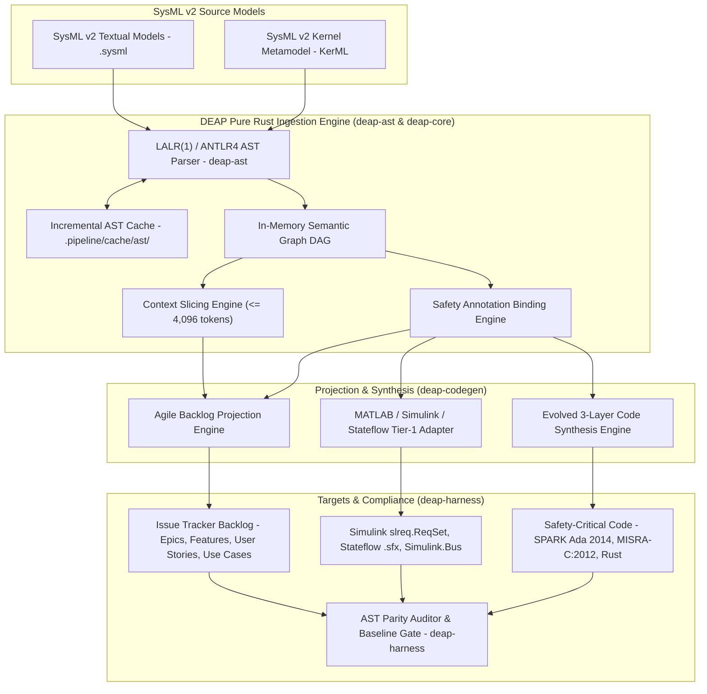
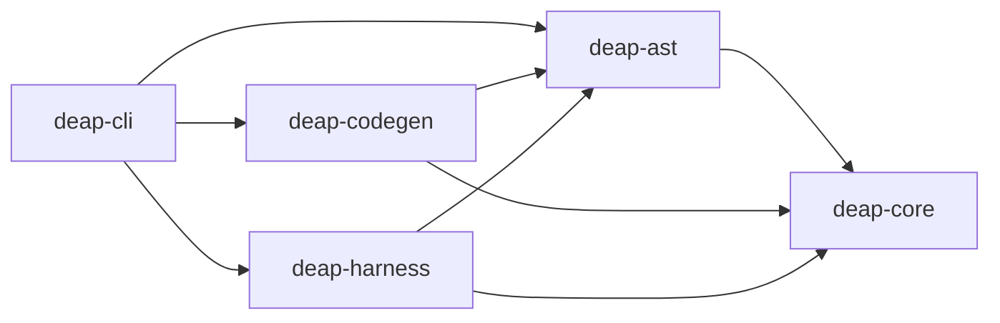
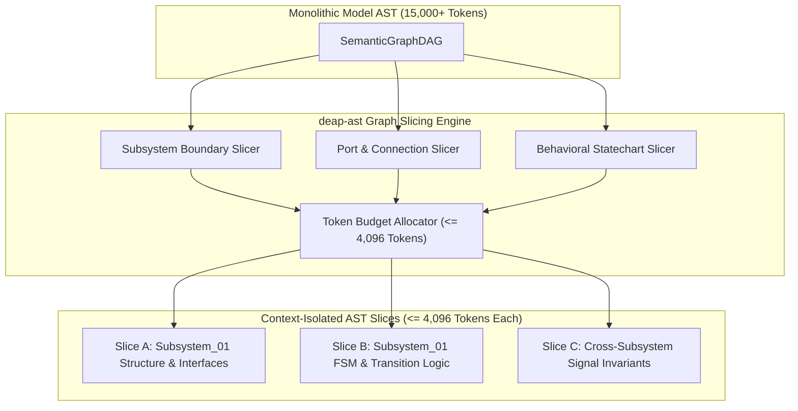
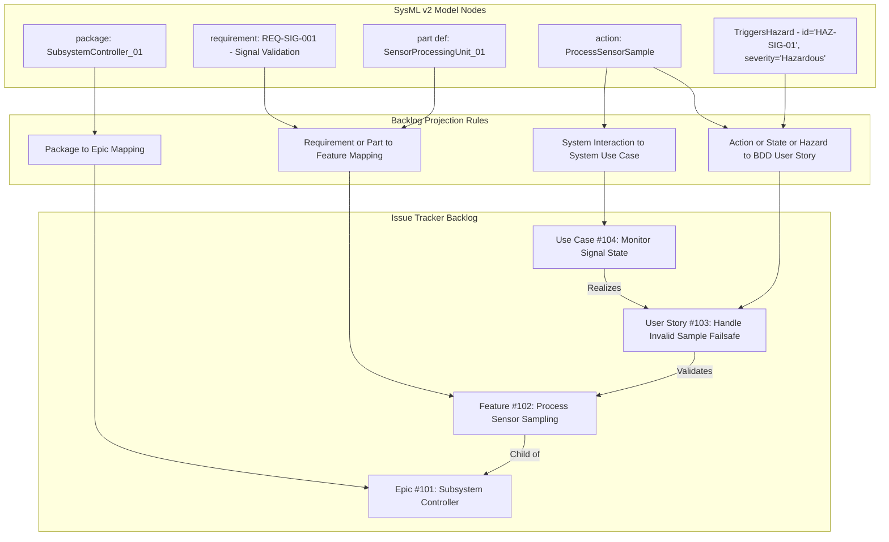
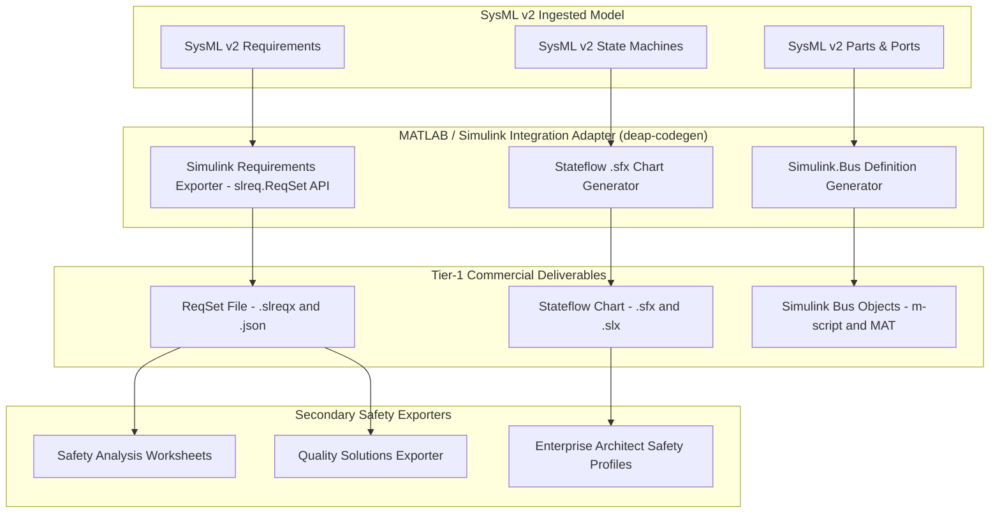
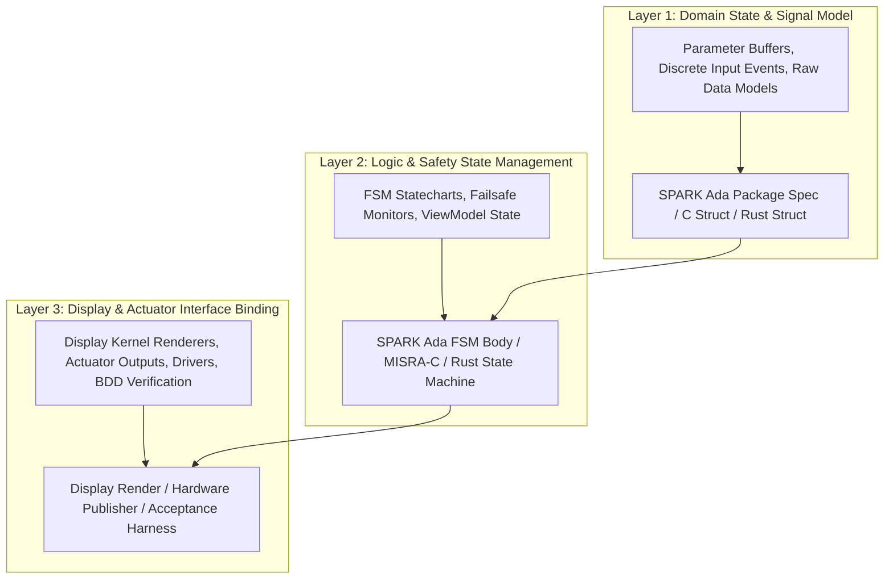
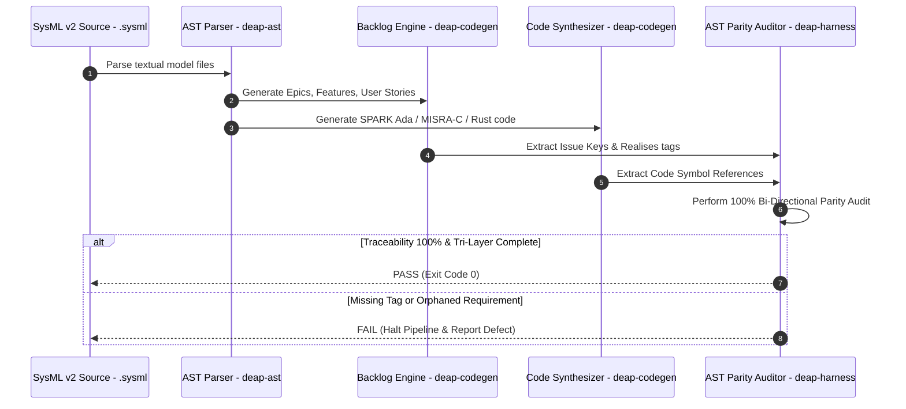
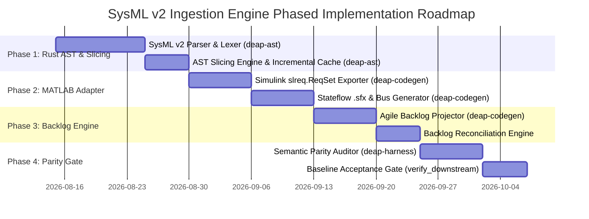

# SysML v2 Ingestion Engine Solution Blueprint (DEAP-BLUEPRINT-SYSML-003)

## 1. Executive Summary & Architectural Vision

The **Digital Engineering Agentic Pipeline (DEAP)** SysML v2 Ingestion Engine establishes an automated, production-grade Model-Based Systems Engineering (MBSE) ingestion pipeline. It bridges high-level OMG SysML v2 textual and graphical models with the DEAP multi-tier compiler workspace.



### Key Vision & Objectives:
1. **Seamless MBSE Ingestion:** Parse raw OMG SysML v2 textual declarations (`package`, `part def`, `port`, `connection`, `action`, `state`, `attribute`, `requirement`) into a structured in-memory Semantic Graph Directed Acyclic Graph (DAG) using a pure Rust modular architecture.
2. **Incremental AST Caching:** Maintain a deterministic, content-hash keyed parser cache (`.pipeline/cache/ast/`) to eliminate redundant re-parsing of unchanged model units across CI/CD and subagent execution loops.
3. **Strongly-Typed AST Slicing:** Partition monolithic model DAGs into context-isolated, strongly-typed semantic slices strictly bounded at $\le 4,096$ tokens, enabling zero-truncation consumption by specialized LLM synthesis subagents.
4. **Deterministic Backlog Projection:** Project SysML v2 packages and requirements into issue tracker backlog items (Epics, Features, BDD User Stories, and UML Use Cases) with 100% structural fidelity.
5. **Tier-1 Commercial Toolchain Integration:** Interoperability with MATLAB / Simulink / Stateflow / Embedded Coder (`slreq.ReqSet`, Stateflow `.sfx` charts, `Simulink.Bus` objects) as the primary commercial Model-Based Design (MBD) toolchain.
6. **Evolved 3-Layer Code Synthesis:** Synthesize high-integrity, certifiable target source code in **SPARK Ada 2014**, **MISRA-C:2012**, and **High-Assurance Rust** structured across Domain State/Signals (Layer 1), Logic & Safety State Management (Layer 2), and Display/Actuator Interfaces (Layer 3).
7. **Continuous Compliance Verification:** Enforce 100% bi-directional traceability and zero-orphan coverage via automated AST parity gates in `deap-harness` under stringent high-assurance standards (**DO-178C**, **DO-254**, **ARP4754A/4761**, **ASTM F3269**).

---

## 2. Pure Rust Cargo Workspace Architecture & AST Parser Engine

### 2.1 Pure Rust Modular Cargo Workspace Topology

The ingestion engine and downstream compilation pipeline are organized as a pure Rust modular Cargo workspace:

```
deap-compiler/
├── Cargo.toml                  # Workspace root manifest
├── crates/
│   ├── deap-core/              # Core primitives, diagnostics, hashing, and configuration
│   ├── deap-ast/               # SysML v2 AST, grammar parser, slicing engine, incremental cache
│   ├── deap-codegen/           # Backlog projection, MATLAB/Simulink exporters, 3-layer code synthesis
│   ├── deap-harness/           # Parity validation gates, semantic acceptance tests, simulation drivers
│   └── deap-cli/               # Unified CLI entrypoint (`deap ingest`, `deap slice`, `deap verify`)
```

- **`deap-core`**: Provides zero-allocation string interning, diagnostic emission with ANSI/JSON formatters, SHA-256 cryptographic fingerprinting, and workspace configuration loaders.
- **`deap-ast`**: Houses the formal SysML v2 grammar lexer/parser, strongly-typed node hierarchies, incremental caching subsystem, and topological graph slicing engine.
- **`deap-codegen`**: Implements template-free code generation for MBD artifacts, Markdown backlog projections, and multi-language safety implementations.
- **`deap-harness`**: Implements mechanical verification gates, semantic parity checks, and model-in-the-loop validation runners.
- **`deap-cli`**: Exposes high-performance CLI commands for pipeline operators and automated CI/CD runners.



### 2.2 AST Grammar & Primitive Extraction
The `deap-ast` parser processes standard SysML v2 structural and behavioral primitives:
- `package`: Top-level namespace containers mapping to functional domains.
- `part def` / `part`: Structural components, subsystems, and physical/logical entities.
- `port`: Dynamic interface points and bus connectors with explicit directionality (`in`, `out`, `inout`).
- `connection`: Dataflow and logical bindings between ports.
- `action` / `action def`: Discrete operational behaviors, activities, and control flows.
- `state` / `state def`: FSM safety states, transition conditions, entry/exit actions.
- `attribute`: Typed data fields with value ranges, units, and multiplicity constraints.
- `requirement`: Formal system requirements with explicit text, IDs, and verification criteria.
- `enum def` / `item def`: Discrete enumeration types and structured data items.

### 2.3 Strongly-Typed AST Data Structures in Rust (`deap-ast`)

```rust
// Strongly-typed AST structures in crates/deap-ast/src/model.rs

use serde::{Deserialize, Serialize};
use std::collections::HashMap;

#[derive(Debug, Clone, PartialEq, Eq, Serialize, Deserialize)]
pub enum NodeKind {
    Package,
    PartDef,
    Port,
    Connection,
    Action,
    State,
    Requirement,
    Attribute,
    ItemDef,
}

#[derive(Debug, Clone, Serialize, Deserialize)]
pub struct AnnotationAttribute {
    pub name: String, // e.g., "TriggersHazard", "SafetyRealises", "Layer"
    pub params: HashMap<String, String>,
}

#[derive(Debug, Clone, Serialize, Deserialize)]
pub struct SourceSpan {
    pub file_path: String,
    pub start_line: usize,
    pub end_line: usize,
}

#[derive(Debug, Clone, Serialize, Deserialize)]
pub struct SysMLNode {
    pub node_id: String,
    pub kind: NodeKind,
    pub name: String,
    pub qualified_name: String,
    pub docstring: Option<String>,
    pub attributes: HashMap<String, String>,
    pub annotations: Vec<AnnotationAttribute>,
    pub source_ref: Option<SourceSpan>,
}

#[derive(Debug, Clone, Serialize, Deserialize)]
pub struct SysMLEdge {
    pub source_id: String,
    pub target_id: String,
    pub edge_type: String, // "contains", "connects_to", "transition", "realises", "triggers_hazard"
    pub metadata: HashMap<String, String>,
}

#[derive(Debug, Clone, Default, Serialize, Deserialize)]
pub struct SemanticGraphDAG {
    pub nodes: HashMap<String, SysMLNode>,
    pub edges: Vec<SysMLEdge>,
    pub package_hierarchy: HashMap<String, Vec<String>>,
}
```

### 2.4 Strongly-Typed AST Slicing Mechanics ($\le 4,096$ Tokens)

To guarantee that autonomous AI subagents operate without context truncation or hallucination, `deap-ast` incorporates a deterministic topological graph slicing engine. Large monolithic models (which can span tens of thousands of tokens) are partitioned into coherent, self-contained subgraphs strictly bounded at $\le 4,096$ tokens.



#### Slicing Algorithms & Invariants:
1. **Subsystem Partition Slicing:** Extracts a single target `part def` along with all direct child parts, attributes, and internal actions. External connections are replaced with strongly-typed port interface stubs.
2. **Interface Boundary Slicing:** Extracts all connected `PortDefNode` instances, item flows, and signal definitions across an N² subsystem boundary, pruning internal logic.
3. **Behavioral State Slicing:** Extracts a single `state def` machine with all transition paths, guard predicates, and entry/exit actions, binding external event triggers to typed stub signals.
4. **Token Budget Guarantee:** The slicing engine tokenizes the serialized JSON/YAML projection of the subgraph using the target tokenizer (e.g. tiktoken cl100k_base). If the token count exceeds 4,096 tokens, the engine recursively subdivides behavioral actions from structural declarations, yielding two complementary sub-slices.

```rust
// AST Slicing Interface in crates/deap-ast/src/slicing.rs

pub struct AstSlice {
    pub slice_id: String,
    pub target_node: String,
    pub token_count: usize,
    pub subgraph: SemanticGraphDAG,
    pub external_interface_stubs: Vec<SysMLNode>,
}

impl SemanticGraphDAG {
    pub fn slice_subsystem(&self, target_part_id: &str, max_tokens: usize) -> Result<Vec<AstSlice>, SlicingError> {
        // Deterministic BFS extraction preserving immediate dependencies
        // Enforces token_count <= max_tokens (default 4,096)
        // Replaces out-of-slice targets with typed stub references
    }
}
```

### 2.5 Incremental AST Parser Caching

To optimize execution velocity and support rapid continuous verification loops, `deap-ast` implements an incremental disk and memory caching subsystem:

1. **Fingerprint Computation:** For every input `.sysml` or schema file, `deap-ast` computes a SHA-256 content digest and combines it with compiler version metadata.
2. **Cache Keying & Layout:** Cached binary AST artifacts are stored under `.pipeline/cache/ast/<sha256>.bin` using bincode serialization for sub-millisecond cold loading.
3. **Delta Dependency Invalidation:** When a package is modified, only the affected AST nodes and their immediate topological dependents in the DAG are invalidated; unaffected packages are pulled directly from cache.

```rust
// Incremental Cache in crates/deap-ast/src/cache.rs

pub struct IncrementalAstCache {
    cache_dir: PathBuf,
}

impl IncrementalAstCache {
    pub fn get_or_parse<F>(&self, file_path: &Path, parse_fn: F) -> Result<SemanticGraphDAG, ParseError>
    where
        F: FnOnce(&Path) -> Result<SemanticGraphDAG, ParseError>,
    {
        let digest = deap_core::hash_file_sha256(file_path)?;
        let cache_file = self.cache_dir.join(format!("{}.bin", digest));
        if cache_file.exists() {
            return deap_core::deserialize_bincode(&cache_file);
        }
        let ast = parse_fn(file_path)?;
        deap_core::serialize_bincode(&cache_file, &ast)?;
        Ok(ast)
    }
}
```

### 2.6 Custom Safety Annotations
The synthesizer extracts custom DEAP safety annotations embedded within SysML v2 textual comments or metadata tags:

| Annotation Syntax | Parameters | Extraction & Semantic Linkage |
| :--- | :--- | :--- |
| `@TriggersHazard(id="HAZ-NNN", severity="SeverityLevel")` | `id`: Hazard ID string, `severity`: `Catastrophic`, `Hazardous`, `Major`, `Minor` | Binds element to system hazard analysis matrix; forces creation of BDD negative scenario. |
| `@SafetyRealises(requirement="REQ-NNN")` | `requirement`: Requirement ID string | Establishes bi-directional traceability between structural/behavioral elements and upstream requirements. |
| `@Layer(tier="Layer1\|Layer2\|Layer3")` | `tier`: Target layer designation | Binds the element explicitly to Layer 1 (State/Signals), Layer 2 (Statecharts/FSM), or Layer 3 (Display/Actuators). |

### 2.7 Dual-LLM Air-Gapped Agent Dispatch Protocol

To guarantee mathematical determinism, total intellectual property containment, and complete immunity to cloud rate-limiting or content censorship, DEAP utilizes a dual-LLM air-gapped agent dispatch architecture orchestrated by `deap-harness` and `deap-cli`:

1. **Reasoning Slot (DeepSeek-R1)**:
   - Dedicated Chain-of-Thought (CoT) reasoning model executing on sovereign air-gapped workstation hardware.
   - Ingests strongly-typed AST slices (<= 4,096 tokens) from `deap-ast` to derive formal semantics, invariant boundaries, and state reachability matrices.
   - Streams formal mathematical proofs, reachability derivations, and safety invariant checks directly into `.pipeline/diagnostics/cot_audit_log.json`.
   - Never generates raw code directly; outputs verified formal derivations and boundary assertions.

2. **Execution Slot (Qwen-2.5-Coder)**:
   - High-throughput deterministic code and specification synthesis model.
   - Ingests verified reasoning derivations from `.pipeline/diagnostics/cot_audit_log.json` alongside the strongly-typed AST slice.
   - Generates verified SysML v2 specifications, formal verification contracts, and multi-toolchain synthesis artifacts.
   - All generated code and model artifacts are validated through `deap-harness` mechanical gates before committing to the repository.

---

## 3. Agile Backlog Projection Engine (`deap-codegen`)

The Agile Backlog Projection Engine deterministically maps the in-memory `SemanticGraphDAG` into issue tracker backlog artifacts.



### 3.1 Projection Transformation Rules
1. **SysML `package` -> Issue Tracker Epic:**
   - Title format: `[Module/Domain]: [Functional Area]` (e.g., `[CoreSubsystem]: Signal Processing & State Estimation`).
   - Frontmatter tags: `type: epic`, `sysml_package: <qualified_name>`.
2. **SysML `requirement` & `part def` -> Issue Tracker Feature:**
   - Title format: `[Verb] [Object] [Qualifier]` (e.g., `Sample Sensor Data Stream`).
   - Frontmatter tags: `type: feature`, `epic_ref: #<Epic_ID>`, `sysml_element: <qualified_name>`.
   - Acceptance Criteria: Derived from `attribute` constraints, `port` boundaries, and `@SafetyRealises` tags.
3. **SysML `action`, `state`, & `@TriggersHazard` -> BDD User Story:**
   - Title format: `As a [Actor/Subsystem], I want to [Action], so that [Outcome/Safety Constraint]`.
   - Canonical BDD Scenarios (Given-When-Then):
     - **Pattern A (Display System Interfaces):** `Given [Parameter Buffer State], When [Binary Command Received], Then [Widget State & Display Kernel Render Updated]`.
     - **Pattern B (Real-Time Safety Statecharts / Controller):** `Given [Subsystem State Vector / Discrete Event], When [Safety FSM Transition Triggered], Then [Actuator Command / Output Signal Rendered]`.
     - **Pattern C (Decoupled Operator Console):** `Given [Console Domain Model State], When [Operator Action Initiated], Then [ViewModel State & Component Binding Updated]`.
4. **SysML `use case` & System Interaction -> UML System Use Case:**
   - Formal specification containing Primary Actors, Preconditions, Main Success Scenario, Alternate Flows, and a complete Realization Matrix linking Use Cases to User Stories and Features.

---

## 4. MATLAB / Simulink / Stateflow Tier-1 Integration Adapter

DEAP establishes **MATLAB / Simulink / Stateflow / Embedded Coder** as the Primary Tier-1 Commercial Toolchain Integration for Model-Based Design (MBD), control law synthesis, and DO-178C C/SPARK Ada code generation.



### 4.1 Simulink Requirements (`slreq.ReqSet`) Mapping
SysML v2 `requirement` blocks are exported directly into MATLAB Simulink Requirements sets using the `slreq` programmatic API:
- Requirement ID -> `slreq.ID`
- Requirement text -> `slreq.Text`
- Rationale -> `slreq.Rationale`
- Safety Attributes / DO-178C DAL -> `slreq.setAttribute("SafetyDAL", "DAL_A")`

### 4.2 Stateflow `.sfx` Chart Generation
SysML v2 `state def` machines translate directly into standalone Stateflow chart definitions (`.sfx`):
- `state` -> Stateflow State Object
- `transition` -> Stateflow Transition with Guard Condition `[guard]` and Action `{action;}`
- Entry/Exit Actions -> `entry:` / `exit:` statements inside Stateflow states.

### 4.3 `Simulink.Bus` & Signal Objects
SysML v2 `part def` and `port` structures generate MATLAB scripts constructing `Simulink.Bus` objects:
```matlab
% Generated Simulink.Bus Definition Script
elems(1) = Simulink.BusElement;
elems(1).Name = 'signal_alpha';
elems(1).DataType = 'single';
elems(1).Min = 0.0;
elems(1).Max = 1000.0;

elems(2) = Simulink.BusElement;
elems(2).Name = 'subsystem_status';
elems(2).DataType = 'Enum: SubsystemStatusType';

Bus_Subsystem_01 = Simulink.Bus;
Bus_Subsystem_01.Elements = elems;
```

---

## 5. Evolved 3-Layer Pure Rust Code Synthesis Engine

The 3-Layer Code Synthesis Engine in `deap-codegen` translates the SysML v2 Semantic Graph DAG into target source code, guaranteeing strict separation across domain states, safety statecharts, and display/actuator interfaces.



### 5.1 Layer Definitions & Target Languages

#### Layer 1: Domain State & Signal Model
- **SPARK Ada 2014:** Strong scalar types with explicit range constraints and record definitions.
  ```ada
  type Signal_Alpha_Type is new Float range 0.0 .. 1000.0;
  type Subsystem_Status_Type is (Valid, Invalid, Degraded, No_Signal);
  
  type Subsystem_Buffer_Type is record
     Current_Signal : Signal_Alpha_Type;
     Status         : Subsystem_Status_Type;
  end record;
  ```
- **MISRA-C:2012:** Fixed-width integer types (`int32_t`, `uint32_t`) and defensive typedef structs.
- **High-Assurance Rust:** Strongly typed newtypes with validated range invariants:
  ```rust
  #[derive(Debug, Clone, Copy, PartialEq)]
  pub struct SignalAlpha(f32);
  
  impl SignalAlpha {
      pub fn new(val: f32) -> Result<Self, SignalError> {
          if (0.0..=1000.0).contains(&val) {
              Ok(Self(val))
          } else {
              Err(SignalError::ValueOutOfRange)
          }
      }
  }
  ```

#### Layer 2: Logic & Safety State Management
- **SPARK Ada 2014:** Formal verification contracts ensuring zero runtime errors (`Pre`, `Post`, `Global`, `Depends`).
  ```ada
  procedure Transition_Safety_State (
     Buffer : in     Subsystem_Buffer_Type;
     State  : in out FSM_State_Type)
  with
     Pre  => Buffer.Current_Signal >= 0.0,
     Post => (if Buffer.Status /= Valid then State = Failsafe_Fallback),
     Global => null;
  ```
- **MISRA-C:2012:** Defensive state machine with explicit switch/case logic, Rule 10.x compliance, and static variable scoping.
- **High-Assurance Rust:** Type-state pattern with compile-time state transitions:
  ```rust
  pub struct StateMachine<S> {
      state: S,
  }
  
  impl StateMachine<Operational> {
      pub fn handle_fault(self, fault: FaultEvent) -> StateMachine<FailsafeFallback> {
          StateMachine { state: FailsafeFallback::from(fault) }
      }
  }
  ```

#### Layer 3: Display & Actuator Interface Binding
- **SPARK Ada / C:** Display widget buffer driver rendering and actuator DAC bus updates.
- **High-Assurance Rust:** Zero-cost hardware abstraction layer (HAL) bindings and deterministic actuator updates.
- **Semantic Acceptance Tests:** Automated verification suites verifying that components render and actuate correctly in response to Layer 1/2 state changes.

---

## 6. Continuous Compliance Verification & Parity Gate (`deap-harness`)

Continuous compliance and structural parity are mechanically verified by `deap-harness` and `./target/release/verify-baseline`.



### 6.1 Parity Auditor Enforcement Rules
1. **100% Model Coverage:** Every requirement in the `.sysml` source file MUST map to at least one Feature issue.
2. **Zero Orphaned Requirements:** Every code file carrying a `/// Realises: [Feat-NNN/...]` tag must resolve to an active Feature issue key.
3. **Tri-Layer Definition of Done Gate:** Enforced by `deap-harness`. Every Feature issue must have all three layers (Layer 1 State/Signal, Layer 2 Statechart/ViewModel, Layer 3 Display/Actuator) explicitly implemented or mapped to a named task.

---

## 7. Implementation Roadmap & Phased Execution Plan

The SysML v2 Ingestion Engine solution blueprint is executed across four distinct phases:



### Phase Details & Exit Criteria

| Phase | Core Deliverables | Key Artifacts | Exit Criteria & Verification Gate |
| :--- | :--- | :--- | :--- |
| **Phase 1: AST Parser & Slicing Engine** | SysML v2 grammar parser, typed AST slices (<= 4,096 tokens) | `deap-ast`, `deap-core` | Parsed `.sysml` files output valid `SemanticGraphDAG` and context-isolated AST slices without data loss. |
| **Phase 2: MATLAB Tier-1 Adapter** | MBD exporter for Simulink & Stateflow | `deap-codegen` Simulink exporter | MATLAB CLI successfully loads exported `.slreqx` and executes `.sfx` Stateflow simulation without errors. |
| **Phase 3: Backlog Projection Engine** | Projection rules for Epics, Features, User Stories, Use Cases | `deap-codegen`, backlog reconciliation | 100% of SysML requirements and packages projected into specifications with valid YAML frontmatter tags. |
| **Phase 4: Parity Gate & Compliance** | Semantic acceptance verification harness | `deap-harness`, `./target/release/verify-baseline` | `./target/release/verify-baseline . --no-domain` passes 100% green; bi-directional audit verifies zero orphan code symbols or requirements. |

---
