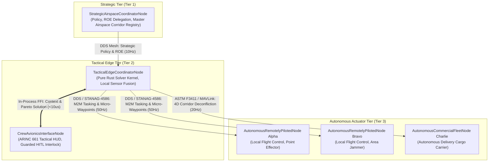

# DUAL-USE DRONE ORCHESTRATION AND C-UAS SOLUTION BLUEPRINT
> **System Architecture, Mathematical Formulations, and Dual-Use Domain Metamodel**  
> *Conforming to ISO/IEC/IEEE 29148:2018, DO-178C Level A, and JARUS SORA v2.5*

<!-- Provenance: schema/cuas_coa.sysml §1.1 | Level 0 Architecture Specification -->

---

## Executive Summary

The DEAP dual-use orchestration architecture formalizes the realization that counter-uncrewed aerial systems (C-UAS) defense and commercial low-altitude economy (LAE) drone fleet orchestration share approximately 85% algorithmic and mathematical commonality. 

Whether defending critical infrastructure or tactical air space against a coordinated swarm of hostile uncrewed aerial vehicles (UAS), or orchestrating a 50-drone commercial delivery and linear infrastructure inspection fleet across shared civil airspace, the underlying systems engineering problems are identical:

```
┌────────────────────────────────────────────────────────────────────────────────────────┐
│                        CORE REUSABLE DUAL-USE ORCHESTRATION KERNEL                     │
│  * 4D Spatiotemporal Airspace Deconfliction (ASTM F3411 Remote ID / RTCA DO-365B DAA)  │
│  * Multi-Objective Pareto Resource Allocation Engine                                  │
│  * Dynamic Sensor-to-Effector / Waypoint Assignment Topology                           │
│  * Deterministic Fail-Closed Human-in-the-Loop (HITL) Interlocks                       │
│  * Microsecond In-Process FFI Computation with Asynchronous Pub-Sub Edge Mesh          │
└────────────────────────────────────────────────────────────────────────────────────────┘
                                    │
          ┌─────────────────────────┴─────────────────────────┐
          ▼                                                   ▼
┌───────────────────────────────────┐       ┌───────────────────────────────────┐
│     DEFENSE / TACTICAL C-UAS      │       │     CIVIL / DUAL-USE COMMERCIAL   │
│ * Sensor: AESA Radar, RF-DF, EO/IR│       │ * Sensor: ADS-B In, Remote ID, DAA│
│ * Threat: Hostile Swarms, Loitering│      │ * Traffic: Commercial Deliveries  │
│ * Actuator: Kinetic, EW Jam, HPM  │       │ * Actuator: Motor ESC, Parachute  │
│ * Metric: P_k, Keep-Out Margin,   │       │ * Metric: Separation, Battery DoD,│
│   Magazine Retention              │       │   SORA Ground/Air Risk Class (GRC)│
└───────────────────────────────────┘       └───────────────────────────────────┘
```

The differences lie strictly in vocabulary and actuator modalities:
1. In defense operations, the system pairs hostile drone tracks with non-kinetic (directional RF jamming, high-power microwave bursts) or kinetic effectors to maximize target neutralization probability ($P_k$) while retaining magazine depth for follow-on waves.
2. In commercial fleet management, the system pairs cargo delivery routes with spatiotemporal 4D flight corridors, battery state-of-charge reserves, and emergency landing zones to ensure zero mid-air collisions, zero ASTM/ICAO airspace violations, and SORA Ground Risk Class (GRC) containment.

The core computational engine, state representations, geometry routines, and safety architectures are identical and platform-independent.

---

## Command and Control Architecture

To prevent architectural brittleness and premature distributed network lock-in, the DEAP architecture enforces a clear boundary between local in-process computation and distributed edge network communication:

**2.1 The Two Operational Communication Tiers**

1. **Local In-Process In-Memory FFI Interface (Sub-Millisecond Loop):**
   - High-rate tactical cockpit rendering and local decision-support algorithms communicate through a strongly typed in-memory C ABI / FFI boundary.
   - Guaranteed deterministic sub-millisecond execution ($< 10\,\mu\text{s}$ call overhead, $< 500\,\text{ms}$ full combinatorial solve).
   - Eliminates distributed serialization, socket overhead, and network discovery from the core GUI and flight-critical inner loops.

2. **Asynchronous Distributed Edge Mesh (Inter-Node Multi-Domain):**
   - Inter-node telemetry, machine-to-machine (M2M) tasking, and wide-area radar/sensor track streaming operate over a DDS (Data Distribution Service) or gRPC mesh.
   - Bounded latency ($< 50\,\text{ms}$ mesh propagation).
   - Enforces asynchronous isolation: network disconnects or packet drops cannot block local tactical solver execution or operator cockpit interactivity.

**2.2 Operational Node Hierarchy**



**2.3 Severed Backhaul Autonomous Fallback**

When the communications link between `StrategicAirspaceCoordinatorNode` and `TacticalEdgeCoordinatorNode` is jammed, degraded, or severed:
1. The `TacticalEdgeCoordinatorNode` autonomously transitions to the `SeveredLinkAutonomousFallback` state.
2. The edge node enforces the last known validated Rules of Engagement (ROE) and pre-authorized contingency envelopes.
3. The crew avionics interface alerts the operator with high-contrast amber annunciators without freezing or destabilizing the presentation pipeline.
4. When communication is restored, cryptographic state reconciliation executes idempotently over the DDS state bus.

---

## Domain Ontological Harmonization Definitions

In strict accordance with the Pure Schema-Driven Compiler Invariant, all domain-specific concepts in Tier 2 product line repositories derive exclusively from generalized systems engineering classes. Customer-specific or market-specific names (such as specific aircraft designations or proprietary drone brand names) are Tier 3 deployment instances and are strictly forbidden in this product line specification.

| Abstract Product Line Class | Standard Grounding | Tactical Air Combat Exemplar | Civil Low-Altitude Economy Exemplar | Critical Infrastructure Perimeter Exemplar |
| :--- | :--- | :--- | :--- | :--- |
| `StrategicAirspaceCoordinatorNode` | ISO/IEC/IEEE 15288 §6.4.2 | Airborne Early Warning & Control (AEW&C) / CAOC | Civil Uncrewed Traffic Management (UTM) Flight Authority | Regional Homeland Security / Port Security Operations Center |
| `TacticalEdgeCoordinatorNode` | DO-178C Level A / ED-12C | Tactical Crewed Combat Edge Aircraft Mission Computer | Regional Drone Logistics Hub Dispatcher / Vertiport C2 | Ground Tactical Command Post / Mobile C-UAS Shelter |
| `CrewAvionicsInterfaceNode` | ARINC 661 / MIL-STD-1472H | Crew Tactical Cockpit Panoramic Display System | Logistics Flight Controller Desktop Workstation | Security Guard Force Tactical Touchscreen Console |
| `AutonomousRemotelyPilotedNode` | STANAG 4586 / RTCA DO-365B | Collaborative Combat Aircraft (CCA) Autonomous Wingman | Automated Beyond-Visual-Line-of-Sight (BVLOS) Delivery Drone | Autonomous Perimeter Patrol & Interceptor Sentry Drone |
| `CivilianAirspaceAuthorityNode` | ASTM F3411-22 / ICAO Doc 10019 | National Air Traffic Control Liaison Radar Interface | Civil Aviation Authority (CAA) Dynamic Airspace Reservation | Municipal Airspace Safety Interlock & No-Fly Registry |
| `AutonomousCommercialFleetNode` | JARUS SORA v2.5 / ASTM F38 | Autonomous Collaborative Delivery Swarm (50x package drones)| Linear Pipeline / Power Grid Continuous Inspection Fleet | Industrial Site Automated Environmental Monitoring Fleet |
| `ProtectedInfrastructureAssetNode` | MIL-STD-882E / ISO 26262 | Tactical Operations Center, Runway, Ammunition Depot | Urban Vertiport Pad, Hospital Heliport, Hospital Corridor | Oil Refinery, Nuclear Generation Facility, Water Reservoir |

---

## Universal Dual-Use Primitives Architecture

Every scenario across defense and civil operations resolves to interactions between four fundamental systems engineering primitives:

1. **`ProtectedAssetNode` (The Value Entity):**
   - High-value geographic location, facility, or crewed airborne asset requiring preservation.
   - Attributes: Priority weight $W_i$, 3D spatial boundary polygon, keep-out boundary radius $R_{\text{keepout}}$, vulnerability index $V_i$.

2. **`TargetTrackEntity` (The Dynamic Entity):**
   - Identified airborne object operating within or approaching the monitored volume.
   - In Defense: Hostile or unidentified UAS intruder with kinematics, bearing, classification, and estimated time-to-impact (TTI).
   - In Civil: Commercial delivery drone, general aviation aircraft, or emergency medical helicopter with 4D intent trajectory and Remote ID beacon.

3. **`AssignedActorEffectorNode` (The Actuator Entity):**
   - Resource capable of modifying the physical state or trajectory of a dynamic entity.
   - In Defense: Directional RF jammer (EW), high-power microwave (HPM), kinetic surface-to-air interceptor.
   - In Civil: Autonomous delivery drone motor speed controller (ESC), dynamic waypoint rerouting command, parachute descent trigger.

4. **`OptimizationTradeOffVector` (The Policy Objective):**
   - Mathematical objective weights balancing competing operational imperatives.
   - Components: Immediate coverage / neutralization ($J_{\text{coverage}}$), sustainment / reserve preservation ($J_{\text{reserve}}$), collateral / third-party ground risk minimization ($J_{\text{risk}}$).

---

## System-Level Requirements Specifications

**5.1 Functional Requirements**

- **REQ-SYS-001 (Pareto Frontier Synthesis):**
  The solver engine shall synthesize at least 3 distinct pareto-optimal Courses of Action (COAs) evaluating asset coverage, resource reserve retention, and collateral risk within $500\,\text{ms}$ of receiving an updated tactical scenario context.
- **REQ-SYS-002 (Guarded Two-Stage Human Authorization):**
  The system shall enforce a two-stage interlock (`ARM` then `COMMIT`) before executing any effector engagement tasking or flight path override command.
- **REQ-SYS-003 (Autonomous Fail-Closed Interlock):**
  If communications between the tactical edge and strategic command are interrupted, the edge coordinator shall execute local safety invariants and prevent any action violating pre-authorized Rules of Engagement (ROE).
- **REQ-SYS-004 (4D Spatiotemporal Airspace Reservation):**
  The system shall compute 4D trajectory envelopes $(x, y, z, t)$ ensuring minimum separation distances of $150\,\text{m}$ horizontal and $50\,\text{m}$ vertical between any two autonomous remotely piloted nodes.
- **REQ-SYS-005 (Universal Sensor-to-Effector Pairing):**
  The system shall support heterogeneous sensor modalities (radar, passive RF-DF, EO/IR thermal, Remote ID) and map detections into a unified kinematic track picture.

**5.2 Performance & Real-Time Latency Requirements**

- **REQ-SYS-006 (FFI Sub-Millisecond Execution):**
  In-process FFI solver invocations shall complete with memory allocation overhead strictly under $10\,\mu\text{s}$ and execute a 50-track combinatorial optimization in under $5\,\text{ms}$.
- **REQ-SYS-007 (DDS Mesh Network Latency):**
  Machine-to-machine tasking messages dispatched across the tactical edge pub-sub network shall achieve one-way delivery in under $50\,\text{ms}$ at 99.9th percentile.
- **REQ-SYS-008 (Cockpit Display Cadence):**
  The tactical graphical user interface shall maintain a rendering cadence of at least 60 frames per second ($16.67\,\text{ms}$ frame budget) under active track injection of up to 100 simultaneous targets.

**5.3 Safety, Airworthiness & Regulatory Invariants**

- **REQ-SYS-009 (Zero Rule-of-Engagement Violations):**
  The optimization engine shall enforce an absolute constraint ceiling of zero violations against validated ROE and civilian airspace restrictions:
  $$\text{ViolationCount} = 0$$
- **REQ-SYS-010 (Sustainment Magazine & Battery Reserve Floor):**
  The system shall preserve at least 25% consumable resource reserve (kinetic interceptor rounds or battery state-of-charge) across all nominal single-wave engagement plans:
  $$\text{ReserveRatio} \ge 0.25$$
- **REQ-SYS-011 (Collateral Risk Floor):**
  The estimated collateral damage or third-party ground impact risk score shall not exceed 0.05 under any candidate COA:
  $$\text{CollateralRiskScore} \le 0.05$$
- **REQ-SYS-012 (JARUS SORA v2.5 Ground Risk Class Containment):**
  In civilian operations, dynamic flight reroutes shall maintain a Ground Risk Class (GRC) index of 4 or lower over populated areas.

---

## Operational Use Cases Specifications

**6.1 UC-M2M: Autonomous Remotely Piloted Node Machine-to-Machine Tasking**
- **Primary Actor:** `TacticalEdgeCoordinatorNode`
- **Secondary Actor:** `AutonomousRemotelyPilotedNode`
- **Preconditions:** Sensor fusion engine tracks hostile target or commercial mission waypoint; edge solver has computed valid pareto pairing.
- **Main Success Scenario:**
  1. Edge solver emits a verified `WeaponTargetPairing` or `TrajectoryCommand` record.
  2. The record is serialized over the secure DDS bus with cryptographic signature.
  3. The autonomous node ingests the pairing, verifies local safety bounds, and arms local actuator.
  4. The autonomous node acknowledges tasking within $20\,\text{ms}$.
- **Postconditions:** Effector or flight actuator is tracking the assigned target or corridor.

**6.2 UC-STRAT-DELEGATION: Strategic Airspace Authority Delegation & Autonomous Fallback**
- **Primary Actor:** `StrategicAirspaceCoordinatorNode`
- **Secondary Actor:** `TacticalEdgeCoordinatorNode`
- **Preconditions:** Wide-area communications active; strategic authority delegates operational sector.
- **Main Success Scenario:**
  1. Strategic coordinator publishes signed operational envelope and ROE limits.
  2. Tactical edge node validates envelope and takes custody of local airspace sector.
  3. Tactical edge node operates continuously within authorized constraints.
- **Extensions (Severed Link):**
  - 3a. Communications backhaul lost.
  - 3b. Tactical edge node transitions to `SeveredLinkAutonomousFallback`.
  - 3c. Edge node executes local fail-closed defensive and deconfliction routines.
  - 3d. Operator HUD displays degraded backhaul advisory without loss of control.

**6.3 UC-CREW-COMMIT: Low-Cognitive-Load Crew Interface & Single-Action Commit Interlock**
- **Primary Actor:** Airborne Mission Commander (Tactical Pilot or Fleet Director)
- **Secondary Actor:** `CrewAvionicsInterfaceNode`
- **Preconditions:** Solver displays ranked candidate COAs on ARINC 661 tactical HUD.
- **Main Success Scenario:**
  1. Operator reviews plain-language rationale and side-by-side trade-off metrics.
  2. Operator taps candidate row to designate active COA.
  3. Operator toggles the guarded `[GUARD]` switch to arm interlock (`ARMED` state).
  4. Operator confirms single-action `[COMMIT COA]` button.
  5. Interlock tasks actuators and automatically locks to prevent double-activation.
- **Postconditions:** COA transitions to `AUTHORIZED`; actuators receive execution packets.

**6.4 UC-CIVIL-CORRIDOR: 4D Spatiotemporal Airspace Corridor Dynamic Deconfliction**
- **Primary Actor:** `AutonomousCommercialFleetNode`
- **Secondary Actor:** `CivilianAirspaceAuthorityNode`
- **Preconditions:** Drone delivery fleet operating across urban low-altitude airspace.
- **Main Success Scenario:**
  1. Commercial fleet node requests 4D corridor reservation $(x, y, z, t)$.
  2. Deconfliction engine checks spatial separation against known flight paths and geofenced zones.
  3. System issues reservation certificate complying with ASTM F3411 Remote ID.
  4. Fleet node executes flight while broadcasting real-time kinematic telemetry.

**6.5 UC-SATURATION: Multi-Wave Intruder Saturation Defense & Sustainment Depth**
- **Primary Actor:** Defense C-UAS Battery / Airbase Defense Grid
- **Secondary Actor:** `TacticalEdgeCoordinatorNode`
- **Preconditions:** Wave 1 engagement in progress; radar detects incoming high-density Wave 2 swarm.
- **Main Success Scenario:**
  1. Radar detects 36-drone swarm surge (1.5x saturation).
  2. Pareto solver recalculates effector mix, prioritizing directional RF jamming and HPM to preserve kinetic ammunition for Wave 3.
  3. System maintains $> 95\%$ asset coverage while keeping kinetic reserve above 25%.
  4. Edge coordinator outputs updated COA bundle in under $10\,\text{ms}$.

---

## Mathematical Formulations and System Parameters

**7.1 Single-Target Neutralization / Deconfliction Probability**

The cumulative single-engagement neutralization or successful deconfliction probability $P_{\text{eff}}(i, j)$ for target $i$ assigned to effector or route $j$ is formulated as:

$$
\begin{aligned}
P_{\text{eff}}(i, j) &= 1.0 - \prod_{m \in M(i, j)} \left(1.0 - P_k(i, j, m) \cdot \exp\left(-\frac{\Delta R(i, j)}{R_{\text{eff}}(m)}\right)\right)
\end{aligned}
$$

where:
- $M(i, j)$ is the set of assigned effector modalities (kinetic, directional RF, HPM, or waypoint reroute),
- $P_k(i, j, m)$ is the nominal single-shot kill or deconfliction probability under modality $m$,
- $\Delta R(i, j)$ is the slant range between actuator and target,
- $R_{\text{eff}}(m)$ is the effective operational scale range of modality $m$.

**7.2 Multi-Objective Pareto Fitness Function**

The optimization engine synthesizes candidate COAs by optimizing a composite objective vector $\vec{J} = [J_{\text{coverage}}, J_{\text{reserve}}, J_{\text{collateral}}]$:

$$
\begin{aligned}
J_{\text{coverage}} &= \frac{1}{\sum_{i} W_i} \sum_{i=1}^{N_{\text{targets}}} W_i \cdot P_{\text{eff}}(i, \text{Assigned}(i)) \\
J_{\text{reserve}} &= \frac{\text{RemainingConsumables}}{\text{TotalConsumables}} = \frac{C_{\text{total}} - \sum_{k} C_{\text{expended}}(k)}{C_{\text{total}}} \\
J_{\text{risk}} &= \sum_{k=1}^{N_{\text{pairings}}} \text{RiskFactor}(k) \cdot (1.0 - \text{SeparationMargin}(k))
\end{aligned}
$$

The scalarized objective function for ranking candidate COAs is:

$$
\begin{aligned}
\mathcal{F}(\text{COA}) &= \alpha \cdot J_{\text{coverage}} + \beta \cdot J_{\text{reserve}} - \gamma \cdot J_{\text{risk}} - \lambda \cdot \text{ViolationCount}
\end{aligned}
$$

with constraint enforcement:

$$
\begin{aligned}
\text{ViolationCount} &= 0 \\
J_{\text{reserve}} &\ge 0.25 \\
J_{\text{risk}} &\le 0.05
\end{aligned}
$$

**7.3 SORA Ground Risk Class (GRC) Index Formulation**

In commercial low-altitude drone operations, the Ground Risk Class is evaluated according to JARUS SORA v2.5:

$$
\begin{aligned}
\text{GRC} &= \text{BaseGRC}(\text{Dim}_{\text{drone}}, V_{\text{impact}}) + \Delta \text{GRC}_{\text{density}} - \sum \text{Mitigation}_{\text{M1,M2,M3}}
\end{aligned}
$$

where $\Delta \text{GRC}_{\text{density}}$ reflects ground population density and mitigations account for parachute deployment, geofencing, and containment.

---

## Normative Model Specifications

The tables in this section adhere strictly to the tabular schemas required by the DEAP pipeline compiler (`ingest-sysml`).

## Bill of Materials

| Component | Type | Subsystem | Description | Provenance |
| :--- | :--- | :--- | :--- | :--- |
| StrategicAirspaceCoordinatorNode | LogicalCoordinator | StrategicC2 | Master airspace authority and wide-area policy coordinator node | ISO-15288 §6.4.2 |
| TacticalEdgeCoordinatorNode | EdgeProcessor | TacticalEdge | Pure Rust Pareto optimization engine and real-time mission solver | DO-178C Level A |
| CrewAvionicsInterfaceNode | DisplayClient | CrewHMI | ARINC 661 tactical cockpit visualization and guarded HITL interlock | ARINC 661 §4.2 |
| AutonomousRemotelyPilotedNode | UncrewedNode | AutonomousSwarm | Collaborative combat aircraft wingman or autonomous commercial UAS | STANAG 4586 |
| CivilianAirspaceAuthorityNode | AirspaceManager | CivilUTM | ASTM F3411 Remote ID and civil air traffic deconfliction provider | ASTM F3411-22 |
| AutonomousCommercialFleetNode | FleetAsset | CivilFleet | Commercial cargo delivery and infrastructure inspection drone swarm | JARUS SORA v2.5 |
| ProtectedInfrastructureAssetNode | ProtectedNode | PerimeterDefense | High-value ground asset, facility, or forward operating base | MIL-STD-882E |

## System Interfaces

| Port | Direction | Type | Protocol | Rate | Description |
| :--- | :--- | :--- | :--- | :--- | :--- |
| TacticalScenarioContextPort | in | TacticalScenarioContext | FFI | 100Hz | In-process scenario context and track state input stream |
| CoaBundleReportPort | out | CoaBundleReport | FFI | 100Hz | Ranked candidate Course of Action bundle distribution stream |
| WeaponTargetPairingPort | out | WeaponTargetPairing | DDS | 50Hz | Machine-to-machine tasking command dispatch to autonomous nodes |
| AirspaceDeconflictionCorridorPort | inout | AirspaceCorridorRecord | DDS | 10Hz | 4D spatiotemporal airspace corridor reservation exchange |

## Parametric Constraints

| Parameter | Min | Max | Bound | Unit | Description |
| :--- | :--- | :--- | :--- | :--- | :--- |
| SubsecondEdgeSolverLatency | 0.001 | 0.500 | <= 0.500 | s | Edge solver replan latency bound |
| FfiTransportLatency | 0.000001 | 0.000010 | <= 0.000010 | s | In-process C ABI / FFI bridge call overhead bound |
| DdsMeshPropagationLatency | 0.001 | 0.050 | <= 0.050 | s | Tactical pub-sub mesh network propagation latency bound |
| SoraGroundRiskContainmentIndex | 1.0 | 4.0 | <= 4.0 | Dimensionless | JARUS SORA v2.5 Ground Risk Class upper containment limit |
| ZeroRoeAirspaceViolations | 0 | 0 | <= 0 | Dimensionless | Absolute zero ROE and civilian airspace violation ceiling |

## Acceptance Criteria

| Requirement | Scenario | Given | When | Then | Diagnostic |
| :--- | :--- | :--- | :--- | :--- | :--- |
| REQ-SYS-001 | AC-01-ParetoSynthesis | Tactical scenario with 12 ingress targets | Solver invoked via in-process FFI call | 3 candidate COAs synthesized within 500ms | SolveLatencyMs <= 500.0 |
| REQ-SYS-002 | AC-02-GuardedHitlInterlock | COA candidate displayed on tactical HUD | Operator taps commit before arming guard | Execution blocked and commit button disabled | InterlockSafeClosed == true |
| REQ-SYS-003 | AC-03-SeveredLinkFallback | Strategic communications link severed | 36-drone swarm surge injected at edge | Edge node continues local solve under safe ROE | FallbackActiveNominal == true |
| REQ-SYS-009 | AC-04-ZeroViolationInvariant | Candidate COA generation under EW jam | Optimization evaluates degraded sensor mix | Zero rule or airspace violations committed | ViolationCount == 0 |
