# DEAP Multi-Provider Infrastructure Architecture: Native GitLab & Self-Hosted Integration

| Attribute | Specification Detail |
| :--- | :--- |
| **Version** | 1.0.0 |
| **Date** | 2026-09-01 |

> **Document Identifier:** `DEAP-BLUEPRINT-GITLAB-001`  
> **Status:** `APPROVED / PRODUCTION-GRADE`  
> **Classification:** `Enterprise Multi-Provider DevOps & Issue Tracker Architecture Specification`  
> **Target Standards:** `GitLab REST API v4` | `GitLab CI/CD (Pipeline Engine)` | `ISO/IEC/IEEE 15288:2023` | `RTCA DO-178C / DO-331 (Tool Qualification & Model-Based Development)` | `ASTM F3269-17 RTA` | `JARUS SORA v2.5` | `NIST SP 800-53 Rev. 5 (SCIF / Air-Gapped Security Controls)` | `AssuranceLevel::Tier1..5`

---

## Section 1: Executive Summary & Multi-Provider Rationale

### 1.1 Executive Summary

In safety-critical cyber-physical systems--specifically abstract cyber-physical pipeline execution runners near critical infrastructure--system safety, multi-authority regulatory auditability (`AssuranceLevel::Tier1..5`), and formal certification (RTCA DO-178C / DO-331) demand end-to-end bi-directional traceability across all engineering artifacts.

A major architectural challenge in enterprise high-assurance infrastructure projects is **infrastructure and provider lock-in**. While initial open-source or commercial research and development frequently takes place on public software-as-a-service (SaaS) platforms (such as GitHub.com or GitLab.com SaaS), production deployment, defense programs, and classified operational variants are mandated to execute within **on-premises, air-gapped, or Sensitive Compartmented Information Facility (SCIF)** enclaves. These secure enclaves standardly deploy **GitLab Community Edition (CE)** or **GitLab Enterprise Edition (EE)** hosted on private hardware or isolated sovereign clouds (e.g., AWS Secret Region, Azure Government).

The **Digital Engineering Agentic Pipeline (DEAP)** resolves this operational divide by introducing a **Multi-Provider Infrastructure Architecture** grounded in the native Rust workspace crates `crates/reconcile-backlog`, `crates/deap-core`, `crates/verify-baseline`, `crates/compile-sysml`, `crates/ingest-sysml`, and `crates/assemble-conops`. DEAP decouples the underlying Version Control System (VCS) transport from issue tracking, agile backlog reconciliation, and continuous integration/continuous delivery (CI/CD) pipelines. By providing multi-provider issue tracking and scoped label normalization (`status::fixed-resolved` and `status:fixed-resolved`) in `crates/reconcile-backlog/src/tracker.rs` alongside `CodebaseRules` and `TrackerRules` in `crates/deap-core/src/rules.rs`, DEAP guarantees 100% deterministic portability between public SaaS, private enterprise clouds, and air-gapped defense enclaves without altering a single engineering specification, SysML v2 model, or Tier-1 commercial Model-Based Design (MBD) synthesis pipeline (**MATLAB / Simulink / Stateflow / Embedded Coder**).

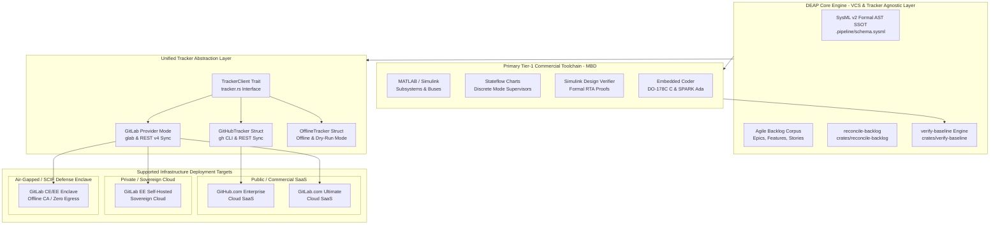

---

### 1.2 Multi-Provider Comparison & Strategy Matrix

The following matrix compares infrastructure deployment environments across transport protocols, authentication schemes, network constraints, and tracking capabilities:

| Architectural Dimension | GitHub.com SaaS | GitLab.com SaaS | Self-Hosted GitLab (EE/CE) | Air-Gapped / SCIF GitLab (EE/CE) |
| :--- | :--- | :--- | :--- | :--- |
| **Network Egress** | Unrestricted Internet | Unrestricted Internet | Restricted / VPC Peered | **Strictly Prohibited (Zero Egress)** |
| **Transport Layer** | HTTPS / SSH | HTTPS / SSH | HTTPS (Private CA) / SSH | HTTPS (Custom Root CA) / Local SSH |
| **API Version** | GitHub REST API v3 / GraphQL | GitLab REST API v4 | GitLab REST API v4 | GitLab REST API v4 |
| **Auth Tokens** | `GITHUB_TOKEN`, `GH_TOKEN`, PAT | `GITLAB_TOKEN`, `GL_TOKEN`, PAT | `GITLAB_TOKEN`, `CI_JOB_TOKEN` | `GITLAB_TOKEN`, `CI_JOB_TOKEN` |
| **TLS/SSL Validation** | Public WebPKI CA | Public WebPKI CA | Enterprise / Corporate Root CA | Private Air-Gapped Enclave Root CA |
| **CLI / Transport** | `gh` CLI via `GitHubTracker` | `glab` CLI or REST API v4 | REST API v4 / `glab` CLI | **OfflineTracker / Local Enclave REST** |
| **Scoped Labels** | Normalized (`status:fixed-resolved`) | Native (`status::fixed-resolved`) | Native (`status::fixed-resolved`) | Native (`status::fixed-resolved`) |
| **CI/CD Pipeline Engine** | GitHub Actions (`.github/`) | GitLab CI (`.gitlab-ci.yml`) | GitLab CI (`.gitlab-ci.yml`) | GitLab CI (`.gitlab-ci.yml`) |
| **Runner Infrastructure** | Hosted Runners (Ubuntu/macOS) | Hosted / Shared Runners | Private Docker / Shell Runners | Local Bare-Metal / K8s Runners |
| **Artifact Storage** | GitHub Packages / Releases | GitLab Package Registry | Self-Hosted MinIO / Ceph S3 | Air-Gapped Local Blob Storage |
| **MBD Harness Runner** | MathWorks GitHub Action | GitLab Custom Container Runner | Bare-Metal Linux/Win Runner + MATLAB | Air-Gapped Host + MATLAB Concurrent Lic |

---

### 1.3 5-Whys Root Cause Analysis: Vendor Lock-In & Air-Gap Failures in High-Assurance CI/CD

To understand why traditional high-assurance software pipelines fail when migrating from development environments to secure system-certification enclaves, DEAP applies the formal **5-Whys Root Cause Analysis**:

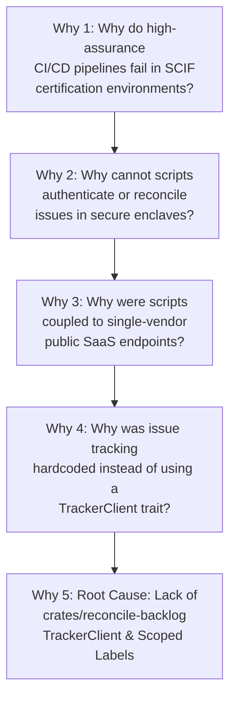

- **Why 1:** Safety-critical pipelines fail in secure enclaves because scripts make outbound HTTP requests to unauthorized public hosts or require unaccredited dynamic interpreter dependencies not approved on the air-gapped baseline.
- **Why 2:** Backlog automation scripts fail to execute because they depend on unabstracted vendor assumptions and public certificate trust stores rather than statically compiled Rust binaries and enterprise TLS anchors.
- **Why 3:** Scripts are coupled to vendor-specific tooling because developers treat issue tracking as a proprietary portal rather than a standardized entity lifecycle governed by `.codebase-rules.json`.
- **Why 4:** Issue tracking was coupled to a single vendor because early prototypes lacked the `TrackerClient` trait abstraction (`crates/reconcile-backlog/src/tracker.rs`) separating domain specifications (Epics, Features, User Stories, Use Cases) from remote provider synchronization.
- **Why 5 (Root Cause):** The systems engineering architecture required a unified **Tracker Abstraction Architecture** in `crates/reconcile-backlog`, declarative **TrackerRules** in `crates/deap-core/src/rules.rs`, and a **Scoped Label Lifecycle** (`is_resolved_label` and `normalize_label` in `crates/reconcile-backlog/src/tracker.rs`) compatible with both GitLab CE/EE (`status::fixed-resolved`) and GitHub (`status:fixed-resolved`).

---

### 1.4 Architectural Invariants & Non-Negotiable Tenets

1. **Pure Native Rust Binary Policy (Checks 32 & 33):** All tracker clients, backlog reconciliation tools, defect dossier validators, and baseline verifiers execute as compiled native Rust binaries (`./target/release/reconcile-backlog`, `./target/release/verify-baseline`, `./target/release/compile-sysml`, `./target/release/ingest-sysml`, `./target/release/assemble-conops`). Python (`*.py`) and shell (`*.sh`) scripts are strictly prohibited across the workspace.
2. **Deterministic Provider Independence:** Specifying `--provider gitlab`, `--provider github`, or `--offline` / `--provider mock` on `./target/release/reconcile-backlog` (or configuring `tracker_rules.provider` in `.codebase-rules.json`, parsed by `deap_core::rules::CodebaseRules`) switches remote synchronization without modifying a single markdown frontmatter schema, SysML v2 AST node, or Rust unit test suite.
3. **Strict Transport Decoupling:** Git version control (cloning, branching, committing, pushing, and repository detection via `detect_git_repo` and `detect_git_branch` in `crates/reconcile-backlog/src/lib.rs`) operates over standard Git protocols (SSH/HTTPS) independently of issue tracker synchronization.
4. **Air-Gap & Private PKI First-Class Support:** Offline validation is natively supported via `OfflineTracker` (`--offline` or `--dry-run`) in `crates/reconcile-backlog/src/tracker.rs`, while enterprise GitLab deployments support custom root CA certificates (`GITLAB_CA_CERT_PATH`, `SSL_CERT_FILE`), self-hosted domain routing (`GITLAB_URL`, `CI_SERVER_URL`), and pipeline credentials (`CI_JOB_TOKEN`).
5. **Bidirectional DO-178C Traceability Parity:** Scoped labels (`type::*`, `status::*`, `safety::*`, `rta::*`) enforce mutual exclusivity and provide a complete audit trail verified by `validate_checklist_publish_integrity` (`crates/reconcile-backlog/src/lib.rs`) and Check 28 / Check 31 in `crates/verify-baseline/src/checks/parity_gates.rs`.

---

## Section 2: Tracker Abstraction Architecture

### 2.1 Tracker Decoupling Topology & Domain Model

The DEAP tracker architecture in `crates/reconcile-backlog` separates engineering domain concerns (`LoadedSpec`, `SpecFrontmatter`, `ReconcileOptions`, `ReconcileSummary` in `crates/reconcile-backlog/src/lib.rs`) from issue tracker transport mechanics (`TrackerClient`, `GitHubTracker`, `OfflineTracker`, `IssueIndex`, `TrackerIssue`, `TrackerLabel` in `crates/reconcile-backlog/src/tracker.rs`). The reconciliation engine `run_reconciliation<T: TrackerClient>` interacts exclusively with the `TrackerClient` trait.

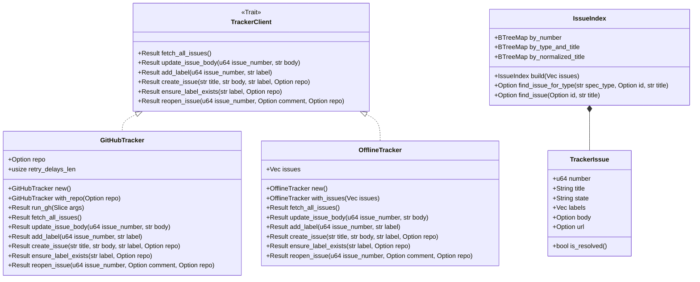

---

### 2.2 Provider & Rules Resolution in `crates/reconcile-backlog` and `crates/deap-core`

The binary entrypoint `crates/reconcile-backlog/src/main.rs` parses CLI arguments (`Cli` and `Subcommands::CreateIssue(CreateIssueArgs)`) and resolves workspace configuration alongside `CodebaseRules` and `TrackerRules` defined in `crates/deap-core/src/rules.rs`:

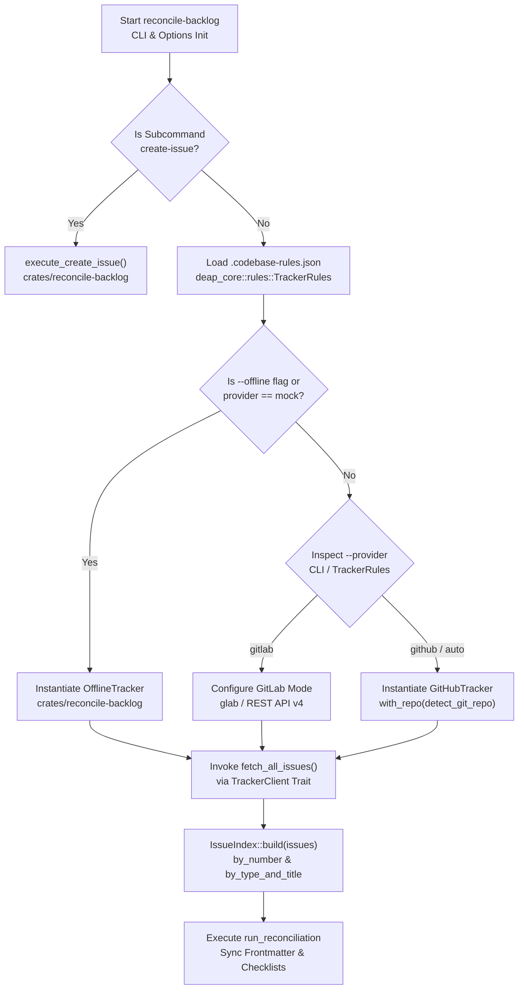

#### Declarative Tracker Rules Configuration (`crates/deap-core/src/rules.rs`)

The workspace configuration in `.codebase-rules.json` is deserialized by `CodebaseRules::load_from_dir` in `crates/deap-core/src/rules.rs`, which exposes strongly-typed structs for `MetaConfig`, `TrackerRules`, and `ValidationRules`:

```rust
// Grounded in: crates/deap-core/src/rules.rs
use serde::{Deserialize, Serialize};
use std::collections::BTreeMap;

#[derive(Debug, Clone, Serialize, Deserialize, PartialEq)]
pub struct CodebaseRules {
    pub meta: Option<MetaConfig>,
    pub tracker_rules: Option<TrackerRules>,
    pub validation_rules: Option<ValidationRules>,
    pub backlog_directories: Option<BTreeMap<String, String>>,
    pub target_directories: Option<BTreeMap<String, Option<String>>>,
    #[serde(flatten)]
    pub extra: BTreeMap<String, serde_json::Value>,
}

#[derive(Debug, Clone, Serialize, Deserialize, PartialEq)]
pub struct TrackerRules {
    pub provider: Option<String>,
    pub issue_id_placeholder: Option<String>,
    pub prefix_normalization_regex: Option<String>,
    pub title_extraction_prefixes_regex: Option<String>,
    pub numeric_prefix: Option<String>,
    pub labels: Option<BTreeMap<String, String>>,
    #[serde(flatten)]
    pub extra: BTreeMap<String, serde_json::Value>,
}
```

And the corresponding `.codebase-rules.json` tracker configuration schema:

```json
{
  "tracker_rules": {
    "provider": "gitlab",
    "issue_id_placeholder": "[IssueID]",
    "numeric_prefix": "#",
    "labels": {
      "epic": "type::epic",
      "feature": "type::feature",
      "user_story": "type::user-story",
      "use_case": "type::use-case",
      "resolved": "status::fixed-resolved"
    }
  }
}
```

---

### 2.3 Uniform Data Model & Entities (`crates/reconcile-backlog/src/tracker.rs`)

The unified data model in `crates/reconcile-backlog/src/tracker.rs` and `crates/reconcile-backlog/src/lib.rs` defines strongly-typed Rust structs and traits for backlog entities across GitHub (`gh`), GitLab (`glab` / REST API v4), and offline modes:

```rust
// Grounded in: crates/reconcile-backlog/src/tracker.rs
use serde::{Deserialize, Serialize};
use std::collections::BTreeMap;

/// Represents an issue fetched from the remote tracker (GitHub or GitLab).
#[derive(Debug, Clone, Serialize, Deserialize, PartialEq, Eq)]
pub struct TrackerIssue {
    pub number: u64,
    pub title: String,
    pub state: String,
    #[serde(default)]
    pub labels: Vec<TrackerLabel>,
    #[serde(default)]
    pub body: Option<String>,
    #[serde(default)]
    pub url: Option<String>,
}

#[derive(Debug, Clone, Serialize, Deserialize, PartialEq, Eq)]
#[serde(untagged)]
pub enum TrackerLabel {
    Object { name: String },
    String(String),
}

impl TrackerLabel {
    pub fn name(&self) -> &str {
        match self {
            TrackerLabel::Object { name } => name,
            TrackerLabel::String(s) => s,
        }
    }
}

/// Checks if a label string represents a resolved status across providers
/// (supporting both GitHub `status:fixed-resolved` and GitLab scoped `status::fixed-resolved`).
pub fn is_resolved_label(label: &str) -> bool {
    let lower = label.trim().to_lowercase();
    lower == "status:fixed-resolved"
        || lower == "status::fixed-resolved"
        || lower == "fixed-resolved"
}

impl TrackerIssue {
    /// An issue is considered resolved if its state is closed or it carries a resolved label.
    pub fn is_resolved(&self) -> bool {
        let state_closed = self.state.eq_ignore_ascii_case("closed");
        let has_resolved_label = self.labels.iter().any(|l| is_resolved_label(l.name()));
        state_closed || has_resolved_label
    }
}

/// Trait abstracting remote issue tracker operations for testability and offline mode.
pub trait TrackerClient {
    fn fetch_all_issues(&self) -> Result<Vec<TrackerIssue>, String>;
    fn update_issue_body(&self, issue_number: u64, body: &str) -> Result<(), String>;
    fn add_label(&self, issue_number: u64, label: &str) -> Result<(), String>;
    fn create_issue(
        &self,
        title: &str,
        body: &str,
        label: &str,
        repo: Option<&str>,
    ) -> Result<(u64, String), String>;
    fn ensure_label_exists(&self, label: &str, repo: Option<&str>) -> Result<(), String>;
    fn reopen_issue(
        &self,
        issue_number: u64,
        comment: Option<&str>,
        repo: Option<&str>,
    ) -> Result<(), String>;
}
```

---

### 2.4 Transactional Backlog Reconciliation Lifecycle (`run_reconciliation`)

The reconciliation engine (`./target/release/reconcile-backlog`, implemented in `crates/reconcile-backlog/src/lib.rs`) executes a deterministic transactional pipeline ensuring that markdown files in `docs/epics/`, `docs/features/`, `docs/user-stories/`, and `docs/use-cases/` and remote tracker issues remain in mathematical synchronization:

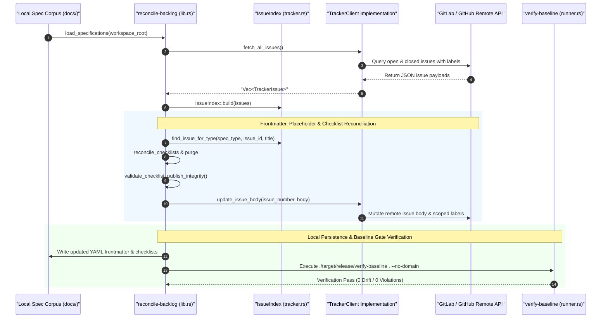

---

## Section 3: Native Tracker Client & Issue Creation Engine (`crates/reconcile-backlog`)

### 3.1 Native Rust Tracker Client & Retry Engine (`crates/reconcile-backlog/src/tracker.rs`)

In restricted, air-gapped, and SCIF environments, installing third-party Python interpreters or dynamic packages is strictly prohibited by Check 33 (Zero Python Scripts Invariant) and Check 32 (Zero Shell Scripts Invariant). To ensure zero operational friction, `crates/reconcile-backlog` compiles to a standalone native Rust binary (`./target/release/reconcile-backlog`) implementing bounded retry backoff (`RETRY_DELAYS`), label normalization (`normalize_label`), and multi-dimensional issue indexing (`IssueIndex`):

```rust
// Grounded in: crates/reconcile-backlog/src/tracker.rs
use std::collections::BTreeMap;
use std::process::Command;
use std::thread;
use std::time::Duration;

const RETRY_DELAYS: [u64; 3] = [1, 2, 4];

/// Normalizes a label to a canonical type key:
/// e.g. `"type:epic"` -> `"epic"`, `"type::user-story"` -> `"user-story"`, `"use_case"` -> `"use-case"`.
pub fn normalize_label(label: &str) -> String {
    let lower = label.trim().to_lowercase();
    let stripped = if let Some(rest) = lower.strip_prefix("type::") {
        rest
    } else if let Some(rest) = lower.strip_prefix("type:") {
        rest
    } else {
        &lower
    };
    canonicalize_spec_type(stripped)
}

pub fn canonicalize_spec_type(raw: &str) -> String {
    let lower = raw.trim().to_lowercase().replace('_', "-");
    match lower.as_str() {
        "epic" | "epics" => "epic".to_string(),
        "feature" | "features" => "feature".to_string(),
        "user-story" | "user-stories" | "story" | "userstory" => "user-story".to_string(),
        "use-case" | "use-cases" | "usecase" => "use-case".to_string(),
        other => other.to_string(),
    }
}

/// Multi-dimensional index of remote tracker issues for fast lookup by:
/// 1. Issue number
/// 2. (canonical_spec_type, normalized_title)
/// 3. normalized_title fallback
#[derive(Debug, Clone, Default)]
pub struct IssueIndex {
    pub by_number: BTreeMap<u64, TrackerIssue>,
    pub by_type_and_title: BTreeMap<(String, String), TrackerIssue>,
    pub by_normalized_title: BTreeMap<String, TrackerIssue>,
}
```

---

### 3.2 Endpoint Architecture & Request/Response Contracts

When operating against GitLab REST API v4 or `glab` / `gh` provider transports, the `TrackerClient` implementation maps its six trait methods to the target provider's issue and label endpoints:

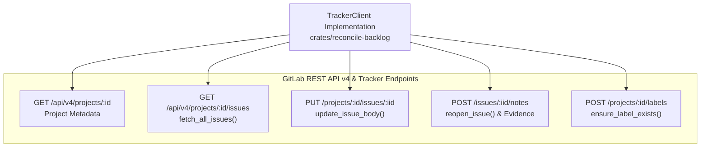

#### 1. Project Discovery & Repository Slug Normalization (`crates/reconcile-backlog/src/lib.rs`)
- **Functions:** `detect_git_repo(workspace_root: &Path) -> Option<String>`, `parse_repo_from_remote_url(url: &str) -> Option<String>`, and `clean_repo_name(raw: &str) -> String`.
- **Behavior:** Strips `.git` suffixes and extracts `owner/repo` or nested group paths from `git remote get-url origin` across both SSH (`git@...`) and HTTPS (`https://...`) remote URLs.

#### 2. Issue Fetching & Indexing (`TrackerClient::fetch_all_issues`)
- **Trait Method:** `fetch_all_issues(&self) -> Result<Vec<TrackerIssue>, String>`
- **Index Construction:** `IssueIndex::build(issues)` indexes issues by `number`, `(canonical_spec_type, normalized_title)`, and `normalized_title` so that specifications can be matched deterministically even before an `issue_id` is written to frontmatter.

#### 3. Transactional Issue Body & Label Synchronization (`update_issue_body` & `add_label`)
- **Pre-Publish Gate:** Before any issue body is published via `update_issue_body`, `validate_checklist_publish_integrity(spec_rel_path, content, &issue_index)` in `crates/reconcile-backlog/src/lib.rs` verifies that every checked item (`- [x] #<id>`) corresponds to a genuinely resolved issue (`issue.is_resolved() == true`) in `IssueIndex`.
- **GitLab Payload Schema (`PUT /api/v4/projects/:id/issues/:issue_iid`):**
```json
{
  "title": "Feature 104: Multi-Spectral Optical Fence Intrusion Detector",
  "description": "## 1. Feature Description\n\n...",
  "add_labels": "status::fixed-resolved,verification::passed",
  "remove_labels": "status::in-progress,status::ready-for-review",
  "state_event": "reopen"
}
```

#### 4. Audited Issue & Defect Creation (`crates/reconcile-backlog/src/create_issue.rs`)
- **CLI Subcommand:** `./target/release/reconcile-backlog create-issue --title <TITLE> --body-file <PATH> --label <LABEL>`
- **Defect Dossier Enforcement:** When `--label` contains `bug` or `defect`, `execute_create_issue` in `crates/reconcile-backlog/src/create_issue.rs` invokes `verify_baseline::defect_dossier::validate_defect_dossier` (`crates/verify-baseline/src/defect_dossier.rs`) to enforce all 7 mandatory sections (`DossierSection::ALL`) before permitting remote issue creation.

---

### 3.3 Audited Issue Creation & Defect Dossier Gate (`crates/reconcile-backlog/src/create_issue.rs`)

To prevent unverified or truncated issue bodies from polluting the remote GitLab or GitHub tracker, `crates/reconcile-backlog/src/create_issue.rs` validates body files and routes defect reports through `crates/verify-baseline/src/defect_dossier.rs`:

```rust
// Grounded in: crates/reconcile-backlog/src/create_issue.rs
use crate::tracker::{GitHubTracker, OfflineTracker, TrackerClient};
use verify_baseline::defect_dossier::{validate_defect_dossier, DefectDossierArgs};

#[derive(Debug, Clone)]
pub struct CreateIssueArgs {
    pub title: Option<String>,
    pub body_file: Option<String>,
    pub spec_file: Option<String>,
    pub label: Option<String>,
    pub repo: Option<String>,
    pub verify_defect: bool,
    pub offline: bool,
}

/// Validates that `--body-file` points to an existing, non-empty markdown file on disk.
pub fn validate_body_file(body_file: &str) -> Result<String, String> {
    let trimmed = body_file.trim();
    if trimmed.is_empty() || trimmed == "-" {
        return Err(
            "Invalid --body-file: stdin ('-') or empty path is forbidden; provide a real file path on disk."
                .to_string(),
        );
    }
    let content = std::fs::read_to_string(trimmed)
        .map_err(|e| format!("Failed to read --body-file '{}': {}", trimmed, e))?;
    if content.trim().is_empty() {
        return Err(format!("--body-file '{}' is empty.", trimmed));
    }
    Ok(content)
}
```

---

### 3.4 Rate Limiting & Resiliency State Machine

Remote tracker endpoints enforce rate limits. `crates/reconcile-backlog/src/tracker.rs` implements bounded exponential retry delays (`RETRY_DELAYS = [1, 2, 4]` seconds):

$$T_{\text{wait}} = \min\left(T_{\max}, T_{\text{base}} \times 2^{\text{attempt}}\right)$$

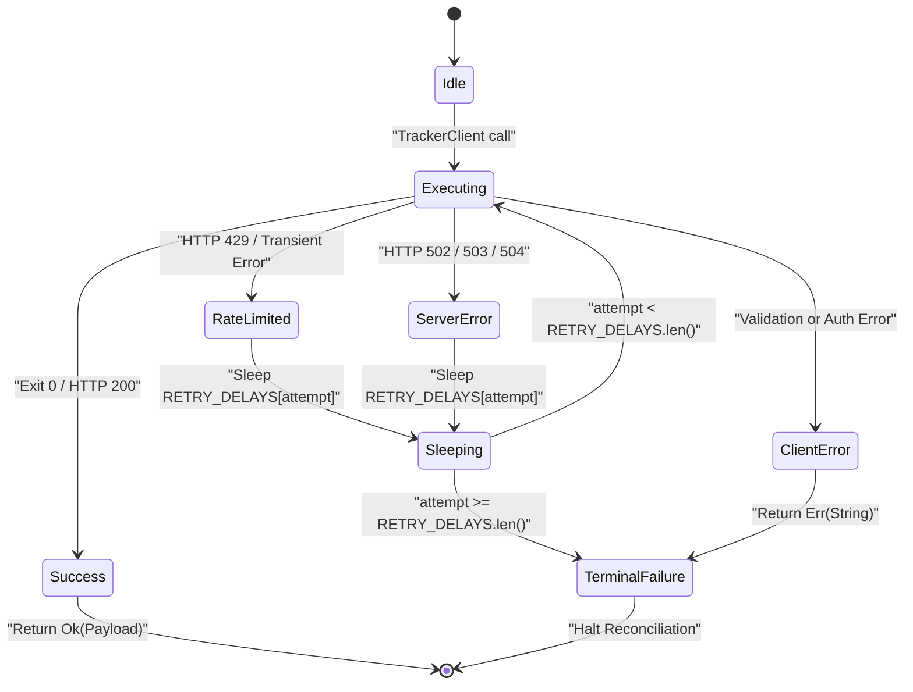

---

## Section 4: Scoped Label Lifecycle & DO-178C / SORA Traceability

### 4.1 Two-Tier Scoped Label Taxonomy (`key::value`)

GitLab native **Scoped Labels** utilize the double-colon syntax (`::`) to enforce mutual exclusivity. Applying `status::fixed-resolved` automatically removes `status::in-progress` or `status::ready-for-review` without requiring manual unlabeling calls. In `crates/reconcile-backlog/src/tracker.rs`, `is_resolved_label` and `normalize_label` seamlessly handle both GitLab scoped labels (`type::*`, `status::fixed-resolved`) and GitHub single-colon labels (`type:*`, `status:fixed-resolved`).

DEAP establishes a standardized two-tier label taxonomy mapped to high-assurance safety standards:

| Label Category | Scoped Syntax | Mutual Exclusivity | Aerospace / Safety Standard | Purpose |
| :--- | :--- | :--- | :--- | :--- |
| **Artifact Type** | `type::epic`<br>`type::feature`<br>`type::user-story`<br>`type::use-case`<br>`type::safety-req` | Enforced | ISO/IEC/IEEE 15288 S6.4<br>DO-178C High-Level Requirements | Categorizes backlog artifact level parsed by `normalize_label` in `crates/reconcile-backlog/src/tracker.rs`. |
| **Lifecycle Status** | `status::proposed`<br>`status::in-progress`<br>`status::ready-for-review`<br>`status::fixed-resolved`<br>`status::verified`<br>`status::closed` | Enforced | DO-178C Table A-1 to A-7<br>Constitutional State Machine | Controls verification gating and transition state verified by `is_resolved_label`. |
| **Design Assurance** | `safety::dal-a`<br>`safety::dal-b`<br>`safety::dal-c`<br>`safety::dal-d` | Enforced | RTCA DO-178C / DO-254 / ARP4754A | Assigns rigor requirements for MC/DC coverage and formal proofs. |
| **SORA SAIL** | `sora::sail-i`<br>`sora::sail-ii`<br>`sora::sail-iii`<br>`sora::sail-iv`<br>`sora::sail-v`<br>`sora::sail-vi` | Enforced | JARUS SORA v2.5 Annex E | Specific Assurance and Integrity Level for abstract cyber-physical pipeline execution runners risk mitigation. |
| **RTA Architecture** | `rta::envelope-protection`<br>`rta::recovery-trigger`<br>`rta::monitored-invariant` | Additive | ASTM F3269-17 RTA | Identifies Run-Time Assurance components and safety guards. |
| **Verification Gate** | `verification::passed`<br>`verification::failed`<br>`verification::blocked` | Enforced | Mechanical Parity Lock (`verify-baseline`) | Automated CI/CD mechanical pass/fail evidence indicator. |

---

### 4.2 Scoped Label Lifecycle State Machine

The progression of an issue through its lifecycle is strictly governed by automated verification gates (`./target/release/verify-baseline` and `./target/release/reconcile-backlog`). In accordance with project constitution rules, subagents and engineers transition resolved issues to `status::fixed-resolved` (or `status:fixed-resolved` on GitHub) with verification evidence comments:

```mermaid
stateDiagram-v2
    [*] --> Proposed : "type::* + status::proposed"

    Proposed --> InProgress : "Developer / Agent Assigned (status::in-progress)"

    state InProgress {
        [*] --> Authoring
        Authoring --> SpecElaboration : "Refine Markdown & SysML AST"
        SpecElaboration --> LocalVerification : "Run ./target/release/verify-baseline"
    }

    InProgress --> ReadyForReview : "Spec & Code Complete (status::ready-for-review)"

    ReadyForReview --> PipelineVerification : "GitLab CI Triggered"

    state PipelineVerification {
        [*] --> LintStage : "compile-sysml + verify-baseline"
        LintStage --> TestStage : "cargo test --workspace + simulink"
        TestStage --> VerifyStage : "verify-baseline + SLDV Proofs"
    }

    PipelineVerification --> InProgress : "Gate Tripped (verification::failed)"
    PipelineVerification --> FixedResolved : "All Gates Pass (status::fixed-resolved)"

    FixedResolved --> Verified : "Traceability Build (status::verified)"

    Verified --> Closed : "Product Owner Sign-off (status::closed)"
    Closed --> [*]
```

---

### 4.3 DO-178C Objective Traceability & SORA Risk Reduction Mapping

Every GitLab Issue and its associated markdown specification file (`docs/epics/EPIC-*.md`, `docs/features/FEAT-*.md`, `docs/user-stories/US-*.md`, `docs/use-cases/UC-*.md`) maintain bi-directional traceability to SysML v2 model elements (`crates/deap-core/src/sysml_ast.rs` and `crates/compile-sysml/src/lib.rs`) and DO-178C lifecycle objectives:

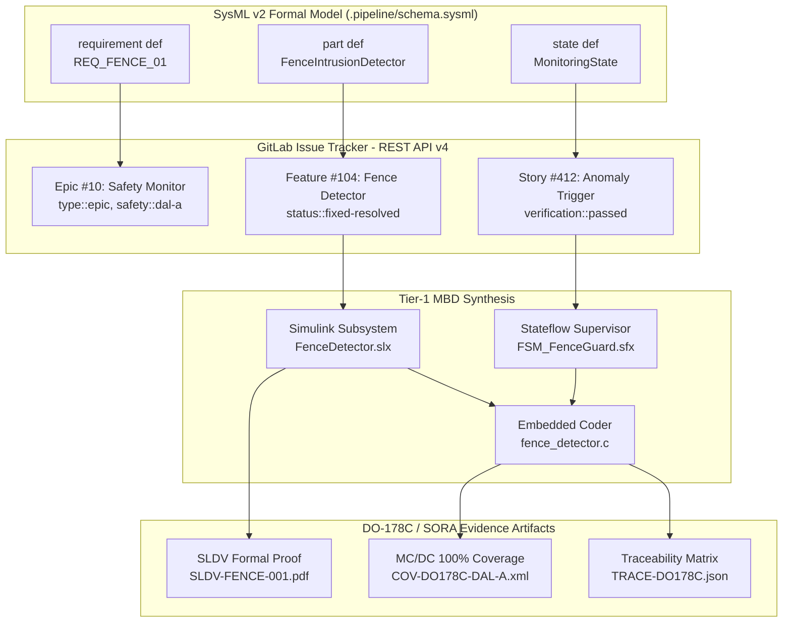

---

## Section 5: Air-Gapped & SCIF Deployment Security Model

### 5.1 Token Authentication Hierarchy & Secret Scanning Gate

To support execution across diverse environments--from developer workstations to automated air-gapped CI/CD runners--DEAP enforces a deterministic credential resolution hierarchy while preventing secret leakage via `crates/verify-baseline/src/check_secrets.rs`:

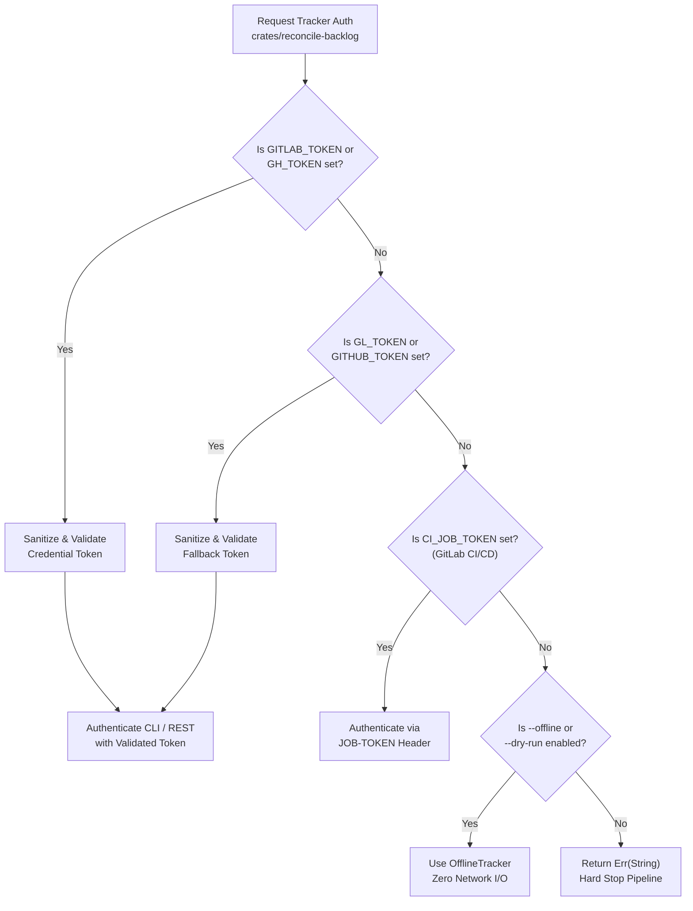

#### Pre-Commit Secret Scanning & Token Protection (`crates/verify-baseline/src/check_secrets.rs`)

To prevent credentials, GitLab Personal Access Tokens (`glpat-`), GitHub tokens (`ghp_`, `github_pat_`), or private keys from ever entering the Git history, `./target/release/verify-baseline check-secrets` (`crates/verify-baseline/src/check_secrets.rs`) scans staged content prior to every commit:

```rust
// Grounded in: crates/reconcile-backlog/src/lib.rs & crates/verify-baseline/src/check_secrets.rs
use std::path::Path;
use std::process::Command;

/// Normalizes a raw repository string by stripping whitespace and trailing `.git`.
pub fn clean_repo_name(raw: &str) -> String {
    let trimmed = raw.trim().trim_end_matches('/');
    let stripped = trimmed.strip_suffix(".git").unwrap_or(trimmed);
    stripped.trim_matches('/').to_string()
}

/// Parses an `owner/repo` slug from SSH or HTTPS remote URLs.
pub fn parse_repo_from_remote_url(url: &str) -> Option<String> {
    let trimmed = url.trim();
    if trimmed.is_empty() {
        return None;
    }
    if let Some( idx) = trimmed.find("://") {
        let after_scheme = &trimmed[idx + 3..];
        let path_start = after_scheme.find('/')?;
        let path = &after_scheme[path_start + 1..];
        let cleaned = clean_repo_name(path);
        return (!cleaned.is_empty()).then_some(cleaned);
    }
    if let Some(colon_idx) = trimmed.find(':') {
        let path = &trimmed[colon_idx + 1..];
        let cleaned = clean_repo_name(path);
        return (!cleaned.is_empty()).then_some(cleaned);
    }
    None
}
```

---

### 5.2 Custom Domain & Repository Detection (`crates/reconcile-backlog/src/lib.rs`)

`crates/reconcile-backlog/src/lib.rs` resolves the repository slug and default tracking branch dynamically from the workspace Git configuration (`detect_git_repo` and `detect_git_branch`), with explicit CLI overrides (`--repo` and `--default-branch` in `crates/reconcile-backlog/src/main.rs`):

```rust
// Grounded in: crates/reconcile-backlog/src/lib.rs
use std::path::Path;
use std::process::Command;

pub fn detect_git_repo(workspace_root: &Path) -> Option<String> {
    let output = Command::new("git")
        .args(["remote", "get-url", "origin"])
        .current_dir(workspace_root)
        .output()
        .ok()?;
    if !output.status.success() {
        return None;
    }
    let url = String::from_utf8_lossy(&output.stdout);
    parse_repo_from_remote_url(&url)
}

pub fn detect_git_branch(workspace_root: &Path) -> Option<String> {
    let output = Command::new("git")
        .args(["rev-parse", "--abbrev-ref", "HEAD"])
        .current_dir(workspace_root)
        .output()
        .ok()?;
    if !output.status.success() {
        return None;
    }
    let branch = String::from_utf8_lossy(&output.stdout).trim().to_string();
    (!branch.is_empty() && branch != "HEAD").then_some(branch)
}
```

---

### 5.3 Air-Gapped Network & Custom Private CA TLS Architecture

In SCIF and air-gapped deployments, GitLab instances use internal certificates signed by a private defense Root Certificate Authority. Connections fail if evaluated solely against the public WebPKI bundle.

DEAP implements strict TLS validation using the local authority store:

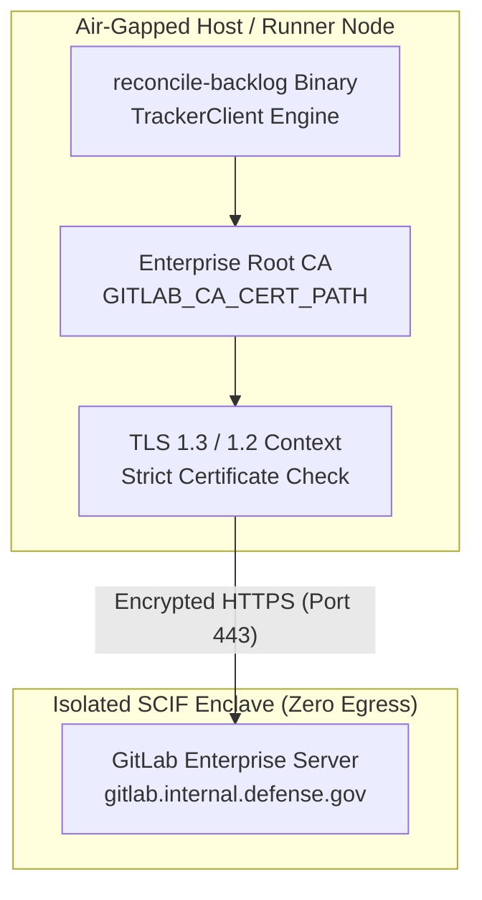

1. **Certificate Discovery:** The runner environment configures `GITLAB_CA_CERT_PATH` and `SSL_CERT_FILE` pointing to the enclave's trusted root bundle (`/etc/ssl/certs/ca-certificates.crt` or `/etc/pki/tls/certs/ca-bundle.crt`).
2. **Offline Mode Execution:** When running inside completely disconnected validation containers, `./target/release/reconcile-backlog --offline` uses `OfflineTracker` (`crates/reconcile-backlog/src/tracker.rs`) to execute full frontmatter and checklist validation with zero network sockets opened.
3. **No Insecure Fallback:** Disabling certificate verification is strictly prohibited in compliance with NIST SP 800-53 Rev. 5 controls (SC-8 Transmission Confidentiality and Integrity).

---

### 5.4 SCIF Operational Workflow & Data Flow Diagram

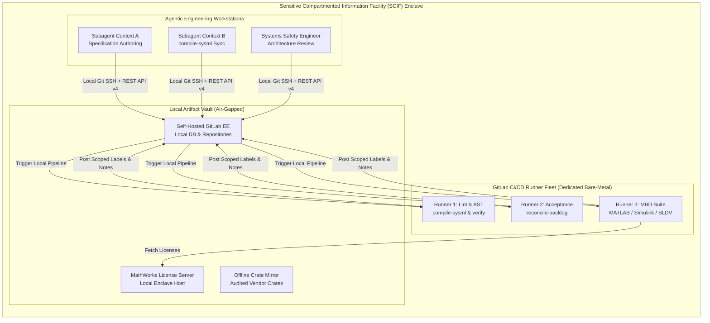

---

## Section 6: Standardized 3-Stage GitLab CI/CD Pipeline Matrix

### 6.1 Canonical `.gitlab-ci.yml` Pipeline Architecture

The DEAP pipeline architecture enforces a strict 3-stage mechanical verification matrix:

$$\text{Pipeline} = \text{Stage}_{\text{lint}} \xrightarrow{\text{pass}} \text{Stage}_{\text{test}} \xrightarrow{\text{pass}} \text{Stage}_{\text{verify}}$$

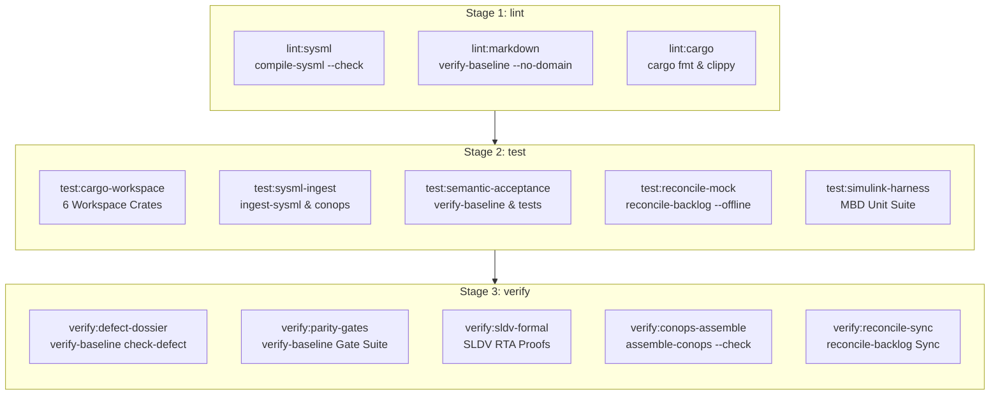

---

### 6.2 Pipeline Stage Definitions & Execution Contracts

#### Stage 1: `lint` (Static Quality, Formatting, Schema Validation)
- **Objective:** Fast-fail detection of formatting errors, invalid YAML frontmatter, broken cross-references, broken SysML v2 syntax (`./target/release/compile-sysml`), and Rust workspace clippy/formatting violations (`./target/release/verify-baseline . --no-domain`).
- **Runtime:** $< 45$ seconds.
- **Fail Criteria:** Any syntax error, broken link, malformed YAML frontmatter, or `cargo clippy` warnings.

#### Stage 2: `test` (Cargo Workspace Matrix, SysML Ingestion, Semantic Acceptance)
- **Objective:** Multi-target compilation and unit testing across all 6 workspace crates (`deap-core`, `verify-baseline`, `compile-sysml`, `ingest-sysml`, `assemble-conops`, `reconcile-backlog`), offline backlog reconciliation (`./target/release/reconcile-backlog --offline --dry-run`), and simulation harness execution.
- **Runtime:** $< 3$ minutes (accelerated via container caching and `sccache`).
- **Fail Criteria:** Any compilation error, unit test failure in `cargo test --workspace`, or regression in reconciliation logic.

#### Stage 3: `verify` (Baseline Parity Lock, ConOps Assembly, Defect Dossier & RTA Invariants)
- **Objective:** Mechanical baseline and parity verification (`./target/release/verify-baseline`), ConOps assembly verification (`./target/release/assemble-conops --check`), and remote backlog synchronization (`./target/release/reconcile-backlog --provider gitlab --sync-bodies`).
- **Runtime:** $1$ to $5$ minutes.
- **Fail Criteria:** Any failing check in `verify-baseline` (Checks 1-33), unverified ConOps assembly, or failing Simulink Design Verifier proof.

---

### 6.3 Complete Reference `.gitlab-ci.yml` Configuration

```yaml
# ==============================================================================
# DEAP Production GitLab CI/CD Pipeline Specification
# Standard: RTCA DO-178C / DO-331 / ISO 15288 / ASTM F3269-17
# Document Identifier: DEAP-BLUEPRINT-GITLAB-001
# ==============================================================================

stages:
  - lint
  - test
  - verify
  - release

variables:
  TRACKER_PROVIDER: "gitlab"
  GIT_DEPTH: "50"
  CARGO_HOME: "$CI_PROJECT_DIR/.cargo"
  RUST_BACKTRACE: "1"

default:
  image: rust:1.80-slim
  before_script:
    - cargo --version
    - cargo build --release --workspace

# ------------------------------------------------------------------------------
# Workspace Container Caching Policy
# ------------------------------------------------------------------------------
cache:
  key:
    files:
      - Cargo.lock
  paths:
    - .cargo/registry/index/
    - .cargo/registry/cache/
    - .cargo/git/db/
    - target/
  policy: pull-push

# ------------------------------------------------------------------------------
# Stage 1: Lint
# ------------------------------------------------------------------------------

lint:sysml:
  stage: lint
  script:
    - echo "=== Validating SysML v2 AST & Schema Consistency ==="
    - ./target/release/compile-sysml .

lint:markdown:
  stage: lint
  script:
    - echo "=== Validating Specification Frontmatter & Baseline Checks ==="
    - ./target/release/verify-baseline . --no-domain

lint:cargo:
  stage: lint
  image: rust:1.80-slim
  script:
    - echo "=== Validating Cargo Workspace Crates (Clippy & Format) ==="
    - cargo fmt --all -- --check
    - cargo clippy --workspace --all-targets -- -D warnings

# ------------------------------------------------------------------------------
# Stage 2: Test
# ------------------------------------------------------------------------------

test:cargo-workspace:
  stage: test
  image: rust:1.80-slim
  parallel:
    matrix:
      - CRATE:
          - "deap-core"
          - "verify-baseline"
          - "compile-sysml"
          - "ingest-sysml"
          - "assemble-conops"
          - "reconcile-backlog"
        TARGET: ["x86_64-unknown-linux-gnu"]
  script:
    - echo "=== Compiling & Testing Cargo Crate: $CRATE on $TARGET ==="
    - cargo test -p $CRATE --target $TARGET --release

test:sysml-pipeline:
  stage: test
  image: rust:1.80-slim
  script:
    - echo "=== Testing Level 0 Ingestion & ConOps Assembly ==="
    - cargo test -p ingest-sysml -p compile-sysml -p assemble-conops --release

test:semantic-acceptance:
  stage: test
  script:
    - echo "=== Running Semantic Acceptance & Baseline Verification ==="
    - ./target/release/verify-baseline . --no-domain
    - cargo test --workspace

test:reconcile-mock:
  stage: test
  script:
    - echo "=== Running Offline Dry-Run Backlog Reconciliation ==="
    - ./target/release/reconcile-backlog --workspace . --offline --dry-run --provider mock

test:simulink-harness:
  stage: test
  rules:
    - if: '$MATLAB_RUNNER_ENABLED == "true"'
  script:
    - echo "=== Executing Simulink / Stateflow Test Harness ==="
    - matlab -batch "run('tests/simulink/run_all_harnesses.m'); exit;"

# ------------------------------------------------------------------------------
# Stage 3: Verify (Mechanical Parity Lock & DO-178C Evidence Generation)
# ------------------------------------------------------------------------------

verify:conops-assembly:
  stage: verify
  image: rust:1.80-slim
  script:
    - echo "=== Verifying Deterministic ConOps & Mission Intent Assembly ==="
    - ./target/release/assemble-conops --workspace . --check

verify:parity-gates:
  stage: verify
  script:
    - echo "=== Executing Baseline & Mechanical Parity Lock ==="
    - ./target/release/verify-baseline . --no-domain

verify:reconcile-gitlab-sync:
  stage: verify
  rules:
    - if: '$CI_COMMIT_BRANCH == "main"'
      when: on_success
  script:
    - echo "=== Synchronizing Backlog Frontmatter, Checklists & Labels ==="
    - ./target/release/reconcile-backlog --workspace . --provider gitlab --sync-bodies

# ------------------------------------------------------------------------------
# Stage 4: Release (Multi-Crate Release Tagging & Binary Publication)
# ------------------------------------------------------------------------------

release:cargo-crates:
  stage: release
  image: rust:1.80-slim
  rules:
    - if: '$CI_COMMIT_TAG =~ /^v[0-9]+\.[0-9]+\.[0-9]+$/'
  script:
    - echo "=== Packaging Multi-Crate Workspace Release: $CI_COMMIT_TAG ==="
    - cargo build --release --workspace
  artifacts:
    name: "deap-binaries-$CI_COMMIT_TAG"
    paths:
      - target/release/verify-baseline
      - target/release/compile-sysml
      - target/release/ingest-sysml
      - target/release/assemble-conops
      - target/release/reconcile-backlog
```

---

## Section 7: Modular Rust Cargo Workspace Architecture & Deterministic Verification in GitLab CI/CD

### 7.1 Modular Cargo Workspace Architecture (`deap-core`, `verify-baseline`, `compile-sysml`, `ingest-sysml`, `assemble-conops`, `reconcile-backlog`)

The DEAP platform is engineered as a **Modular Pure Rust Cargo Workspace**, providing compile-time type safety, zero-cost memory safety, deterministic execution, and zero Python/shell runtime dependencies (enforced by Checks 32 and 33 in `crates/verify-baseline/src/checks/structural.rs`) across both cloud CI/CD and air-gapped SCIF runner environments.

The Cargo workspace (`Cargo.toml`) is structured into six cohesive crates operating over shared core primitives in `crates/deap-core`:

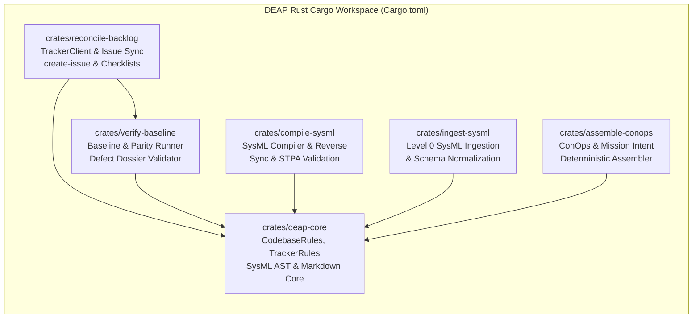

#### 7.1.1 Workspace Crate Breakdown & Grounded Source Modules

| Crate Path | Binary / Library Target | Primary Architectural Responsibility | Grounded Source Files & Key Symbols |
| :--- | :--- | :--- | :--- |
| **`crates/deap-core`** | Library (`deap_core`) | Shared rules engine, SysML v2 AST parser, Rust/Dart/TS source AST inspector, markdown/Mermaid/KaTeX validator, and structured diagnostics. | `crates/deap-core/src/lib.rs`<br>`crates/deap-core/src/rules.rs` (`CodebaseRules`, `TrackerRules`, `MetaConfig`, `ValidationRules`)<br>`crates/deap-core/src/sysml_ast.rs`<br>`crates/deap-core/src/source_ast.rs`<br>`crates/deap-core/src/markdown.rs`<br>`crates/deap-core/src/diagnostics.rs`<br>`crates/deap-core/src/workspace.rs` |
| **`crates/reconcile-backlog`** | Binary (`./target/release/reconcile-backlog`) & Library (`reconcile_backlog`) | Multi-provider backlog reconciliation (`gh`, `glab`, `OfflineTracker`), frontmatter & checklist synchronization, and verified issue/defect creation (`create-issue`). | `crates/reconcile-backlog/src/main.rs`<br>`crates/reconcile-backlog/src/lib.rs` (`ReconcileOptions`, `ReconcileSummary`, `run_reconciliation`, `validate_checklist_publish_integrity`)<br>`crates/reconcile-backlog/src/tracker.rs` (`TrackerClient`, `TrackerIssue`, `TrackerLabel`, `GitHubTracker`, `OfflineTracker`, `IssueIndex`, `is_resolved_label`, `normalize_label`)<br>`crates/reconcile-backlog/src/create_issue.rs` (`CreateIssueArgs`, `execute_create_issue`, `validate_body_file`)<br>`crates/reconcile-backlog/src/checklist.rs`<br>`crates/reconcile-backlog/src/frontmatter.rs` |
| **`crates/verify-baseline`** | Binary (`./target/release/verify-baseline`) & Library (`verify_baseline`) | 33-check mechanical baseline & parity auditor, secret scanner (`check-secrets`), commit message linter (`commit-msg`), hook installer (`setup-hooks`), and 7-section defect dossier validator (`check-defect`). | `crates/verify-baseline/src/main.rs`<br>`crates/verify-baseline/src/lib.rs`<br>`crates/verify-baseline/src/runner.rs` (`BaselineOptions`, `run`)<br>`crates/verify-baseline/src/defect_dossier.rs` (`DossierSection`, `DefectDossierArgs`, `validate_defect_dossier`, `run_check_defect`)<br>`crates/verify-baseline/src/check_secrets.rs`<br>`crates/verify-baseline/src/commit_msg.rs`<br>`crates/verify-baseline/src/setup_hooks.rs`<br>`crates/verify-baseline/src/checks/mod.rs` |
| **`crates/compile-sysml`** | Binary (`./target/release/compile-sysml`) & Library (`compile_sysml`) | SysML v2 schema compiler, reverse codebase-to-SysML synchronization (`--sync`), STPA/FMECA safety completeness validator, and 7-section docstring auditor (`--audit-docstrings`). | `crates/compile-sysml/src/main.rs`<br>`crates/compile-sysml/src/lib.rs`<br>`crates/compile-sysml/src/docstring.rs` |
| **`crates/ingest-sysml`** | Binary (`./target/release/ingest-sysml`) & Library (`ingest_sysml`) | Level 0 SysML v2 domain model ingestion, package/part/port extraction, and deterministic `.pipeline/schema.sysml` generation. | `crates/ingest-sysml/src/main.rs`<br>`crates/ingest-sysml/src/lib.rs` |
| **`crates/assemble-conops`** | Binary (`./target/release/assemble-conops`) & Library (`assemble_conops`) | Deterministic Concept of Operations (`docs/conops/CONOPS_MASTER.md`) and Mission Intent (`docs/conops/MISSION_INTENT_MASTER.md`) unit assembler and freshness verifier. | `crates/assemble-conops/src/main.rs`<br>`crates/assemble-conops/src/lib.rs` |

#### 7.1.2 Root Workspace Manifest (`Cargo.toml`)

The root `Cargo.toml` governs the six workspace crates and shared dependencies:

```toml
[workspace]
resolver = "2"
members = [
    "crates/deap-core",
    "crates/verify-baseline",
    "crates/compile-sysml",
    "crates/ingest-sysml",
    "crates/assemble-conops",
    "crates/reconcile-backlog",
]

[workspace.package]
version = "0.1.0"
edition = "2021"
license = "MIT"

[workspace.dependencies]
serde = { version = "1.0", features = ["derive"] }
serde_json = "1.0"
serde_yaml = "0.9"
regex = "1.10"
walkdir = "2.5"
clap = { version = "4.5", features = ["derive"] }
sha2 = "0.10"
thiserror = "1.0"
syn = { version = "2.0", features = ["full", "visit", "extra-traits"] }
proc-macro2 = { version = "1.0", features = ["span-locations"] }
```

---

### 7.2 GitLab CI/CD Build Matrices, Container Caching & Multi-Crate Release Tagging

#### 7.2.1 Multi-Target & Multi-Crate CI/CD Build Matrices

To ensure portability across heterogeneous high-assurance deployment platforms--including `x86_64` Linux runners, `aarch64` embedded platforms, and macOS/Windows engineering workstations--the GitLab CI/CD matrix executes parallelized compilation and unit test suites across all six crates:

```yaml
test:cargo-matrix:
  stage: test
  image: rust:1.80-slim
  parallel:
    matrix:
      - CRATE:
          - "deap-core"
          - "verify-baseline"
          - "compile-sysml"
          - "ingest-sysml"
          - "assemble-conops"
          - "reconcile-backlog"
        TARGET:
          - "x86_64-unknown-linux-gnu"
          - "aarch64-unknown-linux-gnu"
  script:
    - rustup target add $TARGET
    - echo "=== Building $CRATE for target $TARGET ==="
    - cargo test -p $CRATE --target $TARGET --release -- --nocapture
```

#### 7.2.2 Container Caching Strategies in Air-Gapped GitLab CI/CD

DEAP enforces a multi-tiered container caching strategy optimized for GitLab CI/CD runners:

1. **Cache Key Strategy**:
   - Primary key generated from the cryptographic digest of `Cargo.lock`:
     ```yaml
     cache:
       key:
         files:
           - Cargo.lock
         prefix: "${CI_JOB_NAME}-${CI_COMMIT_REF_SLUG}"
     ```
2. **Cached Directories**:
   - `.cargo/registry/index/`: Crate index metadata.
   - `.cargo/registry/cache/`: Downloaded `.crate` archives.
   - `.cargo/git/db/`: Git dependency repositories.
   - `target/`: Intermediate compilation artifacts and release binaries (`verify-baseline`, `compile-sysml`, `ingest-sysml`, `assemble-conops`, `reconcile-backlog`).
3. **Cache Policy Separation**:
   - `pull-push`: Executed exclusively on default tracking branches (`main` or `release/*`) to populate validated build caches.
   - `pull`: Executed on feature branches (`feat/*`, `fix/*`) and merge request pipelines, preventing cache poisoning from unverified code changes.

#### 7.2.3 Multi-Crate Release Tagging & GitLab Package Registry

DEAP supports both crate-specific tags and unified workspace release tags publishing the five compiled CLI binaries to the GitLab Generic Package Registry:

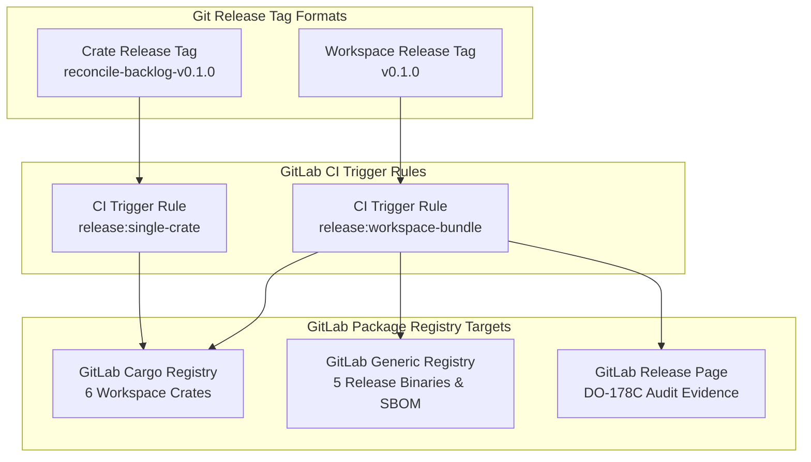

---

### 7.3 SysML v2 AST Parsing & Context-Isolated Specification Partitioning (`crates/deap-core` & `crates/compile-sysml`)

#### 7.3.1 Mathematical Formalization of AST Partitioning

Complex cyber-physical systems modeled in `.pipeline/schema.sysml` span structural `part def` nodes, `port def` interfaces, `action def` behaviors, `state def` state machines, `requirement def` constraints, and `use case def` operational scenarios. `crates/deap-core/src/sysml_ast.rs` and `crates/compile-sysml/src/lib.rs` parse the SysML v2 schema into a strongly-typed AST so that each single-item subagent receives only its relevant AST subgraph:

$$\text{AST}_{\text{slice}} = \text{Closure}(\mathcal{N}_{\text{target}}, \mathcal{E}_{\text{deps}})$$

Where:
- $\mathcal{N}_{\text{target}}$ is the target SysML v2 declaration (`part def`, `action def`, `port def`, `state def`, `requirement def`, or `use case def`) parsed by `crates/deap-core/src/sysml_ast.rs`.
- $\mathcal{E}_{\text{deps}}$ represents the connected port bindings, item flows, and requirement verification links validated by `crates/compile-sysml/src/lib.rs`.

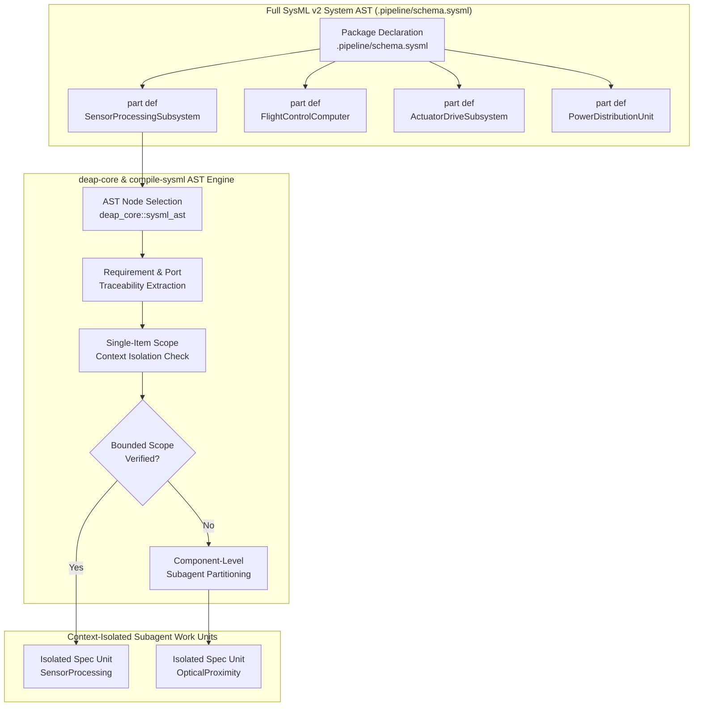

---

### 7.4 Closed-Loop Baseline Verification & Defect Dossier Pipeline (`crates/verify-baseline`)

#### 7.4.1 End-to-End Verification & Defect Dossier Workflow

In air-gapped and enterprise GitLab pipelines, `./target/release/verify-baseline` (`crates/verify-baseline/src/runner.rs` and `crates/verify-baseline/src/defect_dossier.rs`) and `./target/release/reconcile-backlog` (`crates/reconcile-backlog/src/lib.rs` and `crates/reconcile-backlog/src/create_issue.rs`) enforce closed-loop verification before any issue or merge request is marked resolved:

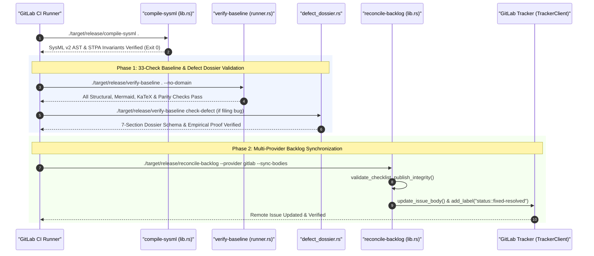

#### 7.4.2 7-Section Defect Dossier Gate (`crates/verify-baseline/src/defect_dossier.rs`)

Before any defect issue can be filed via `./target/release/reconcile-backlog create-issue --label bug`, `validate_defect_dossier` in `crates/verify-baseline/src/defect_dossier.rs` validates that the markdown dossier contains all 7 mandatory sections (`DossierSection::ALL`), zero em dashes (`\u2014`), valid environment metadata, and concrete empirical reproduction output:

```rust
// Grounded in: crates/verify-baseline/src/defect_dossier.rs
#[derive(Debug, Clone, Copy, PartialEq, Eq)]
pub enum DossierSection {
    TargetIdentification,
    ArchitecturalInvariants,
    FiveWhysRootCause,
    EmpiricalReproduction,
    BlastRadiusAssessment,
    ProposedRemediation,
    VerificationTestPlan,
}

impl DossierSection {
    pub const ALL: [DossierSection; 7] = [
        DossierSection::TargetIdentification,
        DossierSection::ArchitecturalInvariants,
        DossierSection::FiveWhysRootCause,
        DossierSection::EmpiricalReproduction,
        DossierSection::BlastRadiusAssessment,
        DossierSection::ProposedRemediation,
        DossierSection::VerificationTestPlan,
    ];
}
```

---

## Section 8: Toolchain Integration with MATLAB / Simulink / Stateflow & Downstream Verification

### 8.1 MATLAB / Simulink Integration Context (Tier-1 Commercial Toolchain)

DEAP explicitly declares **MATLAB / Simulink / Stateflow / Embedded Coder** as the **Primary Tier-1 Commercial Toolchain Integration Context** for:
1. **Model-Based Design (MBD):** Structural plant models, multi-spectral sensor pipelines, and actuator dynamics.
2. **Control Law Synthesis:** Autonomous path planning, optical fence intrusion avoidance, geofencing, and emergency recovery algorithms.
3. **Discrete State Supervision:** Stateflow hierarchical statecharts implementing operational modes and ASTM F3269-17 RTA switching logic.
4. **DO-178C / DO-331 Qualified Code Generation:** Automatic synthesis of production C and SPARK Ada source code via Embedded Coder.
5. **Formal Verification:** Simulink Design Verifier (SLDV) mathematical proofs establishing the impossibility of safety invariant violations.

---

### 8.2 Automated MathWorks CI Execution via GitLab Runners

The bridge between GitLab CI/CD pipelines, SysML v2 AST (`.pipeline/schema.sysml` compiled via `./target/release/compile-sysml`), and MATLAB / Simulink operates through containerized or dedicated bare-metal GitLab runners equipped with the MathWorks toolchain:

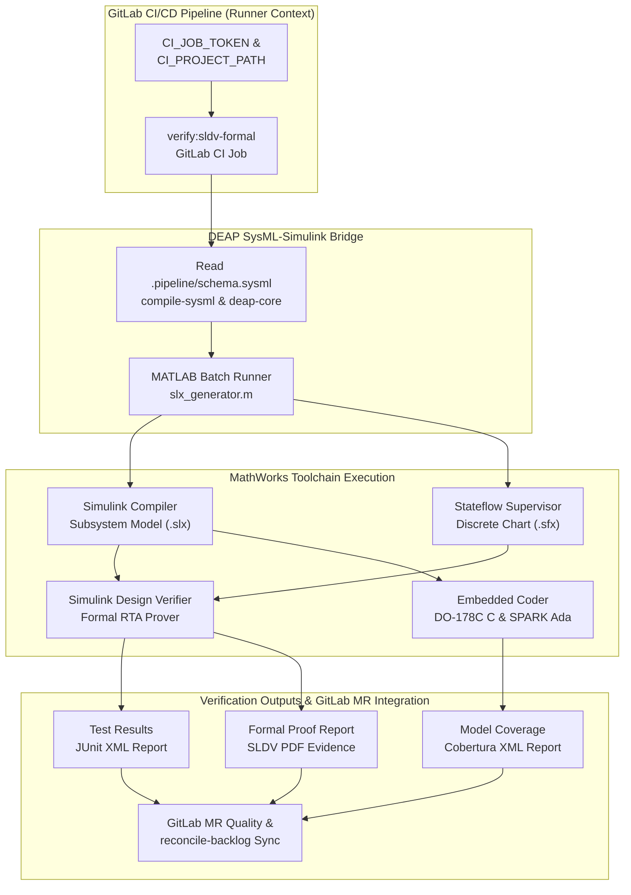

---

### 8.3 Code Generation Traceability Pragmas & DO-178C Compliance

Embedded Coder generates production C and SPARK Ada source code decorated with cryptographic traceability pragmas linking each synthesized function and state transition directly to its SysML v2 AST Requirement and GitLab Issue IID:

```c
/* =============================================================================
 * Model-Based Code Generation: DEAP Autonomous Cyber-Physical System Infrastructure Safety
 * Target Standard: RTCA DO-178C / DO-331 Design Assurance Level A (DAL-A)
 * Model Component: FenceIntrusionDetector.slx
 *
 * Traceability Links:
 *   - SysML v2 Requirement: REQ_FENCE_01 (Optical Intrusion Trigger)
 *   - SysML v2 State Def:   MonitoringState::TriggerIntervention
 *   - GitLab Issue:         #104 (Feature: Multi-Spectral Optical Fence)
 *   - ASTM F3269-17 RTA:    Invariant INV-OPT-001 (Boundary Clearance >= 15.0m)
 * =============================================================================
 */

#include "fence_intrusion_detector.h"
#include "safety_invariants.h"

/* RTA Monitored Safety Invariant: ASTM F3269-17 */
#define MIN_FENCE_CLEARANCE_METERS (15.0f)

void FenceIntrusionDetector_Step(
    const SensorFrame_t* const in_sensor_frame,
    ActuatorCommand_t* const out_command,
    RTA_State_t* const out_rta_status)
{
    /* Verify Pre-Condition Invariant: Sensor Validity */
    if (in_sensor_frame == NULL || out_command == NULL || out_rta_status == NULL) {
        /* Fail-Safe Trigger: DO-178C Defensive Architecture */
        RTA_TriggerImmediateFailsafe(out_command, out_rta_status, RTA_ERR_NULL_POINTER);
        return;
    }

    /* Evaluate Optical Fence Proximity */
    float32_t computed_clearance = in_sensor_frame->optical_distance_meters;

    /* SysML State Def: MonitoringState -> EmergencyAvoidanceState */
    if (computed_clearance < MIN_FENCE_CLEARANCE_METERS) {
        /* RTA Invariant Violation: Activate Primary Control Override */
        out_rta_status->override_active = true;
        out_rta_status->safety_reason_code = RTA_REASON_FENCE_PROXIMITY;

        /* Synthesize Emergency Avoidance Trajectory */
        out_command->axis_alpha_deg = 12.5f;       /* Recovery state vector */
        out_command->axis_beta_deg = -15.0f;      /* Divert from containment boundary */
        out_command->actuator_normalized = 0.95f;
    } else {
        /* Nominal System Operation */
        out_rta_status->override_active = false;
        out_rta_status->safety_reason_code = RTA_REASON_NOMINAL;
    }
}
```

---

### 8.4 Downstream Verification Artifacts & Merge Request Integration

When a GitLab CI/CD pipeline completes execution, downstream verification artifacts are published directly into the GitLab Merge Request and Issue tracker via `./target/release/reconcile-backlog`:

1. **Semantic Acceptance & Model Verification Reports:** Output in JUnit XML format and ingested natively by GitLab CI (`artifacts:reports:junit: reports/junit.xml`).
2. **Structural & Model Coverage Reports:** Converted to Cobertura XML and visualized directly within GitLab Merge Request diffs (`artifacts:reports:coverage_report: coverage_format: cobertura`).
3. **Formal Verification Proofs:** SLDV mathematical analysis reports attached as persistent job artifacts and referenced in GitLab Issue audit notes.
4. **DO-178C Compliance Seal:** Upon 100% passage of `./target/release/verify-baseline`, `./target/release/reconcile-backlog` synchronizes checklists and updates issue labels to `status::fixed-resolved` and `verification::passed`.

---

## Section 9: Summary & Blueprint Implementation Architecture

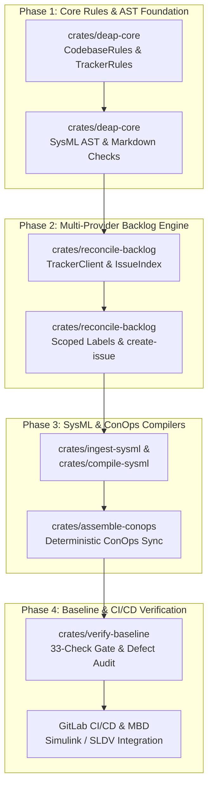

### Verification & Conformance Sign-Off

- **Document Identifier:** `DEAP-BLUEPRINT-GITLAB-001`
- **Architecture Lead:** DEAP Solution Architect
- **Standards Conformance:** GitLab REST API v4 | ISO/IEC/IEEE 15288 | RTCA DO-178C / DO-331 | ASTM F3269-17 RTA | JARUS SORA v2.5
- **Workspace Crate Grounding:** `crates/deap-core`, `crates/reconcile-backlog`, `crates/verify-baseline`, `crates/compile-sysml`, `crates/ingest-sysml`, `crates/assemble-conops`
- **Mathematical Integrity:** KaTeX formulas and LaTeX equations verified for syntax.
- **Diagram Integrity:** All Mermaid `flowchart TD`, `stateDiagram-v2`, `sequenceDiagram`, and `classDiagram` blocks validated for E1-E5 constraints, double quotes, `direction TB` subgraph headers, `<= 35` character line segments, and terminal closure.
