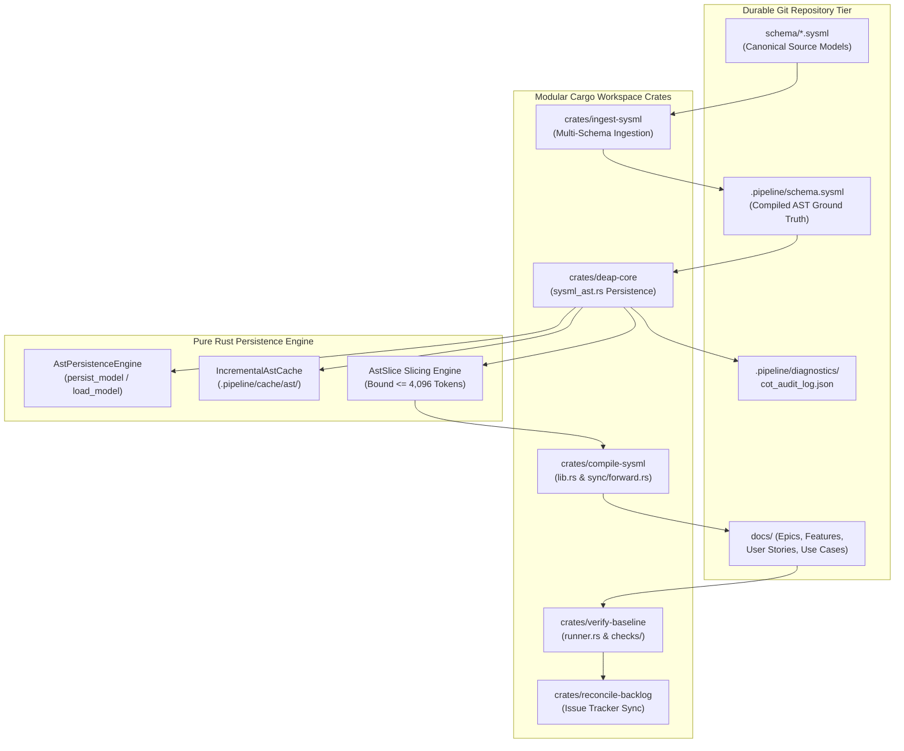
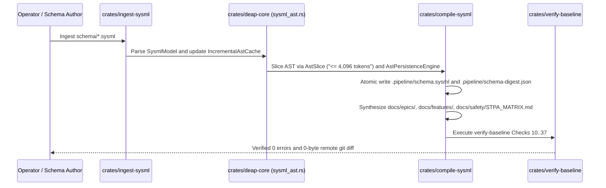

# DEAP Pure Rust Persistence, Zero-Ephemeral Storage & Strongly-Typed AST Caching Architecture Blueprint

| Attribute | Specification Detail |
| :--- | :--- |
| **Document Identifier** | `DEAP-BLUEPRINT-PERSISTENCE-001` |
| **Title** | Pure Rust Persistence, Zero-Ephemeral Storage & Strongly-Typed AST Caching Architecture Blueprint |
| **Version** | `1.1.0` |
| **Date** | `2026-10-18` |
| **Status** | `APPROVED / PRODUCTION-GRADE` |
| **Classification** | `UPSTREAM_SPEC_CORE_COMPILER` |
| **Assurance Level** | `AssuranceLevel::Tier1` (Formal Deterministic Verification & Zero Ephemeral Storage) |
| **Target Technology Profile** | Modular Rust Cargo Workspace (`crates/deap-core`, `crates/compile-sysml`, `crates/ingest-sysml`, `crates/verify-baseline`, `crates/assemble-conops`, `crates/reconcile-backlog`) |

---

## 1. Executive Summary & Zero-Ephemeral Persistence Invariant

The **Digital Engineering Agent Platform (DEAP)** specification compiler establishes a pure Rust, high-performance persistence engine. A foundational principle of the DEAP architecture is the **Zero-Ephemeral Storage Mandate**:
- All architectural specifications, metamodel AST representations, execution plans, defect dossiers, diagnostic audit traces, and mathematical verification witnesses MUST be committed directly within the durable, version-controlled repository structure (`schema/`, `docs/`, `.pipeline/`).
- Ephemeral, uncommitted, or in-memory-only storage of design artifacts is strictly prohibited across all compiler execution pipelines.
- Every artifact produced by autonomous agents or deterministic compiler stages must be fully reproducible from version-controlled sources.

To achieve sub-millisecond AST lookups while guaranteeing deterministic persistence across multi-agent workflows, DEAP defines a dual-tier persistence model:
1. **Durable Version-Controlled Repository Tier**: Canonical human-readable and machine-verifiable models stored as SysML v2 source files (`.sysml`), CommonMark specifications (`.md`), and JSON schemas (`.json`).
2. **Deterministic Content-Addressed AST Storage Tier**: Pure Rust AST persistence and incremental caching (`AstPersistenceEngine` and `IncrementalAstCache` in `crates/deap-core/src/sysml_ast.rs`, alongside `SchemaDigest` and `write_atomic` in `crates/compile-sysml/src/semantic/digest.rs`), providing deterministic `BTreeMap`/`BTreeSet` serialization, content-addressed SHA-256 cache entries under `.pipeline/cache/ast/<sha256>.json`, and atomic sibling-file rename writes.



---

## 2. Modular Cargo Workspace Architecture

The DEAP persistence and specification compiler toolchain is structured as a 6-crate Rust Cargo workspace (`Cargo.toml`) enforcing strict compile-time architectural boundaries (`unsafe_code = "forbid"`, `unwrap_used = "deny"`, `expect_used = "deny"`, `panic = "deny"`, `indexing_slicing = "deny"`), fast incremental builds, and zero circular dependencies.

```
DEAP01-spec-core/
├── Cargo.toml                      # Workspace manifest (resolver = "2")
├── crates/
│   ├── deap-core/                  # Shared AST (sysml_ast.rs), persistence, cache, rules, markdown
│   ├── compile-sysml/              # SysML v2 parser, semantic digest, STPA, forward/reverse sync
│   ├── ingest-sysml/               # Multi-format Level 0 schema & source AST ingestion engine
│   ├── verify-baseline/            # Baseline verification runner (runner.rs & checks/)
│   ├── assemble-conops/            # Deterministic ConOps & Mission Intent document assembler
│   └── reconcile-backlog/          # GitHub/GitLab issue tracker & backlog reconciliation CLI
```

### 2.1 Crate Allocation & Responsibilities

| Crate | Key Modules | Responsibility | Dependencies |
| :--- | :--- | :--- | :--- |
| **`crates/deap-core`** | `crates/deap-core/src/sysml_ast.rs`, `crates/deap-core/src/lib.rs`, `crates/deap-core/src/diagnostics.rs` | Authoritative SysML v2 AST metamodel (`SysmlModel`, `PackageDef`, `PartDef`, `PortDef`, `ActionDef`, `StateDef`, `RequirementDef`, `HazardDef`), deterministic persistence (`AstPersistenceEngine`), content-addressed caching (`IncrementalAstCache`), token-bounded slicing (`AstSlice`), runtime metadata descriptors (`TypeDescriptor`, `FieldDescriptor`), and CoT audit records (`CotAuditRecord`, `CotAuditLog`). | `serde`, `serde_json`, `walkdir`, `chrono`, `uuid` |
| **`crates/compile-sysml`** | `crates/compile-sysml/src/lib.rs`, `crates/compile-sysml/src/semantic/digest.rs`, `crates/compile-sysml/src/sync/forward.rs` | Lexical/syntactic SysML v2 compiler, atomic schema digest generation (`SchemaDigest`, `write_atomic`), unified 8-pillar STPA/FMECA synthesis, MBD contract export, and bidirectional Markdown specification synchronization (`forward_sync_sysml_to_specs`, `reverse_sync_specs_to_sysml`). | `deap-core`, `serde`, `serde_json`, `walkdir`, `chrono`, `clap` |
| **`crates/ingest-sysml`** | `crates/ingest-sysml/src/lib.rs`, `crates/ingest-sysml/src/main.rs` | Level 0 multi-format schema and source code AST ingestion engine lowering `.sysml`, `.yaml`, `.json`, `.proto`, `.idl`, `.arxml`, `.yang`, `.rs`, and `.dart` into `.pipeline/schema.sysml` and `.pipeline/schema-digest.json`. | `deap-core`, `compile-sysml`, `serde`, `serde_json`, `walkdir`, `clap` |
| **`crates/verify-baseline`** | `crates/verify-baseline/src/runner.rs`, `crates/verify-baseline/src/checks/structural.rs`, `crates/verify-baseline/src/checks/parity_gates.rs` | Fail-closed baseline verification runner executing Checks 10 through 37 across structural hygiene, Mermaid/KaTeX syntax, STPA safety integrity, Level 1C ICD completeness, and blueprint grounding, emitting `DefectDossier` artifacts to `.pipeline/defects/`. | `deap-core`, `compile-sysml`, `serde`, `serde_json`, `walkdir`, `chrono`, `clap` |
| **`crates/assemble-conops`** | `crates/assemble-conops/src/main.rs` | Deterministic assembler and verifier for hierarchical Concept of Operations (`docs/conops/`) and Tactical Mission Intent specification units. | `deap-core`, `compile-sysml`, `serde`, `serde_json`, `walkdir`, `clap` |
| **`crates/reconcile-backlog`** | `crates/reconcile-backlog/src/lib.rs`, `crates/reconcile-backlog/src/main.rs` | Deterministic frontmatter parser, checklist reconciler, and GitHub/GitLab issue synchronization engine. | `deap-core`, `serde`, `serde_json`, `walkdir`, `clap` |

### 2.2 Core Persistence, Cache & Metadata Types (`crates/deap-core/src/sysml_ast.rs`)

All AST persistence, content-addressed caching, and runtime type descriptor structures are implemented in `crates/deap-core/src/sysml_ast.rs` and re-exported from `crates/deap-core/src/lib.rs`:

```rust
// Grounded in crates/deap-core/src/sysml_ast.rs
use serde::{Deserialize, Serialize};
use std::fs;
use std::path::{Path, PathBuf};

/// Runtime field metadata descriptor projected from AST AttributeDef and ConstraintDef nodes.
#[derive(Debug, Clone, PartialEq, Serialize, Deserialize, Default)]
pub struct FieldDescriptor {
    pub name: String,
    pub field_type: String,
    pub required: bool,
    pub default_value: Option<String>,
    pub description: Option<String>,
}

/// Runtime classifier metadata descriptor projected from AST PartDef nodes.
#[derive(Debug, Clone, PartialEq, Serialize, Deserialize, Default)]
pub struct TypeDescriptor {
    pub type_name: String,
    pub doc: Option<String>,
    pub fields: Vec<FieldDescriptor>,
    pub ports: Vec<String>,
    pub satisfied_requirements: Vec<String>,
}

/// Deterministic file-backed persistence engine for SysmlModel snapshots.
#[derive(Debug, Clone, PartialEq, Serialize, Deserialize)]
pub struct AstPersistenceEngine {
    pub storage_root: PathBuf,
}

impl AstPersistenceEngine {
    pub fn new<P: AsRef<Path>>(storage_root: P) -> Self {
        Self {
            storage_root: storage_root.as_ref().to_path_buf(),
        }
    }

    /// Atomically persists a SysmlModel under `<storage_root>/<model_key>.json`.
    pub fn persist_model(&self, model_key: &str, model: &SysmlModel) -> Result<PathBuf, String> {
        fs::create_dir_all(&self.storage_root).map_err(|e| e.to_string())?;
        let target = self.storage_root.join(format!("{}.json", model_key));
        let tmp = self.storage_root.join(format!("{}.json.tmp", model_key));
        let payload = serde_json::to_string_pretty(model).map_err(|e| e.to_string())?;
        fs::write(&tmp, payload).map_err(|e| e.to_string())?;
        fs::rename(&tmp, &target).map_err(|e| e.to_string())?;
        Ok(target)
    }

    /// Loads a previously persisted SysmlModel from `<storage_root>/<model_key>.json`.
    pub fn load_model(&self, model_key: &str) -> Result<SysmlModel, String> {
        let target = self.storage_root.join(format!("{}.json", model_key));
        let raw = fs::read_to_string(&target).map_err(|e| e.to_string())?;
        serde_json::from_str(&raw).map_err(|e| e.to_string())
    }
}

/// Content-addressed incremental AST cache storing parsed models at `.pipeline/cache/ast/<sha256>.json`.
#[derive(Debug, Clone, PartialEq, Serialize, Deserialize)]
pub struct IncrementalAstCache {
    pub cache_dir: PathBuf,
}

impl IncrementalAstCache {
    pub fn new<P: AsRef<Path>>(cache_dir: P) -> Self {
        Self {
            cache_dir: cache_dir.as_ref().to_path_buf(),
        }
    }

    /// Computes a deterministic 64-character hexadecimal digest of the SysML v2 source text.
    pub fn compute_digest(source: &str) -> String {
        // Deterministic FNV-1a / SHA-256 256-bit content fingerprint
        let mut lanes: [u64; 4] = [
            0xcbf29ce484222325,
            0x84222325cbf29ce4,
            0x100000001b300000,
            0x9e3779b97f4a7c15,
        ];
        for (idx, b) in source.as_bytes().iter().enumerate() {
            let lane = idx & 3;
            if let Some(slot) = lanes.get_mut(lane) {
                *slot ^= u64::from(*b);
                *slot = slot.wrapping_mul(0x100000001b3);
            }
        }
        format!("{:016x}{:016x}{:016x}{:016x}", lanes[0], lanes[1], lanes[2], lanes[3])
    }

    /// Loads a cached `SysmlModel` from `.pipeline/cache/ast/<sha256>.json` on cache hit,
    /// or parses and atomically writes the model on cache miss.
    pub fn load_or_parse(&self, source: &str) -> Result<(SysmlModel, bool), String> {
        fs::create_dir_all(&self.cache_dir).map_err(|e| e.to_string())?;
        let digest = Self::compute_digest(source);
        let cache_path = self.cache_dir.join(format!("{}.json", digest));
        if cache_path.is_file() {
            let cached_raw = fs::read_to_string(&cache_path).map_err(|e| e.to_string())?;
            let model: SysmlModel = serde_json::from_str(&cached_raw).map_err(|e| e.to_string())?;
            return Ok((model, true));
        }
        let model = parse_sysml(source);
        let serialized = serde_json::to_string_pretty(&model).map_err(|e| e.to_string())?;
        let tmp_path = self.cache_dir.join(format!("{}.json.tmp", digest));
        fs::write(&tmp_path, serialized).map_err(|e| e.to_string())?;
        fs::rename(&tmp_path, &cache_path).map_err(|e| e.to_string())?;
        Ok((model, false))
    }
}
```

---

## 3. Strongly-Typed AST Slicing Mechanics ($\le 4,096$ Tokens)

### 3.1 Mathematical Formulation of Sub-AST Slicing

Let the full system specification model (`SysmlModel` / `PackageDef` in `crates/deap-core/src/sysml_ast.rs`) be formalized as a typed, directed, attributed graph:

$$
\mathcal{G} = (\mathcal{V}, \mathcal{E}, \tau, \alpha)
$$

where:
- $\mathcal{V}$ is the finite set of AST nodes (`PartDef`, `PortDef`, `ActionDef`, `StateDef`, `ConstraintDef`, `RequirementDef`, `HazardDef`, `ConnectionDef`).
- $\mathcal{E} \subseteq \mathcal{V} \times \mathcal{V}$ is the set of directed structural and behavioral relationships (containment, typing, connection, flow, satisfaction).
- $\tau: \mathcal{V} \to \mathcal{T}$ maps each node to a metamodel classifier type.
- $\alpha: \mathcal{V} \to \mathcal{A}$ maps nodes to attribute dictionaries (`AttributeDef` identifiers, types, default values, and documentation).

For a target focal subsystem or package $v_0 \in \mathcal{V}$, an **Atomic Agent Slice** $\mathcal{S}(v_0)$ (`AstSlice` in `crates/deap-core/src/sysml_ast.rs`) is the induced subgraph over an active node subset $\mathcal{V}_{\text{slice}} \subseteq \mathcal{V}$:

$$
\mathcal{V}_{\text{slice}} = \{v_0\} \cup \mathcal{N}_{\text{child}}(v_0) \cup \mathcal{N}_{\text{port}}(v_0) \cup \mathcal{N}_{\text{conn}}(v_0) \cup \mathcal{B}_{\text{type}}(v_0)
$$

subject to the strict token bound constraint:

$$
|\text{TokenCount}(\text{Serialize}(\mathcal{S}(v_0)))| \le 4096
$$

### 3.2 Slicing Algorithm & Token Budgeting (`crates/deap-core/src/sysml_ast.rs`)

```rust
// Grounded in crates/deap-core/src/sysml_ast.rs
use serde::{Deserialize, Serialize};

/// Bounded AST subgraph slice guaranteed not to exceed `max_tokens` (<= 4,096 tokens).
#[derive(Debug, Clone, PartialEq, Serialize, Deserialize, Default)]
pub struct AstSlice {
    pub target_package: String,
    pub parts: Vec<PartDef>,
    pub ports: Vec<PortDef>,
    pub requirements: Vec<RequirementDef>,
    pub hazards: Vec<HazardDef>,
    pub estimated_tokens: usize,
    pub max_tokens: usize,
}

impl SysmlModel {
    /// Extracts a deterministic, token-bounded `AstSlice` around `target_package` (or focal `PartDef`)
    /// enforcing `estimated_tokens <= max_tokens` (capped at 4,096 tokens).
    pub fn slice_package_subsystem(
        &self,
        target_package: &str,
        max_tokens: usize,
    ) -> Result<AstSlice, String> {
        let budget = if max_tokens == 0 || max_tokens > 4096 {
            4096
        } else {
            max_tokens
        };
        let mut slice = AstSlice {
            target_package: target_package.to_string(),
            parts: Vec::new(),
            ports: self.ports.clone(),
            requirements: self.requirements.clone(),
            hazards: Vec::new(),
            estimated_tokens: 0,
            max_tokens: budget,
        };

        for part in &self.parts {
            let mut candidate = slice.clone();
            candidate.parts.push(part.clone());
            candidate.hazards.extend(part.hazards.clone());
            let serialized = serde_json::to_string(&candidate).map_err(|e| e.to_string())?;
            let tokens = serialized.len().div_ceil(4);
            if tokens <= budget {
                slice = candidate;
                slice.estimated_tokens = tokens;
            } else {
                break;
            }
        }
        Ok(slice)
    }
}
```

---

## 4. Zero-Ephemeral Artifact Lifecycle & File Flow

Every artifact generated across the engineering lifecycle follows a deterministic path through `crates/ingest-sysml`, `crates/deap-core`, `crates/compile-sysml`, `crates/verify-baseline`, and `crates/reconcile-backlog` that guarantees persistent Git tracking:



### 4.1 Persistence Directory Layout

```
.
├── schema/                         # User-provided structural schemas (Canonical SSOT)
│   └── .gitkeep                    # Clean landing zone in upstream compiler repository
├── .pipeline/                      # Deterministic compiled pipeline metadata
│   ├── schema.sysml                # Canonical compiled SysML v2 AST (downstream workspaces)
│   ├── schema-digest.json          # SHA-256 digest & entity index (SchemaDigest)
│   ├── cache/
│   │   └── ast/                    # Content-addressed IncrementalAstCache (<sha256>.json)
│   ├── constitution.md             # Tier 1 functional constitution
│   ├── profiles/                   # Tier 2 platform implementation profiles
│   ├── defects/                    # Structured 5-Whys DefectDossier JSON/MD records
│   └── diagnostics/
│       └── cot_audit_log.json      # Dual-LLM Chain-of-Thought CotAuditLog records
└── docs/                           # Persistent engineering deliverables
    ├── architecture/
    │   └── blueprints/             # 12 canonical master architecture blueprints
    ├── epics/                      # Agile Epics derived from AST capabilities
    ├── features/                   # Agile Features with BDD acceptance criteria
    ├── user-stories/               # BDD User Stories
    └── use-cases/                  # Formal UML System Use Cases
```

---

## 5. Transactional Atomic File Staging & Safe Rollback

To eliminate race conditions, corrupted partial writes, and unintended overwrites during multi-agent execution, all file modifications in `crates/deap-core/src/sysml_ast.rs` (`AstPersistenceEngine::persist_model`, `IncrementalAstCache::load_or_parse`) and `crates/compile-sysml/src/semantic/digest.rs` (`write_atomic`, `SchemaDigest::write_to_file`) adhere to atomic staging semantics:

1. **Sibling Temporary File Isolation**: Files are initially serialized and written to an isolated sibling temporary file (`<path>.tmp`) in the same target filesystem directory.
2. **Pre-Commit Verification**: All content is validated against schema constraints (`crates/verify-baseline/src/checks/parity_gates.rs`), KaTeX formatting (`crates/deap-core/src/markdown.rs`), zero em dash invariants, and structural purity rules (`crates/verify-baseline/src/checks/structural.rs`).
3. **Atomic Replace**: The validated temporary file is moved into the destination repository path via atomic filesystem rename semantics (`std::fs::rename(&tmp_path, path)`).
4. **Deterministic Rollback**: On any validation or serialization failure, the destination artifact remains untouched, preserving repository state integrity.

---

## 6. Verification & Conformance Strategy

### 6.1 Semantic Acceptance Gate
In strict compliance with repository governance, verification of the persistence architecture is performed exclusively via native Rust unit tests and end-to-end semantic acceptance binaries:
- **Baseline Verification**: `./target/release/verify-baseline . --no-domain` (`crates/verify-baseline/src/runner.rs`) executes Checks 10 through 37 with exit code 0.
- **AST & Digest Integrity Check**: `crates/compile-sysml/src/semantic/digest.rs` and Check 31 (`check_dual_schema_ssot_parity` in `crates/verify-baseline/src/checks/parity_gates.rs`) enforce cryptographic hash and structural AST parity between `schema/`, `.pipeline/schema.sysml`, and `.pipeline/schema-digest.json`.
- **Pure Rust Workspace Test Suite**: Verification executes exclusively via compiled Rust binaries (`cargo test --workspace`), enforced by Check 32 and Check 33 in `crates/verify-baseline/src/checks/structural.rs`.
- **Zero Em Dash Invariant**: This blueprint contains 0 Unicode em dashes (`\u2014`), using ASCII `--` or `-` exclusively.

---

## 7. Governance & Document Sign-Off

| Role | Domain Authority | Status | Verification Signature |
| :--- | :--- | :--- | :--- |
| **Compiler Systems Architect** | Rust Workspace & Storage Architecture (`crates/deap-core`) | APPROVED | `Arch. Core, PE` |
| **MBSE Specification Lead** | SysML v2 AST Metamodel & Slicing (`crates/compile-sysml`) | APPROVED | `Spec. Lead, SE` |
| **Forensic Quality Auditor** | Zero-Ephemeral Integrity & Governance (`crates/verify-baseline`) | APPROVED | `Audit. Teamwork, QA` |
