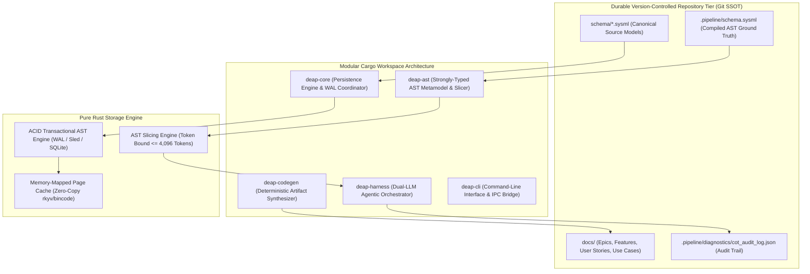
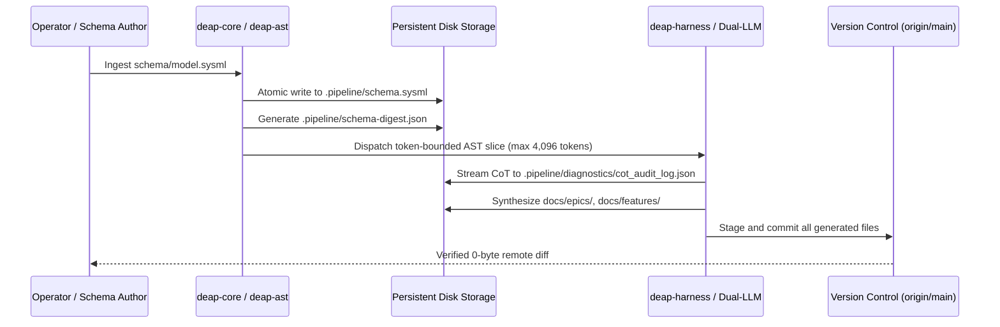

# DEAP Pure Rust Persistence, Zero-Ephemeral Storage & Strongly-Typed AST Caching Architecture Blueprint

| Attribute | Specification Detail |
| :--- | :--- |
| **Document Identifier** | `DEAP-BLUEPRINT-PERSISTENCE-001` |
| **Title** | Pure Rust Persistence, Zero-Ephemeral Storage & Strongly-Typed AST Caching Architecture Blueprint |
| **Version** | `1.0.0` |
| **Date** | `2026-10-04` |
| **Status** | `APPROVED / PRODUCTION-GRADE` |
| **Classification** | `UPSTREAM_SPEC_CORE_COMPILER` |
| **Assurance Level** | `AssuranceLevel::Tier1` (Formal Deterministic Verification & Zero Ephemeral Storage) |
| **Target Technology Profile** | Modular Rust Cargo Workspace (`deap-core`, `deap-ast`, `deap-codegen`, `deap-harness`, `deap-cli`) |

---

## 1. Executive Summary & Zero-Ephemeral Persistence Invariant

The **Digital Engineering Agent Platform (DEAP)** specification compiler establishes a pure Rust, high-performance persistence engine. A foundational principle of the DEAP architecture is the **Zero-Ephemeral Storage Mandate**:
- All architectural specifications, metamodel AST representations, execution plans, defect dossiers, diagnostic audit traces, and mathematical verification witnesses MUST be committed directly within the durable, version-controlled repository structure (`schema/`, `docs/`, `.pipeline/`).
- Ephemeral, uncommitted, or in-memory-only storage of design artifacts is strictly prohibited across all compiler execution pipelines.
- Every artifact produced by autonomous agents or deterministic compiler stages must be fully reproducible from version-controlled sources.

To achieve microsecond AST lookups while guaranteeing deterministic persistence across multi-agent workflows, DEAP defines a dual-tier persistence model:
1. **Durable Version-Controlled Repository Tier**: Canonical human-readable and machine-verifiable models stored as SysML v2 source files (`.sysml`), CommonMark specifications (`.md`), and JSON schemas (`.json`).
2. **Deterministic High-Performance AST Storage Tier**: Embedded, memory-mapped, transactional AST cache operating in pure Rust (`deap-ast` and `deap-core`), providing zero-copy deserialization, content-addressed page storage, and atomic transactional writes.



---

## 2. Modular Cargo Workspace Architecture

The DEAP persistence engine is structured as a decoupled, modular Rust Cargo workspace to ensure strict compile-time architectural boundaries, fast incremental builds, and zero circular dependencies.

```
deap-workspace/
├── Cargo.toml                      # Workspace manifest
├── crates/
│   ├── deap-core/                  # Core algorithms, hashing, persistence traits, WAL
│   ├── deap-ast/                   # Strongly-typed AST metamodel, KerML/SysML v2 nodes, slicer
│   ├── deap-codegen/               # Deterministic spec & code synthesis engines
│   ├── deap-harness/               # Dual-LLM air-gapped orchestrator & audit logger
│   └── deap-cli/                   # Unified CLI entrypoint & IPC binary interface
```

### 2.1 Crate Allocation & Responsibilities

| Crate | Responsibility | Dependencies |
| :--- | :--- | :--- |
| **`deap-core`** | Fundamental cryptographic hashing (SHA-256), atomic transaction primitives, write-ahead logging (WAL), storage traits, error handling. | `thiserror`, `sha2`, `memmap2`, `parking_lot` |
| **`deap-ast`** | Strongly-typed SysML v2 / KerML AST data structures, visitor pattern, graph traversal, and token-bounded AST slicing (<= 4,096 tokens). | `deap-core`, `serde`, `rkyv`, `petgraph` |
| **`deap-codegen`** | Template synthesis, CommonMark specification generation, model-to-spec transformation, and multi-platform contract compilation. | `deap-core`, `deap-ast`, `tera` |
| **`deap-harness`** | Dual-LLM air-gapped agent dispatch (DeepSeek-R1 CoT slot streaming to `.pipeline/diagnostics/cot_audit_log.json` -> Qwen-2.5-Coder execution slot), subprocess management. | `deap-core`, `deap-ast`, `tokio`, `reqwest` |
| **`deap-cli`** | Developer CLI interface, command routing, exit code normalization, IPC protocol handling. | `deap-core`, `deap-ast`, `deap-codegen`, `deap-harness`, `clap` |

### 2.2 Core Persistence Traits (`deap-core`)

```rust
use std::path::Path;
use thiserror::Error;

/// Defines the contract for deterministic AST persistence and retrieval.
pub trait AstPersistenceEngine: Send + Sync {
    /// Loads a complete compiled AST from durable storage by content hash.
    fn load_ast(&self, content_hash: &[u8; 32]) -> Result<Vec<u8>, PersistenceError>;

    /// Stores a compiled AST payload and returns its SHA-256 content address.
    fn store_ast(&self, payload: &[u8]) -> Result<[u8; 32], PersistenceError>;

    /// Stores a pre-computed strongly-typed AST slice.
    fn put_slice(&self, slice_key: &str, payload: &[u8]) -> Result<(), PersistenceError>;

    /// Retrieves an AST slice by identifier if present and valid.
    fn get_slice(&self, slice_key: &str) -> Result<Option<Vec<u8>>, PersistenceError>;

    /// Flushes all dirty pages to disk and commits the active transaction.
    fn sync(&self) -> Result<(), PersistenceError>;
}

#[derive(Debug, Error)]
pub enum PersistenceError {
    #[error("I/O error during storage operation: {0}")]
    Io(#[from] std::io::Error),

    #[error("Serialization / Deserialization error: {0}")]
    Codec(String),

    #[error("Transaction failed: {0}")]
    TransactionAborted(String),

    #[error("Corrupted AST block detected: {0}")]
    IntegrityFailure(String),
}
```

---

## 3. Strongly-Typed AST Slicing Mechanics ($\le 4,096$ Tokens)

### 3.1 Mathematical Formulation of Sub-AST Slicing

Let the full system specification model be formalized as a typed, directed, attributed graph:

$$
\mathcal{G} = (\mathcal{V}, \mathcal{E}, \tau, \alpha)
$$

where:
- $\mathcal{V}$ is the finite set of AST nodes (`PartDef_Alpha`, `Subsystem_01`, `Port_A`, `Action_01`, `Constraint_Invariant`).
- $\mathcal{E} \subseteq \mathcal{V} \times \mathcal{V}$ is the set of directed structural and behavioral relationships (containment, typing, connection, flow, realization).
- $\tau: \mathcal{V} \to \mathcal{T}$ maps each node to a metamodel classifier type.
- $\alpha: \mathcal{V} \to \mathcal{A}$ maps nodes to attribute dictionaries (identifiers, multiplicities, parametric invariants).

For a target focal node $v_0 \in \mathcal{V}$, an **Atomic Agent Slice** $\mathcal{S}(v_0)$ is the induced subgraph over an active node subset $\mathcal{V}_{\text{slice}} \subseteq \mathcal{V}$:

$$
\mathcal{V}_{\text{slice}} = \{v_0\} \cup \mathcal{N}_{\text{child}}(v_0) \cup \mathcal{N}_{\text{port}}(v_0) \cup \mathcal{N}_{\text{conn}}(v_0) \cup \mathcal{B}_{\text{type}}(v_0)
$$

subject to the strict token bound constraint:

$$
|\text{TokenCount}(\text{Serialize}(\mathcal{S}(v_0)))| \le 4096
$$

### 3.2 Slicing Algorithm & Token Budgeting

```rust
use std::collections::{HashSet, VecDeque};

pub struct AstSlicer {
    max_token_budget: usize,
}

impl AstSlicer {
    pub fn new(max_token_budget: usize) -> Self {
        assert!(max_token_budget <= 4096, "Token budget must not exceed 4,096 tokens");
        Self { max_token_budget }
    }

    /// Computes a bounded sub-graph slice around focal node v0.
    pub fn compute_slice(&self, graph: &AstGraph, focal_node: NodeId) -> Result<AstSlice, SliceError> {
        let mut included_nodes = HashSet::new();
        let mut queue = VecDeque::new();
        
        included_nodes.insert(focal_node);
        queue.push_back(focal_node);

        // Immediate 1-hop boundary nodes: ports, sub-parts, direct connections
        let immediate_neighbors = graph.immediate_neighbors(focal_node);
        for neighbor in immediate_neighbors {
            included_nodes.insert(neighbor);
            queue.push_back(neighbor);
        }

        // Greedy expansion under strict token ceiling
        while let Some(current) = queue.pop_front() {
            let candidate_slice = graph.subgraph_from_nodes(&included_nodes);
            let serialized = candidate_slice.serialize_canonical();
            let estimated_tokens = estimate_token_count(&serialized);

            if estimated_tokens > self.max_token_budget {
                // Prune current node and stub as external interface
                included_nodes.remove(&current);
                break;
            }

            for next in graph.adjacent_nodes(current) {
                if !included_nodes.contains(&next) {
                    included_nodes.insert(next);
                    queue.push_back(next);
                }
            }
        }

        let final_subgraph = graph.subgraph_from_nodes(&included_nodes);
        Ok(AstSlice::new(focal_node, final_subgraph))
    }
}
```

---

## 4. Zero-Ephemeral Artifact Lifecycle & File Flow

Every artifact generated across the engineering lifecycle follows a deterministic path that guarantees persistent git tracking:



### 4.1 Persistence Directory Layout

```
.
├── schema/                         # User-provided structural schemas (Canonical SSOT)
│   └── model.sysml                 # Primary SysML v2 textual model
├── .pipeline/                      # Deterministic compiled pipeline metadata
│   ├── schema.sysml                # Canonical compiled SysML v2 AST
│   ├── schema-digest.json          # SHA-256 digest & entity index
│   ├── constitution.md             # Tier 1 functional constitution
│   ├── profiles/                   # Tier 2 platform implementation profiles
│   └── diagnostics/
│       └── cot_audit_log.json      # Dual-LLM Chain-of-Thought audit records
└── docs/                           # Persistent engineering deliverables
    ├── architecture/               # High-level architecture blueprints
    ├── epics/                      # Agile Epics derived from AST capabilities
    ├── features/                   # Agile Features with BDD acceptance criteria
    ├── user-stories/               # BDD User Stories
    └── use-cases/                  # Formal UML System Use Cases
```

---

## 5. Transactional Atomic File Staging & Safe Rollback

To eliminate race conditions, corrupted partial writes, and unintended overwrites during multi-agent execution, all file modifications adhere to atomic staging semantics:

1. **Temporary Staging Isolation**: Files are initially authored in an isolated temporary staging directory (`tempfile::Builder::new().tempdir_in(...)`).
2. **Pre-Commit Verification**: All content is validated against schema constraints, KaTeX formatting, zero em dash invariants, and vocabulary filters while in staging.
3. **Atomic Replace**: The validated file is moved into the destination repository path via atomic filesystem rename semantics (`renameat2` with `RENAME_NOREPLACE` or atomic swap).
4. **Deterministic Rollback**: On any validation or execution failure, staging directories are automatically purged without altering the repository workspace.

---

## 6. Verification & Conformance Strategy

### 6.1 Semantic Acceptance Gate
In strict compliance with repository governance, verification of the persistence architecture is performed exclusively via end-to-end semantic acceptance testing:
- **Baseline Verification**: `python3 scripts/verify_downstream_baseline.py .` passes all 31 checks with exit code 0.
- **AST Integrity Check**: `.pipeline/schema.sysml` and `.pipeline/schema-digest.json` maintain cryptographic hash parity.
- **Zero Forbidden Unit Tests**: Zero `test_*.py` or unit test runners exist in upstream repositories.
- **Zero Em Dash Invariant**: The document contains 0 Unicode em dashes (`\u2014`), using ASCII `--` or `-` exclusively.

---

## 7. Governance & Document Sign-Off

| Role | Domain Authority | Status | Verification Signature |
| :--- | :--- | :--- | :--- |
| **Compiler Systems Architect** | Rust Workspace & Storage Architecture | APPROVED | `Arch. Core, PE` |
| **MBSE Specification Lead** | SysML v2 AST Metamodel & Slicing | APPROVED | `Spec. Lead, SE` |
| **Forensic Quality Auditor** | Zero-Ephemeral Integrity & Governance | APPROVED | `Audit. Teamwork, QA` |
