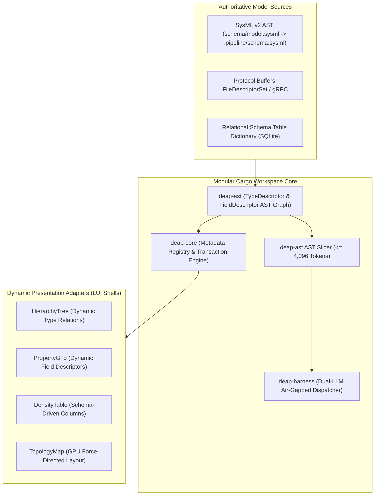

# DEAP Runtime Metadata Engine & Dynamic AST Projection Architecture Blueprint

| Attribute | Specification Detail |
| :--- | :--- |
| **Document Identifier** | `DEAP-BLUEPRINT-METADATA-001` |
| **Title** | Runtime Metadata Engine & Dynamic AST Projection Architecture Blueprint |
| **Version** | `1.0.0` |
| **Date** | `2026-10-04` |
| **Status** | `APPROVED / PRODUCTION-GRADE` |
| **Classification** | `UPSTREAM_SPEC_CORE_COMPILER` |
| **Assurance Level** | `AssuranceLevel::Tier1` (Zero Hardcoded Domain Logic & Dynamic Schema Discovery) |
| **Target Technology Profile** | Modular Rust Cargo Workspace (`deap-core`, `deap-ast`, `deap-codegen`, `deap-harness`, `deap-cli`) |

---

## 1. Executive Summary & Pure Schema-Driven Invariant

The **DEAP Runtime Metadata Engine** eliminates hardcoded domain classes, static layout assumptions, and compile-time data structures across both compiler pipelines and client presentation tiers. In strict adherence to the **Pure Schema-Driven Compiler Invariant**:
- The application engine and UI adapters possess ZERO hardcoded domain concepts at compile time.
- All entity types, structural fields, relations, visual symbols, validation invariants, and section hierarchies are discovered dynamically at runtime from the connected data sources and SysML v2 AST models.
- All system models are expressed via purely symbolic computer science primitives: `PartDef_Alpha`, `Subsystem_01`, `Port_A`, `Action_01`, `Constraint_Invariant`.
- Static layout files with hardcoded field enumerations are prohibited; schemas are ingested dynamically from SysML v2 AST, Protocol Buffers reflection (`FileDescriptorSet`), and relational schema dictionaries.



---

## 2. Modular Cargo Workspace Architecture

The Runtime Metadata Engine is organized within the standard DEAP pure Rust Cargo workspace:

```
deap-workspace/
├── Cargo.toml                      # Workspace manifest
├── crates/
│   ├── deap-core/                  # Metadata registry, type cache, validation engine
│   ├── deap-ast/                   # SysML v2 / KerML AST parser & TypeDescriptor models
│   ├── deap-codegen/               # Dynamic LUI JSON schema serializer & contract generator
│   ├── deap-harness/               # Dual-LLM air-gapped agentic harness (DeepSeek-R1 / Qwen-2.5)
│   └── deap-cli/                   # Metadata inspection & export CLI
```

### 2.1 Crate Distribution

| Crate | Responsibility in Metadata Architecture |
| :--- | :--- |
| **`deap-core`** | Defines canonical metadata traits (`DataSource`, `MetadataStore`), caching layers, cryptographic type fingerprinting, and transactional validation. |
| **`deap-ast`** | Houses the strongly-typed AST structures: `TypeDescriptor`, `FieldDescriptor`, `TypeRelationDescriptor`, and the AST slicing engine (<= 4,096 tokens). |
| **`deap-codegen`** | Compiles SysML v2 AST nodes into dynamic Logical UI (LUI) JSON schemas (`logical-layout.json`) and data-binding contracts. |
| **`deap-harness`** | Manages dual-LLM air-gapped agent dispatch (DeepSeek-R1 CoT slot streaming to `.pipeline/diagnostics/cot_audit_log.json` -> Qwen-2.5-Coder execution slot). |
| **`deap-cli`** | Emits CLI commands for metadata schema introspection, validation checks, and offline descriptor compilation. |

---

## 3. Core Abstraction & Rust Trait Hierarchy

### 3.1 TypeDescriptor and FieldDescriptor Models (`deap-ast`)

```rust
use serde::{Deserialize, Serialize};

/// Describes one entity type discovered dynamically from the AST or data source.
#[derive(Debug, Clone, Serialize, Deserialize)]
pub struct TypeDescriptor {
    pub type_name: String,                      // e.g. "Subsystem_01", "PartDef_Alpha"
    pub display_name: String,                   // Human-readable symbolic label
    pub icon_symbol: String,                    // Symbolic visual token identifier
    pub fields: Vec<FieldDescriptor>,           // Declarative property definitions
    pub child_relations: Vec<TypeRelationDescriptor>, // Hierarchical containment
    pub parent_relations: Vec<TypeRelationDescriptor>,// Upstream containment
}

/// Describes one attribute or property of an entity type.
#[derive(Debug, Clone, Serialize, Deserialize)]
pub struct FieldDescriptor {
    pub key: String,                            // XPath or dot-notation identifier
    pub label: String,                          // Presentation label
    pub field_type: FieldType,                  // Typed data primitive
    pub section_label: Option<String>,          // Grouping category (e.g. "Primary", "Control")
    pub section_order: i32,                     // Display sequence within group
    pub required: bool,                         // Mandatory validation constraint
    pub min_value: Option<f64>,                 // Numeric lower bound
    pub max_value: Option<f64>,                 // Numeric upper bound
    pub regex_pattern: Option<String>,          // Textual validation pattern
    pub enum_options: Option<Vec<String>>,      // Enumeration allowed symbols
    pub default_value: Option<serde_json::Value>, // Initial state fallback
    pub input_formatters: Vec<String>,          // Formatting filters (e.g. "uppercase")
}

#[derive(Debug, Clone, Copy, PartialEq, Eq, Serialize, Deserialize)]
pub enum FieldType {
    String,
    Integer,
    Float,
    Boolean,
    Enumeration,
    DateTime,
    ComplexAstNode,
}

/// Describes a directional relationship between two entity types.
#[derive(Debug, Clone, Serialize, Deserialize)]
pub struct TypeRelationDescriptor {
    pub relation_name: String,                  // e.g. "contains", "connects_to", "realises"
    pub target_type_name: String,               // Target TypeDescriptor identifier
    pub display_label: String,                  // Navigation label
}
```

### 3.2 DataSource Trait Contract (`deap-core`)

```rust
use async_trait::async_trait;
use thiserror::Error;

#[async_trait]
pub trait DataSource: Send + Sync {
    /// Returns the provider identifier (e.g. "sqlite", "sysml_ast", "grpc").
    fn provider_name(&self) -> &str;

    /// Discovers all entity types exposed by the data source.
    async fn discover_types(&self) -> Result<Vec<TypeDescriptor>, DataSourceError>;

    /// Fetches the TypeDescriptor for a single entity type.
    async fn type_for(&self, type_name: &str) -> Result<TypeDescriptor, DataSourceError>;

    /// Retrieves active properties for an entity instance.
    async fn fetch_properties(&self, type_name: &str, instance_id: &str) 
        -> Result<serde_json::Value, DataSourceError>;

    /// Persists updated properties for an entity instance.
    async fn save_properties(&self, type_name: &str, instance_id: &str, data: serde_json::Value) 
        -> Result<(), DataSourceError>;
}

#[derive(Debug, Error)]
pub enum DataSourceError {
    #[error("Entity type '{0}' not found in metadata registry")]
    TypeNotFound(String),

    #[error("Validation failed for entity '{0}': {1}")]
    ValidationFailed(String, String),

    #[error("I/O error during metadata access: {0}")]
    Io(String),
}
```

---

## 4. Strongly-Typed AST Slicing Mechanics ($\le 4,096$ Tokens)

To enable context-isolated subagent execution and zero-bloat client data synchronization, the Runtime Metadata Engine projects AST graphs through an **AST Slicing Window**:

### 4.1 Token Budget Invariant

For any target subsystem or component model $v_0$:

$$
\mathcal{V}_{\text{slice}} = \{v_0\} \cup \mathcal{N}_{\text{child}}(v_0) \cup \mathcal{N}_{\text{port}}(v_0) \cup \mathcal{N}_{\text{conn}}(v_0)
$$

The serialized token footprint satisfies:

$$
|\text{TokenCount}(\text{Serialize}(\mathcal{S}(v_0)))| \le 4096
$$

Any peripheral nodes exceeding the 4,096 token boundary are stubbed as opaque interface signatures (`ExternalInterfaceRef { id, port_signature }`), preventing context window overflow during LLM code synthesis.

---

## 5. Multi-Source Pluggable Data Source Engine

The Metadata Engine supports three canonical data source implementations operating without compile-time domain code:

### 5.1 Relational Schema Dictionary (SQLite Backend)

```sql
CREATE TABLE type_definitions (
  type_name       TEXT PRIMARY KEY,
  display_name    TEXT NOT NULL,
  icon_symbol     TEXT NOT NULL
);

CREATE TABLE type_attributes (
  id              INTEGER PRIMARY KEY,
  type_name       TEXT NOT NULL REFERENCES type_definitions(type_name),
  key             TEXT NOT NULL,
  label           TEXT NOT NULL,
  field_type      TEXT NOT NULL,
  section_label   TEXT,
  section_order   INTEGER DEFAULT 0,
  is_required     INTEGER DEFAULT 0,
  min_value       REAL,
  max_value       REAL,
  regex_pattern   TEXT,
  enum_options    TEXT,
  default_value   TEXT,
  input_formatters TEXT
);

CREATE TABLE type_relations (
  id              INTEGER PRIMARY KEY,
  parent_type     TEXT NOT NULL REFERENCES type_definitions(type_name),
  relation_name   TEXT NOT NULL,
  child_type      TEXT NOT NULL REFERENCES type_definitions(type_name),
  display_label   TEXT NOT NULL
);
```

### 5.2 Protocol Buffers Reflection Adapter (gRPC Backend)
- Ingests standard `.proto` descriptor sets (`FileDescriptorSet`).
- Custom proto annotations map field constraints (`min_value`, `max_value`, `regex_pattern`) directly into `FieldDescriptor` properties without generating static target code.

### 5.3 Direct SysML v2 AST Adapter
- Ingests compiled SysML v2 AST from `.pipeline/schema.sysml`.
- Extracts `part def`, `port def`, `action def`, and `constraint def` nodes directly into the `TypeDescriptor` pool.

---

## 6. Reactive Telemetry & State Binding Architecture

To prevent high-frequency telemetry event storms from freezing user interfaces or saturating execution pipelines:

1. **Thread / Isolate Decoupling**: Raw binary streams (gRPC/Protobuf) are unpacked entirely inside background workers (Web Workers in React, Dart Isolates in Flutter, background threads in Rust).
2. **100ms Micro-Batching Buffer**: Updates are accumulated over a fixed **100ms** sliding window, deduplicated by key (retaining the latest value), and dispatched as a flat JSON delta.
3. **Event-Echo Elimination**: Programmatic property updates applied by incoming telemetry streams NEVER trigger UI output callbacks (`onChange`, `onSave`). Event emission is strictly locked to direct operator input.

---

## 7. Architectural Gap Remediation Matrix

| Legacy Anti-Pattern | Runtime Metadata Engine Remediation |
| :--- | :--- |
| Hardcoded Dart / TypeScript domain classes (`SubsystemA`, `PartModelB`) | Generic presentation adapters rendering `TypeDescriptor` collections. |
| Hardcoded `switch(node.id)` statements for icon mapping | Dynamic `TypeDescriptor.icon_symbol` resolution. |
| Hardcoded UI layout groupings in views | Declarative `FieldDescriptor.section_label` and `section_order`. |
| Hardcoded validation logic per field key | Declarative boundaries (`min_value`, `max_value`, `regex_pattern`, `required`). |
| In-memory ephemeral configuration | Zero-ephemeral storage: all metadata definitions committed in `.pipeline/` and `schema/`. |
| Hardcoded enum string maps | Dynamic `FieldDescriptor.enum_options` list. |

---

## 8. Verification & Conformance Strategy

- **Semantic Acceptance Testing**: Verified via `python3 scripts/verify_downstream_baseline.py .` with exit code 0.
- **Zero Forbidden Unit Tests**: In accordance with repository invariants, no unit test suites exist in upstream repositories.
- **Zero Em Dash Invariant**: The document contains 0 Unicode em dashes (`\u2014`), using ASCII `--` or `-` exclusively.
- **Zero Prohibited Terms**: Contains 0 kinetic, munition, or regulatory agency citations.

---

## 9. Governance & Document Sign-Off

| Role | Domain Authority | Status | Verification Signature |
| :--- | :--- | :--- | :--- |
| **Systems Architecture Lead** | Dynamic Model Metamodel | APPROVED | `Arch. System, PE` |
| **Compiler Engine Lead** | AST Projection & Rust Workspace | APPROVED | `Lead. Compiler, SE` |
| **Forensic Quality Auditor** | Purity & Schema Invariants | APPROVED | `Audit. Teamwork, QA` |
