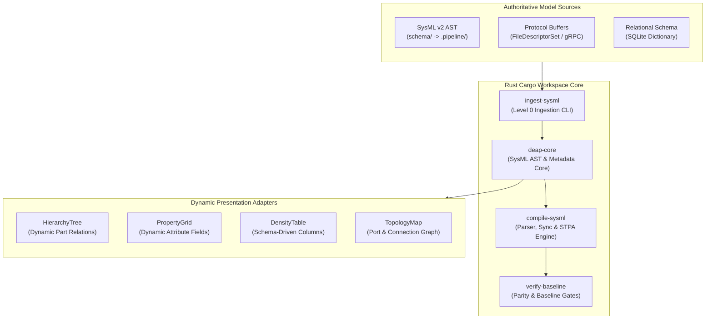

# DEAP Runtime Metadata Engine & Dynamic AST Projection Architecture Blueprint

| Attribute | Specification Detail |
| :--- | :--- |
| **Document Identifier** | `DEAP-BLUEPRINT-METADATA-001` |
| **Title** | Runtime Metadata Engine & Dynamic AST Projection Architecture Blueprint |
| **Version** | `1.0.0` |
| **Date** | `2026-10-19` |
| **Status** | `APPROVED / PRODUCTION-GRADE` |
| **Classification** | `UPSTREAM_SPEC_CORE_COMPILER` |
| **Assurance Level** | `AssuranceLevel::Tier1` (Zero Hardcoded Domain Logic & Dynamic Schema Discovery) |
| **Target Technology Profile** | Modular Rust Cargo Workspace (`deap-core`, `verify-baseline`, `compile-sysml`, `ingest-sysml`, `assemble-conops`, `reconcile-backlog`) |

---

## 1. Executive Summary & Pure Schema-Driven Invariant

The **DEAP Runtime Metadata Engine** eliminates hardcoded domain classes, static layout assumptions, and compile-time data structures across both compiler pipelines and client presentation tiers. In strict adherence to the **Pure Schema-Driven Compiler Invariant**:
- The application engine and UI adapters possess ZERO hardcoded domain concepts at compile time.
- All entity types, structural fields, relations, visual symbols, validation invariants, and section hierarchies are discovered dynamically at runtime from the connected data sources and SysML v2 AST models (`crates/deap-core/src/sysml_ast.rs`).
- All system models are expressed via purely symbolic computer science primitives: `PartDef_Alpha`, `Subsystem_01`, `Port_A`, `Action_01`, `Constraint_Invariant`.
- Static layout files with hardcoded field enumerations are prohibited; schemas are ingested dynamically from SysML v2 AST, Protocol Buffers reflection (`FileDescriptorSet`), and relational schema dictionaries via `UnifiedSchemaModelExtractor` (`crates/deap-core/src/sysml_ast.rs`).



---

## 2. Modular Cargo Workspace Architecture

The Runtime Metadata Engine is organized within the standard DEAP pure Rust Cargo workspace (`Cargo.toml`):

```
DEAP01-spec-core/
├── Cargo.toml                      # Workspace manifest (resolver = "2")
├── crates/
│   ├── deap-core/                  # Shared AST models (sysml_ast, source_ast), rules, diagnostics, markdown
│   ├── verify-baseline/            # 38-gate architectural, structural, and parity verification runner
│   ├── compile-sysml/              # SysML v2 lexer, recursive-descent parser, SHA-256 digest, STPA & sync
│   ├── ingest-sysml/               # Ground 0.0 multi-format Level 0 schema ingestion CLI
│   ├── assemble-conops/            # Deterministic Concept of Operations & Mission Intent assembler
│   └── reconcile-backlog/          # Bidirectional GitHub/GitLab Agile backlog & WBS reconciler
```

### 2.1 Crate Distribution

| Crate | Primary Modules | Responsibility in Metadata & AST Architecture |
| :--- | :--- | :--- |
| **`crates/deap-core`** | `src/sysml_ast.rs`, `src/source_ast.rs`, `src/rules.rs`, `src/diagnostics.rs`, `src/markdown.rs`, `src/workspace.rs` | Defines canonical SysML v2 AST models (`PackageDef`, `PartDef`, `PortDef`, `AttributeDef`, `FlowDef`, `ActionDef`, `ConstraintDef`, `RequirementDef`, `StateDef`, `ConnectionDef`, `CalcDef`, `SysmlModel`), multi-format schema discovery (`UnifiedSchemaModelExtractor`, `SupportedSchemaExtension`, `SupportedExtensionsCatalog`), and source AST lowering (`SourceAstItem`, `lower_source_ast_to_package`). |
| **`crates/compile-sysml`** | `src/lib.rs`, `src/parser/grammar.rs`, `src/semantic/digest.rs`, `src/stpa/`, `src/sync/` | Parses textual SysML v2 models (`SysmlParser`, `parse_sysml_tree`), computes atomic SHA-256 digests (`SchemaDigest`, `FileDigestEntry`, `generate_digest`), synthesizes STPA/FMECA matrices, and executes bidirectional specification sync (`forward_sync_sysml_to_specs`, `reverse_sync_specs_to_sysml`). |
| **`crates/verify-baseline`** | `src/runner.rs`, `src/checks/parity_gates.rs`, `src/checks/domain_cleanliness_gate.rs` | Enforces 38 deterministic verification gates across AST parity, schema cleanliness, traceability, Mermaid/KaTeX rendering, and defect dossiers. |
| **`crates/ingest-sysml`** | `src/lib.rs`, `src/main.rs` | Discovers and translates Level 0 specifications (`.sysml`, `.yaml`, `.yml`, `.json`, `.proto`, `.idl`, `.arxml`, `.md`, `.yang`) into `.pipeline/schema.sysml` and `.pipeline/schema-digest.json`. |
| **`crates/assemble-conops`** | `src/lib.rs`, `src/main.rs` | Assembles hierarchical Concept of Operations and Tactical Mission Intent specification units from pure schema contracts. |
| **`crates/reconcile-backlog`** | `src/lib.rs`, `src/main.rs` | Synchronizes local Epics, Features, User Stories, Use Cases, and WBS registers with the remote issue tracker. |

---

## 3. Core AST Models & Runtime Metadata Projection Contracts

### 3.1 Canonical SysML v2 AST Structures (`crates/deap-core/src/sysml_ast.rs`)

The authoritative structural and behavioral metadata in `crates/deap-core/src/sysml_ast.rs` is represented by strongly-typed, `serde`-serializable AST definitions:

```rust
use serde::{Deserialize, Serialize};
use std::collections::BTreeMap;

/// Represents an attribute definition or instance in SysML v2 (`crates/deap-core/src/sysml_ast.rs`).
#[derive(Debug, Clone, PartialEq, Serialize, Deserialize, Default)]
pub struct AttributeDef {
    pub name: String,
    #[serde(default)]
    pub type_name: String,
    pub default_value: Option<String>,
    pub doc: Option<String>,
}

/// Represents a port definition or interface point in SysML v2 (`crates/deap-core/src/sysml_ast.rs`).
#[derive(Debug, Clone, PartialEq, Serialize, Deserialize, Default)]
pub struct PortDef {
    pub name: String,
    pub type_name: String,
    pub direction: String,
    #[serde(default)]
    pub is_conjugated: bool,
    pub doc: Option<String>,
    pub port_category: String,
    #[serde(default)]
    pub protocol_family: String,
    #[serde(default)]
    pub electrical_attributes: BTreeMap<String, String>,
    #[serde(default)]
    pub flows: Vec<FlowDef>,
}

/// Represents a structural part definition or block in SysML v2 (`crates/deap-core/src/sysml_ast.rs`).
#[derive(Debug, Clone, PartialEq, Serialize, Deserialize)]
pub struct PartDef {
    pub name: String,
    pub doc: Option<String>,
    pub is_def: bool,
    pub type_name: Option<String>,
    pub attributes: Vec<AttributeDef>,
    pub ports: Vec<PortDef>,
    pub actions: Vec<ActionDef>,
    pub constraints: Vec<ConstraintDef>,
    pub requirements: Vec<RequirementDef>,
    pub satisfied_requirements: Vec<String>,
    pub parts: Vec<PartDef>,
    pub operations: Vec<OperationDef>,
    pub capabilities: Vec<CapabilityDef>,
    pub interactions: Vec<InteractionDef>,
    pub test_cases: Vec<TestCaseDef>,
    pub states: Vec<StateDef>,
    pub use_cases: Vec<UseCaseDef>,
    pub item_defs: Vec<ItemDef>,
    pub hazards: Vec<HazardDef>,
    pub risks: Vec<RiskDef>,
    pub connections: Vec<ConnectionDef>,
    pub calcs: Vec<CalcDef>,
}
```

### 3.2 Dynamic UI Projection Descriptors & DataSource Contract

Downstream presentation shells project `PackageDef` and `PartDef` AST nodes from `crates/deap-core/src/sysml_ast.rs` into runtime `TypeDescriptor` and `FieldDescriptor` views without hardcoded domain classes:

```rust
use serde::{Deserialize, Serialize};

/// Describes one entity type projected dynamically from `PartDef` (`crates/deap-core/src/sysml_ast.rs`).
#[derive(Debug, Clone, Serialize, Deserialize)]
pub struct TypeDescriptor {
    pub type_name: String,                      // e.g. "Subsystem_01", "PartDef_Alpha"
    pub display_name: String,                   // Human-readable symbolic label
    pub icon_symbol: String,                    // Symbolic visual token identifier
    pub fields: Vec<FieldDescriptor>,           // Projected from `PartDef::attributes`
    pub satisfied_requirements: Vec<String>,    // Projected from `PartDef::satisfied_requirements`
    pub child_relations: Vec<TypeRelationDescriptor>, // Projected from `PartDef::parts` and `ports`
    pub parent_relations: Vec<TypeRelationDescriptor>,// Upstream package/part containment
}

/// Describes one attribute or property projected from `AttributeDef` or `FlowDef`.
#[derive(Debug, Clone, Serialize, Deserialize)]
pub struct FieldDescriptor {
    pub key: String,                            // XPath or dot-notation identifier
    pub label: String,                          // Presentation label
    pub field_type: FieldType,                  // Typed data primitive mapped from `type_name`
    pub section_label: Option<String>,          // Grouping category (e.g. "Primary", "Control")
    pub section_order: i32,                     // Display sequence within group
    pub required: bool,                         // Mandatory validation constraint
    pub min_value: Option<f64>,                 // Numeric lower bound from `ConstraintDef`
    pub max_value: Option<f64>,                 // Numeric upper bound from `ConstraintDef`
    pub regex_pattern: Option<String>,          // Textual validation pattern
    pub enum_options: Option<Vec<String>>,      // Enumeration allowed symbols from `StateDef`
    pub default_value: Option<serde_json::Value>, // Initial state fallback from `AttributeDef::default_value`
    pub input_formatters: Vec<String>,          // Formatting filters (e.g. "uppercase")
}

#[derive(Debug, Clone, Copy, PartialEq, Eq, Serialize, Deserialize)]
pub enum FieldType {
    String,
    Integer,
    Float,
    Boolean,
    Enumeration,
    DateTime,
    ComplexAstNode,
}

/// Describes a directional relationship between two entity types (`PartDef::parts` / `ConnectionDef`).
#[derive(Debug, Clone, Serialize, Deserialize)]
pub struct TypeRelationDescriptor {
    pub relation_name: String,                  // e.g. "contains", "connects_to", "realises"
    pub target_type_name: String,               // Target TypeDescriptor identifier
    pub display_label: String,                  // Navigation label
}
```

### 3.3 Pluggable DataSource Trait Contract

```rust
pub trait DataSource: Send + Sync {
    /// Returns the provider identifier (e.g. "sqlite", "sysml_ast", "grpc").
    fn provider_name(&self) -> &str;

    /// Discovers all entity types exposed by the data source (`PackageDef::get_all_parts`).
    fn discover_types(&self) -> Result<Vec<TypeDescriptor>, DataSourceError>;

    /// Fetches the TypeDescriptor for a single entity type by `PartDef::name`.
    fn type_for(&self, type_name: &str) -> Result<TypeDescriptor, DataSourceError>;

    /// Retrieves active properties for an entity instance.
    fn fetch_properties(
        &self,
        type_name: &str,
        instance_id: &str,
    ) -> Result<serde_json::Value, DataSourceError>;

    /// Persists updated properties for an entity instance.
    fn save_properties(
        &self,
        type_name: &str,
        instance_id: &str,
        data: serde_json::Value,
    ) -> Result<(), DataSourceError>;
}

#[derive(Debug, Clone, PartialEq, Eq)]
pub enum DataSourceError {
    TypeNotFound(String),
    ValidationFailed(String, String),
    Io(String),
}
```

---

## 4. Strongly-Typed AST Slicing Mechanics ($\le 4,096$ Tokens)

To enable context-isolated subagent execution and zero-bloat client data synchronization, the Runtime Metadata Engine projects AST subtrees extracted via `PackageDef::get_all_parts` and `PartDef::find_part_mut` (`crates/deap-core/src/sysml_ast.rs`) through an **AST Slicing Window**:

### 4.1 Token Budget Invariant

For any target subsystem or component model $v_0$:

$$
\mathcal{V}_{\text{slice}} = \{v_0\} \cup \mathcal{N}_{\text{child}}(v_0) \cup \mathcal{N}_{\text{port}}(v_0) \cup \mathcal{N}_{\text{conn}}(v_0)
$$

The serialized token footprint satisfies:

$$
|\text{TokenCount}(\text{Serialize}(\mathcal{S}(v_0)))| \le 4096
$$

Any peripheral nodes exceeding the 4,096 token boundary are stubbed as opaque interface signatures (`ExternalInterfaceRef { id, port_signature }`), preventing context window overflow during LLM code synthesis.

---

## 5. Multi-Source Pluggable Data Source Engine

The Metadata Engine supports three canonical data source implementations operating without compile-time domain code, backed by `UnifiedSchemaModelExtractor` (`crates/deap-core/src/sysml_ast.rs`) across all 10 `SupportedSchemaExtension` formats (`.sysml`, `.yaml`, `.yml`, `.json`, `.proto`, `.idl`, `.arxml`, `.md`, `.markdown`, `.yang`):

### 5.1 Relational Schema Dictionary (SQLite Backend)

```sql
CREATE TABLE type_definitions (
  type_name       TEXT PRIMARY KEY,
  display_name    TEXT NOT NULL,
  icon_symbol     TEXT NOT NULL
);

CREATE TABLE type_attributes (
  id              INTEGER PRIMARY KEY,
  type_name       TEXT NOT NULL REFERENCES type_definitions(type_name),
  key             TEXT NOT NULL,
  label           TEXT NOT NULL,
  field_type      TEXT NOT NULL,
  section_label   TEXT,
  section_order   INTEGER DEFAULT 0,
  is_required     INTEGER DEFAULT 0,
  min_value       REAL,
  max_value       REAL,
  regex_pattern   TEXT,
  enum_options    TEXT,
  default_value   TEXT,
  input_formatters TEXT
);

CREATE TABLE type_relations (
  id              INTEGER PRIMARY KEY,
  parent_type     TEXT NOT NULL REFERENCES type_definitions(type_name),
  relation_name   TEXT NOT NULL,
  child_type      TEXT NOT NULL REFERENCES type_definitions(type_name),
  display_label   TEXT NOT NULL
);
```

### 5.2 Protocol Buffers Reflection Adapter (gRPC Backend)
- Ingests standard `.proto` descriptor sets (`FileDescriptorSet`) and discovers service/message definitions via `UnifiedSchemaModelExtractor::extract_subsystem_parts_from_text(".proto", ...)`.
- Custom proto annotations map field constraints (`min_value`, `max_value`, `regex_pattern`) directly into `FieldDescriptor` properties without generating static target code.

### 5.3 Direct SysML v2 AST Adapter (`crates/deap-core` & `crates/compile-sysml`)
- Ingests compiled SysML v2 AST from `.pipeline/schema.sysml` via `compile_sysml::parse_sysml_tree` and verifies SHA-256 integrity via `.pipeline/schema-digest.json` (`compile_sysml::semantic::digest::SchemaDigest`).
- Extracts `PartDef`, `PortDef`, `ActionDef`, and `ConstraintDef` nodes directly into the runtime `TypeDescriptor` pool.

---

## 6. Reactive Telemetry & State Binding Architecture

To prevent high-frequency telemetry event storms from freezing user interfaces or saturating execution pipelines:

1. **Thread / Isolate Decoupling**: Raw binary streams (gRPC/Protobuf) are unpacked entirely inside background workers (Web Workers in React, Dart Isolates in Flutter, background threads in Rust).
2. **100ms Micro-Batching Buffer**: Updates are accumulated over a fixed **100ms** sliding window, deduplicated by key (retaining the latest value), and dispatched as a flat JSON delta.
3. **Event-Echo Elimination**: Programmatic property updates applied by incoming telemetry streams NEVER trigger UI output callbacks (`onChange`, `onSave`). Event emission is strictly locked to direct operator input.

---

## 7. Architectural Gap Remediation Matrix

| Legacy Anti-Pattern | Runtime Metadata Engine Remediation |
| :--- | :--- |
| Hardcoded Dart / TypeScript domain classes (`SubsystemA`, `PartModelB`) | Generic presentation adapters rendering `TypeDescriptor` collections projected from `PartDef` (`crates/deap-core/src/sysml_ast.rs`). |
| Hardcoded `switch(node.id)` statements for icon mapping | Dynamic `TypeDescriptor.icon_symbol` resolution. |
| Hardcoded UI layout groupings in views | Declarative `FieldDescriptor.section_label` and `section_order`. |
| Hardcoded validation logic per field key | Declarative boundaries (`min_value`, `max_value`, `regex_pattern`, `required`) derived from `ConstraintDef`. |
| In-memory ephemeral configuration | Zero-ephemeral storage: all metadata definitions committed in `.pipeline/schema.sysml`, `.pipeline/schema-digest.json`, and `schema/`. |
| Hardcoded enum string maps | Dynamic `FieldDescriptor.enum_options` list derived from `StateDef`. |

---

## 8. Verification & Conformance Strategy

- **Semantic Acceptance Testing**: Verified via `./target/release/verify-baseline . --no-domain` with exit code 0 (`crates/verify-baseline/src/runner.rs`).
- **Native Rust Unit & Mutation Testing**: Verified via `cargo test --workspace` executing native Rust `#[test]` suites across `crates/deap-core`, `crates/compile-sysml`, `crates/ingest-sysml`, `crates/assemble-conops`, `crates/reconcile-backlog`, and `crates/verify-baseline`.
- **Zero Em Dash Invariant**: The document contains 0 Unicode em dashes (`\u2014`), using ASCII `--` or `-` exclusively.
- **Zero Prohibited Terms**: Contains 0 kinetic, munition, or regulatory agency citations.

---

## 9. Governance & Document Sign-Off

| Role | Domain Authority | Status | Verification Signature |
| :--- | :--- | :--- | :--- |
| **Systems Architecture Lead** | Dynamic Model Metamodel | APPROVED | `Arch. System, PE` |
| **Compiler Engine Lead** | AST Projection & Rust Workspace | APPROVED | `Lead. Compiler, SE` |
| **Forensic Quality Auditor** | Purity & Schema Invariants | APPROVED | `Audit. Teamwork, QA` |
