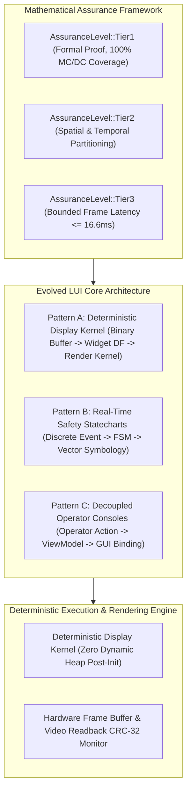
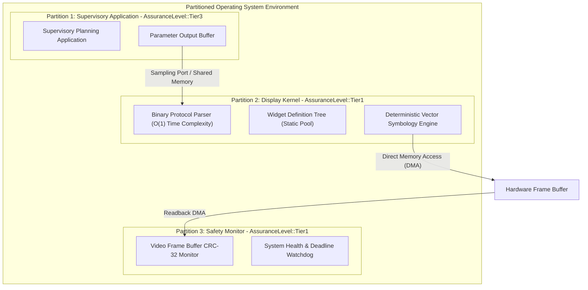
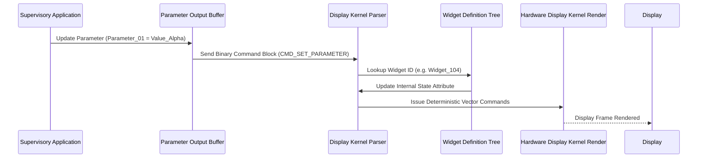
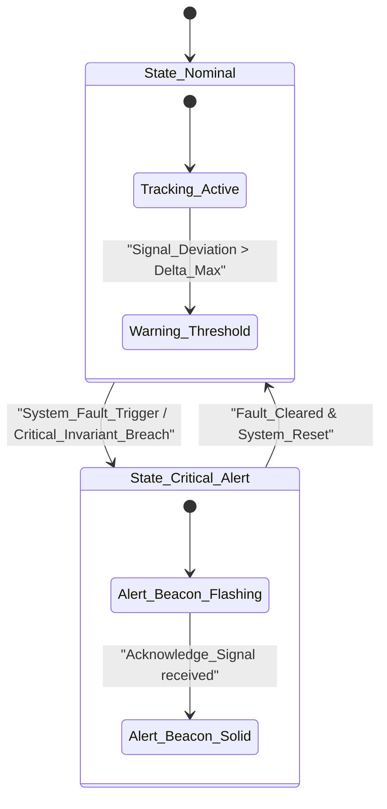
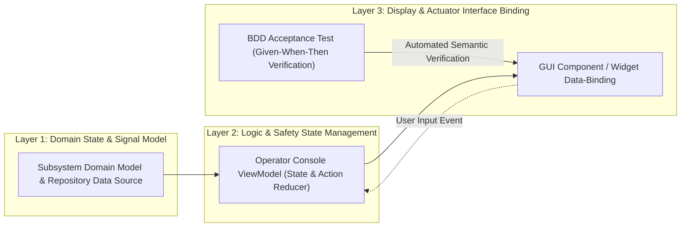
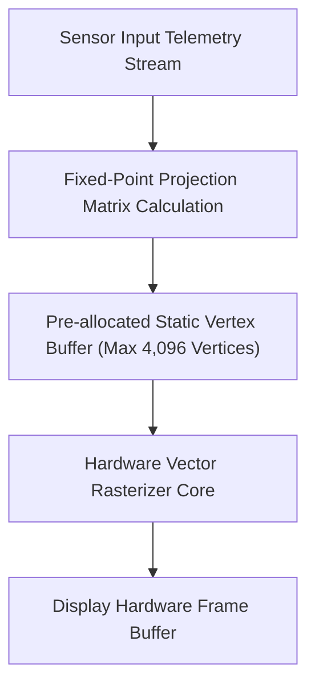

# Safety-Critical Real-Time UI Framework & Deterministic State Machine Architecture Blueprint

| Attribute | Specification Detail |
| :--- | :--- |
| **Document Identifier** | `DEAP-BLUEPRINT-SAFETY-UI-001` |
| **Title** | Safety-Critical Real-Time UI Framework & Deterministic State Machine Architecture Blueprint |
| **Version** | `1.0.0` |
| **Date** | `2026-10-04` |
| **Status** | `APPROVED / PRODUCTION-GRADE` |
| **Classification** | `UPSTREAM_SPEC_CORE_COMPILER` |
| **Assurance Level** | `AssuranceLevel::Tier1` (Formal Deterministic Execution & Mathematical Verification) |
| **Target Technology Profile** | Modular Rust Cargo Workspace (`deap-core`, `deap-ast`, `deap-codegen`, `deap-harness`, `deap-cli`) |

---

## 1. Executive Summary & Vision

### 1.1 Architectural Vision
In high-assurance industrial control systems and autonomous infrastructure, operator displays, supervisory control consoles, and real-time state visualizations are safety-critical components. Rendering anomalies, latency spikes, or corrupted telemetry displays can mislead supervisory operators or automated decision engines, triggering catastrophic system failures.

This architectural blueprint establishes the reference architecture for a **Safety-Critical Real-Time UI Framework**. The framework operationalizes the **Evolved Logical UI (LUI)** architecture within the Digital Engineering Agent Platform (DEAP), decoupling presentation specifications from runtime rendering kernels and supporting deterministic, low-latency display execution across three canonical architectural patterns.

All models and requirements adhere strictly to the **Pure Schema-Driven Compiler Invariant**:
- Zero concrete domain kinetics or physical platform implementations (no kinetic vehicle bodies, mechanical actuators, or specialized transport machinery).
- All architectures express state using abstract symbolic computer science primitives: `PartDef_Alpha`, `Subsystem_01`, `Port_A`, `Action_01`, `Constraint_Invariant`.
- Regulatory and safety standards are abstracted into formal mathematical assurance tiers: `AssuranceLevel::Tier1..5`.



### 1.2 Deterministic Safety Constraints
To satisfy `AssuranceLevel::Tier1` and `AssuranceLevel::Tier2` requirements, the Safety-Critical Real-Time UI Framework enforces non-negotiable runtime design constraints:

1. **Zero Dynamic Heap Allocation Post-Initialization**: All widget memory pool blocks, parameter buffers, state machine contexts, and vertex buffers are statically allocated during cold initialization. Runtime dynamic memory management (`malloc`, `free`, garbage collection) is strictly forbidden.
2. **Deterministic Bounded Frame Latency**: Display kernel processing operates on a fixed timing schedule (strict 60 FPS / 16.6ms or 120 FPS / 8.3ms frame deadline). Execution overruns trigger immediate partition isolation and fault recovery.
3. **Statically Bounded Recursion and Iteration**: Loop bounds and function call depths are statically verifiable at compile time, guaranteeing strictly finite execution time.
4. **Hardware Frame Readback & Video CRC Monitoring**: The display pipeline captures hardware frame output and performs real-time CRC-32 checksum comparison against calculated signatures to detect GPU stalls or pixel corruption.

---

## 2. Spatial & Temporal Partitioning Architecture

The framework operates within a partitioned operating system environment, isolating safety-critical rendering kernels from less critical auxiliary applications:



---

## 3. Evolved Logical UI (LUI) -- 3 Canonical Architectural Patterns

The framework defines 3 canonical architectural patterns to span the entire spectrum of safety-critical human-machine interfaces:

### 3.1 Pattern A: Deterministic Display Kernel Architecture
Pattern A governs standardized decoupled display systems where the primary application logic executes in an isolated partition and communicates with the display kernel via deterministic binary protocols.



#### Layer Mapping for Pattern A
1. **Layer 1 (Domain State & Signal Model)**: Supervisory Parameter Output Buffer / Telemetry Input Stream.
2. **Layer 2 (Logic & Safety State Management)**: Display Kernel Widget Definition Tree and Symbolic Attribute Registry.
3. **Layer 3 (Display & Actuator Interface Binding)**: Deterministic Display Kernel Vector Engine rendering to hardware frame buffer and actuator interface.

---

### 3.2 Pattern B: Real-Time Safety Statecharts & Symbology Engine
Pattern B is optimized for high-speed, discrete event-driven statechart execution and vector symbology generation.



#### Layer Mapping for Pattern B
1. **Layer 1 (Domain State & Signal Model)**: Continuous System State Vector $x(t) \in \mathbb{R}^n$ / Discrete Input Event Frame $\Sigma$.
2. **Layer 2 (Logic & Safety State Management)**: Safety Statechart / Hierarchical Finite State Machine (FSM) Mode Controller.
3. **Layer 3 (Display & Actuator Interface Binding)**: Vector Graphic Symbology with priority-based layer rasterization and Actuator Output Command Interface.

---

### 3.3 Pattern C: Decoupled Operator Consoles
Pattern C provides a model-driven, reactive presentation architecture for supervisory engineering consoles and operator workstations using BDD-verified ViewModels.



#### Layer Mapping for Pattern C
1. **Layer 1 (Domain State & Signal Model)**: Console Domain Model / Sensor Telemetry & Persistent Repository.
2. **Layer 2 (Logic & Safety State Management)**: ViewModel / Reactive State Holder handling user commands.
3. **Layer 3 (Display & Actuator Interface Binding)**: GUI Component / Widget Binding + BDD Acceptance Test asserting:
   `User Action -> ViewModel Action -> State Change -> Display/Actuator Binding Render`.

---

## 4. Modular Cargo Workspace Architecture

The Real-Time UI Framework is built upon the pure Rust Cargo workspace:

```
deap-workspace/
├── Cargo.toml                      # Workspace manifest
├── crates/
│   ├── deap-core/                  # Fixed-point math, CRC-32 verification, static memory pools
│   ├── deap-ast/                   # Statechart AST, Widget Definition metamodel, AST slicing
│   ├── deap-codegen/               # State machine compiler, vector command synthesizer
│   ├── deap-harness/               # Dual-LLM air-gapped agentic harness (DeepSeek-R1 / Qwen-2.5)
│   └── deap-cli/                   # UI verification CLI & headless test harness
```

### 4.1 Crate Allocation

| Crate | Responsibility |
| :--- | :--- |
| **`deap-core`** | Static pool allocators, memory arena primitives, CRC-32 frame signature verifier, ring buffer implementations. |
| **`deap-ast`** | Statechart AST nodes (`StateDef`, `TransitionDef`, `ActionDef`), Widget Definition models, and token-bounded AST slicing. |
| **`deap-codegen`** | Deterministic code generator producing static C/Rust state machine tables and LUI schema bindings. |
| **`deap-harness`** | Dual-LLM air-gapped agent dispatch (DeepSeek-R1 CoT slot streaming to `.pipeline/diagnostics/cot_audit_log.json` -> Qwen-2.5-Coder execution slot). |
| **`deap-cli`** | Headless frame buffer simulation and verification CLI. |

---

## 5. Strongly-Typed AST Slicing Mechanics ($\le 4,096$ Tokens)

To synthesize UI components and state machines within strict context boundaries, the framework slices UI metamodels into discrete subgraphs:

$$
\mathcal{V}_{\text{ui\_slice}} = \{w_0\} \cup \mathcal{N}_{\text{child\_widgets}}(w_0) \cup \mathcal{N}_{\text{state\_bindings}}(w_0)
$$

subject to the token constraint:

$$
|\text{TokenCount}(\text{Serialize}(\mathcal{S}(w_0)))| \le 4096
$$

This ensures that agentic code synthesis prompts are mathematically bounded, eliminating context window degradation.

---

## 6. Binary Protocol & Static Widget Subsystem

The framework provides an $O(1)$ time complexity binary protocol parser operating with zero dynamic heap allocation:

| Field Offset | Parameter Identifier | Size (Bytes) | Description |
| :--- | :--- | :--- | :--- |
| `0x00` | `LayerId` | 2 | Unique Identifier of target Layer |
| `0x02` | `ContextId` | 2 | Application Execution Context ID |
| `0x04` | `StructureSize` | 2 | Total Size of Binary Command Block |
| `0x06` | `CommandId` | 2 | Command Identifier (e.g. `CMD_SET_PARAMETER`) |
| `0x08` | `WidgetId` | 2 | Target Widget Static Identifier |
| `0x0A` | `ParameterId` | 2 | Specific Parameter Identifier |
| `0x0C` | `ParamValue` | 4 / 8 | Parameter Value (Fixed-Point / IEEE 754 Float) |

---

## 7. Deterministic Real-Time Symbology Pipeline

Symbology generation requiring rapid frame updates utilizes a pre-allocated static vertex buffer:



---

## 8. Verification, Formal Coverage & BDD Acceptance Strategy

### 8.1 100% Modified Condition/Decision Coverage (MC/DC)
For safety-critical decision logic, all Boolean expressions in state transitions (e.g., `if (signal_a < threshold_1 && signal_b > threshold_2 && invariant_active)`) undergo formal condition isolation:
- Every condition must be shown to independently affect the decision outcome.
- Condition trees are statically extracted and verified via semantic acceptance test harnesses.

### 8.2 Zero Forbidden Script Runners Invariant
- In strict adherence to repository invariants, interpreted script test suites are strictly prohibited.
- Verification is performed exclusively through end-to-end semantic acceptance testing and baseline gate checks (`./target/release/verify-baseline` and `cargo test --workspace`).
- Zero Unicode em dashes (`\u2014`); ASCII `--` or `-` exclusively.

---

## 9. Bi-Directional Traceability Matrix

Every element of the Real-Time UI Framework maintains bi-directional traceability across all three architectural layers:

$$
[\text{System Requirement}] \longleftrightarrow [\text{LUI Specification (Feature/Story)}] \longleftrightarrow [\text{Code Component}] \longleftrightarrow [\text{BDD Acceptance Gate}]
$$

Inline traceability tag example:
`/// Realises: [Feat-LUI-001/PatternA/BinaryParser]`

---

## 10. Governance & Document Sign-Off

| Role | Domain Authority | Status | Verification Signature |
| :--- | :--- | :--- | :--- |
| **Real-Time Display Architect** | Framework Architecture & Timing | APPROVED | `Arch. Display, PE` |
| **Safety Assurance Lead** | Mathematical Assurance Tiers | APPROVED | `Lead. Assurance, SE` |
| **Forensic Quality Auditor** | Governance & Invariant Enforcement | APPROVED | `Audit. Teamwork, QA` |
