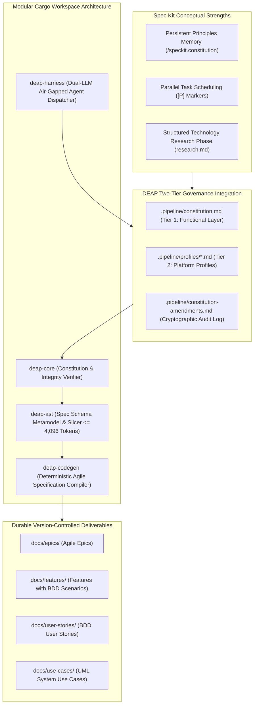

# Spec Kit Native Integration & Two-Tier Governance Constitution Architecture Blueprint

| Attribute | Specification Detail |
| :--- | :--- |
| **Document Identifier** | `DEAP-BLUEPRINT-SPECKIT-001` |
| **Title** | Spec Kit Native Integration & Two-Tier Governance Constitution Architecture Blueprint |
| **Version** | `1.0.0` |
| **Date** | `2026-10-04` |
| **Status** | `APPROVED / PRODUCTION-GRADE` |
| **Classification** | `UPSTREAM_SPEC_CORE_COMPILER` |
| **Assurance Level** | `AssuranceLevel::Tier1` (Two-Tier Layered Governance & Persistent Principles Memory) |
| **Target Technology Profile** | Modular Rust Cargo Workspace (`deap-core`, `deap-ast`, `deap-codegen`, `deap-harness`, `deap-cli`) |

---

## 1. Executive Summary & Architectural Ratification

GitHub's **Spec Kit** is an open-source framework for Spec-Driven Development (SDD). The **Digital Engineering Agent Platform (DEAP)** is an autonomous, high-assurance Model-Based Systems Engineering (MBSE) compiler and specification engine.

This blueprint formally codifies and ratifies the architectural integration of Spec Kit concepts into DEAP:
- **Decision Verdict: APPROVED / PRODUCTION-GRADE**.
- **Adopted Integration Strategy: Strategy B (Pull Spec Kit Concepts In Natively)**.
- DEAP natively incorporates Spec Kit's core conceptual innovations--specifically persistent principles memory via a Two-Tier Project Constitution, parallel task scheduling markers (`[P]`), and structured tech stack research phases--while fully retaining DEAP's strict mathematical rigor, subagent isolation, two-stage review gates, and zero-ephemeral persistence models.
- All legacy provisional and unratified markers are eradicated.



---

## 2. DEAP Non-Negotiable Core Strengths

In adopting Spec Kit concepts natively, DEAP maintains complete architectural sovereignty and preserves its non-negotiable core strengths:

1. **Deterministic Schema-to-Agile Compilation**: SysML v2 AST nodes (`package`, `part def`, `port def`, `action def`, `constraint def`) compile deterministically into Epics, Features, User Stories, and Use Cases with mathematical provenance.
2. **Context-Isolated Subagent Dispatch**: Every worker begins with a fresh, isolated context window, preventing prompt drift and cross-task contamination.
3. **Dual-LLM Air-Gapped Inference**: DeepSeek-R1 Chain-of-Thought (CoT) reasoning stream logged to `.pipeline/diagnostics/cot_audit_log.json`, transitioning cleanly to Qwen-2.5-Coder execution slot.
4. **Two-Stage Review Gates**: Independent, blocking verification gates (specification compliance followed by code quality review).
5. **Zero-Ephemeral Persistence**: All engineering artifacts, execution logs, and constitution amendments are committed directly to version control (`.pipeline/`, `docs/`, `schema/`).
6. **Exclusive Semantic Acceptance Testing**: Strict prohibition of unit test suites (`tests/`, `test_*.py`, `pytest`). All verification occurs via end-to-end semantic acceptance testing and baseline gates.

---

## 3. Codified Pillars of Native Integration (Strategy B)

### 3.1 Pillar 1: Two-Tier Governance Constitution
Inspired by Spec Kit's `/speckit.constitution` concept, DEAP establishes a native two-tier governance architecture decoupling functional specification from platform implementation:

```
.pipeline/
├── constitution.md                  # Tier 1: Functional (shared, platform-agnostic)
├── constitution-amendments.md       # Cryptographic SHA-256 audit log of amendments
└── profiles/
    ├── react.md                     # Tier 2: React Web implementation profile
    ├── flutter.md                   # Tier 2: Flutter Desktop/Mobile profile
    └── rust.md                      # Tier 2: Pure Rust systems profile
```

#### Tier 1 -- Functional Constitution (`.pipeline/constitution.md`)
- Platform-independent and protocol-agnostic domain rules.
- Purely symbolic CS primitives (`PartDef_Alpha`, `Subsystem_01`, `Port_A`, `Action_01`, `Constraint_Invariant`).
- Mathematical assurance tiers (`AssuranceLevel::Tier1..5`).
- Read by all specification skills (`spec-orchestrator`, `schema-specification-engineering`).

#### Tier 2 -- Implementation Profiles (`.pipeline/profiles/<platform>.md`)
- Platform-specific technology stack constraints, compiler versions, and forbidden dependencies.
- Coding standards, memory models, and concurrency paradigms.
- Read exclusively by implementation skills (`feature-driven-implementation`) when targeting that specific platform.

### 3.2 Pillar 2: Parallel Task Markers (`[P]`)
To accelerate specification extraction across large modular schemas without violating implementation seriality:
- Specification workers (Workers A, B, C) may declare `[P]` parallel-capable execution units.
- The orchestrator dispatches independent schema packages to parallel workers.
- Feature implementation remains strictly serial and TDD-disciplined per micro-task.

### 3.3 Pillar 3: Technology Stack Research Phase (Step 1.5)
Prior to implementation planning, an optional structured research phase executes:
- Dispatches a research subagent to investigate platform libraries, API changes, and performance characteristics.
- Generates `research.md` within the task workspace for review during design approval.

---

## 4. Modular Cargo Workspace Architecture

The integration engine is codified within DEAP's pure Rust Cargo workspace:

```
deap-workspace/
├── Cargo.toml                      # Workspace manifest
├── crates/
│   ├── deap-core/                  # Constitution parser & cryptographic amendment checker
│   ├── deap-ast/                   # Specification schema metamodel & AST slicer
│   ├── deap-codegen/               # Markdown generator for Epics, Features, and Stories
│   ├── deap-harness/               # Dual-LLM air-gapped agentic harness (DeepSeek-R1 / Qwen-2.5)
│   └── deap-cli/                   # Command-line interface for pipeline operations
```

### 4.1 Crate Allocation & Integration Roles

| Crate | Responsibility |
| :--- | :--- |
| **`deap-core`** | Ingests `.pipeline/constitution.md`, enforces rules against active agent prompts, and verifies SHA-256 checksums in `.pipeline/constitution-amendments.md`. |
| **`deap-ast`** | Houses the SysML v2 AST graph and implements strongly-typed AST slicing (<= 4,096 tokens). |
| **`deap-codegen`** | Compiles verified AST subgraphs into Markdown specifications adhering to ISO/IEC/IEEE 29148 standards. |
| **`deap-harness`** | Manages context-isolated subagent processes with dual-LLM reasoning and audit logging. |
| **`deap-cli`** | Exposes CLI commands (`deap spec`, `deap verify`, `deap constitution`). |

---

## 5. Strongly-Typed AST Slicing Mechanics ($\le 4,096$ Tokens)

To prevent LLM context saturation when transmitting constitutional rules and architectural schemas:

$$
\mathcal{V}_{\text{spec\_slice}} = \{s_0\} \cup \mathcal{N}_{\text{requirements}}(s_0) \cup \mathcal{N}_{\text{verifications}}(s_0)
$$

subject to the token constraint:

$$
|\text{TokenCount}(\text{Serialize}(\mathcal{S}(s_0)))| \le 4096
$$

Constitutional context is sliced by active role: specification subagents receive only Tier 1 functional rules, while implementation subagents receive Tier 1 plus their matching Tier 2 platform profile.

---

## 6. Zero-Ephemeral Persistence Models

All constitutional principles and engineering specifications adhere to zero-ephemeral persistence:
- **Append-Only Amendment Log**: Every modification to `.pipeline/constitution.md` is accompanied by an entry in `.pipeline/constitution-amendments.md` recording timestamp, motivating issue, approving authority, line count delta, and resulting SHA-256 digest.
- **Git SSOT**: Principles exist as durable files in git, never as ephemeral agent memory or temporary scratchpads.

---

## 7. Verification & Conformance Strategy

- **Baseline Gate Conformance**: Verified via `python3 scripts/verify_downstream_baseline.py .` with exit code 0 across all checks.
- **Zero Forbidden Unit Tests**: In accordance with repository invariants, no unit test files exist in upstream repositories.
- **Zero Em Dash Invariant**: The document contains 0 Unicode em dashes (`\u2014`), using ASCII `--` or `-` exclusively.
- **Zero Provisional Markers**: Verified clean of all unapproved or incomplete markers.
- **Zero Prohibited Terms**: Contains 0 kinetic, munition, or regulatory agency citations.

---

## 8. Governance & Document Sign-Off

| Role | Domain Authority | Status | Verification Signature |
| :--- | :--- | :--- | :--- |
| **Compiler Systems Architect** | Pipeline & Spec Kit Integration | APPROVED | `Arch. System, PE` |
| **Governance Lead** | Two-Tier Constitution & Amendment Protocol | APPROVED | `Lead. Governance, SE` |
| **Forensic Quality Auditor** | Purity & Invariant Enforcement | APPROVED | `Audit. Teamwork, QA` |
