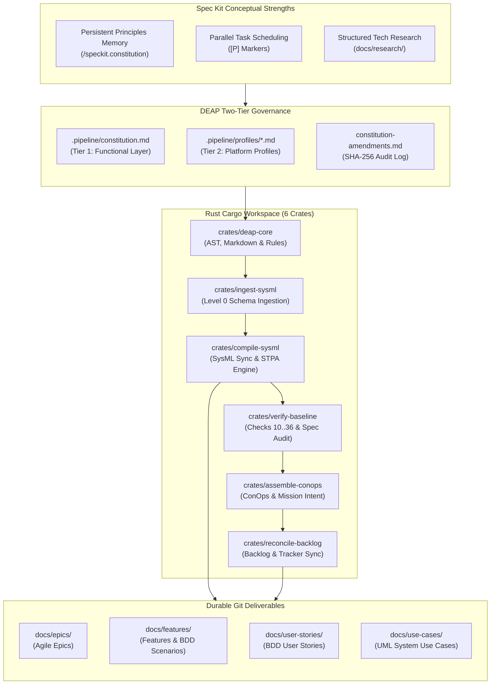

# Spec Kit Native Integration & Two-Tier Governance Constitution Architecture Blueprint

| Attribute | Specification Detail |
| :--- | :--- |
| **Document Identifier** | `DEAP-BLUEPRINT-SPECKIT-001` |
| **Title** | Spec Kit Native Integration & Two-Tier Governance Constitution Architecture Blueprint |
| **Version** | `1.0.0` |
| **Date** | `2026-10-18` |
| **Status** | `APPROVED / PRODUCTION-GRADE` |
| **Classification** | `UPSTREAM_SPEC_CORE_COMPILER` |
| **Assurance Level** | `AssuranceLevel::Tier1` (Two-Tier Layered Governance & Persistent Principles Memory) |
| **Target Technology Profile** | Modular Rust Cargo Workspace (`crates/deap-core`, `crates/ingest-sysml`, `crates/compile-sysml`, `crates/verify-baseline`, `crates/assemble-conops`, `crates/reconcile-backlog`) |

---

## 1. Executive Summary & Architectural Ratification

GitHub's **Spec Kit** is an open-source framework for Spec-Driven Development (SDD). The **Digital Engineering Agent Platform (DEAP)** is an autonomous, high-assurance Model-Based Systems Engineering (MBSE) compiler and specification verification framework.

This blueprint formally codifies and ratifies the architectural integration of Spec Kit concepts into DEAP:
- **Decision Verdict: APPROVED / PRODUCTION-GRADE**.
- **Adopted Integration Strategy: Strategy B (Pull Spec Kit Concepts In Natively)**.
- DEAP natively incorporates Spec Kit's core conceptual innovations -- specifically persistent principles memory via a Two-Tier Project Constitution, parallel task scheduling markers (`[P]`), and structured technology stack research phases -- while fully retaining DEAP's strict mathematical rigor, subagent isolation, two-stage review gates, and zero-ephemeral persistence models.
- All legacy provisional and unratified markers are eradicated.



---

## 2. DEAP Non-Negotiable Core Strengths

In adopting Spec Kit concepts natively, DEAP maintains complete architectural sovereignty and preserves its non-negotiable core strengths:

1. **Deterministic Schema-to-Agile Compilation**: SysML v2 AST nodes (`PackageDef`, `PartDef`, `PortDef`, `ActionDef`, `ConstraintDef`, `RequirementDef`, `UseCaseDef`, `TestCaseDef` in `crates/deap-core/src/sysml_ast.rs`) compile deterministically into Epics, Features, User Stories, and Use Cases via `crates/compile-sysml/src/sync/mod.rs` with full mathematical provenance.
2. **Context-Isolated Subagent Dispatch**: Every worker begins with a fresh, isolated context window, preventing prompt drift and cross-task contamination.
3. **Deterministic Multi-Stage Compilation & Verification Pipeline**: Level 0 ingestion (`crates/ingest-sysml`), SysML v2 semantic compilation and STPA safety suite synthesis (`crates/compile-sysml`), ConOps assembly (`crates/assemble-conops`), backlog reconciliation (`crates/reconcile-backlog`), and fail-closed baseline verification across Checks 10 through 36 with 5-Whys `DefectDossier` artifacts persisted to `.pipeline/defects/` (`crates/verify-baseline/src/runner.rs`).
4. **Two-Stage Review Gates**: Independent, blocking verification gates (specification compliance followed by code quality review).
5. **Zero-Ephemeral Persistence**: All engineering artifacts, defect dossiers, and constitution amendments are committed directly to version control (`.pipeline/`, `docs/`, `schema/`).
6. **Native Rust TDD & Semantic Acceptance Verification**: All compiler and verification crates enforce native Rust `#[test]` unit and mutation tests (`cargo test --workspace`) alongside end-to-end semantic acceptance verification via native Rust binaries (`./target/release/verify-baseline . --no-domain`, `./target/release/compile-sysml`, `./target/release/ingest-sysml`, `./target/release/assemble-conops`, and `./target/release/reconcile-backlog`).

---

## 3. Codified Pillars of Native Integration (Strategy B)

### 3.1 Pillar 1: Two-Tier Governance Constitution
Inspired by Spec Kit's `/speckit.constitution` concept, DEAP establishes a native two-tier governance architecture decoupling functional specification from platform implementation:

```
.pipeline/
├── constitution.md                  # Tier 1: Functional (shared, platform-agnostic)
├── constitution-amendments.md       # Cryptographic SHA-256 audit log of amendments
└── profiles/
    ├── react.md                     # Tier 2: React Web implementation profile
    ├── flutter.md                   # Tier 2: Flutter Desktop/Mobile profile
    └── rust.md                      # Tier 2: Pure Rust systems profile
```

#### Tier 1 -- Functional Constitution (`.pipeline/constitution.md`)
- Platform-independent and protocol-agnostic domain rules.
- Purely symbolic CS primitives (`PartDef_Alpha`, `Subsystem_01`, `Port_A`, `Action_01`, `Constraint_Invariant`).
- Mathematical assurance tiers (`AssuranceLevel::Tier1..5`).
- Read by all specification skills (`spec-orchestrator`, `schema-specification-engineering`, `spec-user-story-engineering`, `spec-usecase-engineering`, `spec-conops-engineering`, `spec-icd-engineering`, `spec-wbs-engineering`).

#### Tier 2 -- Implementation Profiles (`.pipeline/profiles/<platform>.md`)
- Platform-specific technology stack constraints, compiler versions, and forbidden dependencies.
- Coding standards, memory models, and concurrency paradigms.
- Read exclusively by implementation skills (`feature-driven-implementation`) when targeting that specific platform.

### 3.2 Pillar 2: Parallel Task Markers (`[P]`)
To accelerate specification extraction across large modular schemas without violating implementation seriality:
- Specification workers (Workers A, B, C) may declare `[P]` parallel-capable execution units.
- The orchestrator dispatches independent schema packages to parallel workers.
- Feature implementation remains strictly serial and TDD-disciplined per micro-task.

### 3.3 Pillar 3: Technology Stack Research Phase (Step 1.5)
Prior to implementation planning or downstream STPA/FMECA synthesis, a structured research phase executes:
- Dispatches context-isolated research subagents to investigate component failure modes, platform libraries, API contracts, and performance characteristics.
- Generates durable research deliverables under `docs/research/` (including `docs/research/FAILURE_MODE_REGISTRY.md`) for verification prior to design approval.

---

## 4. Modular Cargo Workspace Architecture

The integration and verification engine is codified within DEAP's 6-crate pure Rust Cargo workspace (`Cargo.toml`):

```
DEAP01-spec-core/
├── Cargo.toml                              # Workspace manifest (6 member crates)
└── crates/
    ├── deap-core/                          # Shared AST, Markdown, workspace, and rule primitives
    │   └── src/
    │       ├── lib.rs
    │       ├── diagnostics.rs              # DefectDossier, Diagnostic, DiagnosticSeverity, WhyEntry
    │       ├── markdown.rs                 # check_latex_katex_syntax, check_mermaid_syntax
    │       ├── rules.rs                    # CodebaseRules, MetaConfig, EXCLUDED_DIRS, MASTER_BLUEPRINTS
    │       ├── source_ast.rs               # Rust/Dart source AST extraction & SysML lowering
    │       ├── sysml_ast.rs                # SysmlModel, PackageDef, PartDef, parse_sysml
    │       └── workspace.rs                # is_upstream_compiler & Checks 10, 11, 12, 14, 15, 16
    ├── ingest-sysml/                       # Level 0 Ground Truth to SysML v2 AST ingestion engine
    │   └── src/
    │       ├── main.rs                     # CLI binary (./target/release/ingest-sysml)
    │       └── lib.rs                      # translate_markdown, translate_yang, filter_ast_to_target_scope
    ├── compile-sysml/                      # SysML v2 compiler, STPA safety suite & spec sync engine
    │   └── src/
    │       ├── main.rs                     # CLI binary (./target/release/compile-sysml)
    │       ├── sync/mod.rs                 # forward_sync_sysml_to_specs, reverse_sync_specs_to_sysml
    │       └── stpa/safety_suite.rs        # 10-pillar STPA safety artifact suite transpiler
    ├── verify-baseline/                    # Baseline verification runner (Checks 10..36) & spec audit
    │   └── src/
    │       ├── runner.rs                   # run, BaselineOptions, write_defect_dossier
    │       ├── checks/mod.rs               # Deterministic structural, math, Mermaid, STPA & docstring gates
    │       └── spec_audit/mod.rs           # run_spec_audit, SpecAuditOptions, SpecAuditSummary
    ├── assemble-conops/                    # Deterministic ConOps & Mission Intent assembly engine
    │   └── src/
    │       ├── main.rs                     # CLI binary (./target/release/assemble-conops)
    │       └── lib.rs                      # assemble_conops unit validator and assembler
    └── reconcile-backlog/                  # Backlog, frontmatter, checklist & issue tracker reconciler
        └── src/
            ├── main.rs                     # CLI binary (./target/release/reconcile-backlog)
            └── lib.rs                      # LoadedSpec, ReconcileOptions, synthesize_and_reconcile_hierarchy
```

### 4.1 Crate Allocation & Integration Roles

| Crate | Primary Modules & Key Symbols | Responsibility & Native CLI Entrypoint |
| :--- | :--- | :--- |
| **`crates/deap-core`** | `crates/deap-core/src/sysml_ast.rs` (`SysmlModel`, `PackageDef`, `PartDef`, `parse_sysml`), `crates/deap-core/src/markdown.rs` (`check_latex_katex_syntax`, `check_mermaid_syntax`), `crates/deap-core/src/workspace.rs` (`is_upstream_compiler`), `crates/deap-core/src/rules.rs` (`CodebaseRules`, `MASTER_BLUEPRINTS`) | Shared library crate providing deterministic SysML v2 AST models, KaTeX/Mermaid syntax validators, governance rule models, and workspace topology checks. |
| **`crates/ingest-sysml`** | `crates/ingest-sysml/src/main.rs`, `crates/ingest-sysml/src/lib.rs` (`translate_markdown`, `translate_yang`, `translate_openapi`, `translate_idl`, `filter_ast_to_target_scope`) | Ingests Level 0 Markdown, YANG, OpenAPI, and IDL inputs into canonical `PackageDef` ASTs with closed-world scope filtering via `./target/release/ingest-sysml`. |
| **`crates/compile-sysml`** | `crates/compile-sysml/src/main.rs`, `crates/compile-sysml/src/sync/mod.rs` (`forward_sync_sysml_to_specs`, `reverse_sync_specs_to_sysml`), `crates/compile-sysml/src/stpa/safety_suite.rs` (`ProofTemplate`, `PROOF_TEMPLATES`) | Parses and validates SysML v2 schemas, executes bidirectional Markdown specification sync, and transpiles the 10-pillar STPA safety suite via `./target/release/compile-sysml`. |
| **`crates/verify-baseline`** | `crates/verify-baseline/src/runner.rs` (`run`, `BaselineOptions`, `write_defect_dossier`), `crates/verify-baseline/src/spec_audit/mod.rs` (`run_spec_audit`, `SpecAuditOptions`) | Executes fail-closed repository baseline verification (Checks 10 through 36) and specification quality/coverage audits via `./target/release/verify-baseline . --no-domain`. |
| **`crates/assemble-conops`** | `crates/assemble-conops/src/main.rs`, `crates/assemble-conops/src/lib.rs` (`assemble_conops`) | Validates and deterministically assembles modular ConOps (`CONOPS.md`) and Mission Intent (`MISSION_INTENT.md`) units via `./target/release/assemble-conops`. |
| **`crates/reconcile-backlog`** | `crates/reconcile-backlog/src/lib.rs` (`LoadedSpec`, `ReconcileOptions`, `synthesize_and_reconcile_hierarchy`) | Synchronizes local Markdown specifications, YAML frontmatter, checklists, and traceability diagrams with the issue tracker via `./target/release/reconcile-backlog`. |

---

## 5. Strongly-Typed AST Slicing & Scope Filtering ($\le 4,096$ Tokens)

To prevent LLM context saturation when transmitting constitutional rules and architectural schemas, `crates/deap-core/src/sysml_ast.rs` and `crates/ingest-sysml/src/lib.rs` (`filter_ast_to_target_scope`) isolate target `PackageDef` subgraphs:

$$
\mathcal{V}_{\text{spec\_slice}} = \{s_0\} \cup \mathcal{N}_{\text{requirements}}(s_0) \cup \mathcal{N}_{\text{verifications}}(s_0)
$$

subject to the token constraint:

$$
|\text{TokenCount}(\text{Serialize}(\mathcal{S}(s_0)))| \le 4096
$$

Constitutional context is partitioned by active role: specification subagents load only Tier 1 functional rules (`.pipeline/constitution.md`), while implementation subagents load Tier 1 plus their matching Tier 2 platform profile (`.pipeline/profiles/<platform>.md`).

---

## 6. Zero-Ephemeral Persistence Models

All constitutional principles and engineering specifications adhere to zero-ephemeral persistence:
- **Append-Only Amendment Log**: Every modification to `.pipeline/constitution.md` is accompanied by an entry in `.pipeline/constitution-amendments.md` recording timestamp, motivating issue, approving authority, line count delta, and resulting SHA-256 digest.
- **Git SSOT**: Principles, schemas, specifications, and failure dossiers (`.pipeline/defects/`) exist as durable files in git, never as ephemeral agent memory or temporary scratchpads.

---

## 7. Verification & Conformance Strategy

- **Baseline Gate Conformance**: Verified via `./target/release/verify-baseline . --no-domain` with exit code 0 across Checks 10 through 36.
- **Native Rust Test Suite Conformance**: Verified via `cargo test --workspace` across all 6 Cargo workspace crates, with zero legacy Python or shell scripts (Checks 32 and 33).
- **Zero Em Dash Invariant**: The document contains 0 Unicode em dashes (`\u2014`), using ASCII `--` or `-` exclusively.
- **Zero Provisional Markers**: Verified clean of all unapproved or incomplete markers.
- **Zero Prohibited Terms**: Contains 0 kinetic, munition, or regulatory agency citations.

---

## 8. Governance & Document Sign-Off

| Role | Domain Authority | Status | Verification Signature |
| :--- | :--- | :--- | :--- |
| **Compiler Systems Architect** | Pipeline & Spec Kit Integration | APPROVED | `Arch. System, PE` |
| **Governance Lead** | Two-Tier Constitution & Amendment Protocol | APPROVED | `Lead. Governance, SE` |
| **Forensic Quality Auditor** | Purity & Invariant Enforcement | APPROVED | `Audit. Teamwork, QA` |
