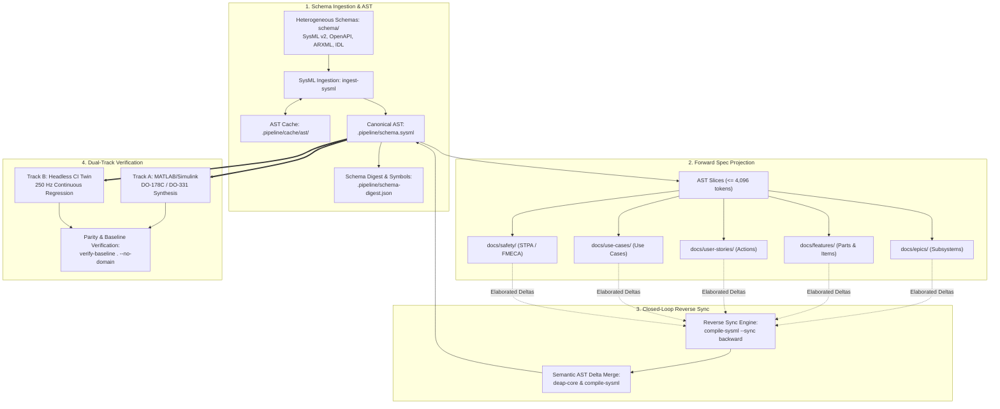
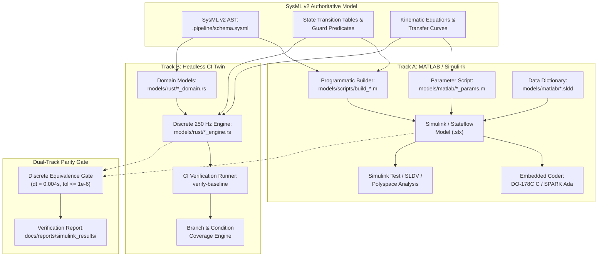

# Architecture Blueprint: SysML v2 Single Source of Truth (SSOT) & Closed-Loop Bidirectional Synchronization Architecture

| Attribute | Specification Detail |
| :--- | :--- |
| **Version** | 2.0.0 |
| **Date** | 2026-09-01 |

- **Document Version**: 2.0.0
- **Classification**: Normative Architectural Blueprint
- **Authority**: SysML v2 Model-as-SSOT & Non-Drifting Elaboration Invariant (`rules/sysml-ssot-completeness.md`)
- **Primary Toolchain**: SysML v2 AST, MATLAB / Simulink / Stateflow (R2024b), Embedded Coder (DO-178C / DO-331), Discrete Digital Twin Engine

---

## 1. Executive Summary & System Vision

In the **Digital Engineering Autonomous Pipeline (DEAP)**, system models and textual engineering specifications do not exist as decoupled or loosely correlated artifacts. Instead, **SysML v2** (`.pipeline/schema.sysml`) serves as the 100% authoritative, mathematically grounded **Single Source of Truth (SSOT)** for all system structure, behaviors, interfaces, data definitions, and safety invariants.

All downstream engineering artifacts -- including Agile Epics, Features, BDD User Stories, formal Use Cases, Concept of Operations (ConOps) units, verification suites, and target code generators -- are direct formal projections and non-drifting elaborations of the SysML v2 Abstract Syntax Tree (AST).



---

## 2. Core Architectural Principles & Model-as-SSOT Foundations

The architecture adheres to four fundamental principles:

1. **Model-as-SSOT Priority**: Natural language prose is never the origin of system truth. Every structural component, interface boundary, state transition, and safety requirement must be formally declared in the SysML v2 AST before or in tandem with downstream specification generation.
2. **Prohibition of Heuristic Prose Parsing**: Downstream code synthesis, validation linters, and verification test harnesses operate strictly on structured AST nodes and verified YAML/Mermaid metadata -- never on free-form natural language heuristics.
3. **Pure Schema-Driven Compilation**: SysML v2 parsing, AST extraction, and verification gates operate purely on generic AST tokens (`package`, `part def`, `item def`, `action def`, `state def`, `port def`, `requirement def`, `use case def`) without hardcoded domain bias.
4. **Non-Drifting Bidirectional Synchronization**: Specifications and models are linked through a closed loop. Any refinement, edge case, or transition guard added in downstream specifications is automatically extracted and merged back into `.pipeline/schema.sysml`.

---

## 3. The 6-Crate Rust Compiler Architecture

The Single Source of Truth (SSOT) and bidirectional synchronization architecture is implemented across the 6-crate pure Rust Cargo workspace (`deap-core`, `ingest-sysml`, `compile-sysml`, `verify-baseline`, `assemble-conops`, `reconcile-backlog`):

```text
DEAP01-spec-core/
├── Cargo.toml                  # Workspace root manifest (6 member crates)
└── crates/
    ├── deap-core/              # Canonical SysML v2 AST, slicing, incremental AST cache, markdown & source AST scanners
    ├── ingest-sysml/           # Heterogeneous schema & Level 0 OEM ground-truth ingestion engine
    ├── compile-sysml/          # SysML v2 parser, semantic digest, forward/backward sync, STPA synthesis, MBD export
    ├── verify-baseline/        # Automated baseline & parity gate verification runner
    ├── assemble-conops/        # Hierarchical ConOps & tactical mission intent deterministic assembler
    └── reconcile-backlog/      # Agile backlog, checklist, diagram, and issue tracker reconciler
```

### Workspace Crate Inventory & Grounded Module Topology

- **`crates/deap-core`**: Core AST primitives, slicing, caching, markdown/KaTeX/Mermaid verification, and workspace governance rules:
  - `src/sysml_ast.rs` (`SysmlModel`, `AstSlice`, `IncrementalAstCache`, `PartDef`, `PortDef`, `RequirementDef`, `HazardDef`)
  - `src/source_ast.rs`
  - `src/markdown.rs`
  - `src/workspace.rs`
  - `src/rules.rs`
  - `src/diagnostics.rs`
- **`crates/ingest-sysml`**: Multi-format schema detection, cryptographic digesting, and canonical SysML v2 translation:
  - `src/main.rs`
  - `src/lib.rs`
  - `src/detectors.rs`
  - `src/digest.rs`
  - `src/translators/mod.rs`
- **`crates/compile-sysml`**: SysML v2 / KerML grammar parser, cryptographic schema digest generator, bidirectional specification synchronization, STPA safety suite synthesis, MBD artifact export, and 7-section safety docstring injection:
  - `src/main.rs`
  - `src/lib.rs` (`MbdExportBundle`, `synthesize_mbd_bundle`, `export_mbd_artifacts`)
  - `src/parser/grammar.rs`
  - `src/semantic/digest.rs`
  - `src/sync/{mod,forward,backward}.rs` (with reverse sync implementation in `src/sync/reverse.rs`)
  - `src/stpa/{mod,safety_suite}.rs`
  - `src/docstring.rs`
- **`crates/verify-baseline`**: Deterministic multi-check verification engine, specification auditor, and defect dossier validator:
  - `src/runner.rs`
  - `src/spec_audit.rs`
  - `src/defect_dossier.rs`
  - `src/checks/{mod,structural,parity_gates,safety_stpa,mermaid,math_katex,wbs_integrity,docstring_gate,domain_cleanliness_gate}.rs`
- **`crates/assemble-conops`**: Deterministic assembler for Concept of Operations (`docs/conops/units/conops/`) and Tactical Mission Intent (`docs/conops/units/mission_intent/`) specification units:
  - `src/main.rs`
- **`crates/reconcile-backlog`**: Bidirectional issue tracker synchronization, defect filing, and backlog traceability reconciliation:
  - `src/main.rs`
  - `src/lib.rs`

### 3.1 Strongly-Typed AST Slicing Mechanics (<= 4,096 Tokens)
During forward projection and reverse synchronization, model complexity can exceed the context window limits of autonomous LLM subagents. The `deap-core` slicing engine (`crates/deap-core/src/sysml_ast.rs` via `AstSlice` and `SysmlModel`) partitions the global model into strongly-typed, context-isolated subgraphs:
1. **Target Subsystem Slicing:** Extracts a discrete subsystem package and its immediate boundaries.
2. **Context Budget Enforcement:** Strictly bounds each `AstSlice` to $\le 4,096$ tokens, preventing prompt truncation and output degradation.
3. **Contract Stubbing:** Replaces external dependencies with typed `PortDef` interfaces, preserving closed-world validity within the slice.

### 3.2 Incremental AST Parser Caching
To ensure sub-second turnaround during multi-agent synchronization loops, `IncrementalAstCache` in `crates/deap-core/src/sysml_ast.rs` and `crates/compile-sysml/src/semantic/digest.rs` enforce:
1. **Content-Hash Keyed Cache:** `.pipeline/cache/ast/<sha256>.bin` stores pre-parsed representations of the AST keyed by SHA-256 content digests.
2. **Selective Delta Parsing:** Only files whose SHA-256 fingerprint has changed are re-lexed and re-parsed by `crates/compile-sysml/src/parser/grammar.rs`. Unchanged modules are loaded directly from disk cache.

### 3.3 Dual-LLM Air-Gapped Agent Dispatch Protocol
To guarantee mathematical determinism, total intellectual property containment, and complete immunity to cloud rate-limiting or content censorship, DEAP utilizes a dual-LLM air-gapped agent dispatch architecture orchestrated by `compile-sysml` and `verify-baseline`:

1. **Reasoning Slot (DeepSeek-R1)**:
   - Dedicated Chain-of-Thought (CoT) reasoning model executing on sovereign air-gapped workstation hardware.
   - Ingests strongly-typed `AstSlice` payloads ($\le 4,096$ tokens) from `deap-core` to derive bidirectional AST delta transformations, merge resolutions, and synchronization invariants.
   - Streams formal mathematical proofs, reachability derivations, and safety invariant checks directly into `.pipeline/diagnostics/cot_audit_log.json`.
   - Never generates raw code directly; outputs verified formal derivations and boundary assertions.

2. **Execution Slot (Qwen-2.5-Coder)**:
   - High-throughput deterministic code and specification synthesis model.
   - Ingests verified reasoning derivations from `.pipeline/diagnostics/cot_audit_log.json` alongside the strongly-typed `AstSlice`.
   - Generates verified SysML v2 AST updates, bidirectional specification projections, and reverse sync patches via `compile-sysml`.
   - All generated model and specification artifacts are validated through `verify-baseline` mechanical gates before committing to the repository.

---

## 4. Schema Ingestion Pipeline & SysML v2 AST Metamodel

Input specifications and interface definitions placed in `schema/` are ingested via `crates/ingest-sysml` (`./target/release/ingest-sysml`). The ingestion engine normalizes heterogeneous domain descriptions into standardized SysML v2 packages:

```text
schema/  -->  ingest-sysml (./target/release/ingest-sysml)  -->  .pipeline/schema.sysml  +  .pipeline/schema-digest.json
```

### AST Element Metamodel Mapping

| Source Schema Element | SysML v2 AST Classifier (`deap-core::sysml_ast`) | Downstream Target Specification |
| :--- | :--- | :--- |
| Package / Module / Domain Container | `package` (`SysmlModel`) | Epic (`docs/epics/EPIC-*.md`) |
| Physical / Logical Component / Subsystem | `part def` (`PartDef`) | Feature (`docs/features/feat-*.md`) |
| Message Payload / Data Structure / DTO | `item def` | Feature Item Definitions & Interfaces |
| Computational Operation / Method | `action def` | User Story BDD Actions (`docs/user-stories/`) |
| Mode / Lifecycle State Machine | `state def` | User Story & Feature Statecharts |
| Directional Interface Boundary | `port def` (`PortDef`) | Feature Interface Connection Matrices |
| System Interaction & Capability Realization | `use case def` | Use Case Specification (`docs/use-cases/uc-*.md`) |
| STPA UCA / Loss Scenario / FMECA Rule | `requirement def` (`RequirementDef`, `HazardDef`) | Safety Matrix (`docs/safety/`) |

---

## 5. Downstream Specification Projection & Traceability Threads

Forward specification generation via `crates/compile-sysml/src/sync/forward.rs` decomposes the canonical SysML v2 AST model into an unbroken digital thread:

1. **Epics (`docs/epics/EPIC-*.md`)**: Realize architectural subsystem packages, defining high-level capabilities and tracking child features.
2. **Features (`docs/features/feat-*.md`)**: Realize `PartDef` components and `item def` payloads. Every Feature mandates YAML frontmatter declaring `sysml_source`, `part_def`, `ports`, `state_defs`, and `requirements`.
3. **User Stories (`docs/user-stories/us-*.md`)**: Realize fine-grained behavioral actions (`action def`) and state transitions (`state def`) mapped to Given-When-Then BDD scenarios.
4. **Use Cases (`docs/use-cases/uc-*.md`)**: Realize formal `use case def` nodes, declaring initiating/participating actors, subjects (`part def`), preconditions, numbered steps, alternate flows, and realization matrices.
5. **Safety Invariants (`docs/safety/`)**: Realize `RequirementDef`, `HazardDef`, `constraint def`, and `assert constraint` elements mapping STPA Unsafe Control Actions and FMECA failure modes via `crates/compile-sysml/src/stpa/{mod,safety_suite}.rs`.

---

## 6. Automated Closed-Loop Bidirectional Synchronization & CLI Invocation Standard

When agile specification workers elaborate edge cases, exception flows, or refined parameters during development phases, those deltas are synchronized between `.pipeline/schema.sysml` and `docs/` using the native Rust compiler binaries:

```bash
# Forward sync (project SysML v2 SSOT AST into markdown specifications)
./target/release/compile-sysml --sync forward --schema .pipeline/schema.sysml --docs docs/

# Backward sync (extract elaborated markdown specification deltas back into SysML v2 SSOT)
./target/release/compile-sysml --sync backward --schema .pipeline/schema.sysml --docs docs/

# STPA synthesis (compile & transpile STPA/FMECA safety constraints and safety suite artifacts)
./target/release/compile-sysml --stpa --schema .pipeline/schema.sysml --docs docs/

# Model-Based Design (MBD) bundle export (synthesize MbdExportBundle via synthesize_mbd_bundle & export_mbd_artifacts)
./target/release/compile-sysml --schema .pipeline/schema.sysml --export-mbd <dir>

# Baseline & 22-gate parity verification
./target/release/verify-baseline . --no-domain
```

### Bidirectional Synchronization Engine Workflow (`crates/compile-sysml/src/sync/{mod,forward,backward}.rs`)

1. **AST Delta Extraction**: Scans all backlog Markdown files, BDD action signatures, Mermaid state diagrams, and STPA/FMECA tables.
2. **Non-Destructive Semantic AST Merge**: Merges newly discovered `PartDef`, `PortDef`, `RequirementDef`, `HazardDef`, states, and actions into `.pipeline/schema.sysml` without overwriting existing formal constraints.
3. **Canonical Serialization**: Re-emits `.pipeline/schema.sysml` using strict canonical indentation and symbol ordering.
4. **Cryptographic Parity Digest Regeneration**: Computes updated SHA-256 hash, line counts, and symbol manifests in `.pipeline/schema-digest.json` via `crates/compile-sysml/src/semantic/digest.rs`.
5. **Pre-Commit Parity Lock**: Automatically validates all structural, safety, mathematical, Mermaid, and parity gates via `./target/release/verify-baseline . --no-domain`.

---

## 7. Primary Commercial Toolchain Synthesis & High-Integrity Verification Architecture

The primary commercial toolchain integration context for DEAP is **MATLAB / Simulink / Stateflow / Embedded Coder** (R2024b), delivering DO-178C / DO-331 Level A/B safety-critical target software synthesis through `MbdExportBundle`, `synthesize_mbd_bundle`, and `export_mbd_artifacts` in `crates/compile-sysml/src/lib.rs`.

### 7.1 MATLAB / Simulink / Stateflow Target Architecture
- Structural `PartDef` blocks map to Simulink Subsystem hierarchies and Model References.
- SysML v2 statecharts compile to Stateflow charts with deterministic transition priorities.
- `PortDef` interfaces bind to Simulink Buses and Typed Inport/Outport blocks.

### 7.2 DO-178C / DO-331 Software Qualification Workflow
- Traceability matrices link SysML v2 `RequirementDef` nodes directly to Simulink blocks and generated source lines.
- Model Coverage objectives (100% Decision, Condition, and MC/DC coverage) are verified via Simulink Coverage.

### 7.3 Simulink Design Verifier (SLDV) & Formal Property Proving
- SysML v2 `assert constraint` nodes are synthesized into SLDV Proof Objectives to mathematically verify absence of deadlocks, integer overflows, and out-of-bounds array accesses.

### 7.4 Polyspace Static Analysis & Target Code Generation
- Embedded Coder generates MISRA C:2012 and SPARK Ada safety-critical source code.
- Polyspace Bug Finder and Code Prover formally prove absence of run-time errors in generated C/Ada code.

---

## 8. Dual-Track Verification Protocol (Native MATLAB/Simulink Synthesis + Headless CI Digital Twin)

To bridge rigorous DO-178C / DO-331 Model-Based Design with modern high-velocity continuous integration (CI) and containerized regression pipelines, DEAP mandates the **Dual-Track Verification Protocol**, exported via `./target/release/compile-sysml --schema .pipeline/schema.sysml --export-mbd <dir>` and verified via `./target/release/verify-baseline . --no-domain`.



#### 1. Track A: Native MATLAB / Simulink Synthesis
- **Purpose**: DO-178C / DO-331 qualified model construction, commercial formal verification, and embedded target software generation synthesized via `synthesize_mbd_bundle` and `export_mbd_artifacts` (`MbdExportBundle`).
- **Deliverables**:
  - Programmatic build script: `models/scripts/build_<feature_slug>_model.m` using official MATLAB/Simulink APIs (`new_system`, `add_block`, `Stateflow.Data`, `Stateflow.State`, `Stateflow.Transition`).
  - Parameter dictionaries: `models/matlab/<feature_slug>_params.m` declaring all physical parameters, mass properties, and transition thresholds.
  - Data dictionaries: `models/matlab/<feature_slug>_data.sldd` defining bus types and storage classes.
- **Solver Configuration**: Strict fixed-step discrete solver (`FixedStepDiscrete`, $dt = 0.004\text{ s}$ / 250 Hz), signal logging enabled (`logsout`), zero continuous states in control units.

#### 2. Track B: Headless CI Digital Twin Engine
- **Purpose**: Autonomous, 100% license-free regression testing, continuous integration, and subagent verification loops.
- **Deliverables**:
  - Domain state and telemetry models: `models/rust/<feature_slug>_domain.rs` with immutable data structures and explicit enum states.
  - Discrete-time simulation engine: `models/rust/<feature_slug>_engine.rs` executing synchronous time-step updates (`step(dt, inputs) -> outputs`).
  - Automated CI simulation suites: verified by `verify-baseline` and `cargo test --workspace` asserting fault injection, boundary trips, and timing bounds.
- **Runtime Model**: Operates without external MathWorks licenses, running inside standard headless Linux CI runners in under 1 second.

#### 3. Zero License Blocker Invariant
- Containerized CI/CD regression runners (GitHub Actions, GitLab CI, local CLI runners) MUST execute 100% of safety, fault-injection, and control verification scenarios without requiring a proprietary MathWorks desktop license, dongle, or cloud license server.
- All verification gates must pass cleanly in offline environments via `./target/release/verify-baseline . --no-domain`.

#### 4. Mathematical & Discrete Equivalence Mandate
- Both Track A and Track B must execute at the identical discrete time step:
  $$
  \Delta t = 0.004, \quad f_{\text{loop}} = \frac{1}{\Delta t} = 250.0
  $$
- Both tracks must evaluate identical polynomial blending curves (e.g. ASTM F3269-17 2nd-order cubic weighting):
  $$
  \lambda(\tau) = 3\tau^2 - 2\tau^3, \quad \tau = \frac{t - t_{\text{trip}}}{t_{\text{switch}}}
  $$
- Numerical precision tolerance between Simulink and the Digital Twin across identical inputs must satisfy:
  $$
  \max_k \|\mathbf{x}_{\text{Simulink}}[k] - \mathbf{x}_{\text{DigitalTwin}}[k]\|_\infty \le 10^{-6}
  $$

#### 5. DO-178C / DO-331 Alignment & Traceability
- **Traceability Thread**: Every state, action, and guard condition maps directly from SysML v2 AST (`rules/sysml-ssot-completeness.md`) to both Track A Stateflow transitions and Track B simulation engine branches.
- **Simulation Results Reporting**: Every control feature must deliver a formal verification report under `docs/reports/simulink_results/<FEATURE-ID>_simulation_results.md` detailing fault-injection test scenarios, transition logs, execution traces, and standard compliance.

---

## 9. 22-Gate Parity Lock & Automated Verification Enforcement

The integrity of the bidirectional digital thread is mechanically enforced by `./target/release/verify-baseline . --no-domain` (`crates/verify-baseline/src/runner.rs`) across the actual check modules on disk:

- **`crates/verify-baseline/src/checks/parity_gates.rs`** (Checks 21-24, 26-31, 30A-30C: structural UML/SysML parity, behavioral state/sequence parity, schema mapping, ICD completeness, executive traceability)
- **`crates/verify-baseline/src/checks/mermaid.rs`** (Check 13B: Mermaid syntax & Rules E1-E5)
- **`crates/verify-baseline/src/checks/math_katex.rs`** (Check 13: KaTeX/LaTeX mathematical syntax)
- **`crates/verify-baseline/src/checks/safety_stpa.rs`** (Checks 17 & 25: 8-pillar STPA/FMECA safety integrity & operational-to-resource allocation)
- **`crates/verify-baseline/src/checks/structural.rs`** (Checks 10-16, 18, 32-35, 37: workspace topology, zero shell/Python/regex prohibited per Check 32 and Check 33, compiler AST purity, blueprint grounding)
- **`crates/verify-baseline/src/checks/docstring_gate.rs`** (Check 36: per-item 7-section safety docstrings)
- **`crates/verify-baseline/src/checks/domain_cleanliness_gate.rs`** (Check 19: domain-agnostic AST cleanliness)
- **`crates/verify-baseline/src/checks/wbs_integrity.rs`** (Check 20: MIL-STD-881E WBS integrity)

| Parity Gate ID | Category | Enforcing Mechanism | Blocking Threshold |
| :--- | :--- | :--- | :--- |
| **GATE-01** | Structural Completeness | `verify-baseline` / `crates/verify-baseline/src/checks/parity_gates.rs` (Checks 21-24) | 100% Schema-to-Feature coverage |
| **GATE-02** | Behavioral Alignment | `verify-baseline` / `crates/verify-baseline/src/checks/parity_gates.rs` (Checks 26-29) | 100% State/Action trigger parity |
| **GATE-03** | Use Case & Executive Realization | `verify-baseline` / `crates/verify-baseline/src/checks/parity_gates.rs` (Checks 30A-30C, 31) | 100% Use-Case-to-Story & ICD mapping |
| **GATE-04** | Safety Traceability | `verify-baseline` / `crates/verify-baseline/src/checks/safety_stpa.rs` (Checks 17 & 25) | 100% STPA/FMECA constraint satisfaction |
| **GATE-05** | Reverse Sync Parity | `compile-sysml` / `./target/release/compile-sysml --sync backward --schema .pipeline/schema.sysml --docs docs/` | Zero AST delta drift |
| **GATE-06** | Mathematical KaTeX Integrity | `verify-baseline` / `crates/verify-baseline/src/checks/math_katex.rs` (Check 13) | 0 dangling operators, 0 math-in-table errors |
| **GATE-07** | Mermaid Syntax & Rules E1-E5 | `verify-baseline` / `crates/verify-baseline/src/checks/mermaid.rs` (Check 13B) | 100% `flowchart TD`, `direction TB`, label <= 35 chars |
| **GATE-08** | Structural & AST Purity | `verify-baseline` / `crates/verify-baseline/src/checks/structural.rs` (Checks 10-16, 18, 32-35, 37) | Zero shell/Python/regex (forbidden per Check 32 & Check 33) |
| **GATE-09** | Safety Docstrings & Cleanliness | `crates/verify-baseline/src/checks/docstring_gate.rs` (Check 36) & `domain_cleanliness_gate.rs` (Check 19) | 100% 7-section Rustdoc & zero hardcoded domain leaks |
| **GATE-10** | WBS & Dual-Track MBD Compliance | `crates/verify-baseline/src/checks/wbs_integrity.rs` (Check 20) & `rules/dual-track-mbd-verification.md` | 100% MIL-STD-881E WBS & Track A/B equivalence (tol <= 1e-6) |

---

## 10. Conclusion

By treating SysML v2 as the authoritative single source of truth and binding it through automated bidirectional synchronization (`compile-sysml`), multi-format ingestion (`ingest-sysml`), ConOps assembly (`assemble-conops`), backlog reconciliation (`reconcile-backlog`), baseline verification (`verify-baseline`), and the Dual-Track MBD Verification Protocol, DEAP achieves uncompromised DO-178C / DO-331 high-assurance safety rigor while empowering autonomous, license-free, continuous integration pipelines.
