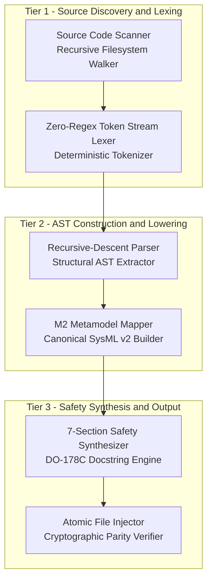
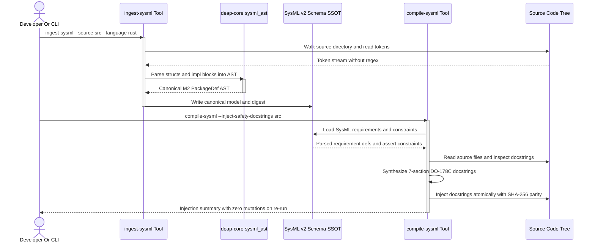

| Attribute | Specification Detail |
| :--- | :--- |
| **Issue ID** | #458 |
| **Title** | FEAT-42: Source-Code AST Ingestion & 7-Section Safety Docstring Synthesizer |
| **Type** | feature |
| **Parent Epic** | EPIC-01 |
| **Status** | Draft |
| **Interface Type** | CLI / AST Compiler / Source Code Synthesizer |
| **Schema Containers** | `IngestSysml::SourceCodeAstIngestion`, `CompileSysml::SafetyDocstringSynthesizer` |
| **Generation Mode** | subagent |
| **Specification Source** | [crates/ingest-sysml/src/main.rs](../../crates/ingest-sysml/src/main.rs) |

# FEAT-42: Automated Source-Code AST Ingestion & 7-Section Safety Docstring Synthesizer

## 1. Context & Executive Summary

The Digital Engineering Agent Platform (DEAP) compiler pipeline provides automated Model-Based Systems Engineering (MBSE) specification and code verification across aerospace, automotive, and defense domains. To uphold regulatory rigor under DO-178C Level A, ISO 26262 ASIL D, and ECSS-E-ST-40C standards, software systems require formal, bidirectional mathematical parity between architectural models and target source code.

This specification establishes the normative functional architecture for two deterministic compiler mechanisms:
1. **Automated Source-Code AST Ingestion (`ingest-sysml --source <DIR>`)**: A zero-regex, recursive-descent token-stream ingestion engine that parses Dart and Rust source code trees directly into canonical SysML v2 abstract syntax tree (AST) structures (`PackageDef`, `PartDef`, `AttributeDef`, `ActionDef`, `PortDef`, and `StateDef`), computing an authoritative cryptographic SHA-256 schema digest.
2. **7-Section Safety Docstring Synthesizer (`compile-sysml --inject-safety-docstrings <DIR>`)**: A deterministic forward synthesizer that parses SysML v2 `requirement def`, `constraint def`, and `action def` entities and injects standardized 7-section high-assurance safety docstrings into target Dart and Rust source files without altering executable AST semantics.

Both tools maintain 100% abstract M2 metamodel purity (zero hardcoded M1 domain concepts), strictly enforcing closed-grammar AST entities per `ALLOWED_M2_METAMODEL_TYPES` and operating with bit-for-bit idempotency.

---

## 2. Normative Interface & CLI Contracts

### 2.1 Ingestion Engine Contract (`ingest-sysml`)

The `ingest-sysml` tool discovers, lexes, parses, and serializes source code trees into canonical SysML v2 models.

#### CLI Command-Line Syntax
```text
ingest-sysml [OPTIONS] [--source <DIR> | --schema <PATH>]
```

#### CLI Option Definitions
| Flag / Option | Argument Type | Mandatory | Default Value | Description |
| :--- | :--- | :--- | :--- | :--- |
| `--source` | Path (`<DIR>`) | No (mutually exclusive with `--schema`) | None | Absolute or workspace-relative path to root of source code tree for AST extraction |
| `--schema` | Path (`<PATH>`) | No (defaults to `schema/` when `--source` is omitted) | `schema/` | Path to input schema file or directory containing schemas (`crates/ingest-sysml/src/main.rs:55`) |
| `--format` | String | No | `auto` | Input format selector (`auto`, `code`, `sysml`, `markdown`, `idl`, `openapi`, `yang`); auto-resolves to `code` when `--source` is provided |
| `--language` | String | No | `auto` | Language parser selection (`auto`, `dart`, `rust`) |
| `--out` | Path (`<FILE>`) | No | `.pipeline/schema.sysml` | Destination path for synthesized canonical SysML v2 text |
| `--digest` | Path (`<FILE>`) | No | `.pipeline/schema-digest.json` | Destination path for cryptographic SHA-256 schema digest JSON |
| `--allowed-parts` | Comma-separated | No | None | Optional filter list restricting extraction to named part definitions |
| `--negative-invariants` | Comma-separated | No | None | Optional list of forbidden entities to assert negative exclusion for |

#### Exit Code Contract
- `0`: Clean execution. All source files parsed, canonical SysML v2 written atomically, and digest updated.
- `1`: Parsing or I/O failure. Unrecognized syntax, inaccessible directory, or invalid arguments.
- `2`: Architectural scope or cryptographic verification failure.

---

### 2.2 Safety Docstring Synthesizer Contract (`compile-sysml`)

The `compile-sysml` compiler synchronizes SysML models with source code docstrings.

#### CLI Command-Line Syntax
```text
compile-sysml [OPTIONS] --inject-safety-docstrings <DIR>
```

#### CLI Option Definitions
| Flag / Option | Argument Type | Mandatory | Default Value | Description |
| :--- | :--- | :--- | :--- | :--- |
| `--inject-safety-docstrings` | Path (`<DIR>`) | Yes | None | Target directory containing Dart or Rust source files to enrich |
| `--dry-run` | Boolean flag | No | `false` | Simulates injection without writing to disk, reporting planned docstring diffs |
| `--extract-source` | Path (`<DIR>`) | No | None | Reverse synchronization verification probe extracting AST from source |
| `--schema` | Path (`<FILE>`) | No | `schema/*.sysml` | Authoritative SysML v2 source schema model path |
| `--force` | Boolean flag | No | `false` | Overwrites existing non-conforming docstrings if conflicting |

#### Exit Code Contract
- `0`: Clean execution. All eligible structs, classes, functions, and methods updated or verified.
- `1`: Compilation or syntax error in source or SysML schema.
- `2`: Idempotency invariant violation or conflicting unforced docstring detected.

---

## 3. Structural & Semantic Metamodel Mapping

### 3.1 Source-to-SysML v2 Metamodel Mapping

The transformation engine maps source language AST constructs into closed-grammar M2 metamodel elements adhering to `rules/sysml-ssot-completeness.md`:

| Source Construct (Dart / Rust) | SysML v2 Target Metamodel Element | Canonical KerML / SysML v2 Representation | Mapping Semantics & Invariants |
| :--- | :--- | :--- | :--- |
| `Class / Struct` | `PartDef` | `part def <Identifier> { ... }` | Maps structural component types and stateful classes to concrete system parts |
| `Properties / Fields` | `AttributeDef` | `attribute <name> : <Type>;` | Maps typed state variables, public fields, and struct members to part attributes |
| `Methods / Functions` | `ActionDef` | `action def <name>(in ..., out ...);` | Maps member functions, synchronous actions, and state transitions to actions |
| `Callbacks / Event Handlers` | `PortDef` | `port def <name> { ... }` | Maps asynchronous notification sinks, event handlers, and streams to ports |
| `/// Realises: [REQ-ID]` | Requirement Bindings | `satisfy requirement <ReqId>;` | Extracts docstring traceability tags and binds them to formal SysML requirements |
| `Invariants / assert(...)` | `assert constraint` | `assert constraint { <expr> }` | Lowers runtime assertion macros and class invariants into formal constraints |

---

### 3.2 Formal 7-Section Safety Docstring Grammar & Check 34 Uniqueness Contract

Safety docstrings injected into source code conform to a rigid, standardized 7-section structure satisfying DO-178C Level A and Check 34 source purity gates (`audit_source_purity` in `crates/verify-baseline/src/checks/structural.rs:806-845`).

#### Docstring Structural Sections & Per-Function Uniqueness Invariant
To satisfy Check 34 `seen_docblocks` uniqueness (`crates/verify-baseline/src/checks/structural.rs:825-845`), which normalizes docstrings by discarding the summary line and the `Realises:` line before hashing, every synthesized docstring MUST:
1. Contain all seven exact section headers (`## 1. Safety Intent & Regulatory Scope` through `## 7. Realization & Traceability`).
2. Guarantee **per-function normalized body uniqueness** across all functions in the module. The synthesizer MUST interpolate function-specific AST attributes across Sections 1 through 6:
   - **Section 1 (`## 1. Safety Intent & Regulatory Scope`)**: Interpolate owning `PartDef` / module classifier name, function identifier `<fn_name>`, and specific regulatory safety objective.
   - **Section 2 (`## 2. Invariants & Mathematical Properties`)**: Interpolate struct/module state invariants, conservation properties, and determinism constraints specific to `<fn_name>`.
   - **Section 3 (`## 3. Preconditions`)**: Enumerate each formal input parameter `<param_name>: <ParamType>` and its domain constraint derived from `ActionDef::in_params`.
   - **Section 4 (`## 4. Postconditions`)**: Specify the concrete return type `<ReturnType>` (`ActionDef::out_params`) and resulting state mutation contract.
   - **Section 5 (`## 5. Algorithmic Complexity Bounds`)**: Bind asymptotic time and space complexity variables to the function's specific input parameter dimensions.
   - **Section 6 (`## 6. Failure Modes & Fault Tolerance`)**: Map error/fallback behavior across the 4 Universal Failure Dimensions to the function's specific return path (`Result`, `Option`, or infallible value):
     - `Interface`: Parameter validation and boundary error handling.
     - `State`: State machine transition validity and safe-state fallback.
     - `Action`: Reentrancy, timeout, and execution sequencing.
     - `Resource`: Allocation, stack depth, and buffer bounds.
   - **Section 7 (`## 7. Realization & Traceability`)**: Emit `Realises: [<REQ-ID>]` bound to the owning SysML v2 element.

#### Extended Backus-Naur Form (EBNF) Docstring Grammar
```ebnf
SafetyDocstring     ::= Section1 Section2 Section3 Section4 Section5 Section6 Section7
Section1            ::= HeaderPrefix "## 1. Safety Intent & Regulatory Scope" Newline HeaderPrefix FunctionScopeIntent Newline
Section2            ::= HeaderPrefix "## 2. Invariants & Mathematical Properties" Newline HeaderPrefix FunctionInvariants Newline
Section3            ::= HeaderPrefix "## 3. Preconditions" Newline ParameterConstraints
Section4            ::= HeaderPrefix "## 4. Postconditions" Newline ReturnTypeContract
Section5            ::= HeaderPrefix "## 5. Algorithmic Complexity Bounds" Newline ComplexityList
Section6            ::= HeaderPrefix "## 6. Failure Modes & Fault Tolerance" Newline FailureModesList
Section7            ::= HeaderPrefix "## 7. Realization & Traceability" Newline TraceabilityLine

HeaderPrefix        ::= "///" | "//!"
ComplexityList      ::= HeaderPrefix "- Time Complexity: " AsymptoticBound Newline
                        HeaderPrefix "- Space Complexity: " AsymptoticBound Newline
FailureModesList    ::= HeaderPrefix "- Interface: " BodyText Newline
                        HeaderPrefix "- State: " BodyText Newline
                        HeaderPrefix "- Action: " BodyText Newline
                        HeaderPrefix "- Resource: " BodyText Newline
TraceabilityLine    ::= HeaderPrefix "Realises: [" RequirementID "] | SysML v2: " ElementDef Newline
```

#### Mathematical Complexity Bounds
$$
\begin{aligned}
T_{\text{ingest}}(N) &= O(N \log N) \\
T_{\text{inject}}(N) &= O(N) \\
S(N) &= O(N)
\end{aligned}
$$

- Parameter Definitions & Engineering Units:
- $T_{\text{ingest}}(N)$: Time complexity for tokenizing and parsing $N$ source AST nodes.
- $T_{\text{inject}}(N)$: Time complexity for synthesizing and injecting docstrings into $N$ source elements.
- $S(N)$: Resident memory space complexity for token streams and AST buffers.
- $N$: Total number of source code declaration tokens and AST entities.

---

## 4. Given-When-Then BDD Acceptance Criteria

### Scenario 1: Dart StatefulWidget Extraction into Canonical PackageDef AST
- **AC-01 (Dart StatefulWidget Extraction)**: **Given** a Dart source tree containing a `StatefulWidget` class with properties, callback handlers, and a `/// Realises: [REQ-UI-01]` docstring tag; **When** `ingest-sysml --source lib/ --format code --language dart --out .pipeline/schema.sysml` is executed; **Then** the engine parses the class without regex into a canonical `PackageDef` containing a corresponding `PartDef`, maps fields to `AttributeDef`, event callbacks to `PortDef`, and establishes a `satisfy requirement REQ-UI-01;` binding with a clean exit code `0`.

### Scenario 2: Rust Struct and Impl Block AST Ingestion
- **AC-02 (Rust Struct and Impl Block AST Ingestion)**: **Given** a Rust crate containing `pub struct ComponentBuffer` and an associated `impl ComponentBuffer` block declaring public methods and invariants; **When** `ingest-sysml --source crates/my-crate/src --format code --language rust` is executed; **Then** the parser produces a canonical `PartDef` for `ComponentBuffer`, maps each struct field to an `AttributeDef`, and lowers each public method into a typed `ActionDef` with formal `in` and `out` parameter signatures.

### Scenario 3: Forward Safety Docstring Synthesis and Injection
- **AC-03 (Forward Safety Docstring Synthesis and Injection)**: **Given** a Rust or Dart source file containing bare function declarations and a SysML v2 schema declaring corresponding `requirement def` and `constraint def` rules; **When** `compile-sysml --inject-safety-docstrings src/` is executed; **Then** the synthesizer parses the SysML constraints and function AST signatures, formats the complete 7-section DO-178C safety docstring with per-function parameter, invariant, return-type, and failure-mode interpolation across Sections 1 through 6, ensuring each generated docblock passes Check 34 normalized body uniqueness under `seen_docblocks` (`crates/verify-baseline/src/checks/structural.rs:806-845`), and prepends it to the function declarations via atomic file replacement.

### Scenario 4: Idempotency Invariant Verification
- **AC-04 (Idempotency Invariant Verification)**: **Given** a source code directory that has successfully received synthesized 7-section safety docstrings; **When** `compile-sysml --inject-safety-docstrings <DIR>` is executed a second time on the identical directory; **Then** the file contents remain bit-for-bit identical, producing zero diffs, zero git working tree modifications, and identical SHA-256 file hashes, while continuing to pass Check 34 `seen_docblocks` uniqueness across all multi-function source files.

### Scenario 5: Zero-Regex Lexer Correctness and Error Recovery (Negative Test)
- **AC-05 (Zero-Regex Lexer Correctness and Error Recovery)**: **Given** a source file containing a syntax error (such as an unclosed brace or malformed token stream); **When** `ingest-sysml --source <DIR>` is invoked; **Then** the deterministic recursive-descent parser detects the unexpected token at line and column offset, halts closed without panicking, logs a structured error to standard error, and terminates with exit code `1` leaving existing output files unmodified.

---

## 5. UML Sequence & Architecture Diagrams

### 5.1 Architecture Flowchart



### 5.2 End-to-End Ingestion and Injection Sequence Diagram



---

## 6. Source References & Traceability Matrix

### 6.1 Authoritative Normative Sources

This specification derives from and maintains strict architectural alignment with normative standards (DO-178C, ISO 26262, ECSS-E-ST-40C), core governance rules ([.pipeline/constitution.md](../../.pipeline/constitution.md), [rules/sysml-ssot-completeness.md](../../rules/sysml-ssot-completeness.md), [rules/domain-engineering-standards.md](../../rules/domain-engineering-standards.md)), and compiler engine crates ([crates/ingest-sysml](../../crates/ingest-sysml), [crates/compile-sysml](../../crates/compile-sysml), [crates/deap-core](../../crates/deap-core)):
- **Governance Constitution**: [.pipeline/constitution.md](../../.pipeline/constitution.md) (Three-Tier Platform Isolation, Zero-Mocking Live Persistence Mandate)
- **SysML SSOT Completeness**: [rules/sysml-ssot-completeness.md](../../rules/sysml-ssot-completeness.md) (100% Structural Single Source of Truth)
- **Domain Engineering Standards**: [rules/domain-engineering-standards.md](../../rules/domain-engineering-standards.md) (M2 Closed-Grammar Metamodel Hygiene)
- **Ingestion Engine Crate**: [crates/ingest-sysml](../../crates/ingest-sysml) (AST Lexer, Tokenizer, and Format Translators)
- **Compilation Engine Crate**: [crates/compile-sysml](../../crates/compile-sysml) (SysML Parser, STPA Transpiler, and Synchronization Engine)
- **Core AST Engine Crate**: [crates/deap-core](../../crates/deap-core) (`crates/deap-core/src/sysml_ast.rs`: Abstract Syntax Tree Definitions and Serializers)

### 6.2 Traceability Matrix

| Requirement / CLI Contract | M2 Metamodel Element | BDD Verification Scenario | Enforcing Gate |
| :--- | :--- | :--- | :--- |
| `ingest-sysml --source <DIR>` | `PackageDef`, `PartDef` | Scenario 1, Scenario 2 | Check 19 (AST Cleanliness), Check 34 (Zero Regex) |
| `compile-sysml --inject-safety-docstrings` | `RequirementDef`, `ConstraintDef` | Scenario 3, Scenario 4 | Check 10, Check 16 (Clean Landing Zones) |
| Zero-Regex Recursive Descent | `ElementDef`, `Type` | Scenario 5 | Check 34 (Zero Regex Invariant) |
| Idempotency Invariant | `SchemaDigest`, `PackageDef` | Scenario 4 | Check 18 (Blueprint Cleanliness) |
| 7-Section DO-178C Docstring | `ActionDef`, `AttributeDef` | Scenario 3 | Check 13 (KaTeX), Check 13B (Mermaid) |
