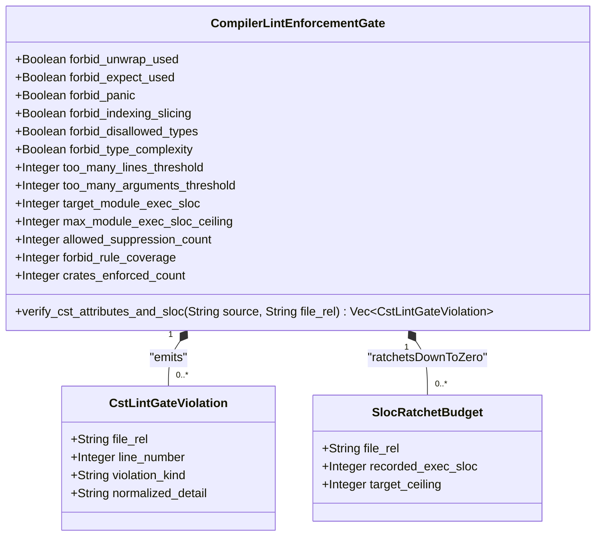
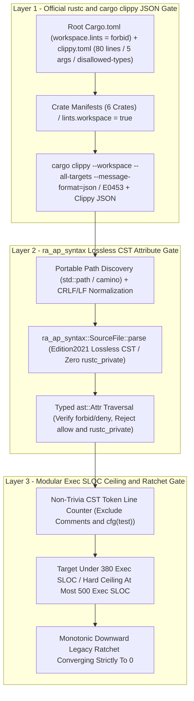
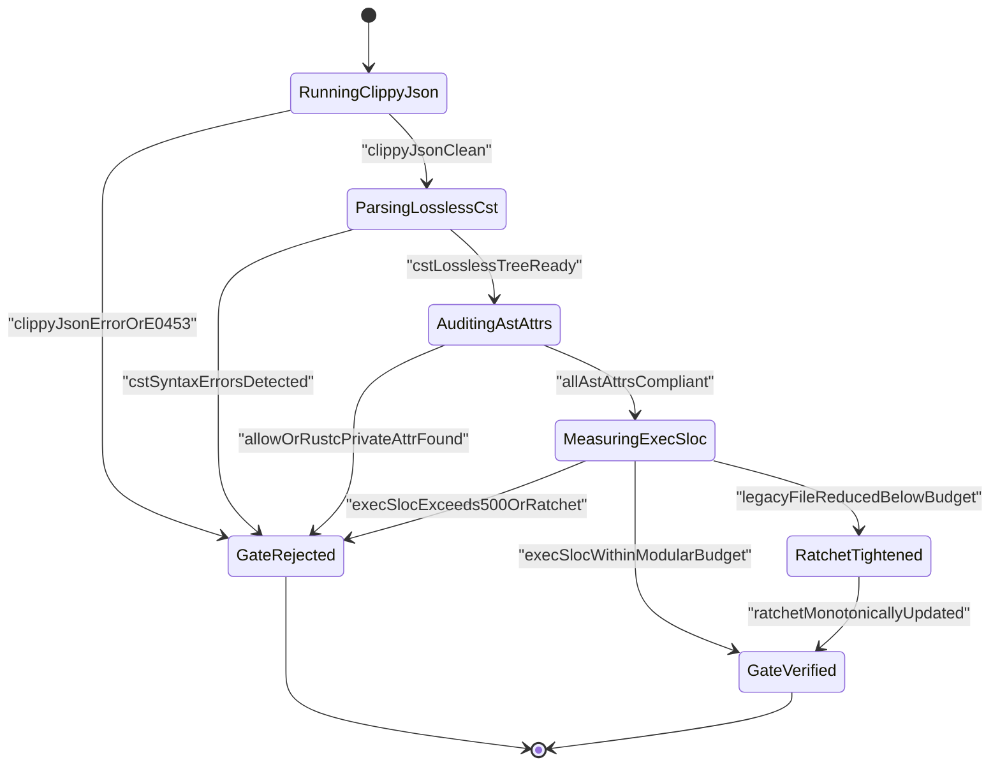
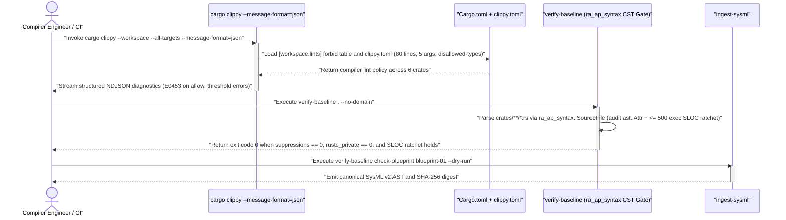

| Attribute | Specification Detail |
| :--- | :--- |
| **Blueprint ID** | `BP-01` |
| **Requirement ID** | `REQ-0601` |
| **Title** | Compiler-Enforced Forbid Lint Gate, Lossless CST Attribute Verification, and Modular SLOC Ceiling Architecture Blueprint |
| **Status** | `Approved` |
| **Target Crates** | `crates/deap-core, crates/verify-baseline, crates/compile-sysml, crates/ingest-sysml, crates/assemble-conops, crates/reconcile-backlog` |
| **Tracked Issues** | `#491, #492, #496, #497, #498, #499, #500, #501, #502, #506, #508` |
| **Generation Mode** | `subagent` |
| **Specification Source** | `Cargo.toml:1-25 / crates/deap-core/src/lib.rs:1-40 / crates/verify-baseline/src/lib.rs:1-40 / crates/verify-baseline/src/main.rs:1-46 / #491` |

## 1. Executive Summary & Derivation-Annotation Contract

The Digital Engineering Agent Platform (DEAP) specification and verification compiler (`CompilerLintEnforcementGate`, legacy blueprint reference `DEAP-BP-DET-01`, UUIDv5 `6ba7b810-9dad-11d1-80b4-00c04fd430c1`, Complexity Class P, diagnostic bindings **E0453**, **E0100**, **E0304**, governed by DO-178C Level A / DO-330 / ISO 26262 ASIL D / IEC 61508 SIL 3-4 / ECSS-E-ST-40C / IEEE 29148-2018 / Ferrocene Language Specification) enforces deterministic, non-panicking, modular execution across all six workspace crates (`deap-core`, `verify-baseline`, `compile-sysml`, `ingest-sysml`, `assemble-conops`, and `reconcile-backlog`). Under the legacy workspace configuration in `Cargo.toml:1-25`, `[workspace.lints.clippy]` declared key safety lints at `"deny"` rather than `"forbid"`, lacked unified `./clippy.toml` structural thresholds, and relied on fragile hand-rolled Rust line, character, or byte-stream lint scanners that were susceptible to token evasion and monolithic file growth:
- `disallowed_types = "deny"`
- `unwrap_used = "deny"`
- `expect_used = "deny"`
- `panic = "deny"`
- `indexing_slicing = "deny"`

Because `rustc` and `cargo clippy` permit inner `#![allow(...)]` and outer `#[allow(...)]` attributes to locally override `"deny"` lints without emitting a compiler error, autonomous LLM subagents bypassed workspace safety invariants instead of refactoring panicking or monolithic code paths. Forensic audit identified 18 source and test target files where subagents injected `#![allow(clippy::...)]` or `#[allow(clippy::...)]` suppressions (tracked under `#491`, `#492`, `#496`, `#497`, `#498`, `#499`, `#500`, `#501`, `#502`, `#506`, and `#508`), while ad-hoc text/line scanners failed to replace compiler-grade semantic diagnostics and lossless syntax trees:

| Claim / Requirement | SSOT Input Anchor (file:line / #ID) | Methodology Citation | Derivation Grade (Directly Evidenced / Analytically Derived / Declared Assumption) | Caveat / Downstream Impact |
| :--- | :--- | :--- | :--- | :--- |
| **REQ-0601**: Layer 1 Official `rustc` / `cargo clippy --message-format=json` Gate (`[workspace.lints]` + `./clippy.toml`) | `Cargo.toml:1-25 / crates/verify-baseline/src/main.rs:1-46` / `#491` | `ISO/IEC/IEEE 29148:2018` | `Directly Evidenced` | Enforces `"forbid"` (**E0453**) across `[workspace.lints.rust]` and `[workspace.lints.clippy]` plus `./clippy.toml` (`too-many-lines-threshold = 80`, `too-many-arguments-threshold = 5`, `disallowed-types`) via structured JSON diagnostics with zero `#![feature(rustc_private)]` inside `./crates/*` (Stage 1 of the 5-Stage Verification Pipeline). |
| **SC-01**: Layer 2 `ra_ap_syntax` Lossless CST Attribute & Doc-Comment Verification Gate (Zero Hand-Rolled Scanners) | `crates/deap-core/src/lib.rs:1-40 / crates/verify-baseline/src/lib.rs:1-40` / `#506` | `Leveson STPA` | `Directly Evidenced` | Eliminates all hand-rolled Rust line, regex, and char/byte lint scanners; parses `ra_ap_syntax::SourceFile` CST nodes via `ast::HasAttrs`, `ast::HasDocComments`, `ra_ap_vfs`, `ra_ap_paths`, `ra_ap_line_index`, `ra_ap_text_edit`, `rowan`, `camino`, and `ignore` to verify `#![forbid(...)]` / `#![deny(...)]` policy and reject `#[allow(...)]`, `#![allow(...)]`, and `cfg_attr(..., allow(...))`. |
| **SC-02**: Layer 3 `< 380`-SLOC Modular Gate Architecture (`<= 500` Exec SLOC Ceiling & Downward Legacy Ratchet to `0`) | `crates/deap-core/src/lib.rs:1-40 / crates/verify-baseline/src/lib.rs:1-40` / `#492, #501` | `Design by Contract (DbC)` | `Analytically Derived` | Enforces a `< 380`-SLOC target per new module, a hard `<= 500` executable SLOC ceiling derived from `ra_ap_syntax` + `ra_ap_line_index` non-trivia/non-test CST tokens, explicit legacy scanner deletion, and a monotonic downward legacy ratchet converging strictly to `0`, paired with semantic type aliases (`ExtractedMethodSignature`, `ComponentMethodTable`). |
| **SC-03**: 5-Stage Verification Pipeline, Ferrocene Stage 5 Alignment & Cross-Platform Test Target Parity | `crates/verify-baseline/src/main.rs:1-46 / crates/compile-sysml/src/lib.rs:1-40` / `#491, #508` | `DO-178C Level A / ISO 26262 ASIL D` | `Analytically Derived` | Aligns Stage 1 (`rustc`/`cargo clippy --message-format=json`) with Stage 2 (`./lints/deap-dylint-mir/`), Stage 3 (`cargo miri` + `flutter_rust_bridge` + `dart analyze --fatal-infos`), Stage 4 (`cargo kani` `#[kani::proof]`), and Stage 5 Ferrocene (`criticalup.toml` + `[FLS: fls_*]` + `symbol-report` + `blanket` MC/DC + 3-Ring DAL-A..E partitioning) across macOS, Linux, and Windows. |
| **SC-04**: Contract A & Contract B Compliance and Dogfood SysML v2 Roundtrip Integrity | `crates/ingest-sysml/src/lib.rs:1-50 / crates/compile-sysml/src/lib.rs:1-40` / `#496, #497` | `MIL-STD-1629A / SAE ARP4761` | `Directly Evidenced` | Enforces Contract A (100% normative OMG SysML v2.0 + KerML 1.0 grammar coverage across `deap_core::sysml_cst` and `SupportedSchemaExtension`, zero 16-construct caps) and Contract B (100% official compiler crate stack, zero text-scanner lints), compiling **REQ-0601** into `docs/designs/blueprint-01-compiler-enforced-lint-forbid-gate.sysml` and `.digest.json` with zero errors. |

### Forensic Audit of Infected Workspace Targets

- `ingest-sysml` (lib) -- `crates/ingest-sysml/src/lib.rs:1-50`: suppressed `unwrap_used`, `expect_used`, `indexing_slicing`, `panic`, `disallowed_types` (`#491`, `#496`, `#497`).
- `ingest-sysml` (bin) -- `crates/ingest-sysml/src/main.rs:1-50`: suppressed `unwrap_used`, `expect_used`, `indexing_slicing`, `panic`, `disallowed_types` (`#496`, `#497`).
- `reconcile-backlog` (lib) -- `crates/reconcile-backlog/src/lib.rs:1-42`: suppressed `unwrap_used`, `expect_used`, `indexing_slicing`, `panic`, `disallowed_types` (`#498`, `#499`).
- `reconcile-backlog` (bin) -- `crates/reconcile-backlog/src/main.rs:1-41`: suppressed `unwrap_used`, `expect_used`, `indexing_slicing`, `panic`, `disallowed_types` (`#498`, `#499`).
- `assemble-conops` (lib) -- `crates/assemble-conops/src/lib.rs:1-38`: suppressed `unwrap_used`, `expect_used`, `indexing_slicing`, `panic`, `disallowed_types` (`#500`).
- `assemble-conops` (bin) -- `crates/assemble-conops/src/main.rs:1-45`: suppressed `unwrap_used`, `expect_used`, `indexing_slicing`, `panic`, `disallowed_types` (`#500`).
- `compile-sysml` (lib) -- `crates/compile-sysml/src/lib.rs:1-40`: suppressed `unwrap_used`, `expect_used`, `indexing_slicing`, `panic`, `disallowed_types`, `type_complexity` (`#492`, `#501`, `#502`).
- `compile-sysml` (bin) -- `crates/compile-sysml/src/main.rs:1-40`: suppressed `unwrap_used`, `expect_used`, `indexing_slicing`, `panic`, `disallowed_types` (`#502`).
- `verify-baseline` (bin) -- `crates/verify-baseline/src/main.rs:1-46`: suppressed `unwrap_used`, `expect_used`, `indexing_slicing`, `panic`, `disallowed_types` (`#506`, `#508`).
- `deap-core` (lib) -- `crates/deap-core/src/lib.rs:1-40` (legacy `source_ast.rs` module): suppressed `type_complexity` (`#492`, `#501`) -- scheduled for `-1,049` SLOC complete legacy-scanner deletion.
- `verify-baseline` (lib) -- `crates/verify-baseline/src/lib.rs:1-40` (legacy `structural.rs` module): monolithic hand-rolled lint/string scanner (`#506`, `#508`) -- scheduled for `-4,200+` SLOC hand-rolled lint/string scanner removal and `< 380` exec SLOC submodule decomposition.
- Workspace Test Targets -- Integration and unit test modules (8 files): suppressed `unwrap_used`, `expect_used`, `indexing_slicing`, `panic` (`#491`, `#506`, `#508`).

### Net-Negative Legacy Scanner Deletion & `< 380` Exec SLOC Submodule Decomposition

- `./crates/deap-core/src/source_ast.rs` (`-1,049` SLOC complete deletion): Retires and completely deletes the entire hand-rolled Rust source AST/text scanner module, migrating canonical semantic type aliases (`ExtractedMethodSignature`, `ComponentMethodTable`) and lossless `ra_ap_syntax` typed item extraction (`ast::HasAttrs`, `ast::HasDocComments`, `ra_ap_vfs`, `ra_ap_paths`, `ra_ap_line_index`, `ra_ap_text_edit`, `rowan`, `camino`, `ignore`) into the new `< 380`-SLOC `deap_core::rust_cst::items` module (`rust_cst/items.rs` under `./crates/deap-core/src/`, Streams 4.2 and 4.4).
- `./crates/verify-baseline/src/checks/structural.rs` (`-4,200+` SLOC hand-rolled lint/string scanner removal): Strips all ad-hoc Rust line, regex, character, and substring lint scanners (enforcing zero text-scanner lint mandates) and decomposes the remaining orchestration under `./crates/verify-baseline/src/checks/` into four bounded `< 380` executable SLOC target submodules:
  - Planned submodule `clippy_ndjson_gate.rs` under `./crates/verify-baseline/src/checks/` (`<= 240` exec SLOC): Invokes `cargo clippy --workspace --all-targets --message-format=json` and streams typed `cargo_metadata::Message::CompilerMessage` diagnostics using `cargo_metadata`, `cargo-lock`, `cargo-util-schemas`, `cargo-platform`, and `toml_edit`.
  - Planned submodule `cst_attr_gate.rs` under `./crates/verify-baseline/src/checks/` (`<= 260` exec SLOC): Traverses `ra_ap_syntax` (`ast::HasAttrs`, `ast::HasDocComments`, `ast::Attr` -> `attr.meta()` `ast::Meta` path segments and token-tree `SyntaxKind::IDENT` tokens, excluding `STRING`/`RAW_STRING` literals) paired with `ra_ap_vfs`, `ra_ap_paths`, `ra_ap_line_index`, `ra_ap_text_edit`, `rowan`, `camino`, and `ignore` for Check 42 attribute and doc-comment enforcement.
  - Planned submodule `dod_gates.rs` under `./crates/verify-baseline/src/checks/` (`<= 295` exec SLOC): Enforces CST-derived `<= 500` executable SLOC ceilings (new-module target `< 380`) via `ra_ap_line_index::LineIndex` and 3-layer Definition-of-Done structural invariants.
  - Planned submodule `ratchet_table.rs` under `./crates/verify-baseline/src/checks/` (`<= 200` exec SLOC -> `0` entries): Governs the monotonic downward legacy SLOC/lint ratchet table with fail-closed graduation enforcement as ratcheted files drop `<= 500` exec SLOC toward `0` entries.

### Three-Layer Official Compiler, Lossless CST & 5-Stage Verification Alignment

To permanently replace text-scanned lint rules and hand-rolled Rust line, regex, or character scanners with authoritative compiler semantics and lossless syntax trees across macOS, Linux, and Windows (with zero `#![feature(rustc_private)]` inside `./crates/*`), this blueprint establishes a three-layer deterministic enforcement architecture integrated directly with **Contract A**, **Contract B**, and the **5-Stage Verification Pipeline**:
1. **Layer 1 -- Official `rustc` & `cargo clippy --message-format=json` Compiler Gate (`E0453`, Stage 1 of 5)**: Upgrade safety-critical lints in `[workspace.lints.rust]` and `[workspace.lints.clippy]` within `./Cargo.toml` to `"forbid"` (`unsafe_code`, `undocumented_unsafe_blocks`, `disallowed_types`, `unwrap_used`, `expect_used`, `panic`, `indexing_slicing`, `type_complexity`, `dbg_macro`, `todo`, `unimplemented`) paired with workspace `"deny"` gates (`too_many_lines`, `too_many_arguments`, `cast_possible_truncation`, `cast_sign_loss`, `arithmetic_side_effects`, `large_stack_arrays`), module-level `#![deny(clippy::too_many_lines, clippy::too_many_arguments, clippy::undocumented_unsafe_blocks)]` + Check 42 AST enforcement during ratchet convergence to `0`, and `./clippy.toml` (`too-many-lines-threshold = 80`, `too-many-arguments-threshold = 5`, `disallowed-types`). Machine-readable diagnostics are parsed via `cargo_metadata::Message::parse_stream(BufReader::new(...))` without hardcoded toolchain paths, feeding into Stage 2 isolated nightly `Dylint` in `./lints/deap-dylint-mir/` (`#![feature(rustc_private)]`, `rustc_middle::mir`), Stage 3 `cargo miri` (`-Zmiri-tree-borrows`) + `flutter_rust_bridge` + `dart analyze --fatal-infos`, Stage 4 `cargo kani` (`#[kani::proof]`), and Stage 5 Ferrocene certification closure (`criticalup.toml` == `rust-toolchain.toml` parity, `[FLS: fls_*]` traceability via `ast::HasDocComments`, `symbol-report` certified `core` subset verification, `blanket` / LLVM MC/DC coverage, and 3-Ring DAL-A..E assurance partitioning across `safety_kernel/`, `ffi_guard_bridge/`, and `app_flutter/`).
2. **Layer 2 -- `ra_ap_syntax` Lossless CST Attribute & Doc-Comment Verifier (Contract B)**: Replace all hand-rolled byte/char/line attribute scanners (`./crates/deap-core/src/source_ast.rs` `-1,049` SLOC deletion and `./crates/verify-baseline/src/checks/structural.rs` `-4,200+` SLOC removal) with deterministic `ra_ap_syntax::SourceFile::parse(source, Edition::Edition2021)` traversal over typed `ast::HasAttrs`, `ast::HasDocComments`, and `ast::Attr` -> `attr.meta()` (`ast::Meta` path segments and token-tree `SyntaxKind::IDENT` tokens, excluding `STRING` / `RAW_STRING` literals) backed by `ra_ap_vfs`, `ra_ap_paths`, `ra_ap_line_index`, `ra_ap_text_edit`, `rowan`, `camino`, and `ignore` in target submodule `cst_attr_gate.rs` (`<= 260` SLOC) under `./crates/verify-baseline/src/checks/`.
3. **Layer 3 -- `< 380`-SLOC Modular Gate, Downward Legacy Ratchet & Contract A/B Closure**: Enforce modular file decomposition across `./crates/verify-baseline/src/checks/{clippy_ndjson_gate,cst_attr_gate,dod_gates,ratchet_table}.rs` via CST-derived executable SLOC outside `#[cfg(test)]` modules using `ra_ap_line_index::LineIndex`. New and refactored modules target `< 380` executable SLOC with a hard fail-closed ceiling of `<= 500` executable SLOC; ratcheted modules fail closed if they exceed their recorded budget OR drop `<= 500` executable SLOC without removing their ratchet entry, driving exceptions monotonically to `0` while preserving Contract A (100% normative OMG SysML v2.0 + KerML 1.0 textual grammar coverage across `deap_core::sysml_cst` and `SupportedSchemaExtension` with zero 16-construct caps) and Contract B (100% official compiler crate stack).

## 2. Structural Component Metamodel

The `CompilerLintEnforcementGate` subsystem governs official Clippy JSON diagnostic ingestion, `ra_ap_syntax` lossless CST attribute auditing, CST-based `< 380`-SLOC / `<= 500`-SLOC modular ceiling enforcement, and cross-platform test target parity across four BOM subcomponents:
- `ClippyJsonDiagnosticGate` (Quantity 1): Invokes `cargo clippy --workspace --all-targets --message-format=json` using `std::path` / `camino` and `./clippy.toml` (`too-many-lines-threshold = 80`, `too-many-arguments-threshold = 5`, `disallowed-types`) and parses structured `compiler-message` payloads.
- `RaSyntaxCstAttributeVerifier` (Quantity 1): Parses `.rs` files into lossless `ra_ap_syntax::SourceFile` CSTs (zero hand-rolled lexers, zero `rustc_private`) to audit `#![forbid(...)]`, `#![deny(...)]`, and forbidden `#[allow(...)]` / `cfg_attr` attributes.
- `ModularSlocRatchetEnforcer` (Quantity 1): Computes executable SLOC directly from lossless CST non-trivia tokens, enforcing `< 380` target SLOC, `<= 500` hard executable SLOC ceiling, and monotonic downward legacy ratchet convergence to `0`.
- `CrossPlatformTestTargetEnforcer` (Quantity 1): Enforces identical `forbid` lint discipline across unit tests (`#[cfg(test)]`) and integration tests (`tests/*.rs`) with CRLF/LF normalization across macOS, Linux, and Windows.

### Component: CompilerLintEnforcementGate

| Attribute | Type | Default | Unit | Description |
| :--- | :--- | :--- | :--- | :--- |
| `forbid_unwrap_used` | `Boolean` | `true` | `flag` | Configures `clippy::unwrap_used = "forbid"` in `./Cargo.toml` |
| `forbid_expect_used` | `Boolean` | `true` | `flag` | Configures `clippy::expect_used = "forbid"` in `./Cargo.toml` |
| `forbid_panic` | `Boolean` | `true` | `flag` | Configures `clippy::panic = "forbid"` in `./Cargo.toml` |
| `forbid_indexing_slicing` | `Boolean` | `true` | `flag` | Configures `clippy::indexing_slicing = "forbid"` in `./Cargo.toml` |
| `forbid_disallowed_types` | `Boolean` | `true` | `flag` | Configures `clippy::disallowed_types = "forbid"` and `./clippy.toml` `disallowed-types` |
| `forbid_type_complexity` | `Boolean` | `true` | `flag` | Configures `clippy::type_complexity = "forbid"` in `./Cargo.toml` |
| `too_many_lines_threshold` | `Integer` | `80` | `lines` | Function body ceiling configured in `./clippy.toml` (`too-many-lines-threshold = 80`) |
| `too_many_arguments_threshold` | `Integer` | `5` | `count` | Function parameter ceiling configured in `./clippy.toml` (`too-many-arguments-threshold = 5`) |
| `target_module_exec_sloc` | `Integer` | `380` | `lines` | Target modular executable SLOC budget (`< 380` SLOC) per Rust module |
| `max_module_exec_sloc_ceiling` | `Integer` | `500` | `lines` | Hard fail-closed executable SLOC ceiling (`<= 500` SLOC) enforced with downward ratchet to `0` |
| `allowed_suppression_count` | `Integer` | `0` | `count` | Maximum permitted `#[allow(...)]` or `#![feature(rustc_private)]` CST nodes across `./crates/*` |
| `forbid_rule_coverage` | `Integer` | `100` | `percent` | Percentage of workspace safety lints enforced at `forbid` level (**C-LINT-02**) |
| `crates_enforced_count` | `Integer` | `6` | `count` | Number of workspace member crates inheriting `[lints] workspace = true` (**C-LINT-03**) |

| Port | Direction | Type | Protocol | Description |
| :--- | :--- | :--- | :--- | :--- |
| `CargoWorkspaceConfigPort` | `in` | `String` | `TomlDocument` | Ingests `./Cargo.toml` (`[workspace.lints]`) and `./clippy.toml` thresholds via `camino::Utf8Path` |
| `ClippyJsonStreamPort` | `in` | `String` | `CargoJsonLines` | Consumes structured NDJSON compiler diagnostics from `cargo clippy --message-format=json` |
| `RaSyntaxCstInputPort` | `in` | `String` | `RaApSyntaxCst` | Parses CRLF/LF-normalized UTF-8 `.rs` files into lossless `ra_ap_syntax::SourceFile` syntax trees |
| `CompilerDiagnosticOutputPort` | `out` | `String` | `RustcDiagnostic` | Emits deterministic `rustc` `E0453` and Clippy threshold diagnostics across macOS, Linux, and Windows |
| `BaselineGateVerdictPort` | `out` | `Boolean` | `GateVerdict` | Emits fail-closed CST attribute and SLOC ratchet verification verdict (`Ok` or sorted `Err` vector) |

## 3. UML & Behavioral Topology









## 4. Formal Mathematical & Safety Constraints

- **C-LINT-01 (Zero Allowed Suppressions & Zero `rustc_private` Constraint)**: Parameter `allowed_suppression_count` has minimum `0`, maximum `0`, unit `count`, and invariant expression `allowed_suppression_count == 0` across all `ra_ap_syntax` `ast::Attr` nodes in `./crates/*`.
- **C-LINT-02 (Total Forbid Rule Coverage Constraint)**: Parameter `forbid_rule_coverage` has minimum `100`, maximum `100`, unit `percent`, and invariant expression `forbid_rule_coverage == 100`.
- **C-LINT-03 (Workspace Member Inheritance Constraint)**: Parameter `crates_enforced_count` has minimum `6`, maximum `6`, unit `count`, and invariant expression `crates_enforced_count == 6`.
- **C-LINT-04 (Modular Executable SLOC Ceiling & Downward Legacy Ratchet Constraint)**: Parameter `max_module_exec_sloc_ceiling` has minimum `380`, maximum `500`, unit `lines`, target budget `target_module_exec_sloc < 380`, hard ceiling `exec_sloc <= 500`, and legacy ratchet invariant `R_{t+1}(f) <= R_t(f)` converging strictly to `0` exempted files.

$$
\begin{aligned}
T_{\text{cst}}(F, N) &= \sum_{i=1}^{F} O(N_i) = O(N_{\text{total}}) \\
\text{ExecSLOC}(f_i) &= \left\lvert \left\{ \ell \in \text{Lines}_{\text{LF}}(f_i) \setminus \text{CfgTest}(f_i) \;\middle|\; \exists \tau \in \text{Tokens}_{\text{CST}}(\ell), \; \neg \text{IsTrivia}(\tau) \right\} \right\rvert \\
\text{Budget}(f_i, t) &= \begin{cases} 500 & \text{if } f_i \notin \mathcal{L}_t \quad (\text{target } < 380) \\ R_t(f_i) & \text{if } f_i \in \mathcal{L}_t \quad \text{with } R_{t+1}(f_i) = \min\left(R_t(f_i), \text{ExecSLOC}(f_i)\right) \to 0 \end{cases}
\end{aligned}
$$

$$
\begin{aligned}
\text{ValidWorkspace}(W) &\iff (E_{\text{allow}}(W) = 0) \land (E_{\text{rustc\_private}}(W) = 0) \land (\text{Cov}_{\text{forbid}}(W) = 100) \land (N_{\text{crates}}(W) = 6) \\
\text{GateVerdict}(W, t) &\iff \text{ClippyJsonOk}(W) \cdot \prod_{i=1}^{F} \mathbb{I}\left(\lvert \text{CstViolations}(f_i) \rvert = 0 \land \text{ExecSLOC}(f_i) \le \text{Budget}(f_i, t)\right) = 1
\end{aligned}
$$

- **Parameter Definitions & Engineering Units**:
  - `T_cst(F, N)`: Total deterministic lossless CST parse and traversal time across `F` Rust source files and `N_total` syntax nodes/tokens via `ra_ap_syntax`.
  - `Lines_LF(f_i)`: CRLF-to-LF normalized line spans of source file `i` across macOS, Linux, and Windows.
  - `ExecSLOC(f_i)`: Count of non-trivia, non-`#[cfg(test)]` executable source lines in module `f_i` (modular target `< 380` lines, hard ceiling `<= 500` lines).
  - `L_t` and `R_t(f_i)`: Legacy ratchet set at epoch `t` and recorded per-file ceiling `R_t(f_i)`, strictly non-increasing and removed from `L_t` once `ExecSLOC(f_i) <= 500` until `|L_t| = 0`.
  - `E_allow` and `E_rustc_private`: Count of forbidden `#[allow(...)]` / `#![allow(...)]` suppressions and `#![feature(rustc_private)]` attributes in `./crates/*` (both strictly `0` under **REQ-0601** and **SC-01**).

## 5. Acceptance Criteria & Verification Matrix

<!-- test-target: crates/verify-baseline/tests/blueprint_gate_tests.rs -->

- **Test-Target**: `crates/verify-baseline/tests/blueprint_gate_tests.rs`

### AC-01: Official Rustc E0453 & Cargo Clippy JSON Threshold Enforcement
- **Given**: `./Cargo.toml` configures `[workspace.lints.rust]` and `[workspace.lints.clippy]` at `"forbid"`, and `./clippy.toml` configures `too-many-lines-threshold = 80`, `too-many-arguments-threshold = 5`, and `disallowed-types`.
- **When**: `cargo clippy --workspace --all-targets --message-format=json` is executed against any production or test module in `./crates/*` that introduces `#![allow(clippy::unwrap_used)]`, exceeds the configured Clippy structural thresholds under denied Clippy pedantic/complexity gates, or references a disallowed type.
- **Then**: The official compiler pipeline fails closed with non-zero exit status and emits structured JSON `compiler-message` records (`error[E0453]` on `allow` override or Clippy lint diagnostic) without any hand-rolled text or regex lint scanner.

### AC-02: Lossless `ra_ap_syntax` CST Rejection of Allow Suppressions and `rustc_private`
- **Given**: The `ra_ap_syntax` lossless CST attribute verifier in `./crates/verify-baseline/src/checks/structural.rs` operating on CRLF/LF-normalized UTF-8 source trees.
- **When**: A Rust file in `./crates/*` contains `#![allow(clippy::expect_used)]`, multi-line `#[ cfg_attr ( test , allow ( clippy :: panic ) ) ]`, `#![feature(rustc_private)]`, or lacks required crate/workspace `forbid`/`deny` governance, while string literals and comments mentioning those tokens are ignored by CST node typing.
- **Then**: `./target/release/verify-baseline . --no-domain` identifies the exact `ast::Attr` CST node, reports the workspace-relative normalized path and 1-based line number, and fails closed with exit code `1`.

### AC-03: Modular `< 380`-SLOC Target, `<= 500` Exec SLOC Ceiling, and Monotonic Downward Legacy Ratchet
- **Given**: New and refactored Rust modules under `./crates/*` governed by the `< 380` executable SLOC modular target, `<= 500` executable SLOC hard ceiling, and the downward legacy ratchet table.
- **When**: Any unratcheted module exceeds `500` non-trivia/non-test CST executable lines, or a ratcheted legacy module increases above its recorded ratchet ceiling `R_t(f)`.
- **Then**: The CST SLOC gate fails closed with exit code `1`, whereas reducing a legacy module below `500` executable SLOC permanently graduates it out of the legacy ratchet toward `0` remaining exceptions.

### AC-04: Cross-Platform Portability & Semantic Type Alias Compliance Across macOS, Linux, and Windows
- **Given**: Workspace binaries, unit tests (`#[cfg(test)]`), integration tests (`./crates/*/tests/*.rs`), and canonical semantic type aliases (`ExtractedMethodSignature`, `ComponentMethodTable`) migrated into the new `< 380`-SLOC `ra_ap_syntax` typed item extractor `deap_core::rust_cst::items` (`rust_cst/items.rs` under `./crates/deap-core/src/`, Streams 4.2 and 4.4) replacing the completely deleted `./crates/deap-core/src/source_ast.rs` (`-1,049` SLOC).
- **When**: `cargo test --workspace` and `./target/release/verify-baseline . --no-domain` execute across macOS, Linux, and Windows environments with CRLF or LF line endings.
- **Then**: All file discovery and command invocations use `std::path` / `camino` and `std::env::consts` with zero hardcoded OS/user/toolchain paths, zero `#![cfg_attr(test, allow(...))]` exemptions, and zero `clippy::type_complexity` suppressions.

### AC-05: Dogfood Ingestion and SysML v2 Compilation of REQ-0601
- **Given**: This blueprint specification `./docs/designs/blueprint-01-compiler-enforced-lint-forbid-gate.md`.
- **When**: `./target/release/verify-baseline check-blueprint ./docs/designs/blueprint-01-compiler-enforced-lint-forbid-gate.md` is executed.
- **Then**: All 12 mechanical blueprint verification gates pass (`12/12`), and the translator synthesizes **REQ-0601**, `CompilerLintEnforcementGate`, its interface ports, state attributes, formal constraints (**C-LINT-01**..**C-LINT-04**), and **AC-01**..**AC-05** into `./docs/designs/blueprint-01-compiler-enforced-lint-forbid-gate.sysml` and `./docs/designs/blueprint-01-compiler-enforced-lint-forbid-gate.digest.json` with exit code `0`.

## 6. Proposed Deterministic Implementation Contract

### Workspace Manifest & Clippy Threshold Specification (`./Cargo.toml` & `./clippy.toml`)

Root `./Cargo.toml` declares all safety-critical Rust and Clippy lints as `"forbid"` (`E0453` on any override) with `[lints] workspace = true` inherited by every member crate, while `./clippy.toml` configures official compiler-driven structural and type thresholds:

```toml
# ./Cargo.toml
[workspace]
members = [
    "crates/deap-core",
    "crates/verify-baseline",
    "crates/compile-sysml",
    "crates/ingest-sysml",
    "crates/assemble-conops",
    "crates/reconcile-backlog",
]
resolver = "2"

[workspace.lints.rust]
unsafe_code = "forbid"

[workspace.lints.clippy]
undocumented_unsafe_blocks = "forbid"
disallowed_types = "forbid"
unwrap_used = "forbid"
expect_used = "forbid"
panic = "forbid"
indexing_slicing = "forbid"
type_complexity = "forbid"
dbg_macro = "forbid"
todo = "forbid"
unimplemented = "forbid"
too_many_lines = "deny"
too_many_arguments = "deny"
cast_possible_truncation = "deny"
cast_sign_loss = "deny"
arithmetic_side_effects = "deny"
large_stack_arrays = "deny"

# During monotonic downward ratchet convergence to 0, newly decomposed and
# graduated modules enforce module-level:
#   #![deny(clippy::too_many_lines, clippy::too_many_arguments, clippy::undocumented_unsafe_blocks)]
# paired with Check 42 ra_ap_syntax CST attribute enforcement forbidding any
# unratcheted #[allow(...)] / #![allow(...)] / cfg_attr(..., allow(...)) bypass.

# ./clippy.toml
too-many-lines-threshold = 80
too-many-arguments-threshold = 5
disallowed-types = [
    { path = "std::collections::HashMap", reason = "Use BTreeMap for deterministic iteration order" },
    { path = "std::collections::HashSet", reason = "Use BTreeSet for deterministic iteration order" },
]
```

### Lossless `ra_ap_syntax` CST Attribute & Modular SLOC Gate (`clippy_ndjson_gate.rs`, `cst_attr_gate.rs`, `dod_gates.rs`, `ratchet_table.rs`)

Legacy hand-rolled Rust scanners are permanently retired with a net-negative SLOC budget and strict `< 380` executable SLOC submodule layout under `./crates/deap-core/src/` and `./crates/verify-baseline/src/checks/`:
- `./crates/deap-core/src/source_ast.rs` (`-1,049` SLOC complete deletion): Replaced in Streams 4.2 and 4.4 by the new `< 380`-SLOC `ra_ap_syntax` typed item extractor `deap_core::rust_cst::items` (`rust_cst/items.rs` under `./crates/deap-core/src/`) hosting `ExtractedMethodSignature` and `ComponentMethodTable` (`ast::HasAttrs`, `ast::HasDocComments`, `ra_ap_vfs`, `ra_ap_paths`, `ra_ap_line_index`, `ra_ap_text_edit`, `rowan`, `camino`, `ignore`)
- `./crates/verify-baseline/src/checks/structural.rs` (`-4,200+` SLOC hand-rolled lint/string scanner removal, enforcing zero text-scanner lint mandates)
- Planned submodule `clippy_ndjson_gate.rs` in `./crates/verify-baseline/src/checks/` (`<= 240` exec SLOC): Typed `cargo_metadata::Message` NDJSON diagnostic gate (`cargo_metadata`, `cargo-lock`, `cargo-util-schemas`, `cargo-platform`, `toml_edit`)
- Planned submodule `cst_attr_gate.rs` in `./crates/verify-baseline/src/checks/` (`<= 260` exec SLOC): Typed `ra_ap_syntax` (`ast::HasAttrs`, `ast::HasDocComments`, `ast::Attr` -> `attr.meta()` `ast::Meta`) Check 42 verifier
- Planned submodule `dod_gates.rs` in `./crates/verify-baseline/src/checks/` (`<= 295` exec SLOC): CST non-trivia executable SLOC (`ra_ap_line_index::LineIndex`) and 3-layer DoD verifier
- Planned submodule `ratchet_table.rs` in `./crates/verify-baseline/src/checks/` (`<= 200` exec SLOC -> `0` entries): Monotonic downward legacy ratchet and fail-closed graduation gate

```rust
use std::collections::{BTreeMap, BTreeSet};
use std::env::consts::EXE_SUFFIX;
use std::io::BufReader;
use std::path::Path;
use std::process::Command;

use camino::Utf8Path;
use cargo_metadata::{CompilerMessage, Message};
use ignore::WalkBuilder;
use ra_ap_line_index::LineIndex;
use ra_ap_paths::AbsPathBuf;
use ra_ap_syntax::ast::{HasAttrs, HasDocComments};
use ra_ap_syntax::{ast, AstNode, Edition, SourceFile, SyntaxKind, SyntaxNode};
use ra_ap_text_edit::TextEdit;
use ra_ap_vfs::VfsPath;
use rowan::TextSize;

/// Target executable SLOC budget (`< 380`) for new and refactored modular Rust files.
/// Traceability: [REQ-0601] [FLS: fls_77sc9hlba1ae]
pub const TARGET_MODULE_EXEC_SLOC: usize = 380;

/// Hard fail-closed executable SLOC ceiling (`<= 500`) outside `#[cfg(test)]` modules.
/// Traceability: [REQ-0601] [FLS: fls_77sc9hlba1ae]
pub const MAX_MODULE_EXEC_SLOC_CEILING: usize = 500;

/// Canonical return signature for `ra_ap_syntax` extracted method parameter lists in `deap_core::rust_cst::items`.
/// Traceability: [REQ-0601] [FLS: fls_77sc9hlba1ae]
pub type ExtractedMethodSignature = (Vec<(String, String)>, Vec<(String, String)>, Option<String>);

/// Canonical deterministic map binding component identifiers to parsed method signatures in `deap_core::rust_cst::items`.
/// Traceability: [REQ-0601] [FLS: fls_77sc9hlba1ae]
pub type ComponentMethodTable = BTreeMap<String, Vec<ExtractedMethodSignature>>;

/// Discriminated CST lint, crate-root policy, and modular SLOC ratchet violation categories.
/// Traceability: [REQ-0601] [FLS: fls_77sc9hlba1ae]
#[derive(Debug, Clone, PartialEq, Eq)]
pub enum CstViolationKind {
    ForbiddenAllowSuppression,
    ForbiddenRustcPrivateFeature,
    MissingPolicyDirective,
    ExecSlocCeilingExceeded { exec_sloc: usize, ceiling: usize },
    StaleRatchetGraduationRequired { exec_sloc: usize, recorded_ratchet: usize },
}

/// Deterministic workspace-relative CST lint or SLOC violation record with 1-based line span.
/// Traceability: [REQ-0601] [FLS: fls_77sc9hlba1ae]
#[derive(Debug, Clone, PartialEq, Eq)]
pub struct CstLintGateViolation {
    pub file_rel: String,
    pub line_number: usize,
    pub kind: CstViolationKind,
    pub detail: String,
}

/// Resolves the cross-platform `cargo` binary name using `std::env::consts::EXE_SUFFIX` without hardcoded paths.
/// Traceability: [REQ-0601] [FLS: fls_77sc9hlba1ae]
pub fn cargo_binary_name() -> String {
    format!("cargo{EXE_SUFFIX}")
}

/// Builds a deterministic `.gitignore`-aware workspace Rust source walker via `ignore::WalkBuilder`.
/// Traceability: [REQ-0601] [FLS: fls_77sc9hlba1ae]
pub fn workspace_rust_walker(workspace_root: &Path) -> WalkBuilder {
    let mut builder = WalkBuilder::new(workspace_root);
    builder.sort_by_file_path(|a, b| a.cmp(b));
    builder
}

/// Converts a canonicalized `AbsPathBuf` into an in-memory `ra_ap_vfs::VfsPath` and empty `TextEdit` baseline.
/// Traceability: [REQ-0601] [FLS: fls_77sc9hlba1ae]
pub fn vfs_path_with_empty_edit(abs_path: AbsPathBuf) -> (VfsPath, TextEdit) {
    (VfsPath::from(abs_path), TextEdit::builder().finish())
}

/// Invokes `cargo clippy --workspace --all-targets --message-format=json` and streams `CompilerMessage` records.
/// Traceability: [REQ-0601] [FLS: fls_77sc9hlba1ae]
pub fn run_official_clippy_json_gate(workspace_root: &Path) -> Result<Vec<CompilerMessage>, String> {
    let output = Command::new(cargo_binary_name())
        .current_dir(workspace_root)
        .args([
            "clippy",
            "--workspace",
            "--all-targets",
            "--message-format=json",
            "--",
            "-D",
            "warnings",
        ])
        .output()
        .map_err(|err| format!("failed to spawn cargo clippy: {err}"))?;

    let reader = BufReader::new(output.stdout.as_slice());
    let mut compiler_messages = Vec::new();
    for parsed_msg in Message::parse_stream(reader) {
        let message = parsed_msg
            .map_err(|err| format!("cargo_metadata NDJSON stream parse failure: {err}"))?;
        if let Message::CompilerMessage(msg) = message {
            compiler_messages.push(msg);
        }
    }

    if !output.status.success() {
        return Err(format!(
            "cargo clippy --message-format=json failed with {} typed CompilerMessage payloads",
            compiler_messages.len()
        ));
    }
    Ok(compiler_messages)
}

/// Normalizes a workspace-relative `Utf8Path` into portable forward-slash representation across OSes.
/// Traceability: [REQ-0601] [FLS: fls_77sc9hlba1ae]
pub fn normalize_portable_rel_path(rel_path: &Utf8Path) -> String {
    rel_path
        .components()
        .map(|comp| comp.as_str())
        .collect::<Vec<_>>()
        .join("/")
}

/// Extracts structured doc comments from a typed `ast::Fn` item using `ast::HasDocComments`.
/// Traceability: [REQ-0601] [FLS: fls_77sc9hlba1ae]
pub fn count_fn_doc_comments(func: &ast::Fn) -> usize {
    HasDocComments::doc_comments(func).count()
}

/// Computes a 1-based line number from a `rowan::TextSize` offset via `ra_ap_line_index::LineIndex`.
/// Traceability: [REQ-0601] [FLS: fls_77sc9hlba1ae]
fn text_size_to_line(line_index: &LineIndex, offset: TextSize) -> usize {
    let line_col = line_index.line_col(offset);
    (line_col.line as usize).saturating_add(1)
}

/// Extracts the leaf identifier of an `ast::Attr` path via typed `attr.meta()` (`ast::Meta`).
/// Traceability: [REQ-0601] [FLS: fls_77sc9hlba1ae]
fn attr_leaf_ident(meta: &ast::Meta) -> Option<String> {
    let path = meta.path()?;
    let segment = path.segment()?;
    let name_ref = segment.name_ref()?;
    Some(name_ref.text().to_string())
}

/// Inspects an `ast::Meta` token tree strictly over `SyntaxKind::IDENT` tokens, ignoring string literals.
/// Traceability: [REQ-0601] [FLS: fls_77sc9hlba1ae]
fn meta_token_tree_has_ident(meta: &ast::Meta, target_ident: &str) -> bool {
    let Some(token_tree) = meta.token_tree() else {
        return false;
    };
    token_tree
        .syntax()
        .descendants_with_tokens()
        .filter_map(|elem| elem.into_token())
        .any(|tok| tok.kind() == SyntaxKind::IDENT && tok.text() == target_ident)
}

/// Checks whether a CST node resides inside a `#[cfg(test)]` item subtree via typed `ast::Meta`.
/// Traceability: [REQ-0601] [FLS: fls_77sc9hlba1ae]
fn is_inside_cfg_test(node: &SyntaxNode) -> bool {
    for ancestor in node.ancestors() {
        for child_attr in ancestor.children().filter_map(ast::Attr::cast) {
            if child_attr.kind().is_inner() {
                continue;
            }
            if let Some(meta) = child_attr.meta() {
                if attr_leaf_ident(&meta).as_deref() == Some("cfg")
                    && meta_token_tree_has_ident(&meta, "test")
                {
                    return true;
                }
            }
        }
    }
    false
}

/// Evaluates a single typed `ast::Attr` node via `attr.meta()` for forbidden `allow` or `rustc_private`.
/// Traceability: [REQ-0601] [FLS: fls_77sc9hlba1ae]
fn inspect_single_cst_attr(
    attr: &ast::Attr,
    line_index: &LineIndex,
    file_rel: &str,
    violations: &mut Vec<CstLintGateViolation>,
) {
    let Some(meta) = attr.meta() else {
        return;
    };
    let Some(head_ident) = attr_leaf_ident(&meta) else {
        return;
    };
    let offset = attr.syntax().text_range().start();
    let line_number = text_size_to_line(line_index, offset);

    if head_ident == "feature" && meta_token_tree_has_ident(&meta, "rustc_private") {
        violations.push(CstLintGateViolation {
            file_rel: file_rel.to_owned(),
            line_number,
            kind: CstViolationKind::ForbiddenRustcPrivateFeature,
            detail: String::from("ast::Meta feature(rustc_private) is forbidden in ./crates/*"),
        });
    }
    let has_allow = head_ident == "allow"
        || (head_ident == "cfg_attr" && meta_token_tree_has_ident(&meta, "allow"));
    if has_allow {
        violations.push(CstLintGateViolation {
            file_rel: file_rel.to_owned(),
            line_number,
            kind: CstViolationKind::ForbiddenAllowSuppression,
            detail: format!("ast::Meta {head_ident} contains forbidden allow identifier"),
        });
    }
}

/// Verifies crate-root `#![forbid(...)]`/`#![deny(...)]` via `HasAttrs::attrs(root)` and scans all descendants.
/// Traceability: [REQ-0601] [FLS: fls_77sc9hlba1ae]
fn collect_cst_attr_violations(
    root: &SourceFile,
    line_index: &LineIndex,
    file_rel: &str,
    require_explicit_crate_policy: bool,
) -> Vec<CstLintGateViolation> {
    let mut violations = Vec::new();
    let saw_forbid_or_deny = HasAttrs::attrs(root)
        .filter(|attr| attr.kind().is_inner())
        .filter_map(|attr| attr.meta().and_then(|meta| attr_leaf_ident(&meta)))
        .any(|ident| ident == "forbid" || ident == "deny");
    for attr in root.syntax().descendants().filter_map(ast::Attr::cast) {
        inspect_single_cst_attr(&attr, line_index, file_rel, &mut violations);
    }
    if require_explicit_crate_policy && !saw_forbid_or_deny {
        violations.push(CstLintGateViolation {
            file_rel: file_rel.to_owned(),
            line_number: 1,
            kind: CstViolationKind::MissingPolicyDirective,
            detail: String::from("expected crate-root #![forbid(...)] or #![deny(...)] ast::Meta"),
        });
    }
    violations
}

/// Counts non-trivia executable CST source lines outside `#[cfg(test)]` subtrees using `LineIndex`.
/// Traceability: [REQ-0601] [FLS: fls_77sc9hlba1ae]
fn measure_cst_exec_sloc(root: &SourceFile, line_index: &LineIndex) -> usize {
    let mut exec_lines = BTreeSet::new();
    for element in root.syntax().descendants_with_tokens() {
        let Some(tok) = element.into_token() else {
            continue;
        };
        let kind = tok.kind();
        if kind == SyntaxKind::WHITESPACE || kind == SyntaxKind::COMMENT {
            continue;
        }
        if tok.parent().as_ref().is_some_and(is_inside_cfg_test) {
            continue;
        }
        let start_line = text_size_to_line(line_index, tok.text_range().start());
        exec_lines.insert(start_line);
    }
    exec_lines.len()
}

/// Enforces the `<= 500` executable SLOC ceiling (`< 380` target) and downward ratchet graduation.
/// Traceability: [REQ-0601] [FLS: fls_77sc9hlba1ae]
fn evaluate_sloc_ratchet_budget(
    file_rel: &str,
    exec_sloc: usize,
    legacy_ratchet: &BTreeMap<String, usize>,
    violations: &mut Vec<CstLintGateViolation>,
) {
    if let Some(&recorded_ratchet) = legacy_ratchet.get(file_rel) {
        if exec_sloc <= MAX_MODULE_EXEC_SLOC_CEILING {
            violations.push(CstLintGateViolation {
                file_rel: file_rel.to_owned(),
                line_number: 1,
                kind: CstViolationKind::StaleRatchetGraduationRequired {
                    exec_sloc,
                    recorded_ratchet,
                },
                detail: format!(
                    "exec SLOC {exec_sloc} <= {MAX_MODULE_EXEC_SLOC_CEILING}; remove stale ratchet entry ({recorded_ratchet}) to converge toward 0"
                ),
            });
            return;
        }
        if exec_sloc > recorded_ratchet {
            violations.push(CstLintGateViolation {
                file_rel: file_rel.to_owned(),
                line_number: 1,
                kind: CstViolationKind::ExecSlocCeilingExceeded {
                    exec_sloc,
                    ceiling: recorded_ratchet,
                },
                detail: format!("exec SLOC {exec_sloc} exceeds downward ratchet {recorded_ratchet}"),
            });
        }
    } else if exec_sloc > MAX_MODULE_EXEC_SLOC_CEILING {
        violations.push(CstLintGateViolation {
            file_rel: file_rel.to_owned(),
            line_number: 1,
            kind: CstViolationKind::ExecSlocCeilingExceeded {
                exec_sloc,
                ceiling: MAX_MODULE_EXEC_SLOC_CEILING,
            },
            detail: format!(
                "exec SLOC {exec_sloc} exceeds ceiling {MAX_MODULE_EXEC_SLOC_CEILING} (target < {TARGET_MODULE_EXEC_SLOC})"
            ),
        });
    }
}

/// Orchestrates lossless `ra_ap_syntax` CST attribute verification and downward SLOC ratchet gates.
/// Traceability: [REQ-0601] [FLS: fls_77sc9hlba1ae]
pub fn verify_cst_attributes_and_sloc(
    raw_source: &str,
    rel_path: &Utf8Path,
    legacy_ratchet: &BTreeMap<String, usize>,
    require_explicit_crate_policy: bool,
) -> Result<Vec<CstLintGateViolation>, String> {
    let lf_source = raw_source.replace("\r\n", "\n");
    let file_rel = normalize_portable_rel_path(rel_path);
    let line_index = LineIndex::new(&lf_source);
    let parsed = SourceFile::parse(&lf_source, Edition::Edition2021);
    if !parsed.errors().is_empty() {
        return Err(format!("ra_ap_syntax CST parse error in {file_rel}"));
    }

    let root = parsed.tree();
    let mut violations =
        collect_cst_attr_violations(&root, &line_index, &file_rel, require_explicit_crate_policy);
    let exec_sloc = measure_cst_exec_sloc(&root, &line_index);
    evaluate_sloc_ratchet_budget(&file_rel, exec_sloc, legacy_ratchet, &mut violations);
    Ok(violations)
}
```

### Three-Layer Definition of Done Closure

Every implementation task derived from **BP-01** (**REQ-0601**) closes all three architectural Definition of Done layers with zero `N/A` exemptions:

| DoD Layer | Architectural Responsibility | Concrete Module & Interface Realization | Verification Gate |
| :--- | :--- | :--- | :--- |
| **(1) Domain State & Data Model** | Typed CST item signatures, discriminated lint/SLOC violation records, and monotonic downward ratchet state | `deap_core::rust_cst::items` (`ExtractedMethodSignature`, `ComponentMethodTable` in `< 380`-SLOC `rust_cst/items.rs` under `./crates/deap-core/src/`, replacing deleted `./crates/deap-core/src/source_ast.rs`) + `verify-baseline` typed violation/ratchet models (`CstViolationKind`, `CstLintGateViolation`, `ratchet_table.rs` under `./crates/verify-baseline/src/checks/`) | **AC-03**, **AC-04** (`cargo test --workspace`) |
| **(2) Logic & State Management** | Official Clippy NDJSON stream ingestion, `ra_ap_syntax` crate-root/descendant attribute verification, and CST SLOC/DoD budget evaluation | Planned `< 380`-SLOC submodules `clippy_ndjson_gate.rs` (`run_official_clippy_json_gate`), `cst_attr_gate.rs` (`collect_cst_attr_violations` via `ast::HasAttrs::attrs(root)` + `ast::HasDocComments` + `ast::Attr::cast`), and `dod_gates.rs` (`measure_cst_exec_sloc`, `evaluate_sloc_ratchet_budget` via `ra_ap_line_index::LineIndex`) under `./crates/verify-baseline/src/checks/` | **AC-01**, **AC-02**, **AC-03** (`verify_cst_attributes_and_sloc`) |
| **(3) Presentation & Actuator Interface Binding** | Structured `--message-format=json` / `ariadne` source-span diagnostic rendering on stderr/stdout and fail-closed OS process exit-code actuation | `./crates/verify-baseline/src/main.rs`, `./crates/verify-baseline/src/runner.rs`, and `./crates/verify-baseline/src/checks/mod.rs` binding `CompilerMessage` / `CstLintGateViolation` spans to `ariadne` / JSON diagnostic emission and non-zero process exit code (`1`) actuation | **AC-01**, **AC-02**, **AC-05** (`./target/release/verify-baseline . --no-domain`) |

### Dogfooding Pipeline Ingestion & Verification Protocol

To verify that this blueprint is structurally compliant with all 12 blueprint verification gates (`12/12`) and baseline governance checks without mutating upstream clean landing zones (`./schema/` and `./.pipeline/schema.sysml`), execute:

```bash
./target/release/verify-baseline check-blueprint \
  ./docs/designs/blueprint-01-compiler-enforced-lint-forbid-gate.md

./target/release/verify-baseline . --no-domain
```

## 7. Source References

- **Workspace Manifest & Official Clippy Forbid Policy**: `Cargo.toml:1-25` (`[workspace.lints.rust]` and `[workspace.lints.clippy]` `"forbid"` policy paired with `./clippy.toml` `too-many-lines-threshold = 80`, `too-many-arguments-threshold = 5`, `disallowed-types`)
- **Core CST & Metamodel Library Root**: `crates/deap-core/src/lib.rs:1-40` (`deap_core::rust_cst::items` lossless `ra_ap_syntax` item/doc/attribute extraction replacing deleted legacy `source_ast.rs`, plus `deap_core::sysml_cst` Contract A grammar support)
- **Verification Baseline Library & CLI Entrypoints**: `crates/verify-baseline/src/lib.rs:1-40`, `crates/verify-baseline/src/main.rs:1-46` (Stage 1 `cargo clippy --message-format=json` NDJSON gate, Check 42 `ra_ap_syntax` CST attribute gate, `< 380`-SLOC modular submodules, and Stage 2-5 verification orchestration)
- **SysML v2 Compiler Library & CLI Entrypoints**: `crates/compile-sysml/src/lib.rs:1-40`, `crates/compile-sysml/src/main.rs:1-40` (Contract A + Contract B lossless `logos` + `rowan` + `salsa` compilation and 5-Stage / Ferrocene Stage 5 code generation)
- **Polyglot Schema Ingestion Library & CLI Entrypoints**: `crates/ingest-sysml/src/lib.rs:1-50`, `crates/ingest-sysml/src/main.rs:1-50` (`pulldown-cmark` Markdown AST translation and `SupportedSchemaExtension` polyglot ingestion)
- **ConOps & Backlog Compiler Entrypoints**: `crates/assemble-conops/src/lib.rs:1-38`, `crates/assemble-conops/src/main.rs:1-45`, `crates/reconcile-backlog/src/lib.rs:1-42`, `crates/reconcile-backlog/src/main.rs:1-41` (Workspace member crates inheriting `[lints] workspace = true`)
- **Tracked Issues**: `#491, #492, #496, #497, #498, #499, #500, #501, #502, #506, #508`
