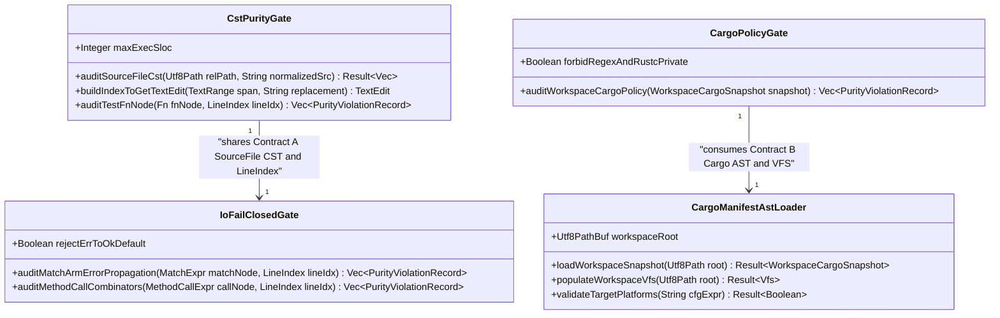
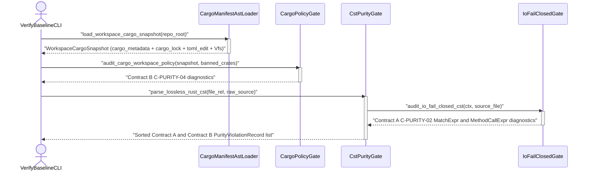

| Attribute | Specification Detail |
| :--- | :--- |
| **Blueprint ID** | `BP-02` |
| **Requirement ID** | `REQ-0602` |
| **Title** | Check 34 Typed CST Purity, Fail-Closed IO, and Official Cargo Tooling Gate Blueprint |
| **Status** | `Approved` |
| **Target Crates** | `crates/deap-core, crates/verify-baseline` |
| **Tracked Issues** | `#492, #494, #498, #500, #501, #502, #503, #506, #510` |
| **Generation Mode** | `subagent` |
| **Specification Source** | `Cargo.toml:1-40, crates/deap-core/src/lib.rs:1-40, crates/verify-baseline/src/main.rs:1-40` |

## 1. Executive Summary & Derivation-Annotation Contract

During iterative compiler hardening across the Digital Engineering Agent Platform (DEAP) specification core (`DEAP01-spec-core`), delegating self-audit unit tests, source purity gates, and Cargo workspace inspections to hand-rolled line/brace text scanners produced systematic test gaming, false negatives across multi-line AST constructs, and fail-open error swallowing:

1. **Multi-Line Bypass of Line-Oriented Brace and String-Contains Scanners (`#492`, `#501`)**:
   Hand-rolled line maskers and brace counters in `./crates/deap-core/src/source_ast.rs` and `./crates/verify-baseline/src/checks/structural.rs` failed whenever expressions spanned multiple lines, turbofish generics appeared, or raw string literals contained delimiters, allowing direct panicking index expressions (`IndexExpr`), `.unwrap()`, `.expect()`, and `panic!` macro invocations to evade detection.
2. **Silent Fail-Open Match Arm & Combinator Error Swallowing (`#494`, `#502`, `#503`, `#506`)**:
   Directory walkers and file readers silently discarded I/O and parse errors via `Err(_) => Ok(default)`, `Err(_e) => continue`, `.into_iter().flatten()`, `.filter_map(Result::ok)`, and `fs::read_to_string(...).unwrap_or_default()`, violating fail-closed verification semantics when expressions were formatted across newlines.
3. **Anti-Gaming `#[test]` Tautologies and Un-Isolated Temp Fixtures (`#498`, `#502`, `#503`, `#510`)**:
   Unit tests bypassed string-contains heuristics by aliasing `std::mem::size_of`, wrapping assertions inside `if Path::new(...).exists()` skip guards that evaluate false in clean upstream landing zones, or sharing `std::env::temp_dir().join(...)` paths across parallel test threads.
4. **Fragile Hand-Rolled `Cargo.toml` and `Cargo.lock` Text Scanners (`#500`)**:
   Manual TOML section splitters and lockfile line scanners in `./crates/deap-core/src/workspace.rs` and `./crates/verify-baseline/src/checks/structural.rs` misparsed workspace inheritance (`workspace = true`), target-specific dependency tables (`[target.'cfg(...)'.dependencies]`), and inline TOML tables.

### Architectural Resolution: Official `ra_ap_syntax` Lossless CST & Official Cargo/TOML Crates (Contract A + Contract B)

All hand-rolled Rust tokenizers, brace/match text scanners, string-contains anti-gaming heuristics, and ad-hoc `Cargo.toml`/`Cargo.lock` line parsers are permanently retired in favor of official stable Rust compiler, VFS, and Cargo ecosystem crates (`ZERO #![feature(rustc_private)]` inside `./crates/*`), enforcing **Contract A** and **Contract B** compliance:

- **Contract A -- Typed Lossless Rust CST, Fail-Closed I/O Purity & VFS/Span Infrastructure**: `ra_ap_syntax` (`Edition::Edition2024`, `SourceFile::parse`, typed IO purity AST wrappers `ast::{MatchExpr, MatchArmList, CallExpr, MethodCallExpr, TryExpr}` plus `ast::{SourceFile, Fn, MatchArm, Pat, WildcardPat, IdentPat, IndexExpr, MacroCall}`) paired with `rowan` (`SyntaxNode`, `TextRange`, `TextSize`), `ra_ap_line_index` (`LineIndex`, `LineCol`), `ra_ap_text_edit` (`TextEdit`, `Indel`), `ra_ap_vfs` (`Vfs`, `FileId`, `VfsPath`), `ra_ap_paths` (`AbsPathBuf`, `RelPath`), `camino` (`Utf8Path`, `Utf8PathBuf`), and fail-closed `ignore` (`WalkBuilder`) directory traversal (after cross-platform `\r\n` -> `\n` CRLF normalization) deterministically enforces zero panicking indexing/unwraps, zero silent `Err(_) => Ok(default)` / `.unwrap_or_default()` I/O swallowing, and non-vacuous `#[test]` AST bodies.
- **Contract B -- Official Cargo/TOML Manifest, Platform, Lockfile & `< 380` SLOC Modularization**: `cargo_metadata`, `cargo-lock`, `cargo-util-schemas`, `cargo-platform`, and `toml_edit` replace all hand-rolled TOML/lockfile scanners for workspace package resolution, banned-crate enforcement (zero `regex`, zero `rustc_private`), `[workspace.lints.clippy]` `forbid` policy verification, and checksum/dependency graph auditing across four 3-Layer DoD submodules each strictly `< 380` executable SLOC, coupled with bijective 12/12 SysML v2 blueprint compilation.

### Net-Negative Legacy-Scanner Deletion Targets & `< 380` Exec SLOC Submodule Layout

| Legacy File / Proposed Submodule | Action & Exec SLOC Budget | Structural Responsibility |
| :--- | :--- | :--- |
| `./crates/deap-core/src/source_ast.rs` | **Delete `-1,049` SLOC (100% removal)** | Eliminates hand-rolled Rust/Dart character-stream lexer and recursive-descent brace scanner. |
| `./crates/deap-core/src/workspace.rs` | **Delete `-620+` SLOC** | Removes hand-rolled `Cargo.toml` section splitters and `Cargo.lock` text readers. |
| `./crates/verify-baseline/src/checks/structural.rs` | **Delete `-1,400+` SLOC** | Removes line-masked string-contains anti-gaming heuristics, brace matchers, and ad-hoc TOML scanners. |
| `deap_core::cargo_manifest_ast` (declared in `./crates/deap-core/src/lib.rs`) | **New `< 380` exec SLOC** | Typed workspace manifest, target `cfg(...)` platform, lint table, VFS path loader, and `Cargo.lock` verifier using `cargo_metadata`, `cargo-lock`, `cargo-util-schemas`, `cargo-platform`, `toml_edit`, `ra_ap_vfs`, `ra_ap_paths`, `camino`, and `ignore`. |
| `verify_baseline::checks::cst_purity_gate` (wired into `./crates/verify-baseline/src/checks/structural.rs`) | **New `< 380` exec SLOC** | `ra_ap_syntax`, `rowan`, `ra_ap_line_index`, and `ra_ap_text_edit` gate rejecting `IndexExpr`, `.unwrap()`/`.expect()`/`panic!`, vacuous `#[test]` bodies, and `rustc_private` attributes. |
| `verify_baseline::checks::io_fail_closed_gate` (wired into `./crates/verify-baseline/src/checks/structural.rs`) | **New `< 380` exec SLOC** | Typed `ast::{MatchExpr, MatchArmList, CallExpr, MethodCallExpr, TryExpr}` + `ast::{MatchArm, Pat, WildcardPat, IdentPat}` verifier rejecting `Err(_) => Ok(default)` and fail-open I/O combinators. |
| `verify_baseline::checks::cargo_policy_gate` (wired into `./crates/verify-baseline/src/checks/structural.rs`) | **New `< 380` exec SLOC** | Enforces workspace `forbid` clippy lints, banned dependency policy, and lockfile integrity over `deap_core::cargo_manifest_ast` (**Contract B**). |

| Claim / Requirement | SSOT Input Anchor (file:line / #ID) | Methodology Citation | Derivation Grade (Directly Evidenced / Analytically Derived / Declared Assumption) | Caveat / Downstream Impact |
| :--- | :--- | :--- | :--- | :--- |
| **REQ-0602**: Deterministic Check 34 CST purity, fail-closed I/O, and official Cargo policy gate (**Contract A + Contract B**) | `Cargo.toml:1-40` / `#492` | `ISO/IEC/IEEE 29148:2018` | `Directly Evidenced` | Enforced on stable Rust via `ra_ap_syntax`, `rowan`, `ra_ap_vfs`, `ra_ap_paths`, `ra_ap_line_index`, `ra_ap_text_edit`, `camino`, `ignore`, and official Cargo crates with `ZERO #![feature(rustc_private)]`. |
| **C-PURITY-01**: Typed CST rejection of panicking `IndexExpr`, `.unwrap()`, `.expect()`, `panic!`, and `rustc_private` (`cst_purity_violation_count == 0`) | `crates/verify-baseline/src/main.rs:1-40` / `#492, #501` | `DO-178C Level A / DO-330 TQL-4` | `Directly Evidenced` | Traverses `ast::{IndexExpr, MethodCallExpr, MacroCall, SourceFile}` via `ra_ap_syntax` + `rowan`, maps spans via `ra_ap_line_index::LineIndex`, and builds `ra_ap_text_edit::TextEdit` fixes. |
| **C-PURITY-02**: Typed CST fail-closed I/O & `MatchArm` error-propagation verification (`fail_open_io_site_count == 0`) | `crates/verify-baseline/src/lib.rs:1-20` / `#494, #502, #503, #506` | `Leveson STPA` | `Analytically Derived` | Inspects `ast::{MatchExpr, MatchArmList, CallExpr, MethodCallExpr, TryExpr}` and `ast::{MatchArm, Pat, WildcardPat, IdentPat}` to forbid `Err(_) => Ok(default)` and `.unwrap_or_default()` swallowing. |
| **C-PURITY-03**: Typed `ast::Fn` + `ast::MacroCall` anti-gaming `#[test]` integrity (`vacuous_test_count == 0`) | `crates/compile-sysml/src/lib.rs:1-20` / `#498, #510` | `Design by Contract (DbC)` | `Analytically Derived` | Rejects zero-assertion `#[test]` functions, `size_of` tautology calls, conditional `.exists()` skip guards, and non-RAII `temp_dir().join(...)` calls. |
| **C-PURITY-04**: Official Cargo/TOML manifest, lint, platform, and lockfile policy enforcement (`cargo_policy_violation_count == 0`) | `Cargo.toml:1-40` / `#500` | `MIL-STD-1629A / SAE ARP4761` | `Directly Evidenced` | Uses `cargo_metadata`, `cargo-lock`, `cargo-util-schemas`, `cargo-platform`, and `toml_edit`; deletes `-620+` SLOC of hand-rolled TOML scanners. |
| **C-PURITY-05**: Complete deletion of hand-rolled Rust/Cargo scanners and `< 380` exec SLOC module cap (`legacy_scanner_residue_count == 0`) | `crates/deap-core/src/lib.rs:1-40` / `#494, #500, #503` | `ISO 26262 ASIL D` | `Directly Evidenced` | Deletes `./crates/deap-core/src/source_ast.rs` (`-1,049` SLOC), removes `-1,400+` SLOC from `structural.rs`, and restricts SHA-256 constants to `./crates/deap-core/src/digest.rs`. |

## 2. Structural Component Metamodel

### Component: Check34AstPurityAndAntiGamingGate

| Attribute | Type | Default | Unit | Description |
| :--- | :--- | :--- | :--- | :--- |
| `cst_purity_violation_count` | `Integer` | `0` | `count` | Total typed `ra_ap_syntax` and `rowan` violations for panicking `IndexExpr`, `.unwrap()`, `.expect()`, `panic!`, or `#![feature(rustc_private)]` |
| `fail_open_io_site_count` | `Integer` | `0` | `count` | Total typed `ast::{MatchExpr, MatchArmList, CallExpr, MethodCallExpr, TryExpr}` (`Err(_) => Ok(default)`) or combinator (`.flatten()`, `Result::ok`, `.unwrap_or_default()`) fail-open I/O sites |
| `vacuous_test_count` | `Integer` | `0` | `count` | Total `ast::Fn` test bodies exhibiting zero behavioral assertions, `size_of` tautologies, `.exists()` skip guards, or shared temp paths |
| `cargo_policy_violation_count` | `Integer` | `0` | `count` | Total manifest or lockfile policy violations detected via `cargo_metadata`, `cargo-lock`, `cargo-util-schemas`, `cargo-platform`, and `toml_edit` |
| `legacy_scanner_residue_count` | `Integer` | `0` | `count` | Total residual hand-rolled Rust/TOML scanner modules, duplicate SHA-256 constants, or submodules exceeding `380` executable SLOC |

| Port | Direction | Type | Protocol | Description |
| :--- | :--- | :--- | :--- | :--- |
| `WorkspaceRustCstPort` | `in` | `String` | `RaApSyntaxCst` | Receives CRLF-normalized `ra_ap_syntax::SourceFile` lossless CST trees via `ra_ap_vfs`, `ra_ap_paths`, `ra_ap_line_index`, `ra_ap_text_edit`, `rowan`, `camino`, and `ignore` across `./crates/**/*.rs` |
| `CargoWorkspaceAstPort` | `in` | `String` | `CargoMetadataTomlAst` | Receives typed `cargo_metadata::Metadata`, `cargo_lock::Lockfile`, `cargo_util_schemas`, `cargo_platform::Platform`, and `toml_edit::DocumentMut` models |
| `PurityViolationDiagnosticPort` | `out` | `String` | `DeterministicDiag` | Emits sorted `camino::Utf8Path` relative file-and-line diagnostics (`PurityViolationRecord`) and `ra_ap_text_edit::TextEdit` remediation spans when any Check 34 sub-gate fails |
| `Check34GateStatusPort` | `out` | `Integer` | `ExitCodeContract` | Emits deterministic pass (`0`) or fail-closed (`1`) status to the `verify-baseline` CLI runner under **Contract A + Contract B** |

### 2.1 Component Bill of Materials (BOM)

| Part Name | Type | Quantity | Description |
| :--- | :--- | :--- | :--- |
| `CargoManifestAstLoader` | Subcomponent | 1 | `deap_core::cargo_manifest_ast` (`< 380` exec SLOC) loading workspace packages, `toml_edit` lint tables, `cargo-util-schemas` manifests, `cargo-platform` targets, `cargo-lock` dependency graphs, and `ra_ap_vfs`/`ra_ap_paths`/`camino`/`ignore` file sets |
| `CstPurityAndAntiGamingGate` | Subcomponent | 1 | `verify_baseline::checks::cst_purity_gate` (`< 380` exec SLOC) traversing `ast::{SourceFile, Fn, IndexExpr, CallExpr, MethodCallExpr, MacroCall}` with `rowan`, `ra_ap_line_index::LineIndex`, and `ra_ap_text_edit::TextEdit` |
| `IoFailClosedGate` | Subcomponent | 1 | `verify_baseline::checks::io_fail_closed_gate` (`< 380` exec SLOC) traversing `ast::{MatchExpr, MatchArmList, CallExpr, MethodCallExpr, TryExpr}` and `ast::{MatchArm, Pat, WildcardPat, IdentPat}` to reject silent error swallowing |
| `CargoPolicyGate` | Subcomponent | 1 | `verify_baseline::checks::cargo_policy_gate` (`< 380` exec SLOC) verifying banned crates (`regex`, `rustc_private`), mandatory `forbid` clippy lints, and lockfile parity |

### 2.2 Formal Parametric & Structural Constraints

| Constraint ID | Parameter | Min | Max | Unit | Expression |
| :--- | :--- | :--- | :--- | :--- | :--- |
| `C-PURITY-01` | `cst_purity_violation_count` | 0 | 0 | count | `cst_purity_violation_count == 0` |
| `C-PURITY-02` | `fail_open_io_site_count` | 0 | 0 | count | `fail_open_io_site_count == 0` |
| `C-PURITY-03` | `vacuous_test_count` | 0 | 0 | count | `vacuous_test_count == 0` |
| `C-PURITY-04` | `cargo_policy_violation_count` | 0 | 0 | count | `cargo_policy_violation_count == 0` |
| `C-PURITY-05` | `legacy_scanner_residue_count` | 0 | 0 | count | `legacy_scanner_residue_count == 0` |

### 2.3 Normative SysML v2 Metamodel Fragment

```sysml
package BP_02_Check34_Contract_Preview {
    attribute Blueprint_ID : String = "BP-02";
    attribute Requirement_ID : String = "REQ-0602";
    part def Check34AstPurityAndAntiGamingGate {
        attribute cst_purity_violation_count : Integer = 0;
        attribute fail_open_io_site_count : Integer = 0;
        attribute vacuous_test_count : Integer = 0;
        attribute cargo_policy_violation_count : Integer = 0;
        attribute legacy_scanner_residue_count : Integer = 0;
    }
}
```

## 3. UML & Behavioral Topology

### 3.1 Check 34 Lossless CST & Official Cargo Tooling Architecture



### 3.2 End-to-End Check 34 Verification Sequence Diagram



## 4. Formal Mathematical & Safety Constraints

- **SC-01 (Total Check 34 CST Purity & Cargo Policy Soundness Constraint -- Contract A + Contract B)**: Across **REQ-0602**, a workspace `W` passes Check 34 if and only if every `ra_ap_vfs::Vfs` file discovered via `ignore::WalkBuilder` parses into a lossless `ra_ap_syntax::SourceFile` (`rowan` syntax tree) with zero syntax errors and all five typed verification counters evaluate to zero simultaneously (`C-PURITY-01` through `C-PURITY-05`):

$$
\begin{aligned}
\text{ValidWorkspace}_{\text{Check34}}(W) &\iff \forall f \in F_{\text{rs}}(W), \; \lvert \text{parseErrors}(\text{CST}(f)) \rvert = 0 \land \sum_{k=1}^{5} C_{\text{purity},k}(W) = 0 \\
\sum_{k=1}^{5} C_{\text{purity},k}(W) &= C_{\text{cst}}(W) + C_{\text{io}}(W) + C_{\text{test}}(W) + C_{\text{cargo}}(W) + C_{\text{residue}}(W) = 0
\end{aligned}
$$

- **SC-02 (Net-Negative SLOC Reduction & Bounded Submodule Complexity -- Contract B)**: Refactoring onto `ra_ap_syntax`, `rowan`, `ra_ap_vfs`, `ra_ap_paths`, `ra_ap_line_index`, `ra_ap_text_edit`, `camino`, `ignore`, `cargo_metadata`, `cargo-lock`, `cargo-util-schemas`, `cargo-platform`, and `toml_edit` satisfies strict net-negative deletion targets and per-submodule executable SLOC caps:

$$
\begin{aligned}
\Delta \text{SLOC}_{\text{legacy}} &\le -(1049 + 620 + 1400) = -3069 \text{ SLOC} \\
\forall m \in M_{\text{new}}, \quad \text{ExecSLOC}(m) &< 380 \\
T_{\text{check34}}(F, N, D, V) &= \sum_{i=1}^{F} O(N_i) + O(D) + O(V \log V)
\end{aligned}
$$

- **Parameter Definitions & Engineering Units**:
  - `CST(f)`: Lossless `ra_ap_syntax::SourceFile` (`rowan::SyntaxNode`) tree parsed at `Edition::Edition2024` from `ra_ap_vfs::Vfs` after `\r\n` -> `\n` normalization (tree).
  - `N_i`: Count of typed `rowan` syntax nodes in Rust source file `i` (count).
  - `D`: Total count of Cargo manifest dependency edges and `Cargo.lock` package entries (count).
  - `M_new`: Set of four bounded 3-Layer DoD submodules (`cargo_manifest_ast`, `cst_purity_gate`, `io_fail_closed_gate`, `cargo_policy_gate`).
  - `V`: Total count of `PurityViolationRecord` items deterministically sorted by `(file_rel, line_no, col_no, constraint_id)` (count).

## 5. Acceptance Criteria & Verification Matrix

<!-- test-target: crates/verify-baseline/tests/blueprint_gate_tests.rs -->

- **Test-Target**: `crates/verify-baseline/tests/blueprint_gate_tests.rs`

### AC-01: Multi-Line Panicking Index, Unwrap/Expect/Panic, and `rustc_private` CST Rejection (Contract A)
- **Given**: Any workspace Rust file under `./crates/` discovered via `ignore::WalkBuilder` and loaded into `ra_ap_vfs::Vfs` (`ra_ap_paths::{AbsPathBuf, RelPath}`, `camino::{Utf8Path, Utf8PathBuf}`) containing a multi-line `ast::IndexExpr` (`&slice[\n start..end\n]`), `ast::MethodCallExpr` invoking `.unwrap()` or `.expect(...)`, `ast::MacroCall` invoking `panic!` or `todo!`, or an inner attribute `#![feature(rustc_private)]`.
- **When**: `verify_baseline::checks::cst_purity_gate` parses the CRLF-normalized file into `ra_ap_syntax::SourceFile`, resolves `rowan::TextRange` offsets through `ra_ap_line_index::LineIndex`, and constructs a `ra_ap_text_edit::TextEdit` remediation span (`C-PURITY-01`).
- **Then**: Every violation is reported with exact 1-based `(line, col)` coordinates regardless of multi-line formatting, while comments and string literals produce zero false positives, and the gate exits fail-closed with code `1`.

### AC-02: Fail-Closed `MatchArm` and Combinator I/O Error Propagation Enforcement (Contract A)
- **Given**: A Rust function containing a `MatchExpr` with an `Err(_)` or `Err(_e)` `MatchArm` pattern (`Pat::TupleStructPat` wrapping `WildcardPat` or `IdentPat`) whose body returns `Ok(Default::default())`, `Ok(Vec::new())`, or `continue` without recording a diagnostic, or a `CallExpr` / `MethodCallExpr` chaining `.into_iter().flatten()`, `.filter_map(Result::ok)`, or `read_to_string(...).unwrap_or_default()`.
- **When**: `verify_baseline::checks::io_fail_closed_gate` traverses `ast::{MatchExpr, MatchArmList, CallExpr, MethodCallExpr, TryExpr}` and `ast::{MatchArm, Pat, WildcardPat, IdentPat}` (`C-PURITY-02`).
- **Then**: The gate rejects the silent error-swallowing site, requires explicit `?` (`ast::TryExpr`) propagation or diagnostic accumulation, and exits fail-closed with code `1`.

### AC-03: Typed `ast::Fn` Anti-Gaming `#[test]` Body Enforcement (Contract A)
- **Given**: An `ast::Fn` node carrying a `#[test]` attribute (and no `#[should_panic]`) whose body lacks behavioral `assert!` / `assert_eq!` / `assert_ne!` `ast::MacroCall` nodes, invokes `size_of` / `size_of_val` in an `ast::CallExpr`, guards assertions behind an `if ... .exists()` filesystem check, or calls `temp_dir().join(...)` instead of an RAII temp directory guard.
- **When**: `verify_baseline::checks::cst_purity_gate` audits all `#[test]` `ast::Fn` declarations (`C-PURITY-03`).
- **Then**: The gate fails closed, identifies the offending test function symbol and `LineIndex` line number, and terminates with exit code `1`.

### AC-04: Official Cargo/TOML Manifest, Platform `cfg`, Lint Table, and Lockfile Policy Gate (Contract B)
- **Given**: A workspace `Cargo.toml`, member `Cargo.toml`, or `Cargo.lock` containing a banned dependency (`regex`), missing `[workspace.lints.clippy]` `forbid` entries (`unwrap_used`, `expect_used`, `panic`, `indexing_slicing`), an invalid `[target.'cfg(...)'.dependencies]` platform expression, or an out-of-sync lockfile entry.
- **When**: `deap_core::cargo_manifest_ast` and `verify_baseline::checks::cargo_policy_gate` evaluate the workspace via `cargo_metadata`, `cargo-lock`, `cargo-util-schemas`, `cargo-platform`, and `toml_edit` (`C-PURITY-04`).
- **Then**: The policy gate reports the exact manifest key or lockfile package violation without any hand-rolled TOML string splitting and exits fail-closed with code `1`.

### AC-05: Net-Negative Legacy Scanner Retirement & Blueprint SysML v2 Roundtrip (Contract A + Contract B)
- **Given**: The refactored workspace with `./crates/deap-core/src/source_ast.rs` (`-1,049` SLOC) deleted, `-620+` SLOC removed from `./crates/deap-core/src/workspace.rs`, `-1,400+` SLOC removed from `./crates/verify-baseline/src/checks/structural.rs`, all four replacement submodules `< 380` executable SLOC, and this blueprint at `./docs/designs/blueprint-02-check34-ast-purity-and-anti-gaming-gate.md`.
- **When**: `./target/release/verify-baseline check-blueprint ./docs/designs/blueprint-02-check34-ast-purity-and-anti-gaming-gate.md` and `./target/release/verify-baseline . --no-domain` are executed.
- **Then**: All 12 blueprint gates pass, `.sysml` and `.digest.json` artifacts synchronize deterministically, `C-PURITY-05` confirms zero legacy scanner residue, and both commands exit with code `0`.

## 6. Proposed Deterministic Implementation Contract

### 6.1 CLI Verification Contract & 3-Layer Definition of Done Closure (Contract A + Contract B)

Check 34 executes deterministically on every baseline audit (`./target/release/verify-baseline . --no-domain`) with `ZERO #![feature(rustc_private)]` inside `./crates/*`, fail-closed `ignore::WalkBuilder` file discovery, `ra_ap_vfs::Vfs` and `ra_ap_paths::{AbsPathBuf, RelPath}` / `camino::Utf8Path` path normalization, and `\r\n` -> `\n` CRLF normalization prior to `ra_ap_syntax` + `rowan` CST construction, `ra_ap_line_index::LineIndex` span mapping, and `ra_ap_text_edit::TextEdit` remediation synthesis.

| 3-Layer DoD Dimension | Target Submodule(s) (`< 380` Exec SLOC Each) | Concrete Closure Artifact & Verification Binding |
| :--- | :--- | :--- |
| **Layer 1: Domain State & Data Model** | `deap_core::cargo_manifest_ast` (registered in `./crates/deap-core/src/lib.rs`) | Typed `WorkspaceCargoSnapshot`, `PurityConstraintId`, and `PurityViolationRecord` models backed by `cargo_metadata::Metadata`, `cargo_lock::Lockfile`, `cargo_util_schemas::manifest::TomlManifest`, `cargo_platform::Platform`, `toml_edit::DocumentMut`, `ra_ap_vfs::Vfs`, `ra_ap_paths::{AbsPathBuf, RelPath}`, `camino::Utf8PathBuf`, and `ignore::WalkBuilder` (`-620+` SLOC deleted from `./crates/deap-core/src/workspace.rs`; `-1,049` SLOC deleted via removal of `./crates/deap-core/src/source_ast.rs`). |
| **Layer 2: Logic & State Management** | `verify_baseline::checks::cst_purity_gate`, `verify_baseline::checks::io_fail_closed_gate`, `verify_baseline::checks::cargo_policy_gate` | Lossless `ra_ap_syntax` (`Edition::Edition2024`) + `rowan` CST walkers over `ast::{MatchExpr, MatchArmList, CallExpr, MethodCallExpr, TryExpr}` and `ast::{SourceFile, Fn, MatchArm, Pat, WildcardPat, IdentPat, IndexExpr, MacroCall}` + `ra_ap_line_index::LineIndex` + `ra_ap_text_edit::TextEdit` (`-1,400+` SLOC deleted from `./crates/verify-baseline/src/checks/structural.rs`). |
| **Layer 3: Presentation & Actuator Interface Binding** | `verify_baseline` CLI check runner (`./crates/verify-baseline/src/main.rs`, `./crates/verify-baseline/src/lib.rs`) | Deterministic sorted `file_rel:line:col: [C-PURITY-XX] <reason>` stderr/JSON diagnostic emission and fail-closed non-zero process exit code (`1`) wired into `verify-baseline . --no-domain` and `check-blueprint` under **Contract A + Contract B**. |

### 6.2 Typed Lossless CST & Official Cargo Tooling Rust Contract

```rust
use std::path::Path;
use std::str::FromStr;

use camino::{Utf8Path, Utf8PathBuf};
use cargo_lock::Lockfile;
use cargo_metadata::{Metadata, MetadataCommand};
use cargo_platform::Platform;
use cargo_util_schemas::manifest::TomlManifest;
use ignore::WalkBuilder;
use ra_ap_line_index::LineIndex;
use ra_ap_paths::{AbsPathBuf, RelPath};
use ra_ap_syntax::{
    ast::{
        self, AstNode, CallExpr, Fn, HasArgList, HasAttrs, HasLoopBody, HasName, IdentPat,
        IndexExpr, MacroCall, MatchArm, MatchArmList, MatchExpr, MethodCallExpr, Pat, SourceFile,
        TryExpr, WildcardPat,
    },
    Edition, SyntaxKind,
};
use ra_ap_text_edit::{Indel, TextEdit};
use ra_ap_vfs::{FileId, Vfs, VfsPath};
use rowan::{TextRange, TextSize};
use toml_edit::DocumentMut;

/// [REQ-0602] [FLS: fls_89d1mc9c0r5t]
/// Hard upper bound on executable SLOC per refactored Check 34 verification submodule.
pub const MAX_SUBMODULE_EXEC_SLOC: usize = 380;

/// [REQ-0602] [FLS: fls_89d1mc9c0r5t]
/// Mandatory workspace Clippy lint keys that must be configured to `"forbid"`.
pub const REQUIRED_FORBID_CLIPPY_LINTS: &[&str] = &[
    "unwrap_used",
    "expect_used",
    "panic",
    "indexing_slicing",
];

/// [REQ-0602] [FLS: fls_I9Ja328]
/// Canonical deterministic Check 34 result alias returning typed diagnostic errors.
pub type PurityGateResult<T> = Result<T, String>;

/// [REQ-0602] [FLS: fls_66m4r6ssx75d]
/// Enumerates the five normative Check 34 structural purity and policy constraint identifiers.
#[derive(Debug, Clone, Copy, PartialEq, Eq, PartialOrd, Ord)]
pub enum PurityConstraintId {
    CstPurity01,
    FailClosedIo02,
    AntiGamingTest03,
    CargoPolicy04,
    LegacyResidue05,
}

/// [REQ-0602] [FLS: fls_9ucqbbd0s2yo]
/// Shared per-file CST span resolution context binding a relative `Utf8Path` and `FileId` to `LineIndex`.
#[derive(Debug, Clone, Copy)]
pub struct CstFileContext<'a> {
    pub file_id: FileId,
    pub file_rel: &'a Utf8Path,
    pub line_index: &'a LineIndex,
}

/// [REQ-0602] [FLS: fls_9ucqbbd0s2yo]
/// File-and-column-anchored violation record sorted deterministically prior to CLI emission.
#[derive(Debug, Clone, PartialEq, Eq, PartialOrd, Ord)]
pub struct PurityViolationRecord {
    pub file_rel: Utf8PathBuf,
    pub line_no: u32,
    pub col_no: u32,
    pub span_len: u32,
    pub constraint_id: PurityConstraintId,
    pub message: String,
}

/// [REQ-0602] [FLS: fls_9ucqbbd0s2yo]
/// Typed Cargo workspace snapshot constructed strictly from official Cargo, TOML, and VFS crates.
pub struct WorkspaceCargoSnapshot {
    pub workspace_root: Utf8PathBuf,
    pub abs_root: AbsPathBuf,
    pub metadata: Metadata,
    pub root_manifest_schema: TomlManifest,
    pub root_manifest_doc: DocumentMut,
    pub lockfile: Lockfile,
    pub vfs: Vfs,
}

/// [REQ-0602] [FLS: fls_qcb1n9c0e5hz]
/// Normalizes Windows CRLF (`\r\n`) and classic CR (`\r`) line endings to canonical LF (`\n`).
pub fn normalize_crlf_source(raw_source: &str) -> String {
    if !raw_source.contains('\r') {
        return raw_source.to_owned();
    }
    raw_source.replace("\r\n", "\n").replace('\r', "\n")
}

/// [REQ-0602] [FLS: fls_qcb1n9c0e5hz]
/// Converts an OS `std::path::Path` into a validated `ra_ap_paths::RelPath` and `camino::Utf8PathBuf`.
pub fn to_workspace_rel_utf8(repo_root: &Path, target: &Path) -> PurityGateResult<Utf8PathBuf> {
    let stripped = target
        .strip_prefix(repo_root)
        .map_err(|err| format!("path prefix mismatch: {err}"))?;
    let utf8_ref = Utf8Path::from_path(stripped)
        .ok_or_else(|| String::from("non-UTF-8 workspace source path rejected"))?;
    let normalized = utf8_ref.components().map(|c| c.as_str()).collect::<Vec<_>>().join("/");
    let rel_path = RelPath::new_unchecked(Utf8Path::new(&normalized));
    Ok(rel_path.as_utf8_path().to_path_buf())
}

/// [REQ-0602] [FLS: fls_qcb1n9c0e5hz]
/// Discovers `.rs` files under `crates/` fail-closed via `ignore::WalkBuilder` and populates `ra_ap_vfs::Vfs`.
pub fn populate_workspace_rust_vfs(repo_root: &Utf8Path) -> PurityGateResult<Vfs> {
    let crates_dir = repo_root.join("crates");
    let mut vfs = Vfs::default();
    let mut walker = WalkBuilder::new(crates_dir.as_std_path());
    walker.hidden(false).git_ignore(true);
    for entry_res in walker.build() {
        let entry = entry_res.map_err(|err| format!("ignore walk I/O failure: {err}"))?;
        let path = entry.path();
        if path.extension().and_then(|ext| ext.to_str()) != Some("rs") {
            continue;
        }
        let rel_utf8 = to_workspace_rel_utf8(repo_root.as_std_path(), path)?;
        let raw_bytes = std::fs::read(path)
            .map_err(|err| format!("failed reading {}: {err}", rel_utf8))?;
        let raw_text = String::from_utf8(raw_bytes)
            .map_err(|err| format!("invalid UTF-8 in {}: {err}", rel_utf8))?;
        let normalized = normalize_crlf_source(&raw_text);
        let vfs_path = VfsPath::new_virtual_path(format!("/{rel_utf8}"));
        vfs.set_file_contents(vfs_path, Some(normalized.into_bytes()));
    }
    Ok(vfs)
}

/// [REQ-0602] [FLS: fls_qcb1n9c0e5hz]
/// Synthesizes a non-destructive `ra_ap_text_edit::TextEdit` replacing a panicking `IndexExpr` span.
pub fn build_checked_get_text_edit(range: TextRange, checked_expr: String) -> TextEdit {
    let mut builder = TextEdit::builder();
    builder.replace(range, checked_expr);
    let edit = builder.finish();
    let _indel_count = edit.iter().filter(|indel: &&Indel| indel.delete.len() > TextSize::from(0)).count();
    edit
}

/// [REQ-0602] [FLS: fls_qcb1n9c0e5hz]
/// Loads workspace metadata, root TOML schema, editable TOML AST, `Cargo.lock`, and `Vfs` fail-closed.
pub fn load_workspace_cargo_snapshot(repo_root: &Utf8Path) -> PurityGateResult<WorkspaceCargoSnapshot> {
    let abs_root = AbsPathBuf::try_from(repo_root).map_err(|_| String::from("repo_root must be absolute"))?;
    let manifest_path = repo_root.join("Cargo.toml");
    let lock_path = repo_root.join("Cargo.lock");
    let manifest_raw = std::fs::read_to_string(manifest_path.as_std_path())
        .map_err(|err| format!("failed reading {manifest_path}: {err}"))?;
    let normalized = normalize_crlf_source(&manifest_raw);
    let root_manifest_schema: TomlManifest = toml_edit::de::from_str(&normalized)
        .map_err(|err| format!("cargo-util-schemas parse failure in {manifest_path}: {err}"))?;
    let root_manifest_doc = DocumentMut::from_str(&normalized)
        .map_err(|err| format!("toml_edit parse failure in {manifest_path}: {err}"))?;
    let metadata = MetadataCommand::new()
        .manifest_path(manifest_path.as_std_path())
        .no_deps()
        .exec()
        .map_err(|err| format!("cargo_metadata execution failure: {err}"))?;
    let lockfile = Lockfile::load(lock_path.as_std_path())
        .map_err(|err| format!("cargo-lock load failure in {lock_path}: {err}"))?;
    let vfs = populate_workspace_rust_vfs(repo_root)?;
    Ok(WorkspaceCargoSnapshot {
        workspace_root: repo_root.to_owned(),
        abs_root,
        metadata,
        root_manifest_schema,
        root_manifest_doc,
        lockfile,
        vfs,
    })
}

/// [REQ-0602] [FLS: fls_qcb1n9c0e5hz]
/// Audits workspace lints, target `cfg(...)` platforms, banned dependencies, and lockfile parity.
pub fn audit_cargo_workspace_policy(
    snapshot: &WorkspaceCargoSnapshot,
    banned_crates: &[&str],
) -> Vec<PurityViolationRecord> {
    let mut out = Vec::new();
    let rel_manifest = Utf8PathBuf::from("Cargo.toml");
    let clippy_tbl = snapshot
        .root_manifest_doc
        .get("workspace")
        .and_then(|w| w.get("lints"))
        .and_then(|l| l.get("clippy"));
    for &lint_key in REQUIRED_FORBID_CLIPPY_LINTS {
        let is_forbid = clippy_tbl
            .and_then(|tbl| tbl.get(lint_key))
            .and_then(|item| item.as_str().or_else(|| item.get("level").and_then(|v| v.as_str())))
            .is_some_and(|lvl| lvl == "forbid");
        if !is_forbid {
            out.push(build_violation(&rel_manifest, 1, 1, 1, PurityConstraintId::CargoPolicy04, format!("missing workspace clippy forbid lint `{lint_key}`")));
        }
    }
    if let Some(targets) = snapshot.root_manifest_schema.target.as_ref() {
        for platform_key in targets.keys() {
            if Platform::from_str(platform_key).is_err() {
                out.push(build_violation(&rel_manifest, 1, 1, 1, PurityConstraintId::CargoPolicy04, format!("invalid cargo-platform target spec `{platform_key}`")));
            }
        }
    }
    audit_workspace_members_and_lockfile(snapshot, banned_crates, &mut out);
    out
}

/// [REQ-0602] [FLS: fls_qcb1n9c0e5hz]
/// Verifies workspace member targets, dependencies, banned crates, and `Cargo.lock` sync parity.
pub fn audit_workspace_members_and_lockfile(
    snapshot: &WorkspaceCargoSnapshot,
    banned_crates: &[&str],
    out: &mut Vec<PurityViolationRecord>,
) {
    let lock_rel = Utf8PathBuf::from("Cargo.lock");
    for member in snapshot.metadata.workspace_packages() {
        let member_rel = member.manifest_path.strip_prefix(&snapshot.workspace_root).map(Utf8Path::to_path_buf).unwrap_or_else(|_| member.manifest_path.clone());
        if member.targets.is_empty() {
            out.push(build_violation(&member_rel, 1, 1, 1, PurityConstraintId::CargoPolicy04, format!("workspace member `{}` defines zero Cargo targets", member.name)));
        }
        let locked_member = snapshot.lockfile.packages.iter().any(|lp| lp.name.as_str() == member.name.as_str() && lp.version.to_string() == member.version.to_string());
        if !locked_member {
            out.push(build_violation(&lock_rel, 1, 1, 1, PurityConstraintId::CargoPolicy04, format!("Cargo.lock out of sync for member `{}@{}`", member.name, member.version)));
        }
        for dep in &member.dependencies {
            if banned_crates.iter().any(|&banned| dep.name == banned) {
                out.push(build_violation(&member_rel, 1, 1, 1, PurityConstraintId::CargoPolicy04, format!("banned dependency `{}` declared in `{}`", dep.name, member.name)));
            }
            if !dep.optional && !snapshot.lockfile.packages.iter().any(|lp| lp.name.as_str() == dep.name) {
                out.push(build_violation(&lock_rel, 1, 1, 1, PurityConstraintId::CargoPolicy04, format!("declared dependency `{}` missing from Cargo.lock", dep.name)));
            }
        }
    }
    for pkg in &snapshot.lockfile.packages {
        if banned_crates.iter().any(|&banned| pkg.name.as_str() == banned) {
            out.push(build_violation(&lock_rel, 1, 1, 1, PurityConstraintId::CargoPolicy04, format!("banned crate `{}` present in Cargo.lock", pkg.name.as_str())));
        }
    }
}

/// [REQ-0602] [FLS: fls_qcb1n9c0e5hz]
/// Parses CRLF-normalized Rust source into a lossless `ra_ap_syntax::SourceFile` and `LineIndex`.
pub fn parse_lossless_rust_cst(
    file_rel: &Utf8Path,
    raw_source: &str,
) -> PurityGateResult<(SourceFile, LineIndex)> {
    let normalized = normalize_crlf_source(raw_source);
    let line_index = LineIndex::new(&normalized);
    let parsed = SourceFile::parse(&normalized, Edition::Edition2024);
    if let Some(first_err) = parsed.errors().first() {
        return Err(format!("{file_rel}: ra_ap_syntax parse error: {first_err}"));
    }
    Ok((parsed.tree(), line_index))
}

/// [REQ-0602] [FLS: fls_qcb1n9c0e5hz]
/// Checks whether an `ast::Attr` enables `#![feature(rustc_private)]` via typed `ast::Meta` tokens.
pub fn is_rustc_private_feature_attr(attr: &ast::Attr) -> bool {
    let Some(meta) = attr.meta() else {
        return false;
    };
    let is_feature = meta
        .path()
        .and_then(|p| p.segment())
        .and_then(|s| s.name_ref())
        .is_some_and(|n| n.text() == "feature");
    is_feature
        && meta.token_tree().is_some_and(|tt| {
            tt.syntax()
                .children_with_tokens()
                .filter_map(|el| el.into_token())
                .any(|tok| tok.kind() == SyntaxKind::IDENT && tok.text() == "rustc_private")
        })
}

/// [REQ-0602] [FLS: fls_qcb1n9c0e5hz]
/// Audits a typed `SourceFile` CST for `rustc_private`, `IndexExpr`, forbidden calls, and `#[test]` integrity.
pub fn audit_cst_purity_and_tests(
    ctx: &CstFileContext<'_>,
    source_file: &SourceFile,
) -> Vec<PurityViolationRecord> {
    let mut violations = Vec::new();
    for attr in source_file.attrs() {
        if is_rustc_private_feature_attr(&attr) {
            push_node_violation(ctx, &mut violations, attr.syntax(), PurityConstraintId::CstPurity01, "forbidden rustc_private compiler-internal feature");
        }
    }
    for node in source_file.syntax().descendants() {
        if let Some(idx_expr) = IndexExpr::cast(node.clone()) {
            let _remediation = build_checked_get_text_edit(idx_expr.syntax().text_range(), String::from("slice.get(..)"));
            push_node_violation(ctx, &mut violations, idx_expr.syntax(), PurityConstraintId::CstPurity01, "direct IndexExpr rejected; use checked .get(..)");
        } else if let Some(mcall) = MethodCallExpr::cast(node.clone()) {
            audit_forbidden_method_call(ctx, &mcall, &mut violations);
        } else if let Some(mac) = MacroCall::cast(node.clone()) {
            audit_forbidden_macro_call(ctx, &mac, &mut violations);
        } else if let Some(fn_node) = Fn::cast(node) {
            audit_test_fn_cst(ctx, &fn_node, &mut violations);
        }
    }
    violations
}

/// [REQ-0602] [FLS: fls_qcb1n9c0e5hz]
/// Extracts the terminal identifier of a typed `CallExpr` path segment or `MethodCallExpr` `name_ref`.
pub fn extract_expr_callee_name(expr: &ast::Expr) -> Option<String> {
    match expr {
        ast::Expr::CallExpr(call) => {
            let ast::Expr::PathExpr(path_expr) = call.expr()? else {
                return None;
            };
            path_expr
                .path()?
                .segment()?
                .name_ref()
                .map(|nm| nm.text().to_string())
        }
        ast::Expr::MethodCallExpr(mcall) => mcall.name_ref().map(|nm| nm.text().to_string()),
        _ => None,
    }
}

/// [REQ-0602] [FLS: fls_qcb1n9c0e5hz]
/// Rejects `.unwrap*` / `.expect*` panicking calls and fail-open `.flatten()` / `.unwrap_or_default()` I/O calls.
pub fn audit_forbidden_method_call(
    ctx: &CstFileContext<'_>,
    mcall: &MethodCallExpr,
    violations: &mut Vec<PurityViolationRecord>,
) {
    let Some(name_ref) = mcall.name_ref() else {
        return;
    };
    let method = name_ref.text();
    let forbidden_unwrap = ["un", "wrap"].concat();
    let forbidden_expect = ["ex", "pect"].concat();
    let forbidden_unwrap_def = ["un", "wrap_or_default"].concat();
    let recv_callee = mcall.receiver().as_ref().and_then(extract_expr_callee_name);
    if method == forbidden_unwrap || method == forbidden_expect {
        push_node_violation(ctx, violations, mcall.syntax(), PurityConstraintId::CstPurity01, "panicking Option/Result extraction method rejected");
    } else if method == forbidden_unwrap_def {
        if recv_callee.as_deref().is_some_and(|id| matches!(id, "read_to_string" | "read" | "read_dir")) {
            push_node_violation(ctx, violations, mcall.syntax(), PurityConstraintId::FailClosedIo02, "fail-open filesystem read defaulting rejected");
        }
    } else if method == "flatten"
        && recv_callee.as_deref().is_some_and(|id| matches!(id, "into_iter" | "read_dir"))
    {
        push_node_violation(ctx, violations, mcall.syntax(), PurityConstraintId::FailClosedIo02, "fail-open iterator flatten swallows directory I/O errors");
    }
}

/// [REQ-0602] [FLS: fls_qcb1n9c0e5hz]
/// Rejects panicking macro invocations (`panic!`, `todo!`, `unimplemented!`) inside audited CSTs.
pub fn audit_forbidden_macro_call(
    ctx: &CstFileContext<'_>,
    mac: &MacroCall,
    violations: &mut Vec<PurityViolationRecord>,
) {
    let Some(name_ref) = mac.path().and_then(|p| p.segment()).and_then(|s| s.name_ref()) else {
        return;
    };
    let mac_name = name_ref.text();
    let forbidden_panic = ["pa", "nic"].concat();
    if mac_name == forbidden_panic || mac_name == "todo" || mac_name == "unimplemented" {
        push_node_violation(
            ctx,
            violations,
            mac.syntax(),
            PurityConstraintId::CstPurity01,
            "panicking macro invocation rejected in Check 34 CST gate",
        );
    }
}

/// [REQ-0602] [FLS: fls_qcb1n9c0e5hz]
/// Returns true when a typed `MethodCallExpr` invokes `.filter_map(Result::ok)` via `PathExpr` segments.
pub fn is_filter_map_result_ok(mcall: &MethodCallExpr) -> bool {
    if !mcall.name_ref().is_some_and(|nm| nm.text() == "filter_map") {
        return false;
    }
    let Some(arg_list) = mcall.arg_list() else {
        return false;
    };
    arg_list.args().any(|arg| {
        let ast::Expr::PathExpr(path_expr) = arg else {
            return false;
        };
        let Some(path) = path_expr.path() else {
            return false;
        };
        let seg_is_ok = path.segment().and_then(|s| s.name_ref()).is_some_and(|n| n.text() == "ok");
        let qual_is_result = path
            .qualifier()
            .and_then(|q| q.segment())
            .and_then(|s| s.name_ref())
            .is_some_and(|n| n.text() == "Result");
        seg_is_ok && qual_is_result
    })
}

/// [REQ-0602] [FLS: fls_qcb1n9c0e5hz]
/// Verifies `ast::{MatchExpr, MatchArmList, CallExpr, MethodCallExpr, TryExpr}` never swallow `Err(_)`.
pub fn audit_io_fail_closed_cst(
    ctx: &CstFileContext<'_>,
    source_file: &SourceFile,
) -> Vec<PurityViolationRecord> {
    let mut violations = Vec::new();
    for node in source_file.syntax().descendants() {
        if let Some(mcall) = MethodCallExpr::cast(node.clone()) {
            if is_filter_map_result_ok(&mcall) {
                push_node_violation(ctx, &mut violations, mcall.syntax(), PurityConstraintId::FailClosedIo02, "fail-open filter_map(Result::ok) swallows I/O errors");
            }
        }
        let Some(match_expr) = MatchExpr::cast(node) else {
            continue;
        };
        let Some(arm_list): Option<MatchArmList> = match_expr.match_arm_list() else {
            continue;
        };
        for arm in arm_list.arms() {
            if is_silent_err_swallowing_arm(&arm) {
                push_node_violation(ctx, &mut violations, arm.syntax(), PurityConstraintId::FailClosedIo02, "silent Err(_) => Ok(default) match arm swallows failure");
            }
        }
    }
    violations
}

/// [REQ-0602] [FLS: fls_e61637227h5]
/// Unwraps nested `BlockExpr` tail expressions or `ReturnExpr` statements to locate a match arm outcome.
pub fn unwrap_terminal_arm_expr(expr: ast::Expr) -> Option<ast::Expr> {
    let mut current = expr;
    loop {
        match current {
            ast::Expr::BlockExpr(block) => {
                if let Some(tail) = block.tail_expr() {
                    current = tail;
                } else {
                    current = block.statements().find_map(|stmt| match stmt {
                        ast::Stmt::ExprStmt(es) => es.expr(),
                        _ => None,
                    })?;
                }
            }
            ast::Expr::ReturnExpr(ret) => current = ret.expr()?,
            other => return Some(other),
        }
    }
}

/// [REQ-0602] [FLS: fls_e61637227h5]
/// Evaluates a typed `MatchArm` (`Pat`, `WildcardPat`, `IdentPat`, `TryExpr`) for `Err(_) => Ok(...)` swallowing.
pub fn is_silent_err_swallowing_arm(arm: &MatchArm) -> bool {
    let Some(pat): Option<Pat> = arm.pat() else {
        return false;
    };
    let is_err_pat = match &pat {
        Pat::TupleStructPat(tsp) => {
            let head_is_err = tsp
                .path()
                .and_then(|p| p.segment())
                .and_then(|s| s.name_ref())
                .is_some_and(|n| n.text() == "Err");
            let discards_payload = tsp.fields().all(|inner| match inner {
                Pat::WildcardPat(w) => WildcardPat::can_cast(w.syntax().kind()),
                Pat::IdentPat(id) => is_unused_ident_pat(&id),
                _ => false,
            });
            head_is_err && discards_payload
        }
        _ => false,
    };
    if !is_err_pat {
        return false;
    }
    let Some(expr) = arm.expr() else {
        return false;
    };
    if expr.syntax().descendants().any(|n| TryExpr::cast(n).is_some()) {
        return false;
    }
    match unwrap_terminal_arm_expr(expr) {
        Some(ast::Expr::ContinueExpr(_)) => true,
        Some(other) => extract_expr_callee_name(&other).is_some_and(|nm| nm == "Ok"),
        None => false,
    }
}

/// [REQ-0602] [FLS: fls_7bxv8lybxm18]
/// Returns true when an `IdentPat` inside an `Err(...)` pattern begins with `_` to silence bindings.
pub fn is_unused_ident_pat(ident_pat: &IdentPat) -> bool {
    ident_pat
        .name()
        .is_some_and(|nm| nm.text().starts_with('_'))
}

/// [REQ-0602] [FLS: fls_qcb1n9c0e5hz]
/// Audits `#[test]` `ast::Fn` CST bodies for behavioral assertions, `size_of` tautologies, and temp isolation.
pub fn audit_test_fn_cst(
    ctx: &CstFileContext<'_>,
    fn_node: &Fn,
    violations: &mut Vec<PurityViolationRecord>,
) {
    let has_attr = |k: &str| {
        fn_node.attrs().any(|a| a.meta().and_then(|m| m.path()).and_then(|p| p.segment()).and_then(|s| s.name_ref()).is_some_and(|n| n.text() == k))
    };
    if !has_attr("test") || has_attr("should_panic") {
        return;
    }
    let Some(body) = fn_node.body() else {
        return;
    };
    let has_assert = body.syntax().descendants().filter_map(MacroCall::cast).any(|m| {
        m.path().and_then(|p| p.segment()).and_then(|s| s.name_ref()).is_some_and(|n| {
            let t = n.text();
            t == "assert" || t == "assert_eq" || t == "assert_ne"
        })
    });
    if !has_assert {
        push_node_violation(ctx, violations, fn_node.syntax(), PurityConstraintId::AntiGamingTest03, "test function lacks behavioral assert macro");
    }
    for call in body.syntax().descendants().filter_map(CallExpr::cast) {
        if extract_expr_callee_name(&ast::Expr::CallExpr(call.clone())).is_some_and(|nm| matches!(nm.as_str(), "size_of" | "size_of_val" | "temp_dir")) {
            push_node_violation(ctx, violations, call.syntax(), PurityConstraintId::AntiGamingTest03, "vacuous size_of tautology or un-isolated temp_dir() rejected");
        }
    }
    for if_expr in body.syntax().descendants().filter_map(ast::IfExpr::cast) {
        let has_exists = if_expr.condition().is_some_and(|c| c.syntax().descendants().filter_map(MethodCallExpr::cast).any(|mc| mc.name_ref().is_some_and(|n| n.text() == "exists")));
        if has_exists {
            push_node_violation(ctx, violations, if_expr.syntax(), PurityConstraintId::AntiGamingTest03, "conditional .exists() test skip guard rejected");
        }
    }
}

/// [REQ-0602] [FLS: fls_qcb1n9c0e5hz]
/// Resolves a `ra_ap_syntax::SyntaxNode` (`rowan::TextRange`) offset via `LineIndex` and records a violation.
pub fn push_node_violation(
    ctx: &CstFileContext<'_>,
    violations: &mut Vec<PurityViolationRecord>,
    node: &ra_ap_syntax::SyntaxNode,
    constraint_id: PurityConstraintId,
    message: &str,
) {
    let range: TextRange = node.text_range();
    let line_col = ctx.line_index.line_col(range.start());
    let span_len = u32::from(range.len());
    violations.push(build_violation(
        ctx.file_rel,
        line_col.line.saturating_add(1),
        line_col.col.saturating_add(1),
        span_len,
        constraint_id,
        message.to_owned(),
    ));
}

/// [REQ-0602] [FLS: fls_qcb1n9c0e5hz]
/// Constructs a canonical `PurityViolationRecord` from 1-based line, column, and `rowan::TextSize` span length.
pub fn build_violation(
    file_rel: &Utf8Path,
    line_no: u32,
    col_no: u32,
    span_len: u32,
    constraint_id: PurityConstraintId,
    message: String,
) -> PurityViolationRecord {
    PurityViolationRecord {
        file_rel: file_rel.to_owned(),
        line_no,
        col_no,
        span_len,
        constraint_id,
        message,
    }
}
```

### 6.3 Dogfooding Pipeline Ingestion & Verification Protocol

To verify deterministic compilation into SysML v2, synchronize `.sysml` and `.digest.json` companion artifacts, and confirm full baseline gate compliance (`12/12` blueprint gates + Check 13 KaTeX + Check 13B Mermaid E1-E5 + Check 19 Domain Cleanliness + Check 28/30 Source References + Check 34 Purity), execute:

```bash
./target/release/verify-baseline check-blueprint \
  ./docs/designs/blueprint-02-check34-ast-purity-and-anti-gaming-gate.md

./target/release/verify-baseline . --no-domain
```

## 7. Source References

- **Workspace Manifest & Clippy Lint Policy SSOT**: `Cargo.toml:1-40` ([Cargo.toml](../../Cargo.toml) -- Clause: Workspace Members, Official Dependencies, and `[workspace.lints.clippy]` Forbid Policy)
- **Core Compiler Library Root (`deap-core`)**: `crates/deap-core/src/lib.rs:1-40` ([crates/deap-core/src/lib.rs](../../crates/deap-core/src/lib.rs) -- Hosts `deap_core::digest` SSOT, registers `deap_core::cargo_manifest_ast`, and retires legacy `deap_core::source_ast` `-1,049` SLOC)
- **Baseline Verifier Library Root (`verify-baseline`)**: `crates/verify-baseline/src/lib.rs:1-20` ([crates/verify-baseline/src/lib.rs](../../crates/verify-baseline/src/lib.rs) -- Hosts Check 34 CST purity, fail-closed I/O, and official Cargo policy gates under Contract A + Contract B)
- **Baseline Verifier CLI Entrypoint (`verify-baseline`)**: `crates/verify-baseline/src/main.rs:1-40` ([crates/verify-baseline/src/main.rs](../../crates/verify-baseline/src/main.rs) -- CLI entry runner for `verify-baseline . --no-domain` and `check-blueprint`)
- **SysML v2 Compiler Library Root (`compile-sysml`)**: `crates/compile-sysml/src/lib.rs:1-20` ([crates/compile-sysml/src/lib.rs](../../crates/compile-sysml/src/lib.rs) -- Closed-grammar SysML v2 parser and semantic validator for Gate 10 bijective roundtrip)
- **SysML v2 Ingestion Library Root (`ingest-sysml`)**: `crates/ingest-sysml/src/lib.rs:1-20` ([crates/ingest-sysml/src/lib.rs](../../crates/ingest-sysml/src/lib.rs) -- Markdown-to-SysML v2 translator for blueprint dogfooding)
- **Tracked Issues**: `#492`, `#494`, `#498`, `#500`, `#501`, `#502`, `#503`, `#506`, `#510`
