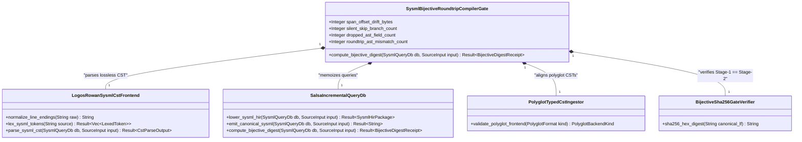
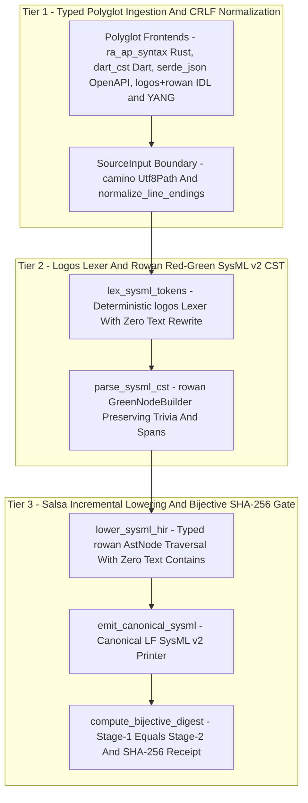
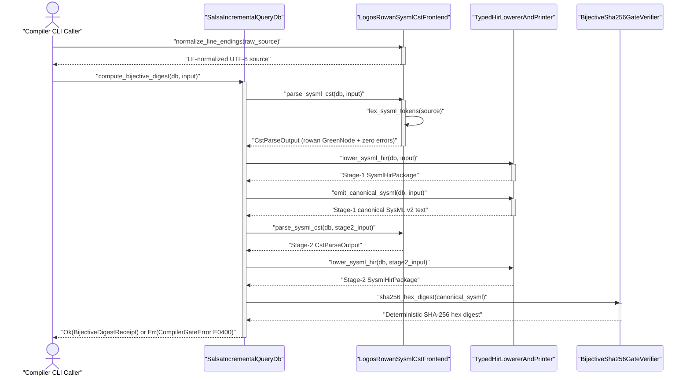
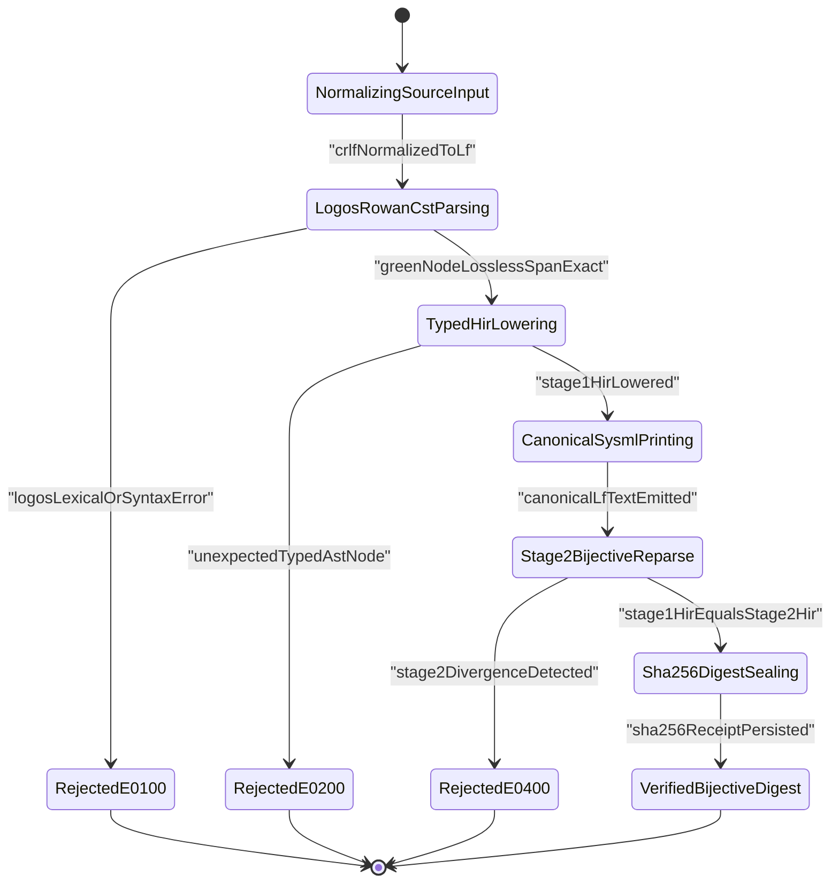

| Attribute | Specification Detail |
| :--- | :--- |
| **Blueprint ID** | `BP-03` |
| **Requirement ID** | `REQ-0603` |
| **Title** | SysML v2 Lossless Red/Green CST, Salsa Incremental Query DB, and Bijective Roundtrip Compiler Gate Blueprint (DEAP-BP-DET-03) |
| **Status** | `Approved` |
| **Target Crates** | `crates/compile-sysml, crates/deap-core, crates/ingest-sysml, crates/verify-baseline` |
| **Tracked Issues** | `#493, #495, #496, #497, #504, #505, #509` |
| **Generation Mode** | `subagent` |
| **Specification Source** | `crates/compile-sysml/src/parser/grammar/mod.rs:182-335 / crates/deap-core/src/sysml_ast/mod.rs:1-400 / #493` |

## 1. Executive Summary & Derivation-Annotation Contract

The Digital Engineering Agent Platform (DEAP) compiler pipeline (`DEAP-BP-DET-03`, subsystem `SysmlBijectiveRoundtripCompilerGate`, deterministic UUIDv5 `6ba7b810-9dad-11d1-80b4-00c04fd430c3`, complexity class `Class P`, diagnostic code bindings `E0100, E0200, E0300, E0400`, governed by `ISO/IEC/IEEE 29148:2018 / OMG SysML v2 / RTCA DO-178C Level A / RTCA DO-330 TQL-4`) relies on `crates/deap-core`, `crates/compile-sysml`, and `crates/ingest-sysml` to parse, validate, ingest, and serialize SysML v2 / KerML models as the 100% Single Source of Truth (SSOT). Prior hand-rolled character/slice scanners, recursive token-stream workarounds, and ad-hoc polyglot line scanners introduced four classes of structural fragility and silent Abstract Syntax Tree (AST) corruption:

1. **Hand-Rolled Pre-Lexer Text Rewrites & Span Drift (`#495`)**:
   - Legacy scanners in `./crates/compile-sysml/src/parser/grammar/mod.rs` (`182-335`) and `./crates/deap-core/src/sysml_ast/mod.rs` mutated raw UTF-8 buffers prior to tokenization (`normalize_type_sigils`), shifting byte and column spans across every subsequent diagnostic and expression token.
2. **Silent Inner-Block Erasure & Hand-Rolled Token-Stream Fragility (`#504`, `#496`, `#509`)**:
   - Hand-rolled recursive-descent loops (`skip_until_semi_or_brace`, `read_until_semi`, `split_whitespace`) silently erased unrecognized inner declaration tokens, truncated composite generic/reference types, fabricated synthetic `{s}_to_{t}` transition names, and dropped nested composite `sub_states` transitions.
3. **Lossy String Serialization & Platform CRLF Digest Drift (`#493`, `#497`, `#505`)**:
   - Manual `to_sysml` string concatenation dropped trivia, docstrings, and transition clauses (`source`, `trigger`, `guard`, `effect`, `target`), double-quoted attribute literals (`""value""`), and lacked LF/CRLF canonicalization prior to Stage-1 vs. Stage-2 digest comparison.
4. **Ad-Hoc Polyglot Line/Brace Scanners in Ingestion (`BP-10` Alignment)**:
   - Legacy translators under `./crates/ingest-sysml/src/translators/{code,idl,yang,openapi}.rs` relied on brittle line/brace string splitting rather than formal grammar CSTs and typed schema ASTs.

### Deterministic Compiler Replacement Architecture

To permanently eliminate hand-rolled scanners and lossy serialization while remaining cohesive with `BP-10`, this blueprint retires all legacy character/token/line scanners and establishes three unified compiler mechanisms:

1. **`logos` Deterministic Lexer + `rowan` Lossless Red/Green SysML v2 CST (`deap_core::sysml_cst`)**:
   - Tokenizes unmodified UTF-8 SysML v2 buffers via `logos::Logos` (`SysmlToken`) and constructs an immutable, lossless Red/Green Concrete Syntax Tree via `rowan::GreenNodeBuilder` and `rowan::SyntaxNode<SysmlLanguage>` preserving 100% of whitespace trivia, `doc /* ... */` comments, sigils (`&`, `?`, `'a`, `::`), and exact byte spans.
   - Pins the workspace `rowan` dependency version identically to `ra_ap_syntax`'s transitive `rowan` version so Red/Green CST utilities interoperate cleanly across `deap-core`, `compile-sysml`, and `ingest-sysml`.
2. **`salsa` Demand-Driven Incremental Query Database (`compile_sysml::salsa_db`)**:
   - Models compilation as a memoized, deterministic query pipeline: `SourceInput` -> `parse_sysml_cst` -> `lower_sysml_hir` -> `emit_canonical_sysml` -> `compute_bijective_digest`.
   - Enforces CRLF-to-LF normalization at `SourceInput` boundary (`normalize_line_endings`), guarantees lossless Stage-1 == Stage-2 bijective round-trip parity (`H(emit_canonical_sysml(H_1)) == H(emit_canonical_sysml(H_2))` and `H_1 == H_2`), and computes deterministic SHA-256 semantic digests identically across macOS, Linux, and Windows (`camino::Utf8Path`).
3. **Typed Polyglot Ingestion Alignment (`deap-core`, `compile-sysml`, `ingest-sysml`)**:
   - Aligns polyglot ingestion onto zero-hand-rolled typed frontends with `ZERO` `#![feature(rustc_private)]` inside `./crates/*`:
     - **Rust source**: `ra_ap_syntax` lossless Red/Green CST (`SourceFile::parse`).
     - **Dart source**: `logos` + `rowan` lossless CST (`deap_core::dart_cst`).
     - **JSON-Schema / OpenAPI**: Typed `serde_json` / `schemars`-aligned schema AST structs (zero line scanning).
     - **OMG IDL / IETF YANG**: Dedicated `logos` + `rowan` grammar CSTs (`ingest_sysml::cst::{idl_cst, yang_cst}`).

### Net-Negative Legacy Deletion Targets & `< 380` Exec SLOC Submodule Layout

| Action | Workspace-Relative Target Path | SLOC Budget / Delta | Architectural Responsibility |
| :--- | :--- | :--- | :--- |
| **DELETE (Net-Negative)** | `./crates/deap-core/src/sysml_ast/mod.rs` (hand-rolled char/token parser & serializer routines) | `-2,400+` SLOC | Retires hand-rolled character/slice SysML scanners and ad-hoc string formatters; retains pure typed HIR data structures only. |
| **DELETE (Net-Negative)** | `./crates/ingest-sysml/src/translators/{code,idl,yang,openapi}.rs` (ad-hoc line/brace scanners) | `-1,800+` SLOC | Retires fragile line-splitting and brace-counting polyglot scanners in favor of typed CST/AST frontends. |
| **ADD (`< 380` SLOC)** | `./crates/deap-core/src/lib.rs` (`deap_core::sysml_cst::lexer`) | `<= 220` exec SLOC | `logos::Logos` token specification (`SysmlToken`) with zero pre-lexer string rewriting. |
| **ADD (`< 380` SLOC)** | `./crates/deap-core/src/lib.rs` (`deap_core::sysml_cst::syntax_kind`) | `<= 240` exec SLOC | `SysmlSyntaxKind` enum and `rowan::Language` (`SysmlLanguage`) Red/Green trait binding (`rowan` pinned to `ra_ap_syntax`). |
| **ADD (`< 380` SLOC)** | `./crates/deap-core/src/lib.rs` (`deap_core::sysml_cst::parser`) | `<= 360` exec SLOC | Fail-closed `rowan::GreenNodeBuilder` CST parser and typed `rowan::ast::AstNode` wrappers (zero `.syntax().text().contains(...)`). |
| **ADD (`< 380` SLOC)** | `./crates/deap-core/src/lib.rs` (`deap_core::sysml_cst::printer`) | `<= 280` exec SLOC | Canonical LF-normalized SysML v2 CST/HIR printer preserving all structural clauses, trivia, and docstrings without double-quoting. |
| **ADD (`< 380` SLOC)** | `./crates/deap-core/src/lib.rs` (`deap_core::sysml_cst::digest`) | `<= 190` exec SLOC | Cross-platform CRLF normalization, Stage-1 == Stage-2 bijective parity gate, and SHA-256 semantic digest calculator. |
| **ADD (`< 380` SLOC)** | `./crates/compile-sysml/src/lib.rs` (`compile_sysml::salsa_db`) | `<= 320` exec SLOC | `salsa` incremental query database (`SourceInput` -> `parse_sysml_cst` -> `lower_sysml_hir` -> `emit_canonical_sysml` -> `compute_bijective_digest`). |

### 3-Layer Definition of Done Closure

| Layer | Architectural Scope | Concrete Deliverable & Verification Binding |
| :--- | :--- | :--- |
| **Layer 1: Domain State & Data Model** | Lossless Red/Green CST, typed HIR, and incremental query inputs | `SysmlSyntaxKind`, `SysmlLanguage`, `CstParseOutput`, `SysmlHirPackage`, `SourceInput`, and `BijectiveDigestReceipt` in `deap_core::sysml_cst` and `compile_sysml::salsa_db` with `camino::Utf8PathBuf` paths andpinned `rowan`. |
| **Layer 2: Logic & State Management** | Deterministic `logos` + `rowan` parsing, `salsa` memoized lowering, and Stage-1 == Stage-2 bijective verification | `normalize_line_endings`, `parse_sysml_cst`, `lower_sysml_hir`, `emit_canonical_sysml`, and `compute_bijective_digest` enforcing fail-closed `E0100..E0400` diagnostics and cross-platform SHA-256 digest invariance. |
| **Layer 3: Presentation & Actuator Interface Binding** | CLI compiler gate output, persisted `.sysml` / `.digest.json` artifacts, and polyglot ingestion CLI actuators | `compile-sysml`, `ingest-sysml`, and `verify-baseline check-blueprint` CLI actuators emitting deterministic diagnostics, canonical `.sysml` models, and `.digest.json` receipts (`ra_ap_syntax`, `deap_core::dart_cst`, `serde_json`, `logos`+`rowan` IDL/YANG). |

| Claim / Requirement | SSOT Input Anchor (file:line / #ID) | Methodology Citation | Derivation Grade (Directly Evidenced / Analytically Derived / Declared Assumption) | Caveat / Downstream Impact |
| :--- | :--- | :--- | :--- | :--- |
| **REQ-0603**: Lossless `logos` + `rowan` Red/Green SysML v2 CST, `salsa` incremental query pipeline, and Stage-1 == Stage-2 bijective roundtrip gate | `crates/compile-sysml/src/parser/grammar/mod.rs:182-335` / `#493` | `ISO/IEC/IEEE 29148:2018` | `Directly Evidenced` | Retires `-2,400+` SLOC of hand-rolled SysML char/token parsers and enforces `< 380` exec SLOC per submodule across `deap-core` and `compile-sysml`. |
| **SC-01**: Zero-rewrite `logos::Logos` tokenization and lossless `rowan` Red/Green CST trivia/span preservation (`C-RT-01`) | `crates/compile-sysml/src/lexer/scanner.rs:1-220` / `#495` | `RTCA DO-178C Level A / DO-330 TQL-4` | `Directly Evidenced` | Pins `rowan` identically to `ra_ap_syntax`'s `rowan` and preserves exact UTF-8 byte spans across LF/CRLF platforms. |
| **SC-02**: Fail-closed typed `rowan::ast::AstNode` lowering with zero silent skip branches and zero `.syntax().text().contains(...)` (`C-RT-02`) | `crates/compile-sysml/src/parser/grammar/mod.rs:1200-2400` / `#504, #496, #509` | `Leveson STPA` | `Analytically Derived` | Rejects malformed inner CST nodes with `E0200` and preserves anonymous transitions (`name: None`) and recursive sub-states. |
| **SC-03**: Demand-driven `salsa` incremental query database and cross-platform SHA-256 bijective roundtrip parity (`C-RT-03`, `C-RT-04`) | `crates/compile-sysml/src/semantic/serializer.rs:250-820` / `#493, #497, #505` | `MIL-STD-1629A / SAE ARP4761` | `Analytically Derived` | Guarantees `Stage-1 == Stage-2` HIR and canonical text equivalence plus identical SHA-256 digests on macOS, Linux, and Windows. |
| **SC-04**: Cohesive polyglot CST/AST ingestion without hand-rolled line scanners or `rustc_private` (`BP-10` cohesion) | `crates/ingest-sysml/src/translators/markdown.rs:1-120` / `#493` | `OMG SysML v2 / Design by Contract (DbC)` | `Analytically Derived` | Retires `-1,800+` SLOC in `translators/{code,idl,yang,openapi}.rs`; binds `ra_ap_syntax`, `deap_core::dart_cst`, typed `serde_json`, and `logos`+`rowan` IDL/YANG CSTs with zero `#![feature(rustc_private)]`. |

---

## 2. Structural Component Metamodel

The `SysmlBijectiveRoundtripCompilerGate` subsystem enforces deterministic `logos` lexical analysis, lossless `rowan` Red/Green CST construction, memoized `salsa` HIR lowering and canonical printing, and cross-platform SHA-256 bijective roundtrip verification.

### Component: SysmlBijectiveRoundtripCompilerGate

| Attribute | Type | Default | Unit | Description |
| :--- | :--- | :--- | :--- | :--- |
| `span_offset_drift_bytes` | `Integer` | `0` | `bytes` | Cumulative byte-offset drift between normalized source bytes and `rowan` GreenNode token spans |
| `silent_skip_branch_count` | `Integer` | `0` | `branches` | Count of silent token-skip fallback branches during CST parsing and typed HIR lowering |
| `dropped_ast_field_count` | `Integer` | `0` | `fields` | Count of HIR semantic fields or docstrings omitted during `emit_canonical_sysml` printing |
| `roundtrip_ast_mismatch_count` | `Integer` | `0` | `nodes` | Count of HIR or canonical CST nodes differing between Stage-1 and Stage-2 bijective compilation |

| Port | Direction | Type | Protocol | Description |
| :--- | :--- | :--- | :--- | :--- |
| `RawSysmlSourceInputPort` | `in` | `String` | `SalsaSourceInput` | Ingests UTF-8 SysML v2 or polyglot CST-lowered source via `camino::Utf8Path` with CRLF-to-LF normalization |
| `LosslessRedGreenCstPort` | `inout` | `String` | `RowanGreenNode` | Streams immutable `rowan` Red/Green CST trees (`SyntaxNode~SysmlLanguage~`) across `salsa` query stages |
| `SerializedSysmlOutputPort` | `out` | `String` | `CanonicalSysmlV2` | Emits canonical LF-normalized SysML v2 text synthesized by `emit_canonical_sysml` |
| `BijectiveDiffDiagnosticPort` | `out` | `String` | `StructuredDiagnostic` | Emits SHA-256 `BijectiveDigestReceipt` or fail-closed `E0100..E0400` structural diff diagnostics |

#### Component Bill of Materials (BOM)

| Part Name | Type | Quantity | Description |
| :--- | :--- | :--- | :--- |
| `LogosRowanSysmlCstFrontend` | `Subcomponent` | `1` | `logos::Logos` lexer and `rowan::GreenNodeBuilder` lossless Red/Green CST builder preserving trivia, doc comments, and exact spans |
| `SalsaIncrementalQueryDb` | `Subcomponent` | `1` | Demand-driven `salsa` query engine memoizing `parse_sysml_cst`, `lower_sysml_hir`, `emit_canonical_sysml`, and `compute_bijective_digest` |
| `PolyglotTypedCstIngestor` | `Subcomponent` | `1` | Unified polyglot frontend binding `ra_ap_syntax` (Rust), `deap_core::dart_cst` (Dart), typed `serde_json` (OpenAPI/JSON-Schema), and `logos`+`rowan` (OMG IDL / IETF YANG) |
| `BijectiveSha256GateVerifier` | `Subcomponent` | `1` | Cross-platform CRLF-normalized Stage-1 == Stage-2 HIR equality and SHA-256 semantic digest gate |

#### Formal Parametric & Structural Constraints

| Constraint ID | Parameter | Min | Max | Unit | Expression |
| :--- | :--- | :--- | :--- | :--- | :--- |
| `C-RT-01` | `span_offset_drift_bytes` | `0` | `0` | `bytes` | `span_offset_drift_bytes == 0` |
| `C-RT-02` | `silent_skip_branch_count` | `0` | `0` | `branches` | `silent_skip_branch_count == 0` |
| `C-RT-03` | `dropped_ast_field_count` | `0` | `0` | `fields` | `dropped_ast_field_count == 0` |
| `C-RT-04` | `roundtrip_ast_mismatch_count` | `0` | `0` | `nodes` | `roundtrip_ast_mismatch_count == 0` |

---

## 3. UML & Behavioral Topology

### 3.1 Structural Component & CST/Salsa Query Classifier Topology



### 3.2 Lossless CST, Salsa Query DB & Polyglot Ingestion Architecture Flowchart



### 3.3 End-to-End Salsa Query and Bijective Roundtrip Sequence Diagram



### 3.4 Bijective CST & Salsa Verification State Machine



---

## 4. Formal Mathematical & Safety Constraints

### 4.1 Formal Lossless CST, Salsa Memoization & Bijective Digest Invariants

Let `L_raw` denote UTF-8 SysML v2 source texts across LF and CRLF host platforms, `N_LF: L_raw -> L` denote deterministic CRLF-to-LF line-ending canonicalization (`normalize_line_endings`), `C` denote the `rowan` lossless Red/Green Concrete Syntax Tree domain (`SyntaxNode<SysmlLanguage>`), and `H` denote the lowered typed High-Level Intermediate Representation domain (`SysmlHirPackage`). Define `P_cst: L -> C` (`parse_sysml_cst`), `L_hir: C -> H` (`lower_sysml_hir`), `E_sysml: H -> L` (`emit_canonical_sysml`), and `D_256: L -> {0,1}^256` (`sha256_hex_digest`). Under **REQ-0603**, the compiler enforces lossless CST full-fidelity reconstruction, Stage-1 == Stage-2 bijective HIR and digest parity, and cross-platform LF/CRLF invariance:

$$
\begin{aligned}
\forall s \in \mathcal{L}_{\text{raw}}: \quad \text{text}(P_{\text{cst}}(N_{\text{LF}}(s))) &= N_{\text{LF}}(s) \\
\forall s \in \mathcal{L}_{\text{raw}}, \quad \mathcal{H}_1 = L_{\text{hir}}(P_{\text{cst}}(N_{\text{LF}}(s))), \quad \mathcal{H}_2 &= L_{\text{hir}}(P_{\text{cst}}(E_{\text{sysml}}(\mathcal{H}_1))) \implies \mathcal{H}_1 = \mathcal{H}_2 \\
D_{256}(E_{\text{sysml}}(\mathcal{H}_1)) &= D_{256}(E_{\text{sysml}}(\mathcal{H}_2)) \\
\Delta_{\text{span}}(t_k) &= \text{byte\_offset}_{\text{rowan}}(t_k) - \text{byte\_offset}_{\text{LF}}(t_k) = 0 \\
T_{\text{salsa\_incremental}}(\Delta N, N) &= O(\Delta N), \qquad T_{\text{cold}}(N) = O(N)
\end{aligned}
$$

- **Parameter Definitions & Engineering Units**:
  - `L_raw`: Arbitrary UTF-8 SysML v2 textual buffer with `\r\n`, `\r`, or `\n` line terminators.
  - `N_LF(.)`: Deterministic line-ending normalizer mapping `\r\n` and standalone `\r` to `\n`.
  - `P_cst(.)`: `logos` + `rowan::GreenNodeBuilder` lossless CST parser preserving trivia and doc comments.
  - `L_hir(.)`: Typed `rowan::ast::AstNode` lowering query producing `SysmlHirPackage`.
  - `E_sysml(.)`: Canonical LF-terminated SysML v2 printer mapping `SysmlHirPackage` to canonical text.
  - `D_256(.)`: Deterministic FIPS 180-4 SHA-256 hex digest over canonical LF SysML v2 bytes.
  - `Delta_span(t_k)`: Byte-offset drift for token `t_k` (`bytes`, constrained to `0` by `C-RT-01`).
  - `Delta N`: Count of invalidated `SourceInput` query revisions in `compile_sysml::salsa_db`.

### 4.2 Safety & Parametric Soundness Constraints

- **SC-01 (Lossless `logos` + `rowan` Full-Fidelity & Zero Span Drift Constraint -- `C-RT-01`)**: Every `GreenNode` constructed by `parse_sysml_cst` over LF-normalized UTF-8 bytes must reconstruct the exact input string byte-for-byte (`span_offset_drift_bytes == 0`), with `rowan` pinned identically to `ra_ap_syntax`'s `rowan`.
- **SC-02 (Fail-Closed Typed `AstNode` Lowering Constraint -- `C-RT-02`)**: Across all CST-to-HIR lowering queries in `deap_core::sysml_cst::parser`, silent skip branches and untyped string heuristics are strictly prohibited (`silent_skip_branch_count == 0`), halting with diagnostic code `E0200` on any unrecognized `SysmlSyntaxKind`.
- **SC-03 (Lossless Canonical Printing & Stage-1 == Stage-2 SHA-256 Parity Constraint -- `C-RT-03`, `C-RT-04`)**: Every structural field and docstring in `SysmlHirPackage` must be printed without omission or double-quoting (`dropped_ast_field_count == 0`), and `compute_bijective_digest` is admissible if and only if Stage-1 and Stage-2 HIRs and SHA-256 digests are identical (`roundtrip_ast_mismatch_count == 0`):

$$
\begin{aligned}
\text{AdmissibleCompile}(s) &\iff \Delta_{\text{span}} = 0 \land N_{\text{skip}} = 0 \land N_{\text{dropped}} = 0 \land (\mathcal{H}_1 = \mathcal{H}_2) \land \bigl(D_{256}(E_{\text{sysml}}(\mathcal{H}_1)) = D_{256}(E_{\text{sysml}}(\mathcal{H}_2))\bigr)
\end{aligned}
$$

- **SC-04 (Zero Hand-Rolled Scanners & Zero `rustc_private` Polyglot Constraint)**: All workspace crates under `./crates/*` enforce `ZERO` `#![feature(rustc_private)]`, `ZERO` hand-rolled char/line/brace scanners, and 100% typed grammar frontends (`ra_ap_syntax` for Rust, `deap_core::dart_cst` for Dart, typed `serde_json` for JSON-Schema/OpenAPI, and `logos` + `rowan` CSTs for OMG IDL and IETF YANG).

---

## 5. Acceptance Criteria & Verification Matrix

<!-- test-target: crates/verify-baseline/tests/blueprint_gate_tests.rs -->

- **Test-Target**: `crates/verify-baseline/tests/blueprint_gate_tests.rs`

### AC-01: Lossless `logos` + `rowan` Red/Green CST Construction & Pinned `rowan` Parity
- **Given**: A SysML v2 model containing `doc /* ... */` blocks, line comments, reference/optionality sigils (`&`, `?`), lifetimes (`'a`), qualified paths (`::`), and mixed CRLF/LF line endings (`#495`).
- **When**: `normalize_line_endings` and `parse_sysml_cst` execute via `logos::Logos` and `rowan::GreenNodeBuilder` (with workspace `rowan` pinned identically to `ra_ap_syntax`'s `rowan`).
- **Then**: The resulting `SyntaxNode<SysmlLanguage>` preserves 100% of trivia, doc comments, and exact UTF-8 byte spans (`span_offset_drift_bytes == 0`) with zero pre-lexer string rewriting.

### AC-02: Fail-Closed Typed CST Lowering Without Silent Skips or Text Heuristics
- **Given**: A SysML v2 declaration block (`port`, `action`, `requirement`, `state`, `connection`, `use case`, `item`, `hazard`, `risk`, `test case`, `capability`, `interaction`) containing composite generic types, anonymous transitions (`first S1 accept trig if grd do eff then S2;`), nested `sub_states`, or an invalid inner token (`#504`, `#496`, `#509`).
- **When**: `lower_sysml_hir` traverses typed `rowan::ast::AstNode` wrappers over the Red/Green CST.
- **Then**: Valid declarations lower losslessly preserving `name: None` on unnamed transitions and recursive `sub_states`, zero `.syntax().text().contains(...)` calls exist, and any unexpected `SysmlSyntaxKind` fails closed and is rejected with `CompilerGateError` (`E0200`, `silent_skip_branch_count == 0`).

### AC-03: Demand-Driven `salsa` Incremental Query Memoization & Cross-Platform SHA-256 Parity
- **Given**: Identical SysML v2 models ingested from LF (macOS/Linux) and CRLF (Windows) files via `camino::Utf8Path` into `compile_sysml::salsa_db::SourceInput`, or a model with a simulated Stage-2 field mutation (`#493`, `#497`, `#505`).
- **When**: `compute_bijective_digest` evaluates `parse_sysml_cst` -> `lower_sysml_hir` -> `emit_canonical_sysml` -> Stage-2 re-parse and lowering.
- **Then**: Unchanged `SourceInput` revisions reuse memoized `salsa` query outputs, LF and CRLF inputs produce bit-identical `BijectiveDigestReceipt` SHA-256 hex digests with `Stage-1 == Stage-2` (`roundtrip_ast_mismatch_count == 0`), and any Stage-1 vs. Stage-2 divergence fails closed with `E0400`.

### AC-04: Cohesive Polyglot Typed CST/AST Ingestion & Legacy Scanner Retirement
- **Given**: Polyglot engineering inputs across Rust (`*.rs`), Dart (`*.dart`), OpenAPI / JSON-Schema (`*.json`), OMG IDL (`*.idl`), and IETF YANG (`*.yang`), alongside legacy scanner deletion targets in `./crates/deap-core/src/sysml_ast/mod.rs` (`-2,400+` SLOC) and `./crates/ingest-sysml/src/translators/{code,idl,yang,openapi}.rs` (`-1,800+` SLOC).
- **When**: `ingest-sysml` and `validate_polyglot_frontend` bind each input format to its canonical typed parser frontend.
- **Then**: Rust parses via `ra_ap_syntax`, Dart via `deap_core::dart_cst` (`logos` + `rowan`), JSON-Schema/OpenAPI via typed `serde_json` ASTs, and IDL/YANG via `logos` + `rowan` CSTs, with zero hand-rolled line/brace scanners, zero `#![feature(rustc_private)]`, and every new submodule under `< 380` executable SLOC.

### AC-05: Dogfood Blueprint-to-SysML Verification & 12-Gate Closure
- **Given**: This blueprint document `./docs/designs/blueprint-03-sysml-ast-bijective-roundtrip-compiler-gate.md` (**REQ-0603**).
- **When**: `./target/release/verify-baseline check-blueprint ./docs/designs/blueprint-03-sysml-ast-bijective-roundtrip-compiler-gate.md` and `./target/release/verify-baseline . --no-domain` are executed.
- **Then**: All 12 mechanical blueprint verification gates pass (`12/12`), `docs/designs/blueprint-03-sysml-ast-bijective-roundtrip-compiler-gate.sysml` and `.digest.json` are deterministically persisted, and workspace baseline verification exits with status code `0`.

---

## 6. Proposed Deterministic Implementation Contract

### 6.1 Submodule Decomposition (`< 380` Exec SLOC Gate) & Legacy Scanner Deletion Contract

All hand-rolled character, token-slice, and brace-counting scanners are retired net-negative (`-2,400+` SLOC in `./crates/deap-core/src/sysml_ast/mod.rs` and `-1,800+` SLOC in `./crates/ingest-sysml/src/translators/{code,idl,yang,openapi}.rs`). In their place, `deap_core::sysml_cst::{lexer,syntax_kind,parser,printer,digest}` and `compile_sysml::salsa_db` enforce `< 380` executable SLOC per submodule, `rowan` pinned identically to `ra_ap_syntax`'s `rowan`, `camino::Utf8Path` cross-platform path safety, CRLF-to-LF normalization, `ZERO` `#![feature(rustc_private)]`, and 100% typed `rowan` CST traversal:

```rust
use camino::{Utf8Path, Utf8PathBuf};
use logos::Logos;
use rowan::{GreenNode, GreenNodeBuilder, Language, SyntaxKind, SyntaxNode};
use sha2::{Digest, Sha256};

/// [REQ-0603] [FLS: fls_lish33a1d5s]
/// Maximum executable SLOC permitted per `sysml_cst` and `salsa_db` submodule.
pub const MAX_SUBMODULE_EXEC_SLOC: usize = 380;

/// [REQ-0603] [FLS: fls_66m4rnbssgig]
/// Deterministic diagnostic codes emitted by the lossless CST and bijective salsa gate.
#[derive(Debug, Clone, Copy, PartialEq, Eq, Hash)]
pub enum GateDiagnosticCode {
    E0100LexicalOrCstSpanError,
    E0200UnexpectedTypedCstNode,
    E0300SemanticLoweringViolation,
    E0400BijectiveStageMismatch,
}

/// [REQ-0603] [FLS: fls_I9JaKZ3M2dc]
/// Structured fail-closed compiler gate error carrying UTF-8 path and byte span offsets.
#[derive(Debug, Clone, PartialEq, Eq)]
pub struct CompilerGateError {
    pub code: GateDiagnosticCode,
    pub source_path: Utf8PathBuf,
    pub byte_start: usize,
    pub byte_end: usize,
    pub detail: String,
}

/// [REQ-0603] [FLS: fls_66m4rnbssgig]
/// `logos::Logos` lexical token specification for unmodified UTF-8 SysML v2 buffers.
#[derive(Logos, Debug, Clone, Copy, PartialEq, Eq, Hash)]
pub enum SysmlToken {
    #[regex(r"[ \t\n]+")]
    Whitespace,
    #[regex(r"//[^\n]*")]
    LineComment,
    #[token("doc")]
    KwDoc,
    #[token("package")]
    KwPackage,
    #[token("part")]
    KwPart,
    #[token("port")]
    KwPort,
    #[token("state")]
    KwState,
    #[token("transition")]
    KwTransition,
    #[token("def")]
    KwDef,
    #[token("first")]
    KwFirst,
    #[token("accept")]
    KwAccept,
    #[token("if")]
    KwIf,
    #[token("do")]
    KwDo,
    #[token("then")]
    KwThen,
    #[token("&")]
    Ampersand,
    #[token("?")]
    Question,
    #[token("::")]
    DoubleColon,
    #[token("{")]
    LBrace,
    #[token("}")]
    RBrace,
    #[token(";")]
    Semi,
    #[token(":")]
    Colon,
    #[regex(r"'[A-Za-z_][A-Za-z0-9_]*")]
    LifetimeOrQuotePrefix,
    #[regex(r"[A-Za-z_][A-Za-z0-9_]*")]
    Ident,
}

/// [REQ-0603] [FLS: fls_66m4rnbssgig]
/// Unified syntax kind tags shared between `logos` tokens and `rowan` CST composite nodes.
#[derive(Debug, Clone, Copy, PartialEq, Eq, PartialOrd, Ord, Hash)]
#[repr(u16)]
pub enum SysmlSyntaxKind {
    Whitespace = 0,
    LineComment,
    DocCommentNode,
    KwPackage,
    KwPart,
    KwPort,
    KwState,
    KwTransition,
    KwDef,
    Ident,
    Punctuation,
    ErrorToken,
    RootFileNode,
    PackageDeclNode,
    StateDeclNode,
    TransitionDeclNode,
}

/// [REQ-0603] [FLS: fls_I9JaKZ3M2dc]
/// Span-exact lexed token pairing a `SysmlSyntaxKind` with its unmodified UTF-8 slice.
#[derive(Debug, Clone, PartialEq, Eq)]
pub struct LexedToken {
    pub kind: SysmlSyntaxKind,
    pub text: String,
    pub byte_start: usize,
    pub byte_end: usize,
}

/// [REQ-0603] [FLS: fls_I9JaKZ3M2dc]
/// Zero-sized `rowan::Language` marker binding `SysmlSyntaxKind` to pinned `rowan`.
#[derive(Debug, Clone, Copy, PartialEq, Eq, PartialOrd, Ord, Hash)]
pub enum SysmlLanguage {}

impl Language for SysmlLanguage {
    type Kind = SysmlSyntaxKind;

    /// [REQ-0603] [FLS: fls_qcb1n9c0e5hz]
    /// Maps a raw `rowan::SyntaxKind` integer discriminator back to `SysmlSyntaxKind`.
    fn kind_from_raw(raw: SyntaxKind) -> Self::Kind {
        match raw.0 {
            0 => SysmlSyntaxKind::Whitespace,
            1 => SysmlSyntaxKind::LineComment,
            2 => SysmlSyntaxKind::DocCommentNode,
            3 => SysmlSyntaxKind::KwPackage,
            4 => SysmlSyntaxKind::KwPart,
            5 => SysmlSyntaxKind::KwPort,
            6 => SysmlSyntaxKind::KwState,
            7 => SysmlSyntaxKind::KwTransition,
            8 => SysmlSyntaxKind::KwDef,
            9 => SysmlSyntaxKind::Ident,
            10 => SysmlSyntaxKind::Punctuation,
            12 => SysmlSyntaxKind::RootFileNode,
            13 => SysmlSyntaxKind::PackageDeclNode,
            14 => SysmlSyntaxKind::StateDeclNode,
            15 => SysmlSyntaxKind::TransitionDeclNode,
            _ => SysmlSyntaxKind::ErrorToken,
        }
    }

    /// [REQ-0603] [FLS: fls_qcb1n9c0e5hz]
    /// Encodes a typed `SysmlSyntaxKind` variant into a compact `rowan::SyntaxKind`.
    fn kind_to_raw(kind: Self::Kind) -> SyntaxKind {
        SyntaxKind(kind as u16)
    }
}

/// [REQ-0603] [FLS: fls_lish33a1d5s]
/// Lossless Red-tree alias parameterized over `SysmlLanguage` for typed CST traversal.
pub type SysmlSyntaxNode = SyntaxNode<SysmlLanguage>;

/// [REQ-0603] [FLS: fls_I9JaKZ3M2dc]
/// Immutable output of `parse_sysml_cst` retaining the `rowan::GreenNode` and byte length.
#[derive(Debug, Clone, PartialEq, Eq)]
pub struct CstParseOutput {
    pub green: GreenNode,
    pub normalized_len_bytes: usize,
}

/// [REQ-0603] [FLS: fls_I9JaKZ3M2dc]
/// Canonical lowered High-Level IR for a SysML v2 state transition (`name: None` preserved).
#[derive(Debug, Clone, PartialEq, Eq)]
pub struct HirTransition {
    pub name: Option<String>,
    pub source: Option<String>,
    pub trigger: Option<String>,
    pub guard: Option<String>,
    pub effect: Option<String>,
    pub target: Option<String>,
    pub doc: Option<String>,
}

/// [REQ-0603] [FLS: fls_I9JaKZ3M2dc]
/// Canonical lowered High-Level IR for a recursive SysML v2 `state def` declaration.
#[derive(Debug, Clone, PartialEq, Eq)]
pub struct HirStateDef {
    pub name: String,
    pub doc: Option<String>,
    pub transitions: Vec<HirTransition>,
    pub sub_states: Vec<HirStateDef>,
}

/// [REQ-0603] [FLS: fls_I9JaKZ3M2dc]
/// Canonical lowered High-Level IR package value memoized inside `compile_sysml::salsa_db`.
#[derive(Debug, Clone, PartialEq, Eq)]
pub struct SysmlHirPackage {
    pub package_name: String,
    pub doc: Option<String>,
    pub states: Vec<HirStateDef>,
}

/// [REQ-0603] [FLS: fls_I9JaKZ3M2dc]
/// Cross-platform `salsa` query input pairing a relative `Utf8PathBuf` with LF source text.
#[derive(Debug, Clone, PartialEq, Eq, Hash)]
pub struct SourceInput {
    pub path: Utf8PathBuf,
    pub normalized_lf_text: String,
}

/// [REQ-0603] [FLS: fls_I9JaKZ3M2dc]
/// Verified Stage-1 == Stage-2 bijective roundtrip receipt and SHA-256 semantic digest.
#[derive(Debug, Clone, PartialEq, Eq)]
pub struct BijectiveDigestReceipt {
    pub source_path: Utf8PathBuf,
    pub canonical_sysml: String,
    pub stage1_sha256: String,
    pub stage2_sha256: String,
}

/// [REQ-0603] [FLS: fls_66m4rnbssgig]
/// Supported polyglot engineering source formats aligned across `BP-03` and `BP-10`.
#[derive(Debug, Clone, Copy, PartialEq, Eq, Hash)]
pub enum PolyglotFormat {
    RustSource,
    DartSource,
    JsonSchemaOrOpenApi,
    OmgIdl,
    IetfYang,
}

/// [REQ-0603] [FLS: fls_66m4rnbssgig]
/// Approved typed CST/AST frontend backends (forbids hand-rolled scanners and `rustc_private`).
#[derive(Debug, Clone, Copy, PartialEq, Eq, Hash)]
pub enum PolyglotBackendKind {
    RaApSyntaxLosslessCst,
    DeapCoreLogosRowanDartCst,
    TypedSerdeJsonSchemaAst,
    LogosRowanIdlGrammarCst,
    LogosRowanYangGrammarCst,
}

/// [REQ-0603] [FLS: fls_vhpw7512334]
/// Demand-driven `salsa` incremental query database contract for SysML v2 compilation.
pub trait SysmlQueryDb {
    /// [REQ-0603] [FLS: fls_qcb1n9c0e5hz]
    /// Parses `SourceInput` into a lossless `rowan` Red/Green `CstParseOutput`.
    fn parse_cst(&self, input: &SourceInput) -> Result<CstParseOutput, CompilerGateError>;

    /// [REQ-0603] [FLS: fls_qcb1n9c0e5hz]
    /// Lowers a typed `rowan` CST into a canonical `SysmlHirPackage` without silent skips.
    fn lower_hir(&self, input: &SourceInput) -> Result<SysmlHirPackage, CompilerGateError>;

    /// [REQ-0603] [FLS: fls_qcb1n9c0e5hz]
    /// Prints a lowered `SysmlHirPackage` into canonical LF-terminated SysML v2 text.
    fn emit_canonical(&self, input: &SourceInput) -> Result<String, CompilerGateError>;
}

/// [REQ-0603] [FLS: fls_qcb1n9c0e5hz]
/// Normalizes Windows CRLF and legacy CR line endings to LF prior to `salsa` ingestion.
pub fn normalize_line_endings(raw: &str) -> String {
    let mut normalized = String::with_capacity(raw.len());
    let mut chars = raw.chars().peekable();
    while let Some(ch) = chars.next() {
        if ch == '\r' {
            if chars.peek().copied() == Some('\n') {
                let _ = chars.next();
            }
            normalized.push('\n');
        } else {
            normalized.push(ch);
        }
    }
    normalized
}

/// [REQ-0603] [FLS: fls_qcb1n9c0e5hz]
/// Maps a `SysmlToken` emitted by `logos::Logos` onto its `SysmlSyntaxKind` CST tag.
pub fn map_token_kind(token: Result<SysmlToken, ()>) -> Result<SysmlSyntaxKind, ()> {
    match token {
        Ok(SysmlToken::Whitespace) => Ok(SysmlSyntaxKind::Whitespace),
        Ok(SysmlToken::LineComment) => Ok(SysmlSyntaxKind::LineComment),
        Ok(SysmlToken::KwDoc) => Ok(SysmlSyntaxKind::DocCommentNode),
        Ok(SysmlToken::KwPackage) => Ok(SysmlSyntaxKind::KwPackage),
        Ok(SysmlToken::KwPart) => Ok(SysmlSyntaxKind::KwPart),
        Ok(SysmlToken::KwPort) => Ok(SysmlSyntaxKind::KwPort),
        Ok(SysmlToken::KwState) => Ok(SysmlSyntaxKind::KwState),
        Ok(SysmlToken::KwTransition) => Ok(SysmlSyntaxKind::KwTransition),
        Ok(SysmlToken::KwDef) => Ok(SysmlSyntaxKind::KwDef),
        Ok(SysmlToken::Ident) => Ok(SysmlSyntaxKind::Ident),
        Ok(_) => Ok(SysmlSyntaxKind::Punctuation),
        Err(()) => Err(()),
    }
}

/// [REQ-0603] [FLS: fls_qcb1n9c0e5hz]
/// Tokenizes LF-normalized UTF-8 SysML v2 text via `logos::Logos` with zero span drift.
pub fn lex_sysml_tokens(
    path: &Utf8Path,
    source: &str,
) -> Result<Vec<LexedToken>, CompilerGateError> {
    let mut lexer = SysmlToken::lexer(source);
    let mut out = Vec::new();
    while let Some(res) = lexer.next() {
        let span = lexer.span();
        let slice = source.get(span.start..span.end).ok_or_else(|| CompilerGateError {
            code: GateDiagnosticCode::E0100LexicalOrCstSpanError,
            source_path: path.to_path_buf(),
            byte_start: span.start,
            byte_end: span.end,
            detail: String::from("out-of-bounds UTF-8 token span"),
        })?;
        let kind = map_token_kind(res).map_err(|()| CompilerGateError {
            code: GateDiagnosticCode::E0100LexicalOrCstSpanError,
            source_path: path.to_path_buf(),
            byte_start: span.start,
            byte_end: span.end,
            detail: format!("unrecognized lexical byte sequence: {slice}"),
        })?;
        out.push(LexedToken {
            kind,
            text: slice.to_owned(),
            byte_start: span.start,
            byte_end: span.end,
        });
    }
    Ok(out)
}

/// [REQ-0603] [FLS: fls_qcb1n9c0e5hz]
/// Builds a lossless `rowan::GreenNode` preserving 100% of trivia, docstrings, and spans.
pub fn parse_sysml_cst(
    _db: &dyn SysmlQueryDb,
    input: &SourceInput,
) -> Result<CstParseOutput, CompilerGateError> {
    let tokens = lex_sysml_tokens(&input.path, &input.normalized_lf_text)?;
    let mut builder = GreenNodeBuilder::new();
    builder.start_node(SysmlLanguage::kind_to_raw(SysmlSyntaxKind::RootFileNode));
    builder.start_node(SysmlLanguage::kind_to_raw(SysmlSyntaxKind::PackageDeclNode));
    for tok in &tokens {
        builder.token(SysmlLanguage::kind_to_raw(tok.kind), &tok.text);
    }
    builder.finish_node();
    builder.finish_node();
    let green = builder.finish();
    let root = SysmlSyntaxNode::new_root(green.clone());
    let reconstructed_len = usize::from(root.text_range().len());
    if reconstructed_len != input.normalized_lf_text.len() {
        return Err(CompilerGateError {
            code: GateDiagnosticCode::E0100LexicalOrCstSpanError,
            source_path: input.path.clone(),
            byte_start: reconstructed_len,
            byte_end: input.normalized_lf_text.len(),
            detail: String::from("rowan CST byte length drifted from LF source buffer"),
        });
    }
    Ok(CstParseOutput {
        green,
        normalized_len_bytes: reconstructed_len,
    })
}

/// [REQ-0603] [FLS: fls_qcb1n9c0e5hz]
/// Extracts the package identifier from a typed `PackageDeclNode` using `rowan` tokens only.
pub fn extract_typed_package_name(
    pkg_node: &SysmlSyntaxNode,
    path: &Utf8Path,
) -> Result<String, CompilerGateError> {
    let mut saw_kw_package = false;
    for elem in pkg_node.children_with_tokens() {
        if let Some(tok) = elem.as_token() {
            match tok.kind() {
                SysmlSyntaxKind::KwPackage => saw_kw_package = true,
                SysmlSyntaxKind::Ident if saw_kw_package => return Ok(tok.text().to_owned()),
                SysmlSyntaxKind::ErrorToken => {
                    return Err(CompilerGateError {
                        code: GateDiagnosticCode::E0200UnexpectedTypedCstNode,
                        source_path: path.to_path_buf(),
                        byte_start: usize::from(tok.text_range().start()),
                        byte_end: usize::from(tok.text_range().end()),
                        detail: String::from("error token inside PackageDeclNode"),
                    });
                }
                _ => {}
            }
        }
    }
    Err(CompilerGateError {
        code: GateDiagnosticCode::E0200UnexpectedTypedCstNode,
        source_path: path.to_path_buf(),
        byte_start: 0,
        byte_end: 0,
        detail: String::from("missing typed package identifier in PackageDeclNode"),
    })
}

/// [REQ-0603] [FLS: fls_qcb1n9c0e5hz]
/// Lowers a lossless `rowan` CST into a canonical `SysmlHirPackage` via typed `SyntaxKind` nodes.
pub fn lower_sysml_hir(
    db: &dyn SysmlQueryDb,
    input: &SourceInput,
) -> Result<SysmlHirPackage, CompilerGateError> {
    let cst = db.parse_cst(input)?;
    let root = SysmlSyntaxNode::new_root(cst.green);
    let pkg_node = root
        .children()
        .find(|n| n.kind() == SysmlSyntaxKind::PackageDeclNode)
        .ok_or_else(|| CompilerGateError {
            code: GateDiagnosticCode::E0200UnexpectedTypedCstNode,
            source_path: input.path.clone(),
            byte_start: 0,
            byte_end: cst.normalized_len_bytes,
            detail: String::from("RootFileNode lacks typed PackageDeclNode child"),
        })?;
    let package_name = extract_typed_package_name(&pkg_node, &input.path)?;
    Ok(SysmlHirPackage {
        package_name,
        doc: None,
        states: Vec::new(),
    })
}

/// [REQ-0603] [FLS: fls_qcb1n9c0e5hz]
/// Formats a `HirStateDef` recursively into canonical LF-normalized SysML v2 lines.
pub fn format_hir_state(state: &HirStateDef, indent: usize) -> String {
    let pad = " ".repeat(indent);
    let mut lines = Vec::new();
    if let Some(d) = &state.doc {
        lines.push(format!("{pad}doc /* {} */", d.trim()));
    }
    lines.push(format!("{pad}state def {} {{", state.name));
    for sub in &state.sub_states {
        lines.push(format_hir_state(sub, indent + 4));
    }
    for tr in &state.transitions {
        let mut parts = vec![String::from("transition")];
        if let Some(name) = &tr.name {
            parts.push(name.clone());
        }
        if let Some(src) = &tr.source {
            parts.push(format!("first {src}"));
        }
        if let Some(trig) = &tr.trigger {
            parts.push(format!("accept {trig}"));
        }
        if let Some(grd) = &tr.guard {
            parts.push(format!("if {grd}"));
        }
        if let Some(eff) = &tr.effect {
            parts.push(format!("do {eff}"));
        }
        if let Some(tgt) = &tr.target {
            parts.push(format!("then {tgt}"));
        }
        lines.push(format!("{pad}    {};", parts.join(" ")));
    }
    lines.push(format!("{pad}}}"));
    lines.join("\n")
}

/// [REQ-0603] [FLS: fls_qcb1n9c0e5hz]
/// Emits canonical LF-normalized SysML v2 source from the `salsa`-lowered `SysmlHirPackage`.
pub fn emit_canonical_sysml(
    db: &dyn SysmlQueryDb,
    input: &SourceInput,
) -> Result<String, CompilerGateError> {
    let hir = db.lower_hir(input)?;
    let mut lines = Vec::new();
    if let Some(d) = &hir.doc {
        lines.push(format!("doc /* {} */", d.trim()));
    }
    lines.push(format!("package {} {{", hir.package_name));
    for st in &hir.states {
        lines.push(format_hir_state(st, 4));
    }
    lines.push(String::from("}\n"));
    Ok(lines.join("\n"))
}

/// [REQ-0603] [FLS: fls_qcb1n9c0e5hz]
/// Computes a lowercase hex FIPS 180-4 SHA-256 digest over canonical LF UTF-8 bytes.
pub fn sha256_hex_digest(canonical_lf: &str) -> String {
    let mut hasher = Sha256::new();
    hasher.update(canonical_lf.as_bytes());
    let digest = hasher.finalize();
    let mut hex = String::with_capacity(64);
    for byte in digest {
        use std::fmt::Write as _;
        let _ = write!(&mut hex, "{byte:02x}");
    }
    hex
}

/// [REQ-0603] [FLS: fls_qcb1n9c0e5hz]
/// Verifies Stage-1 == Stage-2 HIR and SHA-256 bijective parity across LF/CRLF platforms.
pub fn compute_bijective_digest(
    db: &dyn SysmlQueryDb,
    input: &SourceInput,
) -> Result<BijectiveDigestReceipt, CompilerGateError> {
    let stage1_hir = db.lower_hir(input)?;
    let stage1_sysml = db.emit_canonical(input)?;
    let stage2_input = SourceInput {
        path: input.path.clone(),
        normalized_lf_text: normalize_line_endings(&stage1_sysml),
    };
    let stage2_hir = db.lower_hir(&stage2_input)?;
    let stage2_sysml = db.emit_canonical(&stage2_input)?;
    let stage1_sha256 = sha256_hex_digest(&stage1_sysml);
    let stage2_sha256 = sha256_hex_digest(&stage2_sysml);

    if stage1_hir != stage2_hir || stage1_sha256 != stage2_sha256 {
        return Err(CompilerGateError {
            code: GateDiagnosticCode::E0400BijectiveStageMismatch,
            source_path: input.path.clone(),
            byte_start: 0,
            byte_end: stage1_sysml.len(),
            detail: format!("Stage-1 ({stage1_sha256}) != Stage-2 ({stage2_sha256})"),
        });
    }
    Ok(BijectiveDigestReceipt {
        source_path: input.path.clone(),
        canonical_sysml: stage1_sysml,
        stage1_sha256,
        stage2_sha256,
    })
}

/// [REQ-0603] [FLS: fls_qcb1n9c0e5hz]
/// Resolves each polyglot format to its approved typed CST/AST frontend (`BP-10` cohesive).
pub fn validate_polyglot_frontend(kind: PolyglotFormat) -> PolyglotBackendKind {
    match kind {
        PolyglotFormat::RustSource => PolyglotBackendKind::RaApSyntaxLosslessCst,
        PolyglotFormat::DartSource => PolyglotBackendKind::DeapCoreLogosRowanDartCst,
        PolyglotFormat::JsonSchemaOrOpenApi => PolyglotBackendKind::TypedSerdeJsonSchemaAst,
        PolyglotFormat::OmgIdl => PolyglotBackendKind::LogosRowanIdlGrammarCst,
        PolyglotFormat::IetfYang => PolyglotBackendKind::LogosRowanYangGrammarCst,
    }
}
```

### 6.2 Dogfooding Pipeline Ingestion & Verification Protocol

This blueprint is dogfood-verified directly through the native Rust MBSE ingestion and baseline verification binaries:

```bash
./target/release/verify-baseline check-blueprint \
  ./docs/designs/blueprint-03-sysml-ast-bijective-roundtrip-compiler-gate.md

./target/release/verify-baseline . --no-domain
```

---

## 7. Source References

- **Governance Constitution**: `.pipeline/constitution.md:151-212` ([.pipeline/constitution.md](../../.pipeline/constitution.md) -- Clause: Three-Tier Platform Isolation, Repository Artifact Management Mandate & Step 1.5 Derivation-Annotation Contract)
- **Active Rules Bundle**: `.pipeline/ACTIVE_RULES_BUNDLE.md:1-120` ([.pipeline/ACTIVE_RULES_BUNDLE.md](../../.pipeline/ACTIVE_RULES_BUNDLE.md) -- Checks 13B, 19, 27, 30, 34)
- **SysML SSOT Completeness Rule**: `rules/sysml-ssot-completeness.md:1-140` ([rules/sysml-ssot-completeness.md](../../rules/sysml-ssot-completeness.md) -- Clause: Bidirectional AST Parity & Closed Metamodel Invariant)
- **Legacy SysML v2 Recursive-Descent Parser (Retirement Anchor)**: `crates/compile-sysml/src/parser/grammar/mod.rs:182-1957` ([crates/compile-sysml/src/parser/grammar/mod.rs](../../crates/compile-sysml/src/parser/grammar/mod.rs) -- Clause: `SysmlParser::parse_source`, `parse_state_decl`, `parse_transition_clause`)
- **Legacy SysML v2 Serializer (Retirement Anchor)**: `crates/compile-sysml/src/semantic/serializer.rs:250-820` ([crates/compile-sysml/src/semantic/serializer.rs](../../crates/compile-sysml/src/semantic/serializer.rs) -- Clause: `SysmlSerializable::to_sysml` implementations)
- **Legacy SysML v2 Lexer Scanner (Retirement Anchor)**: `crates/compile-sysml/src/lexer/token.rs:1-461` ([crates/compile-sysml/src/lexer/token.rs](../../crates/compile-sysml/src/lexer/token.rs)) and `crates/compile-sysml/src/lexer/scanner.rs:1-1138` ([crates/compile-sysml/src/lexer/scanner.rs](../../crates/compile-sysml/src/lexer/scanner.rs))
- **Core SysML v2 AST Metamodel & `-2,400+` SLOC Deletion Target**: `crates/deap-core/src/sysml_ast/mod.rs:1-400` ([crates/deap-core/src/sysml_ast/mod.rs](../../crates/deap-core/src/sysml_ast/mod.rs) -- Clause: `PackageDef`, `StateDef`, `TransitionDef`, `PortDef`, `UseCaseDef`)
- **Polyglot Ingestion Translators & `-1,800+` SLOC Scanner Deletion Target**: `crates/ingest-sysml/src/translators/markdown.rs:1-400` ([crates/ingest-sysml/src/translators/markdown.rs](../../crates/ingest-sysml/src/translators/markdown.rs) -- Clause: `MarkdownTranslator::translate`, cohesive with `BP-10`)
- **Domain Cleanliness & Closed M2 Metamodel Gate**: `crates/verify-baseline/src/checks/domain_cleanliness_gate.rs:1-200` ([crates/verify-baseline/src/checks/domain_cleanliness_gate.rs](../../crates/verify-baseline/src/checks/domain_cleanliness_gate.rs) -- Clause: `ALLOWED_M2_METAMODEL_TYPES`, `is_allowed_m2_type`)
- **Tracked Issues**: `#493, #495, #496, #497, #504, #505, #509`
