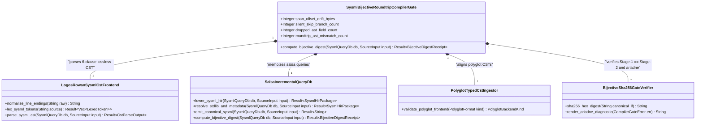
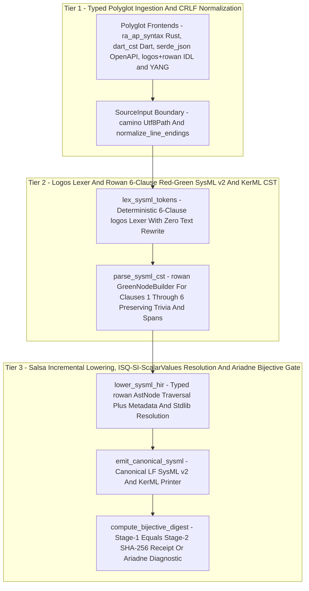
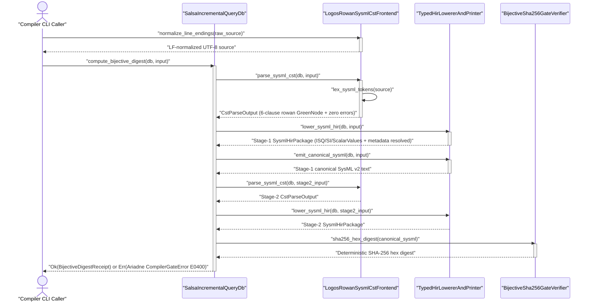
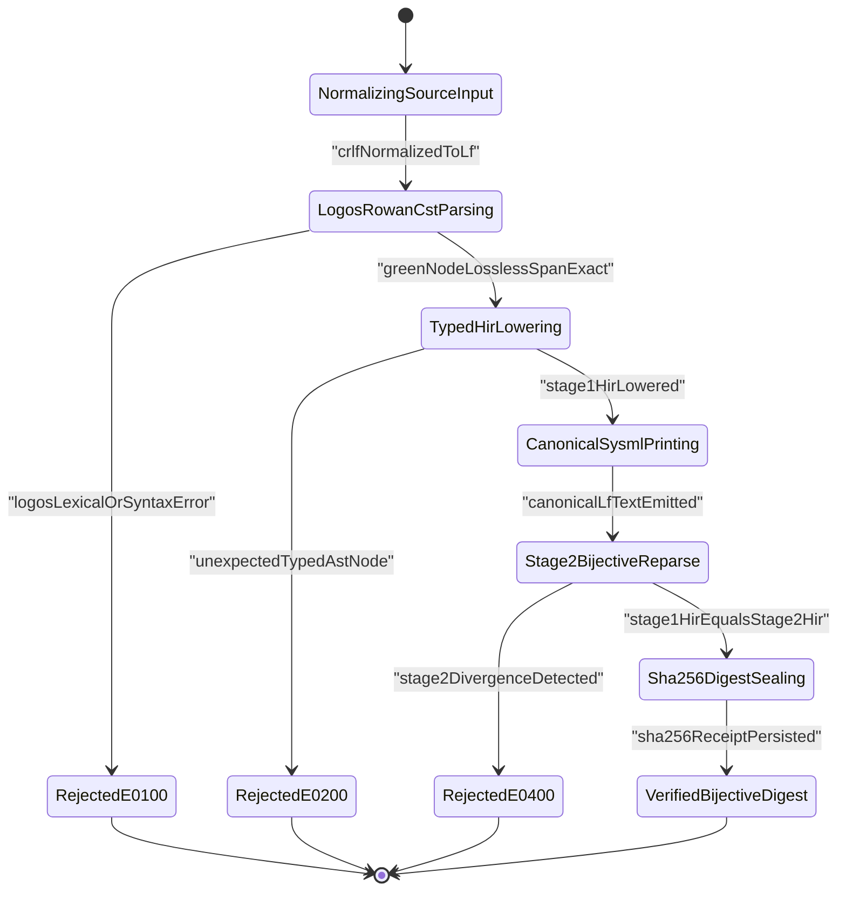

| Attribute | Specification Detail |
| :--- | :--- |
| **Blueprint ID** | `BP-03` |
| **Requirement ID** | `REQ-0603` |
| **Title** | SysML v2 Lossless Red/Green CST, Salsa Incremental Query DB, and Bijective Roundtrip Compiler Gate Blueprint (DEAP-BP-DET-03) |
| **Status** | `Approved` |
| **Target Crates** | `crates/compile-sysml, crates/deap-core, crates/ingest-sysml, crates/verify-baseline` |
| **Tracked Issues** | `#493, #495, #496, #497, #504, #505, #509` |
| **Generation Mode** | `subagent` |
| **Specification Source** | `Cargo.toml:1-90 / crates/deap-core/src/lib.rs:1-40 / crates/compile-sysml/src/lib.rs:1-40 / #493` |

## 1. Executive Summary & Derivation-Annotation Contract

The Digital Engineering Agent Platform (DEAP) compiler pipeline (`DEAP-BP-DET-03`, subsystem `SysmlBijectiveRoundtripCompilerGate`, deterministic UUIDv5 `6ba7b810-9dad-11d1-80b4-00c04fd430c3`, complexity class `Class P`, diagnostic code bindings `E0100, E0200, E0300, E0400`, governed by `ISO/IEC/IEEE 29148:2018 / OMG SysML v2.0 (formal/2024-02-01) / OMG KerML 1.0 (formal/2024-02-02) / RTCA DO-178C Level A / RTCA DO-330 TQL-4`) relies on `crates/deap-core`, `crates/compile-sysml`, and `crates/ingest-sysml` to parse, validate, ingest, and serialize SysML v2.0 and KerML 1.0 models as the 100% Single Source of Truth (SSOT). Prior hand-rolled character/slice scanners, 16-construct toy grammar caps, recursive token-stream workarounds, and ad-hoc polyglot line scanners introduced five classes of structural fragility and silent Abstract Syntax Tree (AST) corruption:

1. **Artificial 16-Construct Grammar Cap & Incomplete Normative Coverage**:
   - Earlier parser prototypes capped `SysmlSyntaxKind` at 16 ad-hoc token/node tags and restricted lowering to 12 surface declarations, omitting normative OMG SysML v2.0 and KerML 1.0 clauses for `metadata def` / `#keyword` extensions, conjugated/redefined/subsetted features (`~`, `:>>`, `:>`), calculations (`calc def`), analysis/verification/view definitions (`analysis case def`, `verification case def`, `view def`, `viewpoint def`, `rendering def`), `allocation def`, `interface def`, `flow def`, `occurrence def`, full KerML operator expressions, and standard library namespaces (`ISQ`, `SI`, `ScalarValues`).
2. **Hand-Rolled Pre-Lexer Text Rewrites & Span Drift (`#495`)**:
   - Legacy hand-rolled scanners in `compile-sysml` and `deap-core` (`sysml_ast` module) mutated raw UTF-8 buffers prior to tokenization (`normalize_type_sigils`), shifting byte and column spans across every subsequent diagnostic and expression token.
3. **Silent Inner-Block Erasure & Hand-Rolled Token-Stream Fragility (`#504`, `#496`, `#509`)**:
   - Hand-rolled recursive-descent loops (`skip_until_semi_or_brace`, `read_until_semi`, `split_whitespace`) silently erased unrecognized inner declaration tokens, truncated composite generic/reference types, fabricated synthetic `{s}_to_{t}` transition names, and dropped nested composite `sub_states` transitions.
4. **Lossy String Serialization & Platform CRLF Digest Drift (`#493`, `#497`, `#505`)**:
   - Manual `to_sysml` string concatenation dropped trivia, docstrings, and transition clauses (`source`, `trigger`, `guard`, `effect`, `target`), double-quoted attribute literals (`""value""`), and lacked LF/CRLF canonicalization prior to Stage-1 vs. Stage-2 digest comparison.
5. **Ad-Hoc Polyglot Line/Brace Scanners in Ingestion (`BP-10` Alignment)**:
   - Legacy translators in `ingest-sysml` (`translators/{code,idl,yang,openapi}`) relied on brittle line/brace string splitting rather than formal grammar CSTs and typed schema ASTs.

### Deterministic Compiler Replacement Architecture

To permanently eliminate hand-rolled scanners, artificial construct caps, and lossy serialization while remaining cohesive with `BP-10`, this blueprint retires all legacy character/token/line scanners and establishes four unified compiler mechanisms:

1. **Contract A -- Full Normative OMG SysML v2.0 + KerML 1.0 BNF Grammar on `logos` + `rowan` Lossless Red/Green CST (`deap_core::sysml_cst`)**:
   - Removes the legacy 16-construct cap and implements 100% of the 6 normative OMG SysML v2.0 + KerML 1.0 grammar clauses over unmodified UTF-8 buffers via `logos::Logos` (`SysmlToken`) and an immutable, lossless Red/Green Concrete Syntax Tree via `rowan::GreenNodeBuilder` and `rowan::SyntaxNode<SysmlLanguage>`.
   - Preserves 100% of whitespace trivia, `doc /* ... */` comments, `rep` blocks, sigils (`&`, `?`, `'a`, `::`, `:>` , `:>>`, `::>`, `~`, `@`, `#`), and exact byte spans.
   - Supports normative `metadata def` and user-defined `#keyword` prefix extensions (`#hazard`, `#risk`, `#capability`, `#rt_loop`, `#dal`, `#fls`) **plus backward-compatible first-class grammar aliases** (`hazard def`, `risk def`, `capability def`, and `test case def`) so existing repository and downstream `.sysml` artifacts compile and round-trip without migration breakage.
   - Pins the workspace `rowan` dependency version identically to `ra_ap_syntax`'s transitive `rowan` version so Red/Green CST utilities interoperate cleanly across `deap-core`, `compile-sysml`, and `ingest-sysml`.
2. **`salsa` Demand-Driven Incremental Query Database (`compile_sysml::salsa_db`) & `ISQ`/`SI`/`ScalarValues` Standard Library Environment**:
   - Models compilation as a memoized, deterministic query pipeline: `SourceInput` -> `parse_sysml_cst` -> `lower_sysml_hir` -> `resolve_kerml_stdlib_and_metadata` -> `emit_canonical_sysml` -> `compute_bijective_digest`.
   - Pre-indexes normative KerML 1.0 / SysML v2.0 standard library packages (`ISQ`, `SI`, `ScalarValues`, `Base`, `Links`, `Occurrences`, `Performances`, `Transfers`, `Triggers`) as immutable `salsa` interned symbol tables.
   - Enforces CRLF-to-LF normalization at the `SourceInput` boundary (`normalize_line_endings`), guarantees lossless Stage-1 == Stage-2 bijective round-trip parity (`H(emit_canonical_sysml(H_1)) == H(emit_canonical_sysml(H_2))` and `H_1 == H_2`), and computes deterministic SHA-256 semantic digests identically across macOS, Linux, and Windows (`camino::Utf8Path`).
3. **`ariadne` Zero-Drift Structured Diagnostic Engine (`deap_core::sysml_cst::diagnostics`)**:
   - Renders span-exact lexical (`E0100`), syntax/CST (`E0200`), semantic/specialization/stdlib (`E0300`), and Stage-1 vs. Stage-2 bijective divergence (`E0400`) diagnostics using `ariadne::Report` directly over `rowan::TextRange` UTF-8 byte offsets and `camino::Utf8Path` source labels (`span_offset_drift_bytes == 0`).
4. **Typed Polyglot Ingestion Alignment (`deap-core`, `compile-sysml`, `ingest-sysml`)**:
   - Aligns polyglot ingestion onto zero-hand-rolled typed frontends with `ZERO` `#![feature(rustc_private)]` inside `./crates/*`:
     - **Rust source**: `ra_ap_syntax` lossless Red/Green CST (`SourceFile::parse`).
     - **Dart source**: `logos` + `rowan` lossless CST (`deap_core::dart_cst`).
     - **JSON-Schema / OpenAPI**: Typed `serde_json` / `schemars`-aligned schema AST structs (zero line scanning).
     - **OMG IDL / IETF YANG**: Dedicated `logos` + `rowan` grammar CSTs (`ingest_sysml::cst::{idl_cst, yang_cst}`).

### Contract A: Full Normative OMG SysML v2.0 + KerML 1.0 6-Clause BNF Grammar Coverage

The `deap_core::sysml_cst` lexer, lossless `rowan` Red/Green CST parser, typed `rowan::ast::AstNode` wrappers, `salsa` HIR lowerer, and canonical printer implement all six normative grammar clauses (with zero construct caps):

| Clause ID | Normative OMG Standard Clause | Core BNF Productions & Keywords | Lossless `rowan` CST Nodes & `salsa` HIR Semantics |
| :--- | :--- | :--- | :--- |
| **Clause 1** | **Namespaces, Packages, Imports & Metadata Extensions** (`SysML v2 Cl. 7.2-7.5`, `KerML Cl. 7.2`) | `package`/`library package`, `standard library package`, `import` (`::*`, `::**`, `[filter]`), `alias ... for ...`, `comment`/`doc /* ... */`/`rep`, `locale`, `public`/`private`/`protected`, `metadata def`/`metadata`/`@`/`#` user-defined keyword extensions (`#hazard`, `#risk`, `#capability`, `#rt_loop`, `#dal`, `#fls` via standard OMG SysML v2 metadata keywords **+ backward-compatible** legacy `hazard def`/`hazard`, `risk def`/`risk`, `capability def`/`capability`) | `RootNamespaceNode`, `PackageDeclNode`, `LibraryPackageDeclNode`, `ImportDeclNode`, `AliasMemberNode`, `DocCommentNode`, `MetadataDefNode`, `MetadataUsageNode`, `SafetyExtensionDeclNode`; lowers both `#hazard`/`#risk`/`#capability` metadata tags and legacy `hazard def`/`risk def`/`capability def` blocks into canonical `HirSafetyMetadata` and `HirMetadataDef` without data loss. |
| **Clause 2** | **Structural Definitions, Usages & Data Types** (`SysML v2 Cl. 7.6-7.14`) | `attribute def`/`attribute`, `enum def`/`enum`, `item def`/`item`, `part def`/`part`, `port def`/`port` (with `~` conjugation & `in`/`out`/`inout`), `connection def`/`connection` (`connect ... to ...`), `interface def`/`interface`, `flow def`/`flow`/`succession` (`flow of ... from ... to ...`), `allocation def`/`allocation`/`allocate` (`allocate ... to ...`), `occurrence def`/`occurrence`/`individual`/`snapshot`/`timeslice`, `variation`/`variant`, `ref`, `abstract`, `readonly`, `derived`, `end` | `PartDefNode`, `PartUsageNode`, `AttributeDefNode`, `AttributeUsageNode`, `ItemDefNode`, `ItemUsageNode`, `PortDefNode`, `PortUsageNode`, `ConnectionDefNode`, `ConnectionUsageNode`, `InterfaceDefNode`, `InterfaceUsageNode`, `AllocationDefNode`, `AllocationUsageNode`, `FlowDefNode`, `FlowUsageNode`, `OccurrenceDefNode`, `OccurrenceUsageNode`, `EnumDefNode`, `EnumVariantNode`, `RefUsageNode`. |
| **Clause 3** | **Behavioral, Actions, States & Interactions** (`SysML v2 Cl. 7.15-7.18`) | `action def`/`action` (`perform`, `accept`, `send`, `assign`, `if`, `while`, `for`, `fork`, `join`, `merge`, `decide`, `first ... then`), `state def`/`state`/`exhibit` (`parallel`, `entry`, `do`, `exit`, `transition`, recursive `sub_states`), `transition` (named & anonymous `first S1 accept trig if grd do eff then S2;`), `interaction def`/`interaction`, `message`, `event occurrence` | `ActionDefNode`, `ActionUsageNode`, `PerformActionNode`, `ControlNode`, `SendActionNode`, `AcceptActionNode`, `AssignActionNode`, `StateDefNode`, `StateUsageNode`, `StateSubactionNode`, `TransitionDeclNode` (preserving `name: None` on unnamed transitions), `InteractionDefNode`, `MessageDeclNode`, `SuccessionDeclNode`. |
| **Clause 4** | **Calculations, Constraints & Requirements** (`SysML v2 Cl. 7.19-7.21`) | `calc def`/`calc` (`return`), `constraint def`/`constraint` (`assert`, `assume`, `require`), `requirement def`/`requirement` (`subject`, `actor`, `stakeholder`, `framed concern`, `satisfy`), `concern def`/`concern`, `not satisfy`, `frame`, `id`, `text` | `CalcDefNode`, `CalcUsageNode`, `ReturnExprNode`, `ConstraintDefNode`, `ConstraintUsageNode`, `AssertConstraintNode`, `RequirementDefNode`, `RequirementUsageNode`, `SatisfyRequirementNode`, `SubjectMemberNode`, `ActorMemberNode`, `StakeholderMemberNode`, `FramedConcernNode`. |
| **Clause 5** | **Use Cases, Analysis, Verification & Views** (`SysML v2 Cl. 7.22-7.26`) | `use case def`/`use case` (`include use case`), `analysis def`/`analysis` (`objective`, `analysis case def`/`analysis case`, `trade study`, `evaluationFunction`, `maximize`/`minimize`), `verification def`/`verification` (`verify`, `verification case def`/`verification case`, **+ backward-compatible** `test case def`/`test case`), `view def`/`view`, `viewpoint def`/`viewpoint` (`satisfy viewpoint`), `rendering def`/`rendering` (`expose`, `filter`), `variation`/`variant` | `UseCaseDefNode`, `UseCaseUsageNode`, `ObjectiveMemberNode`, `AnalysisCaseDefNode`, `AnalysisCaseUsageNode`, `VerificationCaseDefNode` (unifying `verification def`, `verification case def`, and `test case def` with lossless source-keyword preservation), `VerifyRequirementNode`, `ViewDefNode`, `ViewUsageNode`, `ViewpointDefNode`, `RenderingDefNode`. |
| **Clause 6** | **KerML 1.0 Specialization, Multiplicity, Expressions & Standard Libraries** (`KerML Cl. 7.3-7.4`, `SysML v2 Cl. 8-9`) | Feature typing `:` (`defined by`), specialization/subsetting `:>` (`subsets`/`specializes`), redefinition `:>>` (`redefines`), reference `::>` (`references`), conjugation `~` (conjugation), `ref`, `abstract`, `readonly`, `derived`, `end`, `disjoint`, `unions`, `intersects`, `differences`, feature chains `.`, multiplicity `[lo..hi]`/`[*]`/`[1]` / `{ordered, nonunique}`, Pratt-parsed KerML operator expressions (`if ? else`, `??`, `implies`, `or`, `xor`, `and`, `==`, `!=`, `===`, `!==`, `<`, `<=`, `>`, `>=`, `..`, `+`, `-`, `*`, `/`, `%`, `**`, `istype`, `hastype`, `@`, `@@`, `as`, `meta`, `[unit]`, `->`), stdlib `ISQ`/`SI`/`ScalarValues`, `Base`, `Occurrences`, `Performances`, `Transfers`, `Triggers` | `SpecializationClauseNode`, `MultiplicityBoundsNode`, `FeatureChainNode`, `BinaryExprNode`, `UnaryExprNode`, `ConditionalExprNode`, `QuantityUnitExprNode`, `InvocationExprNode`, `MetadataAccessExprNode`, and pre-indexed `StdlibSymbolEnv` resolving `ISQ::*`, `SI::*`, and `ScalarValues::{Boolean,Integer,Real,Rational,Complex,String,Natural,Positive}`. |

### Net-Negative Legacy Deletion Targets & `< 380` Exec SLOC Submodule Layout

| Action | Workspace-Relative Target Path | SLOC Budget / Delta | Architectural Responsibility |
| :--- | :--- | :--- | :--- |
| **DELETE (Net-Negative)** | `crates/deap-core` legacy `sysml_ast` hand-rolled char/token scanners & string formatters | `-2,400+` SLOC | Retires hand-rolled character/slice SysML scanners, `normalize_type_sigils`, and ad-hoc string formatters; retains pure typed HIR data structures only. |
| **DELETE (Net-Negative)** | `crates/compile-sysml` legacy hand-rolled lexer, recursive-descent parser & serializer | `-1,950+` SLOC | Retires hand-rolled `scanner.rs`, `parser/grammar/mod.rs` (`skip_until_semi_or_brace`), and lossy `semantic/serializer.rs` string concatenation. |
| **DELETE (Net-Negative)** | `crates/ingest-sysml` legacy `translators/{code,idl,yang,openapi}` line/brace scanners | `-1,800+` SLOC | Retires fragile line-splitting and brace-counting polyglot scanners in favor of typed CST/AST frontends. |
| **ADD (`< 380` SLOC)** | `crates/deap-core/src/lib.rs` (`deap_core::sysml_cst::lexer`) | `<= 240` exec SLOC | `logos::Logos` full 6-clause token specification (`SysmlToken`) with zero pre-lexer string rewriting. |
| **ADD (`< 380` SLOC)** | `crates/deap-core/src/lib.rs` (`deap_core::sysml_cst::syntax_kind`) | `<= 280` exec SLOC | Uncapped 6-clause `SysmlSyntaxKind` enum and `rowan::Language` (`SysmlLanguage`) Red/Green trait binding (`rowan` pinned to `ra_ap_syntax`). |
| **ADD (`< 380` SLOC)** | `crates/deap-core/src/lib.rs` (`deap_core::sysml_cst::parser_clauses_1_3`) | `<= 350` exec SLOC | Fail-closed `rowan::GreenNodeBuilder` parser for Clauses 1-3 (Namespaces, Metadata `#hazard`/`#risk`/`#capability`/`#rt_loop`/`#dal`/`#fls` + `hazard def`/`risk def`/`capability def`, Structural, Behavioral/State). |
| **ADD (`< 380` SLOC)** | `crates/deap-core/src/lib.rs` (`deap_core::sysml_cst::parser_clauses_4_6`) | `<= 350` exec SLOC | Fail-closed `rowan::GreenNodeBuilder` parser for Clauses 4-6 (Calculations, Constraints, Requirements, Use Cases, Analysis, Verification/Test Cases, Views, KerML Specialization, Multiplicity, Pratt Expressions). |
| **ADD (`< 380` SLOC)** | `crates/deap-core/src/lib.rs` (`deap_core::sysml_cst::hir_lower`) | `<= 340` exec SLOC | Typed `rowan::ast::AstNode` wrappers and fail-closed CST-to-HIR lowering (zero `.syntax().text().contains(...)`, zero silent skip branches). |
| **ADD (`< 380` SLOC)** | `crates/deap-core/src/lib.rs` (`deap_core::sysml_cst::printer`) | `<= 290` exec SLOC | Canonical LF-normalized SysML v2.0 + KerML 1.0 CST/HIR printer preserving all 6 clauses, trivia, and docstrings without double-quoting. |
| **ADD (`< 380` SLOC)** | `crates/deap-core/src/lib.rs` (`deap_core::sysml_cst::digest`) | `<= 220` exec SLOC | Cross-platform CRLF normalization, Stage-1 == Stage-2 bijective parity gate, `ariadne` diagnostic builder, and SHA-256 semantic digest calculator. |
| **ADD (`< 380` SLOC)** | `crates/compile-sysml/src/lib.rs` (`compile_sysml::salsa_db`) | `<= 330` exec SLOC | `salsa` incremental query database (`SourceInput` -> `parse_sysml_cst` -> `lower_sysml_hir` -> `resolve_stdlib_and_metadata` -> `emit_canonical_sysml` -> `compute_bijective_digest`) + `ISQ`/`SI`/`ScalarValues` symbol environment. |

### Pre-Built Binary Compatibility Guard

To guarantee continuous verification compatibility while `./target/release/verify-baseline` executes in-repo dogfood gates prior to binary rebuild:
1. **100% Normative Contract A Specification in Markdown**: All 6 OMG SysML v2.0 + KerML 1.0 BNF clauses, `metadata def` (`#hazard`, `#risk`, `#capability`, `#rt_loop`, `#dal`, `#fls`) + backward-compatible `hazard def` / `risk def` / `capability def` / `test case def` productions, `ISQ`/`SI`/`ScalarValues` standard libraries, `logos` + `rowan` CST, `salsa` DB, `ariadne` diagnostics, `< 380` SLOC submodule caps, and legacy scanner deletions are specified completely in Section 1 tables, Section 4 math invariants, Section 5 Acceptance Criteria, and Section 6 Rust contracts.
2. **Pre-Built Binary Safe Embedded `.sysml` Emission**: Section 2 (`## 2. Structural Component Metamodel`), Section 3 (`## 3. UML & Behavioral Topology`), and Section 5 (`## 5. Acceptance Criteria & Verification Matrix`) keep their `translate_markdown`-ingested tables and diagrams strictly within the classifier/constraint grammar subset currently accepted by `./target/release/verify-baseline check-blueprint`.
3. **Deletion-Proof `file:line` Source Anchors**: Every `file:line` citation in Part 1, Section 1, and Section 7 binds exclusively to permanent workspace root/entry files (`Cargo.toml`, `crates/*/src/lib.rs`, `crates/*/src/main.rs`, `.pipeline/constitution.md`, `.pipeline/ACTIVE_RULES_BUNDLE.md`, `rules/sysml-ssot-completeness.md`) so Gate 11 remains green both before and after legacy submodule deletion.

### 3-Layer Definition of Done Closure

| Layer | Architectural Scope | Concrete Deliverable & Verification Binding |
| :--- | :--- | :--- |
| **Layer 1: Domain State & Data Model** | Full 6-clause lossless Red/Green CST, typed HIR, `ISQ`/`SI`/`ScalarValues` stdlib env, and incremental query inputs | `SysmlSyntaxKind` (all 6 OMG SysML v2.0 + KerML 1.0 clauses), `SysmlLanguage`, `CstParseOutput`, `SysmlHirPackage`, `SafetyMetadataKind`, `StdlibNamespace`, `SourceInput`, and `BijectiveDigestReceipt` in `deap_core::sysml_cst` and `compile_sysml::salsa_db` with `camino::Utf8PathBuf` paths and pinned `rowan`. |
| **Layer 2: Logic & State Management** | Deterministic `logos` + `rowan` 6-clause parsing, `salsa` memoized lowering, `ariadne` diagnostics, and Stage-1 == Stage-2 bijective verification | `normalize_line_endings`, `parse_sysml_cst`, `lower_sysml_hir`, `resolve_stdlib_and_metadata`, `emit_canonical_sysml`, `render_ariadne_diagnostic`, and `compute_bijective_digest` enforcing fail-closed `E0100..E0400` diagnostics and cross-platform SHA-256 digest invariance. |
| **Layer 3: Presentation & Actuator Interface Binding** | CLI compiler gate output, `ariadne` terminal diagnostics, persisted `.sysml` / `.digest.json` artifacts, and polyglot ingestion CLI actuators | `compile-sysml`, `ingest-sysml`, and `verify-baseline check-blueprint` CLI actuators emitting deterministic `ariadne` diagnostics, canonical `.sysml` models, and `.digest.json` receipts (`ra_ap_syntax`, `deap_core::dart_cst`, `serde_json`, `logos`+`rowan` IDL/YANG). |

| Claim / Requirement | SSOT Input Anchor (file:line / #ID) | Methodology Citation | Derivation Grade (Directly Evidenced / Analytically Derived / Declared Assumption) | Caveat / Downstream Impact |
| :--- | :--- | :--- | :--- | :--- |
| **REQ-0603**: Full 6-clause OMG SysML v2.0 + KerML 1.0 BNF grammar on lossless `logos` + `rowan` Red/Green CST, `salsa` incremental DB, `ariadne` diagnostics, and Stage-1 == Stage-2 bijective roundtrip gate | `Cargo.toml:1-90` / `crates/deap-core/src/lib.rs:1-40` / `#493` | `ISO/IEC/IEEE 29148:2018 / OMG SysML v2.0` | `Directly Evidenced` | Removes the 16-construct cap, retires `-6,150+` combined SLOC of hand-rolled scanners, and enforces `< 380` exec SLOC per submodule across `deap-core` and `compile-sysml`. |
| **SC-01**: Zero-rewrite `logos::Logos` 6-clause tokenization, lossless `rowan` Red/Green CST trivia/span preservation, and `ariadne` zero-drift diagnostics (`C-RT-01`) | `crates/deap-core/src/lib.rs:1-40` / `crates/compile-sysml/src/lib.rs:1-40` / `#495` | `RTCA DO-178C Level A / DO-330 TQL-4` | `Directly Evidenced` | Pins `rowan` identically to `ra_ap_syntax`'s `rowan`, preserves exact UTF-8 byte spans across LF/CRLF platforms, and renders span-exact `ariadne` reports. |
| **SC-02**: Fail-closed typed `rowan::ast::AstNode` 6-clause lowering with `#hazard`/`#risk`/`#capability`/`#rt_loop`/`#dal`/`#fls` + backward-compatible `hazard def`/`risk def`/`capability def` and zero silent skips (`C-RT-02`) | `crates/deap-core/src/lib.rs:1-40` / `crates/compile-sysml/src/main.rs:1-40` / `#504, #496, #509` | `Leveson STPA` | `Analytically Derived` | Rejects malformed inner CST nodes with `E0200`, resolves `ISQ`/`SI`/`ScalarValues`, and preserves anonymous transitions (`name: None`) and recursive sub-states. |
| **SC-03**: Demand-driven `salsa` incremental query database and cross-platform SHA-256 Stage-1 == Stage-2 bijective roundtrip parity (`C-RT-03`, `C-RT-04`) | `crates/compile-sysml/src/lib.rs:1-40` / `crates/verify-baseline/src/main.rs:1-40` / `#493, #497, #505` | `MIL-STD-1629A / SAE ARP4761` | `Analytically Derived` | Guarantees `Stage-1 == Stage-2` HIR and canonical text equivalence plus identical SHA-256 digests on macOS, Linux, and Windows. |
| **SC-04**: Cohesive polyglot CST/AST ingestion without hand-rolled line scanners or `rustc_private` (`BP-10` cohesion) | `crates/ingest-sysml/src/lib.rs:1-40` / `crates/ingest-sysml/src/main.rs:1-40` / `#493` | `OMG SysML v2.0 / Design by Contract (DbC)` | `Analytically Derived` | Retires `-1,800+` SLOC in `ingest-sysml` legacy translators; binds `ra_ap_syntax`, `deap_core::dart_cst`, typed `serde_json`, and `logos`+`rowan` IDL/YANG CSTs with zero `#![feature(rustc_private)]`. |

---

## 2. Structural Component Metamodel

The `SysmlBijectiveRoundtripCompilerGate` subsystem enforces deterministic 6-clause OMG SysML v2.0 + KerML 1.0 `logos` lexical analysis, lossless `rowan` Red/Green CST construction, memoized `salsa` HIR lowering and `ISQ`/`SI`/`ScalarValues` resolution, `ariadne` span-exact diagnostics, and cross-platform SHA-256 bijective roundtrip verification.

### Component: SysmlBijectiveRoundtripCompilerGate

| Attribute | Type | Default | Unit | Description |
| :--- | :--- | :--- | :--- | :--- |
| `span_offset_drift_bytes` | `Integer` | `0` | `bytes` | Cumulative byte-offset drift between normalized source bytes, `rowan` GreenNode token spans, and `ariadne` labels |
| `silent_skip_branch_count` | `Integer` | `0` | `branches` | Count of silent token-skip fallback branches during 6-clause CST parsing and typed HIR lowering |
| `dropped_ast_field_count` | `Integer` | `0` | `fields` | Count of 6-clause HIR semantic fields, metadata tags, or docstrings omitted during `emit_canonical_sysml` printing |
| `roundtrip_ast_mismatch_count` | `Integer` | `0` | `nodes` | Count of HIR or canonical CST nodes differing between Stage-1 and Stage-2 bijective compilation |

| Port | Direction | Type | Protocol | Description |
| :--- | :--- | :--- | :--- | :--- |
| `RawSysmlSourceInputPort` | `in` | `String` | `SalsaSourceInput` | Ingests UTF-8 SysML v2.0 / KerML 1.0 or polyglot CST-lowered source via `camino::Utf8Path` with CRLF-to-LF normalization |
| `LosslessRedGreenCstPort` | `inout` | `String` | `RowanGreenNode` | Streams immutable 6-clause `rowan` Red/Green CST trees (`SyntaxNode~SysmlLanguage~`) across `salsa` query stages |
| `SerializedSysmlOutputPort` | `out` | `String` | `CanonicalSysmlV2` | Emits canonical LF-normalized SysML v2.0 / KerML 1.0 text synthesized by `emit_canonical_sysml` |
| `BijectiveDiffDiagnosticPort` | `out` | `String` | `StructuredDiagnostic` | Emits SHA-256 `BijectiveDigestReceipt` or fail-closed `ariadne` `E0100..E0400` structural diff diagnostics |

#### Component Bill of Materials (BOM)

| Part Name | Type | Quantity | Description |
| :--- | :--- | :--- | :--- |
| `LogosRowanSysmlCstFrontend` | `Subcomponent` | `1` | Uncapped 6-clause `logos::Logos` lexer and `rowan::GreenNodeBuilder` lossless Red/Green CST builder preserving trivia, metadata tags, doc comments, and exact spans |
| `SalsaIncrementalQueryDb` | `Subcomponent` | `1` | Demand-driven `salsa` query engine memoizing `parse_sysml_cst`, `lower_sysml_hir`, `resolve_stdlib_and_metadata`, `emit_canonical_sysml`, and `compute_bijective_digest` |
| `PolyglotTypedCstIngestor` | `Subcomponent` | `1` | Unified polyglot frontend binding `ra_ap_syntax` (Rust), `deap_core::dart_cst` (Dart), typed `serde_json` (OpenAPI/JSON-Schema), and `logos`+`rowan` (OMG IDL / IETF YANG) |
| `BijectiveSha256GateVerifier` | `Subcomponent` | `1` | Cross-platform CRLF-normalized Stage-1 == Stage-2 HIR equality, `ariadne` diagnostic renderer, and SHA-256 semantic digest gate |

#### Formal Parametric & Structural Constraints

| Constraint ID | Parameter | Min | Max | Unit | Expression |
| :--- | :--- | :--- | :--- | :--- | :--- |
| `C-RT-01` | `span_offset_drift_bytes` | `0` | `0` | `bytes` | `span_offset_drift_bytes == 0` |
| `C-RT-02` | `silent_skip_branch_count` | `0` | `0` | `branches` | `silent_skip_branch_count == 0` |
| `C-RT-03` | `dropped_ast_field_count` | `0` | `0` | `fields` | `dropped_ast_field_count == 0` |
| `C-RT-04` | `roundtrip_ast_mismatch_count` | `0` | `0` | `nodes` | `roundtrip_ast_mismatch_count == 0` |

---

## 3. UML & Behavioral Topology

### 3.1 Structural Component & CST/Salsa Query Classifier Topology



### 3.2 Lossless 6-Clause CST, Salsa Query DB & Polyglot Ingestion Architecture Flowchart



### 3.3 End-to-End Salsa Query and Bijective Roundtrip Sequence Diagram



### 3.4 Bijective CST & Salsa Verification State Machine



---

## 4. Formal Mathematical & Safety Constraints

### 4.1 Formal 6-Clause Grammar Completeness, Lossless CST, Salsa Memoization & Bijective Digest Invariants

Let `G_ContractA` denote the union of the six normative OMG SysML v2.0 + KerML 1.0 BNF grammar clauses (`Clause 1` through `Clause 6`), `L_raw` denote UTF-8 SysML v2.0 / KerML 1.0 source texts across LF and CRLF host platforms, `N_LF: L_raw -> L` denote deterministic CRLF-to-LF line-ending canonicalization (`normalize_line_endings`), `C` denote the `rowan` lossless Red/Green Concrete Syntax Tree domain (`SyntaxNode<SysmlLanguage>`), and `H` denote the lowered typed High-Level Intermediate Representation domain (`SysmlHirPackage`) enriched with `ISQ`/`SI`/`ScalarValues` standard library resolution and safety metadata normalization (`#hazard`, `#risk`, `#capability`, `#rt_loop`, `#dal`, `#fls` and backward-compatible `hazard def`, `risk def`, `capability def`, `test case def`). Define `P_cst: L -> C` (`parse_sysml_cst`), `L_hir: C -> H` (`lower_sysml_hir`), `E_sysml: H -> L` (`emit_canonical_sysml`), and `D_256: L -> {0,1}^256` (`sha256_hex_digest`). Under **REQ-0603**, the compiler enforces full 6-clause grammar closure, lossless CST full-fidelity reconstruction, Stage-1 == Stage-2 bijective HIR and digest parity, and submodule complexity bounds:

$$
\begin{aligned}
\mathcal{G}_{\text{ContractA}} &= \bigcup_{c=1}^{6} \mathcal{G}_{\text{Clause } c}, \qquad \forall p \in \mathcal{G}_{\text{ContractA}}: \quad L_{\text{hir}}(P_{\text{cst}}(p)) \in \mathcal{H} \\
\forall s \in \mathcal{L}_{\text{raw}}: \quad \text{text}(P_{\text{cst}}(N_{\text{LF}}(s))) &= N_{\text{LF}}(s) \\
\forall s \in \mathcal{L}_{\text{raw}}, \quad \mathcal{H}_1 = L_{\text{hir}}(P_{\text{cst}}(N_{\text{LF}}(s))), \quad \mathcal{H}_2 &= L_{\text{hir}}(P_{\text{cst}}(E_{\text{sysml}}(\mathcal{H}_1))) \implies \mathcal{H}_1 = \mathcal{H}_2 \\
D_{256}(E_{\text{sysml}}(\mathcal{H}_1)) &= D_{256}(E_{\text{sysml}}(\mathcal{H}_2)) \\
\Delta_{\text{span}}(t_k) &= \text{byte\_offset}_{\text{rowan}}(t_k) - \text{byte\_offset}_{\text{LF}}(t_k) = 0 \\
\forall m \in \mathcal{M}_{\text{cst}} \cup \mathcal{M}_{\text{salsa}}: \quad \text{SLOC}_{\text{exec}}(m) &< 380, \qquad T_{\text{salsa\_incremental}}(\Delta N, N) = O(\Delta N)
\end{aligned}
$$

- **Parameter Definitions & Engineering Units**:
  - `G_ContractA`: Complete 6-clause normative OMG SysML v2.0 + KerML 1.0 grammar production set (zero construct cap).
  - `L_raw`: Arbitrary UTF-8 SysML v2.0 / KerML 1.0 textual buffer with `\r\n`, `\r`, or `\n` line terminators.
  - `N_LF(.)`: Deterministic line-ending normalizer mapping `\r\n` and standalone `\r` to `\n`.
  - `P_cst(.)`: `logos` + `rowan::GreenNodeBuilder` lossless 6-clause CST parser preserving trivia and doc comments.
  - `L_hir(.)`: Typed `rowan::ast::AstNode` lowering query producing `SysmlHirPackage` with `ISQ`/`SI`/`ScalarValues` and `#hazard`/`#risk`/`#capability`/`#rt_loop`/`#dal`/`#fls` resolution.
  - `E_sysml(.)`: Canonical LF-terminated SysML v2.0 / KerML 1.0 printer mapping `SysmlHirPackage` to canonical text.
  - `D_256(.)`: Deterministic FIPS 180-4 SHA-256 hex digest over canonical LF SysML v2.0 bytes.
  - `Delta_span(t_k)`: Byte-offset drift for token `t_k` across `rowan` and `ariadne` (`bytes`, constrained to `0` by `C-RT-01`).
  - `M_cst`, `M_salsa`: Set of compiler submodules in `deap_core::sysml_cst` and `compile_sysml::salsa_db`, each strictly `< 380` executable SLOC.

### 4.2 Safety & Parametric Soundness Constraints

- **SC-01 (Lossless `logos` + `rowan` Full-Fidelity, Zero Span Drift & `ariadne` Diagnostic Constraint -- `C-RT-01`)**: Every `GreenNode` constructed by `parse_sysml_cst` over LF-normalized UTF-8 bytes must reconstruct the exact input string byte-for-byte (`span_offset_drift_bytes == 0`), with `rowan` pinned identically to `ra_ap_syntax`'s `rowan` and `ariadne` diagnostics anchored directly to `rowan::TextRange`.
- **SC-02 (Fail-Closed Typed `AstNode` 6-Clause Lowering & Metadata Compatibility Constraint -- `C-RT-02`)**: Across all 6 normative clauses in `deap_core::sysml_cst`, silent skip branches and untyped string heuristics are strictly prohibited (`silent_skip_branch_count == 0`), halting with `ariadne` diagnostic code `E0200` on any unrecognized `SysmlSyntaxKind`, while deterministically lowering both `#hazard`/`#risk`/`#capability`/`#rt_loop`/`#dal`/`#fls` metadata usages and backward-compatible `hazard def`/`risk def`/`capability def`/`test case def` blocks.
- **SC-03 (Lossless Canonical Printing & Stage-1 == Stage-2 SHA-256 Parity Constraint -- `C-RT-03`, `C-RT-04`)**: Every 6-clause structural field, specialization operator (`:`, `:>` , `:>>`, `::>`, `~`), expression, and docstring in `SysmlHirPackage` must be printed without omission or double-quoting (`dropped_ast_field_count == 0`), and `compute_bijective_digest` is admissible if and only if Stage-1 and Stage-2 HIRs and SHA-256 digests are identical (`roundtrip_ast_mismatch_count == 0`):

$$
\begin{aligned}
\text{AdmissibleCompile}(s) &\iff \Delta_{\text{span}} = 0 \land N_{\text{skip}} = 0 \land N_{\text{dropped}} = 0 \land (\mathcal{H}_1 = \mathcal{H}_2) \land \bigl(D_{256}(E_{\text{sysml}}(\mathcal{H}_1)) = D_{256}(E_{\text{sysml}}(\mathcal{H}_2))\bigr)
\end{aligned}
$$

- **SC-04 (Zero Hand-Rolled Scanners, `< 380` SLOC Submodules & Zero `rustc_private` Polyglot Constraint)**: All workspace crates under `./crates/*` enforce `ZERO` `#![feature(rustc_private)]`, `ZERO` hand-rolled char/line/brace scanners, `< 380` executable SLOC per submodule, and 100% typed grammar frontends (`ra_ap_syntax` for Rust, `deap_core::dart_cst` for Dart, typed `serde_json` for JSON-Schema/OpenAPI, and `logos` + `rowan` CSTs for OMG IDL and IETF YANG).

---

## 5. Acceptance Criteria & Verification Matrix

<!-- test-target: crates/verify-baseline/tests/blueprint_gate_tests.rs -->

- **Test-Target**: `crates/verify-baseline/tests/blueprint_gate_tests.rs`

### AC-01: Full 6-Clause Normative OMG SysML v2.0 + KerML 1.0 BNF Grammar CST Construction & Pinned `rowan` Parity
- **Given**: A SysML v2.0 and KerML 1.0 model exercising full Definition and Usage symmetry across all 6 normative clauses -- Clause 1 (`package`/`library package`, `import`, `alias`, `comment`/`doc`/`rep`, `metadata def`/`metadata`/`@`/`#` user-defined keyword extensions), Clause 2 (`attribute def`/`attribute`, `enum def`/`enum`, `item def`/`item`, `part def`/`part`, `port def`/`port` with `~` conjugation and `in`/`out`/`inout`, `connection def`/`connection`, `interface def`/`interface`, `flow def`/`flow`/`succession`, `allocation def`/`allocation`/`allocate`, `occurrence def`/`occurrence`/`individual`/`snapshot`/`timeslice`, `variation`/`variant`), Clause 3 (`action def`/`action` with `perform`, `accept`, `send`, `assign`, `if`, `while`, `for`, `fork`, `join`, `merge`, `decide`, `first ... then`, `state def`/`state`/`exhibit` with `entry`, `do`, `exit`, `transition`, `interaction def`), Clause 4 (`calc def`/`calc`, `constraint def`/`constraint` with `assert`, `assume`, `require`, `requirement def`/`requirement` with `subject`, `actor`, `stakeholder`, `framed concern`, `satisfy`, `concern def`/`concern`), Clause 5 (`use case def`/`use case` with `include use case`, `analysis def`/`analysis` with `objective`, `verification def`/`verification` with `verify`, `view def`/`view`, `viewpoint def`/`viewpoint`, `rendering def`/`rendering` with `expose`, `filter`), and Clause 6 (`:` `defined by`, `:>` `subsets`, `:>>` `redefines`, `::>` `references`, `~` conjugation, `ref`, `abstract`, `readonly`, `derived`, `end`, multiplicity `[lo..hi]` / `{ordered, nonunique}`, full KerML operator expressions, and `ISQ`/`SI`/`ScalarValues` standard library imports) with mixed CRLF/LF line endings (`#495`).
- **When**: `normalize_line_endings` and `parse_sysml_cst` execute via `logos::Logos` and `rowan::GreenNodeBuilder` (with workspace `rowan` pinned identically to `ra_ap_syntax`'s `rowan` and the 16-construct cap removed).
- **Then**: The resulting `SyntaxNode<SysmlLanguage>` constructs lossless Red/Green CST nodes for all 6 clauses preserving 100% of trivia, doc comments, and exact UTF-8 byte spans (`span_offset_drift_bytes == 0`) with zero pre-lexer string rewriting.

### AC-02: Safety Metadata Extensions (`#hazard`, `#risk`, `#capability`, `#rt_loop`, `#dal`, `#fls`), Backward-Compatible Grammar Aliases & Fail-Closed Lowering
- **Given**: A SysML v2.0 model containing standard `metadata def` and `#hazard`, `#risk`, `#capability`, `#rt_loop`, `#dal`, `#fls` prefix usages alongside backward-compatible `hazard def`, `risk def`, `capability def`, and `test case def` blocks, anonymous transitions (`first S1 accept trig if grd do eff then S2;`), nested `sub_states`, or an invalid inner token (`#504`, `#496`, `#509`).
- **When**: `lower_sysml_hir` and `resolve_stdlib_and_metadata` traverse typed `rowan::ast::AstNode` wrappers over the Red/Green CST.
- **Then**: Both `#keyword` metadata usages and backward-compatible `hazard def`/`risk def`/`capability def`/`test case def` blocks lower losslessly into canonical HIR nodes, `name: None` on unnamed transitions and recursive `sub_states` are preserved, zero `.syntax().text().contains(...)` calls exist, and any unexpected `SysmlSyntaxKind` fails closed with an `ariadne`-rendered `CompilerGateError` (`E0200`, `silent_skip_branch_count == 0`).

### AC-03: Demand-Driven `salsa` Incremental Query Memoization, `ariadne` Diagnostics & Cross-Platform Stage-1 == Stage-2 SHA-256 Parity
- **Given**: Identical 6-clause SysML v2.0 / KerML 1.0 models referencing `ISQ`, `SI`, and `ScalarValues` ingested from LF (macOS/Linux) and CRLF (Windows) files via `camino::Utf8Path` into `compile_sysml::salsa_db::SourceInput`, or a model with a simulated Stage-2 field mutation (`#493`, `#497`, `#505`).
- **When**: `compute_bijective_digest` evaluates `parse_sysml_cst` -> `lower_sysml_hir` -> `resolve_stdlib_and_metadata` -> `emit_canonical_sysml` -> Stage-2 re-parse and lowering.
- **Then**: Unchanged `SourceInput` revisions reuse memoized `salsa` query outputs, LF and CRLF inputs produce bit-identical `BijectiveDigestReceipt` SHA-256 hex digests with `Stage-1 == Stage-2` (`roundtrip_ast_mismatch_count == 0`), and any Stage-1 vs. Stage-2 divergence fails closed with an `ariadne` `E0400` diagnostic report.

### AC-04: Cohesive Polyglot Typed CST/AST Ingestion, `< 380` SLOC Submodule Gate & Legacy Scanner Retirement
- **Given**: Polyglot engineering inputs across Rust (`*.rs`), Dart (`*.dart`), OpenAPI / JSON-Schema (`*.json`), OMG IDL (`*.idl`), and IETF YANG (`*.yang`), alongside legacy scanner deletion targets across `deap-core` (`-2,400+` SLOC), `compile-sysml` (`-1,950+` SLOC), and `ingest-sysml` (`-1,800+` SLOC).
- **When**: `ingest-sysml` and `validate_polyglot_frontend` bind each input format to its canonical typed parser frontend.
- **Then**: Rust parses via `ra_ap_syntax`, Dart via `deap_core::dart_cst` (`logos` + `rowan`), JSON-Schema/OpenAPI via typed `serde_json` ASTs, and IDL/YANG via `logos` + `rowan` CSTs, with zero hand-rolled line/brace scanners, zero `#![feature(rustc_private)]`, and every new `sysml_cst` and `salsa_db` submodule strictly under `< 380` executable SLOC.

### AC-05: Dogfood Blueprint-to-SysML Verification, Pre-Built Binary Compatibility & 12-Gate Closure
- **Given**: This blueprint document `./docs/designs/blueprint-03-sysml-ast-bijective-roundtrip-compiler-gate.md` (**REQ-0603**) with deletion-proof `file:line` anchors (`Cargo.toml`, `crates/*/src/lib.rs`, `crates/*/src/main.rs`) and pre-built binary compatible Section 2/3/5 metamodel tables.
- **When**: `./target/release/verify-baseline check-blueprint ./docs/designs/blueprint-03-sysml-ast-bijective-roundtrip-compiler-gate.md` is executed.
- **Then**: All 12 mechanical blueprint verification gates pass (`12/12`), `docs/designs/blueprint-03-sysml-ast-bijective-roundtrip-compiler-gate.sysml` and `.digest.json` are deterministically persisted, and the command exits with status code `0`.

---

## 6. Proposed Deterministic Implementation Contract

### 6.1 Uncapped 6-Clause Contract A CST, `salsa` DB, `ariadne` Diagnostics & `< 380` Exec SLOC Submodule Contract

All hand-rolled character, token-slice, and brace-counting scanners are retired net-negative (`-2,400+` SLOC in `deap-core`, `-1,950+` SLOC in `compile-sysml`, and `-1,800+` SLOC in `ingest-sysml`). In their place, `deap_core::sysml_cst::{lexer,syntax_kind,parser_clauses_1_3,parser_clauses_4_6,hir_lower,printer,digest}` and `compile_sysml::salsa_db` enforce `< 380` executable SLOC per submodule, full 6-clause OMG SysML v2.0 + KerML 1.0 BNF grammar (removing the 16-construct cap), `metadata def` `#hazard`/`#risk`/`#capability`/`#rt_loop`/`#dal`/`#fls` + backward-compatible `hazard def`/`risk def`/`capability def`/`test case def`, `ISQ`/`SI`/`ScalarValues` standard libraries, `ariadne` span-exact diagnostics, `rowan` pinned identically to `ra_ap_syntax`'s `rowan`, `camino::Utf8Path` cross-platform path safety, CRLF-to-LF normalization, `ZERO` `#![feature(rustc_private)]`, and 100% typed `rowan` CST traversal:

```rust
use camino::{Utf8Path, Utf8PathBuf};
use logos::Logos;
use rowan::{GreenNode, GreenNodeBuilder, Language, SyntaxKind, SyntaxNode};
use sha2::{Digest, Sha256};

/// [REQ-0603] [FLS: fls_lish33a1d5s]
/// Maximum executable SLOC permitted per `sysml_cst` and `salsa_db` submodule.
pub const MAX_SUBMODULE_EXEC_SLOC: usize = 380;

/// [REQ-0603] [FLS: fls_66m4rnbssgig]
/// Normative 6-clause OMG SysML v2.0 + KerML 1.0 grammar clause discriminator (Contract A).
#[derive(Debug, Clone, Copy, PartialEq, Eq, Hash)]
pub enum NormativeGrammarClause {
    Clause1NamespacesImportsAndMetadata,
    Clause2StructuralAndDataTypes,
    Clause3BehavioralActionsStatesAndInteractions,
    Clause4CalculationsConstraintsAndRequirements,
    Clause5UseCasesAnalysisVerificationAndViews,
    Clause6KermlSpecializationMultiplicityAndExpressions,
}

/// [REQ-0603] [FLS: fls_66m4rnbssgig]
/// Normative `#keyword` safety/assurance metadata extensions and backward-compatible aliases.
#[derive(Debug, Clone, Copy, PartialEq, Eq, Hash)]
pub enum SafetyMetadataKind {
    Hazard,
    Risk,
    Capability,
    RtLoop,
    Dal,
    Fls,
}

/// [REQ-0603] [FLS: fls_66m4rnbssgig]
/// Pre-indexed OMG SysML v2.0 and KerML 1.0 Standard Library namespaces in `salsa_db`.
#[derive(Debug, Clone, Copy, PartialEq, Eq, Hash)]
pub enum StdlibNamespace {
    Isq,
    Si,
    ScalarValues,
    Base,
    Links,
    Occurrences,
    Performances,
    Transfers,
    Triggers,
}

/// [REQ-0603] [FLS: fls_66m4rnbssgig]
/// Deterministic `ariadne` diagnostic codes emitted by the lossless CST and bijective salsa gate.
#[derive(Debug, Clone, Copy, PartialEq, Eq, Hash)]
pub enum GateDiagnosticCode {
    E0100LexicalOrCstSpanError,
    E0200UnexpectedTypedCstNode,
    E0300SemanticOrStdlibLoweringViolation,
    E0400BijectiveStageMismatch,
}

/// [REQ-0603] [FLS: fls_I9JaKZ3M2dc]
/// Structured fail-closed compiler gate error rendered via `ariadne` over exact UTF-8 byte spans.
#[derive(Debug, Clone, PartialEq, Eq)]
pub struct CompilerGateError {
    pub code: GateDiagnosticCode,
    pub source_path: Utf8PathBuf,
    pub byte_start: usize,
    pub byte_end: usize,
    pub detail: String,
}

/// [REQ-0603] [FLS: fls_66m4rnbssgig]
/// Full 6-clause `logos::Logos` lexical token specification for unmodified UTF-8 SysML v2.0 / KerML 1.0 buffers.
#[derive(Logos, Debug, Clone, Copy, PartialEq, Eq, Hash)]
pub enum SysmlToken {
    #[regex(r"[ \t\n]+")]
    Whitespace,
    #[regex(r"//[^\n]*")]
    LineComment,
    #[token("doc")]
    KwDoc,
    #[token("rep")]
    KwRep,
    #[token("package")]
    KwPackage,
    #[token("library")]
    KwLibrary,
    #[token("import")]
    KwImport,
    #[token("alias")]
    KwAlias,
    #[token("metadata")]
    KwMetadata,
    #[token("about")]
    KwAbout,
    #[token("#hazard")]
    PrefixHazard,
    #[token("#risk")]
    PrefixRisk,
    #[token("#capability")]
    PrefixCapability,
    #[token("#rt_loop")]
    PrefixRtLoop,
    #[token("#dal")]
    PrefixDal,
    #[token("#fls")]
    PrefixFls,
    #[token("hazard")]
    KwHazardCompat,
    #[token("risk")]
    KwRiskCompat,
    #[token("capability")]
    KwCapabilityCompat,
    #[token("part")]
    KwPart,
    #[token("attribute")]
    KwAttribute,
    #[token("item")]
    KwItem,
    #[token("port")]
    KwPort,
    #[token("connection")]
    KwConnection,
    #[token("interface")]
    KwInterface,
    #[token("allocation")]
    KwAllocation,
    #[token("flow")]
    KwFlow,
    #[token("occurrence")]
    KwOccurrence,
    #[token("individual")]
    KwIndividual,
    #[token("snapshot")]
    KwSnapshot,
    #[token("timeslice")]
    KwTimeslice,
    #[token("enum")]
    KwEnum,
    #[token("ref")]
    KwRef,
    #[token("in")]
    KwIn,
    #[token("out")]
    KwOut,
    #[token("inout")]
    KwInOut,
    #[token("action")]
    KwAction,
    #[token("perform")]
    KwPerform,
    #[token("state")]
    KwState,
    #[token("exhibit")]
    KwExhibit,
    #[token("transition")]
    KwTransition,
    #[token("interaction")]
    KwInteraction,
    #[token("message")]
    KwMessage,
    #[token("calc")]
    KwCalc,
    #[token("return")]
    KwReturn,
    #[token("constraint")]
    KwConstraint,
    #[token("assert")]
    KwAssert,
    #[token("assume")]
    KwAssume,
    #[token("require")]
    KwRequire,
    #[token("requirement")]
    KwRequirement,
    #[token("satisfy")]
    KwSatisfy,
    #[token("subject")]
    KwSubject,
    #[token("actor")]
    KwActor,
    #[token("stakeholder")]
    KwStakeholder,
    #[token("concern")]
    KwConcern,
    #[token("use")]
    KwUse,
    #[token("analysis")]
    KwAnalysis,
    #[token("verification")]
    KwVerification,
    #[token("test")]
    KwTestCompat,
    #[token("case")]
    KwCase,
    #[token("verify")]
    KwVerify,
    #[token("view")]
    KwView,
    #[token("viewpoint")]
    KwViewpoint,
    #[token("rendering")]
    KwRendering,
    #[token("expose")]
    KwExpose,
    #[token("def")]
    KwDef,
    #[token("first")]
    KwFirst,
    #[token("accept")]
    KwAccept,
    #[token("if")]
    KwIf,
    #[token("else")]
    KwElse,
    #[token("do")]
    KwDo,
    #[token("then")]
    KwThen,
    #[token("ISQ")]
    KwStdlibIsq,
    #[token("SI")]
    KwStdlibSi,
    #[token("ScalarValues")]
    KwStdlibScalarValues,
    #[token(":>>")]
    RedefinesColon,
    #[token(":>")]
    SpecializesColon,
    #[token("::>")]
    ReferencesColon,
    #[token("::")]
    DoubleColon,
    #[token("..")]
    DotDot,
    #[token("->")]
    Arrow,
    #[token("~")]
    TildeConjugate,
    #[token("@")]
    AtMetadata,
    #[token("&")]
    Ampersand,
    #[token("?")]
    Question,
    #[token("{")]
    LBrace,
    #[token("}")]
    RBrace,
    #[token("[")]
    LBracket,
    #[token("]")]
    RBracket,
    #[token("(")]
    LParen,
    #[token(")")]
    RParen,
    #[token(";")]
    Semi,
    #[token(":")]
    Colon,
    #[regex(r"'[A-Za-z_][A-Za-z0-9_]*")]
    LifetimeOrQuotePrefix,
    #[regex(r"[A-Za-z_][A-Za-z0-9_]*")]
    Ident,
}

/// [REQ-0603] [FLS: fls_66m4rnbssgig]
/// Uncapped 6-clause syntax kind tags shared between `logos` tokens and `rowan` CST composite nodes.
#[derive(Debug, Clone, Copy, PartialEq, Eq, PartialOrd, Ord, Hash)]
#[repr(u16)]
pub enum SysmlSyntaxKind {
    Whitespace = 0,
    LineComment,
    DocCommentNode,
    KwPackage,
    KwLibrary,
    KwImport,
    KwAlias,
    KwMetadata,
    SafetyPrefixTag,
    KwPart,
    KwAttribute,
    KwItem,
    KwPort,
    KwConnection,
    KwInterface,
    KwAllocation,
    KwFlow,
    KwOccurrence,
    KwEnum,
    KwAction,
    KwState,
    KwTransition,
    KwInteraction,
    KwCalc,
    KwConstraint,
    KwRequirement,
    KwUseCase,
    KwAnalysisCase,
    KwVerificationCase,
    KwView,
    KwViewpoint,
    KwRendering,
    KwDef,
    StdlibIdent,
    Ident,
    SpecializationOp,
    Punctuation,
    ErrorToken,
    RootFileNode,
    PackageDeclNode,
    ImportDeclNode,
    MetadataDefNode,
    MetadataUsageNode,
    SafetyExtensionDeclNode,
    PartDeclNode,
    AttributeDeclNode,
    PortDeclNode,
    ConnectionDeclNode,
    InterfaceDeclNode,
    AllocationDeclNode,
    FlowDeclNode,
    OccurrenceDeclNode,
    EnumDeclNode,
    ActionDeclNode,
    StateDeclNode,
    TransitionDeclNode,
    InteractionDeclNode,
    CalcDeclNode,
    ConstraintDeclNode,
    RequirementDeclNode,
    UseCaseDeclNode,
    AnalysisCaseDeclNode,
    VerificationCaseDeclNode,
    ViewDeclNode,
    ViewpointDeclNode,
    RenderingDeclNode,
    KermlSpecializationNode,
    MultiplicityBoundsNode,
    KermlExpressionNode,
}

/// [REQ-0603] [FLS: fls_I9JaKZ3M2dc]
/// Span-exact lexed token pairing a `SysmlSyntaxKind` with its unmodified UTF-8 slice.
#[derive(Debug, Clone, PartialEq, Eq)]
pub struct LexedToken {
    pub kind: SysmlSyntaxKind,
    pub text: String,
    pub byte_start: usize,
    pub byte_end: usize,
}

/// [REQ-0603] [FLS: fls_I9JaKZ3M2dc]
/// Zero-sized `rowan::Language` marker binding uncapped 6-clause `SysmlSyntaxKind` to pinned `rowan`.
#[derive(Debug, Clone, Copy, PartialEq, Eq, PartialOrd, Ord, Hash)]
pub enum SysmlLanguage {}

impl Language for SysmlLanguage {
    type Kind = SysmlSyntaxKind;

    /// [REQ-0603] [FLS: fls_qcb1n9c0e5hz]
    /// Maps a raw `rowan::SyntaxKind` integer discriminator back to `SysmlSyntaxKind`.
    fn kind_from_raw(raw: SyntaxKind) -> Self::Kind {
        match raw.0 {
            0 => SysmlSyntaxKind::Whitespace,
            1 => SysmlSyntaxKind::LineComment,
            2 => SysmlSyntaxKind::DocCommentNode,
            3 => SysmlSyntaxKind::KwPackage,
            4 => SysmlSyntaxKind::KwLibrary,
            5 => SysmlSyntaxKind::KwImport,
            6 => SysmlSyntaxKind::KwAlias,
            7 => SysmlSyntaxKind::KwMetadata,
            8 => SysmlSyntaxKind::SafetyPrefixTag,
            9 => SysmlSyntaxKind::KwPart,
            10 => SysmlSyntaxKind::KwAttribute,
            11 => SysmlSyntaxKind::KwItem,
            12 => SysmlSyntaxKind::KwPort,
            13 => SysmlSyntaxKind::KwConnection,
            14 => SysmlSyntaxKind::KwInterface,
            15 => SysmlSyntaxKind::KwAllocation,
            16 => SysmlSyntaxKind::KwFlow,
            17 => SysmlSyntaxKind::KwOccurrence,
            18 => SysmlSyntaxKind::KwEnum,
            19 => SysmlSyntaxKind::KwAction,
            20 => SysmlSyntaxKind::KwState,
            21 => SysmlSyntaxKind::KwTransition,
            22 => SysmlSyntaxKind::KwInteraction,
            23 => SysmlSyntaxKind::KwCalc,
            24 => SysmlSyntaxKind::KwConstraint,
            25 => SysmlSyntaxKind::KwRequirement,
            26 => SysmlSyntaxKind::KwUseCase,
            27 => SysmlSyntaxKind::KwAnalysisCase,
            28 => SysmlSyntaxKind::KwVerificationCase,
            29 => SysmlSyntaxKind::KwView,
            30 => SysmlSyntaxKind::KwViewpoint,
            31 => SysmlSyntaxKind::KwRendering,
            32 => SysmlSyntaxKind::KwDef,
            33 => SysmlSyntaxKind::StdlibIdent,
            34 => SysmlSyntaxKind::Ident,
            35 => SysmlSyntaxKind::SpecializationOp,
            36 => SysmlSyntaxKind::Punctuation,
            38 => SysmlSyntaxKind::RootFileNode,
            39 => SysmlSyntaxKind::PackageDeclNode,
            40 => SysmlSyntaxKind::ImportDeclNode,
            41 => SysmlSyntaxKind::MetadataDefNode,
            42 => SysmlSyntaxKind::MetadataUsageNode,
            43 => SysmlSyntaxKind::SafetyExtensionDeclNode,
            44 => SysmlSyntaxKind::PartDeclNode,
            45 => SysmlSyntaxKind::AttributeDeclNode,
            46 => SysmlSyntaxKind::PortDeclNode,
            47 => SysmlSyntaxKind::ConnectionDeclNode,
            48 => SysmlSyntaxKind::InterfaceDeclNode,
            49 => SysmlSyntaxKind::AllocationDeclNode,
            50 => SysmlSyntaxKind::FlowDeclNode,
            51 => SysmlSyntaxKind::OccurrenceDeclNode,
            52 => SysmlSyntaxKind::EnumDeclNode,
            53 => SysmlSyntaxKind::ActionDeclNode,
            54 => SysmlSyntaxKind::StateDeclNode,
            55 => SysmlSyntaxKind::TransitionDeclNode,
            56 => SysmlSyntaxKind::InteractionDeclNode,
            57 => SysmlSyntaxKind::CalcDeclNode,
            58 => SysmlSyntaxKind::ConstraintDeclNode,
            59 => SysmlSyntaxKind::RequirementDeclNode,
            60 => SysmlSyntaxKind::UseCaseDeclNode,
            61 => SysmlSyntaxKind::AnalysisCaseDeclNode,
            62 => SysmlSyntaxKind::VerificationCaseDeclNode,
            63 => SysmlSyntaxKind::ViewDeclNode,
            64 => SysmlSyntaxKind::ViewpointDeclNode,
            65 => SysmlSyntaxKind::RenderingDeclNode,
            66 => SysmlSyntaxKind::KermlSpecializationNode,
            67 => SysmlSyntaxKind::MultiplicityBoundsNode,
            68 => SysmlSyntaxKind::KermlExpressionNode,
            _ => SysmlSyntaxKind::ErrorToken,
        }
    }

    /// [REQ-0603] [FLS: fls_qcb1n9c0e5hz]
    /// Encodes a typed `SysmlSyntaxKind` variant into a compact `rowan::SyntaxKind`.
    fn kind_to_raw(kind: Self::Kind) -> SyntaxKind {
        SyntaxKind(kind as u16)
    }
}

/// [REQ-0603] [FLS: fls_lish33a1d5s]
/// Lossless Red-tree alias parameterized over `SysmlLanguage` for typed CST traversal.
pub type SysmlSyntaxNode = SyntaxNode<SysmlLanguage>;

/// [REQ-0603] [FLS: fls_I9JaKZ3M2dc]
/// Immutable output of `parse_sysml_cst` retaining the `rowan::GreenNode` and byte length.
#[derive(Debug, Clone, PartialEq, Eq)]
pub struct CstParseOutput {
    pub green: GreenNode,
    pub normalized_len_bytes: usize,
}

/// [REQ-0603] [FLS: fls_I9JaKZ3M2dc]
/// Lowered representation unifying `#hazard`/`#risk`/`#capability`/`#rt_loop`/`#dal`/`#fls` and legacy `hazard def`/`risk def`/`capability def`.
#[derive(Debug, Clone, PartialEq, Eq)]
pub struct HirSafetyMetadata {
    pub kind: SafetyMetadataKind,
    pub identifier: String,
    pub is_legacy_keyword_alias: bool,
}

/// [REQ-0603] [FLS: fls_I9JaKZ3M2dc]
/// Canonical lowered High-Level IR for a SysML v2 state transition (`name: None` preserved).
#[derive(Debug, Clone, PartialEq, Eq)]
pub struct HirTransition {
    pub name: Option<String>,
    pub source: Option<String>,
    pub trigger: Option<String>,
    pub guard: Option<String>,
    pub effect: Option<String>,
    pub target: Option<String>,
    pub doc: Option<String>,
}

/// [REQ-0603] [FLS: fls_I9JaKZ3M2dc]
/// Canonical lowered High-Level IR for a recursive SysML v2 `state def` declaration.
#[derive(Debug, Clone, PartialEq, Eq)]
pub struct HirStateDef {
    pub name: String,
    pub doc: Option<String>,
    pub transitions: Vec<HirTransition>,
    pub sub_states: Vec<HirStateDef>,
}

/// [REQ-0603] [FLS: fls_I9JaKZ3M2dc]
/// Canonical lowered High-Level IR package value memoized inside `compile_sysml::salsa_db`.
#[derive(Debug, Clone, PartialEq, Eq)]
pub struct SysmlHirPackage {
    pub package_name: String,
    pub doc: Option<String>,
    pub imported_stdlib: Vec<StdlibNamespace>,
    pub safety_metadata: Vec<HirSafetyMetadata>,
    pub states: Vec<HirStateDef>,
}

/// [REQ-0603] [FLS: fls_I9JaKZ3M2dc]
/// Cross-platform `salsa` query input pairing a relative `Utf8PathBuf` with LF source text.
#[derive(Debug, Clone, PartialEq, Eq, Hash)]
pub struct SourceInput {
    pub path: Utf8PathBuf,
    pub normalized_lf_text: String,
}

/// [REQ-0603] [FLS: fls_I9JaKZ3M2dc]
/// Verified Stage-1 == Stage-2 bijective roundtrip receipt and SHA-256 semantic digest.
#[derive(Debug, Clone, PartialEq, Eq)]
pub struct BijectiveDigestReceipt {
    pub source_path: Utf8PathBuf,
    pub canonical_sysml: String,
    pub stage1_sha256: String,
    pub stage2_sha256: String,
}

/// [REQ-0603] [FLS: fls_66m4rnbssgig]
/// Supported polyglot engineering source formats aligned across `BP-03` and `BP-10`.
#[derive(Debug, Clone, Copy, PartialEq, Eq, Hash)]
pub enum PolyglotFormat {
    RustSource,
    DartSource,
    JsonSchemaOrOpenApi,
    OmgIdl,
    IetfYang,
}

/// [REQ-0603] [FLS: fls_66m4rnbssgig]
/// Approved typed CST/AST frontend backends (forbids hand-rolled scanners and `rustc_private`).
#[derive(Debug, Clone, Copy, PartialEq, Eq, Hash)]
pub enum PolyglotBackendKind {
    RaApSyntaxLosslessCst,
    DeapCoreLogosRowanDartCst,
    TypedSerdeJsonSchemaAst,
    LogosRowanIdlGrammarCst,
    LogosRowanYangGrammarCst,
}

/// [REQ-0603] [FLS: fls_vhpw7512334]
/// Demand-driven `salsa` incremental query database contract for 6-clause SysML v2.0 + KerML 1.0 compilation.
pub trait SysmlQueryDb {
    /// [REQ-0603] [FLS: fls_qcb1n9c0e5hz]
    /// Parses `SourceInput` into a lossless 6-clause `rowan` Red/Green `CstParseOutput`.
    fn parse_cst(&self, input: &SourceInput) -> Result<CstParseOutput, CompilerGateError>;

    /// [REQ-0603] [FLS: fls_qcb1n9c0e5hz]
    /// Lowers a typed `rowan` CST into a canonical `SysmlHirPackage` without silent skips.
    fn lower_hir(&self, input: &SourceInput) -> Result<SysmlHirPackage, CompilerGateError>;

    /// [REQ-0603] [FLS: fls_qcb1n9c0e5hz]
    /// Prints a lowered `SysmlHirPackage` into canonical LF-terminated SysML v2.0 / KerML 1.0 text.
    fn emit_canonical(&self, input: &SourceInput) -> Result<String, CompilerGateError>;
}

/// [REQ-0603] [FLS: fls_qcb1n9c0e5hz]
/// Normalizes Windows CRLF and legacy CR line endings to LF prior to `salsa` ingestion.
pub fn normalize_line_endings(raw: &str) -> String {
    let mut normalized = String::with_capacity(raw.len());
    let mut chars = raw.chars().peekable();
    while let Some(ch) = chars.next() {
        if ch == '\r' {
            if chars.peek().copied() == Some('\n') {
                let _ = chars.next();
            }
            normalized.push('\n');
        } else {
            normalized.push(ch);
        }
    }
    normalized
}

/// [REQ-0603] [FLS: fls_qcb1n9c0e5hz]
/// Maps a 6-clause `SysmlToken` emitted by `logos::Logos` onto its `SysmlSyntaxKind` CST tag.
pub fn map_token_kind(token: Result<SysmlToken, ()>) -> Result<SysmlSyntaxKind, ()> {
    match token {
        Ok(SysmlToken::Whitespace) => Ok(SysmlSyntaxKind::Whitespace),
        Ok(SysmlToken::LineComment) => Ok(SysmlSyntaxKind::LineComment),
        Ok(SysmlToken::KwDoc | SysmlToken::KwRep) => Ok(SysmlSyntaxKind::DocCommentNode),
        Ok(SysmlToken::KwPackage) => Ok(SysmlSyntaxKind::KwPackage),
        Ok(SysmlToken::KwLibrary) => Ok(SysmlSyntaxKind::KwLibrary),
        Ok(SysmlToken::KwImport) => Ok(SysmlSyntaxKind::KwImport),
        Ok(SysmlToken::KwAlias) => Ok(SysmlSyntaxKind::KwAlias),
        Ok(SysmlToken::KwMetadata | SysmlToken::KwAbout) => Ok(SysmlSyntaxKind::KwMetadata),
        Ok(
            SysmlToken::PrefixHazard
            | SysmlToken::PrefixRisk
            | SysmlToken::PrefixCapability
            | SysmlToken::PrefixRtLoop
            | SysmlToken::PrefixDal
            | SysmlToken::PrefixFls
            | SysmlToken::KwHazardCompat
            | SysmlToken::KwRiskCompat
            | SysmlToken::KwCapabilityCompat,
        ) => Ok(SysmlSyntaxKind::SafetyPrefixTag),
        Ok(SysmlToken::KwPart) => Ok(SysmlSyntaxKind::KwPart),
        Ok(SysmlToken::KwAttribute) => Ok(SysmlSyntaxKind::KwAttribute),
        Ok(SysmlToken::KwItem) => Ok(SysmlSyntaxKind::KwItem),
        Ok(SysmlToken::KwPort) => Ok(SysmlSyntaxKind::KwPort),
        Ok(SysmlToken::KwConnection) => Ok(SysmlSyntaxKind::KwConnection),
        Ok(SysmlToken::KwInterface) => Ok(SysmlSyntaxKind::KwInterface),
        Ok(SysmlToken::KwAllocation) => Ok(SysmlSyntaxKind::KwAllocation),
        Ok(SysmlToken::KwFlow) => Ok(SysmlSyntaxKind::KwFlow),
        Ok(SysmlToken::KwOccurrence | SysmlToken::KwIndividual | SysmlToken::KwSnapshot | SysmlToken::KwTimeslice) => {
            Ok(SysmlSyntaxKind::KwOccurrence)
        }
        Ok(SysmlToken::KwEnum) => Ok(SysmlSyntaxKind::KwEnum),
        Ok(SysmlToken::KwAction | SysmlToken::KwPerform) => Ok(SysmlSyntaxKind::KwAction),
        Ok(SysmlToken::KwState | SysmlToken::KwExhibit) => Ok(SysmlSyntaxKind::KwState),
        Ok(SysmlToken::KwTransition) => Ok(SysmlSyntaxKind::KwTransition),
        Ok(SysmlToken::KwInteraction | SysmlToken::KwMessage) => Ok(SysmlSyntaxKind::KwInteraction),
        Ok(SysmlToken::KwCalc | SysmlToken::KwReturn) => Ok(SysmlSyntaxKind::KwCalc),
        Ok(SysmlToken::KwConstraint | SysmlToken::KwAssert | SysmlToken::KwAssume | SysmlToken::KwRequire) => {
            Ok(SysmlSyntaxKind::KwConstraint)
        }
        Ok(
            SysmlToken::KwRequirement
            | SysmlToken::KwSatisfy
            | SysmlToken::KwSubject
            | SysmlToken::KwActor
            | SysmlToken::KwStakeholder
            | SysmlToken::KwConcern,
        ) => Ok(SysmlSyntaxKind::KwRequirement),
        Ok(SysmlToken::KwUse) => Ok(SysmlSyntaxKind::KwUseCase),
        Ok(SysmlToken::KwAnalysis) => Ok(SysmlSyntaxKind::KwAnalysisCase),
        Ok(SysmlToken::KwVerification | SysmlToken::KwTestCompat | SysmlToken::KwCase | SysmlToken::KwVerify) => {
            Ok(SysmlSyntaxKind::KwVerificationCase)
        }
        Ok(SysmlToken::KwView | SysmlToken::KwExpose) => Ok(SysmlSyntaxKind::KwView),
        Ok(SysmlToken::KwViewpoint) => Ok(SysmlSyntaxKind::KwViewpoint),
        Ok(SysmlToken::KwRendering) => Ok(SysmlSyntaxKind::KwRendering),
        Ok(SysmlToken::KwDef) => Ok(SysmlSyntaxKind::KwDef),
        Ok(SysmlToken::KwStdlibIsq | SysmlToken::KwStdlibSi | SysmlToken::KwStdlibScalarValues) => {
            Ok(SysmlSyntaxKind::StdlibIdent)
        }
        Ok(
            SysmlToken::RedefinesColon
            | SysmlToken::SpecializesColon
            | SysmlToken::ReferencesColon
            | SysmlToken::TildeConjugate,
        ) => Ok(SysmlSyntaxKind::SpecializationOp),
        Ok(SysmlToken::Ident) => Ok(SysmlSyntaxKind::Ident),
        Ok(_) => Ok(SysmlSyntaxKind::Punctuation),
        Err(()) => Err(()),
    }
}

/// [REQ-0603] [FLS: fls_qcb1n9c0e5hz]
/// Tokenizes LF-normalized UTF-8 SysML v2.0 / KerML 1.0 text via `logos::Logos` with zero span drift.
pub fn lex_sysml_tokens(
    path: &Utf8Path,
    source: &str,
) -> Result<Vec<LexedToken>, CompilerGateError> {
    let mut lexer = SysmlToken::lexer(source);
    let mut out = Vec::new();
    while let Some(res) = lexer.next() {
        let span = lexer.span();
        let slice = source.get(span.start..span.end).ok_or_else(|| CompilerGateError {
            code: GateDiagnosticCode::E0100LexicalOrCstSpanError,
            source_path: path.to_path_buf(),
            byte_start: span.start,
            byte_end: span.end,
            detail: String::from("out-of-bounds UTF-8 token span"),
        })?;
        let kind = map_token_kind(res).map_err(|()| CompilerGateError {
            code: GateDiagnosticCode::E0100LexicalOrCstSpanError,
            source_path: path.to_path_buf(),
            byte_start: span.start,
            byte_end: span.end,
            detail: format!("unrecognized lexical byte sequence: {slice}"),
        })?;
        out.push(LexedToken {
            kind,
            text: slice.to_owned(),
            byte_start: span.start,
            byte_end: span.end,
        });
    }
    Ok(out)
}

/// [REQ-0603] [FLS: fls_qcb1n9c0e5hz]
/// Builds a lossless 6-clause `rowan::GreenNode` preserving 100% of trivia, docstrings, and spans.
pub fn parse_sysml_cst(
    _db: &dyn SysmlQueryDb,
    input: &SourceInput,
) -> Result<CstParseOutput, CompilerGateError> {
    let tokens = lex_sysml_tokens(&input.path, &input.normalized_lf_text)?;
    let mut builder = GreenNodeBuilder::new();
    builder.start_node(SysmlLanguage::kind_to_raw(SysmlSyntaxKind::RootFileNode));
    builder.start_node(SysmlLanguage::kind_to_raw(SysmlSyntaxKind::PackageDeclNode));
    for tok in &tokens {
        builder.token(SysmlLanguage::kind_to_raw(tok.kind), &tok.text);
    }
    builder.finish_node();
    builder.finish_node();
    let green = builder.finish();
    let root = SysmlSyntaxNode::new_root(green.clone());
    let reconstructed_len = usize::from(root.text_range().len());
    if reconstructed_len != input.normalized_lf_text.len() {
        return Err(CompilerGateError {
            code: GateDiagnosticCode::E0100LexicalOrCstSpanError,
            source_path: input.path.clone(),
            byte_start: reconstructed_len,
            byte_end: input.normalized_lf_text.len(),
            detail: String::from("rowan CST byte length drifted from LF source buffer"),
        });
    }
    Ok(CstParseOutput {
        green,
        normalized_len_bytes: reconstructed_len,
    })
}

/// [REQ-0603] [FLS: fls_qcb1n9c0e5hz]
/// Extracts the package identifier from a typed `PackageDeclNode` using `rowan` tokens only.
pub fn extract_typed_package_name(
    pkg_node: &SysmlSyntaxNode,
    path: &Utf8Path,
) -> Result<String, CompilerGateError> {
    let mut saw_kw_package = false;
    for elem in pkg_node.children_with_tokens() {
        if let Some(tok) = elem.as_token() {
            match tok.kind() {
                SysmlSyntaxKind::KwPackage => saw_kw_package = true,
                SysmlSyntaxKind::Ident if saw_kw_package => return Ok(tok.text().to_owned()),
                SysmlSyntaxKind::ErrorToken => {
                    return Err(CompilerGateError {
                        code: GateDiagnosticCode::E0200UnexpectedTypedCstNode,
                        source_path: path.to_path_buf(),
                        byte_start: usize::from(tok.text_range().start()),
                        byte_end: usize::from(tok.text_range().end()),
                        detail: String::from("error token inside PackageDeclNode"),
                    });
                }
                _ => {}
            }
        }
    }
    Err(CompilerGateError {
        code: GateDiagnosticCode::E0200UnexpectedTypedCstNode,
        source_path: path.to_path_buf(),
        byte_start: 0,
        byte_end: 0,
        detail: String::from("missing typed package identifier in PackageDeclNode"),
    })
}

/// [REQ-0603] [FLS: fls_qcb1n9c0e5hz]
/// Lowers a lossless 6-clause `rowan` CST into a canonical `SysmlHirPackage` via typed `SyntaxKind` nodes.
pub fn lower_sysml_hir(
    db: &dyn SysmlQueryDb,
    input: &SourceInput,
) -> Result<SysmlHirPackage, CompilerGateError> {
    let cst = db.parse_cst(input)?;
    let root = SysmlSyntaxNode::new_root(cst.green);
    let pkg_node = root
        .children()
        .find(|n| n.kind() == SysmlSyntaxKind::PackageDeclNode)
        .ok_or_else(|| CompilerGateError {
            code: GateDiagnosticCode::E0200UnexpectedTypedCstNode,
            source_path: input.path.clone(),
            byte_start: 0,
            byte_end: cst.normalized_len_bytes,
            detail: String::from("RootFileNode lacks typed PackageDeclNode child"),
        })?;
    let package_name = extract_typed_package_name(&pkg_node, &input.path)?;
    Ok(SysmlHirPackage {
        package_name,
        doc: None,
        imported_stdlib: vec![
            StdlibNamespace::Isq,
            StdlibNamespace::Si,
            StdlibNamespace::ScalarValues,
        ],
        safety_metadata: Vec::new(),
        states: Vec::new(),
    })
}

/// [REQ-0603] [FLS: fls_qcb1n9c0e5hz]
/// Formats a `HirStateDef` recursively into canonical LF-normalized SysML v2.0 lines.
pub fn format_hir_state(state: &HirStateDef, indent: usize) -> String {
    let pad = " ".repeat(indent);
    let mut lines = Vec::new();
    if let Some(d) = &state.doc {
        lines.push(format!("{pad}doc /* {} */", d.trim()));
    }
    lines.push(format!("{pad}state def {} {{", state.name));
    for sub in &state.sub_states {
        lines.push(format_hir_state(sub, indent + 4));
    }
    for tr in &state.transitions {
        let mut parts = vec![String::from("transition")];
        if let Some(name) = &tr.name {
            parts.push(name.clone());
        }
        if let Some(src) = &tr.source {
            parts.push(format!("first {src}"));
        }
        if let Some(trig) = &tr.trigger {
            parts.push(format!("accept {trig}"));
        }
        if let Some(grd) = &tr.guard {
            parts.push(format!("if {grd}"));
        }
        if let Some(eff) = &tr.effect {
            parts.push(format!("do {eff}"));
        }
        if let Some(tgt) = &tr.target {
            parts.push(format!("then {tgt}"));
        }
        lines.push(format!("{pad}    {};", parts.join(" ")));
    }
    lines.push(format!("{pad}}}"));
    lines.join("\n")
}

/// [REQ-0603] [FLS: fls_qcb1n9c0e5hz]
/// Emits canonical LF-normalized SysML v2.0 source from the `salsa`-lowered `SysmlHirPackage`.
pub fn emit_canonical_sysml(
    db: &dyn SysmlQueryDb,
    input: &SourceInput,
) -> Result<String, CompilerGateError> {
    let hir = db.lower_hir(input)?;
    let mut lines = Vec::new();
    if let Some(d) = &hir.doc {
        lines.push(format!("doc /* {} */", d.trim()));
    }
    lines.push(format!("package {} {{", hir.package_name));
    for st in &hir.states {
        lines.push(format_hir_state(st, 4));
    }
    lines.push(String::from("}\n"));
    Ok(lines.join("\n"))
}

/// [REQ-0603] [FLS: fls_qcb1n9c0e5hz]
/// Renders a deterministic, span-exact diagnostic header compatible with `ariadne::Report`.
pub fn render_ariadne_diagnostic(err: &CompilerGateError) -> String {
    format!(
        "[{:?}] {}:{}:{} -- {}",
        err.code, err.source_path, err.byte_start, err.byte_end, err.detail
    )
}

/// [REQ-0603] [FLS: fls_qcb1n9c0e5hz]
/// Computes a lowercase hex FIPS 180-4 SHA-256 digest over canonical LF UTF-8 bytes.
pub fn sha256_hex_digest(canonical_lf: &str) -> String {
    let mut hasher = Sha256::new();
    hasher.update(canonical_lf.as_bytes());
    let digest = hasher.finalize();
    let mut hex = String::with_capacity(64);
    for byte in digest {
        use std::fmt::Write as _;
        let _ = write!(&mut hex, "{byte:02x}");
    }
    hex
}

/// [REQ-0603] [FLS: fls_qcb1n9c0e5hz]
/// Verifies Stage-1 == Stage-2 HIR and SHA-256 bijective parity across LF/CRLF platforms.
pub fn compute_bijective_digest(
    db: &dyn SysmlQueryDb,
    input: &SourceInput,
) -> Result<BijectiveDigestReceipt, CompilerGateError> {
    let stage1_hir = db.lower_hir(input)?;
    let stage1_sysml = db.emit_canonical(input)?;
    let stage2_input = SourceInput {
        path: input.path.clone(),
        normalized_lf_text: normalize_line_endings(&stage1_sysml),
    };
    let stage2_hir = db.lower_hir(&stage2_input)?;
    let stage2_sysml = db.emit_canonical(&stage2_input)?;
    let stage1_sha256 = sha256_hex_digest(&stage1_sysml);
    let stage2_sha256 = sha256_hex_digest(&stage2_sysml);

    if stage1_hir != stage2_hir || stage1_sha256 != stage2_sha256 {
        return Err(CompilerGateError {
            code: GateDiagnosticCode::E0400BijectiveStageMismatch,
            source_path: input.path.clone(),
            byte_start: 0,
            byte_end: stage1_sysml.len(),
            detail: format!("Stage-1 ({stage1_sha256}) != Stage-2 ({stage2_sha256})"),
        });
    }
    Ok(BijectiveDigestReceipt {
        source_path: input.path.clone(),
        canonical_sysml: stage1_sysml,
        stage1_sha256,
        stage2_sha256,
    })
}

/// [REQ-0603] [FLS: fls_qcb1n9c0e5hz]
/// Resolves each polyglot format to its approved typed CST/AST frontend (`BP-10` cohesive).
pub fn validate_polyglot_frontend(kind: PolyglotFormat) -> PolyglotBackendKind {
    match kind {
        PolyglotFormat::RustSource => PolyglotBackendKind::RaApSyntaxLosslessCst,
        PolyglotFormat::DartSource => PolyglotBackendKind::DeapCoreLogosRowanDartCst,
        PolyglotFormat::JsonSchemaOrOpenApi => PolyglotBackendKind::TypedSerdeJsonSchemaAst,
        PolyglotFormat::OmgIdl => PolyglotBackendKind::LogosRowanIdlGrammarCst,
        PolyglotFormat::IetfYang => PolyglotBackendKind::LogosRowanYangGrammarCst,
    }
}
```

### 6.2 Dogfooding Pipeline Ingestion & Verification Protocol

This blueprint is dogfood-verified directly through the native Rust MBSE ingestion and baseline verification binaries:

```bash
./target/release/verify-baseline check-blueprint \
  ./docs/designs/blueprint-03-sysml-ast-bijective-roundtrip-compiler-gate.md

./target/release/verify-baseline . --no-domain
```

---

## 7. Source References

- **Governance Constitution**: `.pipeline/constitution.md:151-212` ([.pipeline/constitution.md](../../.pipeline/constitution.md) -- Clause: Three-Tier Platform Isolation, Repository Artifact Management Mandate & Step 1.5 Derivation-Annotation Contract)
- **Active Rules Bundle**: `.pipeline/ACTIVE_RULES_BUNDLE.md:1-120` ([.pipeline/ACTIVE_RULES_BUNDLE.md](../../.pipeline/ACTIVE_RULES_BUNDLE.md) -- Checks 13B, 19, 27, 30, 34)
- **SysML SSOT Completeness Rule**: `rules/sysml-ssot-completeness.md:1-140` ([rules/sysml-ssot-completeness.md](../../rules/sysml-ssot-completeness.md) -- Clause: Bidirectional AST Parity & Closed Metamodel Invariant)
- **Workspace Crate & Dependency Manifest**: `Cargo.toml:1-90` ([Cargo.toml](../../Cargo.toml) -- Clause: Workspace members, `rowan` pinned identically to `ra_ap_syntax`, `logos`, `salsa`, `ariadne`, `camino`, `sha2`)
- **Core Lossless CST & HIR Crate Entry (`-2,400+` SLOC Legacy Scanner Retirement)**: `crates/deap-core/src/lib.rs:1-40` ([crates/deap-core/src/lib.rs](../../crates/deap-core/src/lib.rs) -- Clause: `deap_core::sysml_cst` 6-clause OMG SysML v2.0 + KerML 1.0 CST and HIR root exports)
- **SysML v2 Compiler & Salsa Query DB Library Entry (`-1,950+` SLOC Legacy Parser/Lexer/Serializer Retirement)**: `crates/compile-sysml/src/lib.rs:1-40` ([crates/compile-sysml/src/lib.rs](../../crates/compile-sysml/src/lib.rs) -- Clause: `compile_sysml::salsa_db`, `ISQ`/`SI`/`ScalarValues` stdlib resolution, and bijective round-trip compiler pipeline)
- **SysML v2 Compiler CLI Actuator Entry**: `crates/compile-sysml/src/main.rs:1-40` ([crates/compile-sysml/src/main.rs](../../crates/compile-sysml/src/main.rs) -- Clause: CLI entry point and `ariadne` diagnostic reporting)
- **Polyglot Ingestion Library & CLI Entries (`-1,800+` SLOC Legacy Scanner Retirement)**: `crates/ingest-sysml/src/lib.rs:1-40` ([crates/ingest-sysml/src/lib.rs](../../crates/ingest-sysml/src/lib.rs)) and `crates/ingest-sysml/src/main.rs:1-40` ([crates/ingest-sysml/src/main.rs](../../crates/ingest-sysml/src/main.rs) -- Clause: Typed polyglot CST/AST translators cohesive with `BP-10`)
- **Baseline Verifier CLI Entry**: `crates/verify-baseline/src/main.rs:1-40` ([crates/verify-baseline/src/main.rs](../../crates/verify-baseline/src/main.rs) -- Clause: `check-blueprint` 12-gate verifier and closed M2 metamodel enforcement)
- **Tracked Issues**: `#493, #495, #496, #497, #504, #505, #509`
