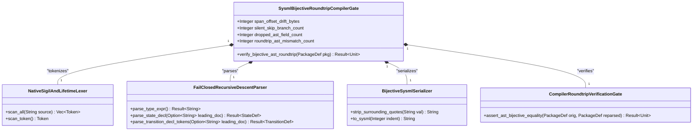
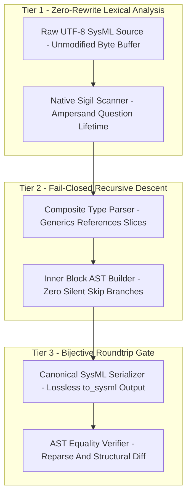
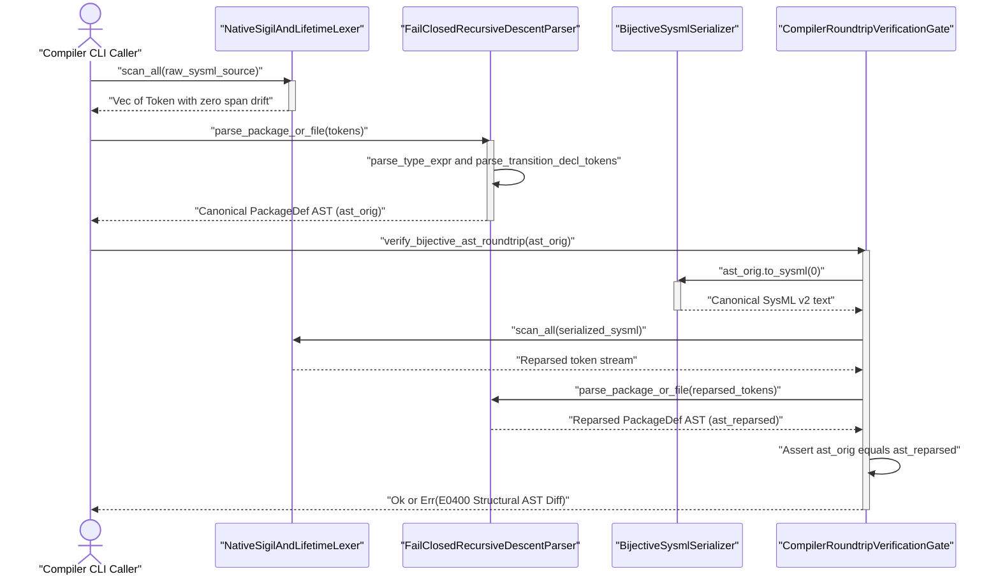
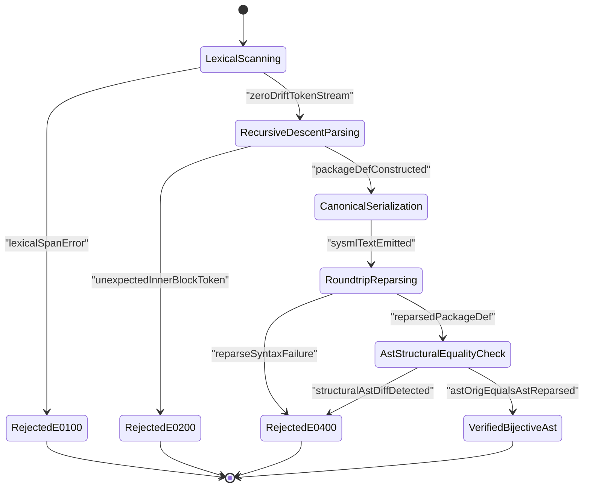

| Attribute | Specification Detail |
| :--- | :--- |
| **Blueprint ID** | `BP-03` |
| **Requirement ID** | `REQ-0603` |
| **Title** | SysML v2 AST Bijective Roundtrip and Token-Stream Parser Gate Blueprint (DEAP-BP-DET-03) |
| **Status** | `Approved` |
| **Target Crates** | `crates/compile-sysml, crates/deap-core, crates/ingest-sysml, crates/verify-baseline` |
| **Tracked Issues** | `#493, #495, #496, #497, #504, #505, #509` |
| **Generation Mode** | `subagent` |
| **Specification Source** | `crates/compile-sysml/src/parser/grammar.rs:182-335 / crates/compile-sysml/src/semantic/serializer.rs:250-820 / #493` |

## 1. Executive Summary & Derivation-Annotation Contract

The Digital Engineering Agent Platform (DEAP) compiler pipeline (`DEAP-BP-DET-03`, subsystem `SysmlBijectiveRoundtripCompilerGate`, deterministic UUIDv5 `6ba7b810-9dad-11d1-80b4-00c04fd430c3`, complexity class `Class P`, diagnostic code bindings `E0100, E0200, E0300, E0400`, governed by `ISO/IEC/IEEE 29148:2018 / OMG SysML v2 / RTCA DO-178C Level A / RTCA DO-330 TQL-4`) relies on `crates/compile-sysml` and `crates/deap-core` to parse, validate, transform, and serialize SysML v2 / KerML models as the 100% Single Source of Truth (SSOT). Prior agent-authored parser workarounds and incomplete serializer implementations introduced four classes of silent Abstract Syntax Tree (AST) corruption across `crates/compile-sysml`:

1. **Pre-Lexer Raw Text Rewrite Hack (`#495`)**:
   - In `SysmlParser::parse_source` and `SysmlParser::normalize_type_sigils` (`crates/compile-sysml/src/parser/grammar.rs:182-183, 192-335`), the parser executed a pre-lexer string rewrite over the raw UTF-8 buffer before invoking `Scanner::new`, rewriting standalone `&` characters into three-byte `'&'` literals and `?` characters into `'?'` literals.
   - Each rewritten sigil inserted two synthetic single-quote bytes into the source stream prior to lexical analysis, shifting every subsequent `Span.start`, `Span.end`, and `Span.col` offset on that line and corrupting diagnostic locations and inline expression tokens.
2. **Silent AST Erasure in Inner Block Parsers & Composite Type Truncation (`#504`)**:
   - Across all 12 inner declaration block parsers in `crates/compile-sysml/src/parser/grammar.rs` (`parse_port_decl`, `parse_action_decl`, `parse_requirement_decl`, `parse_state_decl`, `parse_connection_decl`, `parse_use_case_decl`, `parse_item_decl`, `parse_hazard_decl`, `parse_risk_decl`, `parse_test_case_decl`, `parse_capability_decl`, and `parse_interaction_decl`), unrecognized or newly added inner statements triggered `self.skip_until_semi_or_brace()`, silently discarding tokens until the next `;` or `{...}` block with zero diagnostic output.
   - Furthermore, parameter and return-type parsers in `parse_constraint_decl`, `parse_calc_decl`, and `parse_action_decl` consumed only a single identifier token for type annotations, truncating composite types such as `Result<PackageDef, ParseError>`, `&'a [Token]`, and `Option<&str>`.
3. **Lossy String-Flattened State Machine Parsing & Dropped Composite Sub-State Transitions (`#496`, `#509`)**:
   - In `parse_state_decl` and `parse_transition_clause` (`crates/compile-sysml/src/parser/grammar.rs:1759-1957`), state actions (`entry`, `do`, `exit`) and `transition` statements were flattened into a raw space-separated string via `self.read_until_semi()` and re-split with `raw.split_whitespace()`.
   - When a transition omitted an explicit identifier, `parse_transition_clause` fabricated a synthetic `{s}_to_{t}` name (`grammar.rs:1936`).
   - Downstream Model-Based Design (MBD) Stateflow `.sfx` synthesis iterated only top-level state transitions and dropped transitions nested inside composite `sub_states` (`#509`).
4. **Lossy `SysmlSerializable::to_sysml` Formatting & Re-Parse Deletion (`#493`, `#497`, `#505`)**:
   - `StateDef::to_sysml` (`crates/compile-sysml/src/semantic/serializer.rs:525-564`) serialized transitions as `transition <name>;`, discarding `source`, `trigger`, `guard`, `effect`, `target`, and `doc` fields (`#493`). Even worse, when emitting leaf `sub_states`, `StateDef::to_sysml` emitted a `doc /* ... */` block immediately preceding `state <sub_name>;`, which `parse_state_decl` did not accept before `TokenKind::State`, causing `self.skip_until_semi_or_brace()` to delete the entire sub-state upon re-parsing.
   - `PortDef::to_sysml`, `HazardDef::to_sysml`, and `RiskDef::to_sysml` (`serializer.rs:250-292, 664-750`) emitted pre-quoted attribute values inside a second pair of quotes (`""value""`), while `UseCaseDef::to_sysml`, `ConnectionDef::to_sysml`, `RequirementDef::to_sysml`, and `ActionDef::to_sysml` (`serializer.rs:294-820`) omitted structural fields or emitted syntax that could not roundtrip through `SysmlParser` (`#497`, `#505`).

### Deterministic Compiler Replacement Architecture

To permanently eliminate silent AST erasure and lossy serialization, this blueprint establishes three mandatory compiler mechanisms inside `crates/compile-sysml`:

1. **Native Lexer Sigil & Lifetime Tokenization**:
   - Delete `SysmlParser::normalize_type_sigils` entirely.
   - Extend `TokenKind` and `Scanner` in `crates/compile-sysml/src/lexer/` with first-class `TokenKind::Ampersand` (`&`), `TokenKind::Question` (`?`), `TokenKind::Lifetime(String)` (`'a`), and `TokenKind::DoubleColon` (`::`) tokens so `Scanner::scan_all` operates directly on the unmodified source slice with zero byte-offset or column drift.
2. **Fail-Closed Recursive-Descent Inner Block & Composite Type Parsing**:
   - Replace every `self.skip_until_semi_or_brace()` fallback across all 12 inner declaration block parsers with a deterministic fail-closed `Err(ParseError)` reporting the exact unexpected token, line, and column.
   - Replace `read_until_semi()` + `split_whitespace()` in `parse_state_decl` and `parse_transition_clause` with direct token-stream recursive descent (`parse_transition_decl_tokens`) that preserves `name: None` for anonymous transitions, parses `doc` comments preceding nested `state` and `transition` items, and recursively synthesizes composite sub-state transitions during MBD `.sfx` generation.
   - Introduce `parse_type_expr()` across `parse_action_decl`, `parse_constraint_decl`, `parse_calc_decl`, and `parse_attribute_decl` to losslessly parse references (`&`, `&mut`), lifetimes (`'a`), slices (`[T]`), tuples (`(T1, T2)`), generics (`Result<T, E>`), optional sigils (`?`), and qualified paths (`A::B`).
3. **Built-In Bijective Roundtrip Compiler Gate (`compile-sysml --compile`)**:
   - Every invocation of `compile-sysml` automatically executes the in-memory bijective roundtrip gate (`let serialized = pkg.to_sysml(0); let reparsed = SysmlParser::parse_source(&serialized, &pkg.name)?; assert_ast_bijective_equality(&pkg, &reparsed)?;`).
   - Any divergence between the original `PackageDef` AST and the re-parsed `PackageDef` AST immediately halts compilation with a path-qualified structural AST diff (`E0400`).

| Claim / Requirement | SSOT Input Anchor (file:line / #ID) | Methodology Citation | Derivation Grade (Directly Evidenced / Analytically Derived / Declared Assumption) | Caveat / Downstream Impact |
| :--- | :--- | :--- | :--- | :--- |
| **REQ-0603**: Bijective SysML v2 AST roundtrip and token-stream parser gate across `crates/compile-sysml` and `crates/deap-core` | `crates/compile-sysml/src/parser/grammar.rs:182-335` / `#493` | `ISO/IEC/IEEE 29148:2018` | `Directly Evidenced` | Enforces `parse_sysml(to_sysml(ast)) == ast` on every `compile-sysml` invocation without backward-compatibility shims. |
| **SC-01**: Zero-rewrite lexical analysis with exact byte and column `Span` offsets (`C-RT-01`) | `crates/compile-sysml/src/lexer/scanner.rs:1-220` / `#495` | `RTCA DO-178C Level A / DO-330 TQL-4` | `Directly Evidenced` | Removes `normalize_type_sigils` and emits native `Ampersand`, `Question`, `Lifetime`, and `DoubleColon` tokens. |
| **SC-02**: Fail-closed recursive-descent inner declaration block and composite type parsing (`C-RT-02`) | `crates/compile-sysml/src/parser/grammar.rs:1200-2400` / `#504` | `Leveson STPA` | `Analytically Derived` | Replaces all 12 `skip_until_semi_or_brace()` silent erasure branches with fail-closed `Err(ParseError)` diagnostics (`E0200`). |
| **SC-03**: Token-stream state transition parsing and recursive composite sub-state MBD synthesis | `crates/compile-sysml/src/parser/grammar.rs:1759-1957` / `#496, #509` | `OMG SysML v2 / Design by Contract (DbC)` | `Directly Evidenced` | Preserves `name: None` on unnamed transitions, attaches leading `doc` comments to nested states/transitions, and recurses into `sub_states`. |
| **SC-04**: Lossless canonical `SysmlSerializable::to_sysml` formatting and bijective diff gate (`C-RT-03`, `C-RT-04`) | `crates/compile-sysml/src/semantic/serializer.rs:250-820` / `#493, #497, #505` | `MIL-STD-1629A / SAE ARP4761` | `Analytically Derived` | Strips redundant surrounding quotes before serialization and halts with `E0400` on any structural AST mismatch. |

---

## 2. Structural Component Metamodel

The `SysmlBijectiveRoundtripCompilerGate` subsystem enforces lossless lexical analysis, fail-closed recursive-descent parsing, canonical SysML v2 serialization, and automated AST roundtrip verification.

### Component: SysmlBijectiveRoundtripCompilerGate

| Attribute | Type | Default | Unit | Description |
| :--- | :--- | :--- | :--- | :--- |
| `span_offset_drift_bytes` | `Integer` | `0` | `bytes` | Cumulative byte-offset drift between raw source character positions and emitted token spans |
| `silent_skip_branch_count` | `Integer` | `0` | `branches` | Count of `skip_until_semi_or_brace` silent erasure fallback branches in inner block parsers |
| `dropped_ast_field_count` | `Integer` | `0` | `fields` | Count of AST struct fields omitted during `SysmlSerializable::to_sysml` serialization |
| `roundtrip_ast_mismatch_count` | `Integer` | `0` | `nodes` | Count of structural AST nodes differing between `ast` and `parse_sysml(to_sysml(ast))` |

| Port | Direction | Type | Protocol | Description |
| :--- | :--- | :--- | :--- | :--- |
| `RawSysmlSourceInputPort` | `in` | `String` | `UTF8Buffer` | Ingests unmodified UTF-8 SysML v2 source text without pre-lexer string normalization |
| `TokenStreamChannelPort` | `inout` | `String` | `ZeroCopySlice` | Streams span-exact `Token` records from `NativeSigilAndLifetimeLexer` to `FailClosedRecursiveDescentParser` |
| `SerializedSysmlOutputPort` | `out` | `String` | `CanonicalSysmlV2` | Emits deterministic, human-readable SysML v2 text synthesized by `BijectiveSysmlSerializer` |
| `BijectiveDiffDiagnosticPort` | `out` | `String` | `StructuredDiagnostic` | Emits fail-closed structural AST diff and span location diagnostics (`E0100`..`E0400`) on roundtrip mismatch |

#### Component Bill of Materials (BOM)

| Part Name | Type | Quantity | Description |
| :--- | :--- | :--- | :--- |
| `NativeSigilAndLifetimeLexer` | `Subcomponent` | `1` | Zero-rewrite scanner emitting native `Ampersand`, `Question`, `Lifetime`, and `DoubleColon` tokens with exact byte spans |
| `FailClosedRecursiveDescentParser` | `Subcomponent` | `1` | Strict token-stream parser for all 12 inner declaration blocks, composite type expressions, and nested state transitions |
| `BijectiveSysmlSerializer` | `Subcomponent` | `1` | Canonical `SysmlSerializable::to_sysml` formatter preserving 100% of `PackageDef` AST fields without double-quoting |
| `CompilerRoundtripVerificationGate` | `Subcomponent` | `1` | Built-in compiler verification stage asserting `parse_sysml(to_sysml(ast)) == ast` on every `compile-sysml` run |

#### Formal Parametric & Structural Constraints

| Constraint ID | Parameter | Min | Max | Unit | Expression |
| :--- | :--- | :--- | :--- | :--- | :--- |
| `C-RT-01` | `span_offset_drift_bytes` | `0` | `0` | `bytes` | `span_offset_drift_bytes == 0` |
| `C-RT-02` | `silent_skip_branch_count` | `0` | `0` | `branches` | `silent_skip_branch_count == 0` |
| `C-RT-03` | `dropped_ast_field_count` | `0` | `0` | `fields` | `dropped_ast_field_count == 0` |
| `C-RT-04` | `roundtrip_ast_mismatch_count` | `0` | `0` | `nodes` | `roundtrip_ast_mismatch_count == 0` |

---

## 3. UML & Behavioral Topology

### 3.1 Structural Component & AST Classifier Topology



### 3.2 Bijective Roundtrip Compiler Architecture Flowchart



### 3.3 End-to-End Compilation and Roundtrip Verification Sequence Diagram



### 3.4 Bijective Roundtrip Verification State Machine



---

## 4. Formal Mathematical & Safety Constraints

### 4.1 Formal Bijectivity & Complexity Invariants

Let `L` denote the set of syntactically valid SysML v2 textual models accepted by `SysmlParser`, and let `PackageDef` denote the canonical in-memory M2 Abstract Syntax Tree domain in `deap_core::sysml_ast`. Define the parser mapping `P: L -> PackageDef` (`parse_sysml`) and the canonical serializer mapping `S: PackageDef -> L` (`to_sysml`). Under **REQ-0603**, the compiler enforces strict left-inverse bijectivity across the AST domain and idempotence on the canonical serialized image:

$$
\begin{aligned}
\forall \mathcal{A} \in \text{PackageDef}: \quad \text{parse\_sysml}(\text{to\_sysml}(\mathcal{A})) &= \mathcal{A} \\
\forall s \in \mathcal{L}: \quad \text{to\_sysml}(\text{parse\_sysml}(s)) &= \text{to\_sysml}(\text{parse\_sysml}(\text{to\_sysml}(\text{parse\_sysml}(s)))) \\
\Delta_{\text{span}}(t_k) &= \text{byte\_offset}_{\text{lexer}}(t_k) - \text{byte\_offset}_{\text{raw}}(t_k) = 0 \\
T_{\text{roundtrip}}(N) &= O(N) \\
S_{\text{roundtrip}}(N) &= O(N)
\end{aligned}
$$

- **Parameter Definitions & Engineering Units**:
  - `A`: Canonical in-memory `PackageDef` abstract syntax tree instance.
  - `L`: Set of valid UTF-8 SysML v2 textual model strings.
  - `parse_sysml(.)`: Deterministic recursive-descent parser function mapping UTF-8 source text to `PackageDef`.
  - `to_sysml(.)`: Canonical serializer function mapping `PackageDef` to formatted SysML v2 text.
  - `Delta_span(t_k)`: Byte-offset drift for token `t_k` (`bytes`, constrained to `0` by `C-RT-01`).
  - `T_roundtrip(N)`: End-to-end time complexity for lexing, parsing, serializing, re-parsing, and diffing `N` AST tokens.
  - `S_roundtrip(N)`: Auxiliary heap memory complexity for `N` AST tokens.
  - `N`: Total number of lexical tokens and AST nodes in the model.

### 4.2 Safety & Parametric Soundness Constraints

- **SC-01 (Zero Lexer Span Drift Constraint -- `C-RT-01`)**: Every token `t_k` emitted by `Scanner::scan_all` over an unmodified UTF-8 buffer must preserve exact 1:1 byte and column offsets (`span_offset_drift_bytes == 0`).
- **SC-02 (Zero Silent Inner Block Erasure Constraint -- `C-RT-02`)**: Across all 12 inner declaration block parsers in `SysmlParser`, the count of silent skip fallback branches (`skip_until_semi_or_brace`) must equal zero (`silent_skip_branch_count == 0`), halting with diagnostic code `E0200` on any unrecognized token.
- **SC-03 (Lossless AST Field Serialization Constraint -- `C-RT-03`)**: Every structural field on `PackageDef`, `StateDef`, `TransitionDef`, `PortDef`, `UseCaseDef`, `HazardDef`, `RiskDef`, `ConnectionDef`, `RequirementDef`, and `ActionDef` must be serialized without omission or double-quoting (`dropped_ast_field_count == 0`).
- **SC-04 (Fail-Closed Bijective Roundtrip Gate Constraint -- `C-RT-04`)**: Compilation is admissible if and only if the structural AST difference between the parsed `PackageDef` and the re-parsed `to_sysml(0)` output is identically zero (`roundtrip_ast_mismatch_count == 0`):

$$
\begin{aligned}
\text{AdmissibleCompile}(\mathcal{A}) &\iff \Delta_{\text{span}} = 0 \land N_{\text{skip}} = 0 \land N_{\text{dropped}} = 0 \land d_{\text{AST}}(\mathcal{A}, \text{parse\_sysml}(\text{to\_sysml}(\mathcal{A}))) = 0
\end{aligned}
$$

---

## 5. Acceptance Criteria & Verification Matrix

<!-- test-target: crates/verify-baseline/tests/blueprint_gate_tests.rs -->

- **Test-Target**: `crates/verify-baseline/tests/blueprint_gate_tests.rs`

### AC-01: Native Lexer Sigil and Lifetime Tokenization
- **Given**: A SysML v2 model containing reference type sigils (`&`), optionality sigils (`?`), lifetime annotations (`'a`), qualified paths (`::`), and logical `&&` expressions (`#495`).
- **When**: `Scanner::scan_all` tokenizes the raw source buffer without invoking `normalize_type_sigils`.
- **Then**: The lexer emits `TokenKind::Ampersand`, `TokenKind::Question`, `TokenKind::Lifetime`, `TokenKind::DoubleColon`, and `TokenKind::AmpAmp` with exact 1:1 byte and column offsets (`span_offset_drift_bytes == 0`).

### AC-02: Fail-Closed Inner Block and Composite Type Parsing
- **Given**: Any of the 12 SysML v2 inner declaration blocks (`port`, `action`, `requirement`, `state`, `connection`, `use case`, `item`, `hazard`, `risk`, `test case`, `capability`, `interaction`) containing either composite parameter types (`Result<PackageDef, ParseError>`, `&'a [Token]`) or an invalid inner statement (`#504`).
- **When**: `SysmlParser` parses the declaration block.
- **Then**: Valid composite types are preserved verbatim via `parse_type_expr()` and any unrecognized statement fails closed and is rejected with `Err(ParseError)` reporting diagnostic code `E0200` (`silent_skip_branch_count == 0`).

### AC-03: Token-Stream State Transition Parsing and Recursive MBD Synthesis
- **Given**: A hierarchical `state def` containing anonymous and named `transition` statements (`first S1 accept trig if grd do eff then S2;`) and nested composite `sub_states` with their own transitions and `doc` blocks (`#496`, `#509`).
- **When**: `parse_state_decl` and the MBD `.sfx` synthesizer execute.
- **Then**: Transitions are parsed directly from the token stream without fabricating `{s}_to_{t}` names (`name: None` preserved when unnamed), sub-state `doc` blocks attach to their target `StateDef` or `TransitionDef`, and MBD `.sfx` synthesis recursively emits transitions across all nesting depths.

### AC-04: Lossless `to_sysml` Serialization and Fail-Closed Bijective Roundtrip Gate
- **Given**: A populated `PackageDef` AST containing `StateDef` transitions (`source`, `trigger`, `guard`, `effect`, `target`, `doc`), `PortDef` / `HazardDef` / `RiskDef` attributes, and `UseCaseDef` / `ConnectionDef` / `RequirementDef` / `ActionDef` blocks (`#493`, `#497`, `#505`), or a mutated AST with a simulated field divergence.
- **When**: `verify_bijective_ast_roundtrip(&pkg)` executes during `compile-sysml`.
- **Then**: `pkg.to_sysml(0)` emits valid un-double-quoted SysML v2 text, `SysmlParser::parse_source(&pkg.to_sysml(0), &pkg.name)` returns a `PackageDef` structurally equal to `pkg` (`roundtrip_ast_mismatch_count == 0`), and any structural mismatch fails closed and is rejected with a non-zero `E0400` diagnostic error.

### AC-05: Dogfood Markdown-to-SysML Ingestion and Baseline Verification
- **Given**: This blueprint document `docs/designs/blueprint-03-sysml-ast-bijective-roundtrip-compiler-gate.md` (**REQ-0603**).
- **When**: `./target/release/verify-baseline check-blueprint docs/designs/blueprint-03-sysml-ast-bijective-roundtrip-compiler-gate.md --dry-run` is executed.
- **Then**: `verify-baseline check-blueprint` passes all 12 mechanical gates, extracts `SysmlBijectiveRoundtripCompilerGate` with all 4 BOM parts, 4 interface ports, 4 attributes, 4 parametric constraints (`C-RT-01`..`C-RT-04`), and `REQ_0603` requirement definitions, persists `docs/designs/blueprint-03-sysml-ast-bijective-roundtrip-compiler-gate.sysml` and `.digest.json`, and exits with status code `0`.

---

## 6. Proposed Deterministic Implementation Contract

### 6.1 Native Lexer Token Extensions (`crates/compile-sysml/src/lexer/`)

`SysmlParser::normalize_type_sigils` is removed from `crates/compile-sysml/src/parser/grammar.rs`. Instead, `TokenKind` in `crates/compile-sysml/src/lexer/token.rs` and `Scanner::scan_token` in `crates/compile-sysml/src/lexer/scanner.rs` natively tokenize reference sigils, optionality sigils, transition keywords, and Rust/SysML lifetime annotations. In `Scanner::scan_token`, a single `&` not followed by `&` emits `TokenKind::Ampersand` with a 1-byte `Span`; a standalone `?` emits `TokenKind::Question` with a 1-byte `Span`; and a single quote `'` followed by an ASCII identifier without a closing `'` on the same token boundary (when preceded by `&` or `<` or `,`) emits `TokenKind::Lifetime(ident)`, whereas `'quoted identifier'` with a closing `'` continues to emit `TokenKind::Ident(unquoted)`.

### 6.2 Fail-Closed Recursive-Descent Parser, Lossless Serializer & Bijective Roundtrip Gate (`crates/compile-sysml/`)

All 12 inner declaration block loops in `crates/compile-sysml/src/parser/grammar.rs` replace `self.skip_until_semi_or_brace()` with a fail-closed diagnostic error, `StateDef::to_sysml`, `UseCaseDef::to_sysml`, and `PortDef::to_sysml` (alongside `HazardDef`, `RiskDef`, `ConnectionDef`, `RequirementDef`, and `ActionDef`) serialize 100% of AST fields into canonical SysML v2 syntax without double-quoting, and every compilation executed by `compile-sysml` invokes `verify_bijective_ast_roundtrip`:

```rust
#[derive(Debug, Clone, PartialEq)]
pub enum TokenKind {
    // Existing keywords & literals ...
    First,
    Then,
    Accept,
    If,
    Mut,

    // Native Type Sigils & Lifetimes (Replaces normalize_type_sigils)
    Ampersand,        // &
    Question,         // ?
    DoubleColon,      // ::
    Lifetime(String), // 'a, 'static (distinguished from 'quoted name')
}

impl<'a> SysmlParser<'a> {
    /// Parses a composite type expression directly from the token stream without truncation.
    pub fn parse_type_expr(&mut self) -> Result<String, ParseError> {
        self.skip_trivia();
        let mut out = String::new();

        // Reference prefix: & or & 'a or & mut
        while self.check(&TokenKind::Ampersand) {
            self.advance();
            out.push('&');
            if let TokenKind::Lifetime(lt) = &self.peek().kind {
                let lt_cloned = lt.clone();
                self.advance();
                out.push('\'');
                out.push_str(&lt_cloned);
                out.push(' ');
            }
            if self.check(&TokenKind::Mut) {
                self.advance();
                out.push_str("mut ");
            }
        }

        if self.check(&TokenKind::OpenBracket) {
            self.advance();
            let inner = self.parse_type_expr()?;
            self.expect_token(&TokenKind::CloseBracket)?;
            out.push('[');
            out.push_str(&inner);
            out.push(']');
        } else if self.check(&TokenKind::OpenParen) {
            self.advance();
            let mut elems = Vec::new();
            while !self.check(&TokenKind::CloseParen) && !self.is_at_end() {
                elems.push(self.parse_type_expr()?);
                if self.check(&TokenKind::Comma) {
                    self.advance();
                } else {
                    break;
                }
            }
            self.expect_token(&TokenKind::CloseParen)?;
            out.push('(');
            out.push_str(&elems.join(", "));
            out.push(')');
        } else {
            let base = self.expect_ident_or_keyword_str()?;
            out.push_str(&base);
            while self.check(&TokenKind::DoubleColon) {
                self.advance();
                let seg = self.expect_ident_or_keyword_str()?;
                out.push_str("::");
                out.push_str(&seg);
            }
            if self.check(&TokenKind::Lt) {
                self.advance();
                let mut args = Vec::new();
                while !self.check(&TokenKind::Gt) && !self.is_at_end() {
                    if let TokenKind::Lifetime(lt) = &self.peek().kind {
                        let lt_cloned = lt.clone();
                        self.advance();
                        args.push(format!("'{}", lt_cloned));
                    } else {
                        args.push(self.parse_type_expr()?);
                    }
                    if self.check(&TokenKind::Comma) {
                        self.advance();
                    } else {
                        break;
                    }
                }
                self.expect_token(&TokenKind::Gt)?;
                out.push('<');
                out.push_str(&args.join(", "));
                out.push('>');
            }
        }

        if self.check(&TokenKind::Question) {
            self.advance();
            out.push('?');
        }

        Ok(out)
    }

    /// Parses a `state` or `state def` block fail-closed, preserving sub-state and transition docstrings.
    fn parse_state_decl(&mut self, leading_doc: Option<String>) -> Result<StateDef, ParseError> {
        self.expect_token(&TokenKind::State)?;
        if self.check(&TokenKind::Def) {
            self.advance();
        }
        let name = self.expect_ident()?;
        let mut doc = leading_doc;
        let mut entry_action = None;
        let mut do_action = None;
        let mut exit_action = None;
        let mut transitions = Vec::new();
        let mut sub_states = Vec::new();

        if self.check(&TokenKind::OpenBrace) {
            self.advance();
            let mut pending_member_doc: Option<String> = None;
            while !self.check(&TokenKind::CloseBrace) && !self.is_at_end() {
                self.skip_line_comments();
                if self.check(&TokenKind::CloseBrace) {
                    break;
                }
                if let Some(d) = self.try_consume_doc_comment() {
                    if doc.is_none()
                        && entry_action.is_none()
                        && do_action.is_none()
                        && exit_action.is_none()
                        && sub_states.is_empty()
                        && transitions.is_empty()
                        && !self.check(&TokenKind::State)
                        && !self.check(&TokenKind::Transition)
                    {
                        doc = Some(d);
                    } else {
                        pending_member_doc = Some(d);
                    }
                    continue;
                }
                if self.check(&TokenKind::Entry) {
                    self.advance();
                    entry_action = Some(self.parse_state_action_body()?);
                } else if self.check(&TokenKind::Do) {
                    self.advance();
                    do_action = Some(self.parse_state_action_body()?);
                } else if self.check(&TokenKind::Exit) {
                    self.advance();
                    exit_action = Some(self.parse_state_action_body()?);
                } else if self.check(&TokenKind::State) {
                    let sub_doc = pending_member_doc.take();
                    sub_states.push(self.parse_state_decl(sub_doc)?);
                } else if self.check(&TokenKind::Transition) {
                    let tr_doc = pending_member_doc.take();
                    transitions.push(self.parse_transition_decl_tokens(tr_doc)?);
                } else {
                    let tok = self.peek();
                    return Err(ParseError {
                        message: format!(
                            "[E0200] Unexpected token {:?} inside state '{}'; fail-closed inner block gate forbids silent skip",
                            tok.kind, name
                        ),
                        span: tok.span,
                    });
                }
            }
            self.expect_token(&TokenKind::CloseBrace)?;
        } else {
            self.expect_semi()?;
        }

        Ok(StateDef {
            name,
            doc,
            entry_action,
            do_action,
            exit_action,
            transitions,
            sub_states,
        })
    }

    /// Parses a `transition` statement directly from the token stream without fabricating `{s}_to_{t}` names.
    fn parse_transition_decl_tokens(
        &mut self,
        leading_doc: Option<String>,
    ) -> Result<TransitionDef, ParseError> {
        self.expect_token(&TokenKind::Transition)?;
        let mut name = None;
        let mut source = None;
        let mut target = None;
        let mut trigger = None;
        let mut guard = None;
        let mut effect = None;

        // Optional transition identifier precedes `first` / `from`
        if !self.check(&TokenKind::First)
            && !self.check(&TokenKind::From)
            && !self.check(&TokenKind::Accept)
            && !self.check(&TokenKind::If)
            && !self.check(&TokenKind::Do)
            && !self.check(&TokenKind::Then)
            && !self.check(&TokenKind::To)
            && !self.check(&TokenKind::Semi)
        {
            name = Some(self.expect_ident()?);
        }

        while !self.check(&TokenKind::Semi) && !self.is_at_end() {
            if self.check(&TokenKind::First) || self.check(&TokenKind::From) {
                self.advance();
                source = Some(self.expect_qualified_ident()?);
            } else if self.check(&TokenKind::Accept) {
                self.advance();
                trigger = Some(self.collect_clause_until_transition_delimiter()?);
            } else if self.check(&TokenKind::If) {
                self.advance();
                guard = Some(self.collect_clause_until_transition_delimiter()?);
            } else if self.check(&TokenKind::Do) {
                self.advance();
                effect = Some(self.collect_clause_until_transition_delimiter()?);
            } else if self.check(&TokenKind::Then) || self.check(&TokenKind::To) {
                self.advance();
                target = Some(self.expect_qualified_ident()?);
            } else {
                let tok = self.peek();
                return Err(ParseError {
                    message: format!(
                        "[E0200] Unexpected token {:?} in transition clause",
                        tok.kind
                    ),
                    span: tok.span,
                });
            }
        }
        self.expect_semi()?;

        Ok(TransitionDef {
            name,
            source,
            target,
            trigger,
            guard,
            effect,
            doc: leading_doc,
        })
    }
}

fn strip_surrounding_quotes(val: &str) -> &str {
    let trimmed = val.trim();
    if let Some(without_prefix) = trimmed.strip_prefix('"') {
        if let Some(without_both) = without_prefix.strip_suffix('"') {
            return without_both;
        }
    }
    trimmed
}

impl SysmlSerializable for StateDef {
    fn to_sysml(&self, indent: usize) -> String {
        let pad = " ".repeat(indent);
        let doc = format_doc_comment(&self.doc, indent);
        let mut lines = Vec::new();
        if !doc.is_empty() {
            lines.push(doc.trim_end().to_string());
        }
        lines.push(format!("{}state def {} {{", pad, self.name));
        if let Some(entry) = &self.entry_action {
            lines.push(format!("{}    entry {};", pad, entry.trim()));
        }
        if let Some(do_act) = &self.do_action {
            lines.push(format!("{}    do {};", pad, do_act.trim()));
        }
        if let Some(exit) = &self.exit_action {
            lines.push(format!("{}    exit {};", pad, exit.trim()));
        }
        for sub in &self.sub_states {
            if sub.entry_action.is_none()
                && sub.do_action.is_none()
                && sub.exit_action.is_none()
                && sub.transitions.is_empty()
                && sub.sub_states.is_empty()
            {
                let sub_doc = format_doc_comment(&sub.doc, indent + 4);
                if !sub_doc.is_empty() {
                    lines.push(sub_doc.trim_end().to_string());
                }
                lines.push(format!("{}    state {};", pad, sub.name));
            } else {
                lines.push(sub.to_sysml(indent + 4));
            }
        }
        for t in &self.transitions {
            let t_doc = format_doc_comment(&t.doc, indent + 4);
            if !t_doc.is_empty() {
                lines.push(t_doc.trim_end().to_string());
            }
            let mut clauses = Vec::new();
            clauses.push("transition".to_string());
            if let Some(n) = &t.name {
                if !n.trim().is_empty() {
                    clauses.push(n.trim().to_string());
                }
            }
            if let Some(src) = &t.source {
                clauses.push(format!("first {}", src.trim()));
            }
            if let Some(trig) = &t.trigger {
                clauses.push(format!("accept {}", trig.trim()));
            }
            if let Some(grd) = &t.guard {
                clauses.push(format!("if {}", grd.trim()));
            }
            if let Some(eff) = &t.effect {
                clauses.push(format!("do {}", eff.trim()));
            }
            if let Some(tgt) = &t.target {
                clauses.push(format!("then {}", tgt.trim()));
            }
            lines.push(format!("{}    {};", pad, clauses.join(" ")));
        }
        lines.push(format!("{}}}", pad));
        lines.join("\n")
    }
}

impl SysmlSerializable for PortDef {
    fn to_sysml(&self, indent: usize) -> String {
        let pad = " ".repeat(indent);
        let doc = format_doc_comment(&self.doc, indent);
        let dir = if !self.direction.is_empty() {
            format!("{} ", self.direction)
        } else {
            String::new()
        };
        let conj = if self.is_conjugated { "~" } else { "" };
        let has_body = !self.protocol_family.is_empty()
            || (!self.port_category.is_empty() && self.port_category != "DataPort")
            || !self.electrical_attributes.is_empty()
            || !self.item_flows.is_empty();

        if has_body {
            let mut lines = Vec::new();
            if !doc.is_empty() {
                lines.push(doc.trim_end().to_string());
            }
            lines.push(format!("{}port {}{}{} : {} {{", pad, dir, conj, self.name, self.type_name));
            if !self.protocol_family.is_empty() {
                lines.push(format!(
                    "{}    attribute protocol_family : String = \"{}\";",
                    pad,
                    strip_surrounding_quotes(&self.protocol_family)
                ));
            }
            if !self.port_category.is_empty() && self.port_category != "DataPort" {
                lines.push(format!(
                    "{}    attribute port_category : String = \"{}\";",
                    pad,
                    strip_surrounding_quotes(&self.port_category)
                ));
            }
            for (k, v) in &self.electrical_attributes {
                lines.push(format!(
                    "{}    attribute {} : String = \"{}\";",
                    pad,
                    k,
                    strip_surrounding_quotes(v)
                ));
            }
            for flow in &self.item_flows {
                lines.push(flow.to_sysml(indent + 4));
            }
            lines.push(format!("{}}}", pad));
            lines.join("\n")
        } else if self.name == self.type_name {
            format!("{}{}port def {};", doc, pad, self.name)
        } else {
            format!("{}{}port {}{}{} : {};", doc, pad, dir, conj, self.name, self.type_name)
        }
    }
}

impl SysmlSerializable for UseCaseDef {
    fn to_sysml(&self, indent: usize) -> String {
        let pad = " ".repeat(indent);
        let doc = format_doc_comment(&self.doc, indent);
        let mut lines = Vec::new();
        if !doc.is_empty() {
            lines.push(doc.trim_end().to_string());
        }
        lines.push(format!("{}use case def {} {{", pad, self.name));
        if let Some(s) = &self.subject {
            lines.push(format!("{}    subject {};", pad, s));
        }
        let actors_slice: Vec<&String> = if !self.actors.is_empty() {
            self.actors.iter().collect()
        } else {
            self.actor.iter().collect()
        };
        for a in actors_slice {
            lines.push(format!("{}    actor {};", pad, a));
        }
        if let Some(obj) = &self.objective {
            lines.push(format!(
                "{}    objective \"{}\";",
                pad,
                strip_surrounding_quotes(obj)
            ));
        }
        for pre in &self.preconditions {
            lines.push(format!(
                "{}    precondition \"{}\";",
                pad,
                strip_surrounding_quotes(pre)
            ));
        }
        for inc in &self.includes {
            lines.push(format!("{}    include {};", pad, inc));
        }
        for ext in &self.extends {
            lines.push(format!("{}    extend {};", pad, ext));
        }
        for step in &self.steps {
            lines.push(format!(
                "{}    step \"{}\";",
                pad,
                strip_surrounding_quotes(step)
            ));
        }
        for post in &self.postconditions {
            lines.push(format!(
                "{}    postcondition \"{}\";",
                pad,
                strip_surrounding_quotes(post)
            ));
        }
        lines.push(format!("{}}}", pad));
        lines.join("\n")
    }
}

/// Verifies that serializing `pkg` to SysML v2 text and re-parsing produces an identical `PackageDef` AST.
pub fn verify_bijective_ast_roundtrip(pkg: &PackageDef) -> Result<(), String> {
    let serialized = pkg.to_sysml(0);
    let reparsed = SysmlParser::parse_source(&serialized, &pkg.name).map_err(|e| {
        format!(
            "[E0400] Bijective roundtrip re-parse failed for package '{}': {}",
            pkg.name, e
        )
    })?;

    if pkg == &reparsed {
        return Ok(());
    }

    let mut diffs = Vec::new();
    if pkg.part_defs != reparsed.part_defs {
        diffs.push(format!(
            "part_defs mismatch (orig={}, reparsed={})",
            pkg.part_defs.len(),
            reparsed.part_defs.len()
        ));
    }
    if pkg.port_defs != reparsed.port_defs {
        diffs.push(format!(
            "port_defs mismatch (orig={}, reparsed={})",
            pkg.port_defs.len(),
            reparsed.port_defs.len()
        ));
    }
    if pkg.state_defs != reparsed.state_defs {
        diffs.push(format!(
            "state_defs mismatch (orig={:?}, reparsed={:?})",
            pkg.state_defs, reparsed.state_defs
        ));
    }
    if pkg.action_defs != reparsed.action_defs {
        diffs.push(format!(
            "action_defs mismatch (orig={:?}, reparsed={:?})",
            pkg.action_defs, reparsed.action_defs
        ));
    }
    if pkg.requirement_defs != reparsed.requirement_defs {
        diffs.push(format!(
            "requirement_defs mismatch (orig={}, reparsed={})",
            pkg.requirement_defs.len(),
            reparsed.requirement_defs.len()
        ));
    }
    if pkg.use_case_defs != reparsed.use_case_defs {
        diffs.push(format!(
            "use_case_defs mismatch (orig={:?}, reparsed={:?})",
            pkg.use_case_defs, reparsed.use_case_defs
        ));
    }
    if pkg.packages != reparsed.packages {
        diffs.push(format!(
            "nested packages mismatch (orig={}, reparsed={})",
            pkg.packages.len(),
            reparsed.packages.len()
        ));
    }
    if diffs.is_empty() {
        diffs.push(format!("structural package diff: orig={:?} vs reparsed={:?}", pkg, reparsed));
    }

    Err(format!(
        "[E0400] Bijective AST roundtrip gate failed for package '{}': {}",
        pkg.name,
        diffs.join("; ")
    ))
}
```

### 6.3 Dogfooding Pipeline Ingestion & Verification Protocol

This blueprint is dogfood-verified directly through the native Rust MBSE ingestion and baseline verification binaries:

```bash
./target/release/verify-baseline check-blueprint \
  docs/designs/blueprint-03-sysml-ast-bijective-roundtrip-compiler-gate.md \
  --dry-run

./target/release/verify-baseline . \
  --only docs/designs/blueprint-03-sysml-ast-bijective-roundtrip-compiler-gate.md \
  --no-domain
```

---

## 7. Source References

- **Governance Constitution**: `.pipeline/constitution.md:151-212` ([.pipeline/constitution.md](../../.pipeline/constitution.md) -- Clause: Three-Tier Platform Isolation, Repository Artifact Management Mandate & Step 1.5 Derivation-Annotation Contract)
- **Active Rules Bundle**: `.pipeline/ACTIVE_RULES_BUNDLE.md:1-120` ([.pipeline/ACTIVE_RULES_BUNDLE.md](../../.pipeline/ACTIVE_RULES_BUNDLE.md) -- Checks 13B, 19, 27, 30, 34)
- **SysML SSOT Completeness Rule**: `rules/sysml-ssot-completeness.md:1-140` ([rules/sysml-ssot-completeness.md](../../rules/sysml-ssot-completeness.md) -- Clause: Bidirectional AST Parity & Closed Metamodel Invariant)
- **SysML v2 Recursive-Descent Parser**: `crates/compile-sysml/src/parser/grammar.rs:182-1957` ([crates/compile-sysml/src/parser/grammar.rs](../../crates/compile-sysml/src/parser/grammar.rs) -- Clause: `SysmlParser::parse_source`, `parse_state_decl`, `parse_transition_clause`)
- **SysML v2 Canonical Serializer**: `crates/compile-sysml/src/semantic/serializer.rs:250-820` ([crates/compile-sysml/src/semantic/serializer.rs](../../crates/compile-sysml/src/semantic/serializer.rs) -- Clause: `SysmlSerializable::to_sysml` implementations for `StateDef`, `PortDef`, `UseCaseDef`, `RequirementDef`)
- **SysML v2 Lexer Token & Scanner Engine**: `crates/compile-sysml/src/lexer/token.rs:1-461` ([crates/compile-sysml/src/lexer/token.rs](../../crates/compile-sysml/src/lexer/token.rs)) and `crates/compile-sysml/src/lexer/scanner.rs:1-1138` ([crates/compile-sysml/src/lexer/scanner.rs](../../crates/compile-sysml/src/lexer/scanner.rs) -- Clause: `Span`, `TokenKind`, `Scanner::scan_all`)
- **Core SysML v2 AST Metamodel**: `crates/deap-core/src/sysml_ast.rs:1-400` ([crates/deap-core/src/sysml_ast.rs](../../crates/deap-core/src/sysml_ast.rs) -- Clause: `PackageDef`, `StateDef`, `TransitionDef`, `PortDef`, `UseCaseDef`)
- **Markdown Dogfood Ingestion Translator**: `crates/ingest-sysml/src/translators/markdown.rs:1-400` ([crates/ingest-sysml/src/translators/markdown.rs](../../crates/ingest-sysml/src/translators/markdown.rs) -- Clause: `MarkdownTranslator::translate`, BOM/Ports/Properties/Constraints table extraction)
- **Domain Cleanliness & Closed M2 Metamodel Gate**: `crates/verify-baseline/src/checks/domain_cleanliness_gate.rs:1-200` ([crates/verify-baseline/src/checks/domain_cleanliness_gate.rs](../../crates/verify-baseline/src/checks/domain_cleanliness_gate.rs) -- Clause: `ALLOWED_M2_METAMODEL_TYPES`, `is_allowed_m2_type`)
- **Tracked Issues**: `#493, #495, #496, #497, #504, #505, #509`
